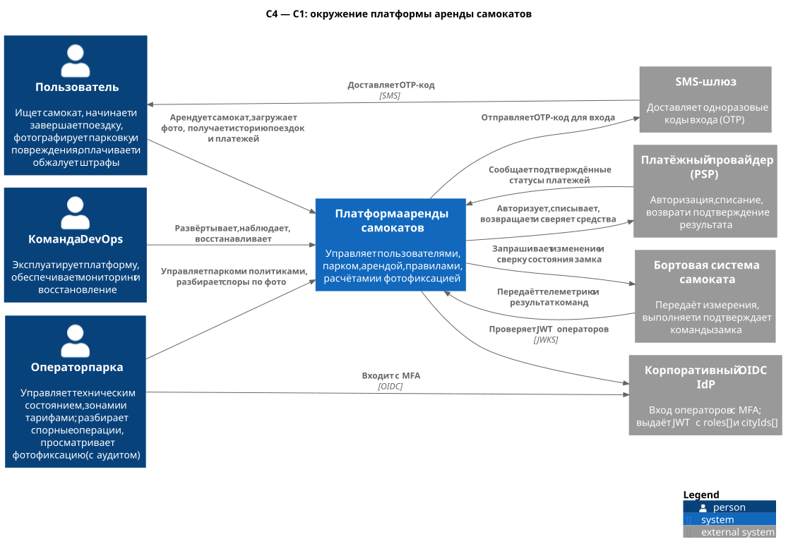
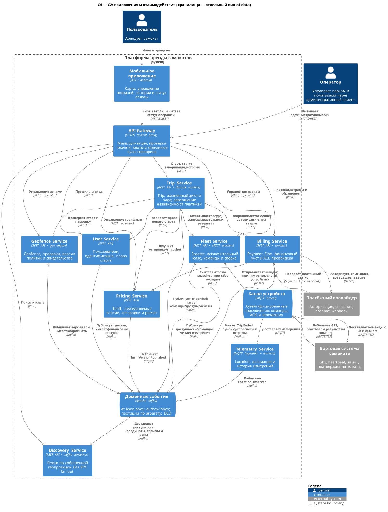
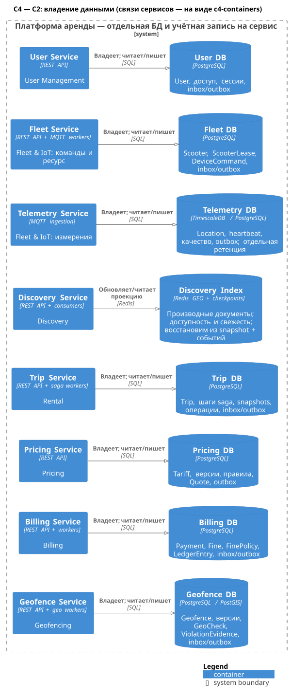

# ADR-001. Декомпозиция по бизнес-контекстам с отдельными поиском и телеметрией

**Статус:** принято для лабораторного проекта.  
**Дата:** 2026-11-01.  
**Система:** платформа аренды электросамокатов, вариант 2224.

## Контекст проблемы

Монолит объединяет управление пользователями, самокатами, поиском, поездками, тарифами, платежами и геозонами. Для 5 млн зарегистрированных пользователей и пика 5 000 внешних RPS требуется независимо масштабировать нагрузку, локализовать отказы и сохранить возможность выделять новые сервисы. DevOps — отдельная команда.

Границы нельзя выбирать только по таблицам. Поиск работает с часто обновляемой производной моделью; управление замком требует исключительного доступа к устройству; поездка объединяет бизнес-сценарий; платежи требуют дедупликации и сверки. GPS-нагрузка зависит от парка, а не от числа пользователей. Физическое устройство и платёжный провайдер не могут участвовать в общей ACID-транзакции с нашей БД.

Критичные инварианты: не более одной незавершённой поездки пользователя, не более одного владельца самоката, отсутствие повторного списания за одну финансовую операцию. Круглосуточная работа означает измеряемую доступность и восстановление, а не обещание отсутствия любых сбоев.

## Рассмотренные альтернативы

| Вариант | Конкретные границы | Преимущества | Недостатки и решение |
| --- | --- | --- | --- |
| **A. Модульный монолит** | Модули пользователей, парка, аренды, тарифов, расчётов и геозон; один основной процесс/релиз | Простая эксплуатация, локальные транзакции, хороший промежуточный этап миграции | Сам по себе может обслуживать 5 000 RPS, но не даёт требуемой независимости развёртывания и изоляции отказов. Для итоговой архитектуры отклонён |
| **B. Сервис на сущность** | User, Scooter, Trip, Tariff, Payment, Location, Geofence, Fine; дополнительно отдельный Unlock Service | Простое формальное соответствие сущностям, мелкие единицы развёртывания | Бизнес-сценарии распадаются на цепочки RPC, Unlock лишён самостоятельного результата и дублирует saga, Fine слишком тесно связан с денежным учётом. Для старта избыточно |
| **C. Крупные бизнес-сервисы** | Account; Rental Operations = парк + поездки + геозоны; Commerce = тарифы + платежи + штрафы; Discovery; Telemetry | Пять сервисов, меньше сетевых шагов, больше локальных транзакций | Сбой Rental Operations затрагивает и парк, и поездки, и геопроверки; разные нагрузки и релизы связаны. Допустимый компромисс для меньшей команды, но слабее целевых требований |
| **D. Выбранная декомпозиция** | User, Fleet, Telemetry, Discovery, Trip, Pricing, Billing, Geofence; семь bounded contexts | Изолирует частые чтения/измерения и финансовые операции; сохраняет целостные бизнес-модели | Больше операционной сложности, нужны saga, наблюдаемость, согласованность проекций и дисциплина контрактов |

## Выбранное решение

Принять вариант **D**. Каждый из восьми сервисов независимо развёртывается и владеет отдельной БД. Fleet и Telemetry принадлежат общему bounded context Fleet & IoT, но разделены по обработке команд и потоку измерений. Остальные контексты представлены одним сервисом каждый.

Trip владеет жизненным циклом аренды и durable saga запуска/завершения. Fleet владеет исключительным lease самоката и фактом исполнения команд замка. Отдельный Unlock Service не вводится. Billing владеет платежами и штрафами, Pricing — версиями тарифов, Geofence — пространственными правилами и свидетельствами.

Синхронный REST используется, когда текущему шагу требуется ответ: проверка пользователя, получение котировки, геопроверка, захват самоката и запрос авторизации. Долгая разблокировка оформляется асинхронной операцией. Факты публикуются через Kafka и outbox; Discovery строит локальную поисковую проекцию без синхронного fan-out. MQTT обслуживает связь с устройствами; отправка команды не требует работоспособности Kafka.

Между сервисами нет общей транзакции и общей БД. Повторы допускаются, эффекты дедуплицируются. Неопределённый исход операции сначала сверяется с устройством/PSP; компенсация не считается гарантированным мгновенным откатом.

## Обоснование выбора

1. **Связность правил.** Поездка и её оркестрация находятся вместе; счёт и штрафы используют единый финансовый учёт. Таблица или технический глагол сами по себе не определяют сервис.
2. **Разный профиль нагрузки.** Поиск и GPS масштабируются независимо от команд замка и платежей. Нагрузка 5 000 RPS используется для планирования, но не доказывает необходимость конкретного числа pod или шардов.
3. **Локальные инварианты.** Trip защищает пользователя, Fleet — самокат, Billing — денежный эффект. Межсервисная согласованность достигается явным протоколом.
4. **Ограничение отказов.** Сбой поиска не блокирует завершение известной поездки; сбой списания оставляет финансовый долг, не продлевая аренду. Синхронные зависимости всё же ограничивают доступность старта.
5. **Воспроизводимость.** Тарифы неизменяемы после публикации; поездка хранит snapshot, геопроверка — версию политики и свидетельство.
6. **Эволюция.** Модуль штрафов может стать Penalty Service без переноса `Payment`; протоколы устройств могут выделиться из Fleet без передачи владения lease.

## Положительные последствия

- Независимые релизы, квоты ресурсов и горизонтальное масштабирование сервисов.
- Один явный владелец каждой исходной сущности и определённые границы локальных транзакций.
- Высокочастотные проекции не заставляют парк или платежи обслуживать каждый запрос карты.
- Принятое завершение поездки не зависит от доступности окончательного расчёта и PSP.
- DevOps может предоставлять общую платформу, не централизуя доменную логику.

## Отрицательные последствия и ограничения

- Восемь сервисов, несколько типов хранилищ и два канала сообщений дороже модульного монолита в разработке и эксплуатации.
- Проекции согласуются с задержкой; пользователю может показываться самокат, уже занятый в источнике истины.
- Старт зависит от нескольких API и устройства. Circuit breaker ограничивает распространение отказа, но не делает зависимый шаг доступным.
- Требуются durable saga, outbox/inbox, idempotency, DLQ, сквозные trace/correlation IDs и инструменты операционной сверки.
- Сложнее миграции схем и тестирование совместимости. Глобальные SQL-отчёты заменяются отдельными аналитическими проекциями при появлении требования.
- Общие Kafka, MQTT, Gateway и кластеры БД могут расширить зону отказа; их репликация и ресурсная изоляция обязательны для выбранных SLO.
- Без поддержки сроков команд/дедупликации прошивкой устройства полная автоматизация восстановления небезопасна; требуется карантин и операционный разбор.

## Итоговая архитектурная схема C4

Уровень **C1** показывает пользователей, платформу и внешние системы:

Исходник: [c4-context.puml](../../diagrams/c4-context.puml).

Уровень **C2, приложения и взаимодействия** показывает мобильное приложение, Gateway, восемь сервисов, Kafka и MQTT. Двунаправленные связи с Kafka подписаны операциями публикации/чтения; точные события перечислены в отчёте.

Исходник: [c4-containers.puml](../../diagrams/c4-containers.puml).

Дополняющая проекция того же уровня **C2, данные** явно показывает отдельное хранилище каждого сервиса. Это часть итоговой архитектуры; БД вынесены на отдельный вид для читаемости, а не являются общей базой за брокером.

Исходник: [c4-data.puml](../../diagrams/c4-data.puml).

Топология реплик, зон и failover описана требованиями в [отчёте](../lab-01.md); C2 не используется как диаграмма физического размещения.

## Как проверить и когда пересмотреть

Смоделировать конкурирующие старты, потерю ACK, дубли PSP, недоступность брокера и восстановление после перезапуска. На нагрузочных испытаниях отдельно измерить клиентские 5 000 RPS, внутренний fan-out и телеметрию. Подтвердить инварианты и способность завершать поездку при отказе платежей.

Пересмотреть границы, если стоимость сопровождения превышает пользу независимых релизов, если задержка межсервисных вызовов нарушает SLO либо если штрафы/протоколы устройств получают самостоятельную команду и темп развития. Решение не запрещает объединять сервисы при наличии измеримых оснований.
