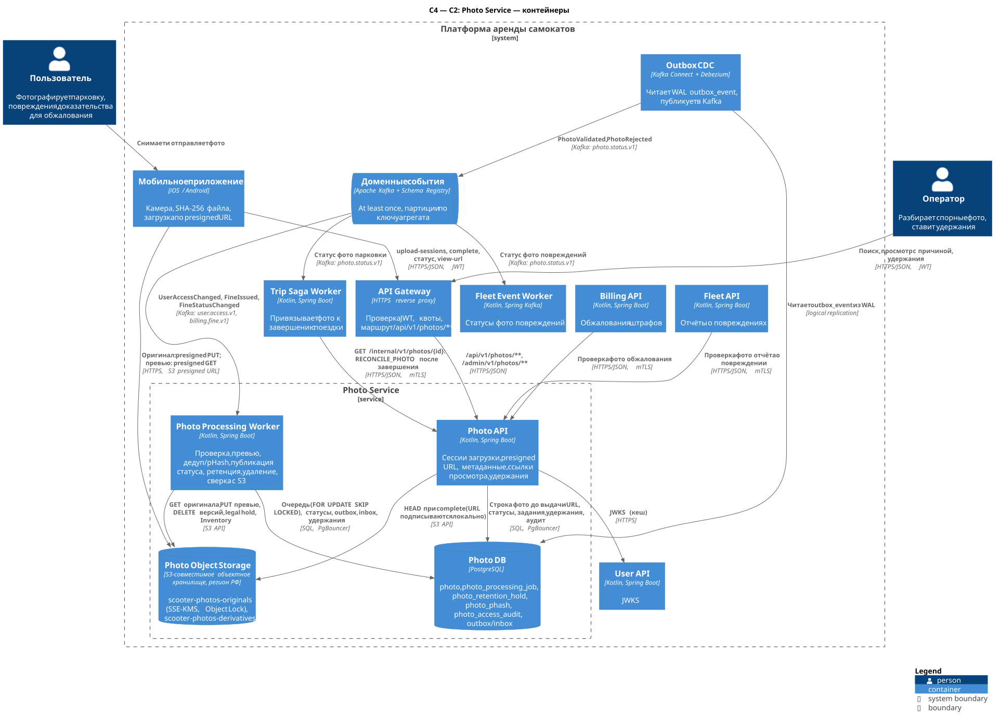
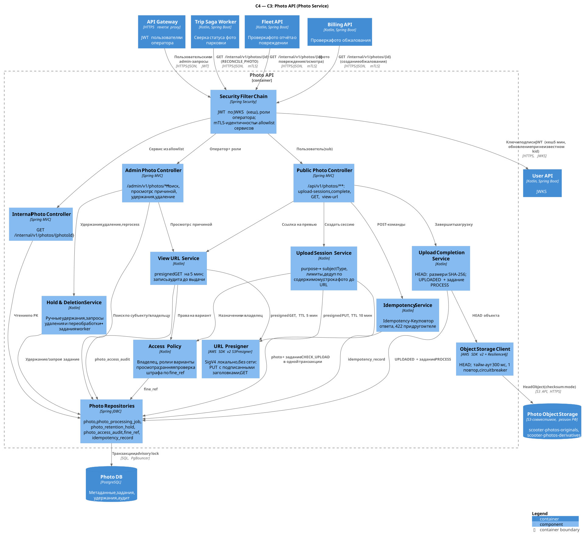
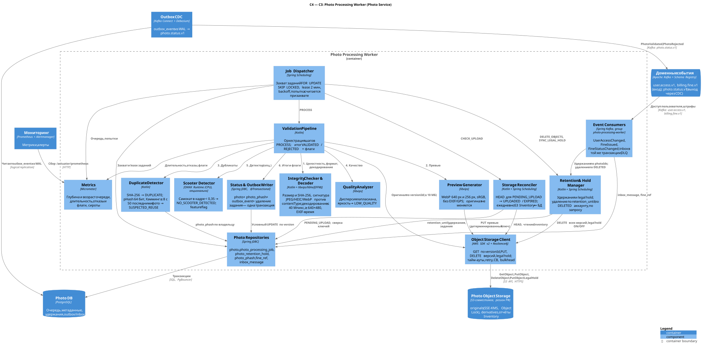

# ADR-003. Фотофиксация: отдельный Photo Service, прямая загрузка в объектное хранилище и асинхронная проверка

**Статус:** Принято.  
**Дата:** 2026-11-05.  
**Система:** платформа аренды электросамокатов, вариант 2224.

Детальный API, события, схема данных, ретенция и сценарии отказов описаны в [Photo Service](../services/photo-service.md). Этот ADR фиксирует само решение, отвергнутые варианты и условия пересмотра. Общие решения по хранилищам — в [ADR-002](ADR-002-storage.md), декомпозиция — в [ADR-001](ADR-001-decomposition.md).

## Контекст проблемы

Замечание преподавателя к первой версии: **«Добавить фотографирование и продумать, как хранить»**. В платформе фото нужны в трёх сценариях:

- **фото парковки** при завершении поездки — доказательство корректной парковки в споре о штрафе (Trip);
- **фото повреждения** самоката — отчёт пользователя и основание для ремонта (Fleet);
- **фото к обжалованию штрафа** — доказательство пользователя (Billing).

Требования и ограничения:

- **Объём (условно, A3, A6).** ~1 млн фото в сутки по ~400 КБ, то есть ~0,4 ТБ/сут; в установившемся режиме ≈ 46 ТБ оригиналов (вместе с фото повреждений, обжалований и удержанными по штрафам) и ≈ 50 ТБ объектов вместе с превью. По A1 (1 млн поездок в сутки, 10 % — в пиковый час) в среднем за пиковый час ≈ 28 завершений/с, то есть ≈ 28 фото/с. **250 фото/с ≈ 100 МБ/с входящего потока — проектная цель с запасом ≈ ×9** на минутные всплески, фото повреждений и обжалований и повторы ([photo-service.md §4.8](../services/photo-service.md#48-объёмы-условно-оценка-по-a1a3)). Загрузка фото не входит в бюджет 5 000 RPS API.
- **Завершение поездки не должно зависеть от фото.** Пользователь на улице, сеть мобильная и нестабильная. Сбой загрузки или проверки не может продлевать аренду и её стоимость ([lab-01 §5.3](../lab-01.md#53-завершение-и-оплата)).
- **Фото — доказательство.** Нужны неизменяемость, проверяемая целостность (хеш), хранение на время спора и после него, журнал доступа.
- **Фото — персональные данные.** Лица прохожих, номера машин, геометка и время в EXIF, связь с пользователем. Действуют требования 152-ФЗ: локализация в РФ (ст. 18 ч. 5), уничтожение по истечении цели или при удалении аккаунта (ст. 21), минимизация доступа.
- **Злоупотребления.** Повторное использование старого фото, фото не того места, «пустые» и тёмные кадры. Файлы от клиента не доверенные: возможны «бомбы» распаковки и подмена формата.
- **Потребители — три контекста**, а удержания задаются четвёртым событийным источником: штрафы Billing.

## Рассмотренные альтернативы

| Вариант | Конкретные границы | Преимущества | Недостатки и решение |
| --- | --- | --- | --- |
| **A. Бинарь в PostgreSQL (`bytea` / large objects)** | Таблица фото с содержимым в БД владельца (Trip или Photo) | Одна транзакция «фото + статус», один бэкап, нет второй системы хранения | ≥ 0,4 ТБ/сут WAL на primary, реплики, WAL-архив и Debezium. Восстановление 36+ ТБ — ~20 ч против RTO ≤ 1 ч. SSD-ТБ оплачивается 3–5 раз. Медленные мобильные загрузки держат соединения пула. Нет presigned URL, lifecycle и Object Lock. **Отклонён** ([разбор](../services/photo-service.md#42-почему-не-bytea-в-postgresql)) |
| **B. Загрузка через Gateway и Photo API** | Клиент шлёт multipart в API, сервис потоково пишет в S3 | Сервис видит байты до записи; один путь аутентификации; клиенту не нужен второй хост | ~100 МБ/с в пик через Gateway и JVM, двойной трафик. Соединения висят секунды на медленной сети. Gateway и API масштабируются по байтам, а не по запросам. Тот же контроль (тип, размер, SHA-256, запрет перезаписи) даёт presigned PUT с подписанными заголовками. **Отклонён** |
| **C. Синхронная проверка** | `complete` (или `finish` поездки) ждёт декодирования, дедупа, pHash и ONNX | Клиент сразу получает вердикт; меньше состояний | ~0,3 CPU-с на фото плюс чтение объекта — секунды и непредсказуемый p99. Под пиковую минуту нужно ~75 vCPU в постоянной готовности. Отказ проверки блокирует завершение поездки, а повторы шли бы внутри HTTP-запроса. **Отклонён:** очередь заданий и события статуса; поездка завершается, не дожидаясь проверки |
| **D. Фото внутри Trip** (и отдельно в Fleet и Billing) | Каждый потребитель хранит и проверяет свои фото | Меньше сервисов; локальная транзакция «поездка + фото» | Три копии конвейера, ретенции, удержаний и контроля ПДн. Trip DB (синхронная реплика, критичный путь) получает метаданные и нагрузку обработки изображений. CPU-bound профиль и темп релизов чужды поездке. Удержания управляются штрафами Billing, а не Trip. **Отклонён** |
| **E. Облако вне РФ** | Зарубежный S3 или GCS с CDN, managed-модерация изображений | Зрелые Object Lock, Inventory, checksums; готовые ML-модели; низкая цена | Первичное хранение ПДн граждан РФ вне РФ нарушает 152-ФЗ ст. 18 ч. 5. Плюс трансграничная передача и риск недоступности сервиса. **Отклонён** |
| **F. Выбранное решение** | Отдельный Photo Service: Photo API + Photo Processing Worker; бинарь в S3-совместимом хранилище в РФ, метаданные в Photo DB; presigned PUT; асинхронная проверка; статус событиями | Байты не проходят через сервисы; завершение поездки не зависит от фото; один владелец доказательств, ретенции и ПДн | Две системы хранения и их сверка; больше состояний и заданий; возможности S3 у провайдеров РФ различаются. **Выбрано** |

## Выбранное решение

Принять вариант **F**. Вводится девятый сервис и bounded context **«Фотофиксация / Photo Evidence»**; владелец — команда аренды. Photo владеет метаданными фото, объектами в хранилище, проверкой, ретенцией и удержаниями. Photo **не** принимает решений о штрафе, не распознаёт лица и не хранит геометку в БД ([Context Map](../lab-01.md#3-context-map)).

| Контейнер | Ответственность |
| --- | --- |
| Photo API | Сессии загрузки, presigned URL, `complete`, статус, ссылки просмотра, внутренний GET для сверки потребителями (allowlist: `trip-saga-worker` — `RECONCILE_PHOTO` после завершения, `fleet-api` — фото повреждений и осмотра, `billing-api` — создание обжалования), admin-операции |
| Photo Processing Worker | Очередь заданий в Photo DB: проверка загрузки, конвейер проверки, превью, дедуп, публикация статуса, удержания, удаление, сверка с хранилищем |
| Photo DB (PostgreSQL) | `photo`, `photo_processing_job`, `photo_retention_hold`, `photo_phash`, `photo_access_audit`, outbox/inbox/idempotency |
| Photo Object Storage | `scooter-photos-originals` (versioning, Object Lock, SSE-KMS), `scooter-photos-derivatives`, отчёты Inventory; регион РФ |

**Поток загрузки:**

1. Клиент вызывает `POST /api/v1/photos/upload-sessions`, передавая `purpose`, `subjectType`, `subjectId`, `contentType`, `sizeBytes` и `sha256Base64`.
2. Photo API проверяет назначение и права на субъект. Для `TRIP_PARKING` права проверяет Trip. Для `FINE_APPEAL` — владелец штрафа по проекции `fine_ref`; окончательно это подтверждает Billing асинхронно.
3. Лимиты в два слоя. Gateway режет всплески: 20 запросов в минуту на пользователя, `429 RATE_LIMITED`. Photo API проверяет бизнес-лимиты под advisory lock по пользователю: ≤ 3 активных фото и ≤ 6 сессий на пару (пользователь, субъект), `409 PHOTO_LIMIT_EXCEEDED`, и квота 20 сессий в час и 100 в сутки на пользователя, `429 UPLOAD_RATE_LIMITED`.
4. В одной транзакции создаются **строка `PENDING_UPLOAD`** и задание `CHECK_UPLOAD`. Только после этого клиент получает presigned PUT на 10 мин. В подпись входят `Content-Type`, `Content-Length`, `x-amz-checksum-sha256`, SSE-KMS и `If-None-Match: *`.
5. Клиент загружает байты прямо в хранилище и вызывает `complete`.
6. Photo API делает HEAD объекта и сверяет размер и контрольную сумму, затем ставит `UPLOADED` и задание `PROCESS`. Если `complete` потерян, тот же переход выполнит `CHECK_UPLOAD` по HEAD.
7. Worker захватывает задание (`FOR UPDATE SKIP LOCKED`, lease) и выполняет конвейер:
   - целостность: SHA-256, сигнатура формата, декодирование с лимитом пикселей;
   - превью без EXIF/GPS;
   - точный дубль по SHA-256 и похожесть по pHash;
   - качество и, опционально, ONNX-детектор самоката.
8. Итог `VALIDATED` (с флагами) или `REJECTED` и событие в `outbox_event` фиксируются одной транзакцией. Outbox CDC публикует `PhotoValidated` / `PhotoRejected` в `photo.status.v1`.
9. Trip не ждёт проверки. `TripEnded` содержит `parkingPhoto.status = PENDING`, если итог ещё не пришёл. **Флаги не означают отказ:** они отправляют фото на ручной разбор и не ведут к автоматическому штрафу.

**Хранение и жизненный цикл.**

- Сроки ретенции зависят от назначения: 90 сут для фото парковки, 180 сут для фото повреждений и обжалований (условно, согласуются с юристами).
- Удержания `FINE` и `FINE_APPEAL` создаются по `billing.fine.v1` и дублируются S3 legal hold. Ручные удержания `LEGAL` и `INVESTIGATION` ставит оператор.
- После снятия удержания фото хранится ещё до 3 лет. Объект защищён GOVERNANCE retention.
- Удаление выполняет worker:
  - по сроку;
  - по `UserAccessChanged(DELETED)`, если удержание не действует;
  - по решению администратора.
- Ежедневная сверка S3 Inventory с БД находит сирот и пропавшие объекты.

## Обоснование выбора

1. **Один контекст для трёх потребителей.** Фото парковки, повреждений и обжалований проходят одинаковые загрузку, проверку, ретенцию и контроль доступа к ПДн. Отдельный сервис даёт одного владельца политики хранения и одну точку аудита. Профиль нагрузки — CPU-bound обработка изображений и поток байтов — не похож ни на Trip, ни на Fleet.
2. **Бинарь вне БД, метаданные в PostgreSQL.** Объектное хранилище даёт дешёвый ТБ, erasure coding, presigned URL, lifecycle и Object Lock. PostgreSQL даёт то, чего нет у хранилища: атомарный переход «статус + задание + outbox», уникальность, выборки по субъекту и владельцу. Метаданные — ~0,2 ТБ, они восстанавливаются за десятки минут и укладываются в RTO ([data-storage §9](../data-storage.md#9-хранение-фото-кратко)).
3. **Presigned PUT вместо проксирования.** Байты идут клиент → хранилище, Gateway и JVM их не видят. Контроль не теряется: подпись фиксирует тип, размер, SHA-256, шифрование и запрет перезаписи, а `complete` перепроверяет HEAD. Строка создаётся **до** выдачи URL, поэтому любой объект в бакете можно сопоставить с записью или признать сиротой.
4. **Асинхронная проверка.** Завершение поездки не зависит от доступности хранилища, ONNX и очереди. Минутный всплеск до проектной цели 250 фото/с сглаживается очередью, а не резервом в 75 vCPU: среднему пикового часа (≈ 28 фото/с) хватает 8–9 vCPU. Потребитель сам решает, что делать с `PENDING`, `REJECTED` и флагами. Для Trip это ручной разбор, а не отказ в завершении.
5. **Очередь в PostgreSQL, факты в Kafka.** Задание на фото требует повторов с backoff, lease, fencing и атомарности со статусом фото. При проектной цели ~250 заданий/с это дешевле сделать на `SKIP LOCKED`, чем отдельной очередью с собственной согласованностью. Наружу публикуются только итоговые факты через outbox, единым для платформы способом.
6. **Доказательная ценность.** Клиент заявляет SHA-256 до загрузки, хранилище и worker его проверяют. Читается закреплённый `versionId`. Удержанные объекты защищены Object Lock. Каждая выдача ссылки на фото записывается в аудит до выдачи.
7. **ПДн и локализация.** Хранилище, KMS, БД и бэкапы находятся в РФ. Пользователь видит только превью без метаданных. Оригинал с EXIF доступен ограниченным ролям с причиной. Фото удаляются при удалении аккаунта, если на них не действует удержание по спору.

## Положительные последствия

- Поток ~0,4 ТБ/сут и проектный пик ~100 МБ/с не нагружают Gateway, Photo API и Photo DB. API масштабируется по запросам, а не по байтам.
- Завершение поездки остаётся доступным при отказе Photo Service, хранилища или обработки (`photoSkipReason`, `parkingPhoto.status = PENDING`).
- Photo DB мала (~0,2 ТБ), живёт в общем кластере `pg-core`, восстанавливается в пределах RTO и не требует шардирования.
- Конвейер проверки, превью и пороги меняются независимо от Trip, Fleet и Billing. `pipelineVersion` позволяет найти фото, обработанные неудачной версией.
- Ретенция, удержания, удаление и аудит реализованы один раз и проверяются в одном месте.
- Флаги антифрода (`SUSPECTED_REUSE`, `LOW_QUALITY`, `NO_SCOOTER_DETECTED`, `EXIF_TIME_MISMATCH`) не превращаются в автоматические штрафы: ошибка модели не наказывает пользователя.

## Отрицательные последствия и ограничения

- **Две системы хранения без общей транзакции.** Нужны порядок операций, задания с повторами и ежедневная сверка Inventory ↔ БД. Сироты и пропавшие объекты — штатные метрики, а не исключения.
- **Больше состояний.** `PENDING_UPLOAD`, `UPLOADED`, `PROCESSING`, `EXPIRED`, `DELETED` и задания на каждом шаге. Клиент работает с двумя хостами (API и хранилище) и должен считать SHA-256 файла.
- **Итог проверки приходит позже**, и потребители обязаны работать с `PENDING`. Trip сверяется внутренним GET, если событие задержалось. Для `EXPIRED` и `DELETED` событий нет: потребители узнают о них только внутренним GET.
- **Девятый сервис** — ещё два контейнера, своя БД и бакеты, а у команды аренды — дежурства по ним.
- **Не все сроки и пороги обоснованы данными.** Ретенция ждёт согласования с юристами, пороги pHash и качества — калибровки на размеченной выборке.

Риски и меры:

| Риск | Мера |
| --- | --- |
| У провайдера РФ нет `x-amz-checksum-sha256`, `If-None-Match`, Object Lock или Inventory | Фолбэки: `Content-MD5` + проверка SHA-256 worker; закреплённый `versionId`; удержание в БД + запрет удаления в IAM; `ListObjectsV2` по суточному префиксу ([§4.3](../services/photo-service.md#43-объектное-хранилище-бакеты-ключи-настройки)). Требования к возможностям — в критерии выбора провайдера |
| Ложные срабатывания pHash и ONNX; перегрузка ручного разбора | Флаги ≠ отказ; сравнение только с другими субъектами владельца; калибровка порогов; kill-switch на каждый флаг; метрика доли флага |
| Удаление фото раньше прихода `FineIssued` | Retention sweep на паузе при лаге `billing.fine.v1` > 1 ч; блокировка строки при удалении; алерт `EVIDENCE_ALREADY_DELETED` |
| Неверные часы устройства или EXIF без часового пояса | `EXIF_TIME_MISMATCH` — только флаг; без часового пояса проверка пропускается |
| Потерянный `complete` | `CHECK_UPLOAD` находит объект HEAD-запросом на +2, +5, +10, +15 мин |
| Недоступность KMS | Равна недоступности хранилища: завершение поездки с причиной пропуска; алерт P1 |
| Стоимость ≈ 50 ТБ объектов (≈ 46 ТБ оригиналов) | Холодный класс после 30 сут, удаление noncurrent-версий через сутки, без копии всего бакета; пересмотр сроков ретенции |
| Передача presigned URL третьим лицам | TTL 5 мин, только превью без метаданных, аудит каждой выдачи, алерты аномалий |
| Лицензирование HEVC при серверном декодировании HEIC | Юридическая проверка; запасной вариант — приложение конвертирует HEIC в JPEG до загрузки, и HEIC убирается из списка допустимых форматов |
| `cityIds` оператора не проверяются: города в модели фото нет | Обязательная причина, аудит и алерты; проверка — после расширения контракта ([§4.11](../services/photo-service.md#411-безопасность-и-пдн)) |

## Итоговая архитектурная схема C4

Место Photo Service среди остальных сервисов показано на общих C2 в [ADR-001](ADR-001-decomposition.md#итоговая-архитектурная-схема-c4).

Уровень **C2** — контейнеры Photo Service, его хранилища и соседи:

Исходник: [c2-photo.puml](../../diagrams/services/photo/c2-photo.puml).

Уровень **C3, Photo API** — сессии загрузки, `complete`, ссылки просмотра, внутренний и admin API:

Исходник: [c3-photo-api.puml](../../diagrams/services/photo/c3-photo-api.puml).

Уровень **C3, Photo Processing Worker** — очередь заданий, конвейер проверки, ретенция и сверка:

Исходник: [c3-photo-processing-worker.puml](../../diagrams/services/photo/c3-photo-processing-worker.puml).

## Как проверить и когда пересмотреть

**Проверить:**

- Нагрузочный тест на проектную цель: 250 загрузок/с напрямую в хранилище и одновременно 800 RPS к Photo API. Измерить p99 `upload-sessions` и `complete`, возраст очереди `PROCESS` и время до итогового статуса.
- Отказы:
  - убить worker посреди обработки — lease и fencing не дают двух итогов;
  - потерять `complete`;
  - отключить хранилище и Kafka во время завершения поездки — поездка завершается;
  - выполнить failover Photo DB — после него нет события о «потерянной» транзакции.
- Ретенция:
  - `FineIssued` до срока удаления ставит legal hold, и фото не удаляется;
  - `UserAccessChanged(DELETED)` удаляет всё без удержаний за ≤ 30 сут.
- Сверка находит подложенную сироту и удалённый вручную объект.
- Ложные срабатывания флагов меряются на размеченной выборке.

**Пересмотреть:**

- выбранный провайдер не поддерживает Object Lock или checksum-заголовки и фолбэки дороже смены провайдера;
- объём фото вырос в 5 раз и более — ретенция, холодный класс, вынос Photo DB из `pg-core` и шардирование по владельцу ([§4.9](../services/photo-service.md#49-партиционирование-и-шардирование));
- бизнес требует «нет завершения без валидного фото» — тогда синхронный этап проверки нужен на пути `finish`, с понятной деградацией;
- антифроду нужен глобальный поиск похожих фото по всем пользователям — векторный индекс или отдельный сервис модерации;
- юристы утвердили другие сроки хранения или появилось распознавание лиц — отдельный режим биометрических ПДн.
