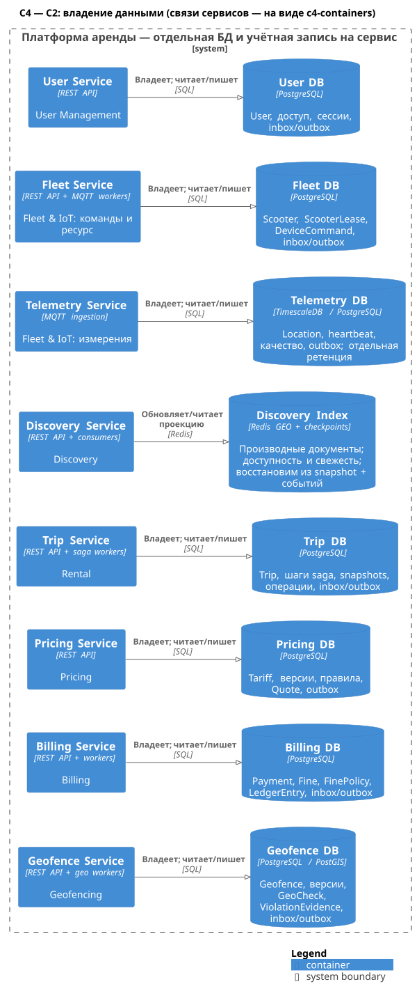

# Хранение данных: почему PostgreSQL, индексы, партиционирование, шардирование

Документ отвечает на замечания **«почему Postgres»** и **«индексы, шардирование и т.д.»**. Здесь собраны общие для всех сервисов решения по хранению. Полный DDL таблиц и индексов каждого сервиса находится в разделе «4. Данные и хранение» сервисного документа (ссылки — в [§4](#4-матрица-хранилищ-по-сервисам)). Решение о выборе хранилищ зафиксировано в [ADR-002](adr/ADR-002-storage.md), решение по фотофиксации — в [ADR-003](adr/ADR-003-photo-evidence.md).

Все объёмы ниже выведены из единых допущений A1–A6 и являются **оценками (условно)**, а не измерениями. Числа подтверждаются нагрузочным тестом из плана проверки в [отчёте](lab-01.md). Примеры SQL сокращены и показывают приём; имена и полный набор колонок определяет раздел сервиса.

Связанные документы: [отчёт](lab-01.md) · [каталог сервисов](service-catalog.md) · [конвенции API и событий](api-conventions.md) · [ADR-001](adr/ADR-001-decomposition.md).

## Кратко

| Класс данных | Хранилище | Владелец | Главная причина |
| --- | --- | --- | --- |
| Источник истины сервисов (OLTP) | PostgreSQL, отдельная логическая БД на сервис | User, Fleet, Trip, Pricing, Billing, Geofence, Photo | Многострочные ACID-транзакции, уникальные ограничения для инвариантов, outbox + CDC из WAL |
| Измерения телеметрии | PostgreSQL + TimescaleDB (`Telemetry DB`) | Telemetry | 20 000 изм./с, сжатие ~10×, ретенция чанками; тот же операционный стек (сжатие и агрегаты — редакция TSL, self-managed; запасной вариант без TSL — §2.2) |
| Геозоны и свидетельства | PostgreSQL + PostGIS (`Geofence DB`) | Geofence | Полигоны, индекс GiST, валидация геометрии, версии |
| Поисковая проекция | Redis Cluster (`Discovery Index`) | Discovery | Производная восстановимая проекция; GEO-запросы в памяти |
| Бинарные фото | S3-совместимое объектное хранилище (`Photo Object Storage`) | Photo | ~0,4 ТБ/сут, прямая загрузка по presigned URL, Object Lock, жизненный цикл |
| Доменные события | Kafka + Schema Registry | Платформа DevOps; топики — производители | Журнал фактов, fan-out, replay; не источник истины сущностей |
| Архив и аналитика | Платформенное архивное хранилище `Archive Store`: Parquet в S3-совместимом объектном хранилище в РФ, versioning и Object Lock (§6.4); DWH на ClickHouse (вне рамок лабораторной) | Платформа DevOps (хранилище и задание архивации); данные архива — сервисы (Trip, Billing, Fleet, Pricing, Geofence); аналитика | Холодные данные вне OLTP; неизменяемость финансовых и спорных записей; отчёты поверх всех сервисов и шардов |

Ни один инвариант (активная поездка, владелец самоката, денежная операция) не хранится только в Redis или Kafka.



Исходник: [c4-data.puml](../diagrams/c4-data.puml).

### Допущения по объёмам (условно)

| | Допущение |
| --- | --- |
| A1 | 5 млн зарегистрированных, DAU ≈ 1 млн, ≈ 1 млн поездок/сут (верхняя оценка), пиковый час ≈ 10 % суточного |
| A2 | 100 000 самокатов онлайн, интервал 5 с → 20 000 измерений/с |
| A3 | Фото парковки на каждую поездку, ~400 КБ (макс. 10 МБ), превью ~30 КБ + миниатюра ~8 КБ → ~0,4 ТБ/сут оригиналов, ~36 ТБ `TRIP_PARKING` за 90 дней (≈ 46 ТБ оригиналов вместе с фото повреждений, обжалований и удержанными (A6); ≈ 50 ТБ объектов вместе с производными), производные ~38 ГБ/сут ≈ 3,4 ТБ за 90 дней; метаданные ~1 КБ/фото → ~1 ГБ/сут. По A1 (1 млн поездок/сут, 10 % — в пиковый час) в среднем за пиковый час ≈ 28 завершений/с, то есть ≈ 28 фото/с. **250 фото/с ≈ 100 МБ/с (≈ 0,8 Гбит/с) — проектная цель с запасом ≈ ×9** на минутные всплески, фото повреждений и обжалований и повторные загрузки ([photo-service.md §4.8](services/photo-service.md#48-объёмы-условно-оценка-по-a1a3)) |
| A4 | Поездка с переходами и шагами saga ≈ 3 КБ → ~3 ГБ/сут, ~1,1 ТБ/год (горячие 13 месяцев); ~4 проводки на поездку → ~4 млн строк/сут; пользователи ~2 КБ × 5 млн ≈ 10 ГБ; телеметрия ~100 Б/строка → ~170 ГБ/сут сырых, ~17 ГБ/сут после сжатия ~10×; сырые 30 дней, минутные агрегаты 1 год |
| A5 | Финансовые записи хранятся ≥ 5 лет (402-ФЗ); время в UTC; деньги — в минимальных единицах (`amountMinor` + `currency`) |
| A6 | Нарушения и штрафы: нарушение при завершении ≈ 3 % поездок (≈ 30 тыс./сут, Geofence); штраф — до 2 % поездок (≈ 20 тыс./сут, верхняя оценка для расчёта объёмов; типично ~1 %); обжалования ≈ 10 % штрафов (≈ 2 тыс./сут); отчёты о повреждениях ≈ 5 тыс./сут (0,5 % поездок, Fleet) по ≤ 3 фото → ≤ 15 тыс. фото/сут |

## 1. Требования к хранению, вытекающие из архитектуры

| # | Требование | Откуда | Что это требует от хранилища |
| --- | --- | --- | --- |
| R1 | Инварианты «не более одного»: одна незавершённая поездка пользователя; один владелец самоката; одна денежная операция на бизнес-ключ; один штраф на свидетельство и версию политики | Trip, Fleet, Billing ([отчёт](lab-01.md), §7) | Строгая согласованность на одном узле записи; уникальные ограничения, проверяемые в той же транзакции, что и изменение |
| R2 | Transactional outbox и inbox, доставка at-least-once | Все производители событий; `Outbox CDC` (Debezium) | Изменение агрегата и событие — одной транзакцией; чтение событий из журнала транзакций (logical replication); дедуп по `(consumer_group, event_id)` |
| R3 | Durable saga старта и завершения: повторяемые шаги, компенсации, восстановление после рестарта | Trip Saga Worker; такие же очереди в Billing, Fleet, Photo, User | Состояние шагов в БД; конкурирующие worker'ы без двойной обработки; условные переходы состояний |
| R4 | Идемпотентность команд (`Idempotency-Key`) | Все POST-команды | Таблица `idempotency_record` с PK `(scope, idempotency_key)` и сроком жизни |
| R5 | Неизменяемые версии и snapshot: тарифы, геозоны, котировки, проверки | Pricing, Geofence, Trip | Документ snapshot (JSONB) рядом с реляционными полями; запрет пересечения периодов действия версий |
| R6 | Fencing token и optimistic locking | Fleet (`scooter.lease_epoch`), PATCH с `If-Match` | Атомарный инкремент счётчика и условное обновление `WHERE version = ?` |
| R7 | Гео: проверка старта и парковки по полигонам версии; поиск рядом | Geofence, Discovery | Пространственные типы, GiST, валидация геометрии; отдельно — быстрый GEO-поиск в памяти |
| R8 | Телеметрия: 20 000 изм./с, ~170 ГБ/сут сырых, 30 дней сырых, агрегаты 1 год | Telemetry (A2, A4) | Пакетная запись, сжатие, удаление по времени без `DELETE`, агрегаты |
| R9 | Фото: ~0,4 ТБ/сут бинарных данных, неизменяемый оригинал, удержания для споров | Photo (A3) | Объектное хранилище с Object Lock и lifecycle; метаданные и статусы — транзакционно |
| R10 | Финансы: неизменяемый журнал проводок, двойная запись, хранение ≥ 5 лет, сверка с PSP | Billing (A5, 402-ФЗ) | Append-only таблицы, CHECK-ограничения, проверка баланса при записи (`ledger_post`), архив WORM |
| R11 | 152-ФЗ: ПДн граждан РФ хранятся в БД на территории РФ; минимизация; сроки хранения и удаление/обезличивание; аудит доступа к истории перемещений и фото | User, Trip, Telemetry, Photo, Billing | Все БД, реплики, бэкапы, архивы и объектное хранилище — в регионе РФ; управляемые сроки хранения; разграничение ролей |
| R12 | Восстановление: RPO ≈ 0 для Trip, Fleet, Billing; PITR; failover за минуты | SLO 99,95 % ([отчёт](lab-01.md), §1 и §6) | Синхронная реплика, автоматический failover, WAL-архив |
| R13 | Рост: около 1 ТБ/год на крупный сервис | A1–A6 | Партиционирование и архив; модель данных, допускающая шардирование без переписывания |
| R14 | Эксплуатация одной командой DevOps | [Отчёт](lab-01.md), §9 | Минимум разных технологий; единые HA, бэкап, мониторинг, миграции |

## 2. Почему PostgreSQL

Ядро системы — короткие транзакции над небольшими агрегатами с жёсткими инвариантами (R1–R6). Это классический реляционный OLTP: нужна СУБД, которая в одной транзакции меняет несколько таблиц, проверяет уникальность и публикует событие через WAL. PostgreSQL закрывает это и одновременно гео (PostGIS) и временные ряды (TimescaleDB), то есть **один операционный стек на 8 из 9 сервисов**. По оценкам [§4](#4-матрица-хранилищ-по-сервисам) крупнейшая горячая БД — около 1,7 ТБ (Billing, 18 месяцев горячего окна), за ней Trip (~1,2–1,3 ТБ) и Telemetry (~1 ТБ), остальные меньше; с партиционированием такие объёмы годами помещаются в один primary на сервис, поэтому распределённая СУБД на старте не нужна (§7).

### 2.1. Возможность → где она используется

| Возможность PostgreSQL | Где используется в системе | Что было бы без неё |
| --- | --- | --- |
| ACID-транзакция на несколько таблиц | Trip: `trip` + `user_active_trip` + `saga_step` + `idempotency_record` + `outbox_event` одним коммитом при `POST /api/v1/trips`. Fleet: `scooter.lease_epoch + 1` + `scooter_active_lease` + `device_command` + `outbox_event`. Billing: платёж + несколько проводок + `outbox_event`. Любой потребитель: `inbox_message` + изменение своей модели | Двойная запись «БД + брокер», потерянные или фантомные события, ручная сверка |
| Уникальные ограничения | `user_active_trip (user_id PK)`; `scooter_active_lease (scooter_id PK, lease_id UNIQUE)`; Billing: PK `payment_operation (trip_id, operation_type, operation_seq)` и `fine UNIQUE (violation_evidence_id, fine_policy_version)` (§5.2); `user_pii UNIQUE (phone_hash)` в User; `inbox_message (consumer_group, event_id)`; `idempotency_record (scope, idempotency_key)` | Гонка «проверил — вставил»: две активные поездки, два владельца самоката, повторное списание |
| Частичные индексы | Очередь готовых шагов `saga_step ... WHERE status IN ('PENDING','RETRY')`; истечение подготовительных lease `WHERE phase = 'PREPARING'`; брошенные загрузки `WHERE status = 'PENDING_UPLOAD'`; «не более одного по умолчанию»: основная карта пользователя (Billing), активный ключ шифрования ПДн (User) | Индексы на всю историю ради долей процента строк; нельзя выразить «уникально среди активных» |
| Условные обновления, optimistic locking | `UPDATE trip SET status = 'ACTIVE' WHERE trip_id = $1 AND status = 'STARTING'`; `scooter.version` → `aggregateVersion` события и `ETag`; проверка `fencing_token` при приёме команды | Потерянные обновления; устаревшая команда разблокирует уже освобождённый самокат |
| `FOR UPDATE SKIP LOCKED` | Trip Saga Worker (`saga_step`); Billing Settlement и Reconciliation (повторы списаний, webhook-inbox, `PENDING_RECONCILIATION`); Fleet Command Worker (тайм-ауты команд, истечение lease); Photo Processing Worker (проверка, ретенция); User Worker (удаление аккаунтов) | Отдельный брокер задач и двойная запись «состояние + задача» |
| JSONB | `tariff_snapshot` в поездке (snapshot котировки + `snapshotHash`); подписанное измерение в проверке и свидетельстве Geofence; `outbox_event.payload`; `idempotency_record.response_body`; правила версии тарифа | Таблица на каждую версию формата snapshot или BLOB без проверок |
| Частичные уникальные индексы, триггеры и блокировка строки на справочниках | Pricing: периоды действия версий одного тарифа не пересекаются по построению — `effective_to` и `EXCLUDE` нет, версия действует до `effective_from` следующей; публикация идёт под `SELECT ... FOR UPDATE` строки `tariff` с проверкой монотонности `effective_from` (`409 EFFECTIVE_FROM_NOT_MONOTONIC`, [pricing-service.md §4.2](services/pricing-service.md#42-ddl-и-индексы)), опубликованная версия неизменяема (триггер). Geofence: в городе нет двух опубликованных версий с одним `effective_from` (`UNIQUE ... WHERE status = 'PUBLISHED'`), опубликованная версия и её зоны неизменяемы (триггер) | Проверка в приложении с гонкой при параллельной публикации |
| CHECK, функция `SECURITY DEFINER`, права ролей | Billing: `amount_minor > 0`; проводки записываются только через функцию `ledger_post` (`SECURITY DEFINER`), которая при записи проверяет Σ дебета = Σ кредита по каждой валюте операции; у роли приложения нет `INSERT`/`UPDATE`/`DELETE` на таблицах журнала, триггер `BEFORE UPDATE OR DELETE` бросает исключение | Нарушение двойной записи, «исправление» проводки задним числом |
| PostGIS + GiST | Geofence: геометрии зон версии, `ST_IsValid`, проверка пересечений при публикации, выборка зон города для загрузки локального индекса JTS и для admin | Самописная геометрия или второй гео-стек |
| TimescaleDB | Telemetry: гипертаблица измерений с чанками по времени, сжатие ~10× (A4), удаление чанков через 30 дней, минутные агрегаты на 1 год | Отдельная TSDB со своими HA, бэкапом и мониторингом |
| Декларативное партиционирование | Поездки, lease и команды Fleet, платежи и проводки Billing, проверки Geofence, метаданные фото, `outbox_event` (§6) | `DELETE` миллионов строк, раздувание таблиц, многочасовой vacuum |
| Logical replication (`pgoutput`) | Outbox CDC: Debezium читает WAL без сторонних плагинов; перенос бакетов при шардировании (§7.5); мажорное обновление с минимальным простоем | Polling-relay в каждом сервисе или триггеры |
| Потоковая репликация, Patroni, PITR | Синхронная реплика Trip/Fleet/Billing (RPO ≈ 0), read replicas Trip и Billing, восстановление на момент времени (§8) | Самостоятельная реализация HA |
| Транзакционный DDL и `CONCURRENTLY` | Атомарные миграции; `CREATE INDEX CONCURRENTLY`, `DETACH PARTITION ... CONCURRENTLY` без остановки записи | Окно обслуживания на каждый индекс |
| Лицензия и доступность | PostgreSQL License (разрешительная); managed PostgreSQL у облачных провайдеров в РФ; отечественный дистрибутив Postgres Pro в реестре российского ПО; широкий рынок специалистов | Зависимость от вендора, санкционные и лицензионные риски |

### 2.2. Версия и расширения

- Единая мажорная версия на все БД, **не ниже PostgreSQL 17**: logical-слоты с переносом на реплику при failover и `synchronized_standby_slots` (важно для Debezium, §8.8), `uuid_extract_timestamp()`. В 18-й версии добавлены встроенная `uuidv7()` и контрольные суммы страниц по умолчанию. Конкретная версия — актуальная из поддерживаемых провайдером и расширениями.
- Расширения: `postgis` (Geofence), `timescaledb` (Telemetry), `btree_gist` (uuid в составном GiST-индексе Geofence), `pg_stat_statements` (все БД), `pg_partman` и `pg_cron` (где доступны), `pgstattuple`, `hypopg` (диагностика).
- Сжатие, continuous aggregates и фоновые политики TimescaleDB распространяются под Timescale License (TSL). TSL запрещает только предоставлять TimescaleDB третьим лицам как сервис (DBaaS); собственная (self-managed) эксплуатация для своего продукта разрешена и бесплатна — мы PostgreSQL как сервис не предоставляем, поэтому лицензия нам подходит. Managed-провайдер при этом может предлагать только Apache-2-редакцию, поэтому `Telemetry DB` — self-managed кластер (Patroni) либо провайдер с полной редакцией. **Запасной вариант без TSL** (если лицензия или провайдер изменятся): нативное декларативное партиционирование `telemetry_measurement` по часу/суткам + BRIN по `measured_at` + `pg_partman` для создания и удаления партиций; минутные агрегаты строит job, а не continuous aggregate. Без сжатия диск под 30 суток сырых данных растёт до ≈ 5 ТБ таблицы (30 × 170 ГБ) и ≈ 7,5 ТБ вместе с индексами (~7 ГБ/ч таблица + ~3,5 ГБ/ч индекс, [telemetry-service.md §4.5](services/telemetry-service.md#45-объёмы-оценка-условно)) — это цена отказа от TSL, а не блокер.

### 2.3. Где НЕ PostgreSQL и почему

| Данные | Хранилище | Почему не PostgreSQL | Как обеспечена надёжность |
| --- | --- | --- | --- |
| `Discovery Index` | Redis Cluster (или wire-совместимый Valkey) | ~3 250 RPS поиска (65 % пика) и ~20 000 обновлений координат/с; нужен GEO-поиск в памяти с субмиллисекундной задержкой. Данные — производная проекция, а не источник истины | Перестроение из snapshot API владельцев + догон событиями (`POST /admin/v1/discovery/rebuilds`); реплика на каждый master. Потеря индекса не теряет ни одного бизнес-факта |
| Бинарные фото | `Photo Object Storage` (S3-совместимое) | 0,4 ТБ/сут и ≈ 46 ТБ оригиналов в установившемся режиме (≈ 50 ТБ объектов вместе с производными; из них `TRIP_PARKING` 36 ТБ за 90 дней, A3, A6) раздули бы WAL, реплики и бэкапы БД в сотни раз; входящий поток с проектной целью ≈ 100 МБ/с (≈ 0,8 Гбит/с, A3) шёл бы через сервисы и держал соединения | Erasure coding в нескольких AZ, версии, Object Lock (legal hold), SSE-KMS; метаданные и статус — в `Photo DB` (§9) |
| Доменные события | Kafka | Журнал с fan-out на многие consumer group, replay и порядком по ключу; таблица БД как брокер плохо масштабирует fan-out | RF=3, `min.insync.replicas=2`, `acks=all`; первичная запись события — outbox в БД производителя, поэтому отказ Kafka не теряет событий |
| Данные старше горячего окна | Платформенное архивное хранилище `Archive Store`: Parquet в S3-совместимом объектном хранилище в РФ | Холодные данные дорого держать на SSD primary и копировать в каждый бэкап | Manifest с контрольными суммами; versioning и Object Lock: compliance для Billing (≈ 6 лет), для архива Trip — на срок хранения 5 лет (§6.4) |

## 3. Сравнение альтернатив

Оценка относительно наших требований R1–R14, а не «вообще»: «+» — закрывает, «±» — частично или с оговорками, «−» — не закрывает.

| СУБД | Транзакции и инварианты | Гео | Временные ряды | Масштабирование | Операционная сложность для нас | Лицензия и доступность в РФ | Итог для нас |
| --- | --- | --- | --- | --- | --- | --- | --- |
| **PostgreSQL** (+ PostGIS, TimescaleDB) | + ACID, UNIQUE, частичные индексы, EXCLUDE, SKIP LOCKED, транзакционный DDL | + PostGIS — эталонный набор функций, GiST | + TimescaleDB: сжатие, ретенция, агрегаты (TSL) | ± вертикально, реплики чтения, партиционирование; шардирование — в приложении или Citus | + один стек на 8 БД; Patroni или managed, pgBackRest, Debezium | + PostgreSQL License; managed в РФ; Postgres Pro в реестре | **Выбран по умолчанию** |
| **MySQL 8 / MariaDB** | + ACID (InnoDB), UNIQUE, SKIP LOCKED; − нет частичных индексов и EXCLUDE, DDL нетранзакционный, нет FK у партиционированных таблиц | ± R-tree, функций меньше, чем в PostGIS | − аналога TimescaleDB нет | + Vitess — зрелое шардирование | ± сопоставимо, но гео и телеметрия потребовали бы второго стека | ± GPLv2 (Oracle); MariaDB и Percona; managed в РФ есть | Жизнеспособен для ядра OLTP, проигрывает по гео, временным рядам и выразительности ограничений |
| **MongoDB** | ± многодокументные транзакции дороже; уникальные и частичные индексы есть; проводки, сверки и отчёты с соединениями неестественны | + 2dsphere | ± time-series коллекции | + встроенное шардирование | − второй стек: другая модель бэкапа, CDC, миграций | − SSPL (не OSI); Atlas в РФ недоступен | Гибкость схемы нам не нужна; реляционные инварианты и учёт важнее |
| **Cassandra / ScyllaDB** | − нет многострочных транзакций и уникальности, кроме PK; LWT (Paxos) — только в пределах раздела и медленно | − нет | + очень высокая скорость записи, TTL | + линейно, multi-DC | − отдельный стек; repair, compaction; таблица под каждый запрос | Cassandra — Apache 2.0; ScyllaDB с 2025 г. — source-available (проверить условия) | Кандидат для сырой телеметрии при росте ×10 |
| **CockroachDB / YugabyteDB** | + распределённые ACID-транзакции; совместимость с PostgreSQL частичная | ± собственный или частичный гео, без полного PostGIS | − | + авто-шардирование, multi-region | − консенсус Raft на каждый коммит → выше задержка; горячая строка (lease самоката) всё равно сериализуется; новый стек | CockroachDB — проприетарная лицензия (Core-версии нет с 2024 г.); YugabyteDB — Apache 2.0; managed в РФ нет | Не нужно при текущих объёмах; пересмотр при multi-region active-active |
| **Redis как primary** | − MULTI без отката; в кластере — только ключи одного слота; AOF `everysec` теряет до ~1 с; асинхронная репликация теряет подтверждённые записи при failover | + GEOSEARCH в памяти | ± Streams/модули, память дорога | + Redis Cluster | + уже используется в Discovery | ± Redis — RSAL/SSPL, с Redis 8 также AGPLv3; Valkey — BSD | Только производная проекция и кеш |
| **ClickHouse** | − нет OLTP-транзакций и уникальности (ReplacingMergeTree дедуплицирует в фоне); точечные UPDATE дороги | ± гео-функции (`pointInPolygon`, H3) | + колоночное сжатие, агрегаты по истории | + шарды и реплики | ± отдельный стек, но только для аналитики | + Apache 2.0; managed в РФ есть | DWH и история телеметрии; не OLTP |

### 3.1. Вывод

1. Ядро (Trip, Fleet, Billing, User, Pricing, Photo) требует транзакций и уникальности — это исключает Cassandra/ScyllaDB, Redis и ClickHouse как источник истины.
2. Из реляционных вариантов PostgreSQL выигрывает у MySQL за счёт PostGIS, TimescaleDB, частичных индексов и EXCLUDE: гео и телеметрия остаются в том же стеке, и команде DevOps не нужны три технологии БД вместо одной.
3. Distributed SQL решает задачу, которой у нас пока нет (шардирование и multi-region), ценой задержки каждого коммита, нового стека и лицензионных рисков. Shard-ready модель (§7) сохраняет путь масштабирования без этой цены.
4. Специализированные хранилища применяются там, где PostgreSQL структурно не подходит (§2.3): Redis — производная GEO-проекция, объектное хранилище — бинарные данные, Kafka — журнал событий.

### 3.2. Условия пересмотра

| Сигнал | Действие |
| --- | --- |
| Телеметрия ×10 (≈ 200 000 изм./с за счёт парка или частоты) и запись в `Telemetry DB` > 60–70 % ресурсов primary на нагрузочном тесте | 1) Шардирование `Telemetry DB` по `scooterId` (тот же стек, §7). 2) Если преобладают исторические и аналитические запросы — сырая история в ClickHouse (MergeTree + TTL), в PostgreSQL остаются последние часы. 3) Если доступ строго ключевой («самокат + интервал») с TTL — ScyllaDB/Cassandra |
| Требование хранить сырую телеметрию дольше 30 дней | Старшие данные — в ClickHouse или Parquet, горячую БД не увеличивать |
| Multi-region active-active с RPO = 0 при потере региона | Сначала региональные ячейки (город → регион; Fleet уже шардируется по `cityId`); если недостаточно — YugabyteDB/CockroachDB для Trip и Fleet |
| Триггеры шардирования (§7.2) достигнуты в нескольких сервисах, маршрутизация в приложении стала дорогой | Citus для Trip и Billing (распределённые таблицы по `user_id`) |
| Поиску нужны сложные фильтры и полнотекст | Поисковый движок (например, OpenSearch) для карточек; геоиндекс остаётся в Redis |
| Провайдер не поддерживает нужное расширение (TimescaleDB TSL, PostGIS) или изменились условия TSL | Self-managed кластер Patroni для этой БД (TSL допускает собственную эксплуатацию); без TSL — нативное партиционирование по часу/суткам + BRIN + `pg_partman` (§2.2) |

## 4. Матрица хранилищ по сервисам

### 4.1. Хранилища и ключевые таблицы

| Сервис | Хранилище | Ключевые таблицы и структуры | Подробно |
| --- | --- | --- | --- |
| User | `User DB` (PostgreSQL) | Учётная запись и профиль (`user_account`), ПДн отдельно и зашифрованно (`user_pii`, UNIQUE `phone_hash`; ключи — `pii_data_key`), статус доступа и его причины (`user_access`), блокировки (`user_block`), OTP-челленджи (`otp_challenge`), refresh-сессии (`user_session`), согласия (`user_consent`), заявки на удаление (`account_deletion_request`), аудит аутентификации (`auth_audit_event`), защита от перебора (`auth_lock`), ключи подписи JWT (`jwt_signing_key`; закрытые ключи — в Vault), проекции из Billing: долг (`user_financial_state`, `debt_version` — `debtVersion` из `PaymentStatusChanged`, событие применяется только при версии больше сохранённой) и штрафы (`user_fine_projection`); outbox/inbox/idempotency | [user-service.md](services/user-service.md#4-данные-и-хранение) |
| Fleet | `Fleet DB` (PostgreSQL) | `scooter` (с `lease_epoch`, `version`), `scooter_active_lease`, история lease (`scooter_lease`), команды устройству и их результаты (`device_command`, очередь отправки `device_command_queue`), последнее подписанное измерение (`scooter_last_measurement`), отчёты о повреждениях (`damage_report`), аудит действий администраторов (`admin_audit_log`) | [fleet-service.md](services/fleet-service.md#4-данные-и-хранение) |
| Telemetry | `Telemetry DB` (PostgreSQL + TimescaleDB) | Гипертаблица измерений `telemetry_measurement`, минутный continuous aggregate `telemetry_minute`, последнее подписанное измерение самоката `scooter_last_location` (UNLOGGED, §5.7), ключи подписи `signing_key` (метаданные; секреты — в KMS), аудит доступа к истории перемещений `location_access_audit` | [telemetry-service.md](services/telemetry-service.md#4-данные-и-хранение) |
| Discovery | `Discovery Index` (Redis Cluster) | GEO-множества доступных самокатов по городу, документы карточек, зоны и тарифы для карты, версии и чекпойнты проекции | [discovery-service.md](services/discovery-service.md#4-данные-и-хранение) |
| Trip | `Trip DB` (PostgreSQL, primary + read replica) | `trip`, `user_active_trip`, переходы состояний (`trip_transition`), операции старта и завершения (`trip_operation`), `saga_step`, фото парковки (`trip_parking_photo`), отзывы (`trip_review`), штрафы по поездке (`trip_fine`), проекция доступа (`user_access_projection`) | [trip-service.md](services/trip-service.md#4-данные-и-хранение) |
| Pricing | `Pricing DB` (PostgreSQL) | Тарифы (`tariff`; `city_id` в `tariff`, `tariff_version` и `quote` — `uuid` города, необязательный `tariff.city_code` вроде `msk` — только метка для консоли, не ключ), версии тарифов (`tariff_version`; периоды не пересекаются по построению — публикация под `FOR UPDATE` строки `tariff` с проверкой монотонности `effective_from`), ревизии каталога (`tariff_catalog_revision`), котировки (`quote`), расчёты цены (`price_calculation`) | [pricing-service.md](services/pricing-service.md#4-данные-и-хранение) |
| Billing | `Billing DB` (PostgreSQL) | Способы оплаты (`payment_method`, токены PSP), платёжный статус пользователя и долг (`user_billing_account`), авторизации (`payment_authorization`), денежные операции по поездке (`payment_operation`, `trip_settlement`), платежи и попытки (`payment`), журнал проводок (`ledger_transaction`, `ledger_entry`), штрафы (`fine`), политики штрафов (`fine_policy`, `fine_policy_version`), обжалования (`fine_appeal`), webhook-inbox (`psp_webhook_inbox`), сверка с реестрами PSP (`psp_registry_line`, `recon_discrepancy`), очередь заданий (`billing_job`) | [billing-service.md](services/billing-service.md#4-данные-и-хранение) |
| Geofence | `Geofence DB` (PostgreSQL + PostGIS) | Версии геозон города (`geofence_version`), зоны с геометрией (`geofence_zone`), проверки старта/завершения (`geo_check`), свидетельства нарушений (`violation_evidence`) | [geofence-service.md](services/geofence-service.md#4-данные-и-хранение) |
| Photo | `Photo DB` (PostgreSQL) + `Photo Object Storage` (S3) | Метаданные и статус фото (`photo`), перцептивные хеши (`photo_phash`), очередь обработки (`photo_processing_job`), `photo_retention_hold`, аудит просмотров (`photo_access_audit`), ссылки на штрафы (`fine_ref`); бакеты `scooter-photos-originals`, `scooter-photos-derivatives` | [photo-service.md](services/photo-service.md#4-данные-и-хранение) |

Во всех PostgreSQL-БД есть одинаковые служебные таблицы `outbox_event`, `inbox_message`, `idempotency_record`; их единая схема и исключения — в [§4.3](#43-общие-служебные-таблицы).

### 4.2. Объёмы и эксплуатационные параметры (условно)

| Сервис | Горячие данные (оценка) | Рост в год | Партиционирование | Ретенция в OLTP → архив | Ключ шардирования | Репликация |
| --- | --- | --- | --- | --- | --- | --- |
| User | ≈ 40 ГБ: профили и ПДн ~10 ГБ (A4) + сессии, согласия, OTP, аудит аутентификации, inbox | ~2–3 ГБ (рост базы) | `auth_audit_event` — месяц по `event_id` (UUIDv7); остальное — нет, кроме `outbox_event` | Профиль — до удаления аккаунта, затем обезличивание (`user_pii` удаляется); OTP — 24 ч после `expires_at`; сессии — до истечения refresh-токена (≤ 90 сут); `auth_audit_event` — 12 мес → DROP; бэкапы — 14 сут (152-ФЗ, §8.9) | `userId` (не потребуется в обозримом горизонте) | Асинхронная по умолчанию; кворумная синхронная реплика настроена, блокировки, удаление и ротация ключей — `SET LOCAL synchronous_commit = on` (§8.2) |
| Fleet | ≈ 0,3 ТБ: `scooter_lease` ~160 ГБ (13 мес) + `device_command` ~90 ГБ (90 сут) + `outbox_event` ≤ 30 ГБ; реестр ~0,2 ГБ; `scooter_last_measurement` ~50 МБ (≈ 10 000 HOT UPDATE/с, §5.7) | Стабильно ~0,3 ТБ после выхода на окно ретенции | `scooter_lease` — месяц по `lease_id`, `device_command` — месяц по `command_id` (UUIDv7) | Lease — 13 мес → Parquet на 5 лет; команды — 90 сут → Parquet на 1 год; `admin_audit_log` — 13 мес → Parquet на 5 лет; отчёты о повреждениях — 3 года | `cityId` | Синхронная (другая AZ) + асинхронная read replica |
| Telemetry | ~1 ТБ: сырые 30 сут ≈ 0,5 ТБ сжатых + несжатые последние часы + минутные агрегаты ≈ 0,4 ТБ/год; `scooter_last_location` ~36 МБ (UNLOGGED) | Стабильно при неизменном парке; ×10 при росте парка или частоты | Чанки TimescaleDB по `measured_at`, 1 ч; `location_access_audit` — месяц по `audit_id` | Сырые 30 сут → удаление чанков; агрегаты 1 год; аудит доступа — 36 мес → DROP | `scooterId` | Асинхронная реплика (чтение истории) |
| Discovery | < 1 ГБ в памяти: ~10⁵ карточек × ~0,3 КБ ≈ 30 МБ + GEO-множества + зоны и тарифы ≈ 0,2–0,3 ГБ данных, < 1 ГБ с фрагментацией ([discovery-service.md](services/discovery-service.md#4-данные-и-хранение)) | Пропорционально парку | Ключи по городам | Документ живёт, пока самокат существует; устаревшие координаты (> 15 с) скрываются | Hash tag `{cityId}` | Реплика на каждый master; бэкап не нужен — перестроение |
| Trip | ~1,2–1,3 ТБ: ~3 ГБ/сут × 13 мес (A4); `saga_step` — 2 мес | ~1,1 ТБ; в OLTP стабильно ~1,2–1,3 ТБ, архив ~0,2 ТБ/год после сжатия | Месяц по собственному UUIDv7-ключу каждой таблицы: `trip_id`, `transition_id`, `operation_id`, `step_id`, `photo_id` (§6.1) | 13 мес → Parquet `trip-archive` на 5 лет; `saga_step` — 2 мес → DROP без архива | `userId` | Синхронная + асинхронная read replica |
| Pricing | ≈ 237 ГБ: `quote` ≈ 11,5 ГБ (7 сут) + `price_calculation` ≈ 220 ГБ (13 мес) ([pricing-service.md §4.4](services/pricing-service.md#44-оценка-объёмов-и-нагрузки-по-a1-a4-a5)); тарифы < 100 МБ | Стабильно; архив расчётов ≈ 150–250 ГБ | `quote` — сутки по `quote_id`; `price_calculation` — месяц по `calculation_id` | Котировки 7 сут → DROP; расчёты 13 мес → Parquet на 5 лет с конца года; тарифы и их версии — бессрочно | Не шардируется; shard-ready по `tripId` (`quote`, `price_calculation`) | Асинхронная по умолчанию; кворумная синхронная реплика настроена, админские изменения тарифов — `SET LOCAL synchronous_commit = on` (§8.2); кеш опубликованных версий |
| Billing | ≈ 1,7 ТБ: ~3,1 ГБ/сут (авторизации, операции, платежи, ~4 млн проводок/сут, строки реестров PSP) × 18 мес | ~1,1 ТБ | Месяц: `payment_operation`, `trip_settlement` — по `trip_id`; `payment_authorization`, `payment`, `ledger_*` — по собственному UUIDv7 (`tx_id`); `psp_registry_line` — по `registry_date`; `psp_webhook_inbox`, `fine*`, `billing_job` — без партиций | 18 мес → Parquet в Billing Archive с compliance Object Lock (WORM) на 5 лет после отчётного года ≈ 6 лет (A5); webhook-inbox — 14 сут после обработки; штрафы, обжалования и политики — 6 лет; выполненные `billing_job` — 7 сут | `userId` | Синхронная (strict) + асинхронная read replica |
| Geofence | ~0,5 ТБ: проверки ~1 ГБ/сут × 13 мес ≈ 0,4 ТБ; свидетельства ~22 ГБ/год (≈ 110 ГБ за 5 лет); ключи идемпотентности ~7 ГБ; версии зон ~3 ГБ/год | ~25 ГБ после выхода проверок на стабильное окно | Проверки и свидетельства — месяц по `check_id` / `evidence_id` | Проверки 13 мес → Parquet на 3 года; свидетельства 5 лет в БД + копия с Object Lock (основание штрафа); версии зон — бессрочно | Не шардируется (`cityId` при необходимости) | Асинхронная по умолчанию; кворумная синхронная реплика настроена, запись свидетельств — опционально `SET LOCAL synchronous_commit = on` (§8.2) |
| Photo (метаданные) | ≈ 0,15–0,2 ТБ: ~1 ГБ/сут × 90–180 сут + строки под удержанием + tombstone + `photo_access_audit` ≈ 35 ГБ | Стабильно | `photo` — месяц по `photo_id`; `photo_access_audit` — месяц по `audit_id` | Строка — до удаления объекта; затем tombstone `DELETED` без ПДн на 30 сут; аудит просмотров — 3 года | `photoId` (до триггера не шардируется) | Асинхронная по умолчанию (кластер `pg-core`, §8.2) |
| Photo (объекты) | ≈ 50 ТБ: оригиналы ≈ 46 ТБ (`TRIP_PARKING` 36 ТБ за 90 сут + `DAMAGE_REPORT` ≈ 1,1 ТБ за 180 сут + `FINE_APPEAL` ≈ 0,15 ТБ за 180 сут + удержанные ≈ 9,2 ТБ при штрафах на 2 % поездок, ≈ 4,6 ТБ при типичном 1 %; A6) + производные (`w640.webp`, `w256.webp`) ≈ 3,4 ТБ ([photo-service.md §4.8](services/photo-service.md#48-объёмы-условно-оценка-по-a1a3)) | Стабильно при постоянном трафике (lifecycle) | Префиксы `originals/{purpose}/{yyyy}/{mm}/{dd}/` | `TRIP_PARKING` 90 сут, `DAMAGE_REPORT` и `FINE_APPEAL` 180 сут, `REJECTED` 30 сут (`DUPLICATE` — по назначению), `EXPIRED` 1 сут; под удержанием `FINE`/`FINE_APPEAL`/`LEGAL` — до снятия + 3 года, `INVESTIGATION` — до снятия + 30 сут ([photo-service.md §4.7](services/photo-service.md#47-ретенция-удержания-удаление)) | Масштабирует хранилище | Erasure coding в ≥ 3 AZ (провайдер), версии, Object Lock |
| Kafka (платформа) | ~2,3 ТБ диска: `telemetry.location.v1` ≈ 20 000 сообщ./с × ~0,4 КБ (со сжатием) × 24 ч ≈ 0,7 ТБ × RF 3 ≈ 2,1 ТБ; остальные топики ≈ 0,1–0,3 ТБ с RF 3 — основной `fleet.device-command.v1`: ~6 млн событий/сут × ~1 КБ × 7 сут ≈ 42 ГБ × RF 3 ≈ 125 ГБ ([fleet-service.md](services/fleet-service.md#4-данные-и-хранение)), `trip.lifecycle.v1` за 14 сут ≥ 14 ГБ на реплику ([каталог топиков](api-conventions.md#157-каталог-топиков)) | Пропорционально парку | Партиции по ключу события ([api-conventions.md §15.3](api-conventions.md#153-ключи-партиции-и-порядок)) | По ретенции топика | Ключ партиции | RF=3, `min.insync.replicas=2` |

Итого в PostgreSQL ≈ **5–6 ТБ горячих данных** на 8 БД; крупнейшая — Billing (~1,7 ТБ), за ней Trip (~1,2–1,3 ТБ) и Telemetry (~1 ТБ). Значения ретенции и имена таблиц совпадают с разделами сервисов; при расхождении источник истины — документ сервиса. Сроки хранения — проектные значения, согласуются с юристами и бизнесом.

### 4.3. Общие служебные таблицы

Transactional outbox, inbox потребителя и записи идемпотентности устроены во всех PostgreSQL-БД одинаково. Разделы сервисов ссылаются сюда и меняют только значения (`topic`, `scope`, `consumer_group`) и, если оговорено, сроки очистки.

```sql
CREATE TABLE outbox_event (
  event_id uuid NOT NULL, topic text NOT NULL, message_key text NOT NULL,
  event_type text NOT NULL, schema_version int NOT NULL,
  aggregate_id text NOT NULL, aggregate_version bigint NOT NULL,
  payload jsonb NOT NULL, headers jsonb NOT NULL DEFAULT '{}',
  created_at timestamptz NOT NULL DEFAULT now(),
  PRIMARY KEY (created_at, event_id)
) PARTITION BY RANGE (created_at);        -- суточные партиции, DROP через 3 дня; Debezium читает WAL
CREATE TABLE inbox_message (
  consumer_group text NOT NULL, event_id uuid NOT NULL,
  received_at timestamptz NOT NULL DEFAULT now(),
  PRIMARY KEY (consumer_group, event_id)
);                                        -- без партиций; очистка пачками > 14 дней
CREATE INDEX ix_inbox_received ON inbox_message (received_at);
CREATE TABLE idempotency_record (
  scope text NOT NULL, idempotency_key text NOT NULL, request_hash bytea NOT NULL,
  status text NOT NULL, response_status int, response_body jsonb, resource_id uuid,
  created_at timestamptz NOT NULL DEFAULT now(), expires_at timestamptz NOT NULL,
  PRIMARY KEY (scope, idempotency_key)
);
CREATE INDEX ix_idempotency_expires ON idempotency_record (expires_at);
```

- **Сроки по умолчанию** (если раздел сервиса не задаёт иное): `outbox_event` — 3 дня, затем `DROP` суточной партиции (только после того, как `confirmed_flush_lsn` слота Debezium её прошёл, §8.8); `inbox_message` — 14 дней (не меньше ретенции читаемых топиков); `idempotency_record` — 24 ч (`expires_at`), очистка пачками по `ix_idempotency_expires`.
- **Алгоритмы:** идемпотентность команд — [конвенции API §7](api-conventions.md#7-идемпотентность-команд); дедуп событий по `(consumer_group, event_id)` в той же транзакции, что и изменение модели, — [§15.4](api-conventions.md#154-доставка-at-least-once-и-inbox); публикация outbox через Debezium — §8.8.
- **Исключения:** у Telemetry этих таблиц нет — событие публикуется напрямую, чужих событий нет, команд `POST` нет ([telemetry-service.md §4.2](services/telemetry-service.md#42-ddl)); Pricing и Geofence не создают `inbox_message` (не читают чужих топиков с записью в БД); у Discovery БД нет — идемпотентность в Redis `dsc:idem:*` (`SET NX`, 24 ч, [discovery-service.md](services/discovery-service.md#4-данные-и-хранение)).

## 5. Индексы

Правило: **каждый индекс обслуживает конкретный запрос**, который указан рядом с `CREATE INDEX` в разделе сервиса. Индекс ускоряет чтение, но замедляет каждую запись в таблицу, поэтому на горячих таблицах их минимум.

### 5.1. Первичные ключи — UUIDv7

- Все PK — UUIDv7 (RFC 9562): первые 48 бит — миллисекунды Unix-времени. Новые ключи вставляются в правый край B-tree: страницы заполняются плотно, горячая часть индекса мала и лежит в памяти, нет случайных вставок по всему индексу и лишних full-page writes, как у UUIDv4.
- Исключение — измерения телеметрии: `measurementId` — детерминированный `UUIDv5(ns, scooterId|bootId|seq)` (повтор того же измерения устройством даёт тот же ID), а гипертаблица `telemetry_measurement` не имеет суррогатного PK — дубли отсекает уникальный индекс `(scooter_id, measured_at, boot_id, seq)`, включающий колонку времени чанка ([Telemetry, §4.2](services/telemetry-service.md#42-ddl)).
- В отличие от `bigserial`, ID генерируется без обращения к БД (в приложении или `uuidv7()` в PostgreSQL 18+), глобально уникален между шардами и не раскрывает число записей. Время создания извлекается из ключа (`uuid_extract_timestamp()`, PG 17+), поэтому ключ годится как ключ партиционирования (§6).
- Цена: 16 байт вместо 8 и раскрытие времени создания (для наших ID это не секрет). UUIDv7 не используется как секрет или токен доступа.
- ID, сгенерированные вызывающим сервисом (например, `commandId` от Trip Saga Worker), принимаются как ключ партиционирования только если время в нём отличается от текущего не более чем на ±5 мин; иначе запрос отклоняется. Клиентские ID ключами партиций не являются.

### 5.2. Инварианты: отдельные непартиционированные таблицы и частичные уникальные индексы

Инвариант «не более одного» держится уникальным ключом **маленькой непартиционированной таблицы**, которая меняется в той же транзакции, что и основной агрегат.

```sql
-- Trip DB: не более одной незавершённой поездки пользователя
CREATE TABLE user_active_trip (
  user_id    uuid PRIMARY KEY,
  trip_id    uuid NOT NULL UNIQUE REFERENCES trip (trip_id),   -- единственный FK Trip (§6.5)
  created_at timestamptz NOT NULL DEFAULT now()
);
-- POST /api/v1/trips: INSERT в той же транзакции, что trip + saga_step + outbox;
--   нарушение PK → 409 ACTIVE_TRIP_EXISTS (если это не повтор того же Idempotency-Key).
-- Переход в ENDED или CANCELLED: DELETE ... WHERE user_id = $1 AND trip_id = $2 в той же транзакции.
-- RECONCILING после завершения: строка удаляется досрочно через 10 мин, когда поездка уходит оператору
--   (начисление ограничено finishRequestedAt); до этого новый старт пользователю запрещён (trip-service.md).

-- Fleet DB: не более одного владельца самоката
CREATE TABLE scooter_active_lease (
  scooter_id    uuid PRIMARY KEY REFERENCES scooter (scooter_id),
  lease_id      uuid NOT NULL UNIQUE,
  trip_id       uuid NOT NULL,
  fencing_token bigint NOT NULL,          -- = scooter.lease_epoch после инкремента в той же транзакции
  phase         text NOT NULL CHECK (phase IN ('PREPARING','ACTIVE','RELEASING','QUARANTINED')),
  expires_at    timestamptz
) WITH (fillfactor = 80);
-- Истечение подготовительных lease (Fleet Command Worker):
CREATE INDEX ix_active_lease_preparing_expiry ON scooter_active_lease (expires_at) WHERE phase = 'PREPARING';
```

**Почему не частичный уникальный индекс прямо на `trip`.** Индекс `UNIQUE (user_id) WHERE status IN (...)` корректен для обычной таблицы, но `trip` партиционирована помесячно. На партиционированной таблице уникальный индекс обязан включать ключ партиционирования (`trip_id`), а `UNIQUE (user_id, trip_id)` инвариант не выражает. Кроме того, уникальность проверялась бы внутри каждой партиции отдельно: незавершённая поездка из октябрьской партиции и новая из ноябрьской не конфликтовали бы. Отдельная таблица решает обе проблемы и мала: при пиковом часе ~100 000 поездок (A1) и средней длительности ~15 мин (допущение) в ней ~25 000 строк, то есть единицы мегабайт в памяти. Активный lease живёт в `scooter_active_lease`, а история lease — в партиционированной таблице.

Частичные уникальные индексы остаются там, где таблица не партиционирована:

```sql
-- User DB: не более одного активного ключа шифрования ПДн
CREATE UNIQUE INDEX uq_pii_data_key_active ON pii_data_key ((true)) WHERE status = 'ACTIVE';
-- User DB: не более одной открытой заявки на удаление аккаунта
CREATE UNIQUE INDEX uq_deletion_open ON account_deletion_request (user_id) WHERE status IN ('REQUESTED','ON_HOLD');
-- Billing DB: не более одной основной карты у пользователя; основной может быть только активная карта
CREATE UNIQUE INDEX ux_pm_default ON payment_method (user_id) WHERE is_default;
--   + CONSTRAINT ck_pm_default CHECK (NOT is_default OR status = 'ACTIVE') в payment_method
-- Geofence DB: в городе нет двух опубликованных версий с одним effective_from
CREATE UNIQUE INDEX uq_version_city_effective ON geofence_version (city_id, effective_from) WHERE status = 'PUBLISHED';
```

Телефон уникален без частичного индекса: `user_pii UNIQUE (phone_hash)`, а при обезличивании строка `user_pii` удаляется, поэтому номер можно зарегистрировать снова.

Уникальный ключ **партиционированной** таблицы обязан включать ключ партиционирования, иначе он проверяется только внутри каждой партиции. Поэтому бизнес-ключи обеспечиваются одним из двух способов:

- (а) **ключ партиционирования входит в бизнес-ключ.** Billing `payment_operation` партиционирована по `trip_id`, поэтому PK `(trip_id, operation_type, operation_seq)` глобально уникален; так же `trip_settlement` по `trip_id`, `ledger_entry` — PK `(tx_id, entry_no)` при партиционировании по `tx_id`;
- (б) **бизнес-ключ, который не может включить ключ партиционирования, живёт в непартиционированной таблице** с UNIQUE по ключу, которая меняется в той же транзакции: Billing `fine` — `UNIQUE (violation_evidence_id, fine_policy_version)` и `UNIQUE (review_id)`; `psp_webhook_inbox` — `UNIQUE (provider, provider_event_id)` (поэтому намеренно не партиционирована и очищается пакетным удалением через 14 суток); `billing_job` — `ux_job_dedup (dedup_key)`. Строки такой таблицы живут дольше максимального окна повторов (ретенция Kafka + replay из DLQ).

Подробная проверка правила по всем таблицам Billing — в [billing-service.md §4.5](services/billing-service.md#45-партиционирование-ретенция-архив).

### 5.3. Очереди в БД: частичный индекс + `SKIP LOCKED`

Работа, которую нужно выполнить надёжно (шаги saga, повторы списаний, тайм-ауты команд, проверка фото, удаление по ретенции), хранится строками в той же БД, что и состояние, и меняется той же транзакцией. Брокер задач не нужен, двойной записи нет.

```sql
-- Trip DB: «готовые к выполнению» шаги — доли процента таблицы, индекс крошечный
CREATE INDEX ix_saga_step_ready ON saga_step (next_run_at) WHERE status IN ('PENDING','RETRY');
-- «зависшие» шаги упавшего worker'а
CREATE INDEX ix_saga_step_running ON saga_step (locked_until) WHERE status = 'RUNNING';

-- Захват пачки (короткая транзакция). Конкурирующие поды не ждут друг друга и не берут одно и то же.
WITH next AS (
  SELECT step_id FROM saga_step
  WHERE status IN ('PENDING','RETRY') AND next_run_at <= now()
  ORDER BY next_run_at
  LIMIT 50
  FOR UPDATE SKIP LOCKED
)
UPDATE saga_step s
SET status = 'RUNNING', locked_by = $1, locked_until = now() + interval '30 seconds', attempt = attempt + 1
FROM next WHERE s.step_id = next.step_id
RETURNING s.*;
-- Внешний вызов (Fleet, Billing, ...) выполняется вне транзакции; результат фиксируется
-- новой транзакцией с условием WHERE step_id = $id AND locked_by = $1 (fencing worker'а).
```

Такие же очереди: Fleet — отдельная узкая очередь команд `device_command_queue` (`ix_queue_due ... WHERE stage IN ('PENDING_SEND','AWAIT_RESULT')` по `next_attempt_at`, крайний срок — `deadline_at`; статус команды хранится в `device_command`) и истечение подготовительных lease (`WHERE phase = 'PREPARING'` по `expires_at`, §5.2); Billing — задания `billing_job` (`ix_job_ready ... WHERE status IN ('READY','RUNNING')` по `next_run_at`: повторы списаний, возвраты, сверка), webhook-inbox `WHERE status = 'RECEIVED'` по `next_attempt_at`, авторизации `PENDING_RECONCILIATION` и `CANCEL_PENDING` (`ix_auth_recheck` по `next_check_at`); Photo — `photo_processing_job` (`CHECK_UPLOAD`, `PROCESS`, `DELETE_OBJECTS`, `SYNC_LEGAL_HOLD`; `WHERE status IN ('PENDING','RETRY')`), брошенные загрузки `PENDING_UPLOAD` по сроку сессии; User — заявки на удаление (`account_deletion_request` по `next_run_at`). В Trip готовым считается и шаг `WAITING` (ждёт события с тайм-аутом), поэтому в разделе сервиса `ix_saga_step_ready` включает `'WAITING'`. Очередные таблицы получают агрессивный autovacuum (`autovacuum_vacuum_scale_factor = 0.01`), а их строки узкие: длинный payload хранится в основной таблице агрегата.

### 5.4. Покрывающие и составные индексы для курсорной пагинации

```sql
-- Trip DB: история поездок пользователя (GET /api/v1/trips) — index-only scan без чтения кучи
CREATE INDEX ix_trip_user_history ON trip (user_id, created_at DESC, trip_id DESC)
  INCLUDE (status, scooter_id, started_at, ended_at);

SELECT trip_id, status, scooter_id, created_at, started_at, ended_at
FROM trip
WHERE user_id = $1
  AND (created_at, trip_id) < ($2, $3)   -- курсор = (created_at, trip_id) последнего элемента страницы
  AND trip_id < $3                       -- то же по ключу партиционирования → новые партиции отсекаются
ORDER BY created_at DESC, trip_id DESC
LIMIT 21;                                -- limit + 1: есть ли следующая страница → nextCursor
```

- Курсор (`nextCursor`) — непрозрачная base64-строка из значений сортировочного ключа; `OFFSET` не используется (его стоимость растёт с номером страницы). Тот же приём: Billing `(user_id, created_at DESC, payment_id DESC)` для `GET /api/v1/payments`, Photo `(subject_type, subject_id, created_at)` для admin, операторские списки `(city_id, status, created_at DESC)`.
- Index-only scan работает, пока карта видимости актуальна. Завершённые поездки больше не меняются, а autovacuum по вставкам (PG 13+) отмечает страницы как all-visible.
- Цена INCLUDE: колонка `status` входит в индекс, поэтому смена статуса — не-HOT обновление. Для поездки это ~5–7 обновлений за жизнь (~70 в секунду в среднем при A1) — приемлемо. Для горячих таблиц так не делаем (§5.7).

### 5.5. BRIN для append-only данных

```sql
-- Billing DB: журнал проводок только дописывается → физический порядок совпадает с временем
CREATE INDEX ix_le_posted_brin ON ledger_entry       USING brin (posted_at);
CREATE INDEX ix_lt_posted_brin ON ledger_transaction USING brin (posted_at);
-- обслуживают: суточную ведомость и сверку «все проводки за сутки/интервал» внутри месячной партиции
-- (WHERE posted_at >= $from AND posted_at < $to); размер — килобайты против гигабайт у B-tree.
-- Проводки транзакции читаются по PK ledger_entry (tx_id, entry_no) — отдельный B-tree не нужен.
```

BRIN эффективен только при корреляции порядка строк со временем: на таблицах с `UPDATE`/`DELETE` в середине он деградирует. В Telemetry ту же роль выполняет отсечение чанков TimescaleDB по времени; внутри чанка — B-tree `(scooter_id, measured_at DESC)` для истории самоката.

### 5.6. GiST и PostGIS; ограничения-исключения

```sql
-- Geofence DB: пространственные запросы внутри версии (валидация пересечений при публикации, admin-выборка, сверка)
CREATE EXTENSION IF NOT EXISTS btree_gist;   -- uuid в составном GiST-индексе
CREATE INDEX gix_zone_version_geom ON geofence_zone USING gist (version_id, geom);
SELECT zone_id, type, speed_limit_kmh
FROM geofence_zone
WHERE version_id = $1
  AND ST_Covers(geom, ST_SetSRID(ST_MakePoint($lon, $lat), 4326));
```

- Горячий путь проверки старта и парковки выполняется по локальному индексу JTS в памяти Geofence API (зоны опубликованной версии малы). PostGIS служит источником истины, валидирует геометрию (`ST_IsValid`, пересечения зон) при публикации версии и обслуживает admin-запросы.
- Проверка с учётом точности измерения (≤ 25 м) делается в метрах: `geography` или локальная метрическая проекция. Индекс строится по тому же выражению, которое стоит в запросе, иначе он не используется.

Ограничение-исключение `EXCLUDE USING gist (... WITH =, tstzrange(from, to) WITH &&)` подходит, когда у строки есть явный изменяемый интервал. В наших справочниках его нет: у версии тарифа нет `effective_to`, а опубликованная версия неизменяема (триггер), поэтому «закрыть» период предыдущей версии при публикации следующей нельзя. Периоды не пересекаются по построению — версия действует до `effective_from` следующей, а порядок обеспечивает блокировка строки тарифа ([pricing-service.md §4.2](services/pricing-service.md#42-ddl-и-индексы)):

```sql
-- Pricing DB: публикация версии тарифа
BEGIN;
SELECT last_version FROM tariff WHERE tariff_id = $1 FOR UPDATE;           -- сериализует публикации тарифа
-- проверка: effective_from новой версии ≥ effective_from последней опубликованной,
--   иначе 409 EFFECTIVE_FROM_NOT_MONOTONIC; при равных effective_from действует версия с большим version
UPDATE tariff_version
   SET status = 'PUBLISHED', published_by = $3, published_at = now(), content_hash = $4
 WHERE tariff_id = $1 AND version = $2 AND status = 'DRAFT';
-- + INSERT INTO outbox_event в той же транзакции
COMMIT;
```

### 5.7. Чего избегаем на горячих таблицах

Каждый индекс — дополнительная запись в WAL на каждую вставку и на каждое не-HOT обновление (write amplification). HOT-обновление (heap-only tuple) возможно, только если не меняется ни одна индексированная колонка и на той же странице есть место; тогда индексы не трогаются вовсе.

- **Нет индексов по сверхчасто меняющимся колонкам.** Заряд, координаты и связь самоката меняются каждые секунды, поэтому живут не в `scooter`, а в узкой проекции (следующий пункт). В `scooter` индексирована `availability`: `ix_scooter_city_availability (city_id, availability, scooter_id)` обслуживает операторский фильтр, а `ix_scooter_city_snapshot (city_id, scooter_id) INCLUDE (availability, ...)` — snapshot index-only scan ([fleet-service.md §4.3](services/fleet-service.md#43-индексы-и-обслуживаемые-запросы)). Смена доступности поэтому — не-HOT обновление (запись в оба индекса), но это ~3 смены на поездку, десятки в секунду в пике: осознанный компромисс ради index-only snapshot и фильтра без сканирования города.
- **Горячие поля — в узкой отдельной таблице.** Последнее подписанное измерение Fleet Event Worker пишет в `scooter_last_measurement` (только PK `scooter_id`, без вторичных индексов и FK, `fillfactor = 50`), а не в `scooter`. Строки ~0,2 КБ, на 10⁵ самокатов это ~50 МБ — вся таблица в памяти, все обновления HOT. Запись пакетная: измерения сливаются в памяти по партиции Kafka, и примерно раз в секунду экземпляр делает `INSERT ... SELECT FROM unnest(...) ON CONFLICT (scooter_id) DO UPDATE ... WHERE` `(measured_at, seq)` новее записанного — устаревшие и повторные измерения отбрасываются.
- **Оценка потока Fleet.** Писать все 20 000 измерений/с — это 20 000 UPDATE/с и ~6 МБ/с WAL на OLTP-базе с lease и командами, а Debezium декодирует весь WAL кластера. Поэтому Fleet прореживает запись ([fleet-service.md §2.3.1](services/fleet-service.md#231-как-не-перегрузить-fleet-db-телеметрией)): измерение не пишется, если одновременно `lockState` не изменился, заряд не пересёк порог 15 % или 20 % и изменился меньше чем на 5 п. п., смещение < 5 м и прошлая запись была < 15 с назад. В пиковый час это ≈ 5 000 строк/с от едущих самокатов + ≈ 5 000 строк/с принудительного обновления стоящих раз в 15 с ≈ **10 000 HOT UPDATE/с** пачками по 1000; свежесть ≤ 15 с укладывается в пороги 30 с (старт) и 60 с (завершение). WAL ≈ 3 МБ/с в пике, `wal_compression = lz4`; батчи проекции фиксируются с `SET LOCAL synchronous_commit = local` (потерянный при failover батч перекроют следующие измерения за 5–15 с), lease и команды — с синхронной фиксацией. Таблица у Fleet обычная (не UNLOGGED): выдача lease сразу после failover опирается на проекцию.
- **Telemetry: `scooter_last_location` (UNLOGGED).** Последнее подписанное измерение для `GET /internal/v1/scooters/{scooterId}/location` и snapshot Discovery хранится в узкой таблице `CREATE UNLOGGED TABLE scooter_last_location` (PK `scooter_id`, `fillfactor = 70`, ~36 МБ — вся в памяти, обновления HOT). Upsert идёт в той же пакетной транзакции, что и вставка в гипертаблицу, с проверкой версии (`aggregate_version`) — устаревшая точка не откатит строку ([telemetry-service.md §4.2](services/telemetry-service.md#42-ddl)).
  - *Почему отдельная таблица, а не «последняя точка из свежего чанка».* Подпись (64 Б + `kid`) в гипертаблице не хранится: случайные байты не сжимаются и добавили бы ~110 ГБ/сут. Snapshot для Discovery — keyset по `scooter_id` через 10⁵ строк — на гипертаблице превратился бы в 10⁵ поисков «последней точки», а для давно молчащего самоката — в чтение сжатых чанков.
  - *Почему UNLOGGED.* 20 000 upsert/с × ~300 Б ≈ 6 МБ/с WAL — больше, чем сами вставки в историю, — уходили бы в WAL-архив PITR и на реплику.
  - *Почему это допустимо.* Таблица производная. После рестарта или failover она пуста, но каждый онлайн-самокат заполняет свою строку за ≤ 5 с; `KafkaBackfillLoader` дозаписывает окно отказа из `telemetry.location.v1` (ретенция 24 ч). Пока строки нет, `/location` отвечает 404 `SCOOTER_LOCATION_NOT_FOUND`, а Fleet отвечает по своей проекции или `MEASUREMENT_STALE` — так же, как при устаревшем измерении. Цена: таблица не реплицируется, поэтому `/location` и snapshot читаются только с primary (нагрузка мала: резервный путь Fleet и редкие перестроения Discovery).
- **`fillfactor`:** 70–90 для часто обновляемых таблиц (место под HOT на странице), 100 (по умолчанию) для append-only.
- **Без низкоселективных индексов** (`status` с 5–7 значениями) — вместо них частичные индексы по редкому «рабочему» подмножеству (§5.3).
- **Без дублирующих индексов:** `(user_id)` не нужен рядом с `(user_id, created_at)`.
- **Без FK и вторичных индексов на сверхгорячих append-only таблицах** (измерения, outbox): целостность обеспечивается приложением и ключом.
- **Без случайных UUIDv4 в ключах** и без `OFFSET`-пагинации и точных `count(*)` в пользовательских списках.

### 5.8. Мониторинг и изменение индексов

- `pg_stat_statements`: топ запросов по `total_exec_time` и `mean_exec_time` — еженедельный разбор; `auto_explain` для запросов > 200 мс; `hypopg` — оценка гипотетического индекса до его создания.
- Неиспользуемые индексы: `idx_scan = 0` или `last_idx_scan` (PG 16+) старше 30 дней. Проверять на primary **и всех репликах** — статистика у каждого узла своя, индекс может обслуживать только чтения реплики. Индексы PK/UNIQUE не удаляются: они обеспечивают ограничения.
- Доля HOT-обновлений горячих таблиц (`n_tup_hot_upd / n_tup_upd`, цель > 90 %), раздувание (`pgstattuple`, `n_dead_tup`), длинные транзакции, удерживающие `xmin`.

```sql
SELECT relname, indexrelname, idx_scan, last_idx_scan, pg_size_pretty(pg_relation_size(indexrelid)) AS size
FROM pg_stat_user_indexes s
JOIN pg_index i USING (indexrelid)
WHERE NOT i.indisunique AND (idx_scan = 0 OR last_idx_scan < now() - interval '30 days')
ORDER BY pg_relation_size(indexrelid) DESC;
```

**Создание индексов без остановки записи.** Только `CREATE INDEX CONCURRENTLY` (вне транзакции: миграция помечается как нетранзакционная в Flyway/Liquibase), с `lock_timeout` и повтором. Упавшее построение оставляет индекс `INVALID` — он удаляется и строится заново. Новые ограничения добавляются как `NOT VALID` и затем `VALIDATE CONSTRAINT` (без блокировки записи). На партиционированной таблице `CONCURRENTLY` для родителя не поддерживается, поэтому:

```sql
CREATE INDEX ix_trip_scooter ON ONLY trip (scooter_id, created_at DESC);                       -- родитель, пока INVALID
CREATE INDEX CONCURRENTLY ix_trip_p2026_11_scooter ON trip_p2026_11 (scooter_id, created_at DESC);
ALTER INDEX ix_trip_scooter ATTACH PARTITION ix_trip_p2026_11_scooter;                          -- для каждой партиции
-- когда присоединены индексы всех партиций, родительский индекс становится VALID
```

## 6. Партиционирование

### 6.1. Какие таблицы и как

| Сервис | Таблицы | Ключ и шаг | Партиция (оценка) | Ретенция → действие |
| --- | --- | --- | --- | --- |
| Trip | `trip`, `trip_transition`, `trip_operation`, `trip_parking_photo` | `RANGE` по собственному UUIDv7-ключу (`trip_id`, `transition_id`, `operation_id`, `photo_id`), месяц | ~90 ГБ на все таблицы поездки | 13 мес → Parquet `trip-archive` (5 лет) → `DROP` |
| Trip | `saga_step` | `RANGE (step_id)`, месяц | ~40 ГБ (~1,3 ГБ/сут, [trip-service.md §4.6](services/trip-service.md#46-объёмы-оценка-по-a1-a4-условно)) | 2 мес → `DROP` без архива (значимые факты — в `trip_transition`) |
| Fleet | История lease `scooter_lease`; аудит администраторов `admin_audit_log` | `RANGE (lease_id)` / `RANGE (audit_id)`, месяц | ~12 ГБ (lease) | 13 мес → Parquet (5 лет) → `DROP` |
| Fleet | Команды и их результаты `device_command` | `RANGE (command_id)`, месяц | ~30 ГБ | 90 сут → Parquet (1 год) → `DROP` |
| Telemetry | Гипертаблица измерений `telemetry_measurement` | Чанк TimescaleDB по `measured_at`, 1 ч | ~7 ГБ сырых до сжатия | Сжатие через ~2 ч; `drop_chunks` старше 30 сут |
| Telemetry | Аудит доступа к истории `location_access_audit` | `RANGE (audit_id)`, месяц | — | 36 мес → `DETACH` + `DROP` |
| Pricing | Котировки `quote` | `RANGE (quote_id)`, сутки | ~1,5 ГБ | 7 сут → `DROP` (авторитетный snapshot — в поездке у Trip) |
| Pricing | Расчёты цены `price_calculation` | `RANGE (calculation_id)`, месяц | ~17 ГБ | 13 мес → Parquet (5 лет с конца года, A5) → `DROP` |
| Billing | `payment_operation`, `trip_settlement` | `RANGE (trip_id)`, месяц (месяц начала поездки) | ~90 ГБ на все таблицы Billing | 18 мес → Parquet в Billing Archive + compliance Object Lock (5 лет после отчётного года ≈ 6 лет) → `DROP` |
| Billing | `payment_authorization`, `payment`, `ledger_transaction`, `ledger_entry` | `RANGE` по собственному UUIDv7 (`authorization_id`, `payment_id`, `tx_id`), месяц; у `ledger_*` одинаковые границы | (входит выше) | то же |
| Billing | `psp_registry_line` | `RANGE (registry_date)`, месяц | — | то же + исходные файлы реестров |
| Geofence | Проверки старта/завершения (`geo_check`) | `RANGE (check_id)`, месяц | ~30 ГБ | 13 мес → Parquet (3 года) → `DROP` |
| Geofence | Свидетельства нарушений (`violation_evidence`) | `RANGE (evidence_id)`, месяц | ~2 ГБ | 5 лет в БД (+ копия с Object Lock) → `DROP` |
| Photo | Метаданные фото `photo` | `RANGE (photo_id)`, месяц | ~30 ГБ | Построчное удаление по ретенции (90/180 сут) и tombstone через 30 сут; партиция с ~1–2 % удержанных строк (A6) сжимается `pg_repack`; пустая партиция → `DETACH` → `DROP` |
| Photo | Аудит просмотров `photo_access_audit` | `RANGE (audit_id)`, месяц | ~1 ГБ | 36 мес → `DROP` |
| Все | `outbox_event` | `RANGE (created_at)`, сутки | — | 3 сут → `DROP` (Debezium читает WAL, а не таблицу) |

Не партиционируются: инвариантные таблицы (`user_active_trip`, `scooter_active_lease`), `inbox_message` (иначе дедуп по `event_id` невозможен; очистка батчами > 14 дней), `idempotency_record`, справочники (тарифы, версии зон, политики штрафов), таблицы с глобальным бизнес-ключом — `psp_webhook_inbox` (`UNIQUE (provider, provider_event_id)`, пакетное удаление через 14 сут после обработки) и `fine`/`fine_appeal` (малы, 6 лет), очереди (`billing_job`, `photo_processing_job`), профили пользователей.

**Дочерние таблицы агрегата** партиционируются одним из двух способов, и раздел сервиса явно называет выбранный:

- **(а) по ID корня** — когда нужен глобально уникальный бизнес-ключ с ID корня или строки должны лежать рядом с заголовком. Billing: `payment_operation`, `trip_settlement` — по `trip_id`; `ledger_entry` — по `tx_id` с теми же границами, что `ledger_transaction`. Запрос «всё по поездке или транзакции» попадает в одну партицию, а данные архивируются и удаляются целиком.
- **(б) по собственному UUIDv7** — Trip: `trip_transition`, `trip_operation`, `saga_step`, `trip_parking_photo`. Дочерние строки создаются вскоре после корня, поэтому лежат в той же или следующей месячной партиции; запрос по поездке идёт по индексу `(trip_id, ...)` и отсекает старые партиции условием на собственный ключ `>= trip_id`. FK на партиционированную историю нет: переход поездки, созданной 31-го числа, лежит уже в следующей партиции. Допустимые FK на партиционированные таблицы перечислены в §6.5. `saga_step` живёт по своей ретенции (2 мес), независимо от поездки.

Размер партиции выбирается так, чтобы партиция с индексами была в пределах десятков гигабайт: vacuum, перестроение индекса и выгрузка одной партиции укладываются в часы. Число партиций на таблицу — десятки, не тысячи (стоимость планирования).

### 6.2. Синтаксис: партиции по UUIDv7

```sql
-- Нижняя граница месяца = минимальный корректный UUIDv7 с этой миллисекундой:
-- версия 7, вариант 10xx, остальные случайные биты — нули
CREATE FUNCTION uuidv7_floor(ts timestamptz) RETURNS uuid
LANGUAGE sql IMMUTABLE PARALLEL SAFE AS $$          -- epoch не зависит от TimeZone
  SELECT (lpad(to_hex(floor(extract(epoch FROM ts) * 1000)::bigint), 12, '0')
          || '7000' || '8000' || '000000000000')::uuid
$$;

CREATE TABLE trip (
  trip_id    uuid NOT NULL,
  user_id    uuid NOT NULL,
  status     text NOT NULL,
  created_at timestamptz NOT NULL,
  -- ...
  PRIMARY KEY (trip_id)                 -- допустимо: PK включает ключ партиционирования
) PARTITION BY RANGE (trip_id);

CREATE TABLE trip_p2026_11 PARTITION OF trip
  FOR VALUES FROM ('01a19467-e800-7000-8000-000000000000')    -- uuidv7_floor('2026-11-01T00:00Z')
               TO ('01a22ee6-b000-7000-8000-000000000000');   -- uuidv7_floor('2026-12-01T00:00Z')

-- Дочерняя таблица Trip — по собственному UUIDv7 (вариант (б) §6.1), без FK на trip
CREATE TABLE trip_transition (
  transition_id uuid NOT NULL,          -- UUIDv7
  trip_id       uuid NOT NULL,
  to_status     text NOT NULL,
  occurred_at   timestamptz NOT NULL,
  -- ...
  PRIMARY KEY (transition_id)
) PARTITION BY RANGE (transition_id);   -- те же месячные границы uuidv7_floor
CREATE INDEX ix_trip_transition_trip ON trip_transition (trip_id, transition_id);
```

Границы с нулями во всех битах после времени (`01a19467-e800-0000-0000-000000000000`, так записаны примеры Fleet) эквивалентны: между ними и `uuidv7_floor` нет ни одного корректного UUIDv7, поэтому в партицию попадают те же строки. Новые DDL для единообразия используют `uuidv7_floor`.

Поиск по ID (`WHERE trip_id = $1`) отсекает все партиции, кроме одной, — и при планировании, и во время выполнения для подготовленных запросов. Запрос по `user_id` без условия на ключ проходит по индексам всех 13 партиций (Merge Append), поэтому курсор пагинации добавляет условие `trip_id < $cursor` (§5.4).

### 6.3. Автоматизация

- Ежедневный job обслуживания (Kubernetes CronJob или `pg_cron`) в каждой БД: создать партиции на 3 периода вперёд, отсоединить и архивировать партиции старше ретенции. Для ключей `timestamptz` (`outbox_event`) — `pg_partman` (`run_maintenance_proc()`). Для UUIDv7-ключей — `pg_partman` 5.x с time encoder/decoder для UUIDv7 (Fleet, Pricing, Photo, `location_access_audit` в Telemetry) либо собственный job на `uuidv7_floor()`: в Trip партиции создаёт Scheduler в Trip Saga Worker под advisory lock, в Geofence — `pg_cron` (`create_monthly_uuidv7_partition()`).
- Партиция `DEFAULT` не создаётся: строки «без партиции» скрывают ошибку обслуживания, а при наличии `DEFAULT` невозможен `DETACH ... CONCURRENTLY` и каждое присоединение новой партиции сканирует `DEFAULT`. Вместо этого — алерт «впереди меньше 2 партиций» и алерт на ошибки вставки.
- Telemetry: политики TimescaleDB (сжатие, удаление чанков, обновление агрегатов) — фоновые задания расширения.

### 6.4. Архивирование: detach → Parquet → drop

1. `ALTER TABLE trip DETACH PARTITION trip_p2025_10 CONCURRENTLY;` — без блокировки записи (PG 14+). Для связанных таблиц сначала отсоединяются дочерние партиции (FK), потом партиция корня.
2. Выгрузка отсоединённой таблицы в Parquet (zstd) job'ом (например, DuckDB или Spark) с read replica, чтобы не нагружать primary: `s3://trip-archive/trip/year=2025/month=10/part-*.parquet`.
   - **Платформенное архивное хранилище `Archive Store`** (владелец — платформа DevOps: бакеты, задание архивации, политики; данные — сервисов): S3-совместимое объектное хранилище в РФ, SSE, versioning и Object Lock.
   - **Trip** — `trip-archive/<table>/year=YYYY/month=MM/`, 5 лет, Object Lock на срок хранения (разбор споров вместе с финансовыми записями).
   - **Billing Archive** — Object Lock в режиме compliance на 5 лет после отчётного года ≈ 6 лет (WORM, A5, 402-ФЗ ст. 29); туда же ежедневно — сырые webhook PSP (JSONL, zstd) и исходные файлы реестров.
   - **Fleet** — lease 5 лет, команды 1 год, `admin_audit_log` 5 лет (в БД — 13 мес); отчёты о повреждениях хранятся в БД 3 года и удаляются пачками без архива ([fleet-service.md](services/fleet-service.md#4-данные-и-хранение)); **Pricing** — расчёты 5 лет с конца года; **Geofence** — `geo_check` 3 года, копия `violation_evidence` с compliance Object Lock на 5 лет (основание штрафа).
3. Проверка: число строк и контрольная сумма по ключам в Parquet совпадают с таблицей; manifest (таблица, период, строки, SHA-256 файлов, версия схемы) пишется в архив и в служебную таблицу сервиса.
4. `DROP TABLE trip_p2025_10;` — после выдержки 7 дней в отсоединённом виде (страховка).

Чтение архива — редкая операция (спор, проверка, аудит): DuckDB или ClickHouse читают Parquet напрямую из объектного хранилища, не возвращая данные в OLTP.

### 6.5. Ограничения партиционирования

- Уникальные ограничения и `ON CONFLICT` на партиционированной таблице обязаны включать ключ партиционирования. Отсюда отдельные инвариантные таблицы (§5.2) и реестры бизнес-ключей.
- Отсечение партиций работает, только если в запросе есть условие на ключ. Запросы без него проходят все партиции, поэтому критичные запросы проектируются с ключом или с ограничением периода.
- FK на партиционированную таблицу допустим (PG 12+), но связывает порядок `DETACH`/`DROP`. Поэтому он ставится только там, где ссылающиеся строки гарантированно уходят раньше партиции, на которую ссылаются:
  - Billing `ledger_entry` → `ledger_transaction` — одинаковые границы партиций, дочерняя партиция отсоединяется первой;
  - Trip `user_active_trip` → `trip` — активные поездки никогда не попадают в архивируемые партиции ([trip-service.md](services/trip-service.md#4-данные-и-хранение));
  - Photo `photo_processing_job`, `photo_retention_hold`, `photo_phash` → `photo` (`ON DELETE CASCADE`) — дочерние таблицы непартиционированы, партиция `photo` удаляется только пустой, а `DETACH` откажет, пока на её строки кто-то ссылается ([photo-service.md §4.4](services/photo-service.md#44-схема-photo-db)).

  У истории Trip, партиционированной по собственным ключам, FK нет. FK на непартиционированные таблицы (`scooter_active_lease → scooter`, `payment_authorization → payment_method`) порядок `DETACH` не связывают и используются как обычно.
- Строка не переезжает между партициями при изменении статуса: ключ — неизменяемый ID, а не статус или дата обновления.

## 7. Шардирование

### 7.1. Почему не сейчас

| БД | Запись в пике (оценка) | Объём горячих данных | Вывод |
| --- | --- | --- | --- |
| Trip DB | Ожидаемо ~450 транзакций/с в пиковый час (≈ 28 стартов/с × ~10 + ≈ 28 завершений/с × ~6 транзакций saga); проектная верхняя граница ~4 000 транзакций/с — 500 команд/с старта и завершения из иллюстративной разбивки [отчёта](lab-01.md) (§6) × ~8 шагов | ~1,2–1,3 ТБ | Один primary; конкуренция — на уровне одной поездки, а не узла |
| Fleet DB | ≈ 10 000 HOT UPDATE/с проекции `scooter_last_measurement` пакетами по 1000 (~1 транзакция/с на экземпляр) + ~56 команд/с; API ~220 RPS | ~0,3 ТБ | Один primary при HOT и прореживании (§5.7) |
| Telemetry DB | 20 000 строк/с: `INSERT ... SELECT FROM unnest(...) ON CONFLICT DO NOTHING` пакетами по 500 (≈ 40 транзакций/с) + upsert `scooter_last_location` в той же транзакции (§5.7); `COPY` не используется — он не поддерживает `ON CONFLICT`, а дубли at-least-once должны отбрасываться по уникальному ключу; ~2–3 МБ/с данных | ~1 ТБ | Один primary; первый кандидат при росте парка ×10 |
| Billing DB | ~100–300 транзакций/с (≈ 1 млн поездок/сут: авторизация, списание, проводки; ~25 строк на поездку → ≈ 700 строк/с в пиковый час) + webhook PSP | ~1,7 ТБ | Первый кандидат по **размеру** (время восстановления), а не по нагрузке |

Шардирование сейчас добавило бы маршрутизацию, межшардовые запросы, ребалансировку, кратное число кластеров и CDC-коннекторов без выигрыша, который нельзя получить партиционированием, репликами чтения и вертикальным масштабированием. Поэтому модель данных делается **shard-ready**: дешёвые решения сейчас превращают будущее шардирование в процедуру, а не переписывание.

### 7.2. Триггеры

Шардирование сервиса включается, если выполнено хотя бы одно условие (на нагрузочном тесте или в production-метриках):

1. Устойчивая загрузка записи primary > 60–70 % (CPU, IOPS, WAL) на целевом профиле с запасом на рост 12 месяцев.
2. Горячий набор (активные партиции + индексы) не помещается в RAM, доля чтений с диска растёт.
3. Размер одной БД такой, что восстановление из бэкапа (§8.6) превышает целевой RTO.
4. Лаг репликации или vacuum (возраст `xmin`, раздувание) не укладываются в цели при штатной нагрузке.

Ожидаемый порядок: Billing — по триггеру 3, Telemetry — по триггеру 1 при росте парка, Trip — при росте поездок в разы.

### 7.3. Shard-ready модель

- **256 логических бакетов:** `bucket = murmur3_32(shardKey) mod 256`. Хеш-функция и seed фиксируются навсегда в общей библиотеке маршрутизации с тест-векторами (одинаковый результат в Kotlin, SQL-утилитах и скриптах). Хешируются все 16 байт UUID, а не его временной префикс.
- **Карта «бакет → физический кластер»** с номером версии (`epoch`) хранится в конфигурации платформы и кешируется в подах; сначала все 256 бакетов указывают на один кластер. 256 бакетов дают равномерное распределение до десятков кластеров при маленькой карте.
- **Маршрутизация в приложении:** репозиторий сервиса выбирает пул соединений по бакету. Транзакция затрагивает ровно один ключ шардирования (один пользователь, город или самокат) — это уже так по построению агрегатов.
- **Бакет в идентификаторе (единое правило маршрутизации по ID).** Сервис, создающий ID, записывает 8-битный бакет ключа шардирования в **последний байт UUIDv7** (байт 15, часть случайной части `rand_b`). Версия, вариант и монотонность по времени не нарушаются; уникальность обеспечивают оставшиеся 66 случайных бит на миллисекунду. Запрос по ID маршрутизируется без справочника и без опроса всех кластеров (fan-out):
  - **`tripId` = бакет `userId`.** Генерирует Trip; согласованность держит `CHECK (get_byte(uuid_send(trip_id), 15) = shard_bucket)`. По нему Trip маршрутизирует `DeviceCommandUpdated` (в событии нет `userId`) и `GET /internal/v1/trips/{tripId}`.
  - **`leaseId` = бакет `cityId`.** Генерирует Fleet при выдаче lease.
  - **`commandId` = бакет `cityId`.** Генерирует Trip Saga Worker: последний байт `commandId` равен последнему байту `leaseId`. Fleet проверяет это при приёме команды (`400 VALIDATION_FAILED`) и маршрутизирует `GET /internal/v1/commands/{commandId}` по самому ID; `?leaseId=` остаётся необязательной проверкой согласованности, а не подсказкой маршрута. Время в `commandId` — в пределах ±5 мин (§5.1). Команды, которые создаёт сам Fleet по lease (`QUERY_STATE` сверки, `reconcileCommandId`), получают бакет тем же способом; сервисные команды оператора (`leaseId = null`) читаются через карточку самоката по `scooterId` и бакет в ID не требуют ([fleet-service.md](services/fleet-service.md#4-данные-и-хранение)).
  - **ID Billing** (`authorizationId`, `paymentId`, `fineId`, `appealId`, `paymentMethodId`) = бакет `userId`; webhook и строки реестров PSP маршрутизируются по `metadata.userId`.
  - **`photoId`**: последний байт = бакет `ownerUserId`. Photo API записывает его в каждый `photoId` с запуска (это ничего не стоит и не требует шардирования); маршрутизация по нему понадобится, только если сработает триггер шардирования Photo ([photo-service.md §4.9](services/photo-service.md#49-партиционирование-и-шардирование)).
  - **`checkId`, `evidenceId`**: последний байт = бакет `cityId`. Geofence API записывает его с запуска, хотя Geofence не шардируется: чтения по ID без города (`GET /internal/v1/geo-checks/{checkId}`, `GET /internal/v1/violation-evidence/{evidenceId}`) после шардирования не потребуют ни справочника, ни опроса всех шардов ([geofence-service.md §4.6](services/geofence-service.md#46-шардирование--не-требуется)).

  Решение принимается до запуска: ID неизменяемы, позже это не исправить. Разделы сервисов ссылаются на это правило, а не описывают своё.
- **Правила модели:** каждая таблица содержит ключ шардирования или достижима от корня агрегата по нему; нет глобальных последовательностей; нет OLTP-запросов «по всем пользователям» (они идут в реплику или DWH); события несут ключ шардирования (`userId` есть почти во всех событиях); малые справочники (политики штрафов, версии) копируются в каждый шард. Для переноса отдельных бакетов фильтр строк должен вычисляться из самой строки (§7.5): если бакет есть в PK, он берётся из последнего байта ID (`get_byte(uuid_send(trip_id), 15)`), а отдельную колонку `shard_bucket smallint NOT NULL` несут только таблицы, где его в ключе нет. В Trip это `trip` (с `CHECK` на совпадение с байтом `trip_id`) и `user_access_projection` (ключ — `user_id`); дочерние таблицы (`trip_transition`, `trip_operation`, `saga_step`, `trip_review`) фильтруются по байту своего `trip_id` ([trip-service.md §4.7](services/trip-service.md#47-шардирование)).

### 7.4. Ключи по сервисам

| Сервис | Ключ | Почему | Запросы не по ключу и их маршрутизация |
| --- | --- | --- | --- |
| Trip | `userId` | `user_active_trip` и история пользователя локальны шарду; `userId` есть в JWT и в `PaymentStatusChanged`, `FineIssued`, `UserAccessChanged`, `PhotoValidated.ownerUserId` | По `tripId` (`GET /internal/v1/trips/{tripId}`) — бакет из последнего байта ID; `DeviceCommandUpdated` (без `userId`) — по `tripId`; операторские выборки по городу и периоду — реплики шардов или DWH |
| Billing | `userId` | Долг, способы оплаты, платежи и штрафы пользователя вместе; `TripEnded` и авторизация из Trip содержат `userId` | ID Billing несут бакет `userId` (§7.3); webhook PSP и строки реестров — по `metadata.userId`, который Billing передаёт в каждом вызове PSP; финансовая отчётность — DWH |
| Fleet | `cityId` | Lease, команды, обслуживание и snapshot для Discovery — в пределах города; естественная привязка города к региону и ЦОД | `scooterId → cityId` — справочник в кеше подов (~10⁵ строк); `leaseId` и `commandId` несут бакет `cityId` в последнем байте (§7.3), поэтому `GET /internal/v1/commands/{commandId}` (ID от Trip) идёт в один кластер без опроса всех. Риск: крупный город = один бакет; при перегрузе ключ дробится до `(cityId, район)` |
| Telemetry | `scooterId` | Совпадает с ключом партиции Kafka `telemetry.location.v1`; история и последнее измерение — по самокату | Ingestor раскладывает пакет по шардам; `GET /internal/v1/locations/snapshot` сливает курсоры шардов |
| Photo | `ownerUserId` (до триггера не шардируется) | Метаданные ~1 ГБ/сут; лимиты, pHash и удаление аккаунта — по владельцу; бинарные данные масштабирует объектное хранилище | По `photoId` — бакет владельца в ID (§7.3); admin-поиск по субъекту — индекс `(subject_type, subject_id)`, после шардирования — по всем шардам или через DWH |
| Discovery | Redis Cluster, hash tag `{cityId}` | GEO-поиск по ключам одного города — в одном слоте; города распределены по узлам | Нагрузка крупного города — реплики Redis для чтения; при росте — ключи по ячейкам внутри города |
| User | `userId` (не требуется) | ≈ 40 ГБ | Вход по телефону — справочник `phone_hash → userId` |
| Pricing | Не шардируется; shard-ready по `tripId` (`quote`, `price_calculation`) | ≈ 237 ГБ; тарифы малы и копируются в каждый шард | Реплики и локальный кеш опубликованных версий |
| Geofence | Не шардируется (`cityId` при необходимости) | Справочные данные малы; проверки идут в памяти API | Реплики и локальные кеши; `checkId` и `evidenceId` с запуска несут бакет `cityId` в последнем байте (§7.3) |

### 7.5. Процедуры: деление кластера и перенос бакета

**Деление кластера (1 → 2 → 4; основной сценарий).**
1. Создать потоковую реплику исходного кластера и дождаться минимального лага.
2. Fence половины бакетов B: в карте `B → FENCED` (epoch + 1). Записи в B получают повторяемую ошибку (внутренний повтор или `503` с `Retry-After`) на секунды. Процедура дожидается завершения транзакций, начатых до fence.
3. Дождаться, пока реплика применит LSN fence, и сделать её primary нового кластера (promote).
4. Переключить карту: `B → новый кластер` (epoch + 1); сервисы перечитывают карту, приём записи в B возобновляется.
5. Фоновая очистка: на каждом кластере пакетно удаляются строки «чужих» бакетов.

**Перенос отдельного бакета (ребалансировка).**
1. На целевом кластере — схема той же версии миграций. Публикация с фильтром строк (PG 15+), на примере Trip ([trip-service.md §4.7](services/trip-service.md#47-шардирование)): `CREATE PUBLICATION mv_b17 FOR TABLE trip WHERE (get_byte(uuid_send(trip_id), 15) = 17), trip_transition WHERE (get_byte(uuid_send(trip_id), 15) = 17), ... WITH (publish_via_partition_root = true)`; для `user_access_projection` фильтр — `shard_bucket = 17`. Подписка — с `copy_data = true`. Фильтр публикации, передающей `UPDATE`/`DELETE`, может ссылаться только на столбцы replica identity: у `trip` байт берётся из PK `trip_id`, а таблицам, где `trip_id`/`shard_bucket` не входят в PK (`trip_transition`, `trip_operation`, `saga_step`, `trip_review`, `user_access_projection`), на время переноса ставится `REPLICA IDENTITY FULL` (на каждой партиции). `outbox_event` **не** включается в публикацию, иначе Debezium целевого кластера повторно опубликует события.
2. Догон и проверка: число строк и хеши по таблицам бакета совпадают. **Теневое чтение:** часть чтений бакета параллельно выполняется на целевом кластере и сравнивается, ответ клиенту — по-прежнему с исходного.
3. Fence бакета (как в делении), ожидание применения LSN fence подпиской.
4. Переключение карты (epoch + 1), удаление подписки и публикации.
5. Строки бакета на исходном кластере остаются только для чтения N дней (откат), затем удаляются пакетами.

**Fencing маршрута.** Помимо карты в подах, в каждом кластере есть служебная таблица владения бакетами (`bucket`, `state`, `epoch`). Транзакция записи проверяет, что бакет на этом кластере `OWNED`. Под с устаревшей картой не сможет записать в бакет, который уже переехал, — тот же принцип, что fencing token у lease.

### 7.6. Альтернатива — Citus

Citus (расширение PostgreSQL, открытая лицензия) даёт распределённые таблицы по `user_id`, колокацию связанных таблиц, reference-таблицы и онлайн-ребалансировку шардов через logical replication. Плюс — меньше кода маршрутизации и распределённые запросы. Минусы — расширение в критическом пути каждого запроса, связанные обновления версий PostgreSQL и Citus, ограничения планировщика на межшардовые запросы, доступность у managed-провайдеров в РФ. Выбор при срабатывании триггеров: если запросы сервиса остаются однопользовательскими — бакеты в приложении (§7.3); если появятся межшардовые соединения и агрегаты в OLTP — Citus.

### 7.7. Связь с Kafka, outbox/CDC и отчётностью

- **Kafka.** Ключи партиций топиков (`tripId`, `userId`, `scooterId`, `photoId`) не зависят от бакетов БД. Потребитель берёт ключ шардирования из payload события и пишет в нужный шард. Порядок по агрегату обеспечивает ключ Kafka, а не расположение данных. Ребалансировка шардов не требует перепартиционирования топиков.
- **Outbox/CDC.** Один коннектор Debezium (и один logical-слот) на каждую БД каждого физического кластера; при делении появляется новый коннектор. Агрегат в каждый момент живёт ровно в одном шарде, но в момент переключения его события могут прийти из двух коннекторов не по порядку. Потребители уже отбрасывают устаревшие версии по `aggregateVersion` и дубли по `eventId`, поэтому изменений протокола не требуется.
- **Отчётность.** Запросы «по всей системе» (финансовая отчётность, операторская аналитика по всем пользователям) не выполняются в OLTP-шардах, а идут в DWH (§10), который получает данные из всех шардов через события и CDC.

## 8. Репликация, HA, пулы соединений, бэкапы

### 8.1. Размещение по кластерам

| Кластер | БД | Реплики | Почему отдельно |
| --- | --- | --- | --- |
| `pg-trip` | Trip DB | Синхронная (AZ-b) + асинхронная read replica (AZ-c) | Критичный путь старта и завершения; реплика для истории |
| `pg-fleet` | Fleet DB | Синхронная + асинхронная | Lease и команды; поток проекции измерений не должен мешать Trip |
| `pg-billing` | Billing DB | Синхронная (strict) + асинхронная read replica; опционально отложенная на 1 ч | Деньги; крупнейшая БД; сверки и отчёты — на реплике |
| `pg-telemetry` | Telemetry DB (TimescaleDB) | Асинхронная | Самый тяжёлый поток записи; изоляция от критичных БД ([отчёт](lab-01.md), §4) |
| `pg-core` | User DB, Pricing DB, Geofence DB, Photo DB | Асинхронная по умолчанию; кворумная синхронная реплика настроена, критичные транзакции коммитятся синхронно (§8.2) | Малые объёмы; общий кластер на старте допустим с осознанным общим риском; БД выносится при росте или конфликте ресурсов |

Каждая БД — отдельная логическая БД со своей учётной записью и миграциями; межсервисные запросы и FK запрещены и на общем кластере.

### 8.2. HA: Patroni или managed

- Patroni (DCS — etcd или Kubernetes API) либо managed PostgreSQL с эквивалентной гарантией: автоматический failover только на реплику, подтвердившую все закоммиченные транзакции.
- **Trip, Fleet, Billing:** `synchronous_mode: true`, `synchronous_standby_names = 'ANY 1 (az_b, az_c)'`, `synchronous_commit = on`. Коммит ждёт сброса WAL на одну из двух реплик в других AZ: RPO ≈ 0 ценой RTT между AZ в каждом коммите. Потеря одной реплики не останавливает запись.
- Если недоступны обе реплики: Trip и Fleet переходят в асинхронный режим с алертом (завершение поездок важнее, окно риска RPO фиксируется); Billing работает в `synchronous_mode_strict` и запись останавливается; перевод Billing в асинхронный режим — только решением дежурного с фиксацией окна риска. Это не блокирует завершение поездок: Trip принимает его без Billing, а `TripEnded` ждёт в Kafka.
- **`pg-core` (User, Pricing, Geofence, Photo)** — асинхронная по умолчанию; кворумная синхронная реплика настроена (`synchronous_standby_names = 'ANY 1 (replica)'`, по умолчанию `synchronous_commit = local`), критичные транзакции поднимают `SET LOCAL synchronous_commit = on`: User — блокировки, удаление, ротация ключей; Pricing — админские изменения тарифов; Geofence — запись свидетельств (опционально, если аудит потребует RPO = 0 для основания штрафа). Остальные транзакции коммитятся с `local` и реплику не ждут: RPO — секунды лага. Photo критичных транзакций не имеет: потерянную строку фото находит сверка S3 Inventory (§8.6).
- **Telemetry** — асинхронная реплика: потеря секунд истории допустима (§8.6).

### 8.3. Реплики чтения

- Trip: история (`GET /api/v1/trips` для завершённых, admin-списки) — с реплики. Текущая поездка и статус операции (`GET /api/v1/trips/{tripId}/operations/{operationId}`) — только с primary (read-your-writes для опроса результата команды).
- Billing: список платежей пользователя, отчёты и сверка реестров PSP — с реплики. Telemetry: admin-история измерений — с реплики.
- Маршрутизатор чтений переключает запрос на primary, если `replay_lag` > 5 с. На репликах для отчётов включён `hot_standby_feedback` с осознанной ценой (раздувание на primary) и ограничено время запроса.

### 8.4. Пулы соединений: PgBouncer

- Перед каждой БД — PgBouncer в режиме **transaction pooling** (≥ 2 экземпляра на БД). Приложения держат небольшие пулы (HikariCP 10–20), PgBouncer мультиплексирует их на малое число серверных соединений.
- **Оценка (условно) для Trip DB:** 12 подов (Trip API + Trip Saga Worker) × пул 20 = 240 клиентских соединений. По закону Литтла активных серверных соединений нужно ≈ пиковые транзакции/с × среднее время транзакции: 4 000 × 3 мс ≈ 12, плюс чтения ≈ 3. `default_pool_size` ≈ 30 на каждый из 2 экземпляров PgBouncer = ~60 серверных соединений на всех (как в [trip-service.md §5.1](services/trip-service.md#51-trip-api)) — запас ×4 к ≈ 15 активным вместо 240 процессов PostgreSQL (каждый — мегабайты памяти и переключения контекста). Общее правило: серверный пул ≈ 2–4 × vCPU primary, `max_connections` — 200–300 с резервом для служебных подключений.
- Ограничения transaction pooling: нет состояния сессии — только `SET LOCAL`, только `pg_advisory_xact_lock`, нет `LISTEN/NOTIFY`; подготовленные запросы — через поддержку протокола в PgBouncer ≥ 1.21 (`max_prepared_statements`). Debezium (replication-соединение), миграции и бэкапы подключаются напрямую или через session-пул.

### 8.5. Бэкапы и PITR

- pgBackRest (или WAL-G): полный бэкап еженедельно, разностный ежедневно, непрерывный асинхронный архив WAL с `archive_timeout = 60s` (RPO восстановления из бэкапа ≤ 1 мин). Бэкап снимается с реплики, чтобы не нагружать primary.
- Репозиторий — объектное хранилище в другой AZ и копия в другом регионе РФ (DR), шифрование репозитория (AES-256) и ключи в KMS. Окно PITR — по разделам сервисов: Billing — 35 сут; Trip, Fleet, Pricing, Photo, Geofence — 14 сут; User — 14 сут (ограничение 152-ФЗ, §8.9); Telemetry — 7 сут (история малоценна, WAL велик). Восстановление проверяется ежемесячно (§8.7).
- **User DB после PITR** не открывается для трафика, пока User Worker заново не выполнит обезличивание для всех `UserAccessChanged(DELETED)` из `user.access.v1` за период после точки восстановления. Топик хранит 7 суток, поэтому точка восстановления для возврата трафика — не старше 7 суток.
- Контрольные суммы страниц включены (`data_checksums`; по умолчанию с PG 18); `pg_amcheck` при проверках восстановления.
- Отложенная реплика Billing (`recovery_min_apply_delay = '1h'`) — быстрая защита от логической ошибки (ошибочная миграция или `DELETE`) без полного PITR.
- Финансовые данные ≥ 5 лет хранятся не в бэкапах, а в архиве Parquet с Object Lock (§6.4): бэкап — средство восстановления, а не архив.

### 8.6. Цели RPO/RTO (проектные)

| Хранилище | Сбой узла или AZ: RPO / RTO | Логическая ошибка или потеря кластера (PITR): RPO / RTO | Примечание |
| --- | --- | --- | --- |
| Trip DB | 0 / ≤ 1 мин | ≤ 1 мин / ≤ 4 ч (потеря региона, восстановление из WAL-архива) | Незавершённые saga продолжаются после восстановления |
| Fleet DB | 0 / ≤ 1 мин | ≤ 1 мин / ≤ 1 ч | После PITR — сверка lease с устройствами (`QUERY_STATE`) до возобновления выдачи |
| Billing DB | 0 / ≤ 2 мин | ≤ 1 мин / ≤ 1 ч | Крупнейшая БД; превышение RTO 1 ч при восстановлении — триггер шардирования Billing (§7.2); после PITR — сверка с PSP и реестрами; отложенная реплика сокращает RTO логической ошибки |
| User DB | ≤ 5 с (блокировки, удаление, ротация ключей — 0 при синхронном коммите, §8.2) / ≤ 2 мин | ≤ 1 мин / ≈ 1 ч | Потерянные секунды — повторный вход; статус доступа восстанавливается replay событий Billing; перед открытием трафика — повторное обезличивание (§8.5) |
| Pricing DB | ≤ 5 с (админские изменения тарифов — 0 при синхронном коммите, §8.2) / ≤ 2 мин | ≤ 1 мин / ≤ 1 ч | Snapshot котировки уже хранится в Trip; потерянная котировка → повтор старта |
| Geofence DB | ≤ 5 с (свидетельства — 0 при синхронном коммите, §8.2) / ≤ 2 мин | ≤ 1 мин / ≤ 1 ч | Проверки идут по локальному индексу в памяти и переживают кратковременный отказ БД; потерянное при failover свидетельство → при обжаловании `404 EVIDENCE_NOT_FOUND` → штраф решается в пользу пользователя (отменяется) ([geofence-service.md §4.7](services/geofence-service.md#47-репликация-ha-бэкап), [billing-service.md §3.2.12](services/billing-service.md#3212-post-apiv1finesfineidappeals--обжаловать-штраф)) |
| Photo DB | ≤ 5 с / ≤ 2 мин | ≤ 1 мин / ≤ 1 ч | Объект без строки найдёт ежедневная сверка S3 Inventory |
| Telemetry DB | ≤ 5 с / ≤ 5 мин | ≤ 1 мин / ≤ 4 ч (сначала свежие чанки) | Потеря секунд истории допустима; последнее измерение обновится через ≤ 5 с |
| Discovery Index | Проекция / перестроение ≤ 15 мин | — | Поиск деградирует; старт и завершение не зависят от Discovery |
| Photo Object Storage | 0 (erasure coding) / по SLA провайдера | Версии объектов и Object Lock | Удаление удержанных объектов невозможно до снятия legal hold |
| Kafka | 0 при RF=3, `min.insync.replicas=2` / минуты | Outbox хранит события 3 сут → повторная публикация | Потребители идемпотентны |

### 8.7. Проверка восстановления

- Ежемесячно (как в разделах сервисов), автоматически, для каждой БД: восстановление последнего бэкапа с PITR на случайный момент в изолированное окружение; `pg_amcheck`; сравнение числа строк по партициям с источником; smoke-тест приложения на восстановленной БД. Фактическое время записывается как измеренный RTO и сравнивается с целью (§8.6).
- Ежеквартально: плановый switchover Patroni в production вне пика и учение по потере AZ в staging; проверка, что Debezium продолжает публикацию после failover без потери и с ожидаемыми дублями.

### 8.8. Logical replication slots для Debezium

Debezium читает WAL через logical-слот (`pgoutput`). Слот удерживает WAL, пока коннектор не подтвердит позицию: **остановленный коннектор приводит к росту WAL и заполнению диска primary**.

```sql
CREATE PUBLICATION dbz_outbox FOR TABLE outbox_event, dbz_heartbeat
  WITH (publish = 'insert', publish_via_partition_root = true);   -- события партиций идут как outbox_event; DROP партиций не публикуется
```

- `max_slot_wal_keep_size` (например, 100 ГБ, по свободному месту и потоку WAL кластера): при превышении слот инвалидируется (`wal_status = lost`) вместо остановки primary.
- Алерты: лаг слота `pg_wal_lsn_diff(pg_current_wal_lsn(), confirmed_flush_lsn)` > 2 ГБ или > 10 мин; слот неактивен > 5 мин; `wal_status` = `unreserved`/`lost`; `safe_wal_size` ниже порога.
- **Восстановление после потери слота:** новый слот + повторная публикация строк `outbox_event` начиная с последнего доставленного `created_at` с запасом. Потребители отбрасывают дубли по `eventId`. Именно поэтому outbox хранит строки 3 суток, а не удаляет их сразу.
- **Heartbeat:** на общем кластере (`pg-core`) WAL общий для всех БД; если в БД редко пишут (Pricing), её слот удерживает WAL соседей. Коннектор раз в 10 с пишет в `dbz_heartbeat` (`heartbeat.action.query`), и слот продвигается.
- **Failover:** слот создаётся с `failover = true` (PG 17+, синхронизация слота на реплику) или как постоянный слот Patroni. На primary задаётся `synchronized_standby_slots`, чтобы Debezium не получал изменения, которые ещё не дошли до реплики. Иначе после асинхронного failover в Kafka могло бы оказаться событие о потерянной транзакции.
- Начальный snapshot outbox-таблицы не выполняется (только поток изменений). На Telemetry DB outbox нет (`LocationObserved` публикуется ingestor'ом напрямую), поэтому там достаточно `wal_level = replica`.

### 8.9. Шифрование, доступ, локализация (152-ФЗ)

- Все кластеры, реплики, бэкапы, архивы, DWH и объектное хранилище размещаются в регионах РФ. Шифрование дисков и репозитория бэкапов, TLS для всех соединений, ключи — в KMS.
- Роли: владелец схемы (миграции) отдельно от роли приложения (только DML); у роли приложения Billing нет `INSERT`/`UPDATE`/`DELETE` на таблицах журнала проводок — запись только через функцию `ledger_post` (`SECURITY DEFINER`, §2.1); операторский доступ к истории перемещений и фото — через API с аудитом, а не через SQL.
- Минимизация: телефон хранится как хеш для поиска и отдельно в зашифрованном виде; в событиях — только `userId`; в ключах объектов фото нет пользовательских данных.
- Удаление аккаунта: профиль обезличивается, фото без удержаний удаляются, финансовые записи хранятся до истечения срока 402-ФЗ с псевдонимным `userId`. Удалённые данные исчезают из бэкапов по истечении окна хранения бэкапов: у `User DB` — 14 сут, поэтому через 7 + 14 = 21 сут (< 30 сут по 152-ФЗ) ПДн не остаются и в резервных копиях; после PITR обезличивание выполняется повторно (§8.5). У `Photo DB` бэкапы — 14 сут, у объектов фото версии хранятся 1 сут. Это указывается в политике обработки ПДн.

## 9. Хранение фото (кратко)

- **Бинарь — в объектном хранилище, метаданные — в PostgreSQL.** Оригиналы занимают ~0,4 ТБ/сут против ~1 ГБ/сут метаданных (A3). В БД бинарь раздул бы WAL, синхронные реплики, бэкапы и время восстановления в сотни раз, а входящий поток с проектной целью 250 фото/с ≈ 100 МБ/с (≈ 0,8 Гбит/с, A3; в среднем за пиковый час ≈ 28 фото/с) шёл бы через сервисы. Объектное хранилище даёт прямую загрузку по presigned URL, дешёвое хранение, lifecycle, Object Lock для удержаний и erasure coding.
- **Метаданные в `Photo DB`:** статус (`PENDING_UPLOAD → UPLOADED → PROCESSING → VALIDATED | REJECTED`, `EXPIRED`, `DELETED`), владелец, назначение и субъект, SHA-256, pHash, флаги, `retention_until`; удержания `photo_retention_hold`; аудит операторских просмотров; outbox для `photo.status.v1`. Лимиты — не более 3 активных фото и 6 сессий на пару (пользователь, субъект), не более 20 сессий в час и 100 в сутки на пользователя — проверяются в транзакции создания сессии под блокировкой по пользователю `pg_advisory_xact_lock(hashtextextended(owner_user_id::text, 0))` (совместима с PgBouncer в transaction-режиме). Фоновые задачи — очередь `photo_processing_job` (§5.3).
- **Бакеты и ключи:** `scooter-photos-originals` (приватный, SSE-KMS, Object Lock; ≈ 46 ТБ в установившемся режиме, A3, A6), `scooter-photos-derivatives` (превью `w640.webp` и `w256.webp` без EXIF/GPS, ≈ 3,4 ТБ); ключ `originals/{purpose}/{yyyy}/{mm}/{dd}/{photoId}`. Доступ — только presigned GET (TTL 5 мин) после проверки прав.
- **Согласованность БД и S3:** строка создаётся до выдачи URL; брошенные загрузки → `EXPIRED` и удаление объекта; ежедневная сверка S3 Inventory с БД находит объекты-сироты. Удаление: статус в БД → удаление объекта → `DELETED` (идемпотентно, с повтором). Lifecycle-правило бакета — страховка; основное удаление выполняет Photo Processing Worker с учётом удержаний.
- **Ретенция:** `TRIP_PARKING` 90 дней, `DAMAGE_REPORT` и `FINE_APPEAL` 180 дней, `REJECTED` 30 дней (кроме `DUPLICATE` — по назначению), под удержанием `FINE`/`FINE_APPEAL`/`LEGAL` — до снятия + 3 года, `INVESTIGATION` — до снятия + 30 дней; удержание дублируется S3 legal hold. После удаления объекта строка остаётся tombstone `DELETED` без ПДн на 30 дней.

Подробно: [Photo Service](services/photo-service.md#4-данные-и-хранение), [ADR-003](adr/ADR-003-photo-evidence.md).

## 10. Аналитика (вне OLTP, вне рамок лабораторной)

- Отчёты по всей системе, финансовая аналитика и исторические запросы по телеметрии не выполняются на OLTP-primary и шардах. Целевое хранилище — **ClickHouse** как DWH.
- Источники: (1) доменные события из Kafka (уже опубликованы, схемы в Schema Registry) — Kafka Connect sink или Kafka-движок ClickHouse; (2) CDC таблиц состояния отдельным коннектором Debezium, по возможности с реплики (logical decoding на standby, PG 16+); (3) архивы Parquet (§6.4) — читаются ClickHouse напрямую из объектного хранилища.
- ПДн в DWH минимизируются: псевдонимный `userId`, без телефонов, координаты огрублены. Доступ — по ролям и с аудитом, хранение — в РФ.
- Детальное проектирование DWH (модель, витрины, SLA свежести) в рамки лабораторной не входит.
