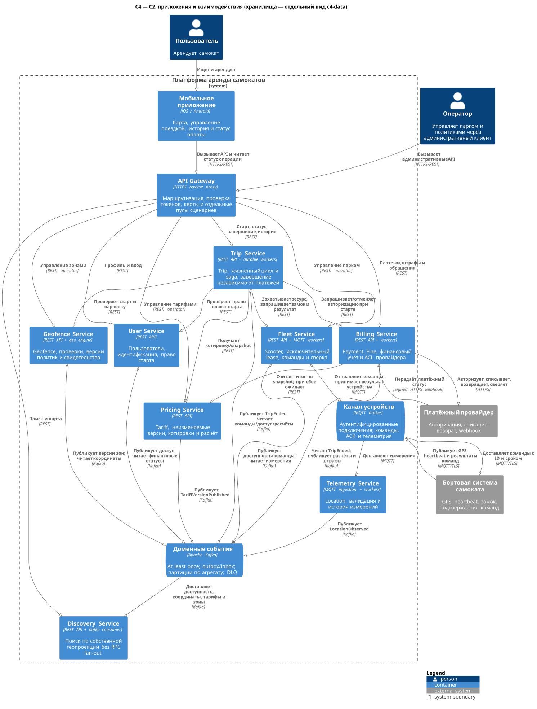
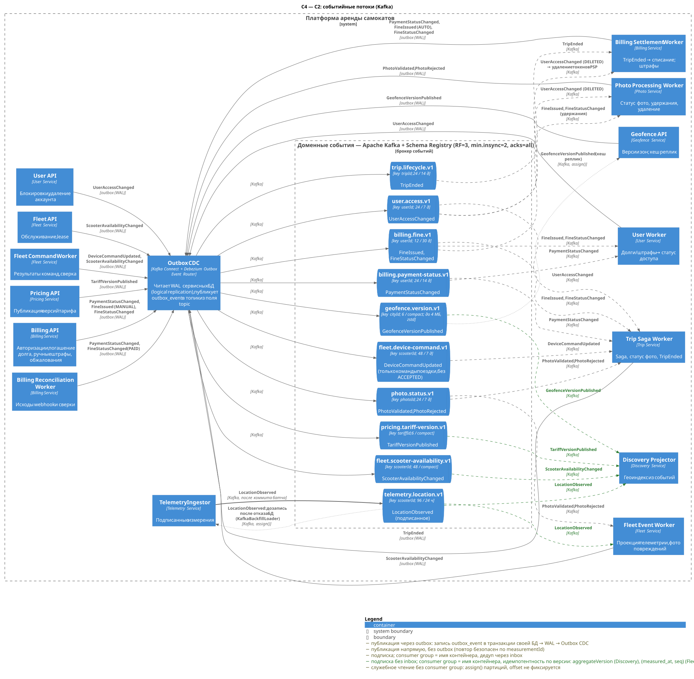
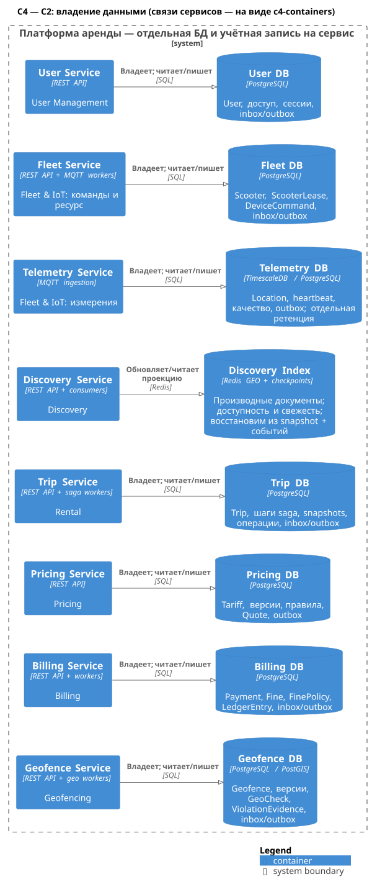

# Лабораторная работа №1. Декомпозиция сервиса аренды самокатов

**Вариант 2224: 5 млн пользователей, 5 000 RPS.**

## 1. Исходные требования и допущения

Система предоставляет регистрацию пользователей, поиск самокатов, разблокировку, поездки, тарифы, оплату, геозоны и фотофиксацию. Фотофиксация включает фото парковки при завершении поездки, фото повреждений и фото к обжалованию штрафа. Необходимо обеспечить работу критических сценариев круглосуточно, ограничить распространение отказов и независимо масштабировать компоненты. Платформой занимается отдельная команда DevOps.

Приняты следующие допущения:

- 5 млн — зарегистрированные пользователи, а не число одновременных поездок.
- 5 000 RPS — суммарный пиковый поток запросов мобильных клиентов и операторов. Внутренние RPC, сообщения устройств и события Kafka считаются отдельно.
- Число самокатов, городов, частота GPS, длительность поездки и объём истории неизвестны; точное число серверов без этих данных не определяется.
- Устройство подтверждает фактическую разблокировку и блокировку. Для автоматического восстановления необходимы `commandId`, срок действия команды и защита от устаревших команд в прошивке. Если устройство этого не поддерживает, сомнительные операции требуют карантина и сверки.
- Перед запуском требуется авторизация суммы у платёжного провайдера; окончательное списание выполняется после окончания поездки. При отказе провайдера новые поездки могут быть недоступны, но текущие должны завершаться.
- Финансовые суммы хранятся в минимальных единицах валюты. Временные отметки — в UTC; тариф фиксирует правила округления и временную зону.
- Фото парковки обязательно при завершении поездки. Исключение — явная причина пропуска: недоступна камера или сервис фото; такая поездка уходит на ручной разбор. Фото — доказательство для спора. Его отсутствие или отклонение не порождает автоматический штраф.
- Для оценки объёмов хранения приняты **условные** значения:
  - DAU около 1 млн;
  - до 1 млн поездок в сутки, на пиковый час приходится около 10% из них;
  - одно фото парковки около 400 КБ на поездку;
  - нарушения и штрафы (A6): нарушение при завершении ≈ 3 % поездок (≈ 30 тыс./сут, Geofence); штраф — до 2 % поездок (≈ 20 тыс./сут, верхняя оценка для расчёта объёмов; типично ~1 %); обжалования ≈ 10 % штрафов (≈ 2 тыс./сут); отчёты о повреждениях ≈ 5 тыс./сут (0,5 % поездок, Fleet) по ≤ 3 фото → ≤ 15 тыс. фото/сут.

  Полный список допущений A1–A6 и расчёты — в [data-storage.md](data-storage.md#допущения-по-объёмам-условно).

Предлагаемый ориентир доступности API поиска, чтения текущей поездки и принятия запроса завершения — **99,95% в месяц**. Это проектный SLO, а не данная условием или доказанная характеристика. Для старта дополнительно измеряются доля успешных разблокировок и задержка устройства; внешние зависимости учитываются в доступности всего сценария.

## 2. Bounded contexts

Границы выбраны по бизнес-правилам и согласованности данных. Bounded context — граница модели и языка; он не обязан соответствовать одному процессу или одной таблице.

| Bounded context | Смысл модели и ключевые правила | Сервисы |
| --- | --- | --- |
| **Пользователи / User Management** | Личность, профиль, доступ, блокировка аккаунта | User Service |
| **Парк и устройства / Fleet & IoT** | Самокат как физическое устройство: техническая готовность, исключительное право использования, команды, измерения | Fleet Service, Telemetry Service |
| **Поиск / Discovery** | Самокат как кандидат на карте; географический поиск по производной модели | Discovery Service |
| **Аренда / Rental** | Поездка как договор пользования: жизненный цикл, старт, окончание, компенсации | Trip Service |
| **Тарификация / Pricing** | Версии тарифов, расчёт по фиксированным условиям | Pricing Service |
| **Расчёты / Billing** | Денежные обязательства, авторизации, списания, возвраты, штрафы | Billing Service |
| **Геополитики / Geofencing** | Версии зон, допустимость старта и парковки, свидетельства нарушения правил | Geofence Service |
| **Фотофиксация / Photo Evidence** (поддерживающий) | Фото как доказательство: загрузка, целостность, проверка, сроки хранения, удержание для споров, удаление ПДн | Photo Service |

Fleet & IoT содержит два сервиса. Обработка частой телеметрии имеет иной профиль нагрузки и хранения, чем команды и резервирование. Контракт между ними явный, общей записи в БД нет.

Разблокировка не образует самостоятельный контекст. Её бизнес-результат — начало поездки, а физическая команда — операция над самокатом.

Фотофиксация выделена в отдельный контекст по трём причинам:

- у неё свой язык (назначение фото, субъект, удержание, ретенция);
- её используют три контекста: Rental — фото парковки, Fleet — повреждения, Billing — обжалование;
- профиль нагрузки и хранилище принципиально иные: около 0,4 ТБ бинарных данных в сутки (условно) в объектном хранилище.

Обоснование — в [ADR-003](adr/ADR-003-photo-evidence.md).

Все возможности задания покрыты:

| Возможность | Сервис |
| --- | --- |
| Пользователи | User |
| Самокаты | Fleet |
| Поиск | Discovery |
| Разблокировка | Trip + Fleet |
| Поездки | Trip |
| Тарифы | Pricing |
| Оплата | Billing |
| Геозоны | Geofence |
| Фотофиксация | Photo |

Telemetry обеспечивает фактические подписанные координаты для поиска и проверки зон.

## 3. Context Map

Исходник: [context-map.puml](../diagrams/context-map.puml). Готовая схема: [SVG](../diagrams/rendered/context-map.svg).

Сплошная стрелка направлена от инициатора синхронного запроса к поставщику API; пунктирная — от производителя события к потребителю. Обозначения U/D указывают upstream/downstream модели **независимо от направления запроса**. OHS/PL означает опубликованный API/язык сообщений, ACL — преобразование внешней модели в собственную.

| Отношение контекстов | Тип интеграции и назначение |
| --- | --- |
| User Management (U) → Rental (D) | OHS/PL: проверка права пользователя на старт; события блокировки |
| Fleet & IoT (U) → Rental (D) | Customer–Supplier, OHS/PL: аренда ресурса, команды замку, результат исполнения |
| Pricing (U) → Rental и Billing (D) | OHS/PL: неизменяемая версия тарифа и детерминированный расчёт |
| Geofencing (U) → Rental и Billing (D) | OHS/PL: проверка старта и парковки, версия применённой политики (Rental); чтение географического свидетельства нарушения `GET /internal/v1/violation-evidence/{evidenceId}` при обжаловании штрафа (Billing) |
| Billing (U) → Rental (D) | Customer–Supplier, OHS/PL: авторизация средств и результат расчётов |
| Rental (U) → Billing (D) | PL: факты завершения поездки и документированные нарушения; модели переводятся адаптером. OHS: чтение статуса поездки `GET /internal/v1/trips/{tripId}` для сверки осиротевших hold |
| User Management (U) → Billing (D) | PL: `UserAccessChanged(DELETED)` из `user.access.v1` — деактивация способов оплаты и удаление токенов у PSP |
| Billing (U) → User Management (D) | PL: финансовые факты (`PaymentStatusChanged`, `FineIssued`, `FineStatusChanged`) для ограничений по долгу |
| Fleet & IoT, Pricing, Geofencing (U) → Discovery (D) | PL + ACL: построение локальной поисковой проекции без совместного владения сущностями |
| Fleet & IoT (U) → Geofencing (D) | PL: подписанный формат измерения и JWKS Telemetry; Geofence проверяет подпись и свежесть измерения, которое передаёт Trip, и не потребляет поток GPS |
| Photo Evidence (U) → Rental, Fleet & IoT, Billing (D) | Customer–Supplier, OHS/PL: сессии загрузки и статусы проверки фото (`photo.status.v1`); принадлежность фото поездке, самокату или штрафу проверяет потребитель |
| Billing, User Management (U) → Photo Evidence (D) | PL: штрафы и обжалования ставят и снимают удержание фото; удаление аккаунта запускает удаление фото |
| Платёжный провайдер (U) → Billing (D) | ACL: статусы и ошибки внешнего PSP переводятся во внутреннюю платёжную модель |

Направление U/D зависит от конкретного контракта. Например, Billing предоставляет авторизацию, но потребляет факты поездки; это два различных отношения, а не общий разделяемый доменный объект.

## 4. Границы сервисов и данные

Сводный каталог: [service-catalog.md](service-catalog.md). У каждого сервиса есть детальный документ: C2 сервиса, C3 каждого контейнера, полное API, схема хранения с индексами и шардированием. Ссылки — в таблице раздела 4.1. Общие правила API и событий — в [api-conventions.md](api-conventions.md).

| Основная сущность | Единственный владелец записи | Допустимые копии |
| --- | --- | --- |
| `User` | User Service | `userId`, статус доступа и версия в проекции Trip; платёжный customer reference в Billing |
| `Scooter` | Fleet Service | Доступность, модель и заряд в Discovery; `scooterId` в Trip |
| `Trip` | Trip Service | Неизменяемые факты поездки в Billing; состояние использования в проекциях |
| `Tariff` | Pricing Service | Неизменяемый snapshot в Trip и Billing; краткое предложение цены в Discovery |
| `Payment` | Billing Service | Статус оплаты в Trip и клиентском интерфейсе |
| `Location` | Telemetry Service | Последняя координата в Discovery/Fleet, свидетельство проверки в Geofence/Trip |
| `Geofence` | Geofence Service | Версионная карта зон в Discovery и локальном кеше проверок |
| `Fine` | Billing Service | Ссылка и статус в истории поездки; географическое свидетельство не является штрафом |
| `Photo` | Photo Service | `photoId` и статус проверки в Trip (фото парковки), Fleet (отчёт о повреждении), Billing (штраф, обжалование); бинарный объект — только в объектном хранилище Photo |

У каждого сервиса своя логическая БД, учётная запись и миграции. Межсервисные SQL-запросы, внешние ключи и прямой доступ к чужой БД запрещены. Отдельная логическая БД сама по себе не обеспечивает изоляцию ресурсов: критичные хранилища и телеметрия размещаются в разных группах отказа/ресурсных пулах. На старте несколько некритичных БД допустимо размещать на одном управляемом кластере с осознанным общим риском.

Внутри сервиса применяются локальные ACID-транзакции. Между сервисами — конечные автоматы, повторяемые шаги и компенсации. Распределённой транзакции с устройством и PSP нет.

### 4.1. Контейнеры (C4, уровень 2) и компоненты (уровень 3)

Сервис в C4 — это группа контейнеров: API, отдельные workers и хранилища. **Workers — самостоятельные контейнеры** (отдельные deployment). У них своё масштабирование и свои отказы: например, остановка Billing Settlement Worker не мешает авторизации в Billing API. Поэтому для каждого worker есть отдельная C3-диаграмма.

Ниже три системные проекции уровня C2.

Синхронные взаимодействия, устройства и загрузка фото ([исходник](../diagrams/c4-containers.puml)):

Событийные потоки — топики Kafka, производители и потребители по контейнерам ([исходник](../diagrams/c4-events.puml)):

Владение данными и Outbox CDC ([исходник](../diagrams/c4-data.puml)):

| Сервис | Контейнеры | C2 и C3 | Детальное API и хранение |
| --- | --- | --- | --- |
| User | User API, User Worker | [C2](../diagrams/rendered/services/user/c2-user.svg) · [C3 API](../diagrams/rendered/services/user/c3-user-api.svg) · [C3 Worker](../diagrams/rendered/services/user/c3-user-worker.svg) | [user-service.md](services/user-service.md) |
| Fleet | Fleet API, Fleet Command Worker, Fleet Event Worker | [C2](../diagrams/rendered/services/fleet/c2-fleet.svg) · [C3 API](../diagrams/rendered/services/fleet/c3-fleet-api.svg) · [C3 Command Worker](../diagrams/rendered/services/fleet/c3-fleet-command-worker.svg) · [C3 Event Worker](../diagrams/rendered/services/fleet/c3-fleet-event-worker.svg) | [fleet-service.md](services/fleet-service.md) |
| Telemetry | Telemetry Ingestor, Telemetry API | [C2](../diagrams/rendered/services/telemetry/c2-telemetry.svg) · [C3 Ingestor](../diagrams/rendered/services/telemetry/c3-telemetry-ingestor.svg) · [C3 API](../diagrams/rendered/services/telemetry/c3-telemetry-api.svg) | [telemetry-service.md](services/telemetry-service.md) |
| Discovery | Discovery API, Discovery Projector | [C2](../diagrams/rendered/services/discovery/c2-discovery.svg) · [C3 API](../diagrams/rendered/services/discovery/c3-discovery-api.svg) · [C3 Projector](../diagrams/rendered/services/discovery/c3-discovery-projector.svg) | [discovery-service.md](services/discovery-service.md) |
| Trip | Trip API, Trip Saga Worker | [C2](../diagrams/rendered/services/trip/c2-trip.svg) · [C3 API](../diagrams/rendered/services/trip/c3-trip-api.svg) · [C3 Saga Worker](../diagrams/rendered/services/trip/c3-trip-saga-worker.svg) | [trip-service.md](services/trip-service.md) |
| Pricing | Pricing API | [C2](../diagrams/rendered/services/pricing/c2-pricing.svg) · [C3 API](../diagrams/rendered/services/pricing/c3-pricing-api.svg) | [pricing-service.md](services/pricing-service.md) |
| Billing | Billing API, Billing Settlement Worker, Billing Reconciliation Worker | [C2](../diagrams/rendered/services/billing/c2-billing.svg) · [C3 API](../diagrams/rendered/services/billing/c3-billing-api.svg) · [C3 Settlement](../diagrams/rendered/services/billing/c3-billing-settlement-worker.svg) · [C3 Reconciliation](../diagrams/rendered/services/billing/c3-billing-reconciliation-worker.svg) | [billing-service.md](services/billing-service.md) |
| Geofence | Geofence API | [C2](../diagrams/rendered/services/geofence/c2-geofence.svg) · [C3 API](../diagrams/rendered/services/geofence/c3-geofence-api.svg) | [geofence-service.md](services/geofence-service.md) |
| Photo | Photo API, Photo Processing Worker | [C2](../diagrams/rendered/services/photo/c2-photo.svg) · [C3 API](../diagrams/rendered/services/photo/c3-photo-api.svg) · [C3 Processing Worker](../diagrams/rendered/services/photo/c3-photo-processing-worker.svg) | [photo-service.md](services/photo-service.md) |

### 4.2. Хранение данных: почему PostgreSQL, индексы, партиционирование, шардирование

Подробно: [data-storage.md](data-storage.md), решение — [ADR-002](adr/ADR-002-storage.md). DDL с индексами — в разделе 4 каждого сервисного документа.

- **PostgreSQL по умолчанию.** Инварианты проекта требуют ACID-транзакции на несколько строк, например «поездка + шаг saga + outbox» или «lease + команда + outbox».
  - Используемые возможности PostgreSQL:
    - уникальные и частичные индексы;
    - условные обновления;
    - `FOR UPDATE SKIP LOCKED` для durable-очередей;
    - JSONB для snapshot;
    - PostGIS — для геозон;
    - TimescaleDB — для телеметрии, без второго операционного стека;
    - декларативное партиционирование;
    - logical replication для Debezium CDC (failover-слоты, поэтому на всех кластерах PostgreSQL 17+, [data-storage.md §2.2](data-storage.md#22-версия-и-расширения));
    - зрелые HA и PITR.
  - Оценочные объёмы годами помещаются в один primary на сервис, поэтому распределённая СУБД (CockroachDB, YugabyteDB) на старте не нужна.
  - Другие альтернативы отклонены по инвариантам: MongoDB и Cassandra — по проводкам и уникальности, MySQL — из-за отсутствия частичных индексов.
- **Не PostgreSQL:**
  - Discovery — Redis Cluster: производная восстанавливаемая проекция с GEO-запросами в памяти;
  - бинарные фото — S3-совместимое объектное хранилище;
  - события — Kafka.
- **Индексы:**
  - PK — UUIDv7: вставки идут в конец B-tree, сохраняется локальность;
  - инварианты «не более одного» — в маленьких непартиционированных таблицах `user_active_trip` и `scooter_active_lease`;
  - очереди — частичные индексы по готовым строкам с `SKIP LOCKED`;
  - история пользователя — покрывающие индексы `(user_id, created_at DESC) INCLUDE (...)`;
  - append-only журналы — BRIN по времени;
  - геометрия — GiST.
- **Партиционирование:**
  - поездки, проводки, проверки, фото — помесячно (RANGE по UUIDv7);
  - котировки и outbox — посуточно;
  - телеметрия — чанки TimescaleDB по 1 ч со сжатием.

  Старые партиции отсоединяются и выгружаются в Parquet в объектное хранилище — платформенный Archive Store с versioning и Object Lock на срок хранения: Trip — 13 месяцев в БД, затем 5 лет в архиве; Billing — 18 месяцев в БД, затем ≥ 5 лет после отчётного года; архивы Fleet, Pricing и Geofence — со своими сроками ([data-storage.md §6.4](data-storage.md#64-архивирование-detach--parquet--drop)).
- **Шардирование** на старте не включается, но модель к нему готова: 256 логических бакетов, `hash(key) mod 256` → кластер.
  - Ключи по сервисам:

    | Сервис | Ключ шардирования |
    | --- | --- |
    | Trip, Billing | `userId` (инвариант пользователя локален) |
    | Fleet | `cityId` |
    | Telemetry | `scooterId` (совпадает с ключом Kafka) |
    | Discovery | hash tag `{cityId}` в Redis Cluster |
    | Photo | `ownerUserId` (только если сработает триггер) |
    | User | `userId` (не требуется: ≈ 40 ГБ) |
    | Pricing | Не шардируется; shard-ready по `tripId` (`quote`, `price_calculation`) |
    | Geofence | Не шардируется (`cityId` при необходимости) |

    Обоснование ключей и маршрутизация запросов не по ключу — [data-storage.md §7.4](data-storage.md#74-ключи-по-сервисам).

  - Идентификаторы, по которым ищут без ключа шардирования, несут бакет в последнем байте случайной части UUIDv7: `tripId` — бакет `userId`, `leaseId` и `commandId` — бакет `cityId`. Поиск по ним не требует fan-out по шардам. `commandId` генерирует Trip Saga Worker с тем же последним байтом, что у `leaseId`; Fleet проверяет это при приёме команды (`400 VALIDATION_FAILED`). ID Billing несут бакет `userId`, `photoId` — бакет `ownerUserId`, `checkId` и `evidenceId` Geofence — бакет `cityId`; все эти ID получают бакет с запуска, до включения шардирования. Единое правило — [data-storage.md §7.3](data-storage.md#73-shard-ready-модель).
  - Шардирование включается, если наступает одно из условий:
    - загрузка записи primary выше 60–70 %;
    - горячий набор не помещается в RAM;
    - восстановление из бэкапа не укладывается в RTO.
- **HA:**
  - Trip, Fleet и Billing — синхронная реплика в другой AZ (RPO ≈ 0);
  - read replica для истории поездок;
  - PgBouncer;
  - PITR через WAL-архив; окна: Billing — 35 сут, Telemetry — 7 сут, остальные БД — 14 сут (для User это и предел по 152-ФЗ), см. [data-storage.md §8.5](data-storage.md#85-бэкапы-и-pitr).

## 5. Основные взаимодействия

### 5.1. Поиск

Мобильное приложение вызывает `GET /api/v1/scooters/nearby` через API Gateway. Discovery API читает собственный геоиндекс (Redis Cluster), который строит Discovery Projector: координаты из `LocationObserved`, доступность из `ScooterAvailabilityChanged`, опубликованные версии зон и тарифов. Время наблюдения и свежесть проекции входят в ответ. Предполагаемый порог скрытия старой координаты — 15 секунд; это параметр для проверки на реальных данных.

Ответ поиска не гарантирует возможность аренды. При старте Fleet атомарно перепроверяет техническую готовность, свежесть связи и отсутствие другого владельца самоката. Карта не становится источником истины о свободных устройствах.

### 5.2. Старт и разблокировка

Дополнительная диаграмма: [trip-start-sequence](../diagrams/rendered/trip-start-sequence.svg) ([исходник](../diagrams/trip-start-sequence.puml)).

1. Клиент отправляет `POST /api/v1/trips` с `scooterId` и `Idempotency-Key`. Trip API синхронно других сервисов не вызывает. В одной транзакции он записывает:
   - поездку `PREPARING`;
   - строку `user_active_trip` — её первичный ключ `user_id` запрещает две незавершённые поездки пользователя;
   - первый шаг saga;
   - запись идемпотентности.

   Клиент получает `202 Accepted` с `tripId` и читает результат через `GET /api/v1/trips/{id}`.
2. Шаги исполняет Trip Saga Worker — отдельный контейнер. Он проверяет доступ пользователя (User API) и получает у Fleet API последнее **подписанное Telemetry** измерение. Затем запрашивает проверку геозоны (Geofence API проверяет подпись по JWKS Telemetry и свежесть) и неизменяемую котировку Pricing с TTL. Старт использует серверные данные о самокате, а не доверяет координатам телефона.
3. Fleet атомарно создаёт исключительный `ScooterLease(tripId, fencingToken)` и меняет доступность самоката. Подготовительный lease имеет TTL. После отправки потенциально исполненной команды истечение TTL уже не делает самокат свободным.
4. Billing авторизует сумму у PSP по стабильному ключу операции `tripId:authorize` (`POST /internal/v1/payment-authorizations`). При явном отказе Trip освобождает подготовительный lease. При неизвестном результате Billing сверяется с PSP и отменяет позднюю авторизацию, если старт отменён. Исход авторизации в `PENDING_RECONCILIATION` Trip узнаёт опросом `GET /internal/v1/payment-authorizations/{authorizationId}` с backoff ([billing-service.md §3.2.3](services/billing-service.md#323-get-internalv1payment-authorizationsauthorizationid--состояние-авторизации)): события об этом исходе Billing не публикует.
5. Trip сохраняет `STARTING` и намерение разблокировать. Fleet API проверяет действительность lease, владельца и fencing token, затем фиксирует `DeviceCommand` и outbox в одной транзакции. Команду через MQTT отправляет Fleet Command Worker. Неиспользованная котировка должна быть действительна при переходе к этому шагу; её тарифный snapshot сохраняется в Trip.
6. Только подтверждение фактического открытия переводит поездку в `ACTIVE`. Время старта — подтверждённое время устройства после проверки допустимого расхождения часов.

Клиент видит прогресс через операцию старта (`GET /api/v1/trips/{tripId}/operations/{operationId}`). Её статусы:

- `ACCEPTED` — намерение записано;
- `CHECKING` — доступ пользователя, самокат и подписанное измерение, зона старта, котировка, подготовительный lease;
- `AUTHORIZING` — авторизация суммы в Billing;
- `UNLOCKING` — команда UNLOCK и ожидание подтверждения устройства;
- `COMPLETED` — поездка `ACTIVE`; `CANCELLED` — старт отменён; `RECONCILING` — исход UNLOCK неизвестен, идёт сверка.

Поездка при этом проходит `PREPARING` → `STARTING` → `ACTIVE` (либо `CANCELLED` / `RECONCILING`). Шаги и тайм-ауты — в [trip-service.md §3.7.3](services/trip-service.md#373-шаги-старта).

Отклонение любой ранней проверки переводит операцию в `CANCELLED` и освобождает созданный подготовительный lease. Если авторизация уже подтверждена, а lease или котировка истекли **до** отправки UNLOCK, saga снимает авторизацию и отменяет старт. Сбой компенсации оставляет отдельный повторяемый шаг, а не теряется вместе с HTTP-ответом.

При повторе запроса возвращается существующая операция; тот же ключ с другим телом даёт конфликт. При потере ACK поездка переходит в `RECONCILING`, самокат блокируется для других аренд, авторизация не отменяется вслепую. Fleet запрашивает состояние устройства: подтверждённый старт восстанавливает `ACTIVE`, подтверждённое неисполнение ведёт к отмене и снятию авторизации. До установления факта действует ограничение на новые поездки пользователя: строка `user_active_trip` сохраняется. Если устройство не ответило за 10 мин, поездка уходит на ручной разбор, а hold и lease держатся до решения оператора. Просроченная команда не должна внезапно разблокировать уже освобождённый самокат.

Trip хранит прогресс saga и следующие действия в БД. После перезапуска worker продолжает незавершённые шаги; «процесс в памяти» не является единственным координатором.

### 5.3. Завершение и оплата

Дополнительная диаграмма: [trip-finish-sequence](../diagrams/rendered/trip-finish-sequence.svg) ([исходник](../diagrams/trip-finish-sequence.puml)).

0. **Фото парковки.** Приложение открывает сессию загрузки: `POST /api/v1/photos/upload-sessions`, назначение `TRIP_PARKING`, субъект `tripId`. Файл загружается **напрямую** в объектное хранилище по presigned PUT URL, минуя Gateway и сервисы. Затем приложение подтверждает загрузку: `POST /api/v1/photos/{photoId}/complete`. Подробности — в [photo-service.md](services/photo-service.md).
1. `POST /api/v1/trips/{id}/finish` с `parkingPhotoId` фиксирует идемпотентное намерение завершить поездку и переводит её в `ENDING`.
   - Без фото запрос допустим только с `photoSkipReason`: `CAMERA_UNAVAILABLE` или `PHOTO_SERVICE_UNAVAILABLE`.
   - Иначе ответ — `422 PHOTO_REQUIRED`.
   - Trip **не ждёт** проверки фото, поэтому завершение не зависит от доступности Photo Service.
2. Geofence проверяет парковку по серверному подписанному измерению. Если парковка запрещена, клиент получает причину; если политика допускает завершение со штрафом, возвращается версионированное свидетельство нарушения. GPS с низкой точностью требует повторного измерения/разбора, а не автоматического штрафа. Trip сохраняет результат как `finishCheck {checkId, decision, reasonCode, policyVersion, violationEvidenceId}`. `reasonCode` — код из словаря Geofence (`OK`, `BOUNDARY_TOLERANCE`, `NO_PARKING_ZONE`, `PARKING_OUTSIDE_ZONE`, `LOW_ACCURACY` и др.); `policyVersion` — целое число, версия геополитики города.
3. Fleet отправляет команду блокировки и подтверждает фактическое закрытие. Trip фиксирует `ENDED`, время окончания и outbox-событие `TripEnded` с `finishCheck`. В событии указан и текущий статус фото: `parkingPhoto.status` = `PENDING` / `VALIDATED` / `REJECTED` / `MISSING`. Затем Fleet идемпотентно освобождает lease только для того же `tripId` и подтверждённого закрытого замка. Потеря ответа оставляет ресурс недоступным до сверки, но не отменяет факт завершения.
4. Billing получает `TripEnded`, рассчитывает сумму по сохранённому snapshot через Pricing и списывает её у PSP. При недоступности Pricing расчёт ждёт восстановления; завершение поездки уже принято. Недостаточная авторизация обрабатывается как дополнительная операция/долг, а не как откат поездки.
5. При наличии свидетельства Billing выбирает по `(cityId, finishCheck.reasonCode)` собственную неизменяемую версию `FinePolicy`, действовавшую на `endedAt`, и создаёт `Fine`. В штраф передаются `photoIds`, по ним Photo ставит удержание. Геозоны определяют географический факт и допустимость действия. Billing принимает денежное решение, исключает дубли и обеспечивает оспаривание и возврат.
   - **Принудительное завершение** поддержкой (`endReason = SUPPORT_FORCE_FINISH`) автоматического штрафа не создаёт. Если геопроверки не было, `finishCheck.decision = NOT_CHECKED`, остальные поля `finishCheck` равны `null`.
   - **Штраф после ручного разбора** (решение оператора `VIOLATION_CONFIRMED` в Trip) назначает оператор через Billing `POST /admin/v1/fines` (`source = MANUAL`). Trip сам Billing для этого не вызывает.
   - **Обжалование.** Billing API проверяет приложенные фото через Photo `GET /internal/v1/photos/{photoId}`: владелец, `purpose = FINE_APPEAL`, статус `VALIDATED`, иначе `422 PHOTO_NOT_ACCEPTABLE`. Свидетельство нарушения Billing API читает у Geofence: `GET /internal/v1/violation-evidence/{evidenceId}`.
6. Photo Processing Worker асинхронно проверяет фото и публикует результат: `PhotoValidated` или `PhotoRejected` в `photo.status.v1`.
   - Проверки: размер, SHA-256, формат, декодирование, разрешение.
   - Обработка: превью без EXIF, дедуп, pHash.
   - Trip Saga Worker сверяет владельца и субъект фото с поездкой и сохраняет статус.
   - Отклонённое, отсутствующее или подозрительное фото (`SUSPECTED_REUSE`, `LOW_QUALITY`) направляет поездку на ручной разбор оператором, а не в автоматический штраф.

Закрытая поездка и успешная оплата — разные состояния. Сбой PSP оставляет `Payment=PENDING/RETRYING/DEBT`; физически завершённая поездка не продолжается. При неизвестном результате блокировки остаётся `ENDING/RECONCILING`. Предлагаемое бизнес-правило ограничивает начисление с момента принятого запроса завершения (`finishRequestedAt`) и отправляет спорный интервал на разбор; это правило необходимо согласовать с бизнесом, чтобы сетевой сбой не приводил к бесконечному счётчику. Если за 10 мин сверка не установила факт закрытия, поездка передаётся оператору, а строка `user_active_trip` удаляется досрочно: пользователь не остаётся заложником неисправного замка и может взять другой самокат. Сам самокат остаётся занятым по lease до решения оператора. Статусы операции завершения: `ACCEPTED`, `CHECKING_PARKING`, `LOCKING`, `COMPLETED`, `REJECTED`, `RECONCILING` ([trip-service.md §3.7.4](services/trip-service.md#374-шаги-завершения)).

Hold, по которому нет расчёта, не снимается по одному возрасту. Billing Reconciliation Worker через 2 ч после авторизации запрашивает фактический статус поездки у Trip: `GET /internal/v1/trips/{tripId}` — единственный внутренний эндпоинт Trip, allowlist — только `billing-reconciliation-worker`. Поездка `CANCELLED` — hold снимается. Поездка ещё идёт — hold держится. Поездка `ENDED`, а `TripEnded` не дошёл — проверка повторяется, а через 24 ч после окончания hold снимается и поздний `TripEnded` списывает сумму отдельно.

### 5.4. Контракты событий и надёжность доставки

| Производитель (контейнер) | Топик / событие | Потребители (контейнеры) / цель |
| --- | --- | --- |
| User API, User Worker | `user.access.v1` / `UserAccessChanged` | Trip Saga Worker: проекция ограничений; Photo Processing Worker: удаление фото при удалении аккаунта; Billing Settlement Worker: при `DELETED` — деактивация способов оплаты и удаление токенов у PSP (финансовые записи хранятся 5 лет в псевдонимизированном виде) |
| Fleet API и workers | `fleet.scooter-availability.v1` / `ScooterAvailabilityChanged` | Discovery Projector: доступность на карте |
| Fleet Command Worker | `fleet.device-command.v1` / `DeviceCommandUpdated` | Trip Saga Worker: завершение ожидающего шага saga |
| Telemetry Ingestor | `telemetry.location.v1` / `LocationObserved` (подписанное) | Discovery Projector: геоиндекс; Fleet Event Worker: последнее измерение, заряд, online |
| Pricing API | `pricing.tariff-version.v1` / `TariffVersionPublished` | Discovery Projector: отображение предложения |
| Geofence API | `geofence.version.v1` / `GeofenceVersionPublished` | Discovery Projector: карта зон; реплики Geofence API: обновление индекса в памяти |
| Trip Saga Worker | `trip.lifecycle.v1` / `TripEnded` | Billing Settlement Worker: расчёт стоимости, штраф по свидетельству |
| Billing (API, workers) | `billing.payment-status.v1` / `PaymentStatusChanged` | Trip Saga Worker: финансовая проекция истории; User Worker: ограничения при долге |
| Billing Settlement Worker (`FineIssued` по свидетельству, списание), Billing API (ручной штраф, обжалования), Billing Reconciliation Worker (`FineStatusChanged(PAID)` после сверки с PSP) | `billing.fine.v1` / `FineIssued`, `FineStatusChanged` | Trip Saga Worker; User Worker; Photo Processing Worker: удержание фото-доказательств |
| Photo Processing Worker | `photo.status.v1` / `PhotoValidated`, `PhotoRejected` | Trip Saga Worker: статус фото парковки; Fleet Event Worker: фото повреждений. Для `EXPIRED` и `DELETED` событий нет: потребители узнают статус через `GET /internal/v1/photos/{photoId}` |

Geofence **не потребляет** `LocationObserved`. Измерения подписаны Telemetry (Ed25519), поэтому Trip передаёт в проверку подписанное измерение, полученное через Fleet API. Geofence проверяет подпись по JWKS Telemetry, свежесть и точность. Это снимает с Geofence поток около 20 000 сообщений/с (условно), а свидетельство нарушения становится неотрекаемым.

Конверт события:

- `eventId`, `eventType`, `schemaVersion`;
- `aggregateType`, `aggregateId`, `aggregateVersion`;
- `occurredAt`, `producer`, `correlationId`, `causationId`;
- `payload` с бизнес-полями.

Схемы событий хранятся в Schema Registry с режимом совместимости BACKWARD. Ключ партиции — идентификатор агрегата, например `scooterId` для телеметрии и `tripId` для поездки. Глобальный порядок и порядок между разными топиками не предполагаются. Полный каталог топиков с ключами, числом партиций, ретенцией и полями payload — в [api-conventions.md](api-conventions.md).

Transactional outbox публикует факты после локального коммита. Публикацию выполняет платформенный Outbox CDC (Kafka Connect + Debezium Outbox Event Router): он читает WAL сервисной БД через logical replication. Исключение — `LocationObserved`: Telemetry Ingestor публикует его напрямую после коммита пакета. Повтор безопасен благодаря детерминированному `measurementId` (UUIDv5 от `scooterId|bootId|seq`). При недоступной БД Telemetry временно работает в режиме `KAFKA_ONLY`: надёжным хранилищем становится Kafka, а БД дозаписывается из топика после восстановления (см. таблицу отказов в §6). Потребитель фиксирует inbox/dedup и изменение своей БД в одной транзакции, затем подтверждает offset. Доставка **at least once**: сквозная «exactly once» с БД, MQTT и PSP не обещается. Поздние версии проекций отбрасываются; дубли денежных операций предотвращают уникальные бизнес-ключи и idempotency key PSP. При отсутствии такой поддержки у PSP неизвестный результат сначала сверяется, а не автоматически списывается повторно.

Временная ошибка потребителя (БД, зависимость или другой сервис недоступны, тайм-аут) повторяется на месте с backoff 1 с → 60 с и jitter: партиция приостанавливается, сообщение не пропускается и в DLQ не уходит. Постоянная ошибка (схема или десериализация, нарушение инварианта, ссылка на несуществующий агрегат после окна ожидания) сразу отправляет событие в DLQ `<topic>.dlq.<consumer-group>` с оповещением и управляемым replay ([api-conventions.md §15.5](api-conventions.md#155-ошибки-обработки-dlq-replay)). Изменения контрактов проходят проверку совместимости; удаление обязательных полей требует новой версии и периода миграции потребителей.

## 6. Нагрузка, масштабирование и доступность

Иллюстративная разбивка внешнего пика, **не исходные измерения**:

| Группа запросов | Доля | RPS | Основной ресурс |
| --- | ---: | ---: | --- |
| Карта и поиск | 65% | 3 250 | Геоиндекс Discovery и пропускная способность сети |
| Чтение поездок и истории | 20% | 1 000 | Индексы и read replicas Trip |
| Старт и завершение поездок | 10% | 500 | Запись Trip/Fleet, задержка устройства, авторизация |
| Профиль, тарифы, платежные команды | 5% | 250 | Кеши, User/Billing/Pricing |
| **Итого** | **100%** | **5 000** | Внутренний fan-out увеличивает реальный поток |

Телеметрия оценивается отдельно: `eventsPerSecond = onlineScooters / reportingIntervalSeconds`. Например, **условные** 100 000 устройств с интервалом 5 секунд дают 20 000 сообщений/с ещё до событий обработки. Число пользователей не позволяет вывести число устройств.

Загрузка фото тоже оценивается отдельно и не входит в 5 000 RPS. Через Gateway проходят только лёгкие вызовы `upload-sessions` и `complete`. Сами файлы идут по presigned URL напрямую в объектное хранилище. **Условная** оценка:

| Параметр | Значение |
| --- | --- |
| Объём фото | ~1 млн фото парковки в сутки × ~400 КБ ≈ 0,4 ТБ/сутки; плюс ≤ 15 тыс. фото повреждений и ~2 тыс. фото к обжалованиям (A6) |
| Хранение в установившемся режиме | ≈ 36 ТБ фото парковки (90 дней); ≈ 46 ТБ оригиналов вместе с фото повреждений и обжалований (180 дней) и удержанными по штрафам (≈ 9,2 ТБ при штрафе до 2 % поездок, A6; ≈ 4,6 ТБ при типичном 1 %); ≈ 50 ТБ объектов вместе с превью ([photo-service.md §4.8](services/photo-service.md#48-объёмы-условно-оценка-по-a1a3)) |
| Средний поток в пиковый час | ≈ 28 завершений/с ≈ 28 фото/с (1 млн поездок в сутки, 10% — в пиковый час: 100 000 / 3 600 с) |
| Проектная цель пика загрузки | ≈ 250 фото/с × 0,4 МБ ≈ 100 МБ/с (≈ 0,8 Гбит/с) |

Проектная цель 250 фото/с — не прогноз среднего, а запас ≈ ×9 к среднему пикового часа: на минутные всплески (окончание поездок у метро, дождь), фото повреждений и обжалований, повторы загрузки. Такой поток через Gateway и JVM-сервисы непропорционально нагрузил бы их сеть и память.

Сервисы API горизонтально масштабируются за балансировщиком; состояние операций хранится вне процесса. Discovery разделяет геоиндекс по городам/ячейкам; запросы на границах объединяют соседние области. Telemetry масштабируется по соединениям, входному потоку и consumer lag. В Trip/Fleet важны конкуренция за один агрегат и пропускная способность записей: добавление pod не устраняет блокировки БД. Количество реплик и партиций определяется замерами p95/p99, CPU, I/O, задержки очередей и отказом одной зоны.

Произвольное шардирование 5 млн пользователей заранее не требуется. Схемы Trip, Billing, Fleet, Telemetry и Photo спроектированы так, чтобы шардирование можно было включить позже: логические бакеты, ключ шардирования в каждой таблице, инварианты — внутри одного ключа. Ключи всех девяти сервисов — в §4.2. Включение — по измеримым триггерам из [data-storage.md §7.2](data-storage.md#72-триггеры). Workers масштабируются отдельно от API:

- Kafka-потребители — до числа партиций топика;
- DB-очереди (`SKIP LOCKED`) — по задержке очереди.

Для production предполагаются несколько зон доступности, несколько экземпляров критичных API, реплицируемый Kafka/MQTT и управляемые БД с автоматическим failover. Конкретная конфигурация должна выдерживать потерю зоны по результатам тестов. Критичный переход подтверждается клиенту после необходимой устойчивой записи; при недоступном кворуме новые конфликтующие аренды отклоняются.

| Отказ | Поведение и предел изоляции |
| --- | --- |
| Discovery/геоиндекс | Поиск деградирует; известный `scooterId`, текущая поездка и завершение обслуживаются независимо |
| Telemetry | Старые самокаты скрываются из поиска; Fleet запрещает новый старт без свежих данных; состояние текущей поездки сохраняется. Частичные отказы Ingestor переживает в деградированных режимах ([telemetry-service.md §2.1.3](services/telemetry-service.md#213-режимы-деградации)): `DB_ONLY` — Kafka недоступна, измерения пишутся в БД, события не публикуются, Fleet берёт координату через Telemetry API; `KAFKA_ONLY` — БД недоступна дольше 10 с, все валидные измерения публикуются, PUBACK отправляется после подтверждения Kafka (исключение из правила «PUBACK после записи в БД»), после восстановления БД окно отказа дозаписывается из топика (ретенция 24 ч); `/location` и snapshot на это время недоступны или устаревают. При недоступности обоих хранилищ (`STALLED`) приём останавливается, EMQX копит сообщения в сессиях |
| User | Чтение с действующим проверяемым локально токеном возможно; новый старт требует подтверждения доступа; завершение разрешено владельцу действующей поездки |
| Pricing | Новые старты возможны только с ещё действительной подписанной котировкой; текущая поездка использует snapshot; Billing ставит расчёт в ожидание |
| Billing/PSP | Новые авторизации недоступны; завершение поездки и фиксация обязательства продолжаются |
| Geofence | Используется последняя локальная валидная версия в репликах сервиса; при полном отказе новый старт запрещён, завершение записывается для безопасного закрытия/последующего разбора без автоматического штрафа |
| Fleet/MQTT/устройство | Команда не считается исполненной по одному HTTP-успеху; неизвестное состояние блокирует повторную выдачу самоката; требуется сверка |
| Kafka | Основные сервисы продолжают локальные транзакции в пределах ёмкости outbox; поиск устаревает и скрывает старые данные; workers Trip опрашивают Fleet для критичных ACK; расчёты отложены |
| Photo Service / объектное хранилище | Завершение поездки не блокируется: клиент передаёт `photoSkipReason=PHOTO_SERVICE_UNAVAILABLE`, поездка уходит на ручной разбор; уже загруженные фото проверяются после восстановления; автоматических штрафов из-за отсутствия фото нет |
| Outbox CDC (Debezium) | Сервисы продолжают коммиты, события копятся в WAL (слот репликации); публикация возобновляется с позиции слота; рост WAL ограничен `max_slot_wal_keep_size` и мониторингом лага |

API Gateway, брокеры и хранилища тоже являются общими точками риска. Нужны отдельные квоты, пулы соединений и лимиты для поиска, старта и завершения, тайм-ауты, circuit breakers и ограничения повторов. Kafka не участвует в синхронной передаче команды разблокировки, но её отказ всё равно задерживает проекции и Billing.

## 7. Обоснование, альтернативы и развитие

Выбранная декомпозиция удерживает критичные инварианты рядом с их владельцами: один пользователь — одна незавершённая поездка в Trip; один самокат — один lease в Fleet; одна финансовая операция — один бизнес-ключ в Billing. Частый поиск и телеметрия масштабируются отдельно от денежных операций. Изменение тарифа или геозоны не переписывает прошлые поездки благодаря версиям и snapshot.

Подробное сравнение трёх альтернатив и решение находятся в [ADR-001](adr/ADR-001-decomposition.md): модульный монолит; сервис на каждую сущность; более крупные сервисы с объединённым операционным ядром.

Решения по данным вынесены в отдельные ADR:

- [ADR-002](adr/ADR-002-storage.md) — PostgreSQL как основное хранилище, Redis для Discovery, TimescaleDB для истории телеметрии, объектное хранилище для бинарных данных; индексы, партиционирование и готовность к шардированию.
- [ADR-003](adr/ADR-003-photo-evidence.md) — выделение Photo Service, прямая загрузка по presigned URL, асинхронная проверка, хранение и ретенция фото.

Предусмотрено дальнейшее выделение **Penalty Service** из Billing, если появятся сложные процедуры оспаривания и отдельная команда. Сначала `Fine`, `FinePolicy` и `FineAssessment` образуют внутренний модуль со своим интерфейсом. При выделении переносится единственный владелец этих данных и поток событий; Billing сохраняет `Payment` и принимает команды оплаты штрафа. В переходный период маршрутизация выбирает одного писателя, данные сверяются, старые чтения отключаются после переключения. Одновременная независимая запись в два источника истины не допускается. При росте числа протоколов аналогично можно выделить Device Command Service из Fleet, сохранив единственный авторитет по lease.

## 8. Потенциальные проблемы и проверка решения

| Проблема | Последствие | Мера |
| --- | --- | --- |
| Последовательные синхронные проверки старта | Рост задержки и зависимость от доступности нескольких сервисов | Короткие тайм-ауты, кеши неизменяемых правил, асинхронное ожидание устройства, отдельные метрики этапов |
| Нельзя атомарно изменить БД, PSP и устройство | Потерянные ACK, лишняя авторизация, неизвестное состояние | Durable saga, идентификаторы команд, сверка, компенсации, карантин |
| Прошивка не защищает от устаревших и повторных команд | Просроченная или чужая команда открывает замок самоката, уже выданного другой поездке | Требования к прошивке ([fleet-service.md §3.5](services/fleet-service.md#35-mqtt)): хранить `lastFencingToken` во флеш-памяти и отклонять команды с меньшим токеном (`REJECTED_STALE`); проверять `expiresAt` по часам устройства (GPS/NTP), без синхронизации — `FAILED` с `CLOCK_UNSYNCED`; дедуплицировать по `commandId` (последние 16 результатов); при том же токене отклонять команду с `issuedAt` раньше последней исполненной; `LOCK` только при нулевой скорости (иначе `SCOOTER_MOVING`). Ответ `STATE` содержит `recentCommands` и `lastFencingToken`, `connSeq` упорядочивает LWT/BIRTH. Без этих свойств — карантин и ручная сверка |
| Устаревшая карта | На карте виден уже занятый самокат | Свежесть, версии проекций, атомарная перепроверка во Fleet |
| Дубли, задержки, перестановка событий | Повторное списание/штраф, откат проекции | Inbox, уникальные бизнес-ключи, версии агрегатов, replay |
| GPS-погрешность, spoofing, неверные часы | Неправильная геозона и сумма | Серверные наблюдения, точность измерения, предел расхождения времени, разбор спорных случаев |
| Горячий город/самокат и большой объём GPS | Неравномерная нагрузка, дорогая история | Партиционирование, квоты, ретенция/агрегация, отдельное хранилище телеметрии |
| Долгие поездки и изменение правил | Невоспроизводимый расчёт | Неизменяемый тарифный snapshot; версия геополитики фиксируется при каждой проверке |
| Много сервисов и общая платформа | Затраты на эксплуатацию, общий отказ кластера | Платформенные шаблоны DevOps, изоляция ресурсов, независимые релизы и восстановление |
| Персональные и платёжные данные | Избыточный доступ и раскрытие истории перемещений | Минимизация событий, RBAC, шифрование, аудит, согласованные сроки хранения; карточные реквизиты остаются у PSP |
| Персональные данные на фото (лица, номера машин) | Утечка изображений, нарушение требований к ПДн | Приватные бакеты, SSE-KMS, короткоживущие presigned GET только для владельца и оператора, удаление EXIF-геометки из производных, ретенция 90 дней (парковка) и 180 дней (повреждения, обжалования), удержания для споров, удаление по `UserAccessChanged` (`DELETED`) |
| Объём и стоимость фото | Десятки ТБ в объектном хранилище | Сжатие на клиенте, лимит размера, lifecycle-правила (переход в холодный класс, удаление), хранение производных отдельно от оригиналов |
| Повторное использование чужого/старого фото | Ложное подтверждение парковки | Сессия загрузки привязана к владельцу и субъекту (`tripId` для фото парковки), Trip сверяет их с поездкой; SHA-256 и perceptual hash против дубликатов, сверка времени съёмки (EXIF) с окном сессии загрузки, ручной разбор спорных случаев |
| Недоступность Photo Service при завершении | Пользователь не может завершить поездку | Завершение не блокируется: `photoSkipReason` и ручной разбор вместо отказа |

План проверки архитектурных предположений: нагрузочный профиль 5 000 внешних RPS с отдельным потоком GPS; два одновременных старта на пользователя и самокат; потеря/повтор MQTT ACK; запоздалая авторизация PSP; двойной webhook; остановка Kafka; остановка Debezium с ростом WAL; завершение поездки при недоступном Photo Service; восстановление saga после перезапуска; отказ зоны; восстановление из резервной копии. Приёмочные критерии включают отсутствие двух владельцев ресурса, отсутствие повторных списаний, воспроизводимость цены и возможность принять завершение при сбое платежей. В рамках лабораторной это **план**, а не результаты нагрузочных испытаний реализованной системы.

## 9. Команды и переход от монолита

Продуктовые команды владеют бизнес-моделью, контрактами, миграциями и работоспособностью своих сервисов; одна команда может вести несколько связанных сервисов. Fleet и Telemetry принадлежат команде IoT. Photo Service ведёт команда Rental вместе с Trip: правила фотофиксации — часть сценария завершения поездки. Отдельная команда DevOps отвечает за CI/CD, IaC, Kubernetes/среду исполнения, брокеры, резервное копирование, секреты, мониторинг и платформенное дежурство. Наличие DevOps не превращает бизнес-ошибки и контракты всех сервисов в её единоличную ответственность.

Переход выполняется постепенно: сначала модули и владельцы данных внутри монолита; затем outbox/контракты и проекция Discovery; далее Telemetry; после этого Pricing/Geofence, Billing и согласованная миграция Rental/Fleet. Для каждой сущности назначается один активный писатель. Бэкфилл и временный CDC применяются для сверки и переноса, а не как постоянный межсервисный SQL-интерфейс. Перед переключением критического сценария проверяются повторы, откат маршрутизации и незавершённые операции.

## 10. Источники методики

- [Microsoft: анализ предметной области и bounded contexts](https://learn.microsoft.com/en-us/azure/architecture/microservices/model/domain-analysis) — принцип границ по бизнес-возможностям. Конкретные границы самокатного сервиса являются решением этой лабораторной.
- [C4: System Context](https://c4model.com/diagrams/system-context) и [Container](https://c4model.com/diagrams/container) — уровни представления системы и её приложений/хранилищ.
- [C4: Component](https://c4model.com/diagrams/component) — уровень 3: устройство отдельного контейнера.
- [C4-PlantUML](https://github.com/plantuml-stdlib/C4-PlantUML) — обозначения и встроенные include для исходников схем.
- [PostgreSQL: Table Partitioning](https://www.postgresql.org/docs/current/ddl-partitioning.html) и [Index Types](https://www.postgresql.org/docs/current/indexes-types.html) — декларативное партиционирование, B-tree/BRIN/GiST.
- [Debezium Outbox Event Router](https://debezium.io/documentation/reference/stable/transformations/outbox-event-router.html) — публикация outbox через CDC.
- [Amazon S3: presigned URLs](https://docs.aws.amazon.com/AmazonS3/latest/userguide/using-presigned-url.html) и [Object Lock](https://docs.aws.amazon.com/AmazonS3/latest/userguide/object-lock.html) — прямая загрузка и удержание фото.
- [RFC 9457: Problem Details for HTTP APIs](https://www.rfc-editor.org/rfc/rfc9457) — формат ошибок API.
