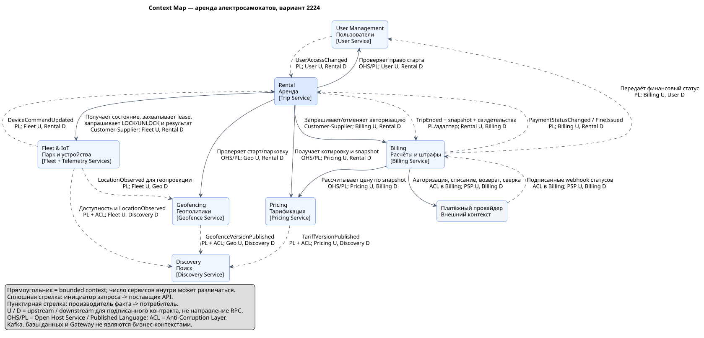

# Лабораторная работа №1. Декомпозиция сервиса аренды самокатов

**Вариант 2224: 5 млн пользователей, 5 000 RPS.**

## 1. Исходные требования и допущения

Система предоставляет регистрацию пользователей, поиск самокатов, разблокировку, поездки, тарифы, оплату и геозоны. Необходимо обеспечить работу критических сценариев круглосуточно, ограничить распространение отказов и независимо масштабировать компоненты. Платформой занимается отдельная команда DevOps.

Приняты следующие допущения:

- 5 млн — зарегистрированные пользователи, а не число одновременных поездок.
- 5 000 RPS — суммарный пиковый поток запросов мобильных клиентов и операторов. Внутренние RPC, сообщения устройств и события Kafka считаются отдельно.
- Число самокатов, городов, частота GPS, длительность поездки и объём истории неизвестны; точное число серверов без этих данных не определяется.
- Устройство подтверждает фактическую разблокировку и блокировку. Для автоматического восстановления необходимы `commandId`, срок действия команды и защита от устаревших команд в прошивке. Если устройство этого не поддерживает, сомнительные операции требуют карантина и сверки.
- Перед запуском требуется авторизация суммы у платёжного провайдера; окончательное списание выполняется после окончания поездки. При отказе провайдера новые поездки могут быть недоступны, но текущие должны завершаться.
- Финансовые суммы хранятся в минимальных единицах валюты. Временные отметки — в UTC; тариф фиксирует правила округления и временную зону.

Предлагаемый ориентир доступности API поиска, чтения текущей поездки и принятия запроса завершения — **99,95% в месяц**. Это проектный SLO, а не данная условием или доказанная характеристика. Для старта дополнительно измеряются доля успешных разблокировок и задержка устройства; внешние зависимости учитываются в доступности всего сценария.

## 2. Bounded contexts

Границы выбраны по бизнес-правилам и согласованности данных. Bounded context — граница модели и языка; он не обязан соответствовать одному процессу или одной таблице.

| Bounded context | Смысл модели и ключевые правила | Сервисы |
| --- | --- | --- |
| **Пользователи / User Management** | Личность, профиль, доступ, блокировка аккаунта | User Service |
| **Парк и устройства / Fleet & IoT** | Самокат как физическое устройство: техническая готовность, исключительное право использования, команды, измерения | Fleet Service, Telemetry Service |
| **Поиск / Discovery** | Самокат как кандидат на карте; географический поиск по производной модели | Discovery Service |
| **Аренда / Rental** | Поездка как договор пользования: жизненный цикл, старт, окончание, компенсации | Trip Service |
| **Тарификация / Pricing** | Версии тарифов, расчёт по фиксированным условиям | Pricing Service |
| **Расчёты / Billing** | Денежные обязательства, авторизации, списания, возвраты, штрафы | Billing Service |
| **Геополитики / Geofencing** | Версии зон, допустимость старта и парковки, свидетельства нарушения правил | Geofence Service |

Fleet & IoT содержит два сервиса: обработка частой телеметрии имеет иной профиль нагрузки и хранения, чем команды и резервирование. Контракт между ними явный; общая запись в БД отсутствует. Разблокировка не образует самостоятельный контекст: её бизнес-результат — начало поездки, а физическая команда — операция над самокатом.

Все возможности задания покрыты: пользователи — User; самокаты — Fleet; поиск — Discovery; разблокировка — Trip + Fleet; поездки — Trip; тарифы — Pricing; оплата — Billing; геозоны — Geofence. Telemetry обеспечивает фактические координаты для поиска и проверки зон.

## 3. Context Map

Исходник: [context-map.puml](../diagrams/context-map.puml). Готовая схема: [SVG](../diagrams/rendered/context-map.svg).

Сплошная стрелка направлена от инициатора синхронного запроса к поставщику API; пунктирная — от производителя события к потребителю. Обозначения U/D указывают upstream/downstream модели **независимо от направления запроса**. OHS/PL означает опубликованный API/язык сообщений, ACL — преобразование внешней модели в собственную.

| Отношение контекстов | Тип интеграции и назначение |
| --- | --- |
| User Management (U) → Rental (D) | OHS/PL: проверка права пользователя на старт; события блокировки |
| Fleet & IoT (U) → Rental (D) | Customer–Supplier, OHS/PL: аренда ресурса, команды замку, результат исполнения |
| Pricing (U) → Rental и Billing (D) | OHS/PL: неизменяемая версия тарифа и детерминированный расчёт |
| Geofencing (U) → Rental (D) | OHS/PL: проверка старта и парковки, версия применённой политики |
| Billing (U) → Rental (D) | Customer–Supplier, OHS/PL: авторизация средств и результат расчётов |
| Rental (U) → Billing (D) | PL: факты завершения поездки и документированные нарушения; модели переводятся адаптером |
| Fleet & IoT, Pricing, Geofencing (U) → Discovery (D) | PL + ACL: построение локальной поисковой проекции без совместного владения сущностями |
| Платёжный провайдер (U) → Billing (D) | ACL: статусы и ошибки внешнего PSP переводятся во внутреннюю платёжную модель |

Направление U/D зависит от конкретного контракта. Например, Billing предоставляет авторизацию, но потребляет факты поездки; это два различных отношения, а не общий разделяемый доменный объект.

## 4. Границы сервисов и данные

Полный каталог с API, зависимостями и масштабированием: [service-catalog.md](service-catalog.md).

| Основная сущность | Единственный владелец записи | Допустимые копии |
| --- | --- | --- |
| `User` | User Service | `userId`, статус доступа и версия в проекции Trip; платёжный customer reference в Billing |
| `Scooter` | Fleet Service | Доступность, модель и заряд в Discovery; `scooterId` в Trip |
| `Trip` | Trip Service | Неизменяемые факты поездки в Billing; состояние использования в проекциях |
| `Tariff` | Pricing Service | Неизменяемый snapshot в Trip и Billing; краткое предложение цены в Discovery |
| `Payment` | Billing Service | Статус оплаты в Trip и клиентском интерфейсе |
| `Location` | Telemetry Service | Последняя координата в Discovery/Fleet, свидетельство проверки в Geofence/Trip |
| `Geofence` | Geofence Service | Версионная карта зон в Discovery и локальном кеше проверок |
| `Fine` | Billing Service | Ссылка и статус в истории поездки; географическое свидетельство не является штрафом |

У каждого сервиса своя логическая БД, учётная запись и миграции. Межсервисные SQL-запросы, внешние ключи и прямой доступ к чужой БД запрещены. Отдельная логическая БД сама по себе не обеспечивает изоляцию ресурсов: критичные хранилища и телеметрия размещаются в разных группах отказа/ресурсных пулах. На старте несколько некритичных БД допустимо размещать на одном управляемом кластере с осознанным общим риском.

Внутри сервиса применяются локальные ACID-транзакции. Между сервисами — конечные автоматы, повторяемые шаги и компенсации. Распределённой транзакции с устройством и PSP нет.

## 5. Основные взаимодействия

### 5.1. Поиск

Мобильное приложение вызывает `GET /scooters/nearby` через API Gateway. Discovery читает собственный геоиндекс: координаты из `LocationObserved`, доступность из `ScooterAvailabilityChanged`, опубликованные версии зон и тарифов. Время наблюдения и свежесть проекции входят в ответ. Предполагаемый порог скрытия старой координаты — 15 секунд; это параметр для проверки на реальных данных.

Ответ поиска не гарантирует возможность аренды. При старте Fleet атомарно перепроверяет техническую готовность, свежесть связи и отсутствие другого владельца самоката. Карта не становится источником истины о свободных устройствах.

### 5.2. Старт и разблокировка

Дополнительная диаграмма: [trip-start-sequence.puml](../diagrams/trip-start-sequence.puml).

1. Клиент отправляет `POST /trips` с `scooterId` и `Idempotency-Key`. Trip создаёт `PREPARING`; уникальное ограничение по `userId` для незавершённых состояний запрещает две одновременные поездки пользователя. Клиент получает `202 Accepted` с `tripId` и читает результат операции через `GET /trips/{id}`.
2. Trip проверяет доступ пользователя, получает актуальное измерение через Fleet, проверку геозоны и неизменяемую котировку Pricing с TTL. Старт использует серверные данные о самокате, а не доверяет координатам телефона.
3. Fleet атомарно создаёт исключительный `ScooterLease(tripId, fencingToken)` и меняет доступность самоката. Подготовительный lease имеет TTL. После отправки потенциально исполненной команды истечение TTL уже не делает самокат свободным.
4. Billing авторизует сумму у PSP по стабильному ключу операции `tripId:authorize`. При явном отказе Trip освобождает подготовительный lease. При неизвестном результате Billing сверяется с PSP и отменяет позднюю авторизацию, если старт отменён.
5. Trip сохраняет `STARTING` и намерение разблокировать. Fleet проверяет действительность lease, владельца и fencing token, затем фиксирует `DeviceCommand` и outbox в одной транзакции; его worker отправляет команду через MQTT. Неиспользованная котировка должна быть действительна при переходе к этому шагу; её тарифный snapshot сохраняется в Trip.
6. Только подтверждение фактического открытия переводит поездку в `ACTIVE`. Время старта — подтверждённое время устройства после проверки допустимого расхождения часов.

Отклонение любой ранней проверки переводит операцию в `CANCELLED` и освобождает созданный подготовительный lease. Если авторизация уже подтверждена, а lease или котировка истекли **до** отправки UNLOCK, saga снимает авторизацию и отменяет старт. Сбой компенсации оставляет отдельный повторяемый шаг, а не теряется вместе с HTTP-ответом.

При повторе запроса возвращается существующая операция; тот же ключ с другим телом даёт конфликт. При потере ACK поездка переходит в `RECONCILING`, самокат блокируется для других аренд, авторизация не отменяется вслепую. Fleet запрашивает состояние устройства: подтверждённый старт восстанавливает `ACTIVE`, подтверждённое неисполнение ведёт к отмене и снятию авторизации. До установления факта действует ограничение на новые поездки пользователя. Просроченная команда не должна внезапно разблокировать уже освобождённый самокат.

Trip хранит прогресс saga и следующие действия в БД. После перезапуска worker продолжает незавершённые шаги; «процесс в памяти» не является единственным координатором.

### 5.3. Завершение и оплата

1. `POST /trips/{id}/finish` фиксирует идемпотентное намерение завершить поездку и переводит её в `ENDING`.
2. Geofence проверяет парковку по серверному измерению. Если парковка запрещена, клиент получает причину; если политика допускает завершение со штрафом, возвращается версионированное свидетельство нарушения. GPS с низкой точностью требует повторного измерения/разбора, а не автоматического штрафа.
3. Fleet отправляет команду блокировки и подтверждает фактическое закрытие. Trip фиксирует `ENDED`, время окончания и outbox-событие `TripEnded`. Затем Fleet идемпотентно освобождает lease только для того же `tripId` и подтверждённого закрытого замка. Потеря ответа оставляет ресурс недоступным до сверки, но не отменяет факт завершения.
4. Billing получает `TripEnded`, рассчитывает сумму по сохранённому snapshot через Pricing и списывает её у PSP. При недоступности Pricing расчёт ждёт восстановления; завершение поездки уже принято. Недостаточная авторизация обрабатывается как дополнительная операция/долг, а не как откат поездки.
5. При наличии свидетельства Billing применяет собственную неизменяемую версию `FinePolicy`, действовавшую на момент нарушения, и создаёт `Fine`. Геозоны определяют географический факт и допустимость действия; Billing принимает денежное решение, исключает дубли и обеспечивает оспаривание/возврат.

Закрытая поездка и успешная оплата — разные состояния. Сбой PSP оставляет `Payment=PENDING/RETRYING/DEBT`; физически завершённая поездка не продолжается. При неизвестном результате блокировки остаётся `ENDING/RECONCILING`. Предлагаемое бизнес-правило ограничивает начисление с момента принятого запроса завершения и отправляет спорный интервал на разбор; это правило необходимо согласовать с бизнесом, чтобы сетевой сбой не приводил к бесконечному счётчику.

### 5.4. Контракты событий и надёжность доставки

| Производитель | Событие | Основные потребители / цель |
| --- | --- | --- |
| User | `UserAccessChanged` | Trip: обновление проекции ограничений; актуальная проверка перед новым стартом |
| Fleet | `ScooterAvailabilityChanged` | Discovery: доступность на карте |
| Fleet | `DeviceCommandUpdated` | Trip: завершение ожидающего шага saga |
| Telemetry | `LocationObserved` | Discovery: геоиндекс; Fleet: свежесть/заряд; Geofence: обработка координат |
| Pricing | `TariffVersionPublished` | Discovery: отображение предложения; кеши опубликованных тарифов |
| Geofence | `GeofenceVersionPublished` | Discovery: карта зон; локальные реплики правил Geofence |
| Trip | `TripEnded` | Billing: расчёт стоимости и обработка приложенных свидетельств |
| Billing | `PaymentStatusChanged`, `FineIssued` | Trip: финансовая проекция истории; User: ограничения при долге по согласованной политике |

Событие содержит `eventId`, `eventType`, `schemaVersion`, `aggregateId`, `aggregateVersion`, `occurredAt`, `correlationId`, а также необходимые бизнес-поля. Ключ партиции — идентификатор агрегата, например `scooterId` для телеметрии и `tripId` для поездки. Глобальный порядок и порядок между разными топиками не предполагаются.

Transactional outbox публикует факты после локального коммита. Потребитель фиксирует inbox/dedup и изменение своей БД в одной транзакции, затем подтверждает offset. Доставка **at least once**: сквозная «exactly once» с БД, MQTT и PSP не обещается. Поздние версии проекций отбрасываются; дубли денежных операций предотвращают уникальные бизнес-ключи и idempotency key PSP. При отсутствии такой поддержки у PSP неизвестный результат сначала сверяется, а не автоматически списывается повторно.

Повторы ограничены по времени, имеют backoff и jitter. Неисправимые события идут в DLQ с оповещением и управляемым replay. Изменения контрактов проходят проверку совместимости; удаление обязательных полей требует новой версии и периода миграции потребителей.

## 6. Нагрузка, масштабирование и доступность

Иллюстративная разбивка внешнего пика, **не исходные измерения**:

| Группа запросов | Доля | RPS | Основной ресурс |
| --- | ---: | ---: | --- |
| Карта и поиск | 65% | 3 250 | Геоиндекс Discovery и пропускная способность сети |
| Чтение поездок и истории | 20% | 1 000 | Индексы и read replicas Trip |
| Старт и завершение поездок | 10% | 500 | Запись Trip/Fleet, задержка устройства, авторизация |
| Профиль, тарифы, платежные команды | 5% | 250 | Кеши, User/Billing/Pricing |
| **Итого** | **100%** | **5 000** | Внутренний fan-out увеличивает реальный поток |

Телеметрия оценивается отдельно: `eventsPerSecond = onlineScooters / reportingIntervalSeconds`. Например, **условные** 100 000 устройств с интервалом 5 секунд дают 20 000 сообщений/с ещё до событий обработки. Число пользователей не позволяет вывести число устройств.

Сервисы API горизонтально масштабируются за балансировщиком; состояние операций хранится вне процесса. Discovery разделяет геоиндекс по городам/ячейкам; запросы на границах объединяют соседние области. Telemetry масштабируется по соединениям, входному потоку и consumer lag. В Trip/Fleet важны конкуренция за один агрегат и пропускная способность записей: добавление pod не устраняет блокировки БД. Количество реплик и партиций определяется замерами p95/p99, CPU, I/O, задержки очередей и отказом одной зоны; произвольное шардирование 5 млн пользователей заранее не требуется.

Для production предполагаются несколько зон доступности, несколько экземпляров критичных API, реплицируемый Kafka/MQTT и управляемые БД с автоматическим failover. Конкретная конфигурация должна выдерживать потерю зоны по результатам тестов. Критичный переход подтверждается клиенту после необходимой устойчивой записи; при недоступном кворуме новые конфликтующие аренды отклоняются.

| Отказ | Поведение и предел изоляции |
| --- | --- |
| Discovery/геоиндекс | Поиск деградирует; известный `scooterId`, текущая поездка и завершение обслуживаются независимо |
| Telemetry | Старые самокаты скрываются из поиска; Fleet запрещает новый старт без свежих данных; состояние текущей поездки сохраняется |
| User | Чтение с действующим проверяемым локально токеном возможно; новый старт требует подтверждения доступа; завершение разрешено владельцу действующей поездки |
| Pricing | Новые старты возможны только с ещё действительной подписанной котировкой; текущая поездка использует snapshot; Billing ставит расчёт в ожидание |
| Billing/PSP | Новые авторизации недоступны; завершение поездки и фиксация обязательства продолжаются |
| Geofence | Используется последняя локальная валидная версия в репликах сервиса; при полном отказе новый старт запрещён, завершение записывается для безопасного закрытия/последующего разбора без автоматического штрафа |
| Fleet/MQTT/устройство | Команда не считается исполненной по одному HTTP-успеху; неизвестное состояние блокирует повторную выдачу самоката; требуется сверка |
| Kafka | Основные сервисы продолжают локальные транзакции в пределах ёмкости outbox; поиск устаревает и скрывает старые данные; workers Trip опрашивают Fleet для критичных ACK; расчёты отложены |

API Gateway, брокеры и хранилища тоже являются общими точками риска. Нужны отдельные квоты, пулы соединений и лимиты для поиска, старта и завершения, тайм-ауты, circuit breakers и ограничения повторов. Kafka не участвует в синхронной передаче команды разблокировки, но её отказ всё равно задерживает проекции и Billing.

## 7. Обоснование, альтернативы и развитие

Выбранная декомпозиция удерживает критичные инварианты рядом с их владельцами: один пользователь — одна незавершённая поездка в Trip; один самокат — один lease в Fleet; одна финансовая операция — один бизнес-ключ в Billing. Частый поиск и телеметрия масштабируются отдельно от денежных операций. Изменение тарифа или геозоны не переписывает прошлые поездки благодаря версиям и snapshot.

Подробное сравнение трёх альтернатив и решение находятся в [ADR-001](adr/ADR-001-decomposition.md): модульный монолит; сервис на каждую сущность; более крупные сервисы с объединённым операционным ядром.

Предусмотрено дальнейшее выделение **Penalty Service** из Billing, если появятся сложные процедуры оспаривания и отдельная команда. Сначала `Fine`, `FinePolicy` и `FineAssessment` образуют внутренний модуль со своим интерфейсом. При выделении переносится единственный владелец этих данных и поток событий; Billing сохраняет `Payment` и принимает команды оплаты штрафа. В переходный период маршрутизация выбирает одного писателя, данные сверяются, старые чтения отключаются после переключения. Одновременная независимая запись в два источника истины не допускается. При росте числа протоколов аналогично можно выделить Device Command Service из Fleet, сохранив единственный авторитет по lease.

## 8. Потенциальные проблемы и проверка решения

| Проблема | Последствие | Мера |
| --- | --- | --- |
| Последовательные синхронные проверки старта | Рост задержки и зависимость от доступности нескольких сервисов | Короткие тайм-ауты, кеши неизменяемых правил, асинхронное ожидание устройства, отдельные метрики этапов |
| Нельзя атомарно изменить БД, PSP и устройство | Потерянные ACK, лишняя авторизация, неизвестное состояние | Durable saga, идентификаторы команд, сверка, компенсации, карантин |
| Устаревшая карта | На карте виден уже занятый самокат | Свежесть, версии проекций, атомарная перепроверка во Fleet |
| Дубли, задержки, перестановка событий | Повторное списание/штраф, откат проекции | Inbox, уникальные бизнес-ключи, версии агрегатов, replay |
| GPS-погрешность, spoofing, неверные часы | Неправильная геозона и сумма | Серверные наблюдения, точность измерения, предел расхождения времени, разбор спорных случаев |
| Горячий город/самокат и большой объём GPS | Неравномерная нагрузка, дорогая история | Партиционирование, квоты, ретенция/агрегация, отдельное хранилище телеметрии |
| Долгие поездки и изменение правил | Невоспроизводимый расчёт | Неизменяемый тарифный snapshot; версия геополитики фиксируется при каждой проверке |
| Много сервисов и общая платформа | Затраты на эксплуатацию, общий отказ кластера | Платформенные шаблоны DevOps, изоляция ресурсов, независимые релизы и восстановление |
| Персональные и платёжные данные | Избыточный доступ и раскрытие истории перемещений | Минимизация событий, RBAC, шифрование, аудит, согласованные сроки хранения; карточные реквизиты остаются у PSP |

План проверки архитектурных предположений: нагрузочный профиль 5 000 внешних RPS с отдельным потоком GPS; два одновременных старта на пользователя и самокат; потеря/повтор MQTT ACK; запоздалая авторизация PSP; двойной webhook; остановка Kafka; восстановление saga после перезапуска; отказ зоны; восстановление из резервной копии. Приёмочные критерии включают отсутствие двух владельцев ресурса, отсутствие повторных списаний, воспроизводимость цены и возможность принять завершение при сбое платежей. В рамках лабораторной это **план**, а не результаты нагрузочных испытаний реализованной системы.

## 9. Команды и переход от монолита

Продуктовые команды владеют бизнес-моделью, контрактами, миграциями и работоспособностью своих сервисов; одна команда может вести несколько связанных сервисов. Fleet и Telemetry принадлежат команде IoT. Отдельная команда DevOps отвечает за CI/CD, IaC, Kubernetes/среду исполнения, брокеры, резервное копирование, секреты, мониторинг и платформенное дежурство. Наличие DevOps не превращает бизнес-ошибки и контракты всех сервисов в её единоличную ответственность.

Переход выполняется постепенно: сначала модули и владельцы данных внутри монолита; затем outbox/контракты и проекция Discovery; далее Telemetry; после этого Pricing/Geofence, Billing и согласованная миграция Rental/Fleet. Для каждой сущности назначается один активный писатель. Бэкфилл и временный CDC применяются для сверки и переноса, а не как постоянный межсервисный SQL-интерфейс. Перед переключением критического сценария проверяются повторы, откат маршрутизации и незавершённые операции.

## 10. Источники методики

- [Microsoft: анализ предметной области и bounded contexts](https://learn.microsoft.com/en-us/azure/architecture/microservices/model/domain-analysis) — принцип границ по бизнес-возможностям. Конкретные границы самокатного сервиса являются решением этой лабораторной.
- [C4: System Context](https://c4model.com/diagrams/system-context) и [Container](https://c4model.com/diagrams/container) — уровни представления системы и её приложений/хранилищ.
- [C4-PlantUML](https://github.com/plantuml-stdlib/C4-PlantUML) — обозначения и встроенные include для исходников схем.
