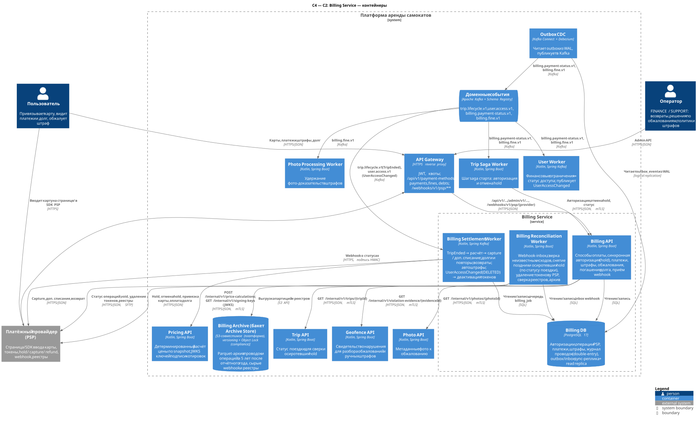
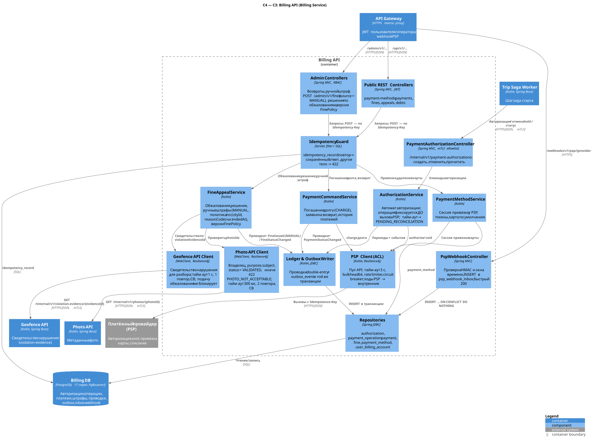
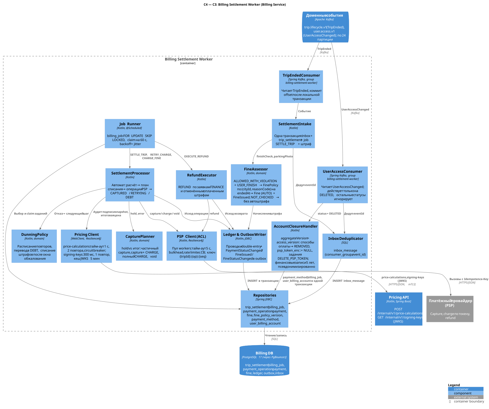
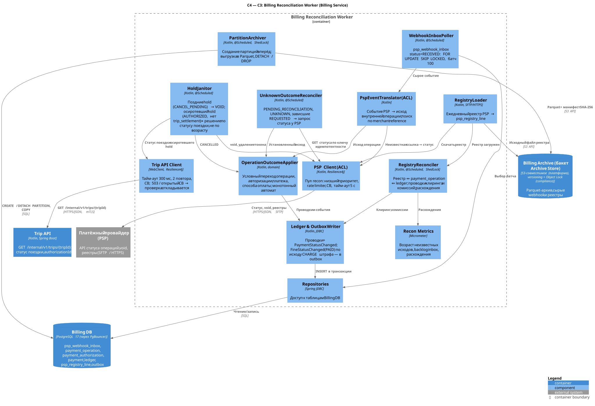

# Billing Service

**Bounded context:** Расчёты / Billing (основной поддомен для денег платформы). **Команда-владелец:** команда расчётов.

**Отвечает за:** способы оплаты (только токены PSP), синхронную авторизацию суммы (hold) при старте поездки и её отмену, окончательное списание после `TripEnded` (capture, дополнительное списание), долги и повторы списаний, возвраты, штрафы по версионированной `FinePolicy`, обжалования, погашение долга, приём и сверку статусов PSP, журнал проводок (double-entry) и его хранение ≥ 5 лет.

**НЕ делает:** не считает цену (это Pricing по snapshot тарифа); не решает, нарушена ли парковка (географический факт и свидетельство — Geofence, Billing принимает только денежное решение); не ограничивает доступ пользователя (публикует факты, решение принимает User Worker); не хранит и не видит карточные данные (PAN/CVC вводятся на странице или в SDK PSP); не хранит бинарные фото (Photo Service); не продлевает и не откатывает поездку из-за проблем с оплатой.

Ссылки: [каталог сервисов](../service-catalog.md#7-billing-service), [конвенции API](../api-conventions.md), [хранение данных](../data-storage.md), основной отчёт — [старт и разблокировка](../lab-01.md#52-старт-и-разблокировка), [завершение и оплата](../lab-01.md#53-завершение-и-оплата), [надёжность доставки](../lab-01.md#54-контракты-событий-и-надёжность-доставки), смежные сервисы — [Trip](trip-service.md), [Pricing](pricing-service.md), [Photo](photo-service.md), [Geofence](geofence-service.md), [User](user-service.md).

Ключевые инварианты сервиса:

| Инвариант | Чем обеспечен |
| --- | --- |
| Одна денежная операция PSP на `(tripId, operationType, operationSeq)` | PK `payment_operation (trip_id, operation_type, operation_seq)` + ключ идемпотентности PSP `{tripId}:{op}[:{seq}]` |
| Одна авторизация на поездку | строка `(tripId, AUTHORIZE, 1)` в `payment_operation`, вставляется до вызова PSP |
| Один штраф на свидетельство и версию политики; один ручной штраф на разбор | UNIQUE `fine (violation_evidence_id, fine_policy_version)`; UNIQUE `fine (review_id)` для ручных штрафов по разбору поездки (§3.2.17) |
| Повторный webhook не создаёт повторной проводки | UNIQUE `psp_webhook_inbox (provider, provider_event_id)` + условный переход операции `REQUESTED/UNKNOWN → SUCCEEDED` в одной транзакции с проводкой |
| Σ дебет = Σ кредит в каждой проводке; прошлые проводки не меняются | запись только через функцию `ledger_post`, права только INSERT/SELECT, исправления — сторнирующей проводкой |
| Тайм-аут PSP ≠ отказ | исход `UNKNOWN` / `PENDING_RECONCILIATION`, затем сверка запросом статуса у PSP |

## 1. Контейнеры (C2)



Исходник: [c2-billing.puml](../../diagrams/services/billing/c2-billing.puml).

| Контейнер | Технология | Ответственность | Единица масштабирования / метрика автоскейлинга | Минимум реплик |
| --- | --- | --- | --- | --- |
| **Billing API** (`billing_api`) | Kotlin, Spring Boot | Способы оплаты (сессия привязки у PSP), синхронная авторизация (hold) и её отмена, чтение платежей, штрафы и обжалования, погашение долга, admin-операции, приём webhook PSP с проверкой подписи | Pod; HPA по CPU (цель 60 %) и заполнению bulkhead PSP (цель 70 %) | 3 (по одной на AZ) |
| **Billing Settlement Worker** (`billing_settlement`) | Kotlin, Spring Kafka | `TripEnded` → аудит подписи snapshot (JWKS Pricing) и расчёт через Pricing → capture / дополнительное списание; долги и повторы по расписанию; возвраты; назначение и списание штрафов; `UserAccessChanged(DELETED)` из `user.access.v1` → деактивация способов оплаты и задания удаления токенов PSP (§3.4) | Pod; HPA по глубине и возрасту готовых заданий `billing_job`, consumer lag `trip.lifecycle.v1` и `user.access.v1`; потолок — квота PSP | 2 |
| **Billing Reconciliation Worker** (`billing_recon`) | Kotlin, Spring Boot | Обработка webhook-inbox, сверка неизвестных исходов запросом статуса у PSP, снятие поздних и осиротевших hold (статус поездки — по `GET /internal/v1/trips/{tripId}` Trip API), удаление токенов, ежедневная сверка реестра PSP с журналом проводок, создание партиций и архив. Цену не пересчитывает и Pricing не вызывает | Pod; HPA по backlog `psp_webhook_inbox` и возрасту неизвестных исходов; суточные задачи — один лидер (ShedLock) | 2 |
| **Billing DB** | PostgreSQL 17, Patroni, PgBouncer | Авторизации, операции PSP, платежи, штрафы, способы оплаты, журнал проводок, очередь заданий, inbox webhook, outbox/inbox/idempotency | Вертикально; primary + синхронная реплика в другой AZ + асинхронная read replica; шардирование по `userId` — по триггеру (§4.7) | 1 primary + 2 реплики |
| **Billing Archive** | Бакет Billing в платформенном архивном хранилище `Archive Store` ([data-storage §6.4](../data-storage.md#64-архивирование-detach--parquet--drop)): S3-совместимое объектное хранилище в РФ, versioning и Object Lock (compliance) на весь срок хранения | Parquet-архив партиций старше горячего окна, сырые webhook и файлы реестров PSP; хранение ≥ 5 лет после отчётного года | Масштабирует хранилище (платформа) | — |

Workers отделены от API, потому что у них разный профиль: API держит короткий синхронный путь старта поездки (p99 ≈ секунда, зависит от PSP), Settlement — пакетную работу с повторами, Reconciliation — фоновые и суточные задачи с самым низким приоритетом квоты PSP. Отказ или перегрузка workers не затрагивает авторизацию новых стартов, и наоборот. Публикацию событий выполняет платформенный **Outbox CDC** (Debezium читает `outbox_event` из WAL Billing DB) — собственного relay-процесса у сервиса нет.

## 2. Компоненты (C3)

### 2.1. Billing API



Исходник: [c3-billing-api.puml](../../diagrams/services/billing/c3-billing-api.puml).

| Компонент | Ответственность | Ключевые зависимости |
| --- | --- | --- |
| PaymentAuthorizationController | `/internal/v1/payment-authorizations/**`; проверка mTLS-идентичности вызывающего (allowlist: `trip-saga-worker`) | AuthorizationService |
| Public REST Controllers | `/api/v1/payment-methods/**`, `/payments/**`, `/fines/**`, `/debts/**`; `userId` берётся только из JWT | Idempotency Guard, прикладные сервисы |
| Admin Controllers | `/admin/v1/payments/**`, `/fines/**`, `/fine-policies/**`; RBAC (`FINANCE`, `SUPPORT`, `OPERATOR`, `ADMIN`), аудит действий оператора | Idempotency Guard, FineAppealService, PaymentCommandService |
| PspWebhookController | `/webhooks/v1/psp/{provider}`: HMAC-подпись и окно времени, `INSERT ... ON CONFLICT DO NOTHING` в `psp_webhook_inbox`, ответ 200 без бизнес-обработки | Repositories |
| Idempotency Guard | Таблица `idempotency_record`: тот же ключ и тело → сохранённый ответ; тот же ключ и другое тело → 422 `IDEMPOTENCY_KEY_REUSED` | Billing DB |
| AuthorizationService | Автомат авторизации; строка операции фиксируется **до** вызова PSP; тайм-аут → `PENDING_RECONCILIATION`; отмена hold | PSP Client, Ledger & Outbox Writer |
| PaymentMethodService | Сессия привязки карты у PSP, карта по умолчанию, удаление (токен удаляется у PSP асинхронно) | PSP Client, Repositories |
| PaymentCommandService | Погашение долга (CHARGE по позиции долга), заявки на возврат (исполняет Settlement Worker), чтение платежей | PSP Client, Ledger & Outbox Writer |
| FineAppealService | Обжалования, решения по ним, ручные штрафы после разбора (`POST /admin/v1/fines`, `source = MANUAL`, §3.2.17), версии `FinePolicy` | Photo API Client, Geofence API Client, Ledger & Outbox Writer |
| PSP Client (ACL) | Пул «API»: тайм-аут 3 с, bulkhead 64 вызова на pod, rate limiter (доля квоты PSP), circuit breaker; перевод кодов PSP во внутренние `declineCode` | PSP |
| Photo API Client | `GET /internal/v1/photos/{photoId}`: проверка фото обжалования (владелец, `purpose = FINE_APPEAL`, привязка к штрафу, статус `VALIDATED`); тайм-аут 300 мс, 2 повтора, circuit breaker | Photo API |
| Geofence API Client | `GET /internal/v1/violation-evidence/{evidenceId}`: детали свидетельства для разбора обжалования и проверки ручного штрафа (`tripId`, `reasonCode`, `cityId`); тайм-аут 1 с, 1 повтор, circuit breaker; недоступность Geofence не блокирует подачу обжалования; `404 EVIDENCE_NOT_FOUND` по свидетельству назначенного штрафа → решение в пользу пользователя (§3.2.12) | Geofence API |
| Ledger & Outbox Writer | Проводки double-entry через `ledger_post` и `outbox_event` в той же транзакции, что и переход состояния | Repositories |
| Repositories | Доступ к Billing DB через PgBouncer; отдельный пул соединений для пути авторизации | Billing DB |

**Путь авторизации (синхронный, на старте поездки):**

1. Trip Saga Worker вызывает `POST /internal/v1/payment-authorizations` с `operationKey = "{tripId}:authorize"`.
2. Транзакция 1: `INSERT payment_operation (trip_id, 'AUTHORIZE', 1, ...) ON CONFLICT DO NOTHING`. Если строка уже есть — это повтор: тело сравнивается с исходным (`userId`, `amount`, `paymentMethodId`), возвращается текущее состояние авторизации. Иначе в той же транзакции создаётся `payment_authorization` в `REQUESTED` с `in_flight_until = now() + 5 s`; локальные проверки: есть ли непогашенный долг (`user_billing_account`) и активная карта — при отказе сразу `DECLINED` без вызова PSP. Коммит.
3. Вызов PSP `authorize` с заголовком `Idempotence-Key: {tripId}:authorize` и merchant reference `{tripId}:authorize`, в метаданных `userId` (маршрутизация по шардам, §4.7). Тайм-аут 3 с — меньше тайм-аута вызывающего (4 с), чтобы Billing успел записать исход.
4. Транзакция 2 по ответу: `authorized` → `AUTHORIZED` (+ `hold_expires_at`, `next_check_at = created_at + 2 ч` — первая проверка осиротевшего hold, §2.3); явный отказ → `DECLINED` + `declineCode`; тайм-аут, обрыв соединения, 5xx после отправки → операция `UNKNOWN`, авторизация `PENDING_RECONCILIATION` (**не** `DECLINED`): дальше её ведёт Reconciliation Worker. Circuit breaker открыт или квота исчерпана — запрос гарантированно не отправлен: операция `NOT_EXECUTED`, ответ 503, повтор с тем же ключом безопасен.
5. Если во время вызова пришла отмена (`cancel_requested_at` установлен), а PSP вернул `authorized`, авторизация сразу переходит в `CANCEL_PENDING`, и hold снимается (синхронно или Reconciliation Worker).

Hold не является денежным движением, поэтому проводок не создаёт; проводки появляются при начислении стоимости поездки и при capture (§4.2).

### 2.2. Billing Settlement Worker



Исходник: [c3-billing-settlement-worker.puml](../../diagrams/services/billing/c3-billing-settlement-worker.puml).

| Компонент | Ответственность | Ключевые зависимости |
| --- | --- | --- |
| TripEndedConsumer | Читает `trip.lifecycle.v1`, consumer group `billing-settlement-worker`; offset коммитится только после локальной транзакции приёма | Kafka, SettlementIntake |
| UserAccessConsumer | Читает `user.access.v1` той же consumer group `billing-settlement-worker`; обрабатывает только `accessStatus = DELETED` (остальные статусы подтверждаются без действий: ограничение доступа решает User, §3.4) | Kafka, Inbox Deduplicator, AccountClosureHandler |
| AccountClosureHandler | Одна транзакция: inbox + все `payment_method` пользователя → `REMOVED`, `psp_token_enc := NULL`, задания `DELETE_PSP_TOKEN` (токен у PSP удаляет Reconciliation Worker); финансовые записи не удаляются (§4.5) | Repositories |
| Inbox Deduplicator | `inbox_message (consumer_group, event_id)` в той же транзакции, что и приём | Repositories |
| SettlementIntake | Одна транзакция: inbox + `trip_settlement` (`ON CONFLICT (trip_id) DO NOTHING`) + задание `SETTLE_TRIP` + штраф (если есть нарушение) | FineAssessor, Repositories |
| FineAssessor | `finishCheck.decision = ALLOWED_WITH_VIOLATION` → выбор `FinePolicy` по `(cityId, finishCheck.reasonCode)`, версия, действовавшая на `endedAt` → `Fine` + `FineIssued`. `NOT_CHECKED`, неизвестное значение `decision`, пустой или неизвестный `reasonCode`, нет политики → автоштраф не назначается (алерт `FINANCE`, возможен ручной штраф) | Ledger & Outbox Writer |
| Job Runner | Durable-очередь `billing_job`: `FOR UPDATE SKIP LOCKED`, claim на 60 с, экспоненциальный backoff с jitter | Repositories |
| SettlementProcessor | Автомат расчёта поездки: расчёт цены → план списания → операции PSP → `CAPTURED` / `RETRYING` / `DEBT` | Pricing Client, CapturePlanner, PSP Client, DunningPolicy |
| CapturePlanner | Доменная политика: hold vs итог → частичный capture, capture + дополнительный CHARGE, полный CHARGE по токену, void при нулевой сумме | — |
| DunningPolicy | Классификация отказов (мягкий / жёсткий / технический), расписание повторов, перевод в `DEBT`, списание штрафов после окна обжалования | — |
| RefundExecutor | Исполнение заявок на возврат (`EXECUTE_REFUND`) | PSP Client, Ledger & Outbox Writer |
| Pricing Client | `POST /internal/v1/price-calculations`; тайм-аут 1 с, 2 повтора, circuit breaker. `GET /internal/v1/signing-keys` — JWKS ключей подписи котировок для аудита snapshot (шаг 2 ниже; [pricing §3.2.6](pricing-service.md#326-get-internalv1signing-keys--ключи-проверки-подписи-котировок-добавлен)): тайм-аут 300 мс, 1 повтор с jitter; кеш JWKS 5 мин, при неизвестном `kid` — принудительное обновление не чаще раза в 30 с; Pricing недоступен → ключи из кеша | Pricing API |
| PSP Client (ACL) | Пул «workers»: тайм-аут 5 с, bulkhead, rate limiter, circuit breaker; ключ `{tripId}:{op}:{seq}` | PSP |
| Ledger & Outbox Writer | Проводки и `PaymentStatusChanged` / `FineIssued` / `FineStatusChanged` в outbox | Repositories |
| Repositories | `trip_settlement`, `billing_job`, `payment_operation`, `payment`, `fine`, `fine_policy_version`, `payment_method`, `user_billing_account` | Billing DB |

**Последовательность расчёта поездки.** Все сетевые вызовы выполняются вне транзакции БД; перед вызовом PSP строка операции уже закоммичена, после — исход записывается условным `UPDATE ... WHERE status IN ('REQUESTED','UNKNOWN')` вместе с проводками и outbox.

1. **Приём `TripEnded`.** Транзакция: `inbox_message`, `trip_settlement` (stage `RECEIVED`, копия `authorizationId`, `startedAt`, `endedAt`, `finishRequestedAt`, `tariffSnapshot`, `finishCheck`, `parkingPhoto`), задание `SETTLE_TRIP:{tripId}`. Валюта расчёта берётся из `tariffSnapshot.snapshot.currency` (Pricing возвращает итог в ней же; расхождение → задание `DEAD` и алерт `FINANCE`), провайдер PSP — из способа оплаты: для capture — из `payment_method` авторизации, для `CHARGE` — из карты, по которой идёт списание. Если `finishCheck.decision = ALLOWED_WITH_VIOLATION`, `violationEvidenceId ≠ null`, `reasonCode ≠ null` и `endReason = USER_FINISH` — в той же транзакции FineAssessor выбирает `FinePolicy` по `(cityId, reasonCode)` с версией, действовавшей на `endedAt`, и создаёт `Fine` (`ISSUED`, `source = AUTO`, `photoIds = [parkingPhoto.photoId]`, если фото есть), проводку начисления штрафа и `FineIssued`. Политики для пары нет → штраф не создаётся, алерт `FINANCE`; расчёт поездки продолжается. При `SUPPORT_FORCE_FINISH` (`decision = NOT_CHECKED`, `checkId`/`reasonCode`/`policyVersion`/`violationEvidenceId = null`) и при любом неизвестном значении `decision` автоматический штраф не назначается никогда — только ручной разбор и `POST /admin/v1/fines` (§3.2.17). Отсутствие или отклонение фото парковки само по себе штраф не создаёт. Коммит, затем commit offset.
2. **Расчёт цены.** Единственный вызывающий `/internal/v1/price-calculations` в Billing — Settlement Worker; Reconciliation Worker цену не пересчитывает. Сначала **аудит snapshot**: Settlement Worker проверяет, что `snapshotHash` = SHA-256(JCS(`snapshot`)), и проверяет JWS-подпись котировки `tariffSnapshot.signature` открытым ключом Pricing по `kid` из `GET /internal/v1/signing-keys` (Pricing Client, кеш JWKS 5 мин). Ключ для `kid` есть в кеше → недоступность Pricing аудит не блокирует; ключа нет и Pricing недоступен → задание откладывается, как при недоступности Pricing, алерт; событие без `signature` → проверяется только хеш, метрика. Затем `POST /internal/v1/price-calculations {tripId, snapshot, snapshotHash, startedAt, endedAt, billableUntil = finishRequestedAt}` (бизнес-правило из [lab-01 §5.3](../lab-01.md#53-завершение-и-оплата): начисление ограничено моментом принятого запроса завершения). Транзакция: stage `PRICED`, `calculation_id`, `total`, `price_lines`, `tariff_snapshot := NULL` (хеш остаётся), создание `payment` (`TRIP_CHARGE`, `PENDING`), проводка начисления `Dr USER_RECEIVABLE / Cr REVENUE_TRIPS`, `PaymentStatusChanged(PENDING)`. Pricing недоступен → задание откладывается (5 с → … → 5 мин), поездка уже `ENDED`. Pricing отвечает `422` (`SNAPSHOT_HASH_MISMATCH`, `SNAPSHOT_TARIFF_MISMATCH` и другие проверки [pricing §3.2.4](pricing-service.md#324-post-internalv1price-calculations--расчёт-цены-поездки); повтор бессмыслен) или подпись/хеш не сошлись при аудите (тот же путь, что `SNAPSHOT_TARIFF_MISMATCH`) → задание `DEAD`, платёж не создаётся, алерт `FINANCE` и ручной разбор.
3. **План списания** (CapturePlanner): `T` — итог, `H` — сумма hold.
   - авторизация `AUTHORIZED`, `0 < T ≤ H` → `CAPTURE T` (частичный capture, остаток hold PSP освобождает сам);
   - авторизация `AUTHORIZED`, `T > H` → `CAPTURE H`, затем `CHARGE (T − H)` по токену той же карты (merchant-initiated);
   - `T = 0` → `VOID` hold, платёж `CAPTURED` с нулевой суммой;
   - hold недоступен (`CANCELLED`, истёк у PSP, `authorizationId` неизвестен) → `CHARGE T` по карте по умолчанию.
4. **Capture.** Транзакция: `payment_operation (tripId, CAPTURE, 1)` в `REQUESTED`, stage `SETTLING`. Вызов PSP с `Idempotence-Key: {tripId}:capture:1`. Успех → `SUCCEEDED`, авторизация `CAPTURED`, проводка `Dr PSP_CLEARING / Cr USER_RECEIVABLE`. Тайм-аут → `UNKNOWN` (решает Reconciliation Worker, повторно вслепую не отправляется). Отказ capture (hold истёк) → переход к `CHARGE T`.
5. **Дополнительное списание** (если `T > H`): `payment_operation (tripId, CHARGE, 1)`, ключ `{tripId}:charge:1`, далее как в шаге 4.
6. **Итог.** Всё списано → `payment CAPTURED`, stage `SETTLED`, `PaymentStatusChanged(CAPTURED)`. Отказ эмитента → DunningPolicy:
   - мягкий отказ (`INSUFFICIENT_FUNDS`, `LIMIT_EXCEEDED`, `DO_NOT_HONOR`) → `RETRYING`, повторы через 1 ч и 6 ч;
   - жёсткий отказ (`CARD_EXPIRED`, `CARD_BLOCKED`, `FRAUD_SUSPECTED`, `AUTHENTICATION_REQUIRED`) или исчерпание мягких повторов → `DEBT`: `outstanding_minor` и `user_billing_account.outstanding_debt_minor` увеличиваются в той же транзакции, `PaymentStatusChanged(DEBT, outstandingDebtMinor)` — по нему User Worker ограничивает новые старты;
   - в `DEBT` продолжаются повторы по расписанию +24 ч, +72 ч, +7 сут, +14 сут (не более 6 попыток всего, условно; с учётом правил платёжных систем о повторах MIT); при жёстком отказе по карте повторы идут только по другой активной карте пользователя;
   - технический сбой (PSP 5xx до исполнения, 429, открытый circuit breaker) **не является отказом**: платёж остаётся `PENDING`, задание откладывается; пользователь не получает долг из-за сбоя PSP. `PENDING` дольше 24 ч → алерт.
7. **Повторы списания долга.** Задание `RETRY_CHARGE:{tripId}:{seq}` создаётся с заранее выделенным `operation_seq` (счётчик `trip_settlement.next_charge_seq` под блокировкой строки) — повтор шага использует тот же `seq` и тот же ключ PSP. Успех → `payment PAID`, долг уменьшается, `PaymentStatusChanged(PAID)`.
8. **Штрафы.** Задание `CHARGE_FINE:{fineId}` срабатывает в `fine.charge_after` (окно обжалования, 7 суток условно) для штрафов в `ISSUED` и сразу после решения `UPHELD`. Создаётся `payment (FINE)` и `CHARGE` по карте; успех → `fine PAID` + `FineStatusChanged(PAID)`; отказ → `DEBT` по тем же правилам. Перед списанием под блокировкой строки штрафа проверяется, что он не `APPEALED`/`CANCELLED`.
9. **Возвраты.** Заявка из `POST /admin/v1/payments/{paymentId}/refunds` (или отмена уже оплаченного штрафа) создаёт `payment (REFUND, PENDING)` и задание `EXECUTE_REFUND`; RefundExecutor вызывает PSP с ключом `{tripId}:refund:{seq}`; успех → `REFUNDED`, проводка `Dr REFUNDS_CONTRA / Cr PSP_CLEARING`, у исходного платежа растёт `refunded_minor` (полный возврат → статус `REFUNDED`).

**Что происходит при повторе события и сбоях на каждом шаге:**

| Ситуация | Поведение |
| --- | --- |
| Тот же `TripEnded` (тот же `eventId`) после ребаланса / повторной доставки | `INSERT inbox_message` конфликтует → событие подтверждается без действий |
| `TripEnded` для той же поездки с другим `eventId` (переиздание, replay из DLQ) | `trip_settlement` `ON CONFLICT (trip_id) DO NOTHING`, задание `SETTLE_TRIP:{tripId}` уже есть (UNIQUE `dedup_key`), штраф — UNIQUE `(violation_evidence_id, fine_policy_version)` → ничего не создаётся повторно |
| Падение после вызова Pricing до коммита | Расчёт детерминирован и идемпотентен по `tripId` → повтор даёт тот же `calculationId` и итог; сохранение условное (`WHERE stage = 'RECEIVED'`) |
| Падение между коммитом `REQUESTED` и отправкой в PSP или до записи ответа | Строка `REQUESTED` старше 60 с подхватывается Reconciliation Worker: запрос статуса по ключу; PSP не знает операцию → `NOT_EXECUTED` → задание повторяет отправку **с тем же ключом**; знает → исход применяется без повторной отправки |
| Тайм-аут capture/charge | `UNKNOWN`; Settlement не отправляет повторно, ждёт сверки; задание спит до появления исхода |
| Webhook и синхронный ответ о той же операции пришли одновременно | Оба делают условный `UPDATE ... WHERE status IN ('REQUESTED','UNKNOWN')`; выигравший пишет проводку и событие, проигравший обновляет 0 строк → дублей проводок нет |
| Новая версия `FinePolicy` опубликована после поездки | Версия выбирается по `endedAt`, а публикация задним числом запрещена (`effectiveFrom > now()`), поэтому replay выбирает ту же версию |
| Повтор списания долга одновременно с ручным погашением пользователем | Оба выделяют `operation_seq` под блокировкой строки `trip_settlement` и проверяют `outstanding_minor > 0`; второй видит погашенный долг или 409 `DEBT_PAYMENT_IN_PROGRESS` |

### 2.3. Billing Reconciliation Worker



Исходник: [c3-billing-reconciliation-worker.puml](../../diagrams/services/billing/c3-billing-reconciliation-worker.puml).

| Компонент | Ответственность | Ключевые зависимости |
| --- | --- | --- |
| WebhookInboxPoller | Выбирает `psp_webhook_inbox` в `RECEIVED` пачками по 100 (`FOR UPDATE SKIP LOCKED`), повтор с backoff, после 10 попыток — `FAILED` и алерт | Repositories, PspEventTranslator |
| PspEventTranslator (ACL) | Формат провайдера → внутренний исход операции; находит операцию по merchant reference `{tripId}:{op}[:{seq}]` (это PK `payment_operation` с pruning по `trip_id`), привязку карты — по `psp_binding_id`; неизвестная ссылка → запрос статуса у PSP, затем `IGNORED` | PSP Client, OperationOutcomeApplier |
| OperationOutcomeApplier | Монотонный автомат: условный переход операции, авторизации, платежа, способа оплаты; проводки и события в той же транзакции; противоречие (у нас `DECLINED`, PSP сообщает `SUCCEEDED`) → `recon_discrepancy` + алерт `FINANCE` | Ledger & Outbox Writer |
| UnknownOutcomeReconciler | Операции `UNKNOWN` и зависшие `REQUESTED` (> 60 с), авторизации `PENDING_RECONCILIATION`: `GET` статуса у PSP по ключу идемпотентности; расписание 5 с, 15 с, 30 с, 1 мин, 5 мин, далее каждые 15 мин до 48 ч, затем ручной разбор | PSP Client, OperationOutcomeApplier |
| HoldJanitor | `CANCEL_PENDING` → `VOID` до подтверждения; **поздний hold** (PSP авторизовал после того, как мы зафиксировали `DECLINED`/`CANCELLED`) → немедленный `VOID`; **осиротевший hold** (`AUTHORIZED`, нет `trip_settlement`, подошёл `next_check_at`) → решение по фактическому статусу поездки из Trip `GET /internal/v1/trips/{tripId}` (таблица ниже), а не по возрасту hold; задания `DELETE_PSP_TOKEN` (удаление токена у PSP после удаления карты или аккаунта) | PSP Client, Trip API Client, OperationOutcomeApplier |
| Trip API Client | `GET /internal/v1/trips/{tripId}` → `{tripId, userId, status, authorizationId, startedAt, endedAt}`; mTLS, allowlist Trip — `billing-reconciliation-worker`; тайм-аут 300 мс, 2 повтора, circuit breaker (открыт или 503 → проверка откладывается до следующего прохода, hold не трогается) ([trip-service.md §3.2.7](trip-service.md#327-get-internalv1tripstripid--статус-поездки-для-сверки-hold-добавлен)) | Trip API |
| Ledger & Outbox Writer | Проводки и `PaymentStatusChanged` / `FineStatusChanged`: в том числе `FineStatusChanged(PAID)`, когда исход операции `CHARGE` по платежу `FINE` (задание `CHARGE_FINE`, исход `UNKNOWN` после тайм-аута) устанавливается по webhook или запросом статуса у PSP. Поэтому Reconciliation Worker — продюсер `billing.fine.v1` наравне с Settlement Worker и Billing API (§3.3) | Repositories |
| RegistryLoader | Ежедневно скачивает реестр PSP (SFTP/HTTPS), сохраняет исходный файл с SHA-256 в Billing Archive, разбирает в `psp_registry_line` | PSP Client, Billing Archive |
| RegistryReconciler | Сверка реестра за сутки: строки ↔ `payment_operation` ↔ проводки `PSP_CLEARING`; проводки комиссий (`PSP_FEES`) и выплат (`BANK_SETTLEMENT`); пробная оборотно-сальдовая ведомость (Σ D = Σ C); расхождения → `recon_discrepancy` | Ledger & Outbox Writer, Recon Metrics |
| PartitionArchiver | Создаёт партиции на 3 месяца вперёд; выгружает партиции старше горячего окна в Parquet с манифестом SHA-256, проверяет число строк, `DETACH PARTITION CONCURRENTLY`, `DROP`; чистит `psp_webhook_inbox` и выгружает сырые webhook | Billing DB, Billing Archive |
| PSP Client (ACL) | Пул «recon»: низший приоритет квоты PSP, rate limiter, circuit breaker, тайм-аут 5 с | PSP |
| Repositories | Доступ к таблицам Billing DB | Billing DB |
| Recon Metrics | Возраст старейшего неизвестного исхода, backlog inbox, доля сопоставленных строк реестра, число открытых расхождений | Micrometer / Prometheus |

Задачи по очередям (inbox, неизвестные исходы, hold) выполняются всеми репликами параллельно благодаря `SKIP LOCKED`; суточные задачи (реестр, архив) — одной репликой под блокировкой ShedLock.

Reconciliation Worker не пересчитывает цену и не вызывает Pricing: он устанавливает исходы уже отправленных операций PSP и сверяет их с реестром. Цену поездки считает только Settlement Worker (§2.2, шаг 2).

**Осиротевший hold: проверка по статусу поездки.** Кандидаты — авторизации `AUTHORIZED`, по которым нет строки `trip_settlement`, а `next_check_at ≤ now()` (при авторизации `next_check_at = created_at + 2 ч`, условно: дольше обычной поездки). Возраст hold сам по себе ничего не решает: решение принимается по ответу Trip `GET /internal/v1/trips/{tripId}`.

| Ответ Trip | Действие Billing |
| --- | --- |
| `ACTIVE`, `PREPARING`, `STARTING`, `ENDING`, `RECONCILING` или неизвестный статус | Поездка не завершена: hold держится, `next_check_at = now() + 1 ч` |
| `CANCELLED` | `VOID` hold (Trip отменяет его и сам; сверка ловит потерянную отмену) |
| `ENDED`, `trip_settlement` нет | `TripEnded` ещё в пути: повтор через 1 ч; нет и через 1 ч после `endedAt` → алерт (лаг `trip.lifecycle.v1`, DLQ); после `endedAt + 24 ч` → `VOID` hold, поздно пришедший `TripEnded` спишет сумму `CHARGE` по карте (§2.2, шаг 3) |
| `authorizationId` поездки ≠ проверяемой авторизации, `userId` не совпадает | Hold не принадлежит поездке (например, повторная авторизация): `VOID` |
| `404 TRIP_NOT_FOUND` | Автоматического решения нет: `recon_discrepancy` + кейс `FINANCE` |
| `503`, тайм-аут, открытый circuit breaker | Hold не трогается, `next_check_at = now() + 5 мин` |

Сверка снимает hold только по факту из Trip, поэтому незавершённая поездка не теряет hold из-за сверки. Если hold истекает у PSP раньше конца поездки (`hold_expires_at`, условно около 7 суток), Settlement списывает сумму `CHARGE` по карте (§2.2, шаг 3).

**Ежедневная сверка реестра (T+1, после получения реестра PSP):**

1. Загрузка реестра за операционный день PSP; повторная загрузка того же файла идемпотентна (PK `(registry_date, provider, line_no)`).
2. Каждая строка сопоставляется с `payment_operation` по merchant reference (fallback — по `psp_operation_id`): совпадение суммы, валюты, типа и статуса → `MATCHED`.
3. Строка без операции → `MISSING_IN_BILLING` (например, операция, о которой мы не узнали из-за потерянного ответа и webhook) — исход применяется через OperationOutcomeApplier, если операция находится, иначе кейс `FINANCE`. Операция `SUCCEEDED` у нас без строки в реестре за T и T+1 → `MISSING_IN_REGISTRY`.
4. Проводки: `Dr PSP_FEES / Cr PSP_CLEARING` (комиссии), `Dr BANK_SETTLEMENT / Cr PSP_CLEARING` (выплата по реестру). После сверки сальдо `PSP_CLEARING` по провайдеру должно совпадать с «деньгами в пути» по данным PSP.
5. Проверка Σ D = Σ C по всем проводкам дня (страховка поверх `ledger_post`); нарушение → `LEDGER_IMBALANCE`, алерт высшего приоритета.

## 3. API

Общие правила — [конвенции API](../api-conventions.md): ошибки RFC 9457 `application/problem+json` с полями `type, title, status, detail, instance, code, traceId, errors[]`; деньги `{amountMinor, currency}`; время RFC 3339 UTC; ID — UUIDv7; курсорная пагинация `?limit=&cursor=` → `{items, nextCursor}`.

### 3.1. Сводная таблица эндпоинтов

| Метод | Путь | Аудитория | Кто вызывает | Авторизация | Идемпотентность |
| --- | --- | --- | --- | --- | --- |
| POST | `/internal/v1/payment-authorizations` | internal | Trip Saga Worker | mTLS, allowlist `trip-saga-worker` | `operationKey = {tripId}:authorize` (= `Idempotency-Key`) |
| POST | `/internal/v1/payment-authorizations/{authorizationId}/cancel` | internal | Trip Saga Worker | mTLS, allowlist `trip-saga-worker` | по состоянию авторизации |
| GET | `/internal/v1/payment-authorizations/{authorizationId}` | internal | Trip Saga Worker | mTLS, allowlist `trip-saga-worker` | безопасный |
| POST | `/api/v1/payment-methods` | public | Мобильное приложение | JWT пользователя | `Idempotency-Key` |
| GET | `/api/v1/payment-methods` | public | Мобильное приложение | JWT пользователя | безопасный |
| PATCH | `/api/v1/payment-methods/{paymentMethodId}` *(добавлен)* | public | Мобильное приложение | JWT пользователя | `If-Match` |
| DELETE | `/api/v1/payment-methods/{paymentMethodId}` | public | Мобильное приложение | JWT пользователя | идемпотентен по состоянию |
| GET | `/api/v1/payments` | public | Мобильное приложение | JWT пользователя | безопасный |
| GET | `/api/v1/payments/{paymentId}` | public | Мобильное приложение | JWT пользователя | безопасный |
| GET | `/api/v1/fines` | public | Мобильное приложение | JWT пользователя | безопасный |
| GET | `/api/v1/fines/{fineId}` *(добавлен)* | public | Мобильное приложение | JWT пользователя | безопасный |
| POST | `/api/v1/fines/{fineId}/appeals` | public | Мобильное приложение | JWT пользователя | `Idempotency-Key` + одно обжалование на штраф |
| GET | `/api/v1/debts` *(добавлен)* | public | Мобильное приложение | JWT пользователя | безопасный |
| POST | `/api/v1/debts/payments` | public | Мобильное приложение | JWT пользователя | `Idempotency-Key` |
| POST | `/webhooks/v1/psp/{provider}` | webhook | PSP через Gateway | HMAC-подпись + окно времени, IP allowlist на Gateway | `(provider, provider_event_id)` |
| POST | `/admin/v1/payments/{paymentId}/refunds` | admin | Админ-клиент | `FINANCE` | `Idempotency-Key` |
| GET | `/admin/v1/payments` *(добавлен)* | admin | Админ-клиент | `SUPPORT`, `FINANCE` | безопасный |
| GET | `/admin/v1/fines` | admin | Админ-клиент | `OPERATOR`, `SUPPORT`, `FINANCE` | безопасный |
| POST | `/admin/v1/fines` *(добавлен)* | admin | Админ-клиент | `FINANCE` | `Idempotency-Key` + UNIQUE свидетельства и версии политики / UNIQUE `review_id` |
| POST | `/admin/v1/fines/{fineId}/appeals/{appealId}/decision` | admin | Админ-клиент | `SUPPORT`, `FINANCE` | `Idempotency-Key` + `If-Match` |
| POST | `/admin/v1/fine-policies/{policyCode}/versions` | admin | Админ-клиент | `FINANCE`, `ADMIN` | `Idempotency-Key` |
| GET | `/admin/v1/fine-policies/{policyCode}/versions` *(добавлен)* | admin | Админ-клиент | `FINANCE`, `ADMIN`, `SUPPORT` | безопасный |

### 3.2. Детальное описание

#### 3.2.0. Общее для всех эндпоинтов

Заголовки запроса: `Authorization: Bearer <JWT>` (public/admin; внутренние — mTLS, идентичность из сертификата), `traceparent`, `Idempotency-Key` (обязателен для POST-команд; UUID или строка ≤ 128 символов; хранится 24 ч), `If-Match` (PATCH и решения по обжалованию). Ответ на повтор идемпотентной команды содержит `Idempotent-Replayed: true`.

Общие ошибки (в таблицах эндпоинтов ниже не повторяются):

| HTTP | code | Условие |
| --- | --- | --- |
| 400 | `VALIDATION_FAILED` | Нарушены типы/ограничения полей; подробности в `errors[]` |
| 400 | `IDEMPOTENCY_KEY_REQUIRED` | POST-команда без `Idempotency-Key` |
| 401 | `UNAUTHENTICATED` | Нет/просрочен JWT; для internal — нет клиентского сертификата |
| 403 | `FORBIDDEN` / `CALLER_NOT_ALLOWED` | Нет роли; для internal — вызывающий не в allowlist |
| 422 | `IDEMPOTENCY_KEY_REUSED` | Тот же ключ с другим телом |
| 429 | `RATE_LIMITED` | Превышена квота Gateway/сервиса; `Retry-After` |
| 503 | `DEPENDENCY_UNAVAILABLE` | Billing DB недоступна; `Retry-After` |

Пример ошибки:

```json
{
  "type": "https://errors.scooter.example/billing/authorization-in-progress",
  "title": "Authorization is being processed",
  "status": 409,
  "detail": "Повторный запрос пришёл, пока исходный вызов PSP ещё выполняется",
  "instance": "/internal/v1/payment-authorizations",
  "code": "AUTHORIZATION_IN_PROGRESS",
  "traceId": "4bf92f3577b34da6a3ce929d0e0e4736",
  "errors": []
}
```

#### 3.2.1. `POST /internal/v1/payment-authorizations` — авторизация (hold) при старте поездки

Назначение: заблокировать на карте пользователя сумму `authorizationAmountMinor` из котировки Pricing до разблокировки самоката. Вызывает Trip Saga Worker на шаге saga старта ([lab-01 §5.2](../lab-01.md#52-старт-и-разблокировка), шаг 4).

Заголовки: `Idempotency-Key: {tripId}:authorize` (должен совпадать с `operationKey`), `traceparent`.

| Поле | Тип | Обяз. | Ограничения |
| --- | --- | --- | --- |
| `operationKey` | string | да | Ровно `"{tripId}:authorize"` |
| `tripId` | uuid | да | UUIDv7 |
| `userId` | uuid | да | Владелец поездки |
| `amount.amountMinor` | int64 | да | 1 … 500 000 (условный потолок hold) |
| `amount.currency` | string | да | ISO 4217, сейчас `RUB` |
| `paymentMethodId` | uuid \| null | нет | `null` → карта по умолчанию; иначе должна принадлежать `userId` и быть `ACTIVE` |

```json
{
  "operationKey": "019a5a3c-1f00-7a10-8c11-5b2e9d4f0a01:authorize",
  "tripId": "019a5a3c-1f00-7a10-8c11-5b2e9d4f0a01",
  "userId": "01923f6e-4b2a-7c3d-8e4f-0a1b2c3d4e5f",
  "amount": { "amountMinor": 20000, "currency": "RUB" },
  "paymentMethodId": null
}
```

Ответ `201 Created` (первый вызов) или `200 OK` с `Idempotent-Replayed: true` (повтор; возвращается **текущее** состояние, например `PENDING_RECONCILIATION` → `AUTHORIZED`). Поля `authorizationId, status, declineCode` — контракт; `tripId, amount, paymentMethodId, holdExpiresAt` — добавлены Billing.

```json
{
  "authorizationId": "019a5a3c-2a10-7d44-a1b2-c3d4e5f60703",
  "status": "AUTHORIZED",
  "declineCode": null,
  "tripId": "019a5a3c-1f00-7a10-8c11-5b2e9d4f0a01",
  "amount": { "amountMinor": 20000, "currency": "RUB" },
  "paymentMethodId": "0199f0aa-1234-7abc-9def-0123456789ab",
  "holdExpiresAt": "2026-11-12T08:12:31Z"
}
```

`status`: `AUTHORIZED` — продолжать старт; `DECLINED` — окончательный отказ, `declineCode ∈ {INSUFFICIENT_FUNDS, CARD_EXPIRED, CARD_BLOCKED, DO_NOT_HONOR, LIMIT_EXCEEDED, FRAUD_SUSPECTED, AUTHENTICATION_REQUIRED, NO_PAYMENT_METHOD, PAYMENT_METHOD_INACTIVE, OUTSTANDING_DEBT, PSP_NOT_PROCESSED}`; `PENDING_RECONCILIATION` — исход неизвестен, Trip не отправляет UNLOCK и опрашивает `GET /internal/v1/payment-authorizations/{authorizationId}` (§3.2.3) с backoff 1, 2, 4 … 30 с, не дольше бюджета старта (дедлайн шага в Trip — 2 мин), после чего при необходимости вызывает отмену. **События об исходе авторизации нет:** Billing не публикует ни `AUTHORIZED`, ни `DECLINED` после `PENDING_RECONCILIATION` — единственный канал для Trip — опрос `GET`. Hold не является денежным движением, поэтому в `billing.payment-status.v1` не попадает.

| HTTP | code | Условие |
| --- | --- | --- |
| 400 | `VALIDATION_FAILED` | `operationKey ≠ "{tripId}:authorize"`, сумма вне диапазона, валюта не поддерживается |
| 404 | `PAYMENT_METHOD_NOT_FOUND` | Указанный `paymentMethodId` не принадлежит пользователю |
| 409 | `AUTHORIZATION_IN_PROGRESS` | Повтор пришёл, пока первый вызов PSP ещё выполняется (`in_flight_until > now()`); `Retry-After: 1` |
| 422 | `IDEMPOTENCY_KEY_REUSED` | Тот же `operationKey` с другим `userId`/`amount`/`paymentMethodId` |
| 503 | `DEPENDENCY_UNAVAILABLE` | Circuit breaker PSP открыт или квота PSP исчерпана — запрос в PSP **не отправлялся**; повтор с тем же ключом безопасен; `Retry-After` |

Идемпотентность и конкурентность: уникальность — PK `(trip_id, 'AUTHORIZE', 1)` в `payment_operation`; к PSP уходит ключ `{tripId}:authorize`, поэтому даже повторная отправка не создаст второй hold. Параллельные дубли не держат блокировку строки во время вызова PSP: «аренда» `in_flight_until` на 5 с, второй запрос получает 409. Бизнес-отказ — это `201` со статусом `DECLINED`, а не 4xx.

Целевой p99 ≤ 1,5 с (при p99 PSP ≤ 1,2 с, условно); собственный тайм-аут PSP 3 с; тайм-аут вызывающего (Trip Saga Worker) — 4 с, без повторов внутри попытки ([конвенции §11](../api-conventions.md#11-межсервисные-вызовы-тайм-ауты-повторы-circuit-breaker)): он больше тайм-аута PSP, чтобы Billing успел записать исход и вернуть `PENDING_RECONCILIATION`, а не обрыв. Если вызывающий всё же оборвал запрос, исход он узнаёт тем же опросом `GET` (§3.2.3).

#### 3.2.2. `POST /internal/v1/payment-authorizations/{authorizationId}/cancel` — отмена hold

Назначение: компенсация saga старта (отказ ранней проверки, истечение lease/котировки до UNLOCK, подтверждённое неисполнение UNLOCK). Вызывает Trip Saga Worker.

Заголовки: `Idempotency-Key` (рекомендуется `{tripId}:cancel`; повтор безопасен по состоянию), `traceparent`. Параметр пути `authorizationId` — uuid.

| Поле | Тип | Обяз. | Ограничения |
| --- | --- | --- | --- |
| `reason` | string | да | `START_CANCELLED`, `START_TIMEOUT`, `QUOTE_EXPIRED`, `LEASE_EXPIRED`, `UNLOCK_NOT_EXECUTED`, `OTHER` |

```json
{ "reason": "LEASE_EXPIRED" }
```

Ответ `200 OK`:

```json
{ "authorizationId": "019a5a3c-2a10-7d44-a1b2-c3d4e5f60703", "status": "CANCEL_PENDING" }
```

Семантика по состоянию: `REQUESTED` (в PSP не отправлялось) → `CANCELLED`; `AUTHORIZED` → синхронный `VOID` в PSP (ключ `{tripId}:void`, тайм-аут 2 с): успех → `CANCELLED`, тайм-аут/недоступность → `CANCEL_PENDING` (довершит Reconciliation Worker); `PENDING_RECONCILIATION` или идущий вызов авторизации → флаг отмены, `CANCEL_PENDING` (когда исход станет известен, hold будет снят); `CANCEL_PENDING`/`CANCELLED` → текущий статус без новых действий.

| HTTP | code | Условие |
| --- | --- | --- |
| 404 | `AUTHORIZATION_NOT_FOUND` | Нет такой авторизации |
| 409 | `AUTHORIZATION_NOT_CANCELLABLE` | Авторизация `CAPTURED` или `DECLINED`; расширение `currentStatus` в problem+json. Для `DECLINED` Trip считает компенсацию выполненной (hold нет) |

Конкурентность: переход условный по `version`; `VOID` к PSP идёт с фиксированным ключом, повтор не создаёт второго действия. Целевой p99 ≤ 1 с; тайм-аут вызывающего 3 с.

#### 3.2.3. `GET /internal/v1/payment-authorizations/{authorizationId}` — состояние авторизации

Назначение: Trip Saga Worker опрашивает исход `PENDING_RECONCILIATION` и состояние перед UNLOCK. Ответ `200 OK`, заголовок `ETag: "<version>"`:

```json
{
  "authorizationId": "019a5a3c-2a10-7d44-a1b2-c3d4e5f60703",
  "tripId": "019a5a3c-1f00-7a10-8c11-5b2e9d4f0a01",
  "userId": "01923f6e-4b2a-7c3d-8e4f-0a1b2c3d4e5f",
  "status": "AUTHORIZED",
  "declineCode": null,
  "amount": { "amountMinor": 20000, "currency": "RUB" },
  "capturedAmount": null,
  "paymentMethodId": "0199f0aa-1234-7abc-9def-0123456789ab",
  "holdExpiresAt": "2026-11-12T08:12:31Z",
  "createdAt": "2026-11-05T08:12:30.412Z",
  "updatedAt": "2026-11-05T08:12:31.020Z",
  "version": 2
}
```

Ошибки: 404 `AUTHORIZATION_NOT_FOUND`. Читается с primary (свежесть важнее разгрузки). Это единственный способ узнать исход `PENDING_RECONCILIATION`: отдельного события об исходе авторизации нет (§3.2.1). Целевой p99 ≤ 50 мс; тайм-аут вызывающего 300 мс, опрос с backoff 1 → 30 с.

#### 3.2.4. `POST /api/v1/payment-methods` — начать привязку карты

Назначение: создать у PSP сессию привязки. Данные карты пользователь вводит **только** на странице PSP или в его SDK; Billing получает токен, маску и срок действия из webhook — платформа не хранит, не обрабатывает и не передаёт PAN/CVC и остаётся вне области PCI DSS для карточных данных (интеграция уровня SAQ A).

Заголовки: `Authorization`, `Idempotency-Key`, `traceparent`.

| Поле | Тип | Обяз. | Ограничения |
| --- | --- | --- | --- |
| `provider` | string \| null | нет | Код провайдера из конфигурации; `null` → основной |
| `flow` | string | да | `REDIRECT` (страница PSP) или `SDK` |
| `returnUrl` | string | для `REDIRECT` | https-URL или deep link из allowlist приложения, ≤ 512 символов |
| `makeDefault` | boolean | нет | По умолчанию `false`; первая карта всегда становится основной |

```json
{ "provider": null, "flow": "REDIRECT", "returnUrl": "scooterapp://payment-methods/return", "makeDefault": true }
```

Ответ `201 Created`:

```json
{
  "paymentMethodId": "0199f0aa-1234-7abc-9def-0123456789ab",
  "status": "PENDING_CONFIRMATION",
  "confirmation": {
    "type": "REDIRECT",
    "url": "https://pay.psp.example/bind/sess_8f2c41",
    "sdkToken": null,
    "expiresAt": "2026-11-05T08:30:00Z"
  }
}
```

Итоговый статус (`ACTIVE` с `brand`, `last4`, `expMonth`, `expYear` или `FAILED`) приходит webhook-ом и применяется Reconciliation Worker; клиент после возврата читает `GET /api/v1/payment-methods`.

| HTTP | code | Условие |
| --- | --- | --- |
| 400 | `RETURN_URL_NOT_ALLOWED` | `returnUrl` не из allowlist |
| 409 | `PAYMENT_METHODS_LIMIT` | Уже 5 активных/ожидающих карт |
| 503 | `DEPENDENCY_UNAVAILABLE` | PSP недоступен (circuit breaker), `Retry-After` |

Идемпотентность: повтор с тем же ключом возвращает ту же сессию (ключ PSP = `{paymentMethodId}:bind`). Целевой p99 ≤ 1,5 с; тайм-аут клиента 10 с.

#### 3.2.5. `GET /api/v1/payment-methods` — список карт

Параметры: нет (активных и ожидающих карт ≤ 5, пагинация не нужна; `nextCursor` всегда `null`). Ответ `200 OK`:

```json
{
  "items": [
    {
      "paymentMethodId": "0199f0aa-1234-7abc-9def-0123456789ab",
      "status": "ACTIVE",
      "brand": "MIR",
      "last4": "4417",
      "expMonth": 9,
      "expYear": 2029,
      "isDefault": true,
      "createdAt": "2026-10-20T17:03:11Z",
      "etag": "\"3\""
    }
  ],
  "nextCursor": null
}
```

Ошибки: только общие. Читается с primary (после привязки карта должна появиться сразу). Целевой p99 ≤ 100 мс; тайм-аут клиента 5 с.

#### 3.2.6. `PATCH /api/v1/payment-methods/{paymentMethodId}` — сделать карту основной *(добавлен)*

Заголовки: `If-Match: "<version>"` (обязателен). Тело: `{ "isDefault": true }` (единственное изменяемое поле). Ответ `200 OK` — объект карты как в списке. Транзакция снимает флаг с прежней основной карты; инвариант «не более одной основной» держит частичный UNIQUE-индекс.

| HTTP | code | Условие |
| --- | --- | --- |
| 404 | `PAYMENT_METHOD_NOT_FOUND` | Нет карты у этого пользователя |
| 409 | `PAYMENT_METHOD_NOT_ACTIVE` | Карта не `ACTIVE` |
| 412 | `PRECONDITION_FAILED` | `If-Match` не совпал с текущей версией |
| 428 | `PRECONDITION_REQUIRED` | Нет `If-Match` |

Целевой p99 ≤ 150 мс; тайм-аут клиента 5 с.

#### 3.2.7. `DELETE /api/v1/payment-methods/{paymentMethodId}` — удалить карту

Назначение: перевести карту в `REMOVED`, сразу стереть токен в Billing DB и поставить задание `DELETE_PSP_TOKEN` (удаление токена у PSP выполняет Reconciliation Worker асинхронно). Ответ `204 No Content`; повторное удаление уже удалённой карты — тоже `204`.

| HTTP | code | Условие |
| --- | --- | --- |
| 404 | `PAYMENT_METHOD_NOT_FOUND` | Нет карты у этого пользователя |
| 409 | `PAYMENT_METHOD_IN_USE` | По карте есть авторизация `REQUESTED`/`AUTHORIZED`/`PENDING_RECONCILIATION` (идёт поездка) |

Если удалена основная карта, основной становится самая новая из оставшихся `ACTIVE`. Целевой p99 ≤ 200 мс; тайм-аут клиента 5 с.

#### 3.2.8. `GET /api/v1/payments` — история платежей пользователя

Параметры запроса: `kind` (`TRIP_CHARGE|FINE|DEBT_REPAYMENT|REFUND`, необяз.), `status` (необяз.), `limit` 1…50 (по умолчанию 20), `cursor` (непрозрачный, кодирует `(createdAt, paymentId)`). Ответ `200 OK`:

```json
{
  "items": [
    {
      "paymentId": "019a5b10-8c20-7e55-b2c3-d4e5f6071804",
      "kind": "TRIP_CHARGE",
      "status": "DEBT",
      "tripId": "019a5a3c-1f00-7a10-8c11-5b2e9d4f0a01",
      "fineId": null,
      "amount": { "amountMinor": 25300, "currency": "RUB" },
      "paidAmount": { "amountMinor": 20000, "currency": "RUB" },
      "refundedAmount": { "amountMinor": 0, "currency": "RUB" },
      "createdAt": "2026-11-05T08:41:07Z",
      "updatedAt": "2026-11-05T08:41:09Z"
    }
  ],
  "nextCursor": "eyJjIjoiMjAyNi0xMS0wNVQwODo0MTowN1oiLCJpIjoiMDE5YTViMTAifQ"
}
```

Ошибки: 400 `INVALID_CURSOR`. Читается с асинхронной read replica (лаг ≤ 1 с допустим для истории), покрывающий индекс `ix_pay_user_hist`. Целевой p99 ≤ 150 мс; тайм-аут клиента 5 с.

#### 3.2.9. `GET /api/v1/payments/{paymentId}` — детали платежа

Ответ `200 OK`: поля из списка плюс строки расчёта цены, попытки списания и ссылка на фискальный чек (формирует PSP/ОФД по 54-ФЗ):

```json
{
  "paymentId": "019a5b10-8c20-7e55-b2c3-d4e5f6071804",
  "kind": "TRIP_CHARGE",
  "status": "DEBT",
  "tripId": "019a5a3c-1f00-7a10-8c11-5b2e9d4f0a01",
  "amount": { "amountMinor": 25300, "currency": "RUB" },
  "paidAmount": { "amountMinor": 20000, "currency": "RUB" },
  "outstandingAmount": { "amountMinor": 5300, "currency": "RUB" },
  "lines": [
    { "code": "UNLOCK_FEE", "amount": { "amountMinor": 5000, "currency": "RUB" } },
    { "code": "RIDE_MINUTES", "quantity": 29, "amount": { "amountMinor": 20300, "currency": "RUB" } }
  ],
  "attempts": [
    { "operation": "CAPTURE", "seq": 1, "status": "SUCCEEDED", "amount": { "amountMinor": 20000, "currency": "RUB" }, "at": "2026-11-05T08:41:08Z" },
    { "operation": "CHARGE", "seq": 1, "status": "DECLINED", "declineCode": "INSUFFICIENT_FUNDS", "amount": { "amountMinor": 5300, "currency": "RUB" }, "at": "2026-11-05T08:41:09Z" }
  ],
  "nextRetryAt": "2026-11-06T08:41:09Z",
  "receiptUrl": "https://receipts.psp.example/r/7f3a9c"
}
```

Ошибки: 404 `PAYMENT_NOT_FOUND` (в том числе чужой платёж — без раскрытия существования). Чтение: replica, при промахе — primary (read-your-writes). Целевой p99 ≤ 100 мс; тайм-аут клиента 5 с.

#### 3.2.10. `GET /api/v1/fines` — штрафы пользователя

Параметры: `status` (необяз.), `limit` 1…50, `cursor`. Ответ `200 OK`:

```json
{
  "items": [
    {
      "fineId": "019a5b10-8c21-7f66-83d4-e5f607182905",
      "tripId": "019a5a3c-1f00-7a10-8c11-5b2e9d4f0a01",
      "status": "ISSUED",
      "amount": { "amountMinor": 50000, "currency": "RUB" },
      "reasonCode": "PARKING_OUTSIDE_ZONE",
      "finePolicyCode": "MSK_PARKING_OUTSIDE_ZONE",
      "finePolicyVersion": 3,
      "issuedAt": "2026-11-05T08:41:06Z",
      "appealDeadline": "2026-11-12T08:41:06Z",
      "photoIds": ["019a5b0f-6a00-7c12-9a34-56789abcdef0"],
      "appeal": null
    }
  ],
  "nextCursor": null
}
```

Ошибки: 400 `INVALID_CURSOR`. Индекс `ix_fine_user`, read replica. Целевой p99 ≤ 150 мс; тайм-аут клиента 5 с.

#### 3.2.11. `GET /api/v1/fines/{fineId}` — детали штрафа *(добавлен)*

Ответ `200 OK`: поля списка + `violationEvidenceId`, `payment` (`paymentId`, `status`) и `appeal` (`appealId`, `status: SUBMITTED|ACCEPTED|REJECTED`, `submittedAt`, `decidedAt`, `decisionComment`, `photoIds`). Ошибки: 404 `FINE_NOT_FOUND`. Целевой p99 ≤ 100 мс; тайм-аут клиента 5 с.

#### 3.2.12. `POST /api/v1/fines/{fineId}/appeals` — обжаловать штраф

Назначение: подать обжалование в окне `appealDeadline`; списание штрафа приостанавливается до решения оператора. Фото к обжалованию клиент заранее загружает в Photo Service (`POST /api/v1/photos/upload-sessions`, [photo-service.md §3.2.1](photo-service.md#321-post-apiv1photosupload-sessions)) с `purpose = FINE_APPEAL`, `subjectType = FINE`, `subjectId = fineId`.

Заголовки: `Authorization`, `Idempotency-Key`, `traceparent`.

| Поле | Тип | Обяз. | Ограничения |
| --- | --- | --- | --- |
| `text` | string | да | 10 … 2000 символов |
| `photoIds` | uuid[] | нет | 0 … 3 элемента, без повторов |

```json
{
  "text": "Самокат стоял на парковке у входа в метро, GPS сместил точку на 40 м. Фото прилагаю.",
  "photoIds": ["019a5b40-1a2b-7c3d-8e4f-5a6b7c8d9e0f"]
}
```

Обработка: Photo API Client параллельно запрашивает `GET /internal/v1/photos/{photoId}` ([photo-service.md §3.2.6](photo-service.md#326-get-internalv1photosphotoid)) и принимает фото только при выполнении всех условий: `ownerUserId = userId из JWT`, `purpose = FINE_APPEAL`, `subjectType = FINE`, `subjectId = fineId`, `status = VALIDATED` (единственный статус фото, пригодного как доказательство). Любой другой статус (`PENDING_UPLOAD`, `UPLOADED`, `PROCESSING`, `REJECTED`, `EXPIRED`, `DELETED`) или 404 → 422 `PHOTO_NOT_ACCEPTABLE` с `errors[]` по каждому `photoId` (`reason`: `NOT_OWNER`, `WRONG_PURPOSE`, `WRONG_SUBJECT`, `NOT_READY` для `UPLOADED`/`PROCESSING` — клиент повторяет после проверки фото, `NOT_VALID` для остальных). Затем транзакция: `SELECT ... FOR UPDATE` штрафа, `fine_appeal (SUBMITTED)`, `fine.status = APPEALED`, `FineStatusChanged(APPEALED, photoIds = фото штрафа ∪ фото обжалования)` в outbox — по нему Photo Processing Worker ставит удержание на фото.

Ответ `201 Created`:

```json
{
  "appealId": "019a5b41-0c0d-7e1f-8a2b-3c4d5e6f7a8b",
  "fineId": "019a5b10-8c21-7f66-83d4-e5f607182905",
  "status": "SUBMITTED",
  "fineStatus": "APPEALED",
  "submittedAt": "2026-11-06T10:15:00Z"
}
```

| HTTP | code | Условие |
| --- | --- | --- |
| 404 | `FINE_NOT_FOUND` | Нет штрафа у этого пользователя |
| 409 | `FINE_NOT_APPEALABLE` | Статус штрафа не `ISSUED` |
| 409 | `APPEAL_ALREADY_EXISTS` | Обжалование уже подано (одно на штраф) |
| 409 | `APPEAL_WINDOW_CLOSED` | `now() > appealDeadline` |
| 422 | `PHOTO_NOT_ACCEPTABLE` | Фото чужое, с другим `purpose`/субъектом, ещё не прошло проверку или не в статусе `VALIDATED`; `errors[]` по каждому `photoId` |
| 503 | `DEPENDENCY_UNAVAILABLE` | Photo API недоступен (обжалование не срочное — клиент повторяет с тем же ключом), `Retry-After` |

Свидетельство нарушения Billing не копирует: для рассмотрения обжалования (карточка обжалования в admin-клиенте, решение §3.2.16) FineAppealService читает его у Geofence через `GET /internal/v1/violation-evidence/{evidenceId}` ([geofence-service.md §3.2.6](geofence-service.md#326-get-internalv1violation-evidenceevidenceid-добавлен)) и сверяет `tripId` и `reasonCode` со штрафом. Подачу обжалования этот вызов не блокирует: при недоступности Geofence обжалование принимается, свидетельство подгружается при рассмотрении. Если Geofence отвечает `404 EVIDENCE_NOT_FOUND` по свидетельству уже назначенного штрафа (строка потеряна при failover асинхронной реплики Geofence — принятый риск, [geofence-service.md §4.7](geofence-service.md#47-репликация-ha-бэкап)), штраф без доказательства решается в пользу пользователя: допустимо только решение `CANCEL` (сторно начисления; штраф в статусе `APPEALED` ещё не списан, возврат не нужен), `UPHOLD` отклоняется с 409 `EVIDENCE_MISSING`, по факту поднимается алерт `FINANCE`.

Конкурентность: гонку с заданием `CHARGE_FINE` решает блокировка строки штрафа — списание проверяет статус под той же блокировкой. Целевой p99 ≤ 600 мс; тайм-аут клиента 10 с.

#### 3.2.13. `GET /api/v1/debts` — текущий долг *(добавлен)*

Ответ `200 OK` (с primary — после погашения долг должен исчезнуть сразу):

```json
{
  "outstandingDebt": { "amountMinor": 5300, "currency": "RUB" },
  "items": [
    {
      "paymentId": "019a5b10-8c20-7e55-b2c3-d4e5f6071804",
      "kind": "TRIP_CHARGE",
      "tripId": "019a5a3c-1f00-7a10-8c11-5b2e9d4f0a01",
      "fineId": null,
      "outstanding": { "amountMinor": 5300, "currency": "RUB" },
      "since": "2026-11-05T08:41:09Z",
      "nextRetryAt": "2026-11-06T08:41:09Z"
    }
  ]
}
```

Ошибки: только общие. Целевой p99 ≤ 100 мс; тайм-аут клиента 5 с.

#### 3.2.14. `POST /api/v1/debts/payments` — погасить долг

Назначение: пользователь сам гасит позицию долга (обычно она одна: после первого `DEBT` User Worker запрещает новые старты). Создаётся платёж `DEBT_REPAYMENT`, PSP-операция `CHARGE` с очередным `operation_seq` по поездке долга. Это платёж по инициативе клиента — PSP может потребовать 3-D Secure.

Заголовки: `Authorization`, `Idempotency-Key`, `traceparent`.

| Поле | Тип | Обяз. | Ограничения |
| --- | --- | --- | --- |
| `debtPaymentId` | uuid \| null | нет | Платёж в статусе `DEBT`; `null` → самый старый долг |
| `paymentMethodId` | uuid \| null | нет | Активная карта пользователя; `null` → основная |
| `returnUrl` | string \| null | нет | Для возврата после 3-D Secure (allowlist) |

```json
{ "debtPaymentId": null, "paymentMethodId": null, "returnUrl": "scooterapp://debts/return" }
```

Ответ `201 Created` (бизнес-отказ — тоже 201 со статусом `FAILED`):

```json
{
  "paymentId": "019a5c22-3b4c-7d5e-8f60-718293a4b5c6",
  "kind": "DEBT_REPAYMENT",
  "settlesPaymentId": "019a5b10-8c20-7e55-b2c3-d4e5f6071804",
  "status": "PENDING",
  "amount": { "amountMinor": 5300, "currency": "RUB" },
  "declineCode": null,
  "action": { "type": "THREE_DS_REDIRECT", "url": "https://pay.psp.example/3ds/acs_51c0" },
  "outstandingDebt": { "amountMinor": 5300, "currency": "RUB" }
}
```

`status`: `PAID` (списано, долг погашен, `outstandingDebt` уменьшен), `PENDING` (нужен 3-D Secure или исход неизвестен — итог придёт webhook-ом, клиент опрашивает `GET /api/v1/payments/{paymentId}`), `FAILED` (+ `declineCode`).

| HTTP | code | Условие |
| --- | --- | --- |
| 404 | `DEBT_NOT_FOUND` | `debtPaymentId` не в статусе `DEBT` или чужой |
| 404 | `PAYMENT_METHOD_NOT_FOUND` | Карта не найдена или не `ACTIVE` |
| 409 | `NO_OUTSTANDING_DEBT` | Долга нет |
| 409 | `DEBT_PAYMENT_IN_PROGRESS` | По этому долгу уже идёт операция (автоповтор или другое погашение в `REQUESTED`/`UNKNOWN`) |
| 503 | `DEPENDENCY_UNAVAILABLE` | Circuit breaker PSP открыт — списание не отправлялось, `Retry-After` |

Идемпотентность: `Idempotency-Key` → сохранённый ответ; к PSP — ключ `{tripId}:charge:{seq}`, `seq` выделяется под блокировкой `trip_settlement` и сохраняется в `idempotency_record`, поэтому повтор не создаёт второго списания. Целевой p99 ≤ 3,5 с; тайм-аут PSP 3 с; тайм-аут клиента 15 с.

#### 3.2.15. `POST /webhooks/v1/psp/{provider}` — приём webhook PSP

Назначение: принять уведомление PSP (авторизация, capture, charge, refund, void, привязка карты, чарджбэк) и **быстро** ответить 200; бизнес-обработка — асинхронно в Reconciliation Worker. Gateway маршрутизирует путь без JWT, применяет IP allowlist провайдера, лимит тела 64 КБ и отдельную квоту.

Параметр пути: `provider` — код провайдера из конфигурации. Заголовки: `X-Psp-Signature: t=<unix>,kid=<keyId>,v1=<hex(HMAC-SHA256(secret[kid], t + "." + rawBody))>`, `Content-Type: application/json`. Тело — формат провайдера; Billing из него обязательно извлекает `provider_event_id` и `event_type`:

```json
{
  "id": "evt_01JC8ZQ4V7K2",
  "type": "payment.capture.succeeded",
  "created": "2026-11-05T08:41:08Z",
  "object": {
    "payment_id": "pay_9f8e7d6c",
    "merchant_reference": "019a5a3c-1f00-7a10-8c11-5b2e9d4f0a01:capture:1",
    "amount": 20000,
    "currency": "RUB",
    "status": "succeeded",
    "metadata": { "userId": "01923f6e-4b2a-7c3d-8e4f-0a1b2c3d4e5f" }
  }
}
```

Обработка в API: проверка подписи (сравнение за постоянное время, поддержка двух активных `kid` для ротации секрета) и окна `|now − t| ≤ 5 мин` (защита от replay); `INSERT INTO psp_webhook_inbox ... ON CONFLICT (provider, provider_event_id) DO NOTHING`; ответ.

Ответ `200 OK` — и для нового события, и для дубля: `{ "status": "accepted" }`.

| HTTP | code | Условие |
| --- | --- | --- |
| 400 | `MALFORMED_PAYLOAD` | Не JSON или нет id/типа события (алерт: PSP будет повторять) |
| 401 | `INVALID_SIGNATURE` | Подпись не сошлась или `t` вне окна |
| 404 | `UNKNOWN_PROVIDER` | Провайдер не сконфигурирован |
| 503 | `DEPENDENCY_UNAVAILABLE` | Billing DB недоступна — PSP повторит доставку |

Webhook — сигнал, а не единственный источник истины: при пропуске webhook исход всё равно установят UnknownOutcomeReconciler и суточная сверка реестра. Целевой p99 ≤ 100 мс (одна вставка); тайм-аут на стороне PSP обычно 5–10 с.

#### 3.2.16. Admin-эндпоинты

Все — через Gateway с JWT оператора, каждое действие пишется в журнал аудита (кто, что, причина, `traceId`). POST-команды требуют `Idempotency-Key`.

| Метод и путь | Роли | Ключевые поля запроса | Успешный ответ | Ошибки |
| --- | --- | --- | --- | --- |
| `POST /admin/v1/payments/{paymentId}/refunds` | `FINANCE` | `amount {amountMinor, currency}`, `reasonCode: SERVICE_ISSUE\|DUPLICATE_CHARGE\|GOODWILL\|FINE_CANCELLED\|OTHER`, `comment` (≤ 500) | `202 {refundPaymentId, status: PENDING}`; исполняет Settlement Worker | 404 `PAYMENT_NOT_FOUND`; 409 `PAYMENT_NOT_REFUNDABLE` (статус не `CAPTURED`/`PAID`); 409 `REFUND_EXCEEDS_PAID`; 422 `IDEMPOTENCY_KEY_REUSED` |
| `GET /admin/v1/payments?userId=&tripId=&status=&cursor=&limit=` *(добавлен)* | `SUPPORT`, `FINANCE` | хотя бы один из `userId`, `tripId` | `200 {items, nextCursor}` с попытками | 400 `FILTER_REQUIRED` |
| `GET /admin/v1/fines?cityId=&status=&from=&to=&cursor=&limit=` | `OPERATOR`, `SUPPORT`, `FINANCE` | окно `from–to` ≤ 31 сут | `200 {items, nextCursor}`; очередь обжалований — `status=APPEALED` | 400 `WINDOW_TOO_LARGE` |
| `POST /admin/v1/fines` *(добавлен)* | `FINANCE` | `tripId`, `violationEvidenceId` и/или `reviewId` (хотя бы одно), `reasonCode`, `finePolicyCode` (необяз., сверка), `photoIds[]`, `reviewComment` — ручной штраф после разбора (`source = MANUAL`; например, при `SUPPORT_FORCE_FINISH` или решении разбора Trip `VIOLATION_CONFIRMED`); подробно — §3.2.17 | `201 {fineId, status: ISSUED, source: MANUAL}` + `FineIssued` | 409 `FINE_ALREADY_EXISTS` (UNIQUE свидетельства и версии или UNIQUE `review_id`); 409 `TRIP_NOT_SETTLED` (нет `TripEnded`); 422 `POLICY_VERSION_NOT_FOUND`; 422 `EVIDENCE_MISMATCH` |
| `POST /admin/v1/fines/{fineId}/appeals/{appealId}/decision` | `SUPPORT`, `FINANCE` | `decision: UPHOLD\|CANCEL`, `comment` (≤ 1000); `If-Match` версии штрафа | `200 {fineId, status: UPHELD\|CANCELLED, appealStatus: REJECTED\|ACCEPTED}` + `FineStatusChanged`; `CANCEL` → сторно начисления; `UPHOLD` → задание списания | 404 `APPEAL_NOT_FOUND`; 409 `APPEAL_ALREADY_DECIDED`; 409 `EVIDENCE_MISSING` (`UPHOLD` штрафа, свидетельство которого Geofence не нашёл — 404, §3.2.12); 412 `PRECONDITION_FAILED` |
| `POST /admin/v1/fine-policies/{policyCode}/versions` | `FINANCE`, `ADMIN` | `amount`, `effectiveFrom` (> now + 1 ч, задним числом нельзя), `appealWindow` (ISO 8601, по умолчанию `P7D`), `description` | `201 {policyCode, version, effectiveFrom}`; версии неизменяемы | 404 `POLICY_NOT_FOUND`; 422 `EFFECTIVE_FROM_IN_PAST`; 409 `VERSION_EFFECTIVE_FROM_CONFLICT` |
| `GET /admin/v1/fine-policies/{policyCode}/versions` *(добавлен)* | `FINANCE`, `ADMIN`, `SUPPORT` | — | `200 {items: [{version, amount, effectiveFrom, appealWindow, createdBy}]}` | 404 `POLICY_NOT_FOUND` |

#### 3.2.17. `POST /admin/v1/fines` — ручной штраф после разбора *(добавлен)*

Назначение: оператор выписывает штраф, когда автоматический не назначен: завершение `SUPPORT_FORCE_FINISH` (`finishCheck.decision = NOT_CHECKED`), нарушение подтверждено ручным разбором поездки в Trip (решение `VIOLATION_CONFIRMED`, [trip-service.md §3.8](trip-service.md#38-фото-парковки-и-ручной-разбор)) или для пары `(cityId, reasonCode)` не нашлось политики. Trip в Billing не ходит: штраф выписывает оператор в admin-клиенте. Роль `FINANCE`, `Idempotency-Key` обязателен, действие пишется в аудит.

| Поле | Тип | Обяз. | Ограничения |
| --- | --- | --- | --- |
| `tripId` | uuid | да | По поездке уже принят `TripEnded` (есть `trip_settlement`) |
| `violationEvidenceId` | uuid \| null | одно из двух | Свидетельство Geofence; его `tripId` должен совпасть с `tripId` |
| `reviewId` | uuid \| null | одно из двух | Разбор поездки в Trip, по которому подтверждено нарушение |
| `reasonCode` | string | да | `OUTSIDE_OPERATING_AREA`, `NO_RIDE_ZONE`, `NO_PARKING_ZONE`, `PARKING_OUTSIDE_ZONE`; при `violationEvidenceId` должен совпасть с `reasonCode` свидетельства |
| `finePolicyCode` | string \| null | нет | Сверка: если передан, должен совпасть с политикой, выбранной Billing |
| `photoIds` | uuid[] | нет | 0 … 4, без повторов (фото парковки поездки или разбора) |
| `reviewComment` | string | да | 10 … 1000 символов |

```json
{
  "tripId": "019a5a3c-1f00-7a10-8c11-5b2e9d4f0a01",
  "violationEvidenceId": null,
  "reviewId": "019a5b20-4d10-7a3b-9c4d-5e6f7a8b9c0d",
  "reasonCode": "NO_PARKING_ZONE",
  "finePolicyCode": null,
  "photoIds": ["019a5b0f-6a00-7c12-9a34-56789abcdef0"],
  "reviewComment": "Принудительное завершение поддержкой; по фото самокат оставлен в зоне запрета парковки"
}
```

Обработка:

1. Если передан `violationEvidenceId` — Geofence API Client читает свидетельство (`GET /internal/v1/violation-evidence/{evidenceId}`) и сверяет `tripId` и `reasonCode`; расхождение → 422 `EVIDENCE_MISMATCH`.
2. Транзакция: `SELECT ... FOR UPDATE` строки `trip_settlement` (нет → 409 `TRIP_NOT_SETTLED`); политика выбирается так же, как для автоштрафа, — по `(trip_settlement.city_id, reasonCode)`, версия, действовавшая на `endedAt` (нет → 422 `POLICY_VERSION_NOT_FOUND`); у поездки не должно быть неотменённого штрафа с тем же `reasonCode` (под блокировкой `trip_settlement`, иначе 409 `FINE_ALREADY_EXISTS`); `INSERT fine (source = 'MANUAL', violation_evidence_id, review_id, ...)`, проводка начисления штрафа, задание `CHARGE_FINE` на `charge_after`, `FineIssued` (`source = MANUAL`, `producer = billing-api`) в outbox.
3. Повтор с тем же `Idempotency-Key` возвращает сохранённый ответ. Другой ключ на то же нарушение отсекают UNIQUE `fine (violation_evidence_id, fine_policy_version)` и UNIQUE `fine (review_id)` → 409 `FINE_ALREADY_EXISTS` с `fineId` существующего штрафа; поэтому ручной штраф поверх уже назначенного автоматического не создаётся.

Ответ `201 Created`: `{fineId, status: ISSUED, source: MANUAL, amount, finePolicyCode, finePolicyVersion, appealDeadline}`. Окно обжалования и списание — как у автоматического штрафа (§2.2, шаг 8).

| HTTP | code | Условие |
| --- | --- | --- |
| 400 | `VALIDATION_FAILED` | Нет ни `violationEvidenceId`, ни `reviewId`; `reasonCode` вне словаря |
| 404 | `EVIDENCE_NOT_FOUND` | Geofence не знает свидетельство |
| 409 | `TRIP_NOT_SETTLED` | `TripEnded` по поездке ещё не принят |
| 409 | `FINE_ALREADY_EXISTS` | Штраф по этому свидетельству и версии политики или по этому разбору уже есть |
| 422 | `EVIDENCE_MISMATCH` | Свидетельство другой поездки или с другим `reasonCode`; `finePolicyCode` не совпал с выбранной политикой |
| 422 | `POLICY_VERSION_NOT_FOUND` | Нет политики для `(cityId, reasonCode)` на `endedAt` |
| 503 | `DEPENDENCY_UNAVAILABLE` | Geofence недоступен (только при `violationEvidenceId`); `Retry-After` |

Целевой p99 ≤ 300 мс; тайм-аут клиента 10 с.

### 3.3. Публикуемые события

Все события пишутся в `outbox_event` в той же транзакции, что и изменение состояния, и публикуются Outbox CDC. Заголовки Kafka: `traceparent`, `eventType`, `schemaVersion`. Порядок гарантирован в пределах ключа (`userId`); потребители отбрасывают устаревшие версии по `aggregateVersion` (версия платежа / штрафа).

| Топик | Событие | Ключ | Когда публикуется | Контейнер-производитель |
| --- | --- | --- | --- | --- |
| `billing.payment-status.v1` | `PaymentStatusChanged` | `userId` | Каждый переход статуса платежа: создание (`PENDING`), `CAPTURED`, `RETRYING`, `DEBT`, `PAID`, `REFUNDED`, `FAILED` | Settlement (расчёт, повторы, возвраты), API (погашение долга), Reconciliation (исходы из webhook и сверки) |
| `billing.fine.v1` | `FineIssued` | `userId` | Назначение штрафа (`source = AUTO` — при приёме `TripEnded`, `source = MANUAL` — `POST /admin/v1/fines`, §3.2.17) | Settlement (`AUTO`), API (`MANUAL`) |
| `billing.fine.v1` | `FineStatusChanged` | `userId` | `APPEALED`, `UPHELD`, `CANCELLED`, `PAID` | API (обжалование, решение, погашение), Settlement (списание), Reconciliation (`PAID` по установленному исходу списания) |

`PaymentStatusChanged` — пример (поездка 253,00 ₽: hold 200,00 ₽ списан, доплата 53,00 ₽ отклонена, долг):

```json
{
  "eventId": "019a5b10-8c30-7012-a345-6789abcdef01",
  "eventType": "PaymentStatusChanged",
  "schemaVersion": 1,
  "aggregateType": "Payment",
  "aggregateId": "019a5b10-8c20-7e55-b2c3-d4e5f6071804",
  "aggregateVersion": 3,
  "occurredAt": "2026-11-05T08:41:09.214Z",
  "producer": "billing-settlement-worker",
  "correlationId": "019a5a3c-1f00-7a10-8c11-5b2e9d4f0a01",
  "causationId": "019a5b0f-9e00-7aa1-8b22-c33d44e55f66",
  "payload": {
    "paymentId": "019a5b10-8c20-7e55-b2c3-d4e5f6071804",
    "userId": "01923f6e-4b2a-7c3d-8e4f-0a1b2c3d4e5f",
    "tripId": "019a5a3c-1f00-7a10-8c11-5b2e9d4f0a01",
    "fineId": null,
    "kind": "TRIP_CHARGE",
    "status": "DEBT",
    "amount": { "amountMinor": 25300, "currency": "RUB" },
    "outstandingDebtMinor": 5300,
    "changedAt": "2026-11-05T08:41:09.201Z",
    "paidAmount": { "amountMinor": 20000, "currency": "RUB" },
    "declineCode": "INSUFFICIENT_FUNDS",
    "nextRetryAt": "2026-11-06T08:41:09Z",
    "debtVersion": 17
  }
}
```

`outstandingDebtMinor` — суммарный непогашенный долг пользователя (сумма `outstanding_minor` платежей в `DEBT`), в валюте платежа. Поля `paidAmount`, `declineCode`, `nextRetryAt`, `debtVersion` добавлены Billing.

`debtVersion` (int64) — версия долга **пользователя**, а не платежа: `user_billing_account.debt_version`, монотонно растёт на 1 в той же транзакции (под `FOR UPDATE` строки счёта), что и любое изменение `outstanding_debt_minor`; в событиях, которые долг не меняют, передаётся текущее значение. Нужна потому, что `aggregateVersion` упорядочивает переходы одного платежа, а долг складывается из нескольких платежей: события разных платежей одного пользователя User Worker может применить в другом порядке после replay или переиздания. Правило потребителя: применять `outstandingDebtMinor`, только если `debtVersion` больше сохранённого; иначе событие устарело для долга (статус платежа применяется по `aggregateVersion` как обычно).

`FineIssued` — пример:

```json
{
  "eventId": "019a5b10-8c31-7123-b456-789abcdef012",
  "eventType": "FineIssued",
  "schemaVersion": 1,
  "aggregateType": "Fine",
  "aggregateId": "019a5b10-8c21-7f66-83d4-e5f607182905",
  "aggregateVersion": 1,
  "occurredAt": "2026-11-05T08:41:06.530Z",
  "producer": "billing-settlement-worker",
  "correlationId": "019a5a3c-1f00-7a10-8c11-5b2e9d4f0a01",
  "causationId": "019a5b0f-9e00-7aa1-8b22-c33d44e55f66",
  "payload": {
    "fineId": "019a5b10-8c21-7f66-83d4-e5f607182905",
    "userId": "01923f6e-4b2a-7c3d-8e4f-0a1b2c3d4e5f",
    "tripId": "019a5a3c-1f00-7a10-8c11-5b2e9d4f0a01",
    "violationEvidenceId": "019a5b0f-77aa-7bcd-8e01-23456789abcd",
    "finePolicyCode": "MSK_PARKING_OUTSIDE_ZONE",
    "finePolicyVersion": 3,
    "amount": { "amountMinor": 50000, "currency": "RUB" },
    "reasonCode": "PARKING_OUTSIDE_ZONE",
    "photoIds": ["019a5b0f-6a00-7c12-9a34-56789abcdef0"],
    "issuedAt": "2026-11-05T08:41:06.512Z",
    "appealDeadline": "2026-11-12T08:41:06Z",
    "source": "AUTO",
    "reviewId": null
  }
}
```

`source`: `AUTO` — штраф назначен Settlement Worker по `TripEnded` (`violationEvidenceId` всегда заполнен); `MANUAL` — выписан оператором через `POST /admin/v1/fines` (§3.2.17), `producer = billing-api`, заполнен `violationEvidenceId` и/или `reviewId` (разбор в Trip; по нему Trip привязывает штраф к разбору). Поля `appealDeadline`, `source`, `reviewId` добавлены Billing; потребители обязаны терпеть неизвестные значения `source`.

`FineStatusChanged` — пример (обжалование подано; `photoIds` — фото штрафа и обжалования, по ним Photo Processing Worker ставит удержание):

```json
{
  "eventId": "019a5b41-0c10-7a2b-9c3d-4e5f6a7b8c9d",
  "eventType": "FineStatusChanged",
  "schemaVersion": 1,
  "aggregateType": "Fine",
  "aggregateId": "019a5b10-8c21-7f66-83d4-e5f607182905",
  "aggregateVersion": 2,
  "occurredAt": "2026-11-06T10:15:00.120Z",
  "producer": "billing-api",
  "correlationId": "019a5a3c-1f00-7a10-8c11-5b2e9d4f0a01",
  "causationId": "019a5b41-0c0d-7e1f-8a2b-3c4d5e6f7a8b",
  "payload": {
    "fineId": "019a5b10-8c21-7f66-83d4-e5f607182905",
    "userId": "01923f6e-4b2a-7c3d-8e4f-0a1b2c3d4e5f",
    "tripId": "019a5a3c-1f00-7a10-8c11-5b2e9d4f0a01",
    "status": "APPEALED",
    "photoIds": ["019a5b0f-6a00-7c12-9a34-56789abcdef0", "019a5b40-1a2b-7c3d-8e4f-5a6b7c8d9e0f"],
    "changedAt": "2026-11-06T10:15:00.101Z",
    "appealId": "019a5b41-0c0d-7e1f-8a2b-3c4d5e6f7a8b"
  }
}
```

### 3.4. Потребляемые события

| Топик / событие | Consumer group | Обработка | Идемпотентность | Ошибки |
| --- | --- | --- | --- | --- |
| `trip.lifecycle.v1` / `TripEnded` (ключ `tripId`, 24 партиции) | `billing-settlement-worker` | Приём расчёта поездки и назначение штрафа (§2.2, шаг 1); тяжёлая работа (Pricing, PSP) вынесена в durable-очередь `billing_job`, поэтому партиция Kafka не блокируется ожиданием PSP | `inbox_message (consumer_group, event_id)` + `trip_settlement` PK `trip_id` + UNIQUE `fine (violation_evidence_id, fine_policy_version)` | Временная ошибка (БД, failover, тайм-аут) — партиция приостанавливается, повтор на месте с backoff 1 с → 60 с с jitter, событие не пропускается и в DLQ не уходит; алерт по возрасту старейшего необработанного сообщения / лагу группы. Постоянная (не проходит схема или десериализация, нет обязательных полей) — сразу в `trip.lifecycle.v1.dlq.billing-settlement-worker` + алерт ([конвенции §15.5](../api-conventions.md#155-ошибки-обработки-dlq-replay)); replay после исправления безопасен. Неизвестный `authorizationId` — не ошибка: план списания переходит на `CHARGE`. Неизвестное значение `finishCheck.decision` или `reasonCode` — не ошибка: расчёт поездки идёт, автоштраф не назначается (§2.2, шаг 1) |
| `user.access.v1` / `UserAccessChanged` (ключ `userId`, 24 партиции, хранение 7 сут) | `billing-settlement-worker` | Действие только для `accessStatus = DELETED` (аккаунт удалён в User): AccountClosureHandler в одной транзакции переводит все `payment_method` пользователя в `REMOVED` (`psp_token_enc := NULL`, `is_default := false`, `removed_at`), ставит задания `DELETE_PSP_TOKEN` (`dedup_key = 'DELETE_PSP_TOKEN:{paymentMethodId}'`; токен у PSP удаляет Reconciliation Worker — так же, как при `DELETE` карты, §3.2.7) и закрывает счёт (`user_billing_account.closed_at`). `ACTIVE`, `RESTRICTED`, `BLOCKED` подтверждаются без действий: ограничение стартов решает User, Billing отказывает в авторизации по своим данным (долг, карта). Финансовые записи (платежи, проводки, штрафы, обжалования, `user_billing_account`) **не удаляются**: хранятся ≥ 5 лет по закону в псевдонимизированном виде (§4.5) | `inbox_message (consumer_group, event_id)`; применяется, только если `aggregateVersion` новее сохранённого в `user_billing_account.access_version`; повтор `DELETED` на уже закрытом счёте (`closed_at` задан) — без действий | Временная ошибка — пауза партиции и повтор на месте с backoff 1 с → 60 с с jitter, без DLQ. Постоянная (схема, десериализация) — сразу в `user.access.v1.dlq.billing-settlement-worker` + алерт. User переводит удаление в `ON_HOLD`, пока есть долг или открытые штрафы, поэтому к моменту `DELETED` долгов и открытых штрафов нет; если они всё же найдены — алерт `FINANCE`, данные не трогаются |

Обе подписки идут одной consumer group `billing-settlement-worker` (имя группы = имя контейнера, [конвенции §15.6](../api-conventions.md#156-именование)): контейнер один, отдельная группа не нужна. Цена — общий ребаланс: `user.access.v1` (единицы событий в секунду) читается тем же consumer'ом, но обработка `DELETED` — короткая транзакция без вызовов PSP, поэтому лаг `trip.lifecycle.v1` из-за неё не растёт. Других подписок у Billing нет: финансовое решение не строится по проекциям поиска или телеметрии.

### 3.5. MQTT

Billing Service не использует MQTT.

## 4. Данные и хранение

### 4.1. Почему PostgreSQL

Общая позиция — [data-storage.md](../data-storage.md). Для Billing решающие свойства: ACID-транзакция на несколько строк (переход операции + платёж + проводки + outbox в одном коммите); UNIQUE/PK-ограничения как защита от двойных денежных эффектов; условные `UPDATE` и optimistic locking; `FOR UPDATE SKIP LOCKED` для durable-очередей (`billing_job`, inbox webhook); декларативное партиционирование для 5-летнего журнала; logical replication для Debezium; синхронная реплика (RPO≈0) и PITR. Event store в Kafka как источник истины денег отклонён: нет уникальных ограничений и выборок по долгу пользователя без отдельной БД. ClickHouse годится только для аналитики по архиву. Архив — Parquet в бакете Billing платформенного архивного хранилища `Archive Store` (S3-совместимое, versioning и Object Lock): дёшево и неизменяемо.

### 4.2. Журнал проводок: double-entry поверх append-only хранения

Выбран **журнал двойной записи** (каждая проводка — `ledger_transaction` с ≥ 2 строками `ledger_entry`, Σ дебет = Σ кредит), хранимый как **append-only** (только INSERT; исправление — сторнирующая проводка). Почему не простой append-only лог событий «списано N»:

- баланс любой проводки проверяется при записи — потерянная «нога» или ошибка суммы обнаруживаются сразу, а не при квартальной сверке;
- сверка с PSP становится механической: счёт `PSP_CLEARING` по провайдеру должен совпасть с реестром; комиссии и выплаты — отдельные проводки;
- долг пользователя — сальдо субсчёта `USER_RECEIVABLE:{userId}`, а не вычисление по истории статусов;
- возвраты, чарджбэки, сторно штрафа, списание безнадёжного долга выражаются стандартно и аудируемо (402-ФЗ: первичный учёт, неизменность записей).

Стоимость — больше строк (≈ 4 строки на поездку, допущение A4) и дисциплина единой точки записи. Счета: `USER_RECEIVABLE` (субсчёт — `userId`), `PSP_CLEARING` (субсчёт — провайдер), `REVENUE_TRIPS`, `REVENUE_FINES`, `REFUNDS_CONTRA`, `PSP_FEES`, `BANK_SETTLEMENT`, `CHARGEBACKS`, `BAD_DEBT`.

| Событие | Дебет | Кредит |
| --- | --- | --- |
| Начислена стоимость поездки (после расчёта) | `USER_RECEIVABLE:{userId}` | `REVENUE_TRIPS` |
| Capture / charge / погашение долга успешны | `PSP_CLEARING:{provider}` | `USER_RECEIVABLE:{userId}` |
| Начислен штраф / штраф отменён (сторно) | `USER_RECEIVABLE` / `REVENUE_FINES` | `REVENUE_FINES` / `USER_RECEIVABLE` |
| Возврат | `REFUNDS_CONTRA` | `PSP_CLEARING` |
| Комиссия PSP / выплата по реестру | `PSP_FEES` / `BANK_SETTLEMENT` | `PSP_CLEARING` |
| Чарджбэк / списание безнадёжного долга | `CHARGEBACKS` / `BAD_DEBT` | `PSP_CLEARING` / `USER_RECEIVABLE` |

Hold — не движение денег и проводок не создаёт. Сальдо глобальных счетов (`REVENUE_*`, `PSP_CLEARING`) не обновляется построчно (это создало бы «горячую строку» на каждую поездку) — оно считается суточной задачей по партиции; оперативное сальдо нужно только по пользователю (`user_billing_account`).

### 4.3. DDL

PostgreSQL 17. PK — UUIDv7, генерируемые приложением в «shard-aware» варианте (младшие 8 бит случайной части = бакет `userId`, §4.7). Общие таблицы `outbox_event`, `inbox_message`, `idempotency_record` — ровно по общей схеме ([data-storage §4.3](../data-storage.md#43-общие-служебные-таблицы)) и здесь не повторяются.

```sql
-- Граница партиции: UUIDv7 с заданным моментом и нулевой случайной частью
CREATE FUNCTION uuidv7_floor(ts timestamptz) RETURNS uuid
LANGUAGE sql IMMUTABLE PARALLEL SAFE AS $$
  SELECT (lpad(to_hex((extract(epoch FROM ts) * 1000)::bigint), 12, '0')
          || '70008000000000000000')::uuid
$$;

-- ===== Способы оплаты и счёт пользователя (не партиционируются) =====
CREATE TABLE payment_method (
  payment_method_id uuid PRIMARY KEY,
  user_id           uuid NOT NULL,
  provider          text NOT NULL,
  status            text NOT NULL CHECK (status IN ('PENDING_CONFIRMATION','ACTIVE','FAILED','EXPIRED','REMOVED')),
  psp_binding_id    text NOT NULL,                       -- id сессии привязки у PSP
  psp_token_enc     bytea,                               -- токен PSP, envelope-шифрование ключом KMS; NULL после REMOVED
  card_brand        text,
  card_last4        char(4) CHECK (card_last4 ~ '^[0-9]{4}$'),
  card_exp_month    smallint CHECK (card_exp_month BETWEEN 1 AND 12),
  card_exp_year     smallint CHECK (card_exp_year BETWEEN 2000 AND 2100),
  is_default        boolean NOT NULL DEFAULT false,
  failure_code      text,
  created_at        timestamptz NOT NULL DEFAULT now(),
  activated_at      timestamptz,
  removed_at        timestamptz,
  version           bigint NOT NULL DEFAULT 1,
  CONSTRAINT ck_pm_active_token  CHECK (status <> 'ACTIVE' OR psp_token_enc IS NOT NULL),
  CONSTRAINT ck_pm_removed_token CHECK (status <> 'REMOVED' OR psp_token_enc IS NULL),
  CONSTRAINT ck_pm_default       CHECK (NOT is_default OR status = 'ACTIVE')
);

CREATE TABLE user_billing_account (
  user_id                uuid PRIMARY KEY,
  currency               char(3) NOT NULL DEFAULT 'RUB',
  outstanding_debt_minor bigint  NOT NULL DEFAULT 0 CHECK (outstanding_debt_minor >= 0),
  open_debt_count        int     NOT NULL DEFAULT 0 CHECK (open_debt_count >= 0),
  debt_since             timestamptz,
  debt_version           bigint  NOT NULL DEFAULT 0,     -- +1 при каждом изменении outstanding_debt_minor (той же транзакцией, FOR UPDATE); → PaymentStatusChanged.debtVersion
  access_version         bigint  NOT NULL DEFAULT 0,     -- aggregateVersion последнего применённого UserAccessChanged
  closed_at              timestamptz,                    -- аккаунт удалён в User (UserAccessChanged DELETED); строка и финансовые записи хранятся
  version                bigint  NOT NULL DEFAULT 1,
  updated_at             timestamptz NOT NULL DEFAULT now(),
  CONSTRAINT ck_uba_debt CHECK ((outstanding_debt_minor > 0) = (debt_since IS NOT NULL))
);

-- ===== Авторизации (hold) =====
CREATE TABLE payment_authorization (
  authorization_id     uuid   NOT NULL,
  trip_id              uuid   NOT NULL,
  user_id              uuid   NOT NULL,
  payment_method_id    uuid   REFERENCES payment_method (payment_method_id),
  amount_minor         bigint NOT NULL CHECK (amount_minor > 0),
  currency             char(3) NOT NULL,
  status               text   NOT NULL CHECK (status IN ('REQUESTED','AUTHORIZED','DECLINED','PENDING_RECONCILIATION',
                                                         'CANCEL_PENDING','CANCELLED','CAPTURED')),
  decline_code         text,
  psp_provider         text   NOT NULL,
  psp_authorization_id text,
  captured_minor       bigint CHECK (captured_minor BETWEEN 0 AND amount_minor),
  hold_expires_at      timestamptz,
  cancel_requested_at  timestamptz,
  cancel_reason        text,
  in_flight_until      timestamptz,                      -- «аренда» вызова PSP против параллельного дубля
  next_check_at        timestamptz,                      -- для PENDING_RECONCILIATION / CANCEL_PENDING; для AUTHORIZED — следующая проверка осиротевшего hold по статусу поездки в Trip (created_at + 2 ч, затем по ответу Trip)
  created_at           timestamptz NOT NULL DEFAULT now(),
  updated_at           timestamptz NOT NULL DEFAULT now(),
  version              bigint NOT NULL DEFAULT 1,
  PRIMARY KEY (authorization_id),
  CONSTRAINT ck_auth_decline CHECK ((status = 'DECLINED') = (decline_code IS NOT NULL)),
  CONSTRAINT ck_auth_check   CHECK (status NOT IN ('PENDING_RECONCILIATION','CANCEL_PENDING') OR next_check_at IS NOT NULL)
) PARTITION BY RANGE (authorization_id);

-- ===== Операции PSP: хаб идемпотентности денежных эффектов =====
CREATE TABLE payment_operation (
  trip_id          uuid     NOT NULL,                    -- ключ партиционирования (месяц начала поездки)
  operation_type   text     NOT NULL CHECK (operation_type IN ('AUTHORIZE','VOID','CAPTURE','CHARGE','REFUND')),
  operation_seq    smallint NOT NULL CHECK (operation_seq >= 1),
  operation_id     uuid     NOT NULL,
  user_id          uuid     NOT NULL,
  authorization_id uuid,
  payment_id       uuid,
  amount_minor     bigint   NOT NULL CHECK (amount_minor >= 0),
  currency         char(3)  NOT NULL,
  idempotency_key  text     NOT NULL,                    -- '{tripId}:authorize', '{tripId}:capture:1', '{tripId}:charge:2'
  psp_provider     text     NOT NULL,
  status           text     NOT NULL CHECK (status IN ('REQUESTED','UNKNOWN','SUCCEEDED','DECLINED','NOT_EXECUTED')),
  psp_operation_id text,
  decline_code     text,
  initiated_by     text     NOT NULL CHECK (initiated_by IN ('billing-api','billing-settlement-worker','billing-reconciliation-worker')),
  send_attempts    smallint NOT NULL DEFAULT 0,
  next_check_at    timestamptz,
  requested_at     timestamptz NOT NULL DEFAULT now(),
  completed_at     timestamptz,
  PRIMARY KEY (trip_id, operation_type, operation_seq),  -- = UNIQUE (trip_id, operation_type, operation_seq)
  CONSTRAINT ck_op_refs CHECK (
       (operation_type IN ('AUTHORIZE','VOID') AND authorization_id IS NOT NULL)
    OR (operation_type = 'CAPTURE' AND authorization_id IS NOT NULL AND payment_id IS NOT NULL)
    OR (operation_type IN ('CHARGE','REFUND') AND payment_id IS NOT NULL)),
  CONSTRAINT ck_op_final CHECK ((status IN ('SUCCEEDED','DECLINED')) = (completed_at IS NOT NULL))
) PARTITION BY RANGE (trip_id);

-- ===== Расчёт поездки (одна строка на TripEnded) =====
CREATE TABLE trip_settlement (
  trip_id             uuid NOT NULL,
  user_id             uuid NOT NULL,
  city_id             uuid NOT NULL,                     -- TripEnded.cityId (UUID, как в Fleet/Geofence)
  scooter_id          uuid NOT NULL,
  authorization_id    uuid,
  source_event_id     uuid NOT NULL,
  started_at          timestamptz NOT NULL,
  ended_at            timestamptz NOT NULL,
  finish_requested_at timestamptz NOT NULL,
  end_reason          text NOT NULL CHECK (end_reason IN ('USER_FINISH','SUPPORT_FORCE_FINISH')),
  tariff_snapshot     jsonb,                             -- обнуляется после расчёта; хеш сохраняется
  snapshot_hash       text NOT NULL,
  finish_check        jsonb NOT NULL,                    -- {checkId, decision, reasonCode, policyVersion (int32), violationEvidenceId}; decision = NOT_CHECKED → все прочие null
  parking_photo       jsonb NOT NULL,
  stage               text NOT NULL CHECK (stage IN ('RECEIVED','PRICED','SETTLING','SETTLED','DEBT','MANUAL_REVIEW')),
  calculation_id      uuid,
  total_minor         bigint CHECK (total_minor >= 0),
  currency            char(3),
  price_lines         jsonb,
  payment_id          uuid,
  next_charge_seq     smallint NOT NULL DEFAULT 1,
  next_refund_seq     smallint NOT NULL DEFAULT 1,
  version             bigint NOT NULL DEFAULT 1,
  created_at          timestamptz NOT NULL DEFAULT now(),
  updated_at          timestamptz NOT NULL DEFAULT now(),
  PRIMARY KEY (trip_id),
  CONSTRAINT ck_ts_times  CHECK (started_at <= finish_requested_at AND finish_requested_at <= ended_at),
  CONSTRAINT ck_ts_priced CHECK (stage IN ('RECEIVED','MANUAL_REVIEW')
                                 OR (calculation_id IS NOT NULL AND total_minor IS NOT NULL AND payment_id IS NOT NULL))
) PARTITION BY RANGE (trip_id);

-- ===== Durable-очередь заданий workers (не партиционируется, выполненные удаляются) =====
CREATE TABLE billing_job (
  job_id        uuid PRIMARY KEY,
  job_type      text NOT NULL CHECK (job_type IN ('SETTLE_TRIP','RETRY_CHARGE','CHARGE_FINE','EXECUTE_REFUND','DELETE_PSP_TOKEN')),
  dedup_key     text NOT NULL,                           -- 'SETTLE_TRIP:{tripId}', 'RETRY_CHARGE:{tripId}:{seq}'
  user_id       uuid NOT NULL,
  trip_id       uuid,
  ref_id        uuid,                                    -- payment_id / fine_id / payment_method_id
  planned_seq   smallint,                                -- operation_seq, зафиксированный при создании
  status        text NOT NULL CHECK (status IN ('READY','RUNNING','DONE','DEAD')),
  attempts      int  NOT NULL DEFAULT 0,
  next_run_at   timestamptz NOT NULL,                    -- для RUNNING = срок claim; истёк — задание снова доступно
  claimed_by    text,
  last_error    text,
  created_at    timestamptz NOT NULL DEFAULT now(),
  updated_at    timestamptz NOT NULL DEFAULT now()
);

-- ===== Платежи =====
CREATE TABLE payment (
  payment_id         uuid   NOT NULL,
  user_id            uuid   NOT NULL,
  trip_id            uuid   NOT NULL,                    -- у всех видов: поездка, к которой относится денежный эффект
  kind               text   NOT NULL CHECK (kind IN ('TRIP_CHARGE','FINE','DEBT_REPAYMENT','REFUND')),
  fine_id            uuid,
  settles_payment_id uuid,                               -- DEBT_REPAYMENT: какой долг гасит
  refunds_payment_id uuid,                               -- REFUND: какой платёж возвращает
  amount_minor       bigint NOT NULL CHECK (amount_minor >= 0),
  currency           char(3) NOT NULL,
  paid_minor         bigint NOT NULL DEFAULT 0 CHECK (paid_minor >= 0),
  refunded_minor     bigint NOT NULL DEFAULT 0 CHECK (refunded_minor >= 0),
  outstanding_minor  bigint NOT NULL DEFAULT 0 CHECK (outstanding_minor >= 0),
  status             text   NOT NULL CHECK (status IN ('PENDING','CAPTURED','RETRYING','DEBT','PAID','REFUNDED','FAILED')),
  decline_code       text,
  attempt_count      smallint NOT NULL DEFAULT 0,
  next_retry_at      timestamptz,
  payment_method_id  uuid,
  created_at         timestamptz NOT NULL DEFAULT now(),
  updated_at         timestamptz NOT NULL DEFAULT now(),
  version            bigint NOT NULL DEFAULT 1,
  PRIMARY KEY (payment_id),
  CONSTRAINT ck_pay_refs CHECK (
       (kind = 'TRIP_CHARGE'    AND fine_id IS NULL AND settles_payment_id IS NULL AND refunds_payment_id IS NULL)
    OR (kind = 'FINE'           AND fine_id IS NOT NULL)
    OR (kind = 'DEBT_REPAYMENT' AND settles_payment_id IS NOT NULL)
    OR (kind = 'REFUND'         AND refunds_payment_id IS NOT NULL)),
  CONSTRAINT ck_pay_amounts CHECK (paid_minor <= amount_minor AND refunded_minor <= paid_minor
                                   AND outstanding_minor <= amount_minor - paid_minor),
  CONSTRAINT ck_pay_debt    CHECK (status <> 'DEBT' OR outstanding_minor > 0)
) PARTITION BY RANGE (payment_id);

-- ===== Штрафы (не партиционируются: ≤ 2 % поездок, условно) =====
CREATE TABLE fine_policy (
  policy_code    text PRIMARY KEY,                       -- 'MSK_PARKING_OUTSIDE_ZONE'
  city_id        uuid NOT NULL,                          -- cityId (UUID) из TripEnded
  reason_code    text NOT NULL CHECK (reason_code IN ('OUTSIDE_OPERATING_AREA','NO_RIDE_ZONE',
                                                      'NO_PARKING_ZONE','PARKING_OUTSIDE_ZONE')),  -- finishCheck.reasonCode (словарь Geofence)
  description    text NOT NULL,
  CONSTRAINT ux_policy_city_reason UNIQUE (city_id, reason_code)  -- выбор политики: (cityId, reasonCode) → версия на endedAt
);

CREATE TABLE fine_policy_version (
  policy_code    text   NOT NULL REFERENCES fine_policy (policy_code),
  version        int    NOT NULL CHECK (version >= 1),
  amount_minor   bigint NOT NULL CHECK (amount_minor > 0),
  currency       char(3) NOT NULL,
  effective_from timestamptz NOT NULL,
  appeal_window  interval NOT NULL DEFAULT interval '7 days' CHECK (appeal_window BETWEEN interval '1 day' AND interval '30 days'),
  created_by     text NOT NULL,
  created_at     timestamptz NOT NULL DEFAULT now(),
  PRIMARY KEY (policy_code, version),
  CONSTRAINT ux_policy_effective UNIQUE (policy_code, effective_from)
);                                                       -- UPDATE/DELETE запрещены триггером: версии неизменяемы

CREATE TABLE fine (
  fine_id               uuid PRIMARY KEY,
  user_id               uuid NOT NULL,
  trip_id               uuid NOT NULL,
  city_id               uuid NOT NULL,
  violation_evidence_id uuid,                            -- AUTO: всегда; MANUAL: если штраф по свидетельству Geofence
  review_id             uuid,                            -- MANUAL: разбор поездки в Trip (VIOLATION_CONFIRMED)
  review_comment        text CHECK (char_length(review_comment) <= 1000),
  fine_policy_code      text NOT NULL,
  fine_policy_version   int  NOT NULL,
  amount_minor          bigint NOT NULL CHECK (amount_minor > 0),
  currency              char(3) NOT NULL,
  reason_code           text NOT NULL,
  photo_ids             uuid[] NOT NULL DEFAULT '{}' CHECK (cardinality(photo_ids) <= 4),
  source                text NOT NULL CHECK (source IN ('AUTO','MANUAL')),
  status                text NOT NULL CHECK (status IN ('ISSUED','APPEALED','UPHELD','CANCELLED','PAID')),
  issued_at             timestamptz NOT NULL,
  appeal_deadline       timestamptz NOT NULL,
  charge_after          timestamptz NOT NULL,
  payment_id            uuid,
  version               bigint NOT NULL DEFAULT 1,
  updated_at            timestamptz NOT NULL DEFAULT now(),
  FOREIGN KEY (fine_policy_code, fine_policy_version) REFERENCES fine_policy_version (policy_code, version),
  CONSTRAINT ux_fine_evidence_policy UNIQUE (violation_evidence_id, fine_policy_version),  -- NULL не конфликтуют
  CONSTRAINT ux_fine_review   UNIQUE (review_id),                                         -- один ручной штраф на разбор
  CONSTRAINT ck_fine_source   CHECK (
       (source = 'AUTO'   AND violation_evidence_id IS NOT NULL AND review_id IS NULL)
    OR (source = 'MANUAL' AND (violation_evidence_id IS NOT NULL OR review_id IS NOT NULL))),
  CONSTRAINT ck_fine_deadline CHECK (appeal_deadline > issued_at AND charge_after >= issued_at)
);

CREATE TABLE fine_appeal (
  appeal_id        uuid PRIMARY KEY,
  fine_id          uuid NOT NULL REFERENCES fine (fine_id),
  user_id          uuid NOT NULL,
  text             text NOT NULL CHECK (char_length(text) BETWEEN 10 AND 2000),
  photo_ids        uuid[] NOT NULL DEFAULT '{}' CHECK (cardinality(photo_ids) <= 3),
  status           text NOT NULL CHECK (status IN ('SUBMITTED','ACCEPTED','REJECTED')),
  submitted_at     timestamptz NOT NULL DEFAULT now(),
  decided_at       timestamptz,
  decided_by       text,
  decision_comment text CHECK (char_length(decision_comment) <= 1000),
  CONSTRAINT ux_appeal_per_fine UNIQUE (fine_id),
  CONSTRAINT ck_appeal_decided  CHECK ((status = 'SUBMITTED') = (decided_at IS NULL))
);

-- ===== Журнал проводок (double-entry, append-only) =====
CREATE TABLE ledger_transaction (
  tx_id          uuid NOT NULL,
  tx_type        text NOT NULL CHECK (tx_type IN ('TRIP_ACCRUAL','PSP_CAPTURE','PSP_CHARGE','PSP_REFUND','FINE_ACCRUAL',
                                                  'FINE_REVERSAL','PSP_FEE','PSP_PAYOUT','CHARGEBACK','WRITE_OFF','REVERSAL')),
  user_id        uuid,
  trip_id        uuid,
  payment_id     uuid,
  operation_ref  text,                                   -- ключ операции PSP или строка реестра
  reverses_tx_id uuid,
  posted_at      timestamptz NOT NULL DEFAULT now(),
  PRIMARY KEY (tx_id)
) PARTITION BY RANGE (tx_id);

CREATE TABLE ledger_entry (
  tx_id        uuid     NOT NULL REFERENCES ledger_transaction (tx_id),
  entry_no     smallint NOT NULL,
  account_code text     NOT NULL CHECK (account_code IN ('USER_RECEIVABLE','PSP_CLEARING','REVENUE_TRIPS','REVENUE_FINES',
                                                         'REFUNDS_CONTRA','PSP_FEES','BANK_SETTLEMENT','CHARGEBACKS','BAD_DEBT')),
  sub_account  text     NOT NULL DEFAULT '',             -- userId для USER_RECEIVABLE, provider для PSP_CLEARING
  direction    char(1)  NOT NULL CHECK (direction IN ('D','C')),
  amount_minor bigint   NOT NULL CHECK (amount_minor > 0),
  currency     char(3)  NOT NULL,
  posted_at    timestamptz NOT NULL,
  PRIMARY KEY (tx_id, entry_no)
) PARTITION BY RANGE (tx_id);
-- Запись только через ledger_post(tx jsonb) SECURITY DEFINER: вставляет транзакцию и строки,
-- проверяет Σ D = Σ C по каждой валюте и падает при нарушении. У роли приложения на таблицах
-- журнала нет INSERT/UPDATE/DELETE; триггер BEFORE UPDATE OR DELETE дополнительно бросает исключение.

-- ===== Webhook PSP (не партиционируется: UNIQUE по событию провайдера; хранится 14 суток) =====
CREATE TABLE psp_webhook_inbox (
  inbox_id          uuid PRIMARY KEY,
  provider          text NOT NULL,
  provider_event_id text NOT NULL,
  event_type        text NOT NULL,
  payload           jsonb NOT NULL,
  signature_kid     text NOT NULL,
  status            text NOT NULL DEFAULT 'RECEIVED' CHECK (status IN ('RECEIVED','PROCESSED','IGNORED','FAILED')),
  attempts          smallint NOT NULL DEFAULT 0,
  next_attempt_at   timestamptz NOT NULL DEFAULT now(),
  last_error        text,
  received_at       timestamptz NOT NULL DEFAULT now(),
  processed_at      timestamptz,
  CONSTRAINT ux_webhook_event UNIQUE (provider, provider_event_id)
);

-- ===== Реестры PSP и расхождения =====
CREATE TABLE psp_registry_line (
  registry_date      date   NOT NULL,
  provider           text   NOT NULL,
  line_no            int    NOT NULL,
  psp_operation_id   text   NOT NULL,
  merchant_reference text,                               -- '{tripId}:capture:1'
  operation_type     text   NOT NULL,
  amount_minor       bigint NOT NULL,
  fee_minor          bigint NOT NULL DEFAULT 0 CHECK (fee_minor >= 0),
  currency           char(3) NOT NULL,
  operated_at        timestamptz NOT NULL,
  match_status       text   NOT NULL DEFAULT 'PENDING'
                     CHECK (match_status IN ('PENDING','MATCHED','MISMATCH','MISSING_IN_BILLING')),
  PRIMARY KEY (registry_date, provider, line_no)
) PARTITION BY RANGE (registry_date);

CREATE TABLE recon_discrepancy (
  discrepancy_id   uuid PRIMARY KEY,
  registry_date    date NOT NULL,
  provider         text NOT NULL,
  kind             text NOT NULL CHECK (kind IN ('MISSING_IN_BILLING','MISSING_IN_REGISTRY','AMOUNT_MISMATCH',
                                                 'STATUS_MISMATCH','LEDGER_IMBALANCE')),
  trip_id          uuid,
  psp_operation_id text,
  details          jsonb NOT NULL,
  status           text NOT NULL DEFAULT 'OPEN' CHECK (status IN ('OPEN','RESOLVED')),
  created_at       timestamptz NOT NULL DEFAULT now(),
  resolved_at      timestamptz,
  CONSTRAINT ux_discrepancy UNIQUE NULLS NOT DISTINCT (registry_date, provider, kind, psp_operation_id)
);

-- ===== Пример партиции (создаёт PartitionArchiver на 3 месяца вперёд) =====
CREATE TABLE payment_operation_2026_11 PARTITION OF payment_operation
  FOR VALUES FROM (uuidv7_floor('2026-11-01 00:00:00+00')) TO (uuidv7_floor('2026-12-01 00:00:00+00'));
CREATE TABLE psp_registry_line_2026_11 PARTITION OF psp_registry_line
  FOR VALUES FROM ('2026-11-01') TO ('2026-12-01');
```

### 4.4. Индексы и обслуживаемые запросы

Индексы на партиционированных таблицах объявляются на родительской таблице и создаются в каждой партиции.

```sql
-- payment_method
CREATE UNIQUE INDEX ux_pm_binding ON payment_method (provider, psp_binding_id);
CREATE UNIQUE INDEX ux_pm_default ON payment_method (user_id) WHERE is_default;
CREATE INDEX ix_pm_user ON payment_method (user_id, created_at DESC)
  WHERE status IN ('PENDING_CONFIRMATION','ACTIVE');

-- user_billing_account
CREATE INDEX ix_uba_debtors ON user_billing_account (debt_since) WHERE outstanding_debt_minor > 0;

-- payment_authorization
CREATE INDEX ix_auth_recheck ON payment_authorization (next_check_at)
  WHERE status IN ('PENDING_RECONCILIATION','CANCEL_PENDING');
CREATE INDEX ix_auth_open ON payment_authorization (next_check_at) WHERE status = 'AUTHORIZED';
CREATE INDEX ix_auth_method_open ON payment_authorization (payment_method_id)
  WHERE status IN ('REQUESTED','AUTHORIZED','PENDING_RECONCILIATION');

-- payment_operation
CREATE INDEX ix_op_unresolved ON payment_operation (next_check_at) WHERE status IN ('REQUESTED','UNKNOWN');
CREATE INDEX ix_op_requested_brin ON payment_operation USING brin (requested_at);

-- trip_settlement
CREATE INDEX ix_ts_in_progress ON trip_settlement (updated_at) WHERE stage IN ('RECEIVED','PRICED','SETTLING');

-- billing_job
CREATE UNIQUE INDEX ux_job_dedup ON billing_job (dedup_key);
CREATE INDEX ix_job_ready ON billing_job (job_type, next_run_at) WHERE status IN ('READY','RUNNING');
CREATE INDEX ix_job_done ON billing_job (updated_at) WHERE status = 'DONE';

-- payment
CREATE INDEX ix_pay_user_hist ON payment (user_id, created_at DESC)
  INCLUDE (kind, status, amount_minor, paid_minor, currency, trip_id);
CREATE INDEX ix_pay_user_debt ON payment (user_id) WHERE status = 'DEBT';
CREATE INDEX ix_pay_trip ON payment (trip_id);

-- fine / fine_appeal
CREATE INDEX ix_fine_user ON fine (user_id, issued_at DESC) INCLUDE (status, amount_minor, trip_id);
CREATE INDEX ix_fine_admin ON fine (city_id, status, issued_at DESC);
CREATE INDEX ix_fine_due ON fine (charge_after) WHERE status IN ('ISSUED','UPHELD') AND payment_id IS NULL;
CREATE INDEX ix_fine_trip ON fine (trip_id);
CREATE INDEX ix_appeal_queue ON fine_appeal (submitted_at) WHERE status = 'SUBMITTED';

-- ledger
CREATE INDEX ix_le_posted_brin ON ledger_entry USING brin (posted_at);
CREATE INDEX ix_le_user_receivable ON ledger_entry (sub_account, posted_at) WHERE account_code = 'USER_RECEIVABLE';
CREATE INDEX ix_lt_posted_brin ON ledger_transaction USING brin (posted_at);
CREATE INDEX ix_lt_payment ON ledger_transaction (payment_id);

-- webhook inbox, реестр, расхождения
CREATE INDEX ix_webhook_ready ON psp_webhook_inbox (next_attempt_at) WHERE status = 'RECEIVED';
CREATE INDEX ix_webhook_done ON psp_webhook_inbox (processed_at) WHERE status IN ('PROCESSED','IGNORED');
CREATE INDEX ix_reg_unmatched ON psp_registry_line (registry_date, provider) WHERE match_status <> 'MATCHED';
CREATE INDEX ix_disc_open ON recon_discrepancy (created_at) WHERE status = 'OPEN';
```

| Индекс | Запрос, который он обслуживает |
| --- | --- |
| PK `payment_operation (trip_id, operation_type, operation_seq)` | Идемпотентная вставка операции; поиск операции по merchant reference из webhook/реестра (`{tripId}:{op}:{seq}` разбирается в PK, pruning до одной партиции); попытки платежа (`WHERE trip_id = $1`) |
| `ix_op_unresolved` | UnknownOutcomeReconciler: `status IN ('REQUESTED','UNKNOWN') AND next_check_at <= now()`; частичный — почти пуст |
| `ix_op_requested_brin` | Суточная сверка: все операции за день реестра |
| PK `payment_authorization (authorization_id)` | `GET`/`cancel` авторизации, ссылка из `TripEnded` (pruning по UUIDv7) |
| `ix_auth_recheck` | Сверка `PENDING_RECONCILIATION` и довершение `CANCEL_PENDING` |
| `ix_auth_open` | HoldJanitor: кандидаты в осиротевшие `AUTHORIZED` с `next_check_at ≤ now()` для проверки статуса поездки в Trip (§2.3) |
| `ix_auth_method_open` | `DELETE /payment-methods/{id}`: есть ли открытый hold по карте |
| PK `trip_settlement (trip_id)` | Дедуп приёма `TripEnded`; блокировка строки при выделении `operation_seq` |
| `ix_ts_in_progress` | Мониторинг «зависших» расчётов (возраст > 15 мин → алерт) |
| `ux_job_dedup` | Не создать второе задание на тот же шаг |
| `ix_job_ready` | Job Runner: `job_type = ANY($1) AND status IN ('READY','RUNNING') AND next_run_at <= now() ORDER BY next_run_at FOR UPDATE SKIP LOCKED LIMIT 50` |
| `ix_job_done` | Удаление выполненных заданий старше 7 суток |
| `ix_pay_user_hist` | `GET /api/v1/payments` — index-only scan по курсору `(created_at, payment_id)` |
| `ix_pay_user_debt` | `GET /api/v1/debts`, выбор долга для `POST /api/v1/debts/payments` |
| `ix_pay_trip` | Поддержка: платежи по поездке (`GET /admin/v1/payments?tripId=`) |
| `ux_pm_binding` | Webhook привязки карты → строка способа оплаты |
| `ux_pm_default` | Инвариант «не более одной основной карты» |
| `ix_pm_user` | `GET /api/v1/payment-methods`, выбор карты для авторизации |
| `ix_uba_debtors` | Отчёт по должникам и кандидатам на списание безнадёжного долга |
| `ux_fine_evidence_policy` | Инвариант «один штраф на свидетельство и версию политики» |
| `ix_fine_user` | `GET /api/v1/fines` |
| `ix_fine_admin` | `GET /admin/v1/fines?cityId=&status=` |
| `ix_fine_due` | Планировщик `CHARGE_FINE`: штрафы, у которых истекло окно обжалования |
| `ix_fine_trip` | Ручной штраф/поддержка по поездке: проверка, что у поездки нет неотменённого штрафа с тем же `reasonCode` (§3.2.17) |
| `ux_appeal_per_fine`, `ix_appeal_queue` | Одно обжалование на штраф; очередь разбора по времени подачи |
| `ix_le_posted_brin`, `ix_lt_posted_brin` | Суточная ведомость и сверка по времени (BRIN — копейки по размеру на append-only данных) |
| `ix_le_user_receivable` | Выписка по счёту пользователя, аудит долга |
| `ix_lt_payment` | Проводки конкретного платежа при разборе |
| `ux_webhook_event` | Дедуп webhook `(provider, provider_event_id)` |
| `ix_webhook_ready`, `ix_webhook_done` | Опрос необработанных webhook; удаление обработанных старше 14 суток |
| `ix_reg_unmatched`, `ix_disc_open` | Досверка несопоставленных строк; очередь расхождений `FINANCE` |

### 4.5. Партиционирование, ретенция, архив

| Таблица | Партиционирование | Горячее хранение в БД | Дальше |
| --- | --- | --- | --- |
| `payment_operation`, `trip_settlement` | `RANGE (trip_id)`, помесячно (месяц начала поездки): все денежные операции поездки — в одной партиции, PK с `trip_id` глобально уникален | 18 месяцев (покрывает окно чарджбэков ≈ 540 сут, условно) | Parquet в Billing Archive, ≥ 5 лет после отчётного года |
| `payment_authorization` | `RANGE (authorization_id)`, помесячно | 18 месяцев | то же |
| `payment` | `RANGE (payment_id)`, помесячно | 18 месяцев | то же |
| `ledger_transaction`, `ledger_entry` | `RANGE (tx_id)`, помесячно, одинаковые границы (строки проводки рядом с заголовком) | 18 месяцев | то же |
| `psp_registry_line` | `RANGE (registry_date)`, помесячно | 18 месяцев | то же + исходные файлы реестров |
| `fine`, `fine_appeal`, `fine_policy*` | нет (≤ 20 тыс. штрафов/сутки — верхняя оценка по допущению A6, типично ~1 % поездок; обжалований ≈ 2 тыс./сутки → ≈ 3 ГБ/год) | 6 лет | удаление пакетами после выгрузки в архив |
| `payment_method`, `user_billing_account` | нет (≈ 7 млн и 5 млн строк) | пока актуальны; токен стирается сразу при `REMOVED` | — |
| `psp_webhook_inbox` | нет (нужен глобальный UNIQUE по событию провайдера) | 14 суток после обработки | ежедневная выгрузка сырых webhook (JSONL, zstd) в архив |
| `billing_job` | нет | выполненные — 7 суток | удаление |
| `outbox_event` / `inbox_message` / `idempotency_record` | по общей схеме ([data-storage §4.3](../data-storage.md#43-общие-служебные-таблицы)) | 3 сут / 14 сут / до `expires_at` | — |

Почему два ключа партиционирования: инвариант `(trip_id, operation_type, operation_seq)` должен быть глобально уникальным, а на партиционированной таблице UNIQUE обязан содержать ключ партиционирования — поэтому `payment_operation` разбит по `trip_id` (тоже UUIDv7, т. е. по времени). Остальные таблицы фактов разбиты по собственному UUIDv7-PK, а их уникальность «на поездку / на штраф» держится через `payment_operation`, `trip_settlement` и строку штрафа (создание всегда идёт под их блокировкой).

Проверка правила «UNIQUE на партиционированной таблице содержит ключ партиционирования»: у всех партиционированных таблиц PK и UNIQUE включают ключ (`payment_operation`, `trip_settlement` — `trip_id`; `payment_authorization` — `authorization_id`; `payment` — `payment_id`; `ledger_*` — `tx_id`; `psp_registry_line` — `registry_date`). Бизнес-ключи, которые ключ партиционирования включить не могут, вынесены в непартиционированные таблицы: `fine` (`UNIQUE (violation_evidence_id, fine_policy_version)`, `UNIQUE (review_id)`), `psp_webhook_inbox` (`UNIQUE (provider, provider_event_id)`), `billing_job` (`dedup_key`). Поэтому `psp_webhook_inbox` намеренно не партиционируется, а очищается пакетным удалением после 14 суток.

Архивация месяца (PartitionArchiver, раз в сутки, под ShedLock):

1. Месяц архивируется согласованно во всех таблицах и только если в нём нет незавершённых строк: платежей `PENDING`/`RETRYING`/`DEBT`, операций `REQUESTED`/`UNKNOWN`, авторизаций вне конечных статусов. Иначе архивация откладывается и создаётся задача `FINANCE` (взыскание или списание безнадёжного долга проводкой `WRITE_OFF` по политике).
2. `COPY (SELECT ...) TO` → Parquet (zstd) по таблицам; манифест с числом строк, суммами по счетам и SHA-256 файлов; загрузка в бакет Billing платформенного `Archive Store` ([data-storage §6.4](../data-storage.md#64-архивирование-detach--parquet--drop)) с versioning и Object Lock в режиме compliance (срок — 5 лет после окончания отчётного года + запас, итого 6 лет; 402-ФЗ, ст. 29).
3. Проверка: число строк и контрольные суммы в Parquet совпадают с партицией; затем `ALTER TABLE ... DETACH PARTITION ... CONCURRENTLY` и `DROP TABLE` (партиция `ledger_entry` — раньше `ledger_transaction`, из-за FK).
4. Чтение архива (аудит, налоговая проверка, спор) — через внешнее аналитическое средство (DuckDB/Trino) по Parquet, а не через OLTP.

Персональные данные: Billing хранит `userId`, маску карты и суммы. При удалении аккаунта (событие `UserAccessChanged` с `accessStatus = DELETED` из `user.access.v1`, §3.4) финансовые записи сохраняются на установленный законом срок — 5 лет после отчётного года (законное основание — 402-ФЗ) — в псевдонимизированном виде: они ссылаются только на `userId`, а ФИО, телефон и e-mail остаются в User, где удаляются или обезличиваются. Billing в той же транзакции переводит способы оплаты в `REMOVED` и стирает токены в своей БД, а Reconciliation Worker удаляет токены у PSP (задания `DELETE_PSP_TOKEN`). Маска карты (`card_last4`, бренд) остаётся в строках `payment_method` как часть финансовой записи. Свободный текст обжалований (`fine_appeal.text`) хранится вместе со штрафом как материал спора и архивируется по тем же срокам.

### 4.6. Оценка объёмов (условно, по допущениям A1, A4, A5, A6)

| Данные | Поток | Размер строки с индексами | В сутки |
| --- | --- | --- | --- |
| `payment_authorization` | ≈ 1,05 млн (поездки + неудачные старты) | ≈ 0,35 КБ | ≈ 0,37 ГБ |
| `payment_operation` | ≈ 2,2 млн (AUTHORIZE, CAPTURE, ~5 % CHARGE, VOID отменённых) | ≈ 0,4 КБ | ≈ 0,9 ГБ |
| `payment` | ≈ 1,02 млн | ≈ 0,35 КБ | ≈ 0,36 ГБ |
| `trip_settlement` | 1 млн | ≈ 0,7 КБ (snapshot обнуляется после расчёта) | ≈ 0,7 ГБ |
| `ledger_transaction` + `ledger_entry` | ≈ 2 млн + 4 млн (A4: ~4 строки на поездку) | ≈ 0,15 / 0,12 КБ | ≈ 0,8 ГБ |
| `psp_webhook_inbox` | ≈ 1 млн | ≈ 1,5 КБ | ≈ 1,5 ГБ, но хранится 14 сут → ≈ 21 ГБ в стационаре |
| `outbox_event` | ≈ 2,5 млн событий | ≈ 1 КБ | ≈ 2,5 ГБ, хранится 3 сут → ≈ 8 ГБ |
| `fine` + `fine_appeal` | ≤ 20 тыс. штрафов + ≈ 2 тыс. обжалований (A6: штраф — до 2 % поездок, верхняя оценка; обжалования ≈ 10 % штрафов) | ≈ 0,4 КБ | ≈ 9 МБ (≈ 3 ГБ/год, хранится 6 лет, §4.5) |

Итог горячих таблиц фактов ≈ 3,1 ГБ/сутки ≈ 95 ГБ/месяц ≈ 1,1 ТБ/год; горячее окно 18 месяцев → **≈ 1,7 ТБ** (верхняя оценка при 1 млн поездок в сутки). Архив: Parquet сжимает такие данные примерно в 8–10 раз → ≈ 120–140 ГБ/год, за 6 лет < 1 ТБ. Нагрузка записи: ~25 строк на поездку → в пиковый час (10 % суток, ≈ 28 поездок/с) ≈ 700 строк/с плюс webhook — далеко от пределов одного primary. Поэтому первым сработает не триггер по нагрузке, а триггер по **размеру и времени восстановления**.

### 4.7. Шардирование

На старте не включается (один primary). Проект «shard-ready»:

- **Ключ:** `userId`; `bucket = hash(userId) mod 256`; карта «бакет → физический кластер» в конфигурации сервиса (сначала все 256 бакетов на одном кластере). Все запросы пользователя (история, долг, карты, авторизации) и инвариант «долг пользователя» локальны одному шарду.
- **Маршрутизация без справочника:** все ID, создаваемые Billing (`authorizationId`, `paymentId`, `fineId`, `appealId`, `paymentMethodId`), — UUIDv7, в младших 8 битах случайной части которых записан бакет. Поэтому `GET /internal/v1/payment-authorizations/{authorizationId}`, `GET /api/v1/payments/{paymentId}` и т. п. маршрутизируются по самому ID. Webhook и строки реестра маршрутизируются по `metadata.userId`, который Billing передаёт в каждом вызове PSP. `TripEnded` и запрос авторизации содержат `userId`.
- **Глобальные счета** (`REVENUE_*`, `PSP_CLEARING`) ведутся в каждом шарде; сводная ведомость и сверка реестра PSP — fan-out по шардам в Reconciliation Worker (раз в сутки, не на горячем пути).
- **Триггеры:** горячий объём > ≈ 2 ТБ или время восстановления из бэкапа (базовый бэкап + WAL) превышает RTO 1 ч; устойчивая загрузка записи primary > 60–70 % на нагрузочном тесте; горячий набор (индексы последних 2 месяцев + `user_billing_account`) не помещается в RAM; лаг репликации/vacuum вне целей.
- **Механизм переноса бакета:** logical replication таблиц бакета на новый кластер → догон → короткая заморозка записи бакета (секунды; запросы получают 503 с `Retry-After`) → переключение карты маршрутизации → проверка счётчиков и сальдо → удаление данных бакета на старом кластере. Альтернатива — Citus с distribution column `user_id` (тогда UNIQUE должны включать `user_id`; для `payment_operation` это эквивалентно, т. к. `trip_id → user_id`).

### 4.8. Репликация, HA, бэкап

- **HA:** Patroni; primary + **синхронная** реплика в другой AZ (`synchronous_commit = on`, `synchronous_standby_names = 'ANY 1 (...)'`) → RPO≈0 для денежных данных; автоматический failover ≈ 30 с (условно). Пока синхронная реплика недоступна, кластер деградирует до асинхронного режима только по решению дежурного (приоритет — не потерять проводки).
- **Чтение:** асинхронная read replica для истории (`GET /api/v1/payments`, `/fines`), admin-поиска и выгрузок архива. Пути с требованием свежести (авторизация, долг, карты) читают primary.
- **CDC при failover:** логический слот Debezium синхронизируется на standby (`sync_replication_slots`, PostgreSQL 17), поэтому публикация outbox продолжается после переключения; `max_slot_wal_keep_size` ограничивает рост WAL при остановке CDC (алерт задолго до лимита).
- **Пулы:** PgBouncer (transaction pooling); отдельные пулы для пути авторизации Billing API и для workers, чтобы пакетная работа не вытесняла синхронный старт.
- **Бэкап:** pgBackRest — полный еженедельно, дифференциальный ежедневно, непрерывный архив WAL в объектное хранилище другого ЦОД в РФ; PITR 35 суток; опционально отложенная реплика (`recovery_min_apply_delay = '1h'`) — быстрая защита от логической ошибки без полного PITR ([data-storage §8.5](../data-storage.md#85-бэкапы-и-pitr)); ежемесячное тестовое восстановление с проверкой сальдо по счетам и выборочной сверкой с реестрами. Архив Parquet в бакете Billing платформенного `Archive Store` защищён Object Lock и версионированием, удалить его до срока не может никто, включая администраторов.

## 5. Масштабирование и отказы

### 5.1. Ограничения PSP: bulkhead, rate limit, circuit breaker

PSP — общий внешний ресурс с лимитом запросов (условно 300 запросов/с на merchant-аккаунт) и непредсказуемой задержкой. Квота делится между контейнерами, а внутри — между pod (доля / число реплик, обновляется при масштабировании):

| Пул | Контейнер | Доля квоты | Тайм-аут | Bulkhead | Circuit breaker |
| --- | --- | --- | --- | --- | --- |
| `api` | Billing API (авторизация, void, привязка, погашение долга) | 50 % — синхронный путь старта имеет приоритет | 3 с (void — 2 с) | 64 одновременных вызова на pod | Окно 50 вызовов / 10 с; открывается при ≥ 50 % ошибок или ≥ 80 % вызовов дольше 2,5 с; open 30 с; half-open — 5 пробных |
| `workers` | Settlement Worker (capture, charge, refund) | 35 % | 5 с | 32 на pod | то же, независимый экземпляр |
| `recon` | Reconciliation Worker (статусы, void, реестры) | 15 %, может занимать свободную долю ночью | 5 с | 8 на pod | то же |

Оценка (условно): пиковый час ≈ 100 тыс. стартов/ч ≈ 28 авторизаций/с, всплески ×3 ≈ 90/с; при задержке ~1 с это ≈ 90 одновременных вызовов — помещается в 3 pod × 64. Ответ PSP 429 соблюдает `Retry-After` и учитывается rate limiter, а не circuit breaker. Повторы к PSP — только с тем же ключом идемпотентности, с backoff и jitter, и только для исходов «точно не исполнено»; неизвестный исход уходит в сверку.

### 5.2. По контейнерам

| Контейнер | Что масштабируется | Ограничения | Поведение при отказе зависимостей |
| --- | --- | --- | --- |
| **Billing API** | Горизонтально, stateless; HPA по CPU и заполнению bulkhead `api` | Квота PSP; пул соединений к БД; webhook ограничен скоростью вставки в inbox (тысячи/с — с запасом) | PSP недоступен → circuit breaker: авторизация отвечает 503 `DEPENDENCY_UNAVAILABLE` без вызова PSP — **новые старты недоступны**, текущие поездки и их завершение не затронуты ([lab-01 §6](../lab-01.md#6-нагрузка-масштабирование-и-доступность)); webhook принимаются (нужна только БД). PSP медленный → тайм-аут 3 с, `PENDING_RECONCILIATION`. Photo API недоступен → обжалования 503, остальное работает. Geofence API недоступен → обжалования принимаются, свидетельство подгружается позже; ручной штраф по `violationEvidenceId` — 503. Kafka/CDC недоступны → API не затронут (outbox копится в WAL). Billing DB недоступна → 503 на всё, webhook отдают 503 и будут повторены PSP |
| **Billing Settlement Worker** | Приём `TripEnded` и `UserAccessChanged` — до 24 consumer на каждый топик (по 24 партиции у `trip.lifecycle.v1` и `user.access.v1`, отдельные listener'ы в одной consumer group), но он дешёвый; исполнители заданий масштабируются независимо от партиций благодаря `billing_job` + `SKIP LOCKED` | Потолок — доля квоты PSP (`workers`) и ёмкость Pricing; блокировка строки `trip_settlement` сериализует операции одной поездки (это намеренно) | Pricing недоступен → задания откладываются (5 с → 5 мин), поездка уже `ENDED`, платёж создаётся после восстановления; возраст > 15 мин — алерт; аудит подписи snapshot идёт по ключам из кеша JWKS. PSP недоступен → платёж остаётся `PENDING`, долга нет; > 24 ч — алерт. Kafka недоступна → расчёты отложены, ничего не теряется (offset не закоммичен). Billing DB failover → незавершённые операции `REQUESTED` подберёт сверка |
| **Billing Reconciliation Worker** | Очереди (inbox, неизвестные исходы, hold) — все реплики; суточные задачи — один лидер | Самая малая доля квоты PSP; реестр PSP доступен по расписанию провайдера | PSP недоступен → backlog неизвестных исходов растёт, авторизации в `PENDING_RECONCILIATION` ждут (Trip не отправляет UNLOCK), алерт по возрасту; нет реестра → повтор загрузки каждые 30 мин, сверка за день откладывается, алерт `FINANCE` через 24 ч. Trip API недоступен → проверка осиротевших hold откладывается (hold не снимается без факта о поездке), алерт, если очередь кандидатов старше 6 ч. Billing Archive недоступен → архивация откладывается (горячие данные остаются в БД дольше), алерт |
| **Billing DB** | Вертикально; read replica для чтений; далее — шардирование (§4.7) | Один primary на запись; рост WAL при остановленном CDC | Потеря primary → failover на синхронную реплику без потери данных; потеря AZ → то же; потеря read replica → чтения истории переключаются на primary с ограничением скорости |

### 5.3. Сводка деградаций

| Отказ | Что продолжает работать | Что недоступно / отложено |
| --- | --- | --- |
| PSP полностью | Завершение поездок, приём `TripEnded`, начисление долга по факту, чтение платежей и штрафов, обжалования, приём webhook | Новые авторизации (старты), списания, погашение долга, привязка карт |
| PSP теряет ответы (тайм-ауты) | Всё; исходы устанавливаются сверкой | Старт ждёт исхода `PENDING_RECONCILIATION` |
| Pricing | Авторизация, API, webhook | Окончательный расчёт и списание (отложены) |
| Photo Service | Всё, кроме подачи обжалования с фото | Обжалования (503, повтор клиентом) |
| Geofence API | Всё, включая автоштрафы (факты нарушения приходят в `TripEnded`) и подачу обжалований | Подгрузка свидетельства при рассмотрении обжалования; ручной штраф по `violationEvidenceId` (503; по `reviewId` — работает) |
| Trip API | Всё; hold не снимается вслепую | Проверка осиротевших hold (откладывается, `next_check_at + 5 мин`) |
| Kafka / Outbox CDC | API, авторизация, webhook, работа workers по уже принятым заданиям | Приём новых `TripEnded` и `UserAccessChanged` (удаление токенов при удалении аккаунта откладывается); доставка `PaymentStatusChanged`/`FineIssued` потребителям (с задержкой, без потерь) |
| Gateway | Внутренние авторизации от Trip (идут мимо Gateway по mTLS), workers | Публичные/admin API; webhook (PSP повторяет, исходы добирает сверка) |
