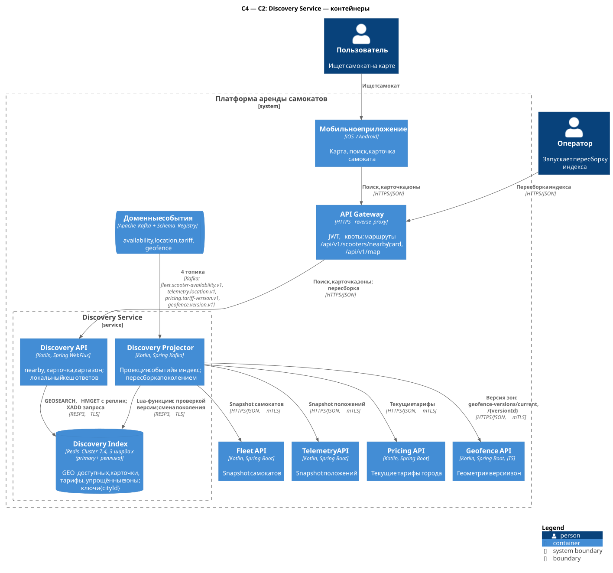
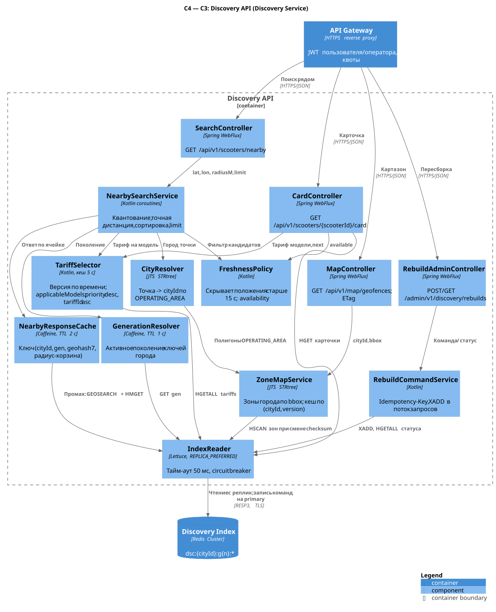
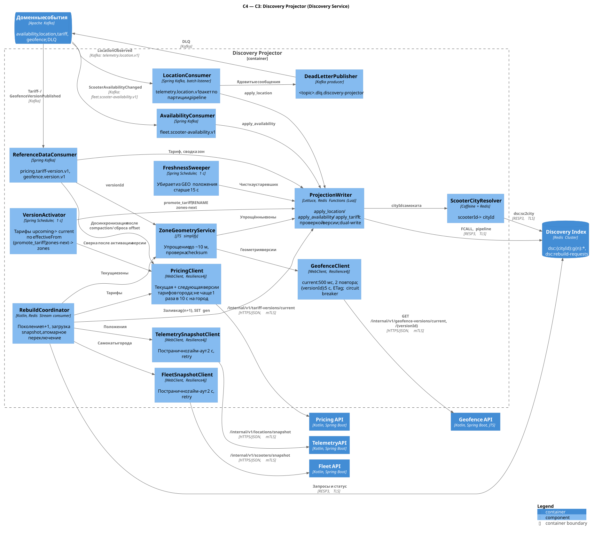

# Discovery Service

| | |
| --- | --- |
| **Bounded context** | Discovery — поиск и карта |
| **Команда-владелец** | Команда поиска/карты |
| **Контейнеры** | Discovery API (`discovery_api`), Discovery Projector (`discovery_projector`), Discovery Index (Redis Cluster) |
| **Ответственность** | Поиск ближайших доступных самокатов (~3 250 RPS в пике по поиску, [отчёт §6](../lab-01.md#6-нагрузка-масштабирование-и-доступность), условно); карточка самоката с ориентировочной ценой; карта зон города; построение геоиндекса из событий Fleet, Telemetry, Pricing, Geofence и его перестроение из snapshot владельцев |
| **Что НЕ делает** | Не резервирует самокат и не гарантирует аренду: Fleet и Trip перепроверяют готовность при старте ([отчёт §5.1](../lab-01.md#51-поиск)); не владеет ни одним агрегатом (`Scooter`, `Location`, `Tariff`, `Geofence` остаются у владельцев); не считает цену поездки (котировка — Pricing); не проверяет зоны для решений (Geofence); не публикует событий |
| **Связанные документы** | [Каталог сервисов](../service-catalog.md#4-discovery-service) · [Конвенции API](../api-conventions.md) · [Хранение данных](../data-storage.md#23-где-не-postgresql-и-почему) · [Telemetry](telemetry-service.md) · [Fleet](fleet-service.md) · [Pricing](pricing-service.md) · [Geofence](geofence-service.md) · [Отчёт: поиск](../lab-01.md#51-поиск), [события](../lab-01.md#54-контракты-событий-и-надёжность-доставки), [нагрузка](../lab-01.md#6-нагрузка-масштабирование-и-доступность) |

Ключевые решения:

1. **Производная проекция в Redis Cluster, а не в PostgreSQL.** Индекс полностью восстанавливается из snapshot владельцев и событий, поэтому durability не нужна, а нужны GEO-запросы в памяти и ~20 000 обновлений положения в секунду без MVCC и vacuum ([4.1](#41-почему-redis-cluster-а-не-postgresql)).
2. **Все ключи города — с hash tag `{cityId}`.** Данные города лежат в одном слоте, поэтому обновление карточки, GEO-набора и признака свежести — одна атомарная Lua-функция.
3. **Защита от откатов по версиям вместо inbox** ([api-conventions §15.4](../api-conventions.md#154-доставка-at-least-once-и-inbox)): доступность — по `aggregateVersion` (`scooter.version`), положение — по `(bootId, seq)` с правилом сброса счётчиков, тарифы и зоны — по `version`. Дубли и перестановки безопасны.
4. **Перестроение поколением.** Новое поколение ключей `g{n+1}` заполняется из snapshot, пока события пишутся в оба поколения; затем `SET gen` атомарно переключает чтение. Поиск во время перестроения не деградирует.
5. **Свежесть и приватность.** В выдачу попадают только `AVAILABLE`-самокаты с положением не старше 15 с; координаты самоката не в статусе `AVAILABLE` (в поездке — это положение пользователя) не хранятся и не отдаются.
6. **Конечная согласованность.** Ответ содержит время наблюдения и лаг индекса; расхождение с Fleet в секундах допустимо, потому что старт перепроверяется.

## 1. Контейнеры (C2)



Исходник: [c2-discovery.puml](../../diagrams/services/discovery/c2-discovery.puml).

| Контейнер | Технология | Ответственность | Единица масштабирования / метрика автоскейлинга | Минимум реплик |
| --- | --- | --- | --- | --- |
| Discovery API (`discovery_api`) | Kotlin, Spring WebFlux, Lettuce, Caffeine, JTS | `nearby`, карточка, карта зон; приём команд перестроения | Deployment; HPA: CPU 60 % и p99 `nearby` > 60 мс; ~1 500 RPS на под (оценка) | 3 (по одной на AZ) |
| Discovery Projector (`discovery_projector`) | Kotlin, Spring Kafka, Lettuce, JTS | Применение событий 4 топиков, перестроение поколением, чистка устаревших положений | Deployment; KEDA по лагу группы `discovery-projector` (> 10 с или > 20 000 сообщений); не больше 96 потребителей (партиции `telemetry.location.v1`) | 3 |
| Discovery Index | Redis Cluster 7.4 (Redis Functions, TTL полей хеша) | GEO-наборы доступных самокатов, карточки, тарифы, упрощённые зоны, поколения, статусы перестроений | Шарды (слоты hash tag `{cityId}`); реплики для чтения | 3 шарда × (primary + реплика в другой AZ) |

Соседи: API Gateway (публичные и admin-маршруты), Kafka (4 топика), Fleet API и Telemetry API (snapshot), Pricing API (текущие тарифы), Geofence API (текущая версия и геометрия зон).

### 1.1. Почему API и Projector — разные контейнеры

- **Профиль нагрузки.** API — тысячи коротких чтений в секунду с жёстким p99; Projector — непрерывный поток записи 20 000 событий/с и тяжёлые перестроения. Лаг или перестроение не должны занимать потоки и память API.
- **Масштабирование.** API масштабируется по RPS, Projector — по лагу Kafka и ограничен числом партиций.
- **Права.** Projector пишет индекс и ходит в snapshot-эндпоинты владельцев; API только читает индекс и пишет команды перестроения в поток. Разные ACL в Redis и разные allowlist у владельцев.

## 2. Компоненты (C3)

### 2.1. Discovery API



Исходник: [c3-discovery-api.puml](../../diagrams/services/discovery/c3-discovery-api.puml).

| Компонент | Ответственность | Ключевые зависимости |
| --- | --- | --- |
| `SearchController` | `GET /api/v1/scooters/nearby`: валидация, ответ | `NearbySearchService` |
| `CardController` | `GET /api/v1/scooters/{scooterId}/card` | `IndexReader`, `FreshnessPolicy`, `TariffSelector` |
| `MapController` | `GET /api/v1/map/geofences`; `ETag`, `304` | `ZoneMapService` |
| `RebuildAdminController` | `POST /admin/v1/discovery/rebuilds`, `GET /admin/v1/discovery/rebuilds/{rebuildId}`; роли, `cityIds` оператора | `RebuildCommandService` |
| `CityResolver` | Точка → `cityId`: STRtree по полигонам `OPERATING_AREA` всех городов, расширенным на максимальный радиус поиска (2 км) | `ZoneMapService` |
| `NearbySearchService` | Квантование запроса (geohash7 + корзина радиуса), выбор кандидатов, точная дистанция (haversine), сортировка, `limit` ([2.1.1](#211-путь-запроса-nearby)) | `NearbyResponseCache`, `GenerationResolver`, `FreshnessPolicy`, `TariffSelector` |
| `TariffSelector` | Тариф для модели на момент запроса по правилу Pricing: версия по времени из `current` + `upcoming[]`, фильтр `applicableModels`, `priority` по убыванию, затем `tariffId` по возрастанию ([2.1.2](#212-тариф-в-выдаче-и-карточке)); тарифы города — кеш пода 5 с | `IndexReader` |
| `NearbyResponseCache` | Caffeine, TTL 2 с, ключ `(cityId, gen, geohash7, radiusBucket)`; хранит кандидатов ячейки, а не готовый ответ; последний ответ ячейки держится 30 с для режима `stale` | `IndexReader` |
| `FreshnessPolicy` | Порог 15 с ([отчёт §5.1](../lab-01.md#51-поиск)): свежесть по `min(measuredAt, receivedAt)`; только `AVAILABLE` | — |
| `GenerationResolver` | Активное поколение города (`dsc:{cityId}:gen`), кеш 1 с; метаданные поколения (лаг, версия зон) | `IndexReader` |
| `ZoneMapService` | Упрощённые зоны всех городов в памяти пода, по одному STRtree на `(cityId, versionId)`; перечитывает зоны города через `HSCAN`, когда меняется `checksum` в `meta`; переключение на запланированную версию в `effectiveFrom` | `IndexReader` |
| `RebuildCommandService` | Идемпотентность по `Idempotency-Key` (в Redis), проверка блокировки города, `XADD` в `dsc:rebuild-requests`, чтение статуса | `IndexReader` |
| `IndexReader` | Lettuce Cluster, `ReadFrom.REPLICA_PREFERRED`, тайм-аут команды 50 мс, circuit breaker; команды записи — на primary | Discovery Index |

#### 2.1.1. Путь запроса `nearby`

1. `CityResolver` находит город по точке (в памяти, ~10 мкс). Нет города в радиусе 2 км от зоны обслуживания → `200` с пустым списком и `outsideServiceArea = true`.
2. `GenerationResolver` даёт активное поколение `n` (кеш 1 с). Поколения нет → `503 INDEX_NOT_READY`.
3. Запрос квантуется: ячейка geohash7 (~153 × 153 м) и корзина радиуса (`radiusM`, округлённый вверх до 250 / 500 / 1000 / 2000 м).
4. `NearbyResponseCache` по ключу `(cityId, n, geohash7, radiusBucket)`. Промах:

   ```
   GEOSEARCH dsc:{cityId}:g{n}:geo FROMLONLAT <lon центра ячейки> <lat центра ячейки>
             BYRADIUS <radiusBucket + 110> m ASC COUNT 150 WITHCOORD
   HMGET     dsc:{cityId}:g{n}:cards <scooterId…>
   ```

   +110 м — половина диагонали ячейки: любая точка в радиусе `r` от пользователя лежит в радиусе `r + 110` от центра его ячейки. `COUNT 150` = 3 × максимальный `limit`. Обе команды идут на реплику шарда города.
5. Для каждого запроса отдельно: точная дистанция от **настоящей** точки пользователя, фильтр `distance ≤ radiusM`, фильтр свежести и `AVAILABLE` (вторая линия защиты после чистки GEO), сортировка, `limit`, выбор тарифа на модель ([2.1.2](#212-тариф-в-выдаче-и-карточке)).

Максимальный возраст положения в выдаче — 15 с (порог) + 1 с (период чистки) + 2 с (кеш) ≈ 18 с. Если в радиусе `r + 110` больше 150 самокатов, кандидаты отбираются по близости к центру ячейки, а не к пользователю, — в такой плотности это незаметно. Доля попаданий в кеш — 30–50 % (оценка; уточняется на нагрузочном тесте).

#### 2.1.2. Тариф в выдаче и карточке

Цена в Discovery — **ориентировочная** (`priceIsEstimate = true`): обязательную цену фиксирует котировка Pricing при старте. Чтобы показать тот же тариф, что выберет котировка, `TariffSelector` повторяет правило Pricing ([pricing-service.md §3.2.1](pricing-service.md#321-модель-тарифа-и-алгоритм-linear-v1), [§3.3](pricing-service.md#33-публикуемые-события)) на момент запроса `now`:

1. **Версия по времени.** Для каждого тарифа города среди известных версий (`current` и `upcoming[]`, [4.2](#42-схема-ключей)) берётся версия с наибольшим `effectiveFrom ≤ now`, при равных `effectiveFrom` — с большей `version`. Поэтому цена меняется ровно в `effectiveFrom`, даже если Projector отстаёт и ещё не перенёс версию в `current` ([2.2.1](#221-применение-событий)). Если ни одна версия тарифа ещё не наступила (тариф опубликован на будущее), тариф в выборе не участвует.
2. **Модель.** Остаются тарифы, у которых в выбранной версии `applicableModels = null` (все модели) или список содержит модель самоката. `applicableModels = []` — тариф снят с продажи: он не участвует в выборе и не попадает в `cityTariffs`, хотя версия хранится (следующая версия может вернуть тариф в продажу).
3. **Приоритет.** Побеждает наибольший `priority` выбранной версии, при равенстве — меньший `tariffId` (UUIDv7 сравниваются как 128-битные числа, что для строк в нижнем регистре совпадает с лексикографическим порядком; выигрывает тариф, созданный раньше). Правило совпадает с правилом котировки; `code` тарифа в выборе не участвует, его нет ни в событии, ни в ответе `/tariff-versions/current`.

Подходящего тарифа нет → в карточке `tariff = null`, в выдаче `items[].tariffId = null` (самокат не арендуется). `next` в карточке — ближайшая версия выбранного тарифа из `upcoming[]` после действующей (или `null`). Расхождение с котировкой остаётся на границе версий (запрос выдачи пришёл до `effectiveFrom`, а старт — после) и в пределах кеша тарифов пода (5 с) после публикации; поэтому цена и помечена как ориентировочная.

### 2.2. Discovery Projector



Исходник: [c3-discovery-projector.puml](../../diagrams/services/discovery/c3-discovery-projector.puml).

| Компонент | Ответственность | Ключевые зависимости |
| --- | --- | --- |
| `LocationConsumer` | `telemetry.location.v1`: batch listener (до 500 записей), группировка по городу, пайплайн `FCALL apply_location`, commit offset после ответа Redis на весь пакет | Kafka, `ProjectionWriter` |
| `AvailabilityConsumer` | `fleet.scooter-availability.v1`: `apply_availability`, обновление `dsc:sc2city`, перенос самоката при смене города | Kafka, `ProjectionWriter` |
| `ReferenceDataConsumer` | `pricing.tariff-version.v1` (`apply_tariff`; тариф без `current` в индексе или сброс offset → досинхронизация города через `PricingClient`), `geofence.version.v1` (загрузка геометрии и запись зон) | Kafka, `ProjectionWriter`, `ZoneGeometryService`, `PricingClient` |
| `DeadLetterPublisher` | `<topic>.dlq.discovery-projector` с заголовками `dlq.*` ([api-conventions §15.5](../api-conventions.md#155-ошибки-обработки-dlq-replay)) | Kafka |
| `RebuildCoordinator` | Потребитель Redis Stream `dsc:rebuild-requests` (группа `rebuilders`); блокировка города; заполнение `g{n+1}`, проверка, переключение, удаление старого поколения; автоматические перестроения ([2.2.2](#222-перестроение-индекса-поколением)) | Discovery Index, клиенты snapshot |
| `FreshnessSweeper` | Раз в 1 с по каждому городу убирает из GEO самокаты с положением старше 15 с (`sweep_stale`); город обрабатывает один под (аренда `SET NX PX 2000`) | `ProjectionWriter` |
| `VersionActivator` | Раз в 1 с по каждому городу (та же аренда города, что у `FreshnessSweeper`) переносит наступившие версии тарифов из `upcoming` в `current` (`promote_tariff`) и после переноса сверяет тарифы города с Pricing; через 1 ч после `effectiveFrom` зон переименовывает `zones-next` в `zones` ([2.2.1](#221-применение-событий)) | `ProjectionWriter`, `PricingClient` |
| `ZoneGeometryService` | Загрузка GeoJSON версии, проверка `checksum`, упрощение Douglas–Peucker с допуском ~10 м (JTS `TopologyPreservingSimplifier`), сериализация зон для карты | `GeofenceClient` |
| `FleetSnapshotClient` | `GET /internal/v1/scooters/snapshot?cityId=` постранично (500) | Fleet API |
| `TelemetrySnapshotClient` | `GET /internal/v1/locations/snapshot?measuredAfter=` постранично (1000) | Telemetry API |
| `PricingClient` | `GET /internal/v1/tariff-versions/current?cityId=` постранично: перестроение и досинхронизация тарифов города (старт пода, активация версии, сброс offset, тариф без `current`); не чаще раза в 10 с на город | Pricing API |
| `GeofenceClient` | `GET /internal/v1/geofence-versions/current?cityId=` (тайм-аут 500 мс, 2 повтора), `GET /internal/v1/geofence-versions/{versionId}` (тайм-аут 5 с, `If-None-Match`); circuit breaker ([3.6](#36-исходящие-вызовы-discovery-projector)) | Geofence API |
| `ProjectionWriter` | Вызовы Redis Functions с проверкой версии и поколений; dual-write во время перестроения; `WAIT 1 100` после записей доступности, тарифов и зон | Discovery Index |
| `ScooterCityResolver` | `scooterId → cityId`: Caffeine (10 мин) поверх `dsc:sc2city:{scooterId}` — `LocationObserved` не содержит `cityId` | Discovery Index |

#### 2.2.1. Применение событий

- **Положение.** `LocationObserved` → город через `ScooterCityResolver` → `apply_location` во всех активных поколениях города. Карточки ещё нет (`NO_CARD`: самокат зарегистрирован, но событие доступности не дошло) → событие пропускается: следующее придёт через 5 с. Подпись измерения Discovery не проверяет: решений на её основе он не принимает.
- **Доступность.** `ScooterAvailabilityChanged` → `apply_availability`. Город сменился (перенос самоката между городами) → `remove_scooter` в старом городе, затем применение в новом и запись `dsc:sc2city`.
- **Тариф.** `TariffVersionPublished` → `apply_tariff`: версия добавляется к известным версиям тарифа — `current` (наступившая) и `upcoming[]` (будущие по возрастанию `effectiveFrom`, [4.2](#42-схема-ключей)); слияние — объединение по `version`, дубль или версия не новее `current.version` отбрасывается. Pricing публикует версию не позже чем за 5 мин до её `effectiveFrom` ([pricing-service.md §3.2.1](pricing-service.md#321-модель-тарифа-и-алгоритм-linear-v1)), поэтому событие приходит как будущая версия и попадает в `upcoming`; если `effectiveFrom` уже наступил (лаг, повтор из DLQ), версия сразу становится `current`. Переключение цены не ждёт Projector: API выбирает версию по времени при каждом чтении ([2.1.2](#212-тариф-в-выдаче-и-карточке)).
  - **Активация по времени.** `VersionActivator` раз в 1 с вызывает `promote_tariff(now)` для города: из наступивших версий `upcoming` последняя становится `current`, более ранние отбрасываются — хранится не больше одной прошлой версии на тариф.
  - **Досинхронизация после compaction.** Топик сжимается по `tariffId`, и опубликованная будущая версия вытесняет из лога текущую ([pricing-service.md §3.3](pricing-service.md#33-публикуемые-события)), поэтому топик — не полный источник состояния. Projector запрашивает `GET /internal/v1/tariff-versions/current?cityId=` (текущая + ближайшая будущая версия, [pricing-service.md §3.2.5](pricing-service.md#325-get-internalv1tariff-versionscurrent--текущие-версии-для-discovery)) и сливает ответ тем же `apply_tariff`: при старте пода (все города), после каждой активации версии в городе, после сброса offset (новая группа, `auto.offset.reset`) и когда событие пришло для тарифа, у которого в индексе нет `current`. Полного перестроения для этого не нужно; вызовы на город — не чаще раза в 10 с. `next` в ответе Pricing несёт тот же набор полей версии, что и `TariffVersionPublished` (в том числе свои `applicableModels`, `priority`, `displayName`, `currency`, `roundingRule`), поэтому версия из ответа записывается в `upcoming` целиком и значения из `current` не подставляются. Тариф, у которого ни одна версия ещё не наступила, приходит с полями версии `null` и заполненным `next` — в индексе это `current = null` и одна версия в `upcoming`.
  - **Снятие с продажи.** Версия с `applicableModels = []` хранится как обычная; после её `effectiveFrom` тариф исключается из выбора и из `cityTariffs` ([2.1.2](#212-тариф-в-выдаче-и-карточке)).
- **Зоны.** `GeofenceVersionPublished` → `GET /internal/v1/geofence-versions/{versionId}` → проверка `checksum` → упрощение → запись в `zones-next` (если `effectiveFrom` в будущем) или `zones`, обновление `meta`. Через 1 ч после `effectiveFrom` `VersionActivator` переименовывает `zones-next` в `zones` (`RENAME` в одном слоте).
- **Неизвестный город.** У города нет `dsc:{cityId}:gen` (новый город или потеря данных шарда) → событие не применяется частично, а запускается автоматическое перестроение города; API до его завершения отвечает `INDEX_NOT_READY`.

#### 2.2.2. Перестроение индекса поколением

**Когда:** команда оператора (`POST /admin/v1/discovery/rebuilds`); автоматически — у города нет поколения, первая версия зон нового города, failover primary шарда Redis (возможна потеря последних асинхронно реплицированных записей), детектор потерянных записей (в `meta.lastLocationAt` время меньше, чем Projector применил для города, более чем на 30 с), смещение `telemetry.location.v1` вышло за ретенцию 24 ч; плановая сверка раз в сутки в 04:00 по времени города (условно).

| Шаг | Действие | Статус города |
| --- | --- | --- |
| 1 | `RebuildCoordinator` читает запрос из потока, берёт `dsc:{cityId}:rebuild-lock` (`SET NX PX 120000`, продление каждые 30 с) | `RUNNING` |
| 2 | `SET dsc:{cityId}:building n+1`. С этого момента функции записи требуют оба поколения: писатель со старым представлением получит `GEN_MISMATCH`, обновит его и повторит — событие не может пройти мимо `g{n+1}` | `RUNNING` (`phase = SCOOTERS`) |
| 3 | Fleet snapshot города → `apply_availability` со `version` из snapshot (события с большей версией уже записаны и перекрывают строку) | `SCOOTERS` |
| 4 | Telemetry snapshot (`measuredAfter = now − 15 мин`) → `apply_location` для самокатов, у которых в `g{n+1}` есть карточка. Snapshot Telemetry не фильтруется по городу, поэтому перестроение всех городов читает его один раз и раскладывает строки по городам | `LOCATIONS` |
| 5 | Pricing `current?cityId=` → `apply_tariff` (текущая и следующая версии; объединение по `version` с версиями, уже записанными событиями) | `TARIFFS` |
| 6 | Geofence `current?cityId=` → геометрия `versionId` (если `checksum` совпадает с `g{n}`, зоны копируются без загрузки) и `scheduled` → `zones-next` | `ZONES` |
| 7 | Проверка: карточек в `g{n+1}` ≥ 90 % от `g{n}` (если `g{n}` есть), зоны загружены, `checksum` совпал; иначе `FAILED`, `g{n+1}` удаляется, `g{n}` продолжает работать | `VERIFY` |
| 8 | Lua `switch_generation`: `SET gen n+1`, `DEL building` — одной операцией | `SWITCHING` |
| 9 | Через 60 с (кеш поколения в API — 1 с, запросы в полёте) `UNLINK` ключей `g{n}`; статус, `XACK` | `COMPLETED` |

Длительность (оценка): ~30 с на крупный город (60 страниц Fleet + 1/3 snapshot Telemetry), 1–2 мин на все города — в пределах цели «перестроение ≤ 15 мин» ([data-storage.md §8.6](../data-storage.md#86-цели-rporto-проектные)). Под упал посреди перестроения → блокировка истекает, запрос остаётся неподтверждённым в потоке и через 5 мин забирается `XAUTOCLAIM` другим подом; недостроенное `g{n+1}` удаляется, перестроение начинается заново. Ошибка snapshot-зависимости после повторов → `FAILED`, старое поколение остаётся.

#### 2.2.3. Свежесть и чистка

- GEO-набор содержит только самокаты `AVAILABLE` со свежим положением; `seen` — те же самокаты по времени положения.
- `FreshnessSweeper` раз в секунду вызывает `sweep_stale(cutoff = now − 15 с)` для активного поколения каждого города: удаляет из `geo` и `seen` до 1000 устаревших за вызов. Карточка остаётся, и следующее свежее положение вернёт самокат в GEO.
- Время положения — `min(measuredAt, receivedAt)`: часы устройства, ушедшие вперёд, не делают точку «свежее». Telemetry отклоняет измерения, у которых `measuredAt` позже `receivedAt` более чем на 2 с ([telemetry-service.md §2.1.2](telemetry-service.md#212-валидация-и-флаги-качества)), так что оставшийся сдвиг не больше 2 с.
- Карточки, не обновлявшиеся 7 дней (самокат списан без события, перенесён в другой город при потере события), удаляются TTL поля хеша (`HEXPIRE`).

## 3. API

Общие правила — [конвенции API](../api-conventions.md): ошибки [RFC 9457](../api-conventions.md#6-ошибки-rfc-9457), [идемпотентность](../api-conventions.md#7-идемпотентность-команд), [лимиты Gateway](../api-conventions.md#10-лимиты-запросов-на-gateway), [межсервисные вызовы](../api-conventions.md#11-межсервисные-вызовы-тайм-ауты-повторы-circuit-breaker). Внутренних эндпоинтов у сервиса нет.

### 3.1. Сводная таблица эндпоинтов

| Метод | Путь | Аудитория | Кто вызывает | Авторизация | Идемпотентность |
| --- | --- | --- | --- | --- | --- |
| GET | `/api/v1/scooters/nearby?lat=&lon=&radiusM=&limit=` | public | Мобильное приложение | JWT пользователя | безопасный метод |
| GET | `/api/v1/scooters/{scooterId}/card` | public | Мобильное приложение (карта, сканирование QR) | JWT пользователя | безопасный метод |
| GET | `/api/v1/map/geofences?cityId=&bbox=` | public | Мобильное приложение | JWT пользователя | безопасный метод, `ETag` |
| POST | `/admin/v1/discovery/rebuilds` | admin | Операторская консоль | JWT оператора: `OPERATOR` (свои города), `ADMIN` | `Idempotency-Key` обязателен |
| GET | `/admin/v1/discovery/rebuilds/{rebuildId}` | admin | Операторская консоль | JWT оператора: `OPERATOR`, `ADMIN` | безопасный метод |

Распределение пиковых 3 250 RPS поиска (условно): `nearby` ~2 600, карточка ~400, карта ~250.

### 3.2. Детальное описание

#### 3.2.1. `GET /api/v1/scooters/nearby`

**Назначение:** доступные самокаты рядом с точкой для карты в приложении.
**Вызывает:** мобильное приложение через Gateway. **Авторизация:** JWT пользователя ([api-conventions §2.1](../api-conventions.md#21-пользователь)). **Заголовки:** `Authorization: Bearer <JWT>`, `traceparent` (ставит Gateway). **Лимиты Gateway:** 5 запросов/с на пользователя (burst 10) и 20/с на IP; клиент делает debounce 300 мс.

| Параметр | Тип | Ограничения |
| --- | --- | --- |
| `lat` | number | обязателен, `[-90..90]` |
| `lon` | number | обязателен, `[-180..180]` |
| `radiusM` | int | `50–2000`, по умолчанию 500 |
| `limit` | int | `1–50`, по умолчанию 20 |

Ответ `200 OK` (`Cache-Control: no-store`):

```json
{
  "cityId": "01900000-0000-7000-8000-000000000001",
  "outsideServiceArea": false,
  "items": [
    {
      "scooterId": "0192f1a4-7c3e-7b21-9d55-3a8e2c41f0b7",
      "lat": 59.9386301,
      "lon": 30.3141302,
      "distanceM": 142,
      "batteryPercent": 78,
      "model": "NB-G30-2025",
      "tariffId": "0192b6e1-3a40-7f2c-8d15-3c9a7e0b4f21",
      "observedAt": "2026-11-05T09:15:29.870Z"
    }
  ],
  "cityTariffs": [
    {
      "tariffId": "0192b6e1-3a40-7f2c-8d15-3c9a7e0b4f21",
      "version": 4,
      "displayName": "Стандарт",
      "currency": "RUB",
      "unlockFeeMinor": 5000,
      "perMinuteMinor": 900,
      "priceIsEstimate": true
    }
  ],
  "freshnessThresholdSec": 15,
  "indexUpdatedAt": "2026-11-05T09:15:31.020Z",
  "indexLagSec": 1,
  "stale": false
}
```

| Поле | Смысл |
| --- | --- |
| `items[].observedAt` | время положения (`measuredAt`); положения старше `freshnessThresholdSec` в выдачу не попадают |
| `items[].tariffId` | ссылка на `cityTariffs` — тариф, который выберет котировка для этой модели ([2.1.2](#212-тариф-в-выдаче-и-карточке)); `null`, если подходящего тарифа нет |
| `indexUpdatedAt`, `indexLagSec` | время последнего применённого события положения в городе и лаг проекции (`now − receivedAt` последнего события) |
| `outsideServiceArea` | точка вне зоны обслуживания; если город в радиусе 2 км найден, самокаты внутри зоны всё равно показываются |
| `stale` | `true` — Redis недоступен, отдан последний ответ ячейки (не старше 30 с) |

| HTTP | `code` | Условие |
| --- | --- | --- |
| 400 | `VALIDATION_FAILED` | нет `lat`/`lon`, значения вне диапазона |
| 401 | `UNAUTHENTICATED` | нет или просрочен JWT (Gateway) |
| 429 | `RATE_LIMITED` | лимит Gateway; `Retry-After` |
| 503 | `INDEX_NOT_READY` | у города нет поколения (перестроение после потери данных); `Retry-After: 10` |
| 503 | `DEPENDENCY_UNAVAILABLE` | Redis недоступен и в кеше нет ответа для ячейки; `Retry-After: 2` |

**Повторы и конкурентность:** безопасный метод; ответ — снимок конечной согласованности, не резерв ([отчёт §5.1](../lab-01.md#51-поиск)). **p99** ≤ 60 мс в сервисе; тайм-аут Gateway для public 3 с; приложение не повторяет автоматически, кроме одного повтора после `503` с `Retry-After`.

#### 3.2.2. `GET /api/v1/scooters/{scooterId}/card`

**Назначение:** карточка самоката по нажатию на карте или после сканирования QR-кода.
**Вызывает:** мобильное приложение. **Авторизация:** JWT пользователя. **Заголовки:** `Authorization`, `traceparent`.

| Параметр | Где | Тип | Ограничения |
| --- | --- | --- | --- |
| `scooterId` | путь | UUID | обязателен |

Ответ `200 OK` (`Cache-Control: no-store`):

```json
{
  "scooterId": "0192f1a4-7c3e-7b21-9d55-3a8e2c41f0b7",
  "cityId": "01900000-0000-7000-8000-000000000001",
  "model": "NB-G30-2025",
  "availability": "AVAILABLE",
  "unavailableReason": null,
  "batteryPercent": 78,
  "location": {
    "lat": 59.9386301,
    "lon": 30.3141302,
    "accuracyM": 4.8,
    "observedAt": "2026-11-05T09:15:29.870Z",
    "fresh": true
  },
  "tariff": {
    "tariffId": "0192b6e1-3a40-7f2c-8d15-3c9a7e0b4f21",
    "version": 4,
    "displayName": "Стандарт",
    "currency": "RUB",
    "unlockFeeMinor": 5000,
    "perMinuteMinor": 900,
    "roundingRule": "CEIL_TO_MINUTE",
    "next": { "version": 5, "effectiveFrom": "2026-11-09T21:00:00Z", "unlockFeeMinor": 5000, "perMinuteMinor": 950 }
  },
  "priceIsEstimate": true,
  "indexUpdatedAt": "2026-11-05T09:15:31.020Z"
}
```

| Поле | Значения |
| --- | --- |
| `availability` | `AVAILABLE` \| `UNAVAILABLE` (внутренние статусы Fleet наружу не отдаются) |
| `unavailableReason` | `IN_USE` (`RESERVED`, `IN_USE`, `RECONCILING`), `LOW_BATTERY`, `MAINTENANCE`, `OFFLINE`; `null` для `AVAILABLE` |
| `location` | только для `AVAILABLE`; `null` иначе — положение самоката в поездке есть положение пользователя. `fresh = false` — положение старше 15 с: приложение показывает «обновлено N с назад», но старт не блокирует — его перепроверит Fleet |
| `tariff` | `null`, если для модели нет подходящего тарифа (самокат не арендуется) |

| HTTP | `code` | Условие |
| --- | --- | --- |
| 400 | `VALIDATION_FAILED` | `scooterId` не UUID |
| 401 | `UNAUTHENTICATED` | нет или просрочен JWT |
| 404 | `SCOOTER_NOT_FOUND` | самоката нет в индексе (не зарегистрирован, списан, карточка истекла) |
| 429 | `RATE_LIMITED` | лимит Gateway |
| 503 | `INDEX_NOT_READY` | у города нет поколения |
| 503 | `DEPENDENCY_UNAVAILABLE` | Redis недоступен; `Retry-After: 2` |

**Повторы и конкурентность:** безопасный метод; два чтения (`dsc:sc2city` из кеша пода, `HGET` карточки с реплики) + тарифы города из кеша пода (5 с). **p99** ≤ 30 мс; тайм-аут Gateway 3 с.

#### 3.2.3. `GET /api/v1/map/geofences`

**Назначение:** упрощённые зоны города в видимой области карты (граница обслуживания, парковки, запреты, зоны ограничения скорости).
**Вызывает:** мобильное приложение. **Авторизация:** JWT пользователя. **Заголовки:** `Authorization`, `traceparent`, `If-None-Match`. **Лимит Gateway:** 1 запрос/с на пользователя, burst 5.

| Параметр | Тип | Ограничения |
| --- | --- | --- |
| `cityId` | UUID | обязателен |
| `bbox` | string | обязателен: `minLon,minLat,maxLon,maxLat`, `min < max`, каждая сторона ≤ 0,5° |
| `types` *(добавлен)* | string | необязателен: список через запятую из `OPERATING_AREA`, `PARKING`, `NO_PARKING`, `NO_RIDE`, `SLOW_ZONE`; на мелком масштабе приложение не запрашивает тысячи парковок |

Ответ `200 OK` — GeoJSON FeatureCollection (RFC 7946, `[lon, lat]`), `ETag: "<checksum версии>:<хеш bbox и types>"`, `Cache-Control: private, max-age=60`, `Content-Encoding: gzip`:

```json
{
  "type": "FeatureCollection",
  "cityId": "01900000-0000-7000-8000-000000000001",
  "versionId": "01a19a8e-0000-7123-8456-000000000042",
  "version": 42,
  "effectiveFrom": "2026-11-03T00:00:00.000Z",
  "checksum": "sha256:9f2c4e0b7a1d...c3",
  "rules": { "parkingMode": "PARKING_ONLY" },
  "scheduled": { "version": 43, "effectiveFrom": "2026-11-10T00:00:00.000Z" },
  "simplificationToleranceM": 10,
  "truncated": false,
  "features": [
    {
      "type": "Feature",
      "id": "0192c0de-3333-7aaa-8bbb-000000000303",
      "geometry": {
        "type": "MultiPolygon",
        "coordinates": [[[[30.33571, 59.93402], [30.33601, 59.93402], [30.33601, 59.93418], [30.33571, 59.93418], [30.33571, 59.93402]]]]
      },
      "properties": { "zoneId": "0192c0de-3333-7aaa-8bbb-000000000303", "type": "PARKING", "name": "Невский пр., 28", "speedLimitKmh": null }
    }
  ]
}
```

Возвращается версия, действующая сейчас; в `effectiveFrom` запланированной версии ответ (и `ETag`) меняется. Не более 5 000 зон в ответе; больше → `truncated = true`, приложение приближает карту. Геометрия упрощена (~10 м) и служит только для показа: решение о парковке принимает Geofence по точной геометрии.

| HTTP | `code` | Условие |
| --- | --- | --- |
| 304 | — | `If-None-Match` совпал |
| 400 | `VALIDATION_FAILED` | нет `cityId`, неизвестное значение `types` |
| 400 | `INVALID_BBOX` | формат, `min ≥ max`, сторона > 0,5° |
| 401 | `UNAUTHENTICATED` | нет или просрочен JWT |
| 404 | `CITY_NOT_CONFIGURED` | город не настроен в Geofence |
| 429 | `RATE_LIMITED` | лимит Gateway |
| 503 | `INDEX_NOT_READY` | зоны города ещё не загружены |

**Повторы и конкурентность:** безопасный метод; ответ из памяти пода, Redis читается только при смене `checksum`. **p99** ≤ 100 мс; тайм-аут Gateway 3 с.

#### 3.2.4. `POST /admin/v1/discovery/rebuilds` (admin)

**Назначение:** перестроить индекс города (или всех городов) из snapshot владельцев — после инцидента, массового расхождения, смены логики проекции.
**Роли:** `OPERATOR` — только для города из `cityIds` токена; `ADMIN` — любой город и `cityId = null` (все). **Заголовки:** `Authorization`, `Idempotency-Key` (UUID, обязателен), `traceparent`. **Лимит Gateway:** 5 записей/с.

Тело:

```json
{ "cityId": "01900000-0000-7000-8000-000000000001", "reason": "Расхождение карты и Fleet после инцидента INC-2211" }
```

| Поле | Тип | Ограничения |
| --- | --- | --- |
| `cityId` | UUID \| null | `null` — все города (только `ADMIN`) |
| `reason` | string | 1–500 символов, обязателен (аудит, [api-conventions §2.2](../api-conventions.md#22-оператор)); нет или пуст → `400 REASON_REQUIRED` |

Ответ `202 Accepted`, `Location: /admin/v1/discovery/rebuilds/{rebuildId}`:

```json
{
  "rebuildId": "01a1aafe-4140-758e-a193-a94b7c9ffef4",
  "status": "QUEUED",
  "cityIds": ["01900000-0000-7000-8000-000000000001"],
  "requestedAt": "2026-11-05T09:15:52.000Z"
}
```

Ошибки: `400 VALIDATION_FAILED`, `400 REASON_REQUIRED` (нет или пуст `reason`), `400 IDEMPOTENCY_KEY_REQUIRED`, `401 UNAUTHENTICATED`, `403 FORBIDDEN` (город вне `cityIds`, `cityId = null` у не-`ADMIN`), `404 CITY_NOT_CONFIGURED`, `409 REBUILD_IN_PROGRESS` (у города уже идёт перестроение; `rebuildId` текущего — в теле problem), `409 IDEMPOTENCY_IN_PROGRESS`, `422 IDEMPOTENCY_KEY_REUSED`, `429 RATE_LIMITED`, `503 DEPENDENCY_UNAVAILABLE`.
**Идемпотентность:** запись `dsc:idem:{sha256(scope + key)}` (`SET NX`, 24 ч) с хешем запроса и ответом — аналог `idempotency_record` ([data-storage §4.3](../data-storage.md#43-общие-служебные-таблицы), [api-conventions §7](../api-conventions.md#7-идемпотентность-команд)) в единственном хранилище сервиса; повтор с тем же ключом и телом возвращает тот же `202`. **p99** ≤ 50 мс; тайм-аут Gateway для admin 30 с.

#### 3.2.5. `GET /admin/v1/discovery/rebuilds/{rebuildId}` (admin)

**Назначение:** статус перестроения. **Роли:** `OPERATOR` (видит только свои города), `ADMIN`. Ответ `200 OK`:

```json
{
  "rebuildId": "01a1aafe-4140-758e-a193-a94b7c9ffef4",
  "status": "RUNNING",
  "reason": "Расхождение карты и Fleet после инцидента INC-2211",
  "requestedBy": "operator:3f6a2c1e-8d4b-4f0a-9e7c-1b2d3e4f5a6b",
  "trigger": "MANUAL",
  "requestedAt": "2026-11-05T09:15:52.000Z",
  "startedAt": "2026-11-05T09:15:52.410Z",
  "finishedAt": null,
  "cities": [
    {
      "cityId": "01900000-0000-7000-8000-000000000001",
      "status": "RUNNING",
      "phase": "LOCATIONS",
      "fromGeneration": 17,
      "toGeneration": 18,
      "scooters": 31840,
      "locations": 18210,
      "tariffs": 3,
      "zones": 0,
      "error": null
    }
  ]
}
```

`status`: `QUEUED`, `RUNNING`, `SWITCHING`, `COMPLETED`, `FAILED`; `phase`: `SCOOTERS`, `LOCATIONS`, `TARIFFS`, `ZONES`, `VERIFY`; `trigger`: `MANUAL`, `AUTO_MISSING_GENERATION`, `AUTO_NEW_CITY`, `AUTO_FAILOVER`, `AUTO_LOST_WRITES`, `AUTO_OFFSET_RESET`, `SCHEDULED`. Статус хранится 30 дней. Ошибки: `401`, `403 FORBIDDEN`, `404 REBUILD_NOT_FOUND`, `503 DEPENDENCY_UNAVAILABLE`. **p99** ≤ 30 мс; тайм-аут Gateway 30 с.

### 3.3. Публикуемые события

Сервис событий не публикует: индекс — производная проекция, у него нет фактов, интересных другим контекстам.

### 3.4. Потребляемые события

Consumer group — `discovery-projector` для всех четырёх топиков; `enable.auto.commit = false`, offset фиксируется после ответа Redis на весь пакет. Inbox нет: проекция идемпотентна по версиям ([api-conventions §15.4](../api-conventions.md#154-доставка-at-least-once-и-inbox)). Временные ошибки (Redis, недоступная зависимость, тайм-аут, открытый circuit breaker) — `pause` партиции и повтор на месте с backoff 1 с → 60 с с jitter до восстановления, в DLQ не уходят; алерт — по возрасту самого старого необработанного сообщения или лагу группы. Постоянные (схема, десериализация, нарушенный инвариант) — DLQ `<topic>.dlq.discovery-projector` ([api-conventions §15.5](../api-conventions.md#155-ошибки-обработки-dlq-replay)).

| Топик | Consumer group | Обработка | Идемпотентность | Ошибки |
| --- | --- | --- | --- | --- |
| `telemetry.location.v1` (96 партиций, 24 ч) | `discovery-projector` | `apply_location` ([2.2.1](#221-применение-событий)); `NO_CARD` → пропуск с метрикой | `(bootId, seq)` новее сохранённых или `measuredAt` новее на > 10 мин (правило [telemetry-service.md §3.3](telemetry-service.md#33-публикуемые-события)) | Схема/десериализация → DLQ; Redis → pause; смещение вне ретенции → `auto.offset.reset = latest` + автоматическое перестроение |
| `fleet.scooter-availability.v1` (48, compact) | `discovery-projector` | `apply_availability`, `dsc:sc2city`, перенос между городами | `aggregateVersion` (`scooter.version`) больше сохранённого `av` | Схема/десериализация → DLQ; Redis → pause; `WAIT 1 100` перед commit offset |
| `pricing.tariff-version.v1` (6, compact) | `discovery-projector` | `apply_tariff`: версия в `upcoming` (или сразу в `current`, если `effectiveFrom` наступил); перенос по времени — `VersionActivator` ([2.2.1](#221-применение-событий)) | объединение версий по `version`; версия не новее `current.version` или уже известная — отбрасывается | Схема/десериализация → DLQ; Redis → pause; тарифа нет в индексе → досинхронизация города через Pricing `/tariff-versions/current` |
| `geofence.version.v1` (6, compact, до 4 МБ) | `discovery-projector` | Загрузка геометрии `versionId`, проверка `checksum`, упрощение, `zones` / `zones-next`, `meta`; первая версия нового города → автоматическое перестроение | `version` больше применённой для города; одинаковый `checksum` — без перезаписи | Geofence недоступен (тайм-аут, `503`, circuit breaker) или Redis → временная ошибка: `pause`, повтор на месте до восстановления, в DLQ не уходит (карта показывает прежнюю версию); алерт, если версия не применена за 30 мин; `404 GEOFENCE_VERSION_NOT_FOUND` или неверный `checksum` → DLQ |

Чтение compact-топиков с начала (новая группа, сброс offset) даёт последнее состояние каждого ключа, но для тарифов теряется текущая версия, вытесненная будущей ([pricing-service.md §3.3](pricing-service.md#33-публикуемые-события)), — поэтому после сброса offset, при старте пода и когда событие пришло для тарифа без `current` Projector досинхронизирует тарифы города через `GET /internal/v1/tariff-versions/current` (текущая + следующая версия) без полного перестроения ([2.2.1](#221-применение-событий)).

### 3.5. MQTT

Не используется.

### 3.6. Исходящие вызовы Discovery Projector

| Эндпоинт | Когда | Тайм-аут | Повторы | При отказе |
| --- | --- | --- | --- | --- |
| Fleet `GET /internal/v1/scooters/snapshot?cityId=&cursor=&limit=500` | Перестроение | 2 с | 2, backoff 50 мс × 2ⁿ | Перестроение `FAILED`, старое поколение работает |
| Telemetry `GET /internal/v1/locations/snapshot?measuredAfter=&cursor=&limit=1000` | Перестроение | 2 с | 2 | То же |
| Pricing `GET /internal/v1/tariff-versions/current?cityId=` | Перестроение; досинхронизация тарифов: старт пода, активация версии, сброс offset, тариф без `current` ([2.2.1](#221-применение-событий)) | 2 с | 2 | Перестроение — то же; досинхронизация — повтор через 30 с, до успеха цены переключаются по уже известным версиям |
| Geofence `GET /internal/v1/geofence-versions/current?cityId=` | Перестроение | 500 мс | 2 | То же |
| Geofence `GET /internal/v1/geofence-versions/{versionId}` | Событие зон, перестроение | 5 с | событие — до восстановления (`pause` партиции, backoff 1 с → 60 с); перестроение — 2 | Карта показывает предыдущую версию зон; алерт, если версия не применена за 30 мин; перестроение — `FAILED` |

Circuit breaker на каждую зависимость (окно 50 вызовов или 10 с, порог 50 %); не более 2 одновременных перестроений на под, чтобы snapshot-запросы не перегружали владельцев.

## 4. Данные и хранение

### 4.1. Почему Redis Cluster, а не PostgreSQL

Общая позиция — [data-storage.md §2.3](../data-storage.md#23-где-не-postgresql-и-почему) и [§3](../data-storage.md#3-сравнение-альтернатив).

- **Данные производные.** Владельцы — Fleet, Telemetry, Pricing, Geofence; индекс восстанавливается из их snapshot за минуты. Durability, транзакции между агрегатами, PITR и бэкапы здесь не нужны, а в PostgreSQL за них пришлось бы платить на каждой записи.
- **Профиль записи.** ~20 000 обновлений положения в секунду по 100 000 строкам. В PostgreSQL каждое — новая версия строки, WAL, vacuum и перестройка GiST-индекса по точке (HOT невозможен: индексируемая колонка меняется). В Redis это обновление в памяти за десятки микросекунд.
- **Запросы.** `GEOSEARCH` по радиусу и чтение карточек — O(log N + M) в памяти, p99 единицы миллисекунд; чтение масштабируется репликами.
- **Отвергнутые альтернативы:**
  - PostgreSQL + PostGIS — см. выше; уместен для источников (Geofence), не для горячей проекции;
  - OpenSearch/Elasticsearch — geo-запросы есть, но near-real-time refresh (≥ 1 с) и тяжёлая индексация 20 000 документов/с;
  - Tile38 — специализированный геоиндекс, но ещё одна технология без managed-поддержки в платформе;
  - индекс в памяти каждого пода API — 3+ копии потока 20 000 событий/с, долгий прогрев после рестарта, нет общего состояния для перестроения.

### 4.2. Схема ключей

Префикс `dsc:`; `{c}` — hash tag `{cityId}`; `n` — номер поколения.

| Ключ | Тип | Содержимое | TTL |
| --- | --- | --- | --- |
| `dsc:{c}:gen` | STRING | активное поколение `n` | — |
| `dsc:{c}:building` | STRING | строящееся поколение `n+1` | 30 мин (страховка от брошенного перестроения) |
| `dsc:{c}:rebuild-lock` | STRING | `rebuildId` | 120 с, продлевается |
| `dsc:{c}:g{n}:cards` | HASH | `scooterId` → JSON карточки | поле — 7 дней с последнего обновления (`HEXPIRE`) |
| `dsc:{c}:g{n}:geo` | GEO (ZSET) | `scooterId` с координатами — только `AVAILABLE` и свежие | — (чистит `FreshnessSweeper`) |
| `dsc:{c}:g{n}:seen` | ZSET | `scooterId` → время положения (мс) для тех же самокатов | — |
| `dsc:{c}:g{n}:tariffs` | HASH | `tariffId` → JSON `{current{…}, upcoming[{…}]}`; версия — `{version, effectiveFrom, displayName, currency, unlockFeeMinor, perMinuteMinor, roundingRule, applicableModels, priority}` (`applicableModels` и `priority` — свои у каждой версии); `upcoming` по возрастанию `effectiveFrom`; `current = null`, пока ни одна версия не наступила | — |
| `dsc:{c}:g{n}:zones` | HASH | `zoneId` → упрощённый GeoJSON Feature (текущая версия) | — |
| `dsc:{c}:g{n}:zones-next` | HASH | то же для запланированной версии | — |
| `dsc:{c}:g{n}:meta` | HASH | `builtAt`, `rebuildId`, `zonesVersionId`, `zonesVersion`, `zonesChecksum`, `zonesEffectiveFrom`, `parkingMode`, `zonesNext*`, `lastLocationAt`, `lastEventReceivedAt` | — |
| `dsc:sc2city:{scooterId}` | STRING | `cityId` (вне поколений; hash tag — `scooterId`) | 30 дней, обновляется событиями доступности |
| `dsc:cities` | SET | известные города | — |
| `dsc:rebuild-requests` | STREAM | запросы перестроения; группа `rebuilders` | `MAXLEN ~ 10000` |
| `dsc:rebuild:{rebuildId}` | HASH | статус перестроения и прогресс по городам | 30 дней |
| `dsc:idem:{sha256}` | STRING | хеш запроса, статус, ответ admin-команды | 24 ч |

Карточка (короткие имена полей экономят память; числа ≤ 14 значащих цифр — точность `cjson` по умолчанию):

```json
{"a":"AVAILABLE","av":1843,"m":"NB-G30-2025","b":78,"bi":70,"sq":1001,"lt":1793870129870,"lat":59.9386301,"lon":30.3141302,"acc":4.8}
```

`a`/`av` — доступность и её версия; `m` — модель; `b` — заряд; `bi`/`sq` — `bootId`/`seq` последнего положения; `lt` — время положения, мс; `lat`/`lon`/`acc` — только при `a = AVAILABLE`.

### 4.3. Redis Functions

Библиотека `discovery` (Lua, `FUNCTION LOAD REPLACE` при старте Projector, если версия библиотеки на узле старее; функции сохраняются в RDB и реплицируются). Общая схема вызова функций записи: `KEYS = [gen, building, cards₁, geo₁, seen₁, (cards₂, geo₂, seen₂)]`, `ARGV = [k, gen₁, (gen₂), …payload]`, где `k` — число поколений, в которые пишет клиент.

```lua
#!lua name=discovery

-- Клиент обязан писать ровно в {gen} ∪ {building}; иначе GEN_MISMATCH → обновить представление и повторить
local function check_gens(keys, args)
  local cur, bld = redis.call('GET', keys[1]), redis.call('GET', keys[2])
  if not cur then return 'NO_INDEX' end
  local k = tonumber(args[1])
  if k ~= (bld and 2 or 1) or args[2] ~= cur or (bld and args[3] ~= bld) then return 'GEN_MISMATCH' end
  return nil
end

local function place(geo, seen, id, card, now, fresh)
  if card.a == 'AVAILABLE' and card.lat and now - card.lt <= fresh then
    redis.call('GEOADD', geo, card.lon, card.lat, id)   -- порядок: lon, lat
    redis.call('ZADD', seen, card.lt, id)
  else
    redis.call('ZREM', geo, id)
    redis.call('ZREM', seen, id)
  end
end

-- payload: scooterId, bootId, seq, lat, lon, accuracyM, batteryPercent, observedAtMs, nowMs, freshMs, resetMs
local function apply_location(keys, args)
  local err = check_gens(keys, args); if err then return err end
  local k = tonumber(args[1]); local p = 2 + k
  local id, boot, seq = args[p], tonumber(args[p + 1]), tonumber(args[p + 2])
  local t, now, fresh, reset = tonumber(args[p + 7]), tonumber(args[p + 8]), tonumber(args[p + 9]), tonumber(args[p + 10])
  local res = {}
  for g = 1, k do
    local cards, geo, seen = keys[3 * g], keys[3 * g + 1], keys[3 * g + 2]
    local raw = redis.call('HGET', cards, id)
    if not raw then res[g] = 'NO_CARD' else
      local c = cjson.decode(raw)
      local newer = (not c.bi) or boot > c.bi or (boot == c.bi and seq > c.sq) or t > c.lt + reset
      if not newer then res[g] = 'STALE' else
        c.bi, c.sq, c.lt, c.b = boot, seq, t, tonumber(args[p + 6])
        if c.a == 'AVAILABLE' then
          c.lat, c.lon, c.acc = tonumber(args[p + 3]), tonumber(args[p + 4]), tonumber(args[p + 5])
        else
          c.lat, c.lon, c.acc = nil, nil, nil            -- положение в поездке не храним
        end
        redis.call('HSET', cards, id, cjson.encode(c))
        redis.call('HEXPIRE', cards, 604800, 'FIELDS', 1, id)
        place(geo, seen, id, c, now, fresh)
        res[g] = 'APPLIED'
      end
    end
  end
  return res
end

-- payload: scooterId, version, availability, model, batteryPercent, nowMs, freshMs
local function apply_availability(keys, args)
  local err = check_gens(keys, args); if err then return err end
  local k = tonumber(args[1]); local p = 2 + k
  local id, v = args[p], tonumber(args[p + 1])
  local res = {}
  for g = 1, k do
    local cards, geo, seen = keys[3 * g], keys[3 * g + 1], keys[3 * g + 2]
    local raw = redis.call('HGET', cards, id)
    local c = raw and cjson.decode(raw) or {}
    if c.av and v <= c.av then res[g] = 'STALE' else
      c.av, c.a, c.m = v, args[p + 2], args[p + 3]
      if not c.lt then c.b = tonumber(args[p + 4]) end    -- заряд из телеметрии свежее
      if c.a ~= 'AVAILABLE' then c.lat, c.lon, c.acc = nil, nil, nil end
      redis.call('HSET', cards, id, cjson.encode(c))
      redis.call('HEXPIRE', cards, 604800, 'FIELDS', 1, id)
      place(geo, seen, id, c, tonumber(args[p + 5]), tonumber(args[p + 6]))
      res[g] = 'APPLIED'
    end
  end
  return res
end

-- KEYS: geo, seen; ARGV: cutoffMs, max
local function sweep_stale(keys, args)
  local ids = redis.call('ZRANGE', keys[2], '-inf', '(' .. args[1], 'BYSCORE', 'LIMIT', 0, tonumber(args[2]))
  if #ids > 0 then
    redis.call('ZREM', keys[1], unpack(ids))
    redis.call('ZREM', keys[2], unpack(ids))
  end
  return #ids
end

redis.register_function('apply_location', apply_location)
redis.register_function('apply_availability', apply_availability)
redis.register_function('sweep_stale', sweep_stale)
-- Также: apply_tariff (объединение версий current + upcoming[] по version), promote_tariff (наступившие версии
-- из upcoming в current по nowMs), remove_scooter, switch_generation (SET gen, DEL building).
```

Версия положения сравнивается парой `(bootId, seq)`, а не числом `bootId × 2³² + seq`: числа Lua — double, точные только до 2⁵³.

### 4.4. Структуры и обслуживаемые запросы

| Структура | Запрос / операция |
| --- | --- |
| `g{n}:geo` | `nearby`: `GEOSEARCH … BYRADIUS … ASC COUNT 150 WITHCOORD` с реплики; `GEOADD`/`ZREM` в `apply_*`, `sweep_stale` |
| `g{n}:cards` | `nearby`: `HMGET` кандидатов; карточка: `HGET`; `apply_*`: чтение версии и запись; проверка перестроения: `HLEN` |
| `g{n}:seen` | `sweep_stale`: `ZRANGE BYSCORE` до порога |
| `g{n}:tariffs` | выдача и карточка: `HGETALL` (единицы полей), кеш пода 5 с, версия выбирается по времени в `TariffSelector`; `apply_tariff`, `promote_tariff` |
| `g{n}:zones`, `zones-next`, `meta` | API: `HGET meta` раз в 5 с, `HSCAN zones COUNT 500` при смене `checksum` (без `HGETALL`: ~20 МБ одной командой заблокировали бы шард); Projector: запись зон пакетами по 500 |
| `gen`, `building` | API: `GET gen` (кеш 1 с); функции записи: проверка поколений; `switch_generation` |
| `sc2city:{scooterId}` | Projector: город для `LocationObserved`; API: город для карточки (кеш пода 10 мин) |
| `rebuild-requests`, `rebuild:{id}`, `rebuild-lock`, `idem:*` | admin-команды и статус; `XREADGROUP`/`XAUTOCLAIM` в `RebuildCoordinator` |

### 4.5. Поколения, TTL, очистка

Партиционирования в Redis нет; его роль играют поколения и TTL:

- **Поколения** — единица полной замены данных города. Старое поколение удаляется `UNLINK` (освобождение памяти в фоне) через 60 с после переключения.
- **TTL полей карточек 7 дней** — удаляет самокаты, исчезнувшие без события. `apply_*` продлевает TTL.
- **GEO и `seen`** не стареют по TTL: свежесть — секунды, её поддерживает `sweep_stale`.
- **Служебные ключи** (`building`, `rebuild-lock`, `rebuild:*`, `idem:*`) — с TTL, см. [4.2](#42-схема-ключей).
- `maxmemory-policy noeviction`: вытеснение молча удаляло бы части индекса; при нехватке памяти запись падает с ошибкой, Projector ставит партиции на паузу, срабатывает алерт.

### 4.6. Объёмы памяти (оценка, условно)

| Данные | Расчёт | Объём |
| --- | --- | --- |
| Карточки | 100 000 × (~140 Б JSON + 36 Б ключ поля + ~100 Б накладных и TTL поля) | ~30 МБ |
| `geo` + `seen` | ~60 000 доступных свежих × 2 × ~120 Б | ~15 МБ |
| `sc2city` | 100 000 × ~150 Б (отдельный ключ) | ~15 МБ |
| Тарифы, `meta`, статусы, идемпотентность | сотни записей | < 10 МБ |
| Зоны | до ~20 000 зон в крупном городе × ~1 КБ после упрощения; все города, текущая + запланированная версии | ~100–200 МБ |
| **Итого данных** | одно поколение; во время перестроения города его данные удваиваются | **~0,2–0,3 ГБ** |
| С фрагментацией (×1,5) и буферами репликации | | **< 1 ГБ** на кластер |

`maxmemory` 4 ГБ на узел (условно) — запас ×10 на рост парка. Пропускная способность (оценка): ~20 000 `FCALL`/с записи (вдвое больше во время перестроения) и ~1 500 промахов кеша `nearby`/с × 2 команды чтения — при ~25–50 тыс. вызовов функций в секунду на шард (Lua + `cjson`) узкое место не память, а самый крупный город на одном шарде.

### 4.7. Шардирование

- **Ключ — `cityId`** через hash tag `{cityId}`: все структуры города в одном слоте, функции атомарны без cross-slot. Исключения — `dsc:sc2city:{scooterId}` (равномерно по `scooterId`) и глобальные служебные ключи.
- **Кластер:** 16 384 слота, 3 шарда. Городов немного, поэтому слоты крупных городов распределяются по шардам вручную (`CLUSTER SETSLOT … MIGRATING/IMPORTING`, `redis-cli --cluster rebalance --cluster-weight`), а не равномерно по числу слотов.
- **Триггеры:** память шарда > 60 % `maxmemory`; CPU primary > 60 % в пике; p99 `GEOSEARCH` > 5 мс; один город даёт > 50 % нагрузки шарда.
- **Механизмы роста:** реплики чтения на шард (до 2) — для RPS; новые шарды и перенос слотов (онлайн, `MIGRATE`) — для памяти и записи; при ×10 горячий город делится на районы (`{cityId:district}`, район — ячейка geohash5), а `nearby` на границе района опрашивает 2–4 ключа параллельно.

### 4.8. Персистентность, HA, восстановление

```
# redis.conf (фрагмент, условно)
cluster-enabled yes
cluster-node-timeout 5000
cluster-require-full-coverage no     # отказ шарда не останавливает остальные города
cluster-allow-reads-when-down yes
maxmemory 4gb
maxmemory-policy noeviction
save 900 1                           # RDB раз в 15 мин
appendonly no
tls-port 6379
tls-auth-clients yes
```

- **Реплики:** у каждого primary — реплика в другой AZ; failover кластера ~5–10 с (`cluster-node-timeout` + выборы). Чтение API — с реплик (`REPLICA_PREFERRED`), запись Projector — только на primary.
- **Асинхронная репликация** теряет последние записи при failover. Положения восстанавливаются следующим событием (≤ 5 с), а изменения доступности — нет. Поэтому: (1) после записей доступности, тарифов и зон Projector выполняет `WAIT 1 100` перед commit offset (десятки событий в секунду — цена ничтожна; при тайм-ауте — метрика); (2) Projector подписан на смену топологии (Lettuce adaptive refresh) и после failover шарда запускает автоматическое перестроение его городов.
- **RDB раз в 15 мин, AOF выключен.** RDB ускоряет рестарт одиночного узла; данные после загрузки RDB старые, поэтому рестарт без реплики приводит к автоматическому перестроению (детектор потерянных записей). AOF не даёт ничего, что не даёт перестроение, но добавляет fsync и перезапись лога на 20 000 записей/с.
- **Бэкапов и окна PITR нет** (PostgreSQL у сервиса нет, индекс производный): восстановление — перестроение из snapshot владельцев за ≤ 15 мин ([data-storage.md §8.6](../data-storage.md#86-цели-rporto-проектные)). Поиск в это время отвечает `INDEX_NOT_READY` или `stale`, старт и завершение поездок от Discovery не зависят.
- **Доступ:** TLS, ACL-пользователи: `discovery-projector` (`~dsc:*`, функции, запись), `discovery-api` (чтение `~dsc:*`, `XADD` в `dsc:rebuild-requests`, запись `~dsc:idem:*` и `~dsc:rebuild:*`); `FLUSHALL`, `KEYS`, `CONFIG` запрещены обоим.

## 5. Масштабирование и отказы

### 5.1. Discovery API

- **Масштабируется** горизонтально (stateless, кеш в поде); HPA по CPU и p99 `nearby`, 3–12 подов. На под — ~1 500 RPS (оценка): основная работа — чтение с реплики и сериализация JSON.
- **Узкие места:** реплика шарда крупного города (добавить реплику), промахи кеша при равномерно распределённых запросах.

| Отказ | Поведение |
| --- | --- |
| Failover primary шарда | Чтение продолжается с реплики (затем с нового primary после обновления топологии); команды `POST rebuilds` для городов шарда — `503` на ~10 с |
| Redis недоступен целиком | `nearby` — последний ответ ячейки не старше 30 с с `stale = true`, затем `503`; карточка — `503`; карта зон — из памяти пода; admin — `503` |
| Лаг Projector | Положения устаревают и отфильтровываются по свежести: выдача становится короче, но не показывает неверных мест; `indexLagSec` в ответе; алерт при лаге > 10 с |
| Перестроение города | Чтение из `g{n}` до атомарного переключения; деградации нет |
| Медленная реплика | Тайм-аут команды 50 мс, circuit breaker → чтение с primary шарда |

### 5.2. Discovery Projector

- **Масштабируется** числом подов до числа партиций `telemetry.location.v1` (96); KEDA по лагу. Пропускная способность ~10 000 событий/с на под (оценка: пакет 500, пайплайн в Redis); минимум 3 пода — запас ×1,5 на пик.

| Отказ | Поведение |
| --- | --- |
| Падение пода | Rebalance, незакоммиченный пакет обрабатывается повторно — версии отсекают дубли; перестроение подхватывает другой под (`XAUTOCLAIM`) |
| Redis недоступен / `OOM` | Пауза партиций, backoff 1 с → 60 с; после восстановления — догон (~20–50 тыс. событий/с, оценка). Если лаг положений > 10 мин — runbook: перемотка группы на конец `telemetry.location.v1` и перестроение (старые положения всё равно не свежие) |
| Ядовитое сообщение | DLQ, обработка продолжается; алерт на любое сообщение в DLQ |
| Fleet / Telemetry / Pricing недоступны | Влияет только на перестроение: `FAILED`, старое поколение работает, повтор вручную или по расписанию. Недоступность Pricing также откладывает досинхронизацию тарифов (повтор через 30 с): цены переключаются по уже известным версиям |
| Geofence недоступен | Партиция `geofence.version.v1` на паузе, событие повторяется до восстановления (не DLQ); новая версия зон применяется с задержкой, карта показывает прежнюю; алерт через 30 мин |
| Событие доступности потеряно в Redis при failover | Автоматическое перестроение городов шарда ([4.8](#48-персистентность-ha-восстановление)) |

### 5.3. Discovery Index

- Рост — по триггерам [4.7](#47-шардирование). Алерты: `used_memory` > 60 % `maxmemory`, `connected_slaves` < 1 у любого primary, задержка репликации > 1 с, `latency` > 5 мс, отказ записи (`OOM`, `CLUSTERDOWN`), отсутствие `gen` у известного города.
- **Полная потеря кластера:** новый кластер, загрузка функций, автоматическое перестроение всех городов (≤ 15 мин); до его конца поиск отвечает `503 INDEX_NOT_READY`, приложение показывает карту без самокатов и предлагает сканировать QR-код — старт поездки работает без Discovery.
