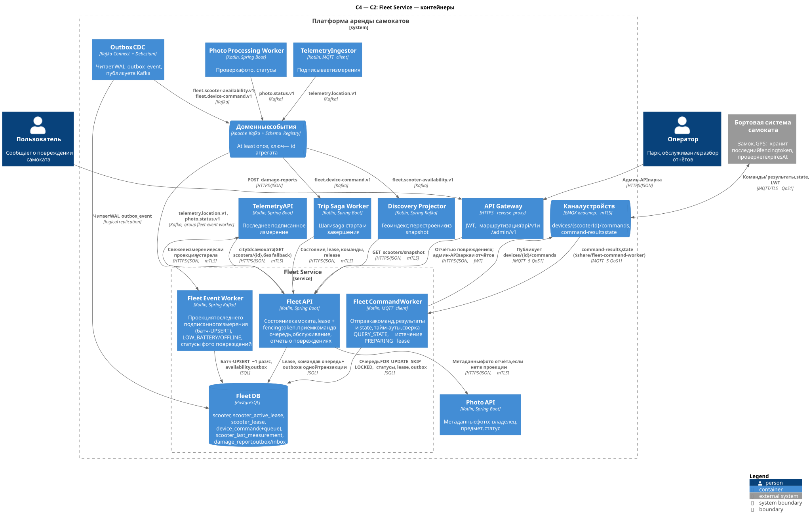
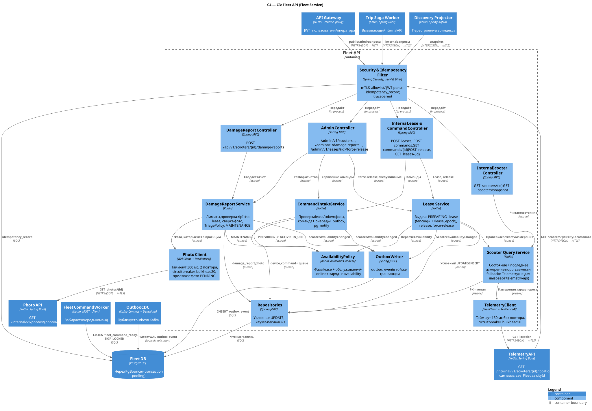
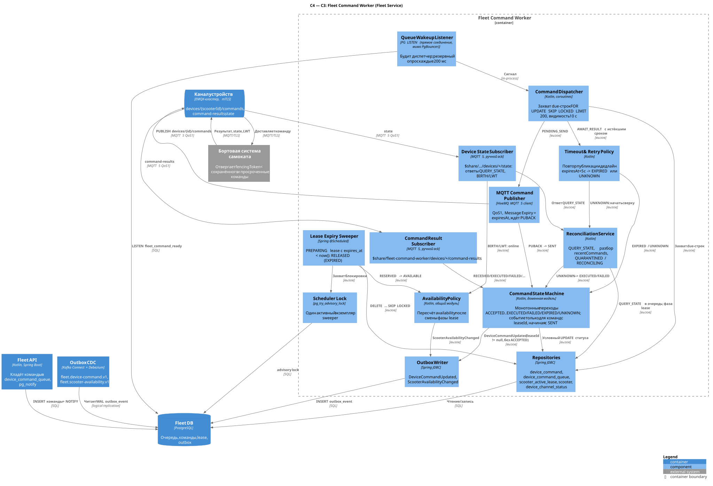
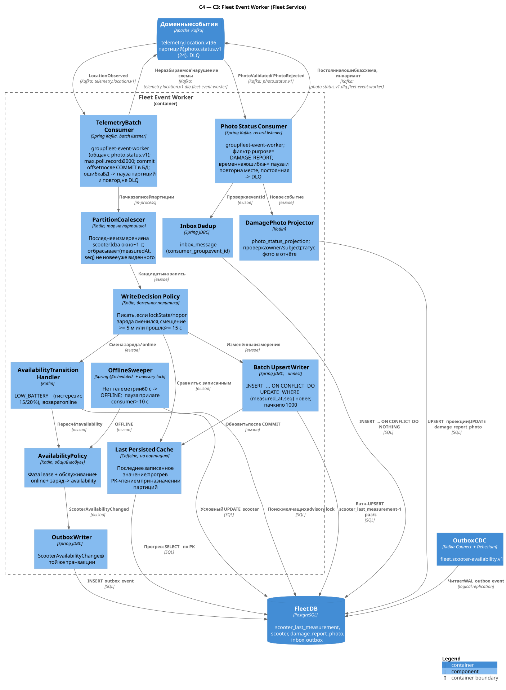

# Fleet Service

| | |
|---|---|
| Bounded context | Fleet & IoT |
| Команда-владелец | команда IoT/парка |
| Контейнеры | Fleet API, Fleet Command Worker, Fleet Event Worker |
| Хранилище | Fleet DB (PostgreSQL) |
| Ссылки | [каталог сервисов](../service-catalog.md#2-fleet-service), [конвенции API](../api-conventions.md), [хранение данных](../data-storage.md), [ADR-002](../adr/ADR-002-storage.md), [lab-01 §5.2 старт](../lab-01.md#52-старт-и-разблокировка), [§5.3 завершение](../lab-01.md#53-завершение-и-оплата), [§5.4 надёжность событий](../lab-01.md#54-контракты-событий-и-надёжность-доставки), [§6 нагрузка](../lab-01.md#6-нагрузка-масштабирование-и-доступность) |

**Отвечает за:**

- реестр самокатов и их техническую готовность: обслуживание, заряд, связь;
- исключительное выделение самоката поездке — lease с fencing token;
- приём команд замку, их доставку через MQTT, тайм-ауты и сверку фактического состояния устройства;
- проекцию последнего **подписанного** измерения, по которому Trip и Geofence принимают решения;
- публикацию доступности самоката для Discovery;
- отчёты пользователей о повреждениях и их разбор операторами.

**Не делает:**

- не хранит историю телеметрии и не подписывает измерения — это делает [Telemetry](telemetry-service.md);
- не проверяет геозоны и подпись измерения — это [Geofence](geofence-service.md);
- не знает статуса поездки, цены и оплаты: lease хранит только `tripId` и `userId`;
- не хранит бинарные фото и не проверяет их — это [Photo](photo-service.md);
- не строит поисковый геоиндекс — это [Discovery](discovery-service.md).

Числа нагрузки ниже — оценки по единым допущениям A1–A6 ([хранение данных](../data-storage.md#допущения-по-объёмам-условно)):

- 1 млн поездок в сутки, пиковый час — 10 %;
- 100 000 самокатов онлайн, интервал телеметрии 5 с, то есть 20 000 измерений/с;
- отчёты о повреждениях ≈ 5 000 в сутки (0,5 % поездок, A6), в каждом ≤ 3 фото → ≤ 15 000 фото/сутки.

Все они условные.

## 1. Контейнеры (C2)



Исходник: [c2-fleet.puml](../../diagrams/services/fleet/c2-fleet.puml).

| Контейнер | Технология | Ответственность | Единица масштабирования / метрика | Мин. реплик |
|---|---|---|---|---|
| Fleet API | Kotlin, Spring Boot | Internal API для Trip Saga Worker, Discovery Projector и Telemetry API (`cityId` самоката): состояние, lease с fencing token, приём команд в очередь, release, snapshot. Публичные отчёты о повреждениях (фото сверяются через Photo API). Admin API парка и отчётов | Под без состояния. HPA по CPU (цель 60 %) и p99 > 100 мс | 3, по одной на AZ |
| Fleet Command Worker | Kotlin, MQTT client (HiveMQ MQTT 5) | Выборка очереди команд и публикация в `devices/{scooterId}/commands`. Приём `command-results` и `state`. Тайм-ауты, сверка `QUERY_STATE`, карантин lease, истечение PREPARING lease. `DeviceCommandUpdated` через outbox | Конкурирующий потребитель очереди (`SKIP LOCKED`) и участник shared subscription. HPA по числу просроченных строк очереди и времени обработки результата | 2, в разных AZ |
| Fleet Event Worker | Kotlin, Spring Kafka | Проекция последнего подписанного измерения (батч-UPSERT), online/OFFLINE, LOW_BATTERY, статусы фото повреждений | Партиции `telemetry.location.v1` (96, то есть не больше 96 потребителей). KEDA по лагу группы `fleet-event-worker` | 3 |
| Fleet DB | PostgreSQL 17+, Patroni | Реестр, lease, команды и очередь, проекция измерений, отчёты, outbox/inbox | Вертикально. Шардирование по `cityId` — только по триггеру ([§4.7](#47-шардирование-по-cityid)) | Primary, синхронная реплика и асинхронная реплика |

Основные потоки:

1. **Старт поездки.** Trip Saga Worker делает три вызова Fleet API:
   - `GET /internal/v1/scooters/{id}`;
   - `POST .../leases`;
   - `POST /internal/v1/leases/{id}/commands` с `UNLOCK`.

   Дальше Fleet Command Worker отправляет команду в MQTT, получает результат и публикует `DeviceCommandUpdated` в `fleet.device-command.v1`, откуда его забирает Trip. Подробная последовательность — в [lab-01 §5.2](../lab-01.md#52-старт-и-разблокировка) и на диаграмме [trip-start-sequence](../../diagrams/rendered/trip-start-sequence.svg) (исходник — [trip-start-sequence.puml](../../diagrams/trip-start-sequence.puml)).
2. **Завершение.** Команда `LOCK`, затем результат `EXECUTED` с `lockState=CLOSED`, затем `release` ([lab-01 §5.3](../lab-01.md#53-завершение-и-оплата)).
3. **Телеметрия.** Telemetry Ingestor публикует `telemetry.location.v1`, Fleet Event Worker пишет его в `scooter_last_measurement`.
4. **Доступность.** Каждое изменение `scooter.availability` в той же транзакции попадает в `outbox_event`. Outbox CDC (Debezium) публикует его в `fleet.scooter-availability.v1`, Discovery Projector его потребляет. Собственного outbox relay у сервиса нет.
5. **Повреждения.**
   - Клиент загружает фото в Photo с `purpose=DAMAGE_REPORT`.
   - Затем вызывает `POST /api/v1/scooters/{id}/damage-reports`. Фото, по которым событие ещё не пришло, Fleet API сверяет через Photo API `GET /internal/v1/photos/{photoId}` ([§2.1.3](#213-отчёты-о-повреждениях)).
   - Статус проверки фото приходит из `photo.status.v1`, после чего отчёт разбирает оператор.

## 2. Компоненты (C3)

### 2.1 Fleet API



Исходник: [c3-fleet-api.puml](../../diagrams/services/fleet/c3-fleet-api.puml).

| Компонент | Ответственность | Ключевые зависимости |
|---|---|---|
| Security & Idempotency Filter | Проверяет mTLS и allowlist вызывающих по эндпоинтам ([§3.1](#31-сводная-таблица-эндпоинтов)): `trip-saga-worker`, `discovery-projector`, `telemetry-api` (только `GET /internal/v1/scooters/{id}`). Для public/admin проверяет JWT и роли. Ведёт `idempotency_record`, пробрасывает `traceparent` | Fleet DB (`idempotency_record`) |
| Internal Scooter Controller | `GET /internal/v1/scooters/{id}`, `GET /internal/v1/scooters/snapshot` | Scooter Query Service |
| Internal Lease & Command Controller | `POST leases`, `POST commands`, `GET commands/{id}`, `POST release`, `GET leases/{id}` | Lease Service, Command Intake Service |
| Damage Report Controller | `POST /api/v1/scooters/{id}/damage-reports` | Damage Report Service |
| Admin Controller | `/admin/v1/scooters/**`, `/admin/v1/damage-reports/**`, `/admin/v1/leases/{id}/force-release` | Lease, Command Intake и Damage Report Service |
| Scooter Query Service | Собирает состояние самоката и последнее измерение. Проверяет порог свежести; при устаревшем измерении берёт его из Telemetry API (кроме вызовов от самого `telemetry-api`: ему нужен только `cityId`, а встречный вызов замкнул бы цикл) | Repositories, Telemetry Client |
| Lease Service | Выдача PREPARING lease (fencing token = `++lease_epoch`), release, force-release, классификация отказов | Repositories, Availability Policy, Outbox Writer |
| Command Intake Service | Проверяет lease, владельца, токен и фазу. В одной транзакции пишет команду, строку очереди и outbox, затем делает `pg_notify` | Repositories, Availability Policy, Outbox Writer |
| Damage Report Service | Лимиты, проверка `tripId` по истории lease, сверка фото (проекция, иначе Photo API), правило сортировки (TriagePolicy), перевод в `MAINTENANCE`, операторский разбор | Repositories, Availability Policy, Photo Client |
| Availability Policy | Чистая доменная функция: фаза lease, обслуживание, online и заряд дают `availability` ([§2.1.2](#212-модель-доступности)) | — |
| Repositories | Условные UPDATE, keyset-пагинация, чтения по PK | Fleet DB через PgBouncer |
| Outbox Writer | Пишет `outbox_event` в той же транзакции, что и изменение агрегата | Fleet DB |
| Telemetry Client | `GET /internal/v1/scooters/{id}/location` у Telemetry API. Тайм-аут 150 мс без повтора, circuit breaker (50 % ошибок за 20 с), bulkhead 50 одновременных вызовов | Telemetry API |
| Photo Client | `GET /internal/v1/photos/{photoId}` у Photo API ([photo-service.md §3.2.6](photo-service.md#326-get-internalv1photosphotoid)) для фото отчёта, по которым событие ещё не пришло. Тайм-аут 300 мс, 2 повтора, circuit breaker; при отказе отчёт принимается с фото `PENDING` | Photo API |

#### 2.1.1 Lease и fencing token

Lease — это исключительное право одной поездки командовать замком самоката.

**Fencing token** — монотонный счётчик `scooter.lease_epoch`. Он увеличивается в трёх случаях:

- при выдаче каждого нового lease;
- при каждом вмешательстве оператора в замок (`UNLOCK`/`LOCK` из admin API);
- при `force-release`.

Каждая команда несёт токен. Её отвергают на двух уровнях:

- **Fleet API**: если токен не равен текущему `lease_epoch`, ответ `409 LEASE_FENCED`;
- **устройство**: если токен меньше последнего сохранённого, результат `REJECTED_STALE` ([§3.5](#35-mqtt)).

Инварианты держат маленькие непартиционированные таблицы:

- «не больше одного активного lease на самокат» — `scooter_active_lease (scooter_id PK)`;
- «не больше одного активного lease на поездку» — `UNIQUE (trip_id)`;
- история хранится в `scooter_lease` ([§4.2](#42-ddl)).

| Фаза | Значение | `availability` | Переходы |
|---|---|---|---|
| `PREPARING` | Самокат зарезервирован, команд замку ещё не было. Действует TTL (`expires_at`) | `RESERVED` | `ACTIVE` — принят `UNLOCK`. `RELEASED` — release `TRIP_CANCELLED` или истёк TTL (sweeper в Fleet Command Worker) |
| `ACTIVE` | `UNLOCK` принят и мог быть исполнен. TTL больше не действует (`expires_at = NULL`) | `IN_USE` | `RELEASING` — принят `LOCK`. `QUARANTINED` — команда `UNKNOWN`. `RELEASED` — release при подтверждённом `CLOSED`, например после `UNLOCK FAILED` |
| `RELEASING` | `LOCK` принят, ждём подтверждения | `IN_USE` | `RELEASED` — release после `LOCK EXECUTED` с `CLOSED`. `QUARANTINED` — `UNKNOWN`. При `LOCK FAILED` (самокат едет) остаётся `RELEASING`, Trip повторяет `LOCK` |
| `QUARANTINED` | Физическое состояние замка неизвестно | `RECONCILING` | Возврат в `phase_before_quarantine`, когда сверка дала ответ. `RELEASED` с `FORCE_RELEASED` — решение оператора после физической проверки |
| `RELEASED` | Lease завершён. Строка удалена из `scooter_active_lease` и осталась только в `scooter_lease` | пересчёт | конечная |

Правила:

- **TTL действует только в `PREPARING`.**
  - `ttlSeconds` — от 30 до 300, по умолчанию 120.
  - Как только принят `UNLOCK`, `expires_at` обнуляется в той же транзакции: после отправки потенциально исполненной команды истечение TTL не освобождает самокат ([lab-01 §5.2](../lab-01.md#52-старт-и-разблокировка)).
  - Гонку sweeper и `UNLOCK` разрешает блокировка строки lease. Sweeper берёт строки с `SKIP LOCKED`, а условие `expires_at > now()` проверяется в самом UPDATE ([§4.4](#44-ключевые-запросы)).
- **Release разрешён в двух случаях:**
  - lease в `PREPARING`;
  - lease в `ACTIVE`/`RELEASING`, а последнее подтверждённое устройством состояние — `CLOSED` (`lock_confirmed_state`).

  Иначе ответ `409 LOCK_NOT_CONFIRMED`, и Fleet сам ставит `QUERY_STATE`.
- **`lock_confirmed_state` меняется так:**
  - при создании lease — `CLOSED`: самокат был `AVAILABLE` и в измерении `lockState=CLOSED`;
  - при приёме `UNLOCK`/`LOCK` — `NULL`, команда «в полёте»;
  - при результате или сверке — `lockState` из ответа устройства.

  Закрытие замка при завершении подтверждает только результат команды: `LOCK` (или `QUERY_STATE`) с `EXECUTED` и `lockState=CLOSED` даёт `lock_confirmed_state = CLOSED`. `measurement.lockState` из подписанной телеметрии для этого не используется. Geofence тоже по нему не решает: он лишь записывает значение в `geo_check` и свидетельство ([geofence-service.md §3.2.2](geofence-service.md#322-post-internalv1geo-checksfinish)).
- **Свежесть при выдаче.** В проекции должно быть измерение моложе 30 с (условно; равно порогу Geofence для старта). Если проекция устарела, Fleet API запрашивает текущее измерение у Telemetry API ([§2.3.2](#232-свежесть-измерения-и-fallback-в-telemetry-api)). Если и оно устарело или Telemetry недоступна — `422 MEASUREMENT_STALE`.
- **Канал устройств.** Если ни один экземпляр Fleet Command Worker не подключён к MQTT дольше 15 с (`device_channel_status`), новые lease не выдаются: `503 DEVICE_CHANNEL_UNAVAILABLE`. Так старт не доходит до авторизации платежа впустую.

SQL выдачи lease, приёма команды и release с проверкой fencing token — в [§4.4](#44-ключевые-запросы).

#### 2.1.2 Модель доступности

`availability` хранится в `scooter` и пересчитывается одной функцией (Availability Policy) во всех трёх контейнерах. Каждое изменение `availability`:

- делается под блокировкой строки `scooter`;
- увеличивает `scooter.version`;
- в той же транзакции пишет `ScooterAvailabilityChanged` в outbox.

Если значение не изменилось, событие не публикуется.

| Приоритет | Условие | `availability` |
|---|---|---|
| 1 | Есть lease `PREPARING` | `RESERVED` |
| 2 | Есть lease `ACTIVE` или `RELEASING` | `IN_USE` |
| 3 | Есть lease `QUARANTINED` | `RECONCILING` |
| 4 | `operational_status` = `MAINTENANCE` или `RETIRED` | `MAINTENANCE` |
| 5 | `online = false` (LWT или нет телеметрии 60 с) | `OFFLINE` |
| 6 | `battery_low = true` | `LOW_BATTERY` |
| 7 | иначе | `AVAILABLE` |

- **`battery_low` с гистерезисом** (условно): включается при заряде < 15 %, выключается при ≥ 20 %. Так самокат на границе не мигает в поиске.
- **`RETIRED`** публикуется как `MAINTENANCE`; в событие добавлено поле `operationalStatus` (`ACTIVE`, `MAINTENANCE`, `RETIRED`).
- **`maintenance_pending`.** Если перевести в обслуживание нужно самокат с активным lease (оператор или отчёт о повреждении), ставится флаг `maintenance_pending`. Поездка не прерывается; при release самокат уходит в `MAINTENANCE`, а не в `AVAILABLE`.

#### 2.1.3 Отчёты о повреждениях

1. Клиент загружает до 3 фото через [Photo Service](photo-service.md): `POST /api/v1/photos/upload-sessions` с `purpose=DAMAGE_REPORT`, `subjectType=SCOOTER`, `subjectId={scooterId}`, затем presigned PUT и `complete`. Ретенция таких фото — 180 дней (правило Photo).
2. Клиент вызывает `POST /api/v1/scooters/{scooterId}/damage-reports` с `photoIds[]`, `category`, `comment` и `tripId`, если есть ([§3.2.8](#328-post-apiv1scootersscooteriddamage-reports)).
   - **Сверка фото до транзакции.** Для фото, которых ещё нет в `photo_status_projection`, Photo Client вызывает Photo API `GET /internal/v1/photos/{photoId}` ([photo-service.md §3.2.6](photo-service.md#326-get-internalv1photosphotoid); тайм-аут 300 мс, 2 повтора, circuit breaker). Проверяется то же, что в шаге 3: `ownerUserId` = автору отчёта, `purpose = DAMAGE_REPORT`, `subjectType = SCOOTER`, `subjectId = scooterId`. Несовпадение — `422 PHOTO_SUBJECT_MISMATCH`. Фото нет (404), оно `EXPIRED` или `DELETED` — `422 PHOTO_NOT_AVAILABLE`. Статусы `VALIDATED`/`REJECTED` берутся из ответа, остальные (`PENDING_UPLOAD`, `UPLOADED`, `PROCESSING`) дают `PENDING`.
   - **Photo недоступен** (тайм-аут, 5xx, открыт circuit breaker) — это мягкая зависимость: отчёт принимается с фото `PENDING`, а проверку принадлежности позже сделает Event Worker по событию (шаг 3).
   - Затем Fleet API в одной транзакции создаёт `damage_report` и `damage_report_photo` и выставляет фото статус: из проекции, если событие уже пришло; иначе из ответа Photo API; иначе `PENDING`.
3. Fleet Event Worker получает `PhotoValidated`/`PhotoRejected` и проверяет фото: `ownerUserId` = автору отчёта, `subjectType = SCOOTER`, `subjectId = scooterId`. Затем обновляет статус фото в отчёте. При несовпадении ставит `MISMATCH`. Гонку «событие раньше отчёта» снимают проекция и `pg_advisory_xact_lock(hashtext(photoId))` в обеих транзакциях.
4. **Правило сортировки (TriagePolicy)** при создании отчёта:
   - Категории, критичные для безопасности: `BRAKES`, `STEERING`, `WHEEL_TIRE`, `BATTERY_DAMAGE`.
   - Если категория критичная и `tripId` подтверждён, самокат немедленно снимается с линии (`MAINTENANCE`), а при активном lease — `maintenance_pending`. `tripId` подтверждён, если lease этой поездки на этот самокат и этого пользователя завершился не раньше 24 ч назад или ещё активен.
   - Неподтверждённый критичный отчёт снимает самокат, если за 24 ч есть второй такой же от другого пользователя.
   - Остальное попадает в очередь оператора без автодействия.
   - Защита от злоупотреблений:
     - не больше 5 отчётов на пользователя в сутки;
     - не больше одного открытого отчёта на пару пользователь–самокат;
     - автодействие всегда видно оператору (`auto_action`) и отменяется одним PATCH.
5. **Разбор оператором**
   - Очередь: `GET /admin/v1/damage-reports?cityId=&status=NEW`.
   - Фото: оператор смотрит их через Photo admin API (`POST /admin/v1/photos/{photoId}/view-url` с причиной; просмотр аудируется). Fleet фото не проксирует.
   - Решение: `PATCH /admin/v1/damage-reports/{id}` переводит отчёт в `IN_REVIEW`, затем в `CONFIRMED`, `REJECTED`, `DUPLICATE` или `RESOLVED`. Поле `maintenance` (`ENTER`, `EXIT`, `NONE`) управляет снятием самоката с линии.
   - Возврат на линию: `maintenance: EXIT` или `PATCH /admin/v1/scooters/{id}/maintenance {mode: EXIT}`. Если у самоката есть подтверждённые (`CONFIRMED`) и не закрытые критичные отчёты, ответ `409 OPEN_SAFETY_REPORTS`.

### 2.2 Fleet Command Worker



Исходник: [c3-fleet-command-worker.puml](../../diagrams/services/fleet/c3-fleet-command-worker.puml).

| Компонент | Ответственность | Ключевые зависимости |
|---|---|---|
| Queue Wakeup Listener | `LISTEN fleet_command_ready` на отдельном прямом соединении: `LISTEN` не работает через PgBouncer в transaction pooling. Будит диспетчер; резервный опрос каждые 200 мс | Fleet DB |
| Command Dispatcher | Захват строк очереди с наступившим сроком `FOR UPDATE SKIP LOCKED LIMIT 200`, «видимость» 10 с. Раздаёт строки публикатору и политике тайм-аутов | Repositories |
| MQTT Command Publisher | `PUBLISH devices/{id}/commands`, QoS 1, MQTT 5 Message Expiry = `expiresAt − now`, Correlation Data = `commandId`. По PUBACK команда переходит в `SENT` | EMQX |
| Command Result Subscriber | `$share/fleet-command-worker/devices/+/command-results`, ручной ack после COMMIT в БД | EMQX, Command State Machine |
| Device State Subscriber | `$share/fleet-command-worker/devices/+/state`: ответы `QUERY_STATE`, BIRTH, LWT | EMQX, Reconciliation Service, Availability Policy |
| Command State Machine | Монотонные переходы статуса (условный UPDATE по рангу). Применяет результат к lease (`lock_confirmed_state`, фаза) | Repositories, Outbox Writer |
| Timeout & Retry Policy | Повтор публикации каждые 5 с до `expiresAt`. Дедлайн `expiresAt + 5 с`: `EXPIRED`, если команда ни разу не опубликована, иначе `UNKNOWN` | Command State Machine, Reconciliation Service |
| Reconciliation Service | Ставит `QUERY_STATE`, разбирает `recentCommands`, `lastFencingToken` и `lockState`. Карантин lease и выход из него | Repositories, Command State Machine |
| Lease Expiry Sweeper | Раз в 1 с освобождает просроченные PREPARING lease (`release_reason = EXPIRED`) | Repositories, Availability Policy |
| Scheduler Lock | `pg_try_advisory_lock`: sweeper работает в одном экземпляре. Это экономия, а не условие корректности — корректность даёт `SKIP LOCKED` | Fleet DB |
| Availability Policy | Та же функция, что в Fleet API (общий модуль) | — |
| Repositories | `device_command`, `device_command_queue`, `scooter_active_lease`, `scooter`, `device_channel_status` | Fleet DB |
| Outbox Writer | `DeviceCommandUpdated`, `ScooterAvailabilityChanged` | Fleet DB |

#### 2.2.1 Жизненный цикл команды

| Статус | Кто ставит | Условие | Публикуется |
|---|---|---|---|
| `ACCEPTED` | Fleet API | Команда и строка очереди записаны (202) | нет (виден через `GET /internal/v1/commands/{id}`) |
| `SENT` | Publisher | PUBACK брокера на первую публикацию | да |
| `DELIVERED` | Result Subscriber | Устройство прислало `RECEIVED` | да |
| `EXECUTED` | Result Subscriber, Reconciliation | Устройство исполнило команду; в `result` есть `lockState` и `deviceTime` | да |
| `FAILED` | Result Subscriber, Reconciliation | Отказ устройства: `failureReason` ∈ `LOCK_MECHANISM_ERROR`, `SCOOTER_MOVING`, `BATTERY_CRITICAL`, `STALE_FENCING_TOKEN` (устройство ответило `REJECTED_STALE`) | да |
| `EXPIRED` | Устройство (`EXPIRED`), Timeout Policy или Reconciliation | Команда гарантированно не исполнена и уже не будет исполнена: устройство отвергло её по `expiresAt`; она ни разу не публиковалась (`publish_attempts = 0`); или сверка показала, что устройство её не получило, а его часы прошли `expiresAt` | да |
| `UNKNOWN` | Timeout Policy | Дедлайн `expiresAt + 5 с` прошёл, команда публиковалась, финального ответа нет | да |

Переходы монотонны:

- `ACCEPTED` → `SENT` → `DELIVERED` → финальный статус;
- `UNKNOWN` → `EXECUTED`, `FAILED` или `EXPIRED` — только через сверку или поздний результат устройства.

Каждый переход — условный UPDATE с проверкой ранга текущего статуса ([§4.4](#44-ключевые-запросы)) и `status_version + 1` (это `aggregateVersion` события).

Ограничения публикации:

- В `fleet.device-command.v1` публикуются только команды с `leaseId`: команды поездки и сверки по lease. Сервисные команды оператора без lease (`leaseId = null`) в Kafka не попадают — у события нет потребителя, а `leaseId` в контракте обязателен. Их статус виден в admin API (карточка самоката `GET /admin/v1/scooters/{scooterId}`), а сам факт команды — в `admin_audit_log`.
- Публикуются только статусы `SENT` и дальше. `ACCEPTED` в Kafka не попадает никогда: его видно только в ответе `202` и через `GET /internal/v1/commands/{id}` ([§3.3](#33-публикуемые-события)).
- Результат устройства (`EXECUTED`, `FAILED`) применяется к lease, только если `lease_id` и `fencing_token` команды всё ещё совпадают с активным lease.

#### 2.2.2 Сверка (QUERY_STATE) и карантин

При `UNKNOWN` lease немедленно переходит в `QUARANTINED`: прежняя фаза сохраняется в `phase_before_quarantine`, `availability` становится `RECONCILING`.

Затем Reconciliation Service ставит `QUERY_STATE`:

- три попытки за ~60 с (0, 20, 40 с);
- далее экспоненциальный backoff до 10 мин;
- внеочередная попытка при BIRTH устройства или при возобновлении телеметрии.

Пока устройство офлайн, строка очереди ждёт в стадии `WAIT_DEVICE`. Её будит Fleet Event Worker или обработчик BIRTH.

Решение по ответу (`lastFencingToken`, `lockState`, `recentCommands`; токен команды — `T`):

| Ответ устройства | Команда `UNLOCK` | Команда `LOCK` |
|---|---|---|
| `commandId` есть в `recentCommands` | статус оттуда (`EXECUTED`, `FAILED`, `EXPIRED`) | то же |
| `lastFencingToken > T` | `FAILED` (`STALE_FENCING_TOKEN`) | `FAILED` (`STALE_FENCING_TOKEN`) |
| `lastFencingToken = T`, `lockState = OPEN` | `EXECUTED` (выведено из состояния) | `FAILED`, если `deviceTime > expiresAt`; иначе ждём |
| `lockState = CLOSED`, команды нет в `recentCommands`, `deviceTime > expiresAt` | `EXPIRED` (не получена и уже не исполнится) | `EXECUTED` (цель достигнута) |
| Нет ответа | остаётся `UNKNOWN`, lease в карантине | то же |

Выход из карантина:

- **Ответ получен.** Lease возвращается в `phase_before_quarantine` с актуальным `lock_confirmed_state`, публикуется `DeviceCommandUpdated` с итоговым статусом. Trip переводит поездку из `RECONCILING` в `ACTIVE` или отменяет старт ([lab-01 §5.2](../lab-01.md#52-старт-и-разблокировка)).
- **Ответа нет 15 мин.** Алерт оператору.
- **Ответа нет 24 ч.** Задача на физическую проверку, затем `POST /admin/v1/leases/{id}/force-release`.

Это же поведение ожидает Trip на пути `END_WITHOUT_LOCK_CONFIRMATION`: release отвечает `409 LOCK_NOT_CONFIRMED`, lease остаётся `QUARANTINED`, а освобождает его только сверка или оператор ([trip-service.md §3.2.6](trip-service.md#326-операторские-эндпоинты-компактно)).

**Ограничение (принято): Trip не уведомляется о force-release.** Fleet не публикует отдельного события об освобождении lease оператором. Trip узнаёт об этом тремя путями:

- `409 LEASE_FENCED` на следующей команде: force-release увеличивает `lease_epoch`;
- `GET /internal/v1/leases/{leaseId}` при сверке ([§3.2.6](#326-get-internalv1leasesleaseid-добавлен)) — `releaseReason = FORCE_RELEASED`;
- повторный release — `200` с `releaseReason = FORCE_RELEASED` ([§3.2.5](#325-post-internalv1leasesleaseidrelease)).

Force-release бывает редко и только после физической проверки, а поездка к этому моменту уже ждёт сверки. Поэтому отдельный канал уведомления не нужен.

#### 2.2.3 Истечение PREPARING lease

Lease Expiry Sweeper раз в 1 с:

1. Удаляет до 500 строк `scooter_active_lease` с `phase='PREPARING' AND expires_at < now()` (`FOR UPDATE SKIP LOCKED`).
2. Отмечает их в истории `RELEASED`/`EXPIRED`.
3. Пересчитывает `availability`: из `RESERVED` в `AVAILABLE` или `MAINTENANCE`, если стоял `maintenance_pending`.
4. Пишет `ScooterAvailabilityChanged`.

Частичный индекс по `expires_at` держит выборку дешёвой.

Если Trip опоздал и прислал `UNLOCK` после истечения, ответ `409 LEASE_EXPIRED` ([§3.2.3](#323-post-internalv1leasesleaseidcommands)). Это сигнал saga снять авторизацию платежа.

#### 2.2.4 Online/offline по каналу команд

Device State Subscriber обрабатывает два сигнала:

- **LWT** (`kind=LWT`, будет опубликован брокером при обрыве; Will Delay Interval 30 с гасит короткие переподключения) — ставит `online=false`;
- **BIRTH** (`kind=BIRTH`) — ставит `online=true`.

Порядок задаёт `connSeq` устройства: сигнал со старым `connSeq` игнорируется (`scooter.device_conn_seq`). Второй источник offline — отсутствие телеметрии 60 с ([§2.3.3](#233-low_battery-и-offline)).

Отдельно каждый экземпляр раз в 5 с пишет `device_channel_status` (подключён ли к EMQX). Fleet API по этой таблице отказывает в новых lease, когда канал устройств недоступен.

### 2.3 Fleet Event Worker



Исходник: [c3-fleet-event-worker.puml](../../diagrams/services/fleet/c3-fleet-event-worker.puml).

| Компонент | Ответственность | Ключевые зависимости |
|---|---|---|
| Telemetry Batch Consumer | Batch listener `telemetry.location.v1`, group `fleet-event-worker`, `max.poll.records=2000`. Offset коммитится только после COMMIT батча в БД | Kafka |
| Partition Coalescer | На каждую назначенную партицию держит map `scooterId → последнее измерение` за окно ~1 с. Отбрасывает записи не новее уже виденной (`measuredAt`, `seq`) | — |
| Write Decision Policy | Решает, писать ли измерение (правила — в [§2.3.1](#231-как-не-перегрузить-fleet-db-телеметрией)) | Last Persisted Cache |
| Last Persisted Cache | Последнее записанное значение по каждому самокату партиции (Caffeine). Прогрев одним `SELECT ... WHERE scooter_id = ANY(...)` при назначении партиции. Сброс при отзыве | Fleet DB |
| Batch Upsert Writer | `INSERT ... SELECT FROM unnest(...) ON CONFLICT DO UPDATE WHERE новее`, пачками по 1000, отсортированными по `scooter_id` (меньше взаимных блокировок) | Fleet DB |
| Availability Transition Handler | Переходы `battery_low` (гистерезис 15/20 %) и `online=true` при возобновлении телеметрии. Будит строки сверки `WAIT_DEVICE` | Availability Policy, Fleet DB |
| Offline Sweeper | Раз в 10 с: `online` самокаты без телеметрии 60 с переводит в OFFLINE. Пауза при лаге консьюмера > 10 с и при массовом срабатывании | Fleet DB, Availability Policy |
| Availability Policy | Общий модуль | — |
| Photo Status Consumer | Record listener `photo.status.v1` (та же группа `fleet-event-worker`; компромисс общей группы — в [§3.4](#34-потребляемые-события)). Пропускает всё, кроме `purpose=DAMAGE_REPORT`. Временная ошибка (БД, тайм-аут) — пауза партиции и повтор на месте; постоянная (схема, инвариант) — DLQ ([§3.4](#34-потребляемые-события)) | Kafka |
| Inbox Dedup | `inbox_message (consumer_group, event_id)` в той же транзакции, что и проекция | Fleet DB |
| Damage Photo Projector | `photo_status_projection`, проверка владельца и предмета, статус фото в `damage_report_photo` | Fleet DB |
| Outbox Writer | `ScooterAvailabilityChanged` при LOW_BATTERY, OFFLINE и возврате | Fleet DB |

#### 2.3.1 Как не перегрузить Fleet DB телеметрией

На входе 20 000 измерений/с (условно, A2). Писать каждое — значит 20 000 UPDATE/с, WAL и vacuum на горячей OLTP-базе, где живут lease и команды. Нагрузку снижают так:

1. **Отдельная узкая таблица `scooter_last_measurement`.**
   - Одна строка на самокат, только PK, без вторичных индексов и FK.
   - `fillfactor = 50` оставляет место на странице, поэтому все UPDATE идут как HOT: индекс не трогается, а мёртвые версии чистит обрезка страницы.
   - `scooter` при этом не обновляется на каждое измерение, а только при смене online, `battery_low` или `lock_state`. Иначе каждое измерение било бы по строке, которую блокируют lease и команды.
2. **Слияние в памяти по партиции Kafka.** Ключ топика — `scooterId`, поэтому все измерения самоката приходят в одну партицию по порядку. Coalescer держит последнее измерение на самокат, промежуточные внутри окна выбрасываются.
3. **Батч-UPSERT примерно раз в секунду.**
   - Одна транзакция на экземпляр: `unnest` массивов, пачки по 1000 строк.
   - Затем COMMIT, затем commit offset всех партиций батча.
   - Подтверждение приходит после записи, поэтому медленная БД сама тормозит чтение — естественный backpressure без отдельной очереди.
4. **Стоящие самокаты не пишутся.** Измерение отбрасывается, если выполнены все условия:
   - `lockState` не изменился;
   - заряд не пересёк порог 15 % или 20 % и изменился меньше чем на 5 п. п.;
   - смещение от записанной точки < 5 м;
   - последняя запись была < 15 с назад.

   Отбрасывается только запись в БД: решение о LOW_BATTERY принимается по каждому измерению.
5. **Защита от отката.** UPSERT обновляет строку только при `(measured_at, seq)` новее записанного. Повтор, дубль (at-least-once Telemetry) или переупорядочение после ребаланса не откатят проекцию назад, поэтому inbox для телеметрии не нужен. Первым сравнивается `measured_at`, потому что `seq` обнуляется при перезагрузке устройства; будущее время отсекает валидация в Telemetry Ingestor (`CLOCK_SKEW`, [telemetry-service.md §2.1.2](telemetry-service.md#212-валидация-и-флаги-качества)).
   - **Дубль** — это то же измерение: та же тройка `(scooterId, bootId, seq)` и потому тот же детерминированный `measurementId` (UUIDv5, [telemetry-service.md](telemetry-service.md#общая-модель-measurement)). У него тот же `(measured_at, seq)`, условие «строго новее» не выполняется, и строка не меняется.
   - Отдельный ключ дедупликации Fleet не хранит. `bootId` не нужен и для порядка: после перезагрузки `seq` сбрасывается, но `measured_at` растёт.
6. **Ослабленный `synchronous_commit` для батчей проекции** (`SET LOCAL synchronous_commit = local`). Батч, потерянный при failover, перекроется следующими измерениями через 5–15 с. Lease и команды остаются с синхронной фиксацией.

Оценка записи (условно):

- в пиковый час ~100 000 поездок/ч при средней длительности ~15 мин дают ≈ 25 000 едущих самокатов → ≈ 5 000 строк/с;
- ≈ 75 000 стоящих самокатов, принудительное обновление раз в 15 с → ≈ 5 000 строк/с;
- итого ≈ 10 000 HOT UPDATE/с вместо 20 000 (днём меньше).

Размер таблицы ≈ 50 МБ, она целиком в памяти. WAL ≈ 3 МБ/с в пике (оценка): `wal_compression = lz4`, `checkpoint_timeout = 15min`.

Отвергнутые варианты:

- `UNLOGGED`-таблица: теряется при failover и не видна на репликах;
- Redis для проекции: выдача lease проверяет свежесть в той же транзакции, что и условный UPDATE `scooter`.

#### 2.3.2 Свежесть измерения и fallback в Telemetry API

Если стоящий самокат не меняется, его измерение обновляется раз в 15 с. С учётом батча и задержки конвейера возраст сохранённого измерения обычно ≤ 20 с. Это ниже порога Geofence для старта (30 с, [Geofence Service](geofence-service.md)) и порога выдачи lease (30 с).

Если сохранённое измерение старше порога, Scooter Query Service вызывает Telemetry API `GET /internal/v1/scooters/{scooterId}/location`. Порог для `GET` — `maxMeasurementAgeSec`, по умолчанию 20 с; для lease — 30 с. Так бывает при лаге Event Worker или после ребаланса. Параметры вызова:

- тайм-аут 150 мс, без повтора внутри запроса;
- circuit breaker и bulkhead 50.

Полученное измерение записывается в проекцию тем же условным UPSERT, поэтому следующая выдача lease его увидит. В ответе это видно по `measurementSource: TELEMETRY_API`. Подпись Fleet не проверяет и поля не переформатирует: это делает Geofence по JWKS Telemetry. Объект `measurement` хранится с канонической точностью, определённой только в [telemetry-service.md §3.3.1](telemetry-service.md#331-каноническая-строка-и-подпись) ([DDL](#42-ddl): `numeric(10,7)` для координат, `numeric(6,1)` для точности, время в мс), поэтому строка подписи из сохранённых полей совпадает с исходной.

#### 2.3.3 LOW_BATTERY и OFFLINE

- **LOW_BATTERY.** Availability Transition Handler меняет `scooter.battery_low` при пересечении порогов: < 15 % включает, ≥ 20 % выключает. Затем пересчитывает `availability` и при изменении пишет `ScooterAvailabilityChanged` (`reason=BATTERY_LOW` или `BATTERY_RECOVERED`).
- **OFFLINE по отсутствию телеметрии.**
  - Offline Sweeper работает в одном экземпляре (advisory lock) и раз в 10 с выбирает `online` самокаты, у которых `received_at` старше 60 с. Индекса по `received_at` нет — он сломал бы HOT; seq scan таблицы на 50 МБ занимает миллисекунды.
  - Затем ставит `online=false` и пересчитывает доступность (`reason=DEVICE_OFFLINE`).
  - Защиты от ложных OFFLINE:
    - пауза, если лаг группы > 10 с, неизвестен, или за 30 с не записано ни одного измерения — это проблема конвейера, а не устройств;
    - если за проход офлайн уходит больше 5 % парка, пометка не применяется, поднимается алерт.
- **OFFLINE по LWT** — в Fleet Command Worker ([§2.2.4](#224-onlineoffline-по-каналу-команд)).
- **Возврат online** — первое измерение после offline (`reason=DEVICE_ONLINE`). Заодно будятся строки сверки в `WAIT_DEVICE`.

#### 2.3.4 Статусы фото повреждений

Photo Status Consumer читает `photo.status.v1` и пропускает события с `purpose ≠ DAMAGE_REPORT`, просто коммитя offset. Для остальных в одной транзакции:

1. `INSERT inbox_message ... ON CONFLICT DO NOTHING` — если строка уже есть, событие дубль, конец.
2. `pg_advisory_xact_lock(hashtext(photoId))`.
3. UPSERT `photo_status_projection`.
4. `UPDATE damage_report_photo SET status = VALIDATED | REJECTED | MISMATCH` — если отчёт уже существует.

Проекция нужна, потому что событие может прийти раньше отчёта; хранится 30 дней. Флаги Photo (`LOW_QUALITY`, `SUSPECTED_REUSE`, `NO_SCOOTER_DETECTED`) не отклоняют отчёт, а показываются оператору.

## 3. API

Общие правила — в [конвенциях API](../api-conventions.md):

- ошибки RFC 9457 с полем `code`;
- `Idempotency-Key` обязателен для POST;
- `If-Match` для PATCH;
- курсорная пагинация `{items, nextCursor}`;
- UUIDv7, время в UTC RFC 3339.

Internal-эндпоинты Gateway не публикует: они защищены mTLS и allowlist по имени контейнера. Неизвестный вызывающий получает `403 CALLER_NOT_ALLOWED`, это общее для всех internal-эндпоинтов и в таблицах ниже не повторяется.

### 3.1 Сводная таблица эндпоинтов

| Метод | Путь | Аудитория | Кто вызывает | Авторизация | Идемпотентность |
|---|---|---|---|---|---|
| GET | `/internal/v1/scooters/{scooterId}` | internal | Trip Saga Worker; Telemetry API (`cityId` для проверки городов оператора) | mTLS, `trip-saga-worker`, `telemetry-api` | безопасный |
| POST | `/internal/v1/scooters/{scooterId}/leases` | internal | Trip Saga Worker | mTLS, `trip-saga-worker` | `Idempotency-Key` + один lease на `tripId` |
| POST | `/internal/v1/leases/{leaseId}/commands` | internal | Trip Saga Worker | mTLS, `trip-saga-worker` | по `commandId` |
| GET | `/internal/v1/commands/{commandId}` | internal | Trip Saga Worker | mTLS, `trip-saga-worker` | безопасный |
| POST | `/internal/v1/leases/{leaseId}/release` | internal | Trip Saga Worker | mTLS, `trip-saga-worker` | `Idempotency-Key` + повтор даёт 200 |
| GET | `/internal/v1/leases/{leaseId}` (добавлен) | internal | Trip Saga Worker | mTLS, `trip-saga-worker` | безопасный |
| GET | `/internal/v1/scooters/snapshot` | internal | Discovery Projector | mTLS, `discovery-projector` | безопасный |
| POST | `/api/v1/scooters/{scooterId}/damage-reports` | public | мобильное приложение через Gateway | JWT пользователя | `Idempotency-Key` |
| POST | `/admin/v1/scooters` | admin | консоль оператора | `ADMIN` | `Idempotency-Key` + уникальный `serialNumber` |
| GET | `/admin/v1/scooters` | admin | консоль оператора | `OPERATOR`, `SUPPORT`, `ADMIN` | безопасный |
| GET | `/admin/v1/scooters/{scooterId}` (добавлен) | admin | консоль оператора | `OPERATOR`, `SUPPORT`, `ADMIN` | безопасный |
| PATCH | `/admin/v1/scooters/{scooterId}/maintenance` | admin | консоль оператора | `OPERATOR`, `ADMIN` | `If-Match` |
| POST | `/admin/v1/scooters/{scooterId}/commands` | admin | консоль оператора | `OPERATOR`, `ADMIN` для `UNLOCK` | по `commandId` |
| POST | `/admin/v1/leases/{leaseId}/force-release` (добавлен) | admin | консоль оператора | `ADMIN` | `Idempotency-Key` |
| GET | `/admin/v1/damage-reports` | admin | консоль оператора | `OPERATOR`, `SUPPORT` | безопасный |
| PATCH | `/admin/v1/damage-reports/{reportId}` | admin | консоль оператора | `OPERATOR` | `If-Match` |

### 3.2 Эндпоинты детально

#### 3.2.1 `GET /internal/v1/scooters/{scooterId}`

**Назначение.** Текущее состояние самоката и его последнее подписанное измерение. Trip Saga Worker вызывает его на шаге старта (измерение уходит в Geofence `geo-checks/start`) и на шаге завершения (`geo-checks/finish`). Telemetry API (`ScooterCityClient`) читает отсюда только `cityId`, чтобы проверить города оператора при выдаче истории перемещений ([telemetry-service.md §2.2](telemetry-service.md#22-telemetry-api)).

**Вызывают:** `trip-saga-worker`, `telemetry-api` (mTLS, allowlist). **Заголовки:** `traceparent`.

**Параметры:**

| Параметр | Где | Тип | Ограничения |
|---|---|---|---|
| `scooterId` | path | uuid | обязателен |
| `maxMeasurementAgeSec` | query (добавлен) | int | 5–60, по умолчанию 20. Если сохранённое измерение старше, Fleet API запрашивает свежее у Telemetry API |

**Ответ `200 OK`**, заголовок `ETag: "1842"` (`version`):

```json
{
  "scooterId": "018f3a2b-7c4d-7e8f-9a0b-1c2d3e4f5a6b",
  "cityId": "01900000-0000-7000-8000-000000000001",
  "model": "NB-G30-2025",
  "availability": "AVAILABLE",
  "lockState": "CLOSED",
  "batteryPercent": 78,
  "online": true,
  "lastSeenAt": "2026-11-05T09:14:01.884Z",
  "measurement": {
    "measurementId": "53c02f35-847f-5848-9c31-61b67c67ad6c",
    "lat": 55.7512443,
    "lon": 37.6184227,
    "accuracyM": 4.0,
    "lockState": "CLOSED",
    "measuredAt": "2026-11-05T09:14:01.512Z",
    "receivedAt": "2026-11-05T09:14:01.884Z",
    "signature": {
      "alg": "EdDSA",
      "kid": "tlm-2026-11",
      "value": "x3Jv0d6nC6kYpQm9...b4Q"
    }
  },
  "activeLeaseId": null,
  "version": 1842,
  "operationalStatus": "ACTIVE",
  "measurementAgeMs": 1608,
  "measurementSource": "PROJECTION"
}
```

| Поле | Пояснение |
|---|---|
| `lockState` | Последнее состояние замка, подтверждённое по каналу команд: результат команды, `QUERY_STATE`, BIRTH. `measurement.lockState` — из подписанной телеметрии: Geofence записывает его в свидетельство, но решения по нему не принимает; закрытие замка при завершении подтверждает результат `LOCK` ([§2.1.1](#211-lease-и-fencing-token)) |
| `batteryPercent`, `lastSeenAt` | Из `scooter_last_measurement` (`battery_percent`, `received_at`) |
| `measurement` | Объект Telemetry ([общая модель `measurement`](telemetry-service.md#общая-модель-measurement)) передаётся без изменений. Каноническая форма полей и строка подписи определены только в [telemetry-service.md §3.3.1](telemetry-service.md#331-каноническая-строка-и-подпись); Fleet её не повторяет и хранит поля с той же точностью ([§4.2](#42-ddl)). `measurementId` — детерминированный UUIDv5 от `(scooterId, bootId, seq)`. `signature.kid` — в формате Telemetry `tlm-YYYY-MM` ([§3.3.2](telemetry-service.md#332-ключи-подписи-и-ротация)). Если измерений ещё не было — `null`. `bootId` и `qualityFlags` Fleet в `measurement` не добавляет: их нет в общей модели Telemetry, они не входят в подпись и не хранятся в `scooter_last_measurement`; Geofence принимает их как необязательные и без них работает ([geofence-service.md](geofence-service.md#общая-модель-measurement)) |
| `operationalStatus`, `measurementAgeMs`, `measurementSource` (`PROJECTION` или `TELEMETRY_API`) | Добавлены Fleet |

**Ошибки:**

| HTTP | `code` | Условие |
|---|---|---|
| 400 | `VALIDATION_FAILED` | `scooterId` не UUID, `maxMeasurementAgeSec` вне диапазона |
| 404 | `SCOOTER_NOT_FOUND` | самоката нет в реестре |
| 503 | `DEPENDENCY_UNAVAILABLE` | Fleet DB недоступна (`Retry-After: 1`) |

**Повторы и конкурентность.**

- Чтение с primary: после выдачи lease нужна актуальность. Реплика используется только для admin и snapshot.
- Недоступность Telemetry API ошибкой не считается: возвращается сохранённое измерение с честным `measurementAgeMs`, решение о свежести принимает Geofence.
- Trip повторяет запрос до 2 раз с джиттером.
- Для вызывающего `telemetry-api` fallback в Telemetry API не выполняется: ответ всегда из проекции. Telemetry нужен только `cityId`, а встречный вызов `/location` замкнул бы цикл между сервисами. Telemetry кеширует ответ 10 мин (тайм-аут 300 мс, 1 повтор).

**Цели:** p99 ≤ 30 мс из проекции и ≤ 200 мс с fallback; тайм-аут вызывающего 500 мс (Trip), 300 мс (Telemetry).

#### 3.2.2 `POST /internal/v1/scooters/{scooterId}/leases`

**Назначение.** Атомарно зарезервировать самокат за поездкой: lease `PREPARING` с TTL и новым fencing token.

**Заголовки:** `Idempotency-Key` (обязателен, рекомендуемое значение `{tripId}:lease`), `traceparent`.

**Тело запроса:**

| Поле | Тип | Обяз. | Ограничения |
|---|---|---|---|
| `tripId` | uuid | да | UUIDv7 поездки |
| `userId` | uuid | да | пользователь поездки |
| `ttlSeconds` | int | нет | 30–300, по умолчанию 120 |

```json
{ "tripId": "01a1b2c3-d4e5-7f60-8a71-b2c3d4e5f607", "userId": "018f9e8d-7c6b-7a59-b483-726150493827", "ttlSeconds": 120 }
```

**Обработка:**

1. Проверка `idempotency_record` (scope `lease-create`).
2. Проверка свежести: измерение моложе 30 с; при необходимости — fallback в Telemetry API ([§2.3.2](#232-свежесть-измерения-и-fallback-в-telemetry-api)).
3. Одна транзакция:
   - условный UPDATE `scooter` (`lease_epoch + 1`, `RESERVED`);
   - INSERT `scooter_active_lease` и `scooter_lease`;
   - outbox `ScooterAvailabilityChanged` (SQL — [§4.4.1](#441-выдача-lease)).
4. Если UPDATE не затронул строку — классификация повторным чтением (таблица ниже).

**Ответ `201 Created`:**

```json
{
  "leaseId": "01a1b2c3-d6f1-7a22-9b33-c4d5e6f70819",
  "scooterId": "018f3a2b-7c4d-7e8f-9a0b-1c2d3e4f5a6b",
  "tripId": "01a1b2c3-d4e5-7f60-8a71-b2c3d4e5f607",
  "fencingToken": 4182,
  "phase": "PREPARING",
  "expiresAt": "2026-11-05T09:16:03.512Z"
}
```

**Ошибки** (тело RFC 9457):

```json
{
  "type": "https://docs.scooter.example/problems/scooter-leased",
  "title": "Самокат уже выделен другой поездке",
  "status": 409,
  "detail": "Scooter 018f3a2b-... has an active lease",
  "instance": "/internal/v1/scooters/018f3a2b-7c4d-7e8f-9a0b-1c2d3e4f5a6b/leases",
  "code": "SCOOTER_LEASED",
  "traceId": "4bf92f3577b34da6a3ce929d0e0e4736"
}
```

| HTTP | `code` | Условие |
|---|---|---|
| 400 | `VALIDATION_FAILED` | нет обязательных полей, `ttlSeconds` вне диапазона |
| 400 | `IDEMPOTENCY_KEY_REQUIRED` | нет `Idempotency-Key` |
| 404 | `SCOOTER_NOT_FOUND` | самоката нет |
| 409 | `SCOOTER_LEASED` | есть активный lease другой поездки |
| 409 | `SCOOTER_NOT_AVAILABLE` | `availability` ≠ `AVAILABLE`: `MAINTENANCE`, `OFFLINE`, `LOW_BATTERY`, `RECONCILING`. Текущее значение — в расширении `availability` |
| 409 | `TRIP_ALREADY_HAS_LEASE` (добавлен) | у этой поездки уже есть или был lease на **другой** самокат |
| 422 | `MEASUREMENT_STALE` | нет измерения моложе 30 с, в том числе после запроса в Telemetry API |
| 422 | `IDEMPOTENCY_KEY_REUSED` | тот же ключ с другим телом |
| 503 | `DEVICE_CHANNEL_UNAVAILABLE` (добавлен) | ни один Fleet Command Worker не подключён к MQTT дольше 15 с |
| 503 | `DEPENDENCY_UNAVAILABLE` | Fleet DB недоступна |

**Повторы и конкурентность.**

- **Повтор с тем же ключом** возвращает сохранённый ответ (24 ч).
- **Повтор с другим ключом, но тем же `tripId` и `scooterId`**, пока lease жив, возвращает тот же lease (`201`, естественная идемпотентность по `trip_id`).
- **Гонка двух поездок за один самокат.** Её решает условный UPDATE строки `scooter` и PK `scooter_active_lease`: побеждает одна, вторая получает `SCOOTER_LEASED` или `SCOOTER_NOT_AVAILABLE`.

**Цели:** p99 ≤ 50 мс (≤ 250 мс с fallback); тайм-аут вызывающего 500 мс.

#### 3.2.3 `POST /internal/v1/leases/{leaseId}/commands`

**Назначение.** Надёжно принять команду замку от владельца lease. `202` означает, что команда записана в очередь, а не исполнена. Итог приходит событием `DeviceCommandUpdated` или через `GET /internal/v1/commands/{id}`.

**Заголовки:** `Idempotency-Key` (обязателен, равен `commandId`), `traceparent`.

**Тело запроса:**

| Поле | Тип | Обяз. | Ограничения |
|---|---|---|---|
| `commandId` | uuid | да | UUIDv7, генерирует Trip. Время в UUID — в пределах ±5 мин от времени сервера. Последний байт (часть `rand_b`) равен последнему байту `leaseId`, то есть бакету `cityId` ([§4.7](#47-шардирование-по-cityid)) |
| `type` | enum | да | `UNLOCK`, `LOCK`, `QUERY_STATE` |
| `tripId` | uuid | да | должен совпадать с `lease.trip_id` |
| `fencingToken` | int64 | да | ≥ 1, должен совпадать с токеном lease и `scooter.lease_epoch` |
| `expiresAt` | RFC 3339 | да | `now + 5 с < expiresAt ≤ now + 120 с`. После этого момента устройство команду не исполнит |

```json
{
  "commandId": "01a1b2c3-e0a4-7c55-8d66-e7f809112219",
  "type": "UNLOCK",
  "tripId": "01a1b2c3-d4e5-7f60-8a71-b2c3d4e5f607",
  "fencingToken": 4182,
  "expiresAt": "2026-11-05T09:14:35.000Z"
}
```

**Обработка:**

1. Если `device_command` с этим `commandId` уже есть:
   - тот же `request_hash` — `202` с **текущим** статусом, без побочных эффектов;
   - другой — `422 IDEMPOTENCY_KEY_REUSED`.
2. Транзакция:
   - условный UPDATE lease с проверкой fencing token и фазы ([§4.4.2](#442-приём-команды-с-проверкой-fencing-token));
   - INSERT `device_command` (`ACCEPTED`);
   - INSERT `device_command_queue` (`PENDING_SEND`);
   - при `PREPARING → ACTIVE` — UPDATE `scooter` в `IN_USE` и outbox `ScooterAvailabilityChanged`;
   - `pg_notify('fleet_command_ready', scooterId)`.
3. Если UPDATE не затронул строку — классификация повторным чтением lease (сначала `scooter_active_lease`, затем история).

**Ответ `202 Accepted`** (поля после `status` добавлены):

```json
{
  "commandId": "01a1b2c3-e0a4-7c55-8d66-e7f809112219",
  "status": "ACCEPTED",
  "leaseId": "01a1b2c3-d6f1-7a22-9b33-c4d5e6f70819",
  "scooterId": "018f3a2b-7c4d-7e8f-9a0b-1c2d3e4f5a6b",
  "acceptedAt": "2026-11-05T09:14:05.004Z"
}
```

**Ошибки:**

| HTTP | `code` | Условие |
|---|---|---|
| 400 | `VALIDATION_FAILED` | `expiresAt` вне окна, `commandId` не UUIDv7 или его время вне ±5 мин, последний байт `commandId` не равен последнему байту `leaseId`, `Idempotency-Key ≠ commandId` |
| 400 | `IDEMPOTENCY_KEY_REQUIRED` | нет `Idempotency-Key` |
| 404 | `LEASE_NOT_FOUND` | lease нет ни в активных, ни в истории |
| 409 | `LEASE_OWNER_MISMATCH` (добавлен) | `tripId` не совпадает с lease |
| 409 | `LEASE_FENCED` | `fencingToken` не равен токену lease или `scooter.lease_epoch`: выдан новый lease или вмешался оператор |
| 409 | `LEASE_EXPIRED` | lease `PREPARING` с `expires_at ≤ now()` или уже освобождён с причиной `EXPIRED` |
| 409 | `LEASE_PHASE_CONFLICT` (добавлен) | команда недопустима в фазе: `LOCK` в `PREPARING`; `UNLOCK` в `RELEASING`; `UNLOCK`/`LOCK` в `QUARANTINED`; любая команда в `RELEASED` |
| 409 | `COMMAND_IN_PROGRESS` (добавлен) | у самоката уже есть незавершённая `UNLOCK`/`LOCK` (уникальный частичный индекс очереди) |
| 422 | `IDEMPOTENCY_KEY_REUSED` | тот же `commandId` с другим телом |
| 503 | `DEPENDENCY_UNAVAILABLE` | Fleet DB недоступна |

**Повторы и конкурентность.**

- Повтор с тем же `commandId` безопасен в любой момент.
- Проверку фазы, токена и создание команды сериализует блокировка строки lease. Sweeper и force-release работают с той же строкой.
- `QUERY_STATE` разрешён в любой нерелизнутой фазе, включая `QUARANTINED`.
- Если MQTT недоступен, команда принимается, но не публикуется и к дедлайну станет `EXPIRED` — это гарантия неисполнения.

**Цели:** p99 ≤ 50 мс; тайм-аут вызывающего 500 мс.

#### 3.2.4 `GET /internal/v1/commands/{commandId}`

**Назначение.** Статус команды для сверки Trip: потерянное событие, перезапуск saga.

**Заголовки:** `traceparent`.

**Параметры:**

- `commandId` (path, uuid);
- `leaseId` (query, uuid, необязательный, добавлен) — проверка согласованности: команда должна принадлежать этому lease, иначе `404 COMMAND_NOT_FOUND`. Trip передаёт его всегда. Для маршрутизации он не нужен: после шардирования шард определяется по бакету в последнем байте `commandId`, без опроса всех шардов ([§4.7](#47-шардирование-по-cityid)).

**Ответ `200 OK`** — поля как в payload `DeviceCommandUpdated`, плюс добавленные `fencingToken`, `expiresAt`, `statusVersion`, `acceptedAt` и `updatedAt`:

```json
{
  "commandId": "01a1b2c3-e0a4-7c55-8d66-e7f809112219",
  "scooterId": "018f3a2b-7c4d-7e8f-9a0b-1c2d3e4f5a6b",
  "leaseId": "01a1b2c3-d6f1-7a22-9b33-c4d5e6f70819",
  "tripId": "01a1b2c3-d4e5-7f60-8a71-b2c3d4e5f607",
  "commandType": "UNLOCK",
  "status": "EXECUTED",
  "result": {
    "lockState": "OPEN",
    "deviceTime": "2026-11-05T09:14:06.410Z",
    "serverReceivedAt": "2026-11-05T09:14:06.533Z"
  },
  "failureReason": null,
  "fencingToken": 4182,
  "expiresAt": "2026-11-05T09:14:35.000Z",
  "statusVersion": 4,
  "acceptedAt": "2026-11-05T09:14:05.004Z",
  "updatedAt": "2026-11-05T09:14:06.540Z"
}
```

**Ошибки:**

| HTTP | `code` | Условие |
|---|---|---|
| 404 | `COMMAND_NOT_FOUND` | команды нет или она не принадлежит переданному `leaseId` |
| 503 | `DEPENDENCY_UNAVAILABLE` | Fleet DB недоступна |

**Повторы и конкурентность.** Чтение с primary по PK, одна партиция (`command_id` — ключ партиционирования). Статус `ACCEPTED` виден только здесь и в ответе `202`; в событиях его нет ([§2.2.1](#221-жизненный-цикл-команды)).

**Цели:** p99 ≤ 20 мс; тайм-аут 300 мс.

#### 3.2.5 `POST /internal/v1/leases/{leaseId}/release`

**Назначение.** Освободить lease после отмены старта (`TRIP_CANCELLED`) или после завершения поездки с подтверждённым закрытием замка (`TRIP_ENDED`).

**Заголовки:** `Idempotency-Key` (обязателен, `{tripId}:release`), `traceparent`.

**Тело запроса:**

| Поле | Тип | Обяз. | Ограничения |
|---|---|---|---|
| `tripId` | uuid | да | владелец lease |
| `fencingToken` | int64 | да | токен lease |
| `reason` | enum | да | `TRIP_CANCELLED`, `TRIP_ENDED`. `TRIP_ENDED` недопустим для `PREPARING` |

```json
{ "tripId": "01a1b2c3-d4e5-7f60-8a71-b2c3d4e5f607", "fencingToken": 4182, "reason": "TRIP_ENDED" }
```

**Правила:**

- `PREPARING` освобождается сразу.
- `ACTIVE`/`RELEASING` освобождается только при `lock_confirmed_state = 'CLOSED'`.
- `QUARANTINED` — никогда (только через force-release).

Release удаляет активную строку и отмечает историю `RELEASED`. Затем пересчитывает `availability` (`AVAILABLE`, а при `maintenance_pending` — `MAINTENANCE`), пишет outbox и удаляет оставшиеся строки очереди этого lease. SQL — [§4.4.3](#443-release).

**Ответ `200 OK`** (поля после `phase` добавлены):

```json
{
  "leaseId": "01a1b2c3-d6f1-7a22-9b33-c4d5e6f70819",
  "phase": "RELEASED",
  "releaseReason": "TRIP_ENDED",
  "releasedAt": "2026-11-05T09:41:12.207Z",
  "scooterAvailability": "AVAILABLE"
}
```

**Ошибки:**

| HTTP | `code` | Условие |
|---|---|---|
| 400 | `VALIDATION_FAILED` | нет полей, неизвестный `reason` |
| 400 | `IDEMPOTENCY_KEY_REQUIRED` | нет `Idempotency-Key` |
| 404 | `LEASE_NOT_FOUND` | lease нет |
| 409 | `LEASE_OWNER_MISMATCH` | `tripId` не владелец |
| 409 | `LEASE_FENCED` | `fencingToken` не равен токену этого lease (ошибка вызывающего) |
| 409 | `LOCK_NOT_CONFIRMED` | `ACTIVE`/`RELEASING` без подтверждённого `CLOSED` или `QUARANTINED`. Fleet ставит `QUERY_STATE`, если его ещё нет; в расширениях ответа есть `lockState` и `reconcileCommandId` |
| 409 | `LEASE_PHASE_CONFLICT` | `TRIP_ENDED` для `PREPARING` |
| 422 | `IDEMPOTENCY_KEY_REUSED` | тот же ключ с другим телом |
| 503 | `DEPENDENCY_UNAVAILABLE` | Fleet DB недоступна |

**Повторы и конкурентность.**

- Повторный release уже освобождённого lease — `200` из истории с фактической `releaseReason`. Ответ одинаковый и для `EXPIRED` (sweeper успел раньше), и для `FORCE_RELEASED`: цель вызывающего достигнута, компенсация saga завершается.
- После `LOCK_NOT_CONFIRMED` Trip ждёт `DeviceCommandUpdated` по `reconcileCommandId` и повторяет release.

**Цели:** p99 ≤ 50 мс; тайм-аут 500 мс.

#### 3.2.6 `GET /internal/v1/leases/{leaseId}` (добавлен)

**Назначение.** Сверка Trip после тайм-аутов и перезапусков: фаза lease, подтверждённое состояние замка, причина освобождения. Без него Trip может узнать о `FORCE_RELEASED` или `EXPIRED` только через ошибку команды.

Событий об освобождении lease Fleet не публикует, в том числе о force-release оператором. Это принятое ограничение ([§2.2.2](#222-сверка-query_state-и-карантин)): Trip узнаёт о нём по `409 LEASE_FENCED` на следующей команде или по этому эндпоинту при сверке. Маршрут после шардирования определяется по бакету в последнем байте `leaseId` ([§4.7](#47-шардирование-по-cityid)).

**Ответ `200 OK`:**

```json
{
  "leaseId": "01a1b2c3-d6f1-7a22-9b33-c4d5e6f70819",
  "scooterId": "018f3a2b-7c4d-7e8f-9a0b-1c2d3e4f5a6b",
  "tripId": "01a1b2c3-d4e5-7f60-8a71-b2c3d4e5f607",
  "fencingToken": 4182,
  "phase": "QUARANTINED",
  "phaseBeforeQuarantine": "ACTIVE",
  "expiresAt": null,
  "lockConfirmedState": null,
  "releaseReason": null,
  "releasedAt": null,
  "version": 5
}
```

**Ошибки:** 404 `LEASE_NOT_FOUND`; 503 `DEPENDENCY_UNAVAILABLE`.

**Цели:** p99 ≤ 20 мс; тайм-аут 300 мс.

#### 3.2.7 `GET /internal/v1/scooters/snapshot`

**Назначение.** Полное перестроение индекса Discovery по городу. Discovery читает страницы snapshot, затем применяет события `fleet.scooter-availability.v1` с `aggregateVersion` больше `version` из snapshot. Координаты Discovery берёт из snapshot Telemetry, поэтому здесь их нет.

**Вызывает:** Discovery Projector (mTLS, `discovery-projector`).

**Параметры:**

| Параметр | Тип | Ограничения |
|---|---|---|
| `cityId` | uuid | обязателен |
| `cursor` | string | непрозрачный (base64 от последнего `scooterId` и `snapshotAt`) |
| `limit` | int | 1–1000, по умолчанию 500 |

**Ответ `200 OK`:**

```json
{
  "items": [
    {
      "scooterId": "018f3a2b-7c4d-7e8f-9a0b-1c2d3e4f5a6b",
      "cityId": "01900000-0000-7000-8000-000000000001",
      "model": "NB-G30-2025",
      "availability": "AVAILABLE",
      "operationalStatus": "ACTIVE",
      "batteryPercent": 78,
      "version": 1842,
      "changedAt": "2026-11-05T08:57:40.118Z"
    }
  ],
  "nextCursor": "eyJzIjoiMDE4ZjNhMmIt...In0",
  "snapshotAt": "2026-11-05T09:20:00.000Z"
}
```

**Ошибки:**

| HTTP | `code` | Условие |
|---|---|---|
| 400 | `VALIDATION_FAILED` | нет `cityId`, `limit` вне диапазона |
| 400 | `INVALID_CURSOR` | курсор повреждён или от другого `cityId` |
| 503 | `DEPENDENCY_UNAVAILABLE` | реплика и primary недоступны |

**Повторы и конкурентность.**

- Keyset-пагинация по `(city_id, scooter_id)`, index-only scan на асинхронной реплике.
- Snapshot не транзакционен между страницами. Согласованность даёт `version`: событие с большей версией перекрывает строку snapshot.
- Повтор страницы безопасен.

**Цели:** p99 ≤ 300 мс на страницу из 1000; тайм-аут 2 с.

#### 3.2.8 `POST /api/v1/scooters/{scooterId}/damage-reports`

**Назначение.** Пользователь сообщает о повреждении самоката: во время поездки, после неё или просто увидев самокат.

**Вызывает:** мобильное приложение через Gateway, маршрут `/api/v1/scooters/*/damage-reports`.

**Авторизация:** JWT пользователя. `reporterUserId` берётся из `sub`, а не из тела.

**Заголовки:** `Authorization: Bearer`, `Idempotency-Key` (обязателен), `traceparent`.

**Тело запроса:**

| Поле | Тип | Обяз. | Ограничения |
|---|---|---|---|
| `photoIds` | uuid[] | нет | 0–3, без повторов. Фото загружены через Photo с `purpose=DAMAGE_REPORT`, `subjectType=SCOOTER`, `subjectId={scooterId}` |
| `category` | enum | да | `BRAKES`, `STEERING`, `WHEEL_TIRE`, `BATTERY_DAMAGE`, `LIGHTS`, `LOCK`, `BODY_SCRATCH`, `DISPLAY`, `OTHER` |
| `comment` | string | нет | ≤ 1000 символов; для `OTHER` обязателен |
| `tripId` | uuid или null | нет | поездка пользователя на этом самокате |

```json
{
  "photoIds": ["01a1c4d4-f0e1-7d2c-9b3a-4f5e6d7c8b9a", "01a1c4d4-f3a9-7e10-8c21-0d9e8f7a6b5c"],
  "category": "BRAKES",
  "comment": "Задний тормоз почти не держит",
  "tripId": "01a1b2c3-d4e5-7f60-8a71-b2c3d4e5f607"
}
```

**Ответ `201 Created`:**

```json
{
  "reportId": "01a1c4d5-1a2b-7c3d-8e4f-5a6b7c8d9e0f",
  "scooterId": "018f3a2b-7c4d-7e8f-9a0b-1c2d3e4f5a6b",
  "status": "NEW",
  "category": "BRAKES",
  "photos": [
    { "photoId": "01a1c4d4-f0e1-7d2c-9b3a-4f5e6d7c8b9a", "status": "VALIDATED" },
    { "photoId": "01a1c4d4-f3a9-7e10-8c21-0d9e8f7a6b5c", "status": "PENDING" }
  ],
  "createdAt": "2026-11-05T09:43:10.031Z"
}
```

**Ошибки:**

| HTTP | `code` | Условие |
|---|---|---|
| 400 | `VALIDATION_FAILED` | неизвестная категория, `comment` длиннее 1000, больше 3 `photoIds`, повтор `photoId` |
| 400 | `IDEMPOTENCY_KEY_REQUIRED` | нет `Idempotency-Key` |
| 401 | `UNAUTHENTICATED` | нет или просрочен JWT (проверяет Gateway) |
| 404 | `SCOOTER_NOT_FOUND` | самоката нет |
| 409 | `DAMAGE_REPORT_ALREADY_OPEN` (добавлен) | у пользователя уже есть открытый отчёт по этому самокату; `reportId` — в расширении |
| 422 | `PHOTO_SUBJECT_MISMATCH` (добавлен) | по проекции или ответу Photo API фото принадлежит другому пользователю, предмету или назначению |
| 422 | `PHOTO_NOT_AVAILABLE` (добавлен) | Photo API ответил `404` или статусом `EXPIRED`/`DELETED`: фото не загружено или уже удалено |
| 422 | `PHOTO_ALREADY_ATTACHED` (добавлен) | фото уже прикреплено к другому отчёту |
| 422 | `TRIP_NOT_MATCHED` (добавлен) | `tripId` не найден среди lease этого пользователя на этот самокат |
| 422 | `IDEMPOTENCY_KEY_REUSED` | тот же ключ с другим телом |
| 429 | `DAMAGE_REPORT_RATE_LIMITED` (добавлен) | больше 5 отчётов за 24 ч (`Retry-After`) |
| 503 | `DEPENDENCY_UNAVAILABLE` | Fleet DB недоступна |

**Повторы и конкурентность.**

- Повтор с тем же ключом возвращает тот же отчёт (scope `damage-report:{userId}`, 24 ч).
- Две параллельные заявки одного пользователя по одному самокату упираются в уникальный частичный индекс «один открытый отчёт».
- Фото ещё не проверено — отчёт принимается со статусом фото `PENDING`.
- Photo API вызывается синхронно только для фото, по которым нет события в проекции, и до открытия транзакции ([§2.1.3](#213-отчёты-о-повреждениях)). Это мягкая зависимость: при тайм-ауте, `5xx` или открытом circuit breaker отчёт принимается с фото `PENDING`, а принадлежность фото проверит Event Worker по событию.

**Цели:** p99 ≤ 150 мс из проекции и ≤ 250 мс со сверкой через Photo API (худший случай с повторами ~1 с); тайм-аут клиента 5 с (мобильная сеть).

#### 3.2.9 Admin-эндпоинты

Все admin-эндпоинты читают JWT оператора и ограничены его городами (claim `cityIds`). Изменения пишутся в журнал аудита (`admin_audit_log`, кто/что/когда/причина). Списки читаются с асинхронной реплики. Все admin-POST требуют `Idempotency-Key`: без него — `400 IDEMPOTENCY_KEY_REQUIRED` ([конвенции §7](../api-conventions.md#7-идемпотентность-команд)); в таблице этот код не повторяется.

| Эндпоинт | Роли | Назначение и ключевые поля | Ответ | Ошибки |
|---|---|---|---|---|
| `POST /admin/v1/scooters` | `ADMIN` | Регистрация самоката: `{serialNumber, cityId, model, deviceCertFingerprint, firmwareVersion}`. Создаётся в `MAINTENANCE` (ввод в эксплуатацию), на линию выводится через `maintenance EXIT` | `201 {scooterId, availability: MAINTENANCE, version}` | 400 `VALIDATION_FAILED`; 409 `SCOOTER_ALREADY_EXISTS` (тот же `serialNumber`) |
| `GET /admin/v1/scooters` | `OPERATOR`, `SUPPORT`, `ADMIN` | Фильтры `cityId` (обяз.), `availability`, `operationalStatus`, `cursor`, `limit ≤ 200` | `200 {items[], nextCursor}` | 400 `VALIDATION_FAILED`; 403 `FORBIDDEN` (`cityId` вне `cityIds` оператора) |
| `GET /admin/v1/scooters/{scooterId}` (добавлен) | `OPERATOR`, `SUPPORT`, `ADMIN` | Карточка: состояние, измерение, активный lease, последние 20 команд, открытые отчёты | `200`, `ETag` | 404 `SCOOTER_NOT_FOUND` |
| `PATCH /admin/v1/scooters/{scooterId}/maintenance` | `OPERATOR`, `ADMIN` | `If-Match`. Тело `{mode: ENTER\|EXIT, reason, comment}`. При активном lease `ENTER` ставит `maintenancePending=true` | `200 {availability, maintenancePending, version}` | 409 `OPEN_SAFETY_REPORTS` (EXIT при неразобранных критичных отчётах); 409 `SCOOTER_RETIRED`; 412 `PRECONDITION_FAILED`; 428 `PRECONDITION_REQUIRED` |
| `POST /admin/v1/scooters/{scooterId}/commands` | `OPERATOR` (`LOCK`, `QUERY_STATE`), `ADMIN` (`UNLOCK`) | Сервисная команда `{commandId, type, reason}`, `expiresAt` = now + 60 с. Только без активного lease; `UNLOCK` — только в `MAINTENANCE`. `UNLOCK`/`LOCK` увеличивают `lease_epoch`. Статус — в карточке, факт команды — в `admin_audit_log`; в Kafka не публикуется (`leaseId = null`, [§2.2.1](#221-жизненный-цикл-команды)). Бакет в `commandId` не проверяется: команду читают через карточку по `scooterId` | `202 {commandId, status: ACCEPTED}` | 409 `SCOOTER_LEASED`; 409 `SCOOTER_NOT_IN_MAINTENANCE`; 409 `COMMAND_IN_PROGRESS`; 422 `IDEMPOTENCY_KEY_REUSED` |
| `POST /admin/v1/leases/{leaseId}/force-release` (добавлен) | `ADMIN` | Последнее средство для `QUARANTINED` или зависших lease после физической проверки: `{reason, physicalCheck: {lockState, checkedAt}}`. Lease становится `RELEASED` (`FORCE_RELEASED`), `lease_epoch + 1`, самокат уходит в `MAINTENANCE`. Сначала оператор закрывает поездку в Trip (`force-finish` или `reconciliation-decisions`). Trip отдельно не уведомляется (принятое ограничение, [§2.2.2](#222-сверка-query_state-и-карантин)) | `200 {leaseId, phase: RELEASED, releaseReason: FORCE_RELEASED}` | 404 `LEASE_NOT_FOUND`; 409 `LEASE_ALREADY_RELEASED`; 422 `IDEMPOTENCY_KEY_REUSED` |
| `GET /admin/v1/damage-reports` | `OPERATOR`, `SUPPORT` | Очередь и поиск: `cityId` (обяз.), `status`, `scooterId`, `category`, `cursor`, `limit ≤ 100`; сортировка — критичные первыми, затем по `createdAt` | `200 {items[], nextCursor}` | 400 `VALIDATION_FAILED`; 403 `FORBIDDEN` (`cityId` вне `cityIds` оператора) |
| `PATCH /admin/v1/damage-reports/{reportId}` | `OPERATOR` | `If-Match`. Тело `{status, resolutionComment, duplicateOf, maintenance: ENTER\|EXIT\|NONE}`. Переходы: `NEW` → `IN_REVIEW` → `CONFIRMED`/`REJECTED`/`DUPLICATE`; `CONFIRMED` → `RESOLVED` | `200 {reportId, status, version}` | 409 `INVALID_STATUS_TRANSITION`; 409 `OPEN_SAFETY_REPORTS`; 412 `PRECONDITION_FAILED` |

### 3.3 Публикуемые события

Все события пишутся в `outbox_event` в транзакции изменения агрегата. Outbox CDC (Debezium, outbox event router) публикует их в Kafka; собственного relay нет. Конверт и правила совместимости — в [конвенциях API](../api-conventions.md); общая схема доставки — в [lab-01 §5.4](../lab-01.md#54-контракты-событий-и-надёжность-доставки).

| Топик | Событие | Ключ | Партиции / хранение | Производители | Потребители |
|---|---|---|---|---|---|
| `fleet.scooter-availability.v1` | `ScooterAvailabilityChanged` | `scooterId` | 48 / compact | Fleet API, Fleet Command Worker, Fleet Event Worker | Discovery Projector |
| `fleet.device-command.v1` | `DeviceCommandUpdated` | `scooterId` | 48 / 7 д | Fleet Command Worker | Trip Saga Worker |

**Порядок.** Три контейнера пишут в одну таблицу одной БД. Debezium читает WAL в порядке фиксации и публикует одной задачей коннектора, поэтому порядок по ключу `scooterId` сохраняется. Потребитель дополнительно отбрасывает события с `aggregateVersion` не больше уже применённой: версия растёт под блокировкой строки агрегата.

#### `ScooterAvailabilityChanged`

Когда публикуется: при каждом изменении `scooter.availability`:

- выдача, активация, карантин и освобождение lease;
- вход в обслуживание и выход из него;
- LOW_BATTERY и возврат;
- OFFLINE и возврат;
- регистрация самоката.

Если значение не изменилось, событие не пишется. `aggregateVersion` = `scooter.version`. В payload добавлены поля `operationalStatus`, `previousAvailability` и `reason`; при BACKWARD-совместимости это допустимо.

`reason` ∈ `LEASE_PREPARING`, `LEASE_ACTIVE`, `LEASE_QUARANTINED`, `LEASE_RELEASED`, `LEASE_EXPIRED`, `LEASE_FORCE_RELEASED`, `RECONCILED`, `MAINTENANCE_ENTER`, `MAINTENANCE_EXIT`, `BATTERY_LOW`, `BATTERY_RECOVERED`, `DEVICE_OFFLINE`, `DEVICE_ONLINE`, `SCOOTER_REGISTERED`.

```json
{
  "eventId": "01a1b2c3-d70a-7b11-8c22-d3e4f5a6b7c8",
  "eventType": "ScooterAvailabilityChanged",
  "schemaVersion": 1,
  "aggregateType": "Scooter",
  "aggregateId": "018f3a2b-7c4d-7e8f-9a0b-1c2d3e4f5a6b",
  "aggregateVersion": 1843,
  "occurredAt": "2026-11-05T09:14:02.611Z",
  "producer": "fleet-api",
  "correlationId": "01a1b2c3-d4e5-7f60-8a71-b2c3d4e5f607",
  "causationId": "01a1b2c3-d6f1-7a22-9b33-c4d5e6f70819",
  "payload": {
    "scooterId": "018f3a2b-7c4d-7e8f-9a0b-1c2d3e4f5a6b",
    "cityId": "01900000-0000-7000-8000-000000000001",
    "availability": "RESERVED",
    "batteryPercent": 78,
    "model": "NB-G30-2025",
    "changedAt": "2026-11-05T09:14:02.611Z",
    "operationalStatus": "ACTIVE",
    "previousAvailability": "AVAILABLE",
    "reason": "LEASE_PREPARING"
  }
}
```

Топик compact, поэтому в нём остаётся последнее состояние каждого самоката. Discovery может перечитать его с начала вместо snapshot; snapshot нужен для новых городов и при расхождениях.

#### `DeviceCommandUpdated`

Когда публикуется: при каждом переходе статуса команды, у которой есть `leaseId`, в том числе при позднем разрешении `UNKNOWN`. Публикуемые значения `status`: `SENT`, `DELIVERED`, `EXECUTED`, `FAILED`, `EXPIRED`, `UNKNOWN`. `ACCEPTED` не публикуется никогда: его подтверждает синхронный ответ `202`, а увидеть его можно через `GET /internal/v1/commands/{id}`. Сервисные команды оператора (`leaseId = null`) в топик не попадают: их статус виден в admin API и журнале аудита ([§2.2.1](#221-жизненный-цикл-команды)). `aggregateType = DeviceCommand`, `aggregateId = commandId`, `aggregateVersion` = `device_command.status_version`.

`failureReason` ∈:

- `STALE_FENCING_TOKEN` — устройство видело больший токен;
- `DEVICE_EXPIRED` — устройство отвергло по `expiresAt`;
- `NOT_PUBLISHED_BEFORE_DEADLINE` — MQTT был недоступен до дедлайна;
- `NOT_DELIVERED` — сверка: устройство команду не получало;
- `NO_RESPONSE` — для `UNKNOWN`;
- `DEVICE_BUSY`;
- `LOCK_MECHANISM_ERROR`;
- `SCOOTER_MOVING` — `LOCK` на ходу;
- `BATTERY_CRITICAL`;
- `CLOCK_UNSYNCED` — у устройства нет достоверного времени.

```json
{
  "eventId": "01a1b2c3-e1b7-7d01-9e12-f3a4b5c6d7e8",
  "eventType": "DeviceCommandUpdated",
  "schemaVersion": 1,
  "aggregateType": "DeviceCommand",
  "aggregateId": "01a1b2c3-e0a4-7c55-8d66-e7f809112219",
  "aggregateVersion": 4,
  "occurredAt": "2026-11-05T09:14:06.540Z",
  "producer": "fleet-command-worker",
  "correlationId": "01a1b2c3-d4e5-7f60-8a71-b2c3d4e5f607",
  "causationId": "01a1b2c3-e0a4-7c55-8d66-e7f809112219",
  "payload": {
    "commandId": "01a1b2c3-e0a4-7c55-8d66-e7f809112219",
    "scooterId": "018f3a2b-7c4d-7e8f-9a0b-1c2d3e4f5a6b",
    "leaseId": "01a1b2c3-d6f1-7a22-9b33-c4d5e6f70819",
    "tripId": "01a1b2c3-d4e5-7f60-8a71-b2c3d4e5f607",
    "commandType": "UNLOCK",
    "status": "EXECUTED",
    "result": {
      "lockState": "OPEN",
      "deviceTime": "2026-11-05T09:14:06.410Z",
      "serverReceivedAt": "2026-11-05T09:14:06.533Z"
    },
    "failureReason": null
  }
}
```

`correlationId` — `tripId`, если он есть, иначе `commandId`. Trip сопоставляет событие с шагом saga по `commandId` и игнорирует `aggregateVersion` не новее уже применённой.

### 3.4 Потребляемые события

Оба топика читает Fleet Event Worker в consumer group `fleet-event-worker`: два listener-контейнера с общей группой, assignor `cooperative-sticky`.

**Компромисс общей группы (принят).** Одна группа на два топика означает общий ребаланс. Масштабирование KEDA по лагу телеметрии, рестарт пода или долгий батч-UPSERT (превышен `max.poll.interval.ms`) запускают ребаланс, который задевает и `photo.status.v1`, и наоборот.

- Почему это терпимо: `cooperative-sticky` переназначает только отзываемые партиции, остальные продолжают читаться. Статусы фото не срочные (секунды задержки незаметны оператору), а телеметрия после ребаланса догоняется за секунды. Fallback в Telemetry API ([§2.3.2](#232-свежесть-измерения-и-fallback-в-telemetry-api)) закрывает свежесть для выдачи lease.
- Что даёт одна группа: одна единица деплоя и масштабирования, один набор метрик лага и одна DLQ-схема ([конвенции §15](../api-conventions.md#15-события-kafka)).
- Когда разделять: если ребалансы из-за телеметрии заметно задерживают статусы фото или наоборот, `photo.status.v1` выносится в отдельную группу `fleet-event-worker-photo` в том же контейнере. Это меняет только конфигурацию. Новая группа стартует с offset'ов старой (их копируют перед переключением), а не с начала топика: inbox ключуется по `(consumer_group, event_id)` и не узнает события, обработанные под старым именем. Повторная обработка была бы безопасна, но лишняя.

Payload `LocationObserved` — по [telemetry-service.md §3.3](telemetry-service.md#33-публикуемые-события): `measurementId`, `scooterId`, `bootId`, `seq`, координаты, `accuracyM`, `speedKmh`, `batteryPercent`, `lockState`, `measuredAt`, `receivedAt`, `qualityFlags[]`, `signature {alg, kid, value}`.

- Fleet сохраняет объект `measurement` без переформатирования.
- `bootId` нужен Telemetry для детерминированного `measurementId`; Fleet для порядка его не использует ([§2.3.1](#231-как-не-перегрузить-fleet-db-телеметрией), п. 5).
- `qualityFlags` (`LOW_ACCURACY`, `IMPLAUSIBLE_JUMP`) Fleet не фильтрует: решение по точности и правдоподобию принимает Geofence. Флаг `LATE` публикуется только в режиме Telemetry `KAFKA_ONLY`; такое измерение, как правило, старше записанного и отбрасывается условием `(measured_at, seq)`.

| Топик / событие | Обработка | Идемпотентность | Ошибки |
|---|---|---|---|
| `telemetry.location.v1` / `LocationObserved` (96 партиций, ~20 000 сообщ./с) | Слияние по партиции и решение о записи. Батч-UPSERT `scooter_last_measurement`. Переходы `battery_low`/`online`. Пробуждение строк `WAIT_DEVICE` ([§2.3](#23-fleet-event-worker)) | Inbox не нужен: условие `(measured_at, seq)` новее записанного отбрасывает повторы и откаты. Offset коммитится после COMMIT | Не разбирается или нарушает схему — сразу в `telemetry.location.v1.dlq.fleet-event-worker`. Неизвестный `scooterId` — пропуск и метрика: это не ошибка обработки, а самокат, ещё не зарегистрированный в Fleet (история остаётся в Telemetry, после регистрации проекцию заполнит следующее измерение). Временная ошибка (БД, тайм-аут) — пауза партиций, повтор батча на месте с backoff 1 → 60 с с jitter без коммита offset; в DLQ такие сообщения не уходят: потеря порядка хуже задержки ([конвенции §15.5](../api-conventions.md#155-ошибки-обработки-dlq-replay)) |
| `photo.status.v1` / `PhotoValidated`, `PhotoRejected` (24 партиции) | Только `purpose = DAMAGE_REPORT`, остальное — коммит offset без обработки. Проекция статуса фото, проверка владельца и предмета, статус фото в отчёте ([§2.3.4](#234-статусы-фото-повреждений)) | `inbox_message (fleet-event-worker, eventId)` в той же транзакции. Повтор события — no-op | Временная ошибка (БД, тайм-аут) — пауза партиции и повтор на месте с backoff 1 → 60 с с jitter без коммита offset, в DLQ не уходит. Постоянная (не проходит схема или десериализация, нарушен инвариант) — сразу в `photo.status.v1.dlq.fleet-event-worker` с заголовками `dlq.*` ([конвенции §15.5](../api-conventions.md#155-ошибки-обработки-dlq-replay)). Replay — DLQ-listener'ом с тем же обработчиком после исправления причины; inbox делает его безопасным |

Отставание `telemetry.location.v1` — главный сигнал здоровья Fleet Event Worker:

- лаг > 5 с — предупреждение;
- лаг > 10 с — Offline Sweeper встаёт на паузу, Fleet API чаще уходит в fallback Telemetry API.

### 3.5 MQTT

Брокер — EMQX-кластер с mTLS. Сертификат устройства имеет CN = `scooterId`; ACL разрешает устройству только свои топики. Используется MQTT 5. Все сообщения — JSON UTF-8 с полем версии `schemaVersion`, как у телеметрии ([конвенции §14](../api-conventions.md#14-mqtt)).

| Топик | Направление | Кто читает / пишет | QoS | Подтверждение |
|---|---|---|---|---|
| `devices/{scooterId}/commands` | платформа → устройство | публикует Fleet Command Worker | 1, `retain=false` | PUBACK брокера означает статус `SENT`. Message Expiry = `expiresAt − now`: брокер не доставит устаревшую команду из офлайн-сессии устройства (persistent session, `Session Expiry` 1 ч) |
| `devices/{scooterId}/command-results` | устройство → платформа | `$share/fleet-command-worker/devices/+/command-results` | 1 | Fleet Command Worker отправляет PUBACK после COMMIT в БД (ручной ack). Без ack брокер переотправит сообщение другому участнику группы |
| `devices/{scooterId}/state` | устройство → платформа | `$share/fleet-command-worker/devices/+/state` | 1 | так же |
| `devices/{scooterId}/telemetry` | устройство → платформа | Telemetry Ingestor (не Fleet) | 1 | — |

EMQX настроен с `shared_subscription_strategy = hash_topic`: сообщения одного самоката идут одному участнику группы, порядок по устройству сохраняется. Результат принимается, только если `scooterId` из топика совпадает со `scooter_id` команды.

**Команда** (`devices/{id}/commands`). MQTT 5 Correlation Data = `commandId`, Response Topic = `devices/{id}/command-results`.

```json
{
  "schemaVersion": 1,
  "commandId": "01a1b2c3-e0a4-7c55-8d66-e7f809112219",
  "type": "UNLOCK",
  "fencingToken": 4182,
  "leaseId": "01a1b2c3-d6f1-7a22-9b33-c4d5e6f70819",
  "issuedAt": "2026-11-05T09:14:05.004Z",
  "expiresAt": "2026-11-05T09:14:35.000Z"
}
```

**Результат** (`devices/{id}/command-results`). Устройство может прислать `RECEIVED` сразу и финальный статус после исполнения.

```json
{
  "schemaVersion": 1,
  "commandId": "01a1b2c3-e0a4-7c55-8d66-e7f809112219",
  "status": "EXECUTED",
  "lockState": "OPEN",
  "deviceTime": "2026-11-05T09:14:06.410Z",
  "fencingToken": 4182,
  "failureReason": null,
  "batteryPercent": 78
}
```

Отображение `status` устройства в статус команды:

| Статус устройства | Статус команды |
|---|---|
| `RECEIVED` | `DELIVERED` |
| `EXECUTED` | `EXECUTED` |
| `FAILED` | `FAILED` с причиной устройства |
| `REJECTED_STALE` | `FAILED` с `STALE_FENCING_TOKEN` |
| `EXPIRED` | `EXPIRED` с `DEVICE_EXPIRED` |

**Состояние** (`devices/{id}/state`). `kind`:

- `STATE` — ответ на `QUERY_STATE`;
- `BIRTH` — устройство публикует его после каждого подключения;
- `LWT` — Will-сообщение, его публикует брокер при обрыве.

```json
{
  "schemaVersion": 1,
  "kind": "STATE",
  "commandId": "01a1b2c3-f2c8-7e13-8a24-b5c6d7e8f901",
  "online": true,
  "lockState": "OPEN",
  "lastFencingToken": 4182,
  "recentCommands": [
    { "commandId": "01a1b2c3-e0a4-7c55-8d66-e7f809112219", "status": "EXECUTED", "at": "2026-11-05T09:14:06.410Z" }
  ],
  "deviceTime": "2026-11-05T09:15:01.120Z",
  "firmware": "3.8.2",
  "connSeq": 917
}
```

Will-сообщение:

- payload того же формата: `schemaVersion`, `kind: LWT`, `online: false`, `connSeq`;
- `retain=false`: shared subscription не получает retained-сообщения;
- Will Delay Interval 30 с;
- `connSeq` растёт при каждом подключении. Fleet хранит его в `scooter.device_conn_seq` и игнорирует LWT и BIRTH со старым `connSeq`.

**Защита на устройстве** (требования к прошивке):

1. Устройство хранит `lastFencingToken` во flash. Команду `UNLOCK`/`LOCK` с `fencingToken < lastFencingToken` оно не исполняет и отвечает `REJECTED_STALE`. Равный токен допустим: это `UNLOCK` и `LOCK` одного lease. Больший токен сохраняется до исполнения.
2. `expiresAt` проверяется по часам устройства (GPS/NTP). Просроченную команду устройство не исполняет и отвечает `EXPIRED`. Без синхронизированных часов — `FAILED` с `CLOCK_UNSYNCED`. Второй рубеж — Message Expiry брокера.
3. Дедупликация по `commandId`: устройство хранит последние 16 результатов. Повтор публикации (Fleet переотправляет каждые 5 с до `expiresAt`) получает тот же результат без повторного исполнения.
4. Команда с тем же токеном, но `issuedAt` раньше последней исполненной, отвергается. Так поздний `UNLOCK` не откроет замок после `LOCK` того же lease.
5. `QUERY_STATE` только читает состояние и выполняется при любом токене.
6. `LOCK` исполняется только при скорости 0, иначе `FAILED` с `SCOOTER_MOVING`.

## 4. Данные и хранение

### 4.1 Почему PostgreSQL

Общая позиция и альтернативы описаны в [хранении данных](../data-storage.md) и [ADR-002](../adr/ADR-002-storage.md); обоснование для всей системы — в [lab-01 §4.2](../lab-01.md#42-хранение-данных-почему-postgresql-индексы-партиционирование-шардирование). Для Fleet решающими оказались:

- **Одна транзакция на несколько таблиц.** Нужны и «lease + история + outbox», и «команда + строка очереди + фаза lease + outbox». С распределённым брокером вместо БД пришлось бы делать двухфазную запись.
- **Инварианты в схеме.** PK `scooter_active_lease` и уникальный частичный индекс «одна незавершённая `UNLOCK`/`LOCK` на самокат».
- **Условные UPDATE как механизм fencing.** Проверка токена, фазы и TTL делается в `WHERE` и не зависит от кода.
- **`FOR UPDATE SKIP LOCKED`** для durable-очереди команд и sweeper. Объём ~56 команд/с в пике (оценка), поэтому отдельный брокер задач не нужен.
- **HOT-обновления** узкой таблицы проекции телеметрии ([§2.3.1](#231-как-не-перегрузить-fleet-db-телеметрией)).
- **Logical replication** для Outbox CDC и **failover-слоты** (PostgreSQL 17+, единая мажорная версия платформы — [хранение данных §2.2](../data-storage.md#22-версия-и-расширения)).

Проекцию измерений в Redis не выносим: выдача lease проверяет свежесть измерения в том же условном UPDATE, что и захват самоката. TimescaleDB не нужна: здесь хранится одна строка на самокат, история — в Telemetry.

### 4.2 DDL

Общие таблицы `outbox_event`, `inbox_message` и `idempotency_record` имеют единую схему — см. [хранение данных §4.3](../data-storage.md#43-общие-служебные-таблицы).

- **`outbox_event`** — суточные партиции.
- **`idempotency_record`** — scope `lease-create`, `lease-release`, `damage-report:{userId}`, `scooter-register`, `force-release`; TTL 24 ч. Команды используют для идемпотентности `device_command` по `commandId`.

```sql
-- Реестр самокатов. Телеметрия (заряд, время связи) сюда не пишется: она в scooter_last_measurement.
CREATE TABLE scooter (
  scooter_id              uuid PRIMARY KEY,
  serial_number           text NOT NULL UNIQUE,
  city_id                 uuid NOT NULL,
  model                   text NOT NULL,
  firmware_version        text NOT NULL,
  device_cert_fingerprint bytea NOT NULL,
  operational_status      text NOT NULL DEFAULT 'MAINTENANCE'
                          CHECK (operational_status IN ('ACTIVE','MAINTENANCE','RETIRED')),
  maintenance_pending     boolean NOT NULL DEFAULT false,
  maintenance_reason      text,
  availability            text NOT NULL DEFAULT 'MAINTENANCE'
                          CHECK (availability IN ('AVAILABLE','RESERVED','IN_USE','MAINTENANCE',
                                                  'OFFLINE','LOW_BATTERY','RECONCILING')),
  online                  boolean NOT NULL DEFAULT false,
  battery_low             boolean NOT NULL DEFAULT false,
  lock_state              text NOT NULL DEFAULT 'UNKNOWN' CHECK (lock_state IN ('OPEN','CLOSED','UNKNOWN')),
  lock_state_at           timestamptz,
  device_conn_seq         bigint NOT NULL DEFAULT 0,
  lease_epoch             bigint NOT NULL DEFAULT 0,      -- fencing token
  version                 bigint NOT NULL DEFAULT 0,      -- aggregateVersion, ETag
  availability_changed_at timestamptz NOT NULL DEFAULT now(),
  created_at              timestamptz NOT NULL DEFAULT now(),
  updated_at              timestamptz NOT NULL DEFAULT now()
);
CREATE INDEX ix_scooter_city_availability ON scooter (city_id, availability, scooter_id);
CREATE INDEX ix_scooter_city_snapshot ON scooter (city_id, scooter_id)
  INCLUDE (availability, operational_status, model, version, availability_changed_at);

-- Инвариант «не больше одного активного lease на самокат и на поездку». RELEASED здесь не бывает.
CREATE TABLE scooter_active_lease (
  scooter_id              uuid PRIMARY KEY REFERENCES scooter (scooter_id),
  lease_id                uuid NOT NULL UNIQUE,
  trip_id                 uuid NOT NULL UNIQUE,
  user_id                 uuid NOT NULL,
  city_id                 uuid NOT NULL,
  fencing_token           bigint NOT NULL,
  phase                   text NOT NULL CHECK (phase IN ('PREPARING','ACTIVE','RELEASING','QUARANTINED')),
  phase_before_quarantine text CHECK (phase_before_quarantine IN ('ACTIVE','RELEASING')),
  expires_at              timestamptz,                    -- TTL только для PREPARING
  activated_at            timestamptz,                    -- принят первый UNLOCK
  lock_confirmed_state    text CHECK (lock_confirmed_state IN ('OPEN','CLOSED')),  -- NULL = команда «в полёте»
  lock_confirmed_at       timestamptz,
  quarantine_reason       text,
  quarantined_at          timestamptz,
  version                 bigint NOT NULL DEFAULT 0,
  created_at              timestamptz NOT NULL DEFAULT now(),
  updated_at              timestamptz NOT NULL DEFAULT now(),
  CHECK ((phase = 'PREPARING') = (expires_at IS NOT NULL)),
  CHECK ((phase = 'QUARANTINED') = (phase_before_quarantine IS NOT NULL))
);
CREATE INDEX ix_active_lease_preparing_expiry ON scooter_active_lease (expires_at) WHERE phase = 'PREPARING';
CREATE INDEX ix_active_lease_quarantined ON scooter_active_lease (quarantined_at) WHERE phase = 'QUARANTINED';

-- История lease: каждая фаза зеркалируется в той же транзакции, RELEASED — конечная.
CREATE TABLE scooter_lease (
  lease_id        uuid NOT NULL,
  scooter_id      uuid NOT NULL,
  trip_id         uuid NOT NULL,
  user_id         uuid NOT NULL,
  city_id         uuid NOT NULL,
  fencing_token   bigint NOT NULL,
  phase           text NOT NULL CHECK (phase IN ('PREPARING','ACTIVE','RELEASING','QUARANTINED','RELEASED')),
  ttl_seconds     int NOT NULL,
  release_reason  text CHECK (release_reason IN ('TRIP_CANCELLED','TRIP_ENDED','EXPIRED','FORCE_RELEASED')),
  released_by     text,                                   -- trip-saga-worker | lease-sweeper | operatorId
  activated_at    timestamptz,
  released_at     timestamptz,
  version         bigint NOT NULL DEFAULT 0,
  created_at      timestamptz NOT NULL DEFAULT now(),
  PRIMARY KEY (lease_id),
  CHECK ((phase = 'RELEASED') = (release_reason IS NOT NULL))
) PARTITION BY RANGE (lease_id);
CREATE INDEX ix_lease_trip ON scooter_lease (trip_id);
CREATE INDEX ix_lease_scooter ON scooter_lease (scooter_id, lease_id DESC);

-- Команды устройству (журнал и идемпотентность по commandId).
CREATE TABLE device_command (
  command_id            uuid NOT NULL,
  scooter_id            uuid NOT NULL,
  lease_id              uuid,
  trip_id               uuid,
  origin                text NOT NULL CHECK (origin IN ('TRIP','OPERATOR','RECONCILIATION')),
  command_type          text NOT NULL CHECK (command_type IN ('UNLOCK','LOCK','QUERY_STATE')),
  fencing_token         bigint NOT NULL,
  status                text NOT NULL CHECK (status IN ('ACCEPTED','SENT','DELIVERED','EXECUTED',
                                                        'FAILED','EXPIRED','UNKNOWN')),
  status_version        bigint NOT NULL DEFAULT 1,
  request_hash          bytea NOT NULL,                 -- SHA-256 тела запроса
  accepted_at           timestamptz NOT NULL DEFAULT now(),  -- = issuedAt в MQTT
  expires_at            timestamptz NOT NULL,
  publish_attempts      int NOT NULL DEFAULT 0,
  first_sent_at         timestamptz,
  result_lock_state     text CHECK (result_lock_state IN ('OPEN','CLOSED','UNKNOWN')),
  result_device_time    timestamptz,
  result_received_at    timestamptz,
  result_inferred       boolean NOT NULL DEFAULT false,  -- статус выведен сверкой
  failure_reason        text,
  reconciles_command_id uuid,                            -- для QUERY_STATE сверки
  requested_by          text NOT NULL,                   -- trip-saga-worker | operatorId | reconciliation
  reason                text,
  updated_at            timestamptz NOT NULL DEFAULT now(),
  PRIMARY KEY (command_id),
  CHECK (origin <> 'TRIP' OR (lease_id IS NOT NULL AND trip_id IS NOT NULL))
) PARTITION BY RANGE (command_id);
CREATE INDEX ix_command_scooter ON device_command (scooter_id, command_id DESC);
CREATE INDEX ix_command_lease ON device_command (lease_id, command_id) WHERE lease_id IS NOT NULL;

-- Durable-очередь доставки. Строка удаляется при финальном статусе команды.
CREATE TABLE device_command_queue (
  command_id      uuid PRIMARY KEY,
  scooter_id      uuid NOT NULL,
  lease_id        uuid,
  command_type    text NOT NULL,
  stage           text NOT NULL CHECK (stage IN ('PENDING_SEND','AWAIT_RESULT','WAIT_DEVICE')),
  next_attempt_at timestamptz NOT NULL DEFAULT now(),
  deadline_at     timestamptz NOT NULL,                  -- expires_at + 5 с
  attempts        int NOT NULL DEFAULT 0,
  payload         jsonb NOT NULL,                        -- готовое MQTT-сообщение
  created_at      timestamptz NOT NULL DEFAULT now()
) WITH (fillfactor = 70);
CREATE INDEX ix_queue_due ON device_command_queue (next_attempt_at)
  WHERE stage IN ('PENDING_SEND','AWAIT_RESULT');
CREATE UNIQUE INDEX ux_queue_one_lock_cmd ON device_command_queue (scooter_id)
  WHERE command_type IN ('UNLOCK','LOCK');
CREATE INDEX ix_queue_scooter ON device_command_queue (scooter_id);

-- Проекция последнего подписанного измерения. Только PK: все UPDATE — HOT.
-- Масштаб чисел и точность времени совпадают с канонической формой подписи Telemetry
-- (telemetry-service.md §3.3.1: lat/lon — 7 знаков, accuracy — 1 знак, время — мс), иначе подпись не сойдётся.
CREATE TABLE scooter_last_measurement (
  scooter_id      uuid PRIMARY KEY,                      -- без FK: не мешает HOT и батчам
  measurement_id  uuid NOT NULL,                         -- UUIDv5(ns, scooterId|bootId|seq) от Telemetry
  seq             bigint NOT NULL,
  lat             numeric(10,7) NOT NULL,
  lon             numeric(10,7) NOT NULL,
  accuracy_m      numeric(6,1) NOT NULL,
  speed_kmh       numeric(5,1),
  battery_percent smallint NOT NULL CHECK (battery_percent BETWEEN 0 AND 100),
  lock_state      text NOT NULL,
  measured_at     timestamptz NOT NULL,
  received_at     timestamptz NOT NULL,
  sig_alg         text NOT NULL,
  sig_kid         text NOT NULL,
  sig_value       text NOT NULL,
  written_at      timestamptz NOT NULL DEFAULT now()
) WITH (fillfactor = 50, autovacuum_vacuum_scale_factor = 0.02, autovacuum_vacuum_cost_delay = 0);

-- Пульс подключения Fleet Command Worker к EMQX.
CREATE TABLE device_channel_status (
  worker_instance text PRIMARY KEY,
  mqtt_connected  boolean NOT NULL,
  heartbeat_at    timestamptz NOT NULL
);

-- Отчёты о повреждениях (~2 ГБ/год, без партиций).
CREATE TABLE damage_report (
  report_id            uuid PRIMARY KEY,
  scooter_id           uuid NOT NULL REFERENCES scooter (scooter_id),
  city_id              uuid NOT NULL,
  reporter_user_id     uuid NOT NULL,
  trip_id              uuid,
  trip_verified        boolean NOT NULL DEFAULT false,
  category             text NOT NULL CHECK (category IN ('BRAKES','STEERING','WHEEL_TIRE','BATTERY_DAMAGE',
                                                         'LIGHTS','LOCK','BODY_SCRATCH','DISPLAY','OTHER')),
  safety_critical      boolean NOT NULL,
  comment              varchar(1000),
  status               text NOT NULL DEFAULT 'NEW'
                       CHECK (status IN ('NEW','IN_REVIEW','CONFIRMED','REJECTED','DUPLICATE','RESOLVED')),
  auto_action          text NOT NULL DEFAULT 'NONE' CHECK (auto_action IN ('NONE','MAINTENANCE','MAINTENANCE_PENDING')),
  assignee_operator_id uuid,
  resolution_comment   varchar(2000),
  duplicate_of         uuid REFERENCES damage_report (report_id),
  version              bigint NOT NULL DEFAULT 0,
  created_at           timestamptz NOT NULL DEFAULT now(),
  updated_at           timestamptz NOT NULL DEFAULT now(),
  resolved_at          timestamptz
);
CREATE INDEX ix_damage_queue ON damage_report (city_id, safety_critical DESC, created_at, report_id)
  WHERE status IN ('NEW','IN_REVIEW');
CREATE INDEX ix_damage_city_created ON damage_report (city_id, created_at DESC);
CREATE INDEX ix_damage_scooter ON damage_report (scooter_id, created_at DESC);
CREATE UNIQUE INDEX ux_damage_open_per_reporter ON damage_report (reporter_user_id, scooter_id)
  WHERE status IN ('NEW','IN_REVIEW');
CREATE INDEX ix_damage_reporter ON damage_report (reporter_user_id, created_at DESC);

CREATE TABLE damage_report_photo (
  report_id     uuid NOT NULL REFERENCES damage_report (report_id),
  position      smallint NOT NULL CHECK (position BETWEEN 1 AND 3),
  photo_id      uuid NOT NULL UNIQUE,
  status        text NOT NULL DEFAULT 'PENDING' CHECK (status IN ('PENDING','VALIDATED','REJECTED','MISMATCH')),
  flags         text[] NOT NULL DEFAULT '{}',
  reject_reason text,
  updated_at    timestamptz NOT NULL DEFAULT now(),
  PRIMARY KEY (report_id, position)
);

-- Статусы фото из photo.status.v1 (событие может прийти раньше отчёта). Хранится 30 дней.
CREATE TABLE photo_status_projection (
  photo_id      uuid PRIMARY KEY,
  owner_user_id uuid NOT NULL,
  subject_type  text NOT NULL,
  subject_id    text NOT NULL,
  status        text NOT NULL CHECK (status IN ('VALIDATED','REJECTED')),
  flags         text[] NOT NULL DEFAULT '{}',
  reason        text,
  event_id      uuid NOT NULL,
  occurred_at   timestamptz NOT NULL,
  received_at   timestamptz NOT NULL DEFAULT now()
);
CREATE INDEX ix_photo_projection_received ON photo_status_projection (received_at);

-- Аудит действий операторов.
CREATE TABLE admin_audit_log (
  audit_id    uuid NOT NULL,
  actor_id    uuid NOT NULL,
  actor_roles text[] NOT NULL,
  action      text NOT NULL,          -- MAINTENANCE_ENTER, SERVICE_COMMAND, FORCE_RELEASE, REPORT_DECISION, ...
  target_type text NOT NULL,          -- SCOOTER | LEASE | DAMAGE_REPORT
  target_id   uuid NOT NULL,
  reason      text,
  details     jsonb NOT NULL DEFAULT '{}',
  created_at  timestamptz NOT NULL DEFAULT now(),
  PRIMARY KEY (audit_id)
) PARTITION BY RANGE (audit_id);
CREATE INDEX ix_audit_target ON admin_audit_log (target_id, audit_id DESC);
```

### 4.3 Индексы и обслуживаемые запросы

| Индекс | Запрос |
|---|---|
| `scooter` PK | `GET /internal/v1/scooters/{id}`, условный UPDATE выдачи lease, все переходы `availability` под блокировкой строки |
| `scooter.serial_number` UNIQUE | регистрация (`409 SCOOTER_ALREADY_EXISTS`), поиск по серийному номеру в консоли |
| `ix_scooter_city_availability` | `GET /admin/v1/scooters?cityId=&availability=`: `WHERE city_id=$1 AND availability=$2 AND scooter_id>$cursor ORDER BY scooter_id LIMIT $n` |
| `ix_scooter_city_snapshot` | snapshot и список без фильтра: `WHERE city_id=$1 AND scooter_id>$cursor ORDER BY scooter_id LIMIT $n` — index-only scan, плюс чтение `battery_percent` по PK проекции |
| `scooter_active_lease` PK | инвариант «один lease на самокат», `activeLeaseId` в GET, классификация отказа выдачи |
| `scooter_active_lease.lease_id` UNIQUE | приём команды, release, `GET /internal/v1/leases/{id}`, применение результата команды к lease |
| `scooter_active_lease.trip_id` UNIQUE | инвариант «один активный lease на поездку», идемпотентный повтор выдачи |
| `ix_active_lease_preparing_expiry` | sweeper: `WHERE phase='PREPARING' AND expires_at < now() ORDER BY expires_at LIMIT 500` |
| `ix_active_lease_quarantined` | алерты и список карантина в консоли: `WHERE phase='QUARANTINED' AND quarantined_at < now() - interval '15 minutes'` |
| `scooter_lease` PK | повторный release и `GET lease` после освобождения, классификация `LEASE_EXPIRED`/`LEASE_NOT_FOUND`; поиск попадает в одну партицию |
| `ix_lease_trip` | `TRIP_ALREADY_HAS_LEASE`; проверка `tripId` в отчёте о повреждении: `WHERE trip_id=$1 AND lease_id >= $1 AND user_id=$2 AND scooter_id=$3` (`lease_id >= trip_id` отсекает партиции старше поездки) |
| `ix_lease_scooter` | карточка самоката: последние lease (`ORDER BY lease_id DESC LIMIT 20`) |
| `device_command` PK | `GET /internal/v1/commands/{id}`, идемпотентность по `commandId`, переходы статуса |
| `ix_command_scooter` | карточка самоката: последние 20 команд; сверка по самокату |
| `ix_command_lease` | `reconcileCommandId` при `LOCK_NOT_CONFIRMED`, выход из карантина (команды lease в `UNKNOWN`) |
| `ix_queue_due` | захват диспетчером ([§4.4.5](#445-захват-очереди-команд)) — индекс покрывает только «готовые» стадии |
| `ux_queue_one_lock_cmd` | `409 COMMAND_IN_PROGRESS`: не больше одной незавершённой `UNLOCK`/`LOCK` на самокат |
| `ix_queue_scooter` | BIRTH или возобновление телеметрии будят `WAIT_DEVICE` по `scooter_id`; release удаляет строки lease |
| `scooter_last_measurement` PK | батч-UPSERT, чтение измерения для GET и выдачи lease, прогрев кеша Event Worker |
| `ix_damage_queue` | очередь оператора: `WHERE city_id=$1 AND status IN ('NEW','IN_REVIEW') ORDER BY safety_critical DESC, created_at` |
| `ix_damage_city_created` | поиск разобранных отчётов по городу: `WHERE city_id=$1 AND status=$2 ORDER BY created_at DESC` |
| `ix_damage_scooter` | правило «второй критичный отчёт за 24 ч», проверка `OPEN_SAFETY_REPORTS`, отчёты в карточке |
| `ux_damage_open_per_reporter` | `409 DAMAGE_REPORT_ALREADY_OPEN` |
| `ix_damage_reporter` | лимит «5 отчётов за 24 ч»: `WHERE reporter_user_id=$1 AND created_at > now() - interval '24 hours'` |
| `damage_report_photo.photo_id` UNIQUE | Damage Photo Projector ищет отчёт по `photoId`; `PHOTO_ALREADY_ATTACHED` |
| `ix_photo_projection_received` | очистка проекции старше 30 дней батчами |
| `ix_audit_target` | история действий по самокату или lease в консоли |
| общие `inbox_message`, `idempotency_record` | дедуп `photo.status.v1`; повтор POST; очистка по времени — см. [хранение данных §4.3](../data-storage.md#43-общие-служебные-таблицы) |

### 4.4 Ключевые запросы

#### 4.4.1 Выдача lease

Одна транзакция. Fencing token — новое значение `lease_epoch`; условие свежести, заряда и закрытого замка проверяется в том же UPDATE.

```sql
WITH s AS (
  UPDATE scooter
     SET lease_epoch = lease_epoch + 1,
         availability = 'RESERVED',
         version = version + 1,
         availability_changed_at = now(),
         updated_at = now()
   WHERE scooter_id = $1
     AND availability = 'AVAILABLE'
     AND operational_status = 'ACTIVE'
     AND NOT maintenance_pending
     AND EXISTS (SELECT 1 FROM scooter_last_measurement m
                  WHERE m.scooter_id = $1
                    AND m.measured_at > now() - interval '30 seconds'
                    AND m.battery_percent >= 15
                    AND m.lock_state = 'CLOSED')
  RETURNING scooter_id, city_id, lease_epoch, version
), l AS (
  INSERT INTO scooter_active_lease (scooter_id, lease_id, trip_id, user_id, city_id, fencing_token,
                                    phase, expires_at, lock_confirmed_state, lock_confirmed_at)
  SELECT s.scooter_id, $2, $3, $4, s.city_id, s.lease_epoch,
         'PREPARING', now() + make_interval(secs => $5), 'CLOSED', now()
    FROM s
  RETURNING lease_id, scooter_id, trip_id, fencing_token, expires_at
)
INSERT INTO scooter_lease (lease_id, scooter_id, trip_id, user_id, city_id, fencing_token, phase, ttl_seconds)
SELECT l.lease_id, l.scooter_id, l.trip_id, $4, s.city_id, l.fencing_token, 'PREPARING', $5
  FROM l JOIN s USING (scooter_id)
RETURNING lease_id, fencing_token;
-- далее в той же транзакции: INSERT outbox_event (ScooterAvailabilityChanged, aggregate_version = s.version)
```

Если вернулось 0 строк, отказ классифицируется повторным чтением:

| Найдено | Ответ |
|---|---|
| Активный lease той же поездки на этот самокат | идемпотентный `201` |
| Lease поездки на другом самокате | `TRIP_ALREADY_HAS_LEASE` |
| Lease другой поездки | `SCOOTER_LEASED` |
| `availability ≠ AVAILABLE` | `SCOOTER_NOT_AVAILABLE` |
| Иначе (измерение устарело) | `MEASUREMENT_STALE` |

Нарушения ограничений — страховка от гонки: PK `scooter_active_lease` даёт `SCOOTER_LEASED`, уникальность `trip_id` — `TRIP_ALREADY_HAS_LEASE`.

#### 4.4.2 Приём команды с проверкой fencing token

```sql
UPDATE scooter_active_lease l
   SET phase = CASE $2 WHEN 'UNLOCK' THEN 'ACTIVE' WHEN 'LOCK' THEN 'RELEASING' ELSE l.phase END,
       expires_at = CASE WHEN $2 = 'UNLOCK' THEN NULL ELSE l.expires_at END,     -- TTL перестаёт действовать
       activated_at = COALESCE(l.activated_at, CASE WHEN $2 = 'UNLOCK' THEN now() END),
       lock_confirmed_state = CASE WHEN $2 IN ('UNLOCK','LOCK') THEN NULL ELSE l.lock_confirmed_state END,
       version = l.version + 1,
       updated_at = now()
  FROM scooter s
 WHERE l.lease_id = $1
   AND l.trip_id = $3
   AND l.fencing_token = $4
   AND s.scooter_id = l.scooter_id
   AND s.lease_epoch = $4                                 -- оператор или новый lease не сдвинули epoch
   AND CASE $2
         WHEN 'UNLOCK' THEN l.phase = 'ACTIVE' OR (l.phase = 'PREPARING' AND l.expires_at > now())
         WHEN 'LOCK'   THEN l.phase IN ('ACTIVE','RELEASING')
         ELSE true                                        -- QUERY_STATE: любая нерелизнутая фаза
       END
RETURNING l.scooter_id, l.phase, l.version, (l.activated_at = now()) AS activated_now;
```

**Почему достаточно проверить `s.lease_epoch` без блокировки `scooter`.** `lease_epoch` меняется только в трёх транзакциях:

- выдача нового lease — возможна лишь при отсутствии активного;
- сервисная команда оператора — тоже только без активного lease;
- force-release — удаляет строку lease.

Все три либо блокируют, либо удаляют строку lease, а UPDATE держит эту строку заблокированной до COMMIT.

**Что дальше в той же транзакции:**

1. `INSERT device_command` (`ACCEPTED`).
2. `INSERT device_command_queue` (`PENDING_SEND`). Нарушение `ux_queue_one_lock_cmd` даёт `COMMAND_IN_PROGRESS`.
3. Если `activated_now`: `UPDATE scooter SET availability='IN_USE'` и outbox.
4. Обновление фазы в `scooter_lease`.
5. `SELECT pg_notify('fleet_command_ready', $scooterId)`.

**Если вернулось 0 строк**, причина определяется по порядку: `LEASE_NOT_FOUND`, `LEASE_OWNER_MISMATCH`, `LEASE_FENCED`, `LEASE_EXPIRED`, `LEASE_PHASE_CONFLICT`.

#### 4.4.3 Release

```sql
WITH released AS (
  DELETE FROM scooter_active_lease l
   WHERE l.lease_id = $1 AND l.trip_id = $2 AND l.fencing_token = $3
     AND (l.phase = 'PREPARING'
          OR (l.phase IN ('ACTIVE','RELEASING') AND l.lock_confirmed_state = 'CLOSED'))
  RETURNING l.scooter_id, l.lease_id
)
UPDATE scooter_lease h
   SET phase = 'RELEASED', release_reason = $4, released_by = 'trip-saga-worker',
       released_at = now(), version = h.version + 1
  FROM released r
 WHERE h.lease_id = r.lease_id
RETURNING h.scooter_id;
-- далее: SELECT ... FROM scooter WHERE scooter_id = $sid FOR UPDATE;
--        пересчёт availability (maintenance_pending → MAINTENANCE), version + 1, outbox;
--        DELETE FROM device_command_queue WHERE scooter_id = $sid AND lease_id = $1;
```

Если удалено 0 строк, причина определяется так:

| Найдено | Ответ |
|---|---|
| Lease уже в истории как `RELEASED` | `200` из истории |
| `QUARANTINED` или замок не подтверждён | `LOCK_NOT_CONFIRMED` и постановка `QUERY_STATE` |
| `TRIP_ENDED` для `PREPARING` | `LEASE_PHASE_CONFLICT` |
| Иначе | `LEASE_OWNER_MISMATCH` или `LEASE_FENCED` |

#### 4.4.4 Истечение PREPARING lease (sweeper)

```sql
WITH expired AS (
  SELECT scooter_id FROM scooter_active_lease
   WHERE phase = 'PREPARING' AND expires_at < now()
   ORDER BY expires_at
   LIMIT 500
   FOR UPDATE SKIP LOCKED                               -- строку держит UNLOCK — пропускаем
), released AS (
  DELETE FROM scooter_active_lease l
   USING expired e
   WHERE l.scooter_id = e.scooter_id
     AND l.phase = 'PREPARING' AND l.expires_at < now()   -- повторная проверка после блокировки
  RETURNING l.scooter_id, l.lease_id
)
UPDATE scooter_lease h
   SET phase = 'RELEASED', release_reason = 'EXPIRED', released_by = 'lease-sweeper',
       released_at = now(), version = h.version + 1
  FROM released r
 WHERE h.lease_id = r.lease_id
RETURNING h.scooter_id;
-- далее для каждого scooter_id: блокировка строки scooter, RESERVED → AVAILABLE | MAINTENANCE, outbox
```

#### 4.4.5 Захват очереди команд

Короткая транзакция только захватывает строки; публикация в MQTT идёт вне её. Если экземпляр упал, строка снова станет видимой через 10 с.

```sql
WITH due AS (
  SELECT command_id FROM device_command_queue
   WHERE stage IN ('PENDING_SEND','AWAIT_RESULT') AND next_attempt_at <= now()
   ORDER BY next_attempt_at
   LIMIT 200
   FOR UPDATE SKIP LOCKED
)
UPDATE device_command_queue q
   SET next_attempt_at = now() + interval '10 seconds',
       attempts = q.attempts + 1
  FROM due
 WHERE q.command_id = due.command_id
RETURNING q.command_id, q.scooter_id, q.stage, q.deadline_at, q.payload;
```

Обработка захваченной строки:

- **`PENDING_SEND`**: публикация. После PUBACK — `stage = 'AWAIT_RESULT'`, `next_attempt_at = now() + 5 с`, статус `SENT`, `publish_attempts + 1`, outbox.
- **`AWAIT_RESULT`** до `deadline_at`: повторная публикация (устройство дедуплицирует по `commandId`).
- **После `deadline_at`**: `EXPIRED`, если `publish_attempts = 0`, иначе `UNKNOWN` и сверка.

#### 4.4.6 Монотонный переход статуса команды

```sql
UPDATE device_command
   SET status = $2, status_version = status_version + 1,
       result_lock_state  = COALESCE($3, result_lock_state),
       result_device_time = COALESCE($4, result_device_time),
       result_received_at = COALESCE($5, result_received_at),
       result_inferred = $6, failure_reason = $7, updated_at = now()
 WHERE command_id = $1
   AND (  (CASE status WHEN 'ACCEPTED' THEN 0 WHEN 'SENT' THEN 1 WHEN 'DELIVERED' THEN 2 ELSE 3 END)
        < (CASE $2::text WHEN 'ACCEPTED' THEN 0 WHEN 'SENT' THEN 1 WHEN 'DELIVERED' THEN 2 ELSE 3 END)
       OR (status = 'UNKNOWN' AND $2::text IN ('EXECUTED','FAILED','EXPIRED')))
RETURNING command_id, scooter_id, lease_id, trip_id, status, status_version;
```

Если вернулось 0 строк, это дубль или опоздавший результат: сообщение MQTT подтверждается, событие не пишется.

Результат `EXECUTED` в той же транзакции обновляет:

- `scooter.lock_state`;
- `scooter_active_lease.lock_confirmed_state` — условием `WHERE lease_id = $lease AND fencing_token = $token`.

#### 4.4.7 Батч-UPSERT проекции измерений

```sql
SET LOCAL synchronous_commit = local;
INSERT INTO scooter_last_measurement AS m
       (scooter_id, measurement_id, seq, lat, lon, accuracy_m, speed_kmh, battery_percent,
        lock_state, measured_at, received_at, sig_alg, sig_kid, sig_value)
SELECT u.*
  FROM unnest($1::uuid[], $2::uuid[], $3::bigint[], $4::numeric[], $5::numeric[], $6::numeric[],
              $7::numeric[], $8::smallint[], $9::text[], $10::timestamptz[], $11::timestamptz[],
              $12::text[], $13::text[], $14::text[])
       AS u(scooter_id, measurement_id, seq, lat, lon, accuracy_m, speed_kmh, battery_percent,
            lock_state, measured_at, received_at, sig_alg, sig_kid, sig_value)
 WHERE EXISTS (SELECT 1 FROM scooter s WHERE s.scooter_id = u.scooter_id)   -- неизвестные самокаты пропускаются
ORDER BY u.scooter_id                                                        -- единый порядок блокировок
ON CONFLICT (scooter_id) DO UPDATE
   SET measurement_id = EXCLUDED.measurement_id, seq = EXCLUDED.seq,
       lat = EXCLUDED.lat, lon = EXCLUDED.lon, accuracy_m = EXCLUDED.accuracy_m,
       speed_kmh = EXCLUDED.speed_kmh, battery_percent = EXCLUDED.battery_percent,
       lock_state = EXCLUDED.lock_state, measured_at = EXCLUDED.measured_at,
       received_at = EXCLUDED.received_at, sig_alg = EXCLUDED.sig_alg,
       sig_kid = EXCLUDED.sig_kid, sig_value = EXCLUDED.sig_value, written_at = now()
 WHERE (EXCLUDED.measured_at, EXCLUDED.seq) > (m.measured_at, m.seq);        -- защита от отката
```

### 4.5 Партиционирование, ретенция, архив

| Таблица | Партиционирование | Горячее хранение | Дальше |
|---|---|---|---|
| `scooter_lease` | помесячно, `RANGE (lease_id)` по границам UUIDv7 | 13 месяцев | `DETACH ... CONCURRENTLY`, выгрузка в Parquet в платформенное `Archive Store` с versioning и Object Lock ([хранение данных §6.4](../data-storage.md#64-архивирование-detach--parquet--drop); 5 лет, условно; разбор споров), `DROP` |
| `device_command` | помесячно, `RANGE (command_id)` | 90 дней | Parquet в `Archive Store` на 1 год (условно), `DROP` |
| `admin_audit_log` | помесячно, `RANGE (audit_id)` | 13 месяцев | Parquet в `Archive Store` на 5 лет |
| `outbox_event` | посуточно, `RANGE (created_at)` | 3 дня | `DROP`, только если `confirmed_flush_lsn` слота Debezium прошёл партицию |
| `inbox_message` | нет (иначе дедуп по `event_id` невозможен) | 14 дней | удаление батчами по `received_at` |
| `idempotency_record` | нет | 24 ч | удаление батчами по `expires_at` |
| `photo_status_projection` | нет | 30 дней | удаление батчами |
| `damage_report`, `damage_report_photo` | нет (~2 ГБ/год) | 3 года | удаление батчами по `created_at` без архива, как в [хранении данных §4.2](../data-storage.md#42-объёмы-и-эксплуатационные-параметры-условно); сами фото хранит Photo по своей ретенции |
| `scooter`, `scooter_active_lease`, `scooter_last_measurement`, `device_command_queue`, `device_channel_status` | нет: малы и ограничены размером парка | — | — |

Пример партиций; границы — UUIDv7 начала месяца UTC (48 бит миллисекунд, остальные нули). PostgreSQL сравнивает `uuid` побайтово, поэтому порядок UUIDv7 совпадает с порядком времени.

```sql
CREATE TABLE scooter_lease_2026_11 PARTITION OF scooter_lease
  FOR VALUES FROM ('01a19467-e800-0000-0000-000000000000') TO ('01a22ee6-b000-0000-0000-000000000000');
CREATE TABLE scooter_lease_2026_12 PARTITION OF scooter_lease
  FOR VALUES FROM ('01a22ee6-b000-0000-0000-000000000000') TO ('01a2ce8b-d400-0000-0000-000000000000');
CREATE TABLE device_command_2026_11 PARTITION OF device_command
  FOR VALUES FROM ('01a19467-e800-0000-0000-000000000000') TO ('01a22ee6-b000-0000-0000-000000000000');
CREATE TABLE outbox_event_2026_11_05 PARTITION OF outbox_event
  FOR VALUES FROM ('2026-11-05 00:00:00+00') TO ('2026-11-06 00:00:00+00');
-- архивирование месяца
ALTER TABLE scooter_lease DETACH PARTITION scooter_lease_2025_10 CONCURRENTLY;
```

Партиции создаёт `pg_partman` заранее: на 3 месяца вперёд и на 7 суток для outbox. Алерт срабатывает, если впереди меньше 2 готовых партиций. DEFAULT-партиции нет: вставка вне диапазона должна падать явно.

### 4.6 Оценка объёмов

Все числа — оценка по A1–A2 (1 млн поездок/сутки, 100 000 самокатов) и A6 (отчёты о повреждениях), [общие допущения](../data-storage.md#допущения-по-объёмам-условно), условно.

| Данные | Скорость | Размер строки | Объём |
|---|---|---|---|
| `scooter` | ~110 000 строк (парк и резерв) | ~0,4 КБ | ~50 МБ с индексами |
| `scooter_last_measurement` | ~10 000 HOT UPDATE/с в пике | ~0,2 КБ | ~50 МБ (fillfactor 50) |
| `scooter_active_lease` | ≤ ~30 000 строк в пике | ~0,3 КБ | < 20 МБ |
| `scooter_lease` | 1 млн/сутки | ~0,4 КБ с индексами | ~0,4 ГБ/сутки, ~12 ГБ/мес, ~160 ГБ за 13 месяцев |
| `device_command` | ~2,2 млн/сутки (`UNLOCK`, `LOCK`, изредка `QUERY_STATE`), ~56/с в пике | ~0,45 КБ | ~1 ГБ/сутки, ~90 ГБ за 90 дней |
| `device_command_queue` | сотни строк, в аварии — до тысяч | ~0,5 КБ | < 10 МБ |
| `outbox_event` | ~10 млн событий/сутки: ~3 смены доступности и ~6 статусов команд на поездку, плюс заряд и связь | ~1 КБ | ~10 ГБ/сутки, ≤ 30 ГБ за 3 дня |
| `idempotency_record` | ~2 млн/сутки (lease и release) | ~0,3 КБ | ~0,6 ГБ (TTL 24 ч) |
| `damage_report` и фото | ~5 000 отчётов/сутки (0,5 % поездок, A6), в каждом ≤ 3 фото → ≤ 15 000 фото/сутки (бинарные данные хранит Photo) | ~1 КБ | ~2 ГБ/год, ~6 ГБ за 3 года |
| **Итого горячее** | | | **~300 ГБ** — один primary с запасом |

Нагрузка на Fleet API: ~7 вызовов на поездку (старт — 3, завершение — 3, редкая сверка). При 100 000 поездок/ч это ~200 RPS, с snapshot и admin ~220 RPS, всплески до ~1 000 RPS (оценка). Основная нагрузка на запись — проекция телеметрии; lease и команды дают сотни транзакций в секунду.

### 4.7 Шардирование по cityId

На старте не включается: объёмы помещаются в один primary ([§4.6](#46-оценка-объёмов)). Схема готова к шардированию по общей [shard-ready модели](../data-storage.md#73-shard-ready-модель): 256 бакетов `bucket = murmur3_32(cityId) mod 256` (общая библиотека маршрутизации, хешируются все 16 байт UUID) и карта бакет → кластер.

**Почему `cityId`:**

- Всё, что меняется атомарно, — самокат, его lease, команды, очередь, проекция, отчёты — принадлежит одному самокату, а самокат одному городу. Перевод в другой город — редкая операционная миграция. Транзакции не пересекают шардов.
- Snapshot для Discovery (`?cityId=`), очередь отчётов и списки консоли фильтруются по городу и попадают в один шард. Discovery тоже шардирует индекс по `{cityId}`.
- Изоляция отказов и требований к размещению данных при выходе в новые регионы: город или страну можно держать в отдельном кластере.
- Альтернативы хуже. `scooterId` превращает snapshot и консоль в fan-out. `userId` не подходит: lease — свойство самоката, а не пользователя.

**Маршрутизация:**

- **Вызовы по `scooterId`** (GET, выдача lease, отчёты). В памяти каждого контейнера держится справочник `scooter_id → city_id → bucket`: ~110 000 записей, ~10 МБ. Он загружается при старте и обновляется событиями регистрации.
- **Вызовы по `leaseId`.** Fleet генерирует `leaseId` и кладёт номер бакета `cityId` в последний байт UUIDv7 (часть `rand_b`), так что маршрут вычисляется без справочника.
- **`GET /internal/v1/commands/{id}`.** `commandId` генерирует Trip, но его последний байт обязан совпадать с последним байтом `leaseId`, то есть с бакетом `cityId` ([§3.2.3](#323-post-internalv1leasesleaseidcommands)). Fleet проверяет это при приёме команды (`400 VALIDATION_FAILED`), поэтому маршрут по `commandId` вычисляется без справочника и без опроса всех кластеров. `?leaseId=` остаётся проверкой согласованности, а не подсказкой маршрута ([§3.2.4](#324-get-internalv1commandscommandid)). Команды, которые создаёт сам Fleet (`QUERY_STATE` сверки, `reconcileCommandId`), получают бакет тем же способом. Сервисные команды оператора (`leaseId = null`) читаются через карточку самоката по `scooterId` и бакет в ID не требуют.
- **Fleet Event Worker.** Партиции Kafka ключуются по `scooterId`, а не по городу. Батч раскладывается по шардам через справочник: один UPSERT на шард.
- **Fleet Command Worker.** Пул диспетчеров на каждый кластер. Результаты из общей shared subscription маршрутизируются по `scooterId`.
- **Outbox CDC.** Отдельный коннектор на кластер. Порядок по `scooterId` сохраняется, потому что самокат живёт в одном кластере.

**Когда включать.** По общим триггерам ([хранение данных §7.2](../data-storage.md#72-триггеры)):

- устойчивая загрузка записи primary > 60–70 % на нагрузочном тесте;
- горячий набор не помещается в RAM;
- восстановление дольше RTO;
- лаг реплики или vacuum.

Для Fleet это прежде всего рост парка в ~5 раз (~50 000 HOT UPDATE/с проекции) или выход в регион с требованием локального хранения.

**Первые шаги до шардирования:**

- вертикальное масштабирование;
- вынос snapshot и консоли на реплику;
- огрубление правила записи (15 → 30 с для стоящих самокатов).

Крупный город получает выделенный кластер переназначением его бакетов. Перенос бакета:

1. logical replication;
2. короткая заморозка записи бакета — новые lease в городе получают `503` с `Retry-After` на секунды;
3. переключение маршрута.

### 4.8 Репликация, HA, бэкап

- **Patroni, 3 узла в 3 AZ:**
  - primary;
  - синхронная реплика (`synchronous_standby_names = 'ANY 1 (...)'`, RPO ≈ 0 для lease и команд);
  - асинхронная реплика для snapshot, списков консоли и отчётов.

  Переключение ~30 с. Всё это время Fleet API отвечает `503 DEPENDENCY_UNAVAILABLE` с `Retry-After`, saga повторяет с теми же ключами идемпотентности.
- **Outbox CDC переживает failover.** Используются failover-слоты PostgreSQL 17+ (`failover = true` у слота, `sync_replication_slots = on` на реплике, `synchronized_standby_slots` на primary — [хранение данных §8.8](../data-storage.md#88-logical-replication-slots-для-debezium)). Возможные дубли закрывает дедуп потребителей по `eventId` и `aggregateVersion`. Слот защищён `max_slot_wal_keep_size = 50GB`, алерт — при лаге слота > 5 мин. Если слот всё же потерян, его пересоздают, а за период простоя делают incremental snapshot таблицы `outbox_event`: она хранится 3 дня.
- **Батчи проекции** с `synchronous_commit = local` могут потеряться при failover. Их перекроют следующие измерения за ≤ 15 с. Проекцию можно и пересобрать сбросом offset группы: ретенция топика 24 ч.
- **PgBouncer** (transaction pooling) по 2 экземпляра. `LISTEN` в Fleet Command Worker идёт прямым соединением.
- **Тайм-ауты на роль приложения:** `statement_timeout = 2s`, `lock_timeout = 500ms`, `idle_in_transaction_session_timeout = 10s`.
- **pgBackRest в объектное хранилище:**
  - полный бэкап раз в неделю, дифференциальный — ежедневно;
  - непрерывный WAL-архив (`archive_timeout = 60s`);
  - PITR 14 дней;
  - после PITR Fleet API не выдаёт новые lease, пока не пройдёт сверка с устройствами ([хранение данных §8.6](../data-storage.md#86-цели-rporto-проектные)). Reconciliation Service ставит `QUERY_STATE` всем самокатам онлайн, а процедура восстановления поднимает `lease_epoch` до `max(lease_epoch, lastFencingToken) + 1`, чтобы новый токен не совпал с выданным после точки восстановления. Самокат без ответа остаётся недоступным для выдачи до ответа устройства;
  - ежемесячное тестовое восстановление с замером времени (цель RTO ≤ 1 ч, условно).

## 5. Масштабирование и отказы

### 5.1 Fleet API

- **Масштабирование.**
  - Под без состояния: HPA по CPU (цель 60 %) и p99 > 100 мс, от 3 до 12 реплик.
  - ~220 RPS в пике (оценка) — это единицы процентов возможностей 3 подов. Запас нужен на всплески и потерю AZ.
- **Ограничения.**
  - Пул PgBouncer: 20 клиентских соединений на под, 100 серверных.
  - Конкурентные попытки взять один самокат сериализуются на строке `scooter`. Транзакция короче 5 мс, `lock_timeout` 500 мс.
  - Fallback в Telemetry ограничен bulkhead 50, чтобы медленная Telemetry не съела потоки.
  - Сверка фото через Photo API — отдельный bulkhead 20 и только для фото, которых нет в проекции; медленный Photo не задерживает остальные эндпоинты.
  - Отчёты о повреждениях ограничены 5 в сутки на пользователя; rate limit по IP — на Gateway.

### 5.2 Fleet Command Worker

- **Масштабирование.**
  - От 2 до 6 экземпляров. Нагрузка мала: ~56 команд/с и ~200 сообщений результатов/с в пике (оценка), поэтому реплики нужны прежде всего для HA.
  - Очередь делят `SKIP LOCKED`, результаты — shared subscription.
- **Ограничения.**
  - Порядок по самокату обеспечивает `hash_topic`.
  - Не больше одной незавершённой `UNLOCK`/`LOCK` на самокат.
  - Sweeper работает в одном экземпляре (advisory lock); при падении блокировка снимается вместе с сессией.
- **Падение экземпляра.**
  - Захваченные строки очереди снова видны через 10 с.
  - Неподтверждённые сообщения MQTT брокер переотправит другому участнику группы.
  - Команда не потеряется и не исполнится дважды: устройство дедуплицирует по `commandId`.

### 5.3 Fleet Event Worker

- **Масштабирование.**
  - KEDA по лагу группы `fleet-event-worker` (порог 2 с), от 3 до 96 экземпляров — не больше числа партиций `telemetry.location.v1`.
  - Один экземпляр обрабатывает ~7 000 сообщений/с (оценка).
- **Ограничения.**
  - Пропускная способность записи в Fleet DB. Backpressure естественный: offset коммитится после записи.
  - При ребалансе сбрасывается кеш и прогреваются новые партиции; `cooperative-sticky` уменьшает перемещения.
  - Группа общая для `telemetry.location.v1` и `photo.status.v1`, поэтому масштабирование по лагу телеметрии вызывает ребаланс и для фото. Это принятый компромисс; критерий выноса фото в отдельную группу — в [§3.4](#34-потребляемые-события).

### 5.4 Отказы зависимостей

| Зависимость | Что ломается | Поведение |
|---|---|---|
| Fleet DB primary (failover ~30 с) | Все записи | Fleet API отвечает `503 DEPENDENCY_UNAVAILABLE` с `Retry-After: 2`, Trip повторяет с тем же `Idempotency-Key`/`commandId`. Command Worker не захватывает очередь и не подтверждает MQTT-результаты, брокер их переотправит. Event Worker ставит партиции на паузу без коммита offset |
| EMQX (канал устройств) | Доставка команд | Команды принимаются, но не публикуются. Через 15 с без пульса новые lease получают `503 DEVICE_CHANNEL_UNAVAILABLE`, чтобы старт не авторизовал платёж впустую. Неопубликованные команды к дедлайну становятся `EXPIRED`: гарантированно не исполнены, Trip отменяет старт. Опубликованные без ответа — `UNKNOWN`, и после восстановления идёт сверка. Начатые поездки едут дальше; завершение ждёт `LOCK` (операция Trip в `LOCKING`/`RECONCILING`) |
| Kafka | Публикация и чтение событий | Outbox копится в БД (слот держит WAL), события Discovery и Trip задерживаются; у Trip есть резервный опрос `GET /internal/v1/commands/{id}`. Event Worker стоит, проекция стареет. Выдача lease уходит в fallback Telemetry API, Offline Sweeper на паузе (за 30 с нет записей) |
| Outbox CDC (Debezium) | Публикация событий | Как при отказе Kafka. Партиции outbox не удаляются, пока слот их не прошёл. Алерт по лагу слота |
| Telemetry API | Fallback измерения | `GET scooter` отдаёт проекцию с честным `measurementAgeMs`. Выдача lease работает, пока проекция свежая (обычный случай), иначе `422 MEASUREMENT_STALE`. Circuit breaker открывается при 50 % ошибок за 20 с |
| Telemetry Ingestor / поток телеметрии | Свежесть проекции, OFFLINE | Защита Offline Sweeper не даёт массово перевести парк в OFFLINE. Без свежего подписанного измерения lease не выдаётся — это правильно: Geofence тоже отклонила бы старт |
| Photo Processing Worker | Статусы фото отчётов | Отчёты принимаются с фото `PENDING`. Проекция догонит из Kafka (ретенция 7 дней) |
| Photo API (`GET /internal/v1/photos/{photoId}`) | Сверка фото, которых ещё нет в проекции, при приёме отчёта | Тайм-аут 300 мс, 2 повтора, затем circuit breaker. Отчёт принимается, фото получает статус `PENDING`; владельца и предмет проверит Event Worker по событию `PhotoValidated`/`PhotoRejected` ([§2.1.3](#213-отчёты-о-повреждениях)). Отчёт с чужим фото не проходит молча: фото с несовпавшим владельцем или предметом получает статус `MISMATCH` ([§2.3.4](#234-статусы-фото-повреждений)) |
| Trip Saga Worker | Чтение `fleet.device-command.v1` | События ждут в Kafka 7 дней. PREPARING lease истекают по TTL, и самокаты возвращаются в `AVAILABLE`. ACTIVE lease остаются за поездками: так и задумано |
| Устройство офлайн во время команды | Результат команды | `EXPIRED` или `UNKNOWN`, затем карантин и сверка ([§2.2.2](#222-сверка-query_state-и-карантин)) |

Ключевые алерты:

- старейшая «готовая» строка очереди команд > 5 с;
- число lease в `QUARANTINED` и время в нём > 15 мин;
- лаг `fleet-event-worker` > 10 с;
- лаг слота Debezium > 5 мин;
- нет пульса MQTT ни у одного Command Worker;
- доля самокатов `OFFLINE` выросла > 5 % за 1 мин.
