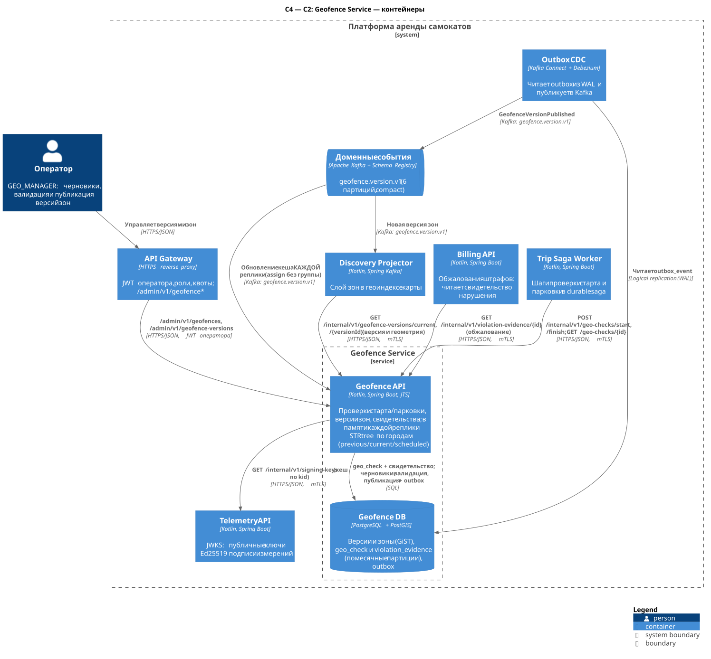
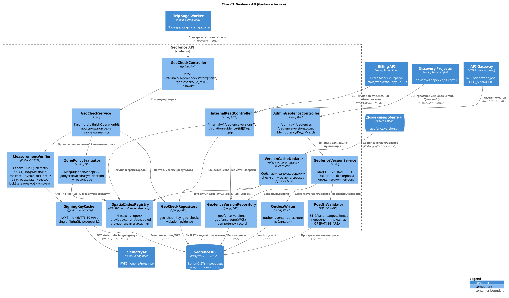

# Geofence Service

| | |
| --- | --- |
| **Bounded context** | Геополитики / Geofencing |
| **Команда-владелец** | Команда геополитик |
| **Контейнеры** | Geofence API (`geo_api`) + Geofence DB (PostgreSQL + PostGIS). Worker-а нет — см. [1.1](#11-почему-у-сервиса-нет-worker-а) |
| **Ответственность** | Версии зон города (черновик → валидация → неизменяемая публикация); проверка допустимости старта и завершения поездки по **подписанному** серверному измерению; фиксация воспроизводимого результата (`geo_check`) и свидетельства нарушения (`violation_evidence`); выдача геометрии опубликованных версий потребителям |
| **Что НЕ делает** | Не назначает штрафы и не считает деньги (решение и сумма — Billing по своей `FinePolicy`); не хранит историю GPS и **не потребляет** `LocationObserved` (координаты — у Telemetry, последнее измерение — у Fleet); не управляет устройством (ограничение скорости в реальном времени исполняет прошивка); не обслуживает карту для клиентов (её отдаёт Discovery из своей проекции); не хранит `userId` (минимизация ПДн) |
| **Связанные документы** | [Каталог сервисов](../service-catalog.md#8-geofence-service) · [Конвенции API](../api-conventions.md) · [Хранение данных](../data-storage.md) · [Отчёт: старт](../lab-01.md#52-старт-и-разблокировка) и [завершение](../lab-01.md#53-завершение-и-оплата) |

Ключевые решения:

1. **Проверка в памяти, БД — только для записи результата.** Каждая реплика держит пространственный индекс (JTS STRtree) зон по городам; запрос проверки не делает пространственных SQL-запросов. В БД пишется одна строка `geo_check` (+ свидетельство при нарушении) — порядка сотен строк/с в пике.
2. **Подписанное измерение вместо потока телеметрии.** Trip передаёт измерение, полученное от Fleet; Geofence проверяет подпись Ed25519 Telemetry Ingestor по JWKS, свежесть и точность. Поток `telemetry.location.v1` (20 000 сообщ./с, A2) сервису не нужен ([3.4](#34-потребляемые-события)).
3. **Опубликованная версия неизменяема**; каждая проверка фиксирует `policyVersion`/`zoneVersionId`, поэтому изменение зон не переписывает прошлые решения.
4. **Презумпция в пользу пользователя.** Нарушение считается доказанным, только если весь круг неопределённости радиусом `accuracyM` лежит в запрещённой области; неточное или устаревшее измерение даёт `NEED_REMEASURE`, а не штраф.

## 1. Контейнеры (C2)



Исходник: [c2-geofence.puml](../../diagrams/services/geofence/c2-geofence.puml).

| Контейнер | Технология | Ответственность | Единица масштабирования / метрика автоскейлинга | Минимум реплик |
| --- | --- | --- | --- | --- |
| Geofence API (`geo_api`) | Kotlin, Spring Boot, JTS | Внутренние проверки старта/завершения, чтение проверок и свидетельств, выдача версий; админ-контур версий; локальный индекс зон и его обновление по `geofence.version.v1` | Pod. HPA по CPU (цель 60 %) и p99 `geo-checks` > 50 мс; память фиксирована (индекс ~0,3 ГБ, heap 2 ГБ) | 3 (по одной на AZ), PDB `minAvailable: 2` |
| Geofence DB | PostgreSQL 17+ + PostGIS 3 (+ `btree_gist`, `pg_cron`; слоты логической репликации с failover для Debezium — [data-storage §2.2](../data-storage.md#22-версия-и-расширения)) | Версии и зоны (GiST), `geo_check`, `violation_evidence`, ключи идемпотентности, outbox, резервная копия JWKS | Вертикально; primary + реплика в другой AZ (асинхронная по умолчанию, [4.7](#47-репликация-ha-бэкап)); PgBouncer; PITR 14 сут | 1 primary + 1 реплика |

Соседи: API Gateway (только `/admin/v1/...`), Trip Saga Worker (проверки), Discovery Projector (геометрия версий), Billing API (свидетельство нарушения при обжаловании штрафа), Telemetry API (JWKS), Outbox CDC и Kafka (`geofence.version.v1`). Billing Settlement Worker Geofence не вызывает: `reasonCode` и `policyVersion` для выбора `FinePolicy` приходят ему в `TripEnded.finishCheck` ([2.1.3](#213-правила-решения-и-reasoncode)).

### 1.1. Почему у сервиса нет worker-а

- **Нет асинхронной бизнес-работы.** Проверка старта/парковки — синхронный шаг saga, ответ нужен сейчас. Админ-команды редки и коротки: валидация одной версии города в PostGIS занимает секунды и укладывается в синхронный запрос с тайм-аутом 30 с.
- **Публикацию событий выполняет платформенный Outbox CDC** (Debezium читает WAL) — собственного relay-процесса у сервиса нет.
- **Единственный потребитель Kafka — обновление локального индекса — обязан работать внутри каждой реплики API**: индекс живёт в памяти процесса. Вынос в отдельный worker потребовал бы разделяемого кеша (например, Redis) — лишний сетевой переход и новая точка отказа на критическом пути проверки.
- **Обслуживание партиций и ретенция** — функции в БД по расписанию `pg_cron`; экспорт партиций в архив — общее платформенное задание архивации (см. [data-storage.md](../data-storage.md)). Это не бизнес-логика сервиса.
- Критерий появления worker-а: асинхронная работа с собственной очередью (массовый импорт зон из внешних ГИС, пересчёт аналитики нарушений, рассылка политик скорости на устройства).

## 2. Компоненты (C3)

### 2.1. Geofence API



Исходник: [c3-geofence-api.puml](../../diagrams/services/geofence/c3-geofence-api.puml).

| Компонент | Ответственность | Ключевые зависимости |
| --- | --- | --- |
| `GeoCheckController` | `POST /internal/v1/geo-checks/start`, `/finish`, `GET /geo-checks/{checkId}`; проверка mTLS-идентичности по allowlist; валидация схемы | `GeoCheckService` |
| `InternalReadController` | `/internal/v1/geofence-versions/current`, `/{versionId}` (GeoJSON, gzip, `ETag`, `immutable`), `/internal/v1/violation-evidence/{id}`; отдельный bulkhead для тяжёлых ответов | `SpatialIndexRegistry`, репозитории |
| `AdminGeofenceController` | `/admin/v1/geofences`, `/admin/v1/geofence-versions/**`, `/admin/v1/violation-evidence/{id}`, `/admin/v1/geo-checks`; роли из JWT оператора, `Idempotency-Key`, `If-Match`, аудит | `GeofenceVersionService`, репозитории |
| `GeoCheckService` | Прикладной сервис проверки: поиск существующего результата по ключу (`tripId`, `finishOperationId`), вызов верификатора и оценщика, запись `geo_check_key` + `geo_check` + `violation_evidence` в одной транзакции | `MeasurementVerifier`, `ZonePolicyEvaluator`, `GeoCheckRepository` |
| `MeasurementVerifier` | Каноническая строка `TLM1` — единственное определение формата и точности полей в [telemetry-service.md §3.3.1](telemetry-service.md#331-каноническая-строка-и-подпись), строится общей библиотекой Telemetry из `scooterId` запроса и полей `measurement`; проверка Ed25519, свежести (старт ≤ 30 с, завершение ≤ 60 с), точности (≤ 25 м), расхождения часов | `SigningKeyCache` |
| `SigningKeyCache` | Кеш JWKS Telemetry по `kid`: TTL 10 мин, внеплановое обновление на неизвестный `kid` (single-flight, не чаще 1 раза в 30 с), тайм-аут 500 мс, circuit breaker; копия ключей в таблице `telemetry_signing_key` для холодного старта без Telemetry | Telemetry API, Geofence DB |
| `ZonePolicyEvaluator` | Доменная политика: порядок правил, матрица действий версии (`rules`), допуск по `accuracyM`, grace-период после смены версии, `decision` + `reasonCode`, ближайшая парковка | `SpatialIndexRegistry` |
| `SpatialIndexRegistry` | Для каждого города — неизменяемый `CityIndex` для версий `previous`, `current` и `scheduled` (опубликована с будущим `effectiveFrom`); STRtree + `PreparedGeometry` в локальной метрической проекции города; атомарная замена ссылки (`AtomicReference`) | — |
| `VersionCacheUpdater` | Загрузка всех городов при старте (readiness только после неё); Kafka-consumer `geofence.version.v1` **без consumer group** (`assign` всех партиций); загрузка зон версии, проверка `checksum`, замена индекса; переключение `scheduled → current` по часам в `effectiveFrom`; страховочная сверка с БД раз в 60 с | Kafka, `GeofenceVersionRepository`, `SpatialIndexRegistry` |
| `GeofenceVersionService` | Жизненный цикл версии `DRAFT → VALIDATED/VALIDATION_FAILED → PUBLISHED` (`DISCARDED`); сериализация публикаций города (`SELECT ... FOR UPDATE`), монотонность `version`/`effectiveFrom`, правило «четырёх глаз», запись события через outbox | `PostGisValidator`, `GeofenceVersionRepository`, `OutboxWriter` |
| `PostGisValidator` | SQL-проверки черновика: `ST_IsValid`/`ST_IsValidReason`, самопересечения, запрещённые пересечения типов, покрытие `OPERATING_AREA`, лимиты, diff с текущей версией | Geofence DB |
| `GeoCheckRepository` | JDBC-доступ к `geo_check_key`, `geo_check`, `violation_evidence`; только `INSERT`/`SELECT` (у роли приложения нет `UPDATE/DELETE` на этих таблицах) | Geofence DB |
| `GeofenceVersionRepository` | `geofence_version`, `geofence_zone` (геометрия в WKB, преобразование в проекцию города), `idempotency_record` | Geofence DB |
| `OutboxWriter` | Запись `GeofenceVersionPublished` в `outbox_event` в транзакции публикации | Geofence DB (читает Outbox CDC) |

#### 2.1.1. Алгоритм проверки

1. **Ключ и повтор.** `GeoCheckService` ищет `geo_check_key`: для старта — `START:{measurementId}`, для завершения — финальный ключ `FINISH:{finishOperationId}`, затем ключ попытки `FINISH:{finishOperationId}:{measurementId}`. Найден — возвращается сохранённый результат (`Idempotency-Replayed: true`); если в повторе другие `scooterId`/`cityId` — `422 IDEMPOTENCY_KEY_REUSED`.
2. **Подпись.** Ключ берётся по `signature.kid`; каноническая строка `TLM1|…` ([telemetry-service.md §3.3.1](telemetry-service.md#331-каноническая-строка-и-подпись)) строится из полей `measurement` и `scooterId` **запроса** — так измерение другого самоката не пройдёт проверку. Неподписанные поля (`bootId`, `qualityFlags`, `speedKmh`) в строку не входят. Неверная подпись → `422 MEASUREMENT_SIGNATURE_INVALID` + событие безопасности; неизвестный `kid` при недоступном JWKS → `503 DEPENDENCY_UNAVAILABLE`.
3. **Свежесть и часы.** Возраст = `checkedAt − receivedAt` (серверное подписанное время): старт ≤ 30 с, завершение ≤ 60 с. Дополнительно `receivedAt − measuredAt ≤ 10 с` (буферизованная точка устарела) и `measuredAt − receivedAt ≤ 2 с` (часы устройства спешат → `CLOCK_SKEW`).
4. **Точность.** `accuracyM > 25` → `NEED_REMEASURE`/`LOW_ACCURACY` (для старта `allowed=false`). Лимит попыток повторного измерения держит Trip; Geofence каждую попытку записывает отдельной строкой.
5. **Оценка.** Индекс версии, действующей в `checkedAt`; точка переводится в метрическую проекцию города; кандидаты — `STRtree.query(envelope(P, accuracyM))`. Условие «точка в зоне Z» считается доказанным, если `Z.contains(P)` и `distance(P, ∂Z) > accuracyM`; «точка вне области A» — если `distance(P, A) > accuracyM`. Порядок правил — [2.1.3](#213-правила-решения-и-reasoncode).
6. **Grace-период.** В течение `rules.switchGraceMinutes` (по умолчанию 15) после `effectiveFrom` текущей версии завершение оценивается по текущей и предыдущей версиям, применяется более благоприятное для пользователя решение (`ALLOWED` > `ALLOWED_WITH_VIOLATION` > `FORBIDDEN`); в результат пишется фактически применённая версия.
7. **Запись.** Одна транзакция: `INSERT geo_check_key ... ON CONFLICT DO NOTHING` (0 строк → параллельный запрос уже записал результат: откат и возврат победителя), `INSERT geo_check`, при `ALLOWED_WITH_VIOLATION` — `INSERT violation_evidence`. Ответ отдаётся только после `COMMIT`: решение без сохранённой записи не выдаётся.

#### 2.1.2. Пространственный индекс и обновление версий

- **Структура.** `Map<cityId, CitySlot>`; `CitySlot = {previous, current, scheduled}`, каждый — неизменяемый `CityIndex(versionId, version, checksum, rules, effectiveFrom, STRtree<ZoneEntry>, operatingArea: PreparedGeometry, parkingUnion: PreparedGeometry)`. Геометрия хранится в `PackedCoordinateSequence` (16 Б/вершина) в UTM-зоне города (SRID задаётся в `rules.metricSrid`), поэтому расстояния и допуски — в метрах.
- **Память (оценка, условно).** Город: ~2 000 парковок × ~10 вершин + ~200 запретных/медленных зон × ~100 вершин + граница зоны обслуживания ≈ 40 тыс. вершин ≈ 0,7 МБ координат, с деревом и подготовленными геометриями ≈ 2 МБ на версию. 50 городов × до 3 версий ≈ 0,3 ГБ heap на реплику.
- **Старт реплики.** `VersionCacheUpdater` читает из Geofence DB для каждого города `previous`, `current` и `scheduled`, строит индексы, проверяет `checksum` и только затем выставляет readiness `UP`. Liveness от индекса не зависит (чтобы не перезапускать pod в цикле при медленной БД).
- **Каждая реплика получает каждое событие.** Consumer **не входит в consumer group**: `KafkaConsumer.assign()` на все 6 партиций `geofence.version.v1`, при старте `seekToEnd()` (актуальное состояние уже загружено из БД), offset не коммитится — состояние восстанавливается из БД. Это исключение из правила «consumer group = имя контейнера» (см. [конвенции](../api-conventions.md#156-именование)): с общей группой событие получила бы одна реплика из N, а уникальные группы на pod оставляют «осиротевшие» группы после каждого перезапуска.
- **Применение события.** Версия ≤ уже загруженной игнорируется (идемпотентность по `(cityId, version)`). Иначе после случайной задержки 0–5 с (чтобы N реплик не читали БД одновременно) загружаются зоны `versionId`, пересчитывается `checksum` (SHA-256 по каноническому представлению: `rules` + зоны, отсортированные по `zoneId`, с `ST_AsBinary(ST_Normalize(geom))`) и сравнивается с полем события. Несовпадение → версия не применяется, повтор с backoff, алерт P1. При `effectiveFrom ≤ now` версия сразу становится `current` (старая → `previous`), иначе — `scheduled`, и переключение выполняет таймер реплики точно в `effectiveFrom` (часы синхронизированы NTP).
- **Страховка.** Раз в 60 с выполняется дешёвый запрос «последняя опубликованная версия по городам» ([4.3](#43-индексы-и-обслуживаемые-запросы)); расхождение с памятью → загрузка. Так обновление работает и при недоступных Kafka/Outbox CDC (задержка ≤ 60 с). Метрика `geofence_cache_version_lag{cityId}`, алерт при отставании > 5 мин.

#### 2.1.3. Правила решения и reasonCode

Правила хранятся в каждой версии (`rules`, JSON) и публикуются вместе с зонами, поэтому `policyVersion` — это номер опубликованной версии города (`version`, целое int32, монотонно растёт в пределах `cityId`): одно число однозначно определяет и геометрию, и матрицу действий. Тот же тип `policyVersion` имеет в ответах Geofence, в `TripEnded.finishCheck` и в Billing.

```json
{
  "parkingMode": "PARKING_ONLY",
  "metricSrid": 32636,
  "switchGraceMinutes": 15,
  "start":  { "OUTSIDE_OPERATING_AREA": "FORBID", "NO_RIDE_ZONE": "FORBID" },
  "finish": { "OUTSIDE_OPERATING_AREA": "FORBID", "NO_RIDE_ZONE": "FORBID",
              "NO_PARKING_ZONE": "FORBID", "PARKING_OUTSIDE_ZONE": "ALLOW_WITH_VIOLATION" }
}
```

`parkingMode`: `PARKING_ONLY` (завершение только в зонах `PARKING`) или `FREE_FLOAT` (в любом месте зоны обслуживания, кроме запретных). Действия: `FORBID`, `ALLOW_WITH_VIOLATION`, `ALLOW`. Порядок оценки завершения: вне `OPERATING_AREA` → внутри `NO_RIDE` → внутри `NO_PARKING` → (только `PARKING_ONLY`) вне всех `PARKING` → иначе `ALLOWED`. Первое доказанное условие определяет результат.

| `reasonCode` | Проверка | Результат | Смысл |
| --- | --- | --- | --- |
| `OK` | старт, завершение | `allowed=true` / `ALLOWED` | Точка в разрешённой области |
| `BOUNDARY_TOLERANCE` | старт, завершение | `allowed=true` / `ALLOWED` | Нарушение не доказано с учётом `accuracyM` (круг неопределённости пересекает границу) |
| `OUTSIDE_OPERATING_AREA` | старт, завершение | `false` / по `rules` (по умолчанию `FORBIDDEN`) | Вне зоны обслуживания города |
| `NO_RIDE_ZONE` | старт, завершение | `false` / по `rules` (по умолчанию `FORBIDDEN`) | В зоне запрета движения |
| `NO_PARKING_ZONE` | завершение | по `rules`: `FORBIDDEN` или `ALLOWED_WITH_VIOLATION` | В зоне запрета парковки |
| `PARKING_OUTSIDE_ZONE` | завершение (`PARKING_ONLY`) | по `rules` (по умолчанию `ALLOWED_WITH_VIOLATION`) | Не в разрешённой парковке |
| `MEASUREMENT_STALE` | старт, завершение | `false` / `NEED_REMEASURE` | Измерение старше 30/60 с или доставлено с опозданием > 10 с |
| `LOW_ACCURACY` | старт, завершение | `false` / `NEED_REMEASURE` | `accuracyM > 25` |
| `CLOCK_SKEW` | старт, завершение | `false` / `NEED_REMEASURE` | `measuredAt` позже `receivedAt` более чем на 2 с |

`ALLOWED_WITH_VIOLATION` всегда сопровождается свидетельством (`violationEvidenceId`). `FORBIDDEN` свидетельства не создаёт: завершения не было, штрафовать не за что; результат сохраняется в `geo_check` для разбора обращений.

**Словарь `reasonCode` принадлежит Geofence** — это таблица выше, другие сервисы своих кодов в него не добавляют. Trip копирует `reasonCode`, `policyVersion`, `checkId` и `violationEvidenceId` финального результата в `TripEnded.finishCheck {checkId|null, decision, reasonCode|null, policyVersion|null, violationEvidenceId|null}` ([trip-service.md §3.3](trip-service.md#33-публикуемые-события)). Billing выбирает `FinePolicy` по `(cityId, reasonCode)`, действующую на `endedAt`, без вызова Geofence; свидетельство (3.2.6) Billing API читает только при рассмотрении обжалования. При принудительном завершении поддержкой без проверки (`SUPPORT_FORCE_FINISH`) Trip ставит `decision = NOT_CHECKED`, а `checkId`, `reasonCode`, `policyVersion`, `violationEvidenceId` — `null`; это не решение Geofence, и такого кода в словаре нет. Новые коды добавляются только аддитивно, потребители обязаны принимать неизвестные значения `reasonCode` и `decision` (не назначать по ним автоматический штраф).

## 3. API

Общие правила (ошибки RFC 9457, заголовки, mTLS/allowlist, форматы, тайм-ауты) — в [api-conventions.md](../api-conventions.md). Публичных эндпоинтов (`/api/v1`) у сервиса **нет**: клиентская карта зон отдаётся Discovery API (`GET /api/v1/map/geofences`) из его проекции.

### 3.1. Сводная таблица эндпоинтов

| Метод | Путь | Аудитория | Кто вызывает | Авторизация | Идемпотентность |
| --- | --- | --- | --- | --- | --- |
| POST | `/internal/v1/geo-checks/start` | internal | Trip Saga Worker | mTLS, allowlist `trip-saga-worker` | По `(tripId, measurementId)` |
| POST | `/internal/v1/geo-checks/finish` | internal | Trip Saga Worker | mTLS, allowlist `trip-saga-worker` | По `(tripId, finishOperationId)`; попытки `NEED_REMEASURE` — по `measurementId` |
| GET | `/internal/v1/geo-checks/{checkId}` | internal | Trip Saga Worker | mTLS, allowlist `trip-saga-worker` | Чтение |
| GET | `/internal/v1/geofence-versions/current?cityId=` | internal | Discovery Projector | mTLS, allowlist `discovery-projector` | Чтение |
| GET | `/internal/v1/geofence-versions/{versionId}` | internal | Discovery Projector | mTLS, allowlist `discovery-projector` | Чтение (неизменяемый ресурс) |
| GET | `/internal/v1/violation-evidence/{evidenceId}` *(добавлен)* | internal | Billing API (обжалование штрафа) | mTLS, allowlist `billing-api` | Чтение |
| GET | `/admin/v1/geofences?cityId=` | admin | Админ-клиент | `GEO_MANAGER`, `OPERATOR`, `SUPPORT`, `ADMIN` | Чтение |
| POST | `/admin/v1/geofence-versions` | admin | Админ-клиент | `GEO_MANAGER`, `ADMIN` | `Idempotency-Key` |
| GET | `/admin/v1/geofence-versions`, `/admin/v1/geofence-versions/{versionId}` *(добавлены)* | admin | Админ-клиент | `GEO_MANAGER`, `ADMIN` | Чтение |
| POST | `/admin/v1/geofence-versions/{versionId}/validate` | admin | Админ-клиент | `GEO_MANAGER`, `ADMIN` | `Idempotency-Key`, `If-Match` |
| POST | `/admin/v1/geofence-versions/{versionId}/publish` | admin | Админ-клиент | `GEO_MANAGER`, `ADMIN` (не автор черновика) | `Idempotency-Key`, `If-Match` |
| GET | `/admin/v1/violation-evidence/{evidenceId}` *(добавлен)* | admin | Админ-клиент (обжалования) | `SUPPORT`, `FINANCE`, `GEO_MANAGER`, `ADMIN`; аудит | Чтение |
| GET | `/admin/v1/geo-checks?tripId=` *(добавлен)* | admin | Админ-клиент (поддержка) | `SUPPORT`, `OPERATOR`, `ADMIN` | Чтение |

### 3.2. Детальное описание

#### Общая модель: `measurement`

Объект передаётся без изменений из ответа Fleet `GET /internal/v1/scooters/{scooterId}` (поле `measurement`). Модель и точность полей задаёт Telemetry ([telemetry-service.md, общая модель `measurement`](telemetry-service.md#общая-модель-measurement)); формат подписи — [§3.3.1](telemetry-service.md#331-каноническая-строка-и-подпись). Здесь — только то, как поля использует Geofence.

| Поле | Тип | Ограничения |
| --- | --- | --- |
| `measurementId` | string (UUID, версия 5) | обязательно; детерминирован Telemetry: `UUIDv5(ns, scooterId\|bootId\|seq)`. Geofence его не вычисляет и не разбирает: это ключ идемпотентности попытки (`START:{measurementId}`, `FINISH:{finishOperationId}:{measurementId}`) |
| `lat`, `lon` | number | WGS84, `[-90..90]`, `[-180..180]`; ровно 7 знаков после точки (как в подписанной строке) |
| `accuracyM` | number | `≥ 0`, 1 знак после точки; > 25 → `NEED_REMEASURE` |
| `lockState` | string | `OPEN`, `CLOSED`, `UNKNOWN`. Входит в подпись; Geofence его **только фиксирует** в `geo_check` и свидетельстве и решения по нему не принимает (см. 3.2.2) |
| `measuredAt`, `receivedAt` | string (RFC 3339 UTC, мс) | время устройства / время приёма Telemetry Ingestor |
| `signature` | object | `{alg: "EdDSA", kid: string, value: string}`; `value` — base64url без `=`, 64 байта; `kid` в формате `tlm-YYYY-MM` ([telemetry-service.md §3.3.2](telemetry-service.md#332-ключи-подписи-и-ротация)) |
| `bootId` | integer | необязательно, **вне подписи**. Счётчик загрузок устройства из `LocationObserved`; уже учтён в `measurementId` |
| `qualityFlags` | string[] | необязательно, **вне подписи**: `LOW_ACCURACY`, `IMPLAUSIBLE_JUMP`, `LATE` (режим `KAFKA_ONLY` Telemetry). На решение не влияют: точность и свежесть Geofence пересчитывает по подписанным `accuracyM`, `measuredAt`, `receivedAt`. Неизвестные флаги игнорируются |

`bootId` и `qualityFlags` Telemetry публикует в `LocationObserved` рядом с `measurement`. Если Fleet передаёт их в объекте `measurement`, Geofence принимает их, не включает в каноническую строку и сохраняет вместе с измерением (`geo_check.boot_id`, `geo_check.quality_flags`, `violation_evidence.signed_measurement`) для разбора. Отсутствие этих полей ошибкой не является.

#### 3.2.1. `POST /internal/v1/geo-checks/start`

**Назначение:** решить, можно ли начать поездку в точке самоката. Вызывается шагом saga старта до захвата lease.
**Заголовки:** `traceparent`; mTLS-идентичность `trip-saga-worker`. `Idempotency-Key` не требуется — естественный ключ в теле.

Тело запроса:

| Поле | Тип | Ограничения |
| --- | --- | --- |
| `tripId` | UUIDv7 | обязательно |
| `scooterId` | UUIDv7 | обязательно; входит в подписанную строку |
| `cityId` | UUIDv7 | обязательно; город должен иметь опубликованную версию |
| `measurement` | object | см. общую модель |

```json
{
  "tripId": "01a1aafd-2f10-7d2a-9b41-6c0e1f2a3b4c",
  "scooterId": "01937a10-5c3e-7a11-8f20-1b2c3d4e5f60",
  "cityId": "01900000-0000-7000-8000-000000000001",
  "measurement": {
    "measurementId": "8d3f6a1e-2b4c-5e7f-9a01-2c3d4e5f6a7b",
    "lat": 59.9386301,
    "lon": 30.3141302,
    "accuracyM": 6.5,
    "lockState": "CLOSED",
    "measuredAt": "2026-11-05T09:15:01.200Z",
    "receivedAt": "2026-11-05T09:15:01.740Z",
    "signature": { "alg": "EdDSA", "kid": "tlm-2026-11", "value": "kq3VbH0x...Zt9w" }
  }
}
```

Ответ `200 OK` (базовый контракт `checkId`, `allowed`, `reasonCode`, `policyVersion`, `zoneIds` + добавленные `zoneVersionId`, `speedLimitKmh`, `checkedAt`):

```json
{
  "checkId": "01a1aafd-3010-7e01-b2c4-5d6e7f809a1b",
  "allowed": true,
  "reasonCode": "OK",
  "policyVersion": 42,
  "zoneIds": ["0192c0de-1111-7aaa-8bbb-000000000101", "0192c0de-2222-7aaa-8bbb-000000000202"],
  "zoneVersionId": "01a19a8e-0000-7123-8456-000000000042",
  "speedLimitKmh": 15,
  "checkedAt": "2026-11-05T09:15:03.412Z"
}
```

`zoneIds` — зоны, содержащие точку (зона обслуживания, `SLOW_ZONE` и др.); `speedLimitKmh` — минимальный лимит среди содержащих `SLOW_ZONE` или `null`. При `allowed=false` Trip отменяет старт; при `MEASUREMENT_STALE`/`LOW_ACCURACY` может запросить у Fleet свежее измерение и повторить вызов (новый `measurementId` → новая проверка).

| HTTP | `code` | Условие |
| --- | --- | --- |
| 400 | `VALIDATION_FAILED` | Нарушена схема тела (формат UUID, диапазоны координат, `alg ≠ EdDSA`) |
| 403 | `CALLER_NOT_ALLOWED` | Вызывающий не в allowlist |
| 422 | `MEASUREMENT_SIGNATURE_INVALID` | Подпись не сходится (в т. ч. `scooterId` запроса не совпадает с подписанным) |
| 422 | `CITY_NOT_CONFIGURED` | Для `cityId` нет опубликованной версии |
| 422 | `IDEMPOTENCY_KEY_REUSED` | Тот же `(tripId, measurementId)` с другими `scooterId`/`cityId` |
| 503 | `DEPENDENCY_UNAVAILABLE` | Geofence DB недоступна, неизвестный `kid` при недоступном JWKS, индекс города не загружен; `Retry-After` |

**Повторы и конкурентность:** повтор с тем же `(tripId, measurementId)` возвращает тот же `checkId` (`Idempotency-Replayed: true`). Параллельные одинаковые запросы разрешает `PRIMARY KEY` `geo_check_key`. **p99** ≤ 50 мс. **Тайм-аут вызывающего (Trip Saga Worker) — 400 мс на попытку**, до 2 повторов с jitter с тем же телом (повтор идемпотентен), затем circuit breaker. Это значение — источник для [trip-service.md §3.6](trip-service.md#36-исходящие-вызовы-trip-saga-worker) и [конвенций §11](../api-conventions.md#11-межсервисные-вызовы-тайм-ауты-повторы-circuit-breaker): запас ×8 к p99 покрывает GC-паузу и запись в БД, но укладывает три попытки в ~1,3 с шага saga.

#### 3.2.2. `POST /internal/v1/geo-checks/finish`

**Назначение:** решение о допустимости завершения поездки в текущей точке и, при нарушении, неизменяемое свидетельство. Вызывается в состоянии операции `CHECKING_PARKING` до команды `LOCK`.
**Заголовки:** как у 3.2.1.

Тело: как у 3.2.1 плюс `finishOperationId` (UUIDv7, обязательно — `operationId` операции завершения Trip). `measurement.lockState` обычно `OPEN` (замок закрывается после проверки).

**`lockState` Geofence только фиксирует.** Значение из подписанного измерения записывается в `geo_check.lock_state` и в свидетельство как факт на момент проверки; на `decision` и `reasonCode` оно не влияет, и Geofence не отклоняет завершение из-за `OPEN`/`UNKNOWN`. Закрытие замка при завершении подтверждает Fleet результатом команды `LOCK` (`EXECUTED` с `lockState = CLOSED`); без него `release` lease отвечает `409 LOCK_NOT_CONFIRMED` ([fleet-service.md §3.2.5](fleet-service.md#325-post-internalv1leasesleaseidrelease)).

```json
{
  "tripId": "01a1aafd-2f10-7d2a-9b41-6c0e1f2a3b4c",
  "finishOperationId": "01a1ab15-7700-7c10-8d20-3e4f5a6b7c8d",
  "scooterId": "01937a10-5c3e-7a11-8f20-1b2c3d4e5f60",
  "cityId": "01900000-0000-7000-8000-000000000001",
  "measurement": {
    "measurementId": "c41e9b07-6d2a-5f83-a1b4-7e9c0d2f3a58",
    "lat": 59.9341208,
    "lon": 30.3352119,
    "accuracyM": 4.0,
    "lockState": "OPEN",
    "measuredAt": "2026-11-05T09:41:10.050Z",
    "receivedAt": "2026-11-05T09:41:10.630Z",
    "signature": { "alg": "EdDSA", "kid": "tlm-2026-11", "value": "Hc8uQm2L...p0Ag" }
  }
}
```

Ответ `200 OK` (базовый контракт `checkId`, `decision`, `reasonCode`, `policyVersion`, `violationEvidenceId` + добавленные `zoneVersionId`, `zoneIds`, `nearestParking`, `checkedAt`):

```json
{
  "checkId": "01a1ab15-7810-7f11-a0b1-c2d3e4f5a6b7",
  "decision": "ALLOWED_WITH_VIOLATION",
  "reasonCode": "PARKING_OUTSIDE_ZONE",
  "policyVersion": 42,
  "violationEvidenceId": "01a1ab15-7811-7a22-b3c4-d5e6f7a8b9c0",
  "zoneVersionId": "01a19a8e-0000-7123-8456-000000000042",
  "zoneIds": ["0192c0de-1111-7aaa-8bbb-000000000101"],
  "nearestParking": { "zoneId": "0192c0de-3333-7aaa-8bbb-000000000303", "distanceM": 48.0 },
  "checkedAt": "2026-11-05T09:41:11.020Z"
}
```

`decision`: `ALLOWED` | `ALLOWED_WITH_VIOLATION` | `FORBIDDEN` | `NEED_REMEASURE`. `nearestParking` (может быть `null`) Trip показывает клиенту при `FORBIDDEN`/`ALLOWED_WITH_VIOLATION`. Ошибки — как у 3.2.1; `IDEMPOTENCY_KEY_REUSED` — тот же `(tripId, finishOperationId)` с другими `scooterId`/`cityId`.

**Идемпотентность и конкурентность** (контракт: идемпотентно по `(tripId, finishOperationId)`):

- На операцию завершения существует **не более одного финального** результата (`ALLOWED`, `ALLOWED_WITH_VIOLATION`, `FORBIDDEN`) — ключ `FINISH:{finishOperationId}` в `geo_check_key`. Любой повтор, даже с другим измерением, возвращает его; второе свидетельство (и второй штраф) по одной операции невозможно.
- `NEED_REMEASURE` не финален: ключ `FINISH:{finishOperationId}:{measurementId}`. Повтор с тем же измерением возвращает ту же попытку; новое измерение даёт новую проверку.
- После `FORBIDDEN` пользователь перемещает самокат и отправляет новый `POST /api/v1/trips/{tripId}/finish` → новый `finishOperationId` → новая проверка.
- Два одновременных запроса по одной операции: оба вычисляют решение, `INSERT ... ON CONFLICT DO NOTHING` пропускает только первый; второй откатывает транзакцию и возвращает результат первого.

**p99** ≤ 50 мс (≤ 60 мс с записью свидетельства); тайм-аут вызывающего — те же 400 мс на попытку, до 2 повторов с jitter (как у 3.2.1). Повтор после тайм-аута безопасен: финальный результат по `finishOperationId` один.

#### 3.2.3. `GET /internal/v1/geo-checks/{checkId}`

**Назначение:** воспроизводимый результат проверки — дочитывание итога шага саги, если ответ на `start`/`finish` потерян или нужно сверить сохранённый `checkId`. Allowlist: только `trip-saga-worker`. Trip API этот эндпоинт не вызывает: история поездки отдаётся из Trip DB, где уже лежит `finishCheck`. Billing API тоже не вызывает: для обжалования ему достаточно самодостаточного свидетельства [3.2.6](#326-get-internalv1violation-evidenceevidenceid-добавлен) (в нём есть `checkId`). Поддержка разбирает проверки через `GET /admin/v1/geo-checks?tripId=` ([3.2.7](#327-admin-эндпоинты)). Billing Settlement Worker в allowlist не входит: всё нужное для штрафа (`reasonCode`, `policyVersion`, `violationEvidenceId`) приходит в `TripEnded.finishCheck`. Параметр пути `checkId` (UUIDv7) — поиск попадает в одну партицию.

```json
{
  "checkId": "01a1ab15-7810-7f11-a0b1-c2d3e4f5a6b7",
  "kind": "FINISH",
  "tripId": "01a1aafd-2f10-7d2a-9b41-6c0e1f2a3b4c",
  "finishOperationId": "01a1ab15-7700-7c10-8d20-3e4f5a6b7c8d",
  "scooterId": "01937a10-5c3e-7a11-8f20-1b2c3d4e5f60",
  "cityId": "01900000-0000-7000-8000-000000000001",
  "decision": "ALLOWED_WITH_VIOLATION",
  "reasonCode": "PARKING_OUTSIDE_ZONE",
  "policyVersion": 42,
  "zoneVersionId": "01a19a8e-0000-7123-8456-000000000042",
  "zoneIds": ["0192c0de-1111-7aaa-8bbb-000000000101"],
  "violationEvidenceId": "01a1ab15-7811-7a22-b3c4-d5e6f7a8b9c0",
  "measurement": { "measurementId": "c41e9b07-6d2a-5f83-a1b4-7e9c0d2f3a58", "lat": 59.9341208, "lon": 30.3352119,
                   "accuracyM": 4.0, "lockState": "OPEN", "measuredAt": "2026-11-05T09:41:10.050Z",
                   "receivedAt": "2026-11-05T09:41:10.630Z", "signatureKid": "tlm-2026-11" },
  "checkedAt": "2026-11-05T09:41:11.020Z"
}
```

| HTTP | `code` | Условие |
| --- | --- | --- |
| 403 | `CALLER_NOT_ALLOWED` | Вызывающий не в allowlist |
| 404 | `GEO_CHECK_NOT_FOUND` | Нет такой проверки |
| 410 | `GEO_CHECK_ARCHIVED` | Старше горячего окна (13 мес.), доступна из архива по заявке |
| 503 | `DEPENDENCY_UNAVAILABLE` | БД недоступна |

Повторы безопасны. **p99** ≤ 20 мс; тайм-аут вызывающего 300 мс.

#### 3.2.4. `GET /internal/v1/geofence-versions/current?cityId=`

**Назначение:** какая версия действует в городе (для перестроения слоя зон в Discovery; Trip этот эндпоинт не вызывает — версия зон приходит ему в ответе `geo-checks` как `policyVersion`/`zoneVersionId`). Отдаётся из памяти реплики (то же состояние, по которому идут проверки); работает при недоступной БД. Параметр `cityId` (UUIDv7, обязателен).

```json
{
  "cityId": "01900000-0000-7000-8000-000000000001",
  "versionId": "01a19a8e-0000-7123-8456-000000000042",
  "version": 42,
  "effectiveFrom": "2026-11-03T00:00:00.000Z",
  "checksum": "sha256:9f2c4e0b7a1d...c3",
  "zonesCount": 2214,
  "scheduled": { "versionId": "01a1ab94-0000-7123-8456-000000000043", "version": 43, "effectiveFrom": "2026-11-10T00:00:00.000Z" }
}
```

Ошибки: 400 `VALIDATION_FAILED`, 403 `CALLER_NOT_ALLOWED`, 404 `CITY_NOT_CONFIGURED`, 503 `DEPENDENCY_UNAVAILABLE` (индекс не загружен). **p99** ≤ 10 мс; тайм-аут 500 мс.

#### 3.2.5. `GET /internal/v1/geofence-versions/{versionId}`

**Назначение:** полная геометрия **опубликованной** версии (черновики недоступны → 404). Вызывает Discovery Projector после события `GeofenceVersionPublished` и при перестроении. Ответ — GeoJSON FeatureCollection (RFC 7946, порядок `[lon, lat]`) с дополнительными членами; `Content-Encoding: gzip`; `ETag: "sha256:<checksum>"`; `Cache-Control: public, max-age=31536000, immutable`; `If-None-Match` → `304`.

```json
{
  "type": "FeatureCollection",
  "versionId": "01a19a8e-0000-7123-8456-000000000042",
  "cityId": "01900000-0000-7000-8000-000000000001",
  "version": 42,
  "effectiveFrom": "2026-11-03T00:00:00.000Z",
  "checksum": "sha256:9f2c4e0b7a1d...c3",
  "rules": { "parkingMode": "PARKING_ONLY", "switchGraceMinutes": 15 },
  "features": [
    {
      "type": "Feature",
      "id": "0192c0de-3333-7aaa-8bbb-000000000303",
      "geometry": { "type": "MultiPolygon", "coordinates": [[[[30.33571, 59.93402], [30.33601, 59.93402], [30.33601, 59.93418], [30.33571, 59.93418], [30.33571, 59.93402]]]] },
      "properties": { "zoneId": "0192c0de-3333-7aaa-8bbb-000000000303", "type": "PARKING", "name": "Невский пр., 28", "speedLimitKmh": null }
    }
  ]
}
```

Ошибки: 403 `CALLER_NOT_ALLOWED`, 404 `GEOFENCE_VERSION_NOT_FOUND`, 503 `DEPENDENCY_UNAVAILABLE`. Неизменяемость делает повторы и кеширование безопасными. Одновременно отдаётся не более 4 тяжёлых ответов на реплику (bulkhead), чтобы перестроение Discovery не вытесняло проверки. **p99** ≤ 300 мс (до ~2 МБ gzip); тайм-аут вызывающего 5 с.

#### 3.2.6. `GET /internal/v1/violation-evidence/{evidenceId}` *(добавлен)*

**Назначение:** самодостаточное свидетельство нарушения для рассмотрения обжалования штрафа. Вызывает Billing API, когда пользователь обжалует штраф или сотрудник `FINANCE` разбирает обжалование: свидетельство показывает точку, точность, версию зон и нарушенные зоны. Allowlist: `billing-api`. Для **назначения** штрафа вызов не нужен: Billing Settlement Worker выбирает `FinePolicy` по `(cityId, finishCheck.reasonCode)` из `TripEnded` ([2.1.3](#213-правила-решения-и-reasoncode)) и хранит `violationEvidenceId` как ссылку.

```json
{
  "evidenceId": "01a1ab15-7811-7a22-b3c4-d5e6f7a8b9c0",
  "checkId": "01a1ab15-7810-7f11-a0b1-c2d3e4f5a6b7",
  "tripId": "01a1aafd-2f10-7d2a-9b41-6c0e1f2a3b4c",
  "finishOperationId": "01a1ab15-7700-7c10-8d20-3e4f5a6b7c8d",
  "scooterId": "01937a10-5c3e-7a11-8f20-1b2c3d4e5f60",
  "cityId": "01900000-0000-7000-8000-000000000001",
  "decision": "ALLOWED_WITH_VIOLATION",
  "reasonCode": "PARKING_OUTSIDE_ZONE",
  "policyVersion": 42,
  "zoneVersionId": "01a19a8e-0000-7123-8456-000000000042",
  "versionChecksum": "sha256:9f2c4e0b7a1d...c3",
  "violatedZones": [],
  "nearestParking": { "zoneId": "0192c0de-3333-7aaa-8bbb-000000000303", "distanceM": 48.0 },
  "measurement": {
    "measurementId": "c41e9b07-6d2a-5f83-a1b4-7e9c0d2f3a58", "lat": 59.9341208, "lon": 30.3352119, "accuracyM": 4.0,
    "lockState": "OPEN", "measuredAt": "2026-11-05T09:41:10.050Z", "receivedAt": "2026-11-05T09:41:10.630Z",
    "signature": { "alg": "EdDSA", "kid": "tlm-2026-11", "value": "Hc8uQm2L...p0Ag" }
  },
  "signingKey": { "kty": "OKP", "crv": "Ed25519", "kid": "tlm-2026-11", "x": "11qYAYKxCrfVS_7TyWQHOg7hcvPapiMlrwIaaPcHURo" },
  "evidenceHash": "sha256:4b1e0c9d...7a",
  "createdAt": "2026-11-05T09:41:11.020Z",
  "retainUntil": "2031-11-05"
}
```

Свидетельство проверяемо третьей стороной без доступа к нашим системам: подписанное измерение (строку `TLM1` восстанавливают по [telemetry-service.md §3.3.1](telemetry-service.md#331-каноническая-строка-и-подпись) из `scooterId` и `measurement`) + публичный ключ + `checksum` версии зон + `evidenceHash` (SHA-256 канонического JSON свидетельства). Ошибки: 403 `CALLER_NOT_ALLOWED`, 404 `EVIDENCE_NOT_FOUND`, 503 `DEPENDENCY_UNAVAILABLE`. **p99** ≤ 30 мс; тайм-аут вызывающего (Billing API) — 1 с, 1 повтор, circuit breaker; повторы безопасны.

#### 3.2.7. Admin-эндпоинты

Все — через Gateway, JWT оператора, `traceparent`; `POST` требуют `Idempotency-Key` (алгоритм — [конвенции §7](../api-conventions.md#7-идемпотентность-команд)); переходы версии требуют `If-Match` с `ETag` версии (`"<row_version>"`, иначе `428`/`412`). Все изменения и просмотры свидетельств пишутся в `admin_audit`.

| Эндпоинт | Назначение и ключевые поля | Ответ | Ошибки |
| --- | --- | --- | --- |
| `GET /admin/v1/geofences?cityId=&bbox=&type=&versionId=&cursor=&limit=` | Зоны текущей (или указанной) версии города как GeoJSON; фильтр по `bbox` (`minLon,minLat,maxLon,maxLat`) через GiST; `limit` ≤ 5 000 зон | `200` FeatureCollection + `nextCursor` | 400 `VALIDATION_FAILED`, 404 `CITY_NOT_CONFIGURED` |
| `POST /admin/v1/geofence-versions` | Черновик: `cityId`, `zones` (GeoJSON FeatureCollection; только `Polygon`/`MultiPolygon`, `properties.type` ∈ `OPERATING_AREA, PARKING, NO_PARKING, NO_RIDE, SLOW_ZONE`, `speedLimitKmh` 5–25 только для `SLOW_ZONE`, `properties.zoneId` — сохраняется между версиями, иначе генерируется), `rules` (по умолчанию из текущей версии), `effectiveFrom` (необязательно, план), `sourceVersionId` (вместо `zones` — копия зон версии, путь быстрого отката), `comment`. Лимиты: тело ≤ 20 МБ, ≤ 20 000 зон, ≤ 5 000 вершин в полигоне | `201 {versionId, status: DRAFT, zonesCount, sourceSha256}`, `ETag` | 400 `VALIDATION_FAILED`, 413 `PAYLOAD_TOO_LARGE`, 422 `ZONE_LIMIT_EXCEEDED`, 422 `IDEMPOTENCY_KEY_REUSED`, 409 `IDEMPOTENCY_IN_PROGRESS` |
| `GET /admin/v1/geofence-versions?cityId=&status=&cursor=&limit=`, `GET /admin/v1/geofence-versions/{versionId}` | Список версий города; карточка версии со статусом, `validationReport`, автором, `ETag` | `200` | 404 `GEOFENCE_VERSION_NOT_FOUND` |
| `POST /admin/v1/geofence-versions/{versionId}/validate` | Синхронная валидация в PostGIS (тайм-аут 30 с): `ST_IsValid`/`ST_IsValidReason` (в т. ч. самопересечения), ровно одна связная `OPERATING_AREA`, все прочие зоны `ST_CoveredBy` зоны обслуживания, запрещённые пересечения `PARKING ∩ NO_PARKING`, `PARKING ∩ NO_RIDE` (площадь > 1 м²), координаты в bbox города, предупреждения (парковка < 4 м², удалено > 10 % парковок — diff с текущей версией). Фиксирует `checksum` | `200 {versionId, status: VALIDATED\|VALIDATION_FAILED, checksum, report {errors[], warnings[], diff {added, removed, changed}}}` | 409 `VERSION_NOT_DRAFT`, 412 `PRECONDITION_FAILED`, 428 `PRECONDITION_REQUIRED` |
| `POST /admin/v1/geofence-versions/{versionId}/publish` | Публикация: `effectiveFrom` (≥ `now − 1 мин`; рекомендовано ≥ `now + 5 мин`, чтобы реплики переключились одновременно по часам; строго больше `effectiveFrom` последней опубликованной). Публикует оператор, не являющийся автором черновика (правило «четырёх глаз»; `ADMIN` — с обязательным `reason`). В одной транзакции: блокировка города, `version = max + 1`, `status = PUBLISHED`, outbox `GeofenceVersionPublished` | `200 {versionId, cityId, version, status: PUBLISHED, effectiveFrom, checksum}` | 409 `VERSION_NOT_VALIDATED`, 409 `EFFECTIVE_FROM_NOT_MONOTONIC`, 422 `EFFECTIVE_FROM_IN_PAST`, 403 `FOUR_EYES_REQUIRED`, 412/428 |
| `GET /admin/v1/violation-evidence/{evidenceId}?reason=` | Свидетельство для обжалования (как 3.2.6); `reason` обязателен, просмотр аудируется | `200` | 400 `REASON_REQUIRED`, 404 `EVIDENCE_NOT_FOUND` |
| `GET /admin/v1/geo-checks?tripId=` | Все проверки поездки (почему не дали завершить) | `200 {items, nextCursor}` | 400 `VALIDATION_FAILED` |

Отдельного `DELETE`/`PATCH` для опубликованной версии нет: исправление — новая версия; отмена черновика — `status = DISCARDED` при истечении 30 дней или новом черновике того же автора.

### 3.3. Публикуемые события

| Топик | Ключ | Событие | Когда | Производитель |
| --- | --- | --- | --- | --- |
| `geofence.version.v1` (6 партиций, compact) | `cityId` | `GeofenceVersionPublished` | В транзакции публикации версии (не в момент `effectiveFrom`: потребители заранее загружают версию и применяют её с `effectiveFrom`) | Geofence API → `outbox_event` → Outbox CDC |

`aggregateType = CityGeofence`, `aggregateId = cityId`, `aggregateVersion = version` (монотонно по городу) — потребители отбрасывают версию ≤ применённой. `zonesSummary` при 20 000 зон — до ~1,6 МБ, поэтому у топика `max.message.bytes = 4 МБ` и сжатие `zstd`; геометрия в событие не входит.

```json
{
  "eventId": "01a1ab94-0001-7b00-8c00-0d0e0f101112",
  "eventType": "GeofenceVersionPublished",
  "schemaVersion": 1,
  "aggregateType": "CityGeofence",
  "aggregateId": "01900000-0000-7000-8000-000000000001",
  "aggregateVersion": 43,
  "occurredAt": "2026-11-05T12:00:04.512Z",
  "producer": "geofence-api",
  "correlationId": "01a1ab93-ffd0-7000-8000-00000000c0de",
  "causationId": "01a1ab93-ffd0-7000-8000-00000000c0de",
  "payload": {
    "cityId": "01900000-0000-7000-8000-000000000001",
    "versionId": "01a1ab94-0000-7123-8456-000000000043",
    "version": 43,
    "effectiveFrom": "2026-11-10T00:00:00.000Z",
    "checksum": "sha256:1a7e93c0d4b2...e8",
    "zonesSummary": [
      { "zoneId": "0192c0de-0000-7aaa-8bbb-000000000001", "type": "OPERATING_AREA", "speedLimitKmh": null },
      { "zoneId": "0192c0de-3333-7aaa-8bbb-000000000303", "type": "PARKING", "speedLimitKmh": null },
      { "zoneId": "0192c0de-4444-7aaa-8bbb-000000000404", "type": "SLOW_ZONE", "speedLimitKmh": 10 }
    ]
  }
}
```

`correlationId`/`causationId` — идентификатор admin-запроса публикации. Свидетельства нарушений событиями **не** публикуются: ссылку на свидетельство вместе с `reasonCode` и `policyVersion` переносит `TripEnded.finishCheck` (производитель — Trip), содержимое при обжаловании читается по 3.2.6.

### 3.4. Потребляемые события

| Топик | Consumer group | Обработка | Идемпотентность | Ошибки |
| --- | --- | --- | --- | --- |
| `geofence.version.v1` (собственный) | **Нет** — `assign()` всех партиций в каждой реплике Geofence API, offset не коммитится | Загрузка зон версии из Geofence DB, проверка `checksum`, построение индекса, `current`/`scheduled` ([2.1.2](#212-пространственный-индекс-и-обновление-версий)) | `(cityId, version)` ≤ загруженной — пропуск; inbox не нужен (эффект — только память) | Повтор с backoff 1 с → 60 с, реплика продолжает работать на прежней версии; DLQ нет (событие — сигнал, источник истины — БД); страховочная сверка с БД раз в 60 с; алерт при отставании > 5 мин |

**Почему Geofence больше не потребляет `telemetry.location.v1`** (подписанные измерения, [telemetry-service.md §3.3.1](telemetry-service.md#331-каноническая-строка-и-подпись)):

- снимаются 20 000 сообщ./с (A2, условно) чтения и до 20 000 записей/с в Geofence DB — БД получает только результаты проверок, сотни строк/с; отпадают 96 партиций потребления, consumer lag и его влияние на свежесть решений;
- проверка использует **то же** измерение, по которому Fleet выдал/закрыл самокат (одна истина вместо двух несогласованных проекций), а подпись Telemetry делает его неотрекаемым: свидетельство содержит подписанное измерение и ключ;
- в Geofence нет истории перемещений — меньше персональных данных и объём хранения;
- цена: зависимость от JWKS Telemetry (снимается кешем и копией ключей в БД) и требование к Trip/Fleet передавать свежее измерение (иначе `NEED_REMEASURE`).

### 3.5. MQTT

Не используется.

## 4. Данные и хранение

### 4.1. Почему PostgreSQL + PostGIS

Нужны: ACID-транзакция «ключ идемпотентности + проверка + свидетельство» и «версия + outbox»; уникальные и частичные индексы для инвариантов (одна финальная проверка на операцию, одна действующая версия на `effectiveFrom`); PostGIS для валидации (`ST_IsValid`, `ST_Intersection`, `ST_CoveredBy`, `ST_Transform`) и GiST-индексы; декларативное партиционирование для журналов; logical replication для Outbox CDC. Горячий путь проверки в БД не ходит, поэтому специализированная гео-СУБД не нужна. Общее обоснование и альтернативы — [data-storage.md](../data-storage.md).

### 4.2. DDL

```sql
CREATE EXTENSION IF NOT EXISTS postgis;
CREATE EXTENSION IF NOT EXISTS btree_gist;   -- uuid в составном GiST-индексе

-- Версия геополитики города: черновик или опубликованная (неизменяемая)
CREATE TABLE geofence_version (
  version_id        uuid        PRIMARY KEY,                     -- UUIDv7
  city_id           uuid        NOT NULL,
  version           int,                                         -- присваивается при публикации
  status            text        NOT NULL CHECK (status IN ('DRAFT','VALIDATION_FAILED','VALIDATED','PUBLISHED','DISCARDED')),
  effective_from    timestamptz,
  rules             jsonb       NOT NULL,
  checksum          text,                                        -- 'sha256:<hex>', фиксируется при VALIDATED
  source_sha256     text        NOT NULL,                        -- хеш исходного GeoJSON (аудит импорта)
  source_version_id uuid        REFERENCES geofence_version(version_id),
  zones_count       int         NOT NULL CHECK (zones_count BETWEEN 1 AND 20000),
  validation_report jsonb,
  row_version       int         NOT NULL DEFAULT 1,              -- ETag
  created_by        text        NOT NULL,
  created_at        timestamptz NOT NULL DEFAULT now(),
  validated_at      timestamptz,
  published_by      text,
  published_at      timestamptz,
  publish_override_reason text,                                  -- ADMIN публикует свой черновик: обязательная причина
  CONSTRAINT uq_geofence_city_version UNIQUE (city_id, version),
  CONSTRAINT ck_published_complete CHECK (status <> 'PUBLISHED' OR (version IS NOT NULL AND effective_from IS NOT NULL
                                          AND checksum IS NOT NULL AND published_by IS NOT NULL AND published_at IS NOT NULL)),
  CONSTRAINT ck_four_eyes CHECK (published_by IS NULL OR published_by <> created_by OR publish_override_reason IS NOT NULL)
);

-- Зоны версии; zone_id стабилен между версиями
CREATE TABLE geofence_zone (
  version_id      uuid        NOT NULL REFERENCES geofence_version(version_id),
  zone_id         uuid        NOT NULL,
  type            text        NOT NULL CHECK (type IN ('OPERATING_AREA','PARKING','NO_PARKING','NO_RIDE','SLOW_ZONE')),
  name            text,
  speed_limit_kmh smallint    CHECK (speed_limit_kmh BETWEEN 5 AND 25),
  geom            geometry(MultiPolygon, 4326) NOT NULL,
  properties      jsonb       NOT NULL DEFAULT '{}',
  PRIMARY KEY (version_id, zone_id),
  CONSTRAINT ck_slow_zone_limit CHECK ((type = 'SLOW_ZONE') = (speed_limit_kmh IS NOT NULL))
);

-- Неизменяемость опубликованной версии (защита от ошибки приложения и ручных правок)
CREATE FUNCTION forbid_published_change() RETURNS trigger LANGUAGE plpgsql AS $$
BEGIN
  IF TG_TABLE_NAME = 'geofence_version' THEN
    IF OLD.status = 'PUBLISHED' THEN RAISE EXCEPTION 'published version % is immutable', OLD.version_id; END IF;
  ELSIF EXISTS (SELECT 1 FROM geofence_version v WHERE v.version_id = OLD.version_id AND v.status = 'PUBLISHED') THEN
    RAISE EXCEPTION 'zones of published version % are immutable', OLD.version_id;
  END IF;
  RETURN CASE WHEN TG_OP = 'DELETE' THEN OLD ELSE NEW END;
END $$;
CREATE TRIGGER trg_version_immutable BEFORE UPDATE OR DELETE ON geofence_version
  FOR EACH ROW EXECUTE FUNCTION forbid_published_change();
CREATE TRIGGER trg_zone_immutable BEFORE UPDATE OR DELETE ON geofence_zone
  FOR EACH ROW EXECUTE FUNCTION forbid_published_change();

-- Ключи идемпотентности проверок: маленькая НЕпартиционированная таблица (data-storage §5.2)
CREATE TABLE geo_check_key (
  trip_id       uuid        NOT NULL,
  operation_key text        NOT NULL CHECK (operation_key ~ '^(START:|FINISH:)'),
  -- 'START:{measurementId}' | 'FINISH:{finishOperationId}' (финальный) | 'FINISH:{finishOperationId}:{measurementId}'
  check_id      uuid        NOT NULL,
  created_at    timestamptz NOT NULL DEFAULT now(),
  PRIMARY KEY (trip_id, operation_key)
);

-- Журнал проверок: помесячные партиции по UUIDv7
CREATE TABLE geo_check (
  check_id              uuid        NOT NULL,                  -- UUIDv7 = ключ партиционирования
  kind                  text        NOT NULL CHECK (kind IN ('START','FINISH')),
  trip_id               uuid        NOT NULL,
  finish_operation_id   uuid,
  scooter_id            uuid        NOT NULL,
  city_id               uuid        NOT NULL,
  version_id            uuid,                                  -- NULL, если зоны не оценивались (STALE/LOW_ACCURACY)
  policy_version        int,
  decision              text        NOT NULL CHECK (decision IN ('ALLOWED','ALLOWED_WITH_VIOLATION','FORBIDDEN','NEED_REMEASURE')),
  reason_code           text        NOT NULL,
  zone_ids              uuid[]      NOT NULL DEFAULT '{}',
  measurement_id        uuid        NOT NULL,                  -- UUIDv5 от Telemetry (scooterId|bootId|seq)
  lat                   numeric(10,7) NOT NULL CHECK (lat BETWEEN -90 AND 90),     -- точность подписанной строки TLM1
  lon                   numeric(10,7) NOT NULL CHECK (lon BETWEEN -180 AND 180),
  accuracy_m            numeric(6,1) NOT NULL CHECK (accuracy_m >= 0),
  lock_state            text        NOT NULL CHECK (lock_state IN ('OPEN','CLOSED','UNKNOWN')),  -- только фиксируется
  measured_at           timestamptz NOT NULL,                  -- точность мс
  received_at           timestamptz NOT NULL,
  signature_kid         text        NOT NULL,
  boot_id               bigint,                                -- вне подписи, если передан
  quality_flags         text[]      NOT NULL DEFAULT '{}',     -- вне подписи, на решение не влияют
  violation_evidence_id uuid,
  checked_at            timestamptz NOT NULL DEFAULT now(),
  PRIMARY KEY (check_id),
  CONSTRAINT ck_finish_op CHECK ((kind = 'FINISH') = (finish_operation_id IS NOT NULL)),
  CONSTRAINT ck_start_decision CHECK (kind = 'FINISH' OR decision <> 'ALLOWED_WITH_VIOLATION'),
  CONSTRAINT ck_evidence CHECK ((decision = 'ALLOWED_WITH_VIOLATION') = (violation_evidence_id IS NOT NULL))
) PARTITION BY RANGE (check_id);

-- Свидетельства нарушений: помесячные партиции, хранение 5 лет
CREATE TABLE violation_evidence (
  evidence_id          uuid        NOT NULL,                   -- UUIDv7
  check_id             uuid        NOT NULL,
  trip_id              uuid        NOT NULL,
  finish_operation_id  uuid        NOT NULL,
  scooter_id           uuid        NOT NULL,
  city_id              uuid        NOT NULL,
  reason_code          text        NOT NULL,
  version_id           uuid        NOT NULL,
  policy_version       int         NOT NULL,
  version_checksum     text        NOT NULL,
  violated_zones       jsonb       NOT NULL,                   -- [{zoneId, type}]
  nearest_parking      jsonb,                                  -- {zoneId, distanceM}
  signed_measurement   jsonb       NOT NULL,                   -- измерение целиком + signature {alg, kid, value}
  signing_key_jwk      jsonb       NOT NULL,                   -- публичный ключ проверки (переживает ротацию JWKS)
  evidence_hash        bytea       NOT NULL CHECK (octet_length(evidence_hash) = 32),
  created_at           timestamptz NOT NULL DEFAULT now(),
  retain_until         date        NOT NULL,                   -- created_at + 5 лет
  PRIMARY KEY (evidence_id)
) PARTITION BY RANGE (evidence_id);

-- Партиции месяца (создаются pg_cron на 3 месяца вперёд; границы — UUIDv7 начала месяца)
CREATE TABLE geo_check_2026_11 PARTITION OF geo_check
  FOR VALUES FROM ('01a19467-e800-7000-8000-000000000000') TO ('01a22ee6-b000-7000-8000-000000000000');
CREATE TABLE violation_evidence_2026_11 PARTITION OF violation_evidence
  FOR VALUES FROM ('01a19467-e800-7000-8000-000000000000') TO ('01a22ee6-b000-7000-8000-000000000000');

-- Копия публичных ключей Telemetry для холодного старта без Telemetry API
CREATE TABLE telemetry_signing_key (
  kid           text        PRIMARY KEY,
  jwk           jsonb       NOT NULL,
  first_seen_at timestamptz NOT NULL DEFAULT now(),
  last_seen_at  timestamptz NOT NULL DEFAULT now()
);

-- Аудит админ-действий и просмотров свидетельств
CREATE TABLE admin_audit (
  audit_id     uuid        PRIMARY KEY,                        -- UUIDv7
  actor        text        NOT NULL,
  actor_roles  text[]      NOT NULL,
  action       text        NOT NULL,                           -- CREATE_DRAFT | VALIDATE | PUBLISH | VIEW_EVIDENCE | ...
  target_id    uuid        NOT NULL,
  reason       text,
  trace_id     text,
  created_at   timestamptz NOT NULL DEFAULT now()
);

-- outbox_event, idempotency_record — общая схема data-storage §4.3 (без изменений).
-- inbox_message не создаётся: единственный потребитель (кеш) идемпотентен по (cityId, version) и не пишет в БД.
```

DDL общих таблиц `outbox_event` и `idempotency_record` — [data-storage §4.3](../data-storage.md#43-общие-служебные-таблицы).

Межпартиционных FK (`geo_check → violation_evidence`) нет: у таблиц разная ретенция, а целостность обеспечивается одной транзакцией записи. У роли приложения на `geo_check`, `violation_evidence`, `geo_check_key` — только `INSERT, SELECT`; удаление партиций выполняет роль обслуживания.

### 4.3. Индексы и обслуживаемые запросы

```sql
-- Текущая/предыдущая/запланированная версия города: старт реплики, сверка раз в 60 с, GET current
CREATE INDEX ix_version_published ON geofence_version (city_id, effective_from DESC)
  INCLUDE (version, checksum) WHERE status = 'PUBLISHED';
-- Инвариант: в городе не бывает двух опубликованных версий с одним effectiveFrom
CREATE UNIQUE INDEX uq_version_city_effective ON geofence_version (city_id, effective_from) WHERE status = 'PUBLISHED';
-- Список черновиков города в админке
CREATE INDEX ix_version_drafts ON geofence_version (city_id, created_at DESC)
  WHERE status IN ('DRAFT','VALIDATION_FAILED','VALIDATED');

-- Пространственные запросы внутри версии: валидация (самосоединение пересечений), админ-выборка по bbox
CREATE INDEX gix_zone_version_geom ON geofence_zone USING gist (version_id, geom);
-- История зоны между версиями (diff при валидации, «когда изменили эту парковку»)
CREATE INDEX ix_zone_history ON geofence_zone (zone_id, version_id);

-- Очистка ключей идемпотентности старше 30 дней (батчами)
CREATE INDEX ix_geo_check_key_created ON geo_check_key (created_at);

-- Проверки поездки: GET /admin/v1/geo-checks?tripId= (локальный индекс в каждой партиции)
CREATE INDEX ix_geo_check_trip ON geo_check (trip_id, checked_at);
-- Отчёты по окну времени и городу (доля NEED_REMEASURE, FORBIDDEN): BRIN по append-only времени
CREATE INDEX brin_geo_check_checked ON geo_check USING brin (checked_at);

-- Свидетельства поездки: обжалование и поддержка
CREATE INDEX ix_evidence_trip ON violation_evidence (trip_id);
-- Все свидетельства по версии зон: массовая отмена штрафов после ошибочной публикации
CREATE INDEX ix_evidence_version ON violation_evidence (version_id);
```

Поиск по `check_id`/`evidence_id` идёт по PK и попадает в одну партицию (UUIDv7 содержит время). Индекс `ix_geo_check_trip` без ключа партиции опрашивает до 13 партиций — допустимо для редкого админ-запроса.

### 4.4. Партиционирование, ретенция, архив

| Таблица | Партиции | Горячее хранение | Дальше | Обоснование срока |
| --- | --- | --- | --- | --- |
| `geo_check` | Помесячно, `RANGE (check_id)` | 13 месяцев | Экспорт партиции в Parquet (объектное хранилище, регион РФ) на 3 года, затем удаление | Покрывает историю поездок (горизонт Trip, A4) и окно обращений; 3 года — общий срок исковой давности для споров «почему не дали завершить» |
| `violation_evidence` | Помесячно, `RANGE (evidence_id)` | **5 лет** в БД (`retain_until`) | Ежемесячная копия партиции в бакет с Object Lock (compliance) на тот же срок; `DROP PARTITION` после истечения | Свидетельство — основание финансового начисления (штрафа): Billing хранит штрафы ≥ 5 лет (A5, 402-ФЗ), ссылка не должна «повиснуть»; покрывает 3 года исковой давности с запасом. Объём мал (≈ 110 ГБ за 5 лет) — держать в БД дешевле, чем восстанавливать из архива. При судебном споре за пределами срока — legal hold на архивный объект по регламенту |
| `geo_check_key` | Нет | 30 дней | Удаление батчами | Повторы Trip по операции завершаются за минуты-часы; 30 дней — запас на длительные `RECONCILING` |
| `geofence_version`/`geofence_zone` | Нет | Опубликованные — бессрочно (≈ 3 ГБ/год) | — | Воспроизводимость любой прошлой проверки |
| `outbox_event` | Суточно ([data-storage §4.3](../data-storage.md#43-общие-служебные-таблицы)) | 3 дня | `DROP` | — |
| `idempotency_record` | Нет | 24 ч (`expires_at`) | Удаление батчами | Конвенция API |

Партиции на 3 месяца вперёд и удаление старых выполняет `pg_cron` (функции `create_monthly_uuidv7_partition()` и `drop_expired_partitions()`); перед удалением партиции `geo_check` проверяется наличие подтверждённой архивной копии.

### 4.5. Объёмы (оценка, условно)

| Что | Расчёт | Итог |
| --- | --- | --- |
| Проверки | 1 млн поездок/сутки (A1) × (1 старт + ~1,2 завершения с повторами) ≈ 2,2 млн строк/сутки × ~0,45 КБ (строка + индексы) | ≈ 1 ГБ/сутки, ≈ 30 ГБ/мес, **≈ 0,4 ТБ** за 13 мес. |
| Пиковая запись | Пиковый час 10 % (A1): ≈ 60 проверок/с; верхняя граница — 500 RPS старт/завершение ([lab-01 §6](../lab-01.md#6-нагрузка-масштабирование-и-доступность)) | **≤ ~500 строк/с** (сотни/с) |
| Свидетельства | ~3 % завершений с нарушением ≈ 30 тыс./сутки (допущение A6, [data-storage](../data-storage.md#допущения-по-объёмам-условно)) × ~2 КБ | ≈ 60 МБ/сутки, ≈ 22 ГБ/год, **≈ 110 ГБ** за 5 лет |
| Ключи идемпотентности | 2,2 млн/сутки × ~0,1 КБ × 30 дней | ≈ 7 ГБ |
| Зоны | ~50 городов × ~2 200 зон ≈ 1,2 МБ на версию; ~1 публикация/неделю на город | ≈ 3 ГБ/год |
| Память реплики | [2.1.2](#212-пространственный-индекс-и-обновление-версий) | ≈ 0,3 ГБ heap |

Итого горячий объём ≈ 0,5 ТБ — помещается в один primary.

### 4.6. Шардирование — не требуется

- Объём зон мал (единицы ГБ), и проверки считаются **в памяти** реплик API — чтение зон из БД происходит только при старте и смене версии.
- БД получает только запись результатов — сотни строк/с, на порядки ниже предела одного primary; горячий набор (текущие партиции и индексы) помещается в RAM.
- Крупнейшая таблица `geo_check` — append-only журнал: при росте первым шагом будет сокращение горячего окна (13 → 3 мес.) с архивом в Parquet, а не шардирование.
- Триггеры пересмотра — общие ([data-storage §7.2](../data-storage.md#72-триггеры)): устойчивая загрузка записи > 60–70 %, горячий набор не в RAM, восстановление из бэкапа дольше RTO. Тогда ключ — `cityId` (зоны, проверки и событие `geofence.version.v1` локальны городу), схема 256 бакетов `murmur3_32(cityId) mod 256`. Чтения по `checkId`/`evidenceId` без города не требуют ни таблицы маршрутизации, ни опроса всех шардов: Geofence API при генерации этих UUIDv7 записывает бакет `cityId` в последний байт (байт 15) по единому правилу [data-storage §7.3](../data-storage.md#73-shard-ready-модель) — ID неизменяемы, поэтому это делается с запуска. Даже так шардирование — лишняя сложность, пока триггеры не сработали.

### 4.7. Репликация, HA, бэкап

- Кластер pg-core ([data-storage §8.1](../data-storage.md#81-размещение-по-кластерам), [§8.2](../data-storage.md#82-ha-patroni-или-managed)): primary + реплика в другой AZ; репликация **асинхронная по умолчанию**, кворумная синхронная реплика настроена (`synchronous_standby_names = 'ANY 1 (replica)'`, по умолчанию `synchronous_commit = local`). Автоматический failover (Patroni/managed), PgBouncer (transaction pooling); реплика используется для отчётов и экспорта в архив.
- Последствие асинхронности: при failover могут потеряться последние сотни миллисекунд записей. Окно опасно для штрафов: Trip мог получить ответ с `violationEvidenceId` и опубликовать `TripEnded`, а Billing — назначить штраф по `finishCheck.reasonCode`, хотя строки свидетельства после failover нет. Такое свидетельство при обжаловании даёт `404 EVIDENCE_NOT_FOUND`, и штраф без доказательства решается в пользу пользователя ([billing-service.md §3.2.12](billing-service.md#3212-post-apiv1finesfineidappeals--обжаловать-штраф)). Окно — доли секунды на failover, поэтому это принятый риск. Потерянная проверка старта влияет только на воспроизводимость. Если аудит потребует RPO = 0 для свидетельств, Geofence (опционально) поднимает `SET LOCAL synchronous_commit = on` только в транзакциях с `violation_evidence` — подтверждение даёт уже настроенная кворумная реплика, остальные транзакции остаются асинхронными.
- Бэкапы: WAL-архив + базовые бэкапы (pgBackRest/WAL-G) в объектное хранилище, PITR с окном 14 сут ([data-storage §8.5](../data-storage.md#85-бэкапы-и-pitr)); ежемесячная проверка восстановления. Архивы `geo_check` и копии свидетельств — в объектном хранилище в регионе РФ.

## 5. Масштабирование и отказы

**Geofence API — масштабирование.** Нагрузка: ≤ ~500 проверок/с в пике (оценка). Стоимость проверки — проверка подписи Ed25519 (~0,1 мс) и запрос к STRtree + `PreparedGeometry` (~0,1–0,5 мс), поэтому одна реплика обрабатывает тысячи проверок/с; реплики нужны прежде всего для отказоустойчивости (3 AZ). HPA по CPU 60 % и p99. Ограничения: память под индекс фиксирована (не масштабируется числом pod), загрузка новой версии — N реплик × ~1–2 МБ из БД с jitter. Bulkhead: отдельные пулы для `geo-checks`, тяжёлых ответов `geofence-versions/{id}` (≤ 4 одновременно) и `/admin`.

| Отказ / ситуация | Поведение |
| --- | --- |
| Geofence DB недоступна | `geo-checks` → `503 DEPENDENCY_UNAVAILABLE`: решение без записи не выдаётся (иначе нет воспроизводимости и свидетельства). Trip: новый старт не выполняется; завершение — по резервному правилу Trip (закрытие для безопасности без автоматического штрафа, ручной разбор — [lab-01 §6](../lab-01.md#6-нагрузка-масштабирование-и-доступность)). Индексы в памяти и `GET current` продолжают работать; геометрия версий, свидетельства и админка — `503` |
| Telemetry API (JWKS) недоступна | Ключи из кеша (память → `telemetry_signing_key`), проверки продолжаются. Неизвестный `kid` → `503` + алерт. Требование к Telemetry: публиковать новый ключ в JWKS ≥ 24 ч до начала подписи и держать старый ≥ 24 ч после |
| Kafka или Outbox CDC недоступны | Публикация версии фиксируется в БД (outbox); реплики подхватывают версию сверкой раз в 60 с; карта Discovery отстаёт до восстановления |
| Реплика не загрузила индекс / OOM | Readiness `DOWN` — трафик не направляется; остальные реплики обслуживают |
| Расхождение версий между репликами | При `effectiveFrom` в будущем все реплики переключаются по часам одновременно; при немедленной публикации окно ≤ задержки события (секунды) или ≤ 60 с (сверка); grace-период смягчает пограничные случаи |
| Ошибочно опубликованная версия | Черновик с `sourceVersionId` предыдущей версии → validate → publish с `effectiveFrom ≈ now` (минуты). Прошлые проверки не меняются; все свидетельства по ошибочной версии находятся по `ix_evidence_version` для отмены штрафов в Billing |
| Подделка/повтор измерения | Неверная подпись → `422` + событие безопасности; повтор старого подписанного измерения отсекается свежестью (30/60 с); измерение другого самоката — несовпадением `scooterId` в подписанной строке |
| Отказ зоны доступности | 2 из 3 реплик продолжают работу (PDB); БД — failover на реплику, RTO порядка минуты (оценка) |
| Перегрузка | Trip ограничивает вызовы тайм-аутом 400 мс, ≤ 2 повторами и circuit breaker; при открытом CB Trip ведёт себя как при недоступности Geofence (см. выше) |
