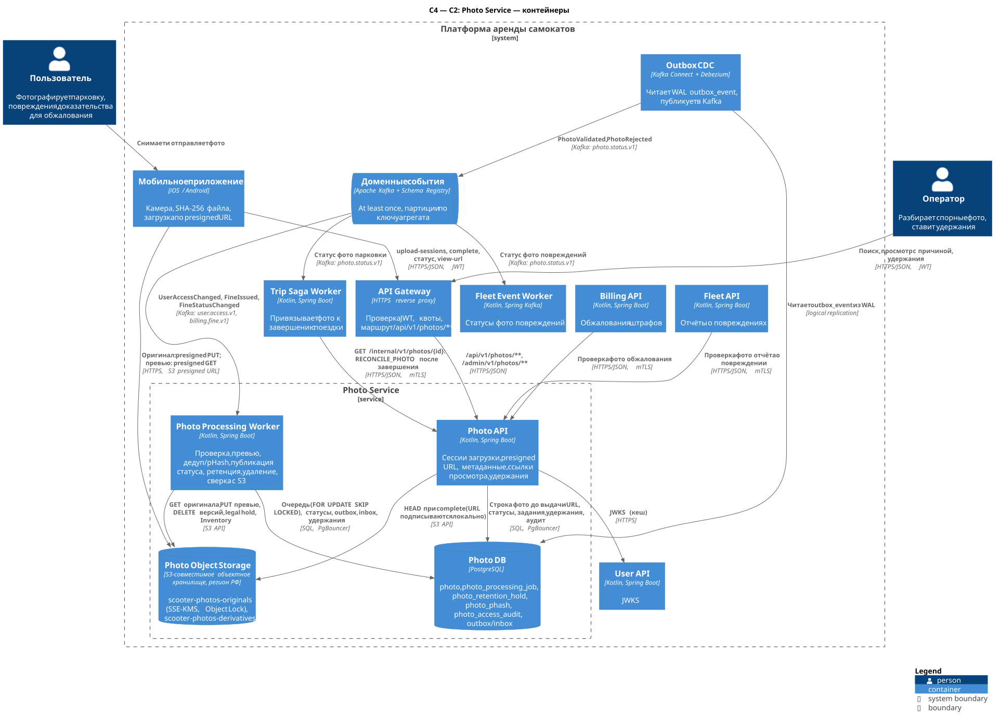
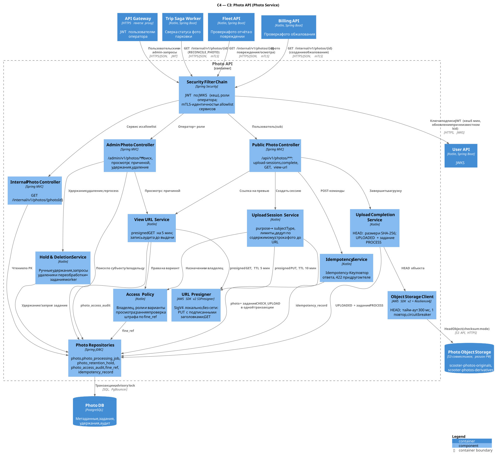
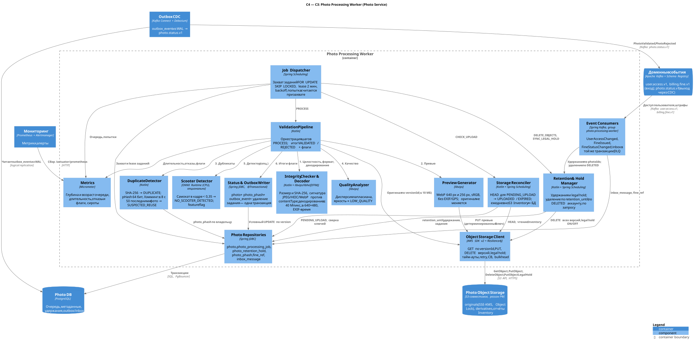

# Photo Service

**Bounded context:** Фотофиксация / Photo Evidence (поддерживающий).
**Команда-владелец:** команда аренды (Rental) — та же, что ведёт Trip: правила фотофиксации входят в сценарий завершения поездки ([lab-01 §9](../lab-01.md#9-команды-и-переход-от-монолита)).
**Контейнеры:** Photo API, Photo Processing Worker. **Хранилища:** Photo DB (PostgreSQL), Photo Object Storage (S3-совместимое, регион РФ).
**Ссылки:** [каталог сервисов](../service-catalog.md#9-photo-service) · [конвенции API](../api-conventions.md) · [хранение данных](../data-storage.md) · [ADR-003](../adr/ADR-003-photo-evidence.md) · [завершение поездки, lab-01 §5.3](../lab-01.md#53-завершение-и-оплата).

**Ответственность.** Фото как доказательство: сессии загрузки и presigned URL; проверка целостности и формата; превью без EXIF/GPS; точный дедуп (SHA-256) и выявление повторного использования (pHash); оценка качества; публикация статуса проверки; ретенция, удержания для споров (штраф, обжалование, legal hold), удаление по сроку и по удалению аккаунта; аудит просмотров.

**Что сервис НЕ делает:**

- не знает бизнес-смысла субъекта. Принадлежность фото поездке, самокату или штрафу проверяет потребитель: Trip, Fleet, Billing;
- не блокирует завершение поездки и не решает, нужен ли штраф. Флаги — только повод для ручного разбора;
- не распознаёт лица и номера и не идентифицирует людей;
- не хранит GPS из EXIF в БД. Геометка остаётся только в неизменяемом оригинале;
- не раздаёт изображения публично (нет CDN и публичных ссылок);
- не пропускает бинарные данные через Gateway или свои pod на загрузке.

### Почему отдельный сервис, а не часть Trip или Fleet

1. **Три потребителя, свой язык.** Фото нужно Rental (парковка), Fleet & IoT (повреждения) и Billing (обжалование штрафа). У контекста свои понятия: назначение (`purpose`), субъект, удержание, ретенция, целостность доказательства. Внутри Trip фото повреждений и обжалований были бы чужеродны. Внутри Fleet — фото парковки и штрафов.
2. **Другой профиль нагрузки.** Бинарный поток: ~0,4 ТБ/сутки; в среднем за пиковый час ≈ 28 фото/с, а проектная цель — 250 фото/с ≈ 100 МБ/с (≈ 0,8 Гбит/с) с запасом ≈ ×9 (A3, условно; расчёт — [4.8](#48-объёмы-условно-оценка-по-a1a3)). Декодирование, превью и ONNX требуют CPU и памяти и дают всплески. OOM или падение нативного декодера не должны затрагивать saga поездки, поэтому обработку изолирует отдельный worker.
3. **Другое хранилище и жизненный цикл.** Нужны объектное хранилище, KMS, Object Lock, lifecycle, сроки хранения, удержания, удаление ПДн и аудит просмотров. Всё это требования 152-ФЗ и споров. Их лучше выполнять в одном месте, а не повторять в трёх сервисах.
4. **Завершение поездки не зависит от фото.** Trip получает только `photoId`. Статус приходит асинхронно (`photo.status.v1`), поэтому отказ Photo Service не блокирует завершение ([lab-01 §6](../lab-01.md#6-нагрузка-масштабирование-и-доступность)).
5. **Свой темп изменений.** Пороги pHash и качества, модель детектора, форматы (HEIC) меняются без релиза Trip.

Цена решения: ещё один сервис и БД; согласованность между фото и поездкой достигается в конечном счёте; внутренний вызов `GET /internal/v1/photos/{photoId}` на сверке. Операционно её смягчает общий владелец Trip и Photo.

**Context Map.** Photo Evidence (U) → Rental, Fleet & IoT, Billing (D): Open Host Service и Published Language — сессии загрузки, `photo.status.v1`, внутренний GET. Billing (U) → Photo Evidence (D): `billing.fine.v1` ставит и снимает удержания. User Management (U) → Photo Evidence (D): `UserAccessChanged(DELETED)` запускает удаление. В обоих входящих направлениях Photo — conformist ([lab-01 §3](../lab-01.md#3-context-map)).

### Сквозной поток

Диаграмма завершения с фото — [trip-finish-sequence](../../diagrams/rendered/trip-finish-sequence.svg).

1. **Сессия.** Приложение вызывает `POST /api/v1/photos/upload-sessions`. Photo API проверяет назначение, права и лимиты. Строка `photo` (`PENDING_UPLOAD`) и задание `CHECK_UPLOAD` фиксируются в БД **до** выдачи URL. Затем Photo API локально подписывает presigned PUT (TTL 10 мин). Подписаны `Content-Type`, `Content-Length`, `x-amz-checksum-sha256` и `If-None-Match: *`.
2. **Загрузка.** Приложение делает PUT напрямую в `scooter-photos-originals`, мимо Gateway и сервисов. Хранилище само проверяет длину и SHA-256. `If-None-Match: *` запрещает перезаписать уже загруженный объект.
3. **Подтверждение.** Приложение вызывает `POST /api/v1/photos/{photoId}/complete`. Photo API делает HEAD объекта (размер, checksum, versionId). В одной транзакции фото переходит в `UPLOADED`, а `CHECK_UPLOAD` заменяется заданием `PROCESS`.
4. **Завершение поездки.** `POST /api/v1/trips/{tripId}/finish {parkingPhotoId}` не ждёт проверки. Если загрузка не удалась, клиент передаёт `photoSkipReason=PHOTO_SERVICE_UNAVAILABLE`. Если PUT прошёл, а `complete` нет, клиент всё равно передаёт `parkingPhotoId`: «забытый» complete подберёт сверка.
5. **Сверка «забытого» complete.** Worker выполняет `CHECK_UPLOAD`: HEAD через 2, 5, 10 и 15 мин. Если объект найден, фото переводится в `UPLOADED` и ставится `PROCESS`. Если объекта нет и TTL + 5 мин истекли — `EXPIRED`.
6. **Проверка.** Photo Processing Worker забирает `PROCESS` из очереди в Photo DB (`FOR UPDATE SKIP LOCKED`). Шаги: целостность и формат → декодирование → превью без EXIF/GPS → SHA-256 и pHash → качество → опциональный ONNX-детектор. Затем одна транзакция: итоговый статус, `photo_phash`, `outbox_event`, удаление задания.
7. **Статус.** Outbox CDC публикует `PhotoValidated` или `PhotoRejected` в `photo.status.v1`. Trip Saga Worker сверяет `ownerUserId == trip.userId` и `subjectId == tripId`. Fleet Event Worker делает то же для отчётов о повреждениях. Флаги и отказ ведут к ручному разбору, а не к автоматическому штрафу.
8. **Жизненный цикл.** Удержания приходят из `billing.fine.v1`. Удаление выполняется по `retention_until`, по `UserAccessChanged(DELETED)` и по решению администратора. Сироты находит ежедневная сверка S3 Inventory с БД.

### Жизненный цикл фото

```
PENDING_UPLOAD ──complete / CHECK_UPLOAD──▶ UPLOADED ──claim──▶ PROCESSING ──▶ VALIDATED | REJECTED
      │                                                                              │
      └── TTL + 5 мин без объекта ──▶ EXPIRED ─────────────── DELETE_OBJECTS ───────▶ DELETED
```

| Переход | Кто | Условие |
| --- | --- | --- |
| → `PENDING_UPLOAD` | Photo API | Сессия создана, права и лимиты проверены |
| `PENDING_UPLOAD` → `UPLOADED` | Photo API (`complete`) или worker (`CHECK_UPLOAD`) | HEAD нашёл объект; `original_version_id` закреплён |
| `PENDING_UPLOAD` → `EXPIRED` | Worker | Объекта нет через `upload_expires_at` + 5 мин |
| `UPLOADED` → `PROCESSING` | Worker | Задание `PROCESS` захвачено |
| `PROCESSING` → `VALIDATED` / `REJECTED` | Worker | Итог конвейера; публикуется `PhotoValidated` / `PhotoRejected` |
| `VALIDATED` / `REJECTED` / `EXPIRED` / `UPLOADED` → `DELETED` | Worker (`DELETE_OBJECTS`) | Истёк `retention_until` и нет активных удержаний, удалён аккаунт или решение `ADMIN` |

`REJECTED` — конечный статус проверки: повторная проверка того же объекта даст тот же результат. Пользователь делает новый снимок. `DELETED` — tombstone: строка без ссылок на объекты хранится 30 дней, чтобы потребители получали «удалено», а не 404.

## 1. Контейнеры (C2)



Исходник: [c2-photo.puml](../../diagrams/services/photo/c2-photo.puml).

| Контейнер | Технология | Ответственность | Единица масштабирования / метрика автоскейлинга | Минимум реплик |
| --- | --- | --- | --- | --- |
| Photo API | Kotlin, Spring Boot, AWS SDK v2 (S3Presigner) | Сессии загрузки, presigned PUT/GET, `complete` (HEAD), метаданные, внутренний GET, admin: поиск, просмотр с причиной, удержания, удаление | Pod без состояния; HPA по CPU 60 % и RPS на pod | 3 (по одной на AZ) |
| Photo Processing Worker | Kotlin, Spring Boot, libvips + libheif, ONNX Runtime (CPU) | Очередь заданий: проверка, превью, дедуп/pHash, качество, детектор, публикация статуса через outbox; потребление `user.access.v1` и `billing.fine.v1`; ретенция, legal hold, удаление, сверка с S3 | Pod на выделенном CPU-пуле узлов; KEDA по числу готовых заданий и возрасту самого старого | 2 |
| Photo DB | PostgreSQL + PgBouncer (transaction pooling) | Метаданные, очередь заданий, удержания, pHash, аудит, outbox/inbox/idempotency | Вертикально; шардирование — по триггеру (§4.9) | primary + асинхронная реплика в другой AZ |
| Photo Object Storage | S3-совместимое объектное хранилище, регион РФ | Оригиналы (неизменяемые, SSE-KMS, Object Lock), производные (превью), отчёты Inventory | Масштабирует провайдер / кластер Ceph RGW | Мульти-AZ хранение провайдера |

Соседи: Gateway маршрутизирует `/api/v1/photos/**` и `/admin/v1/photos/**`. Trip Saga Worker, Fleet API и Billing API вызывают внутренний GET. Trip Saga Worker и Fleet Event Worker потребляют `photo.status.v1`. Outbox CDC (Debezium) читает `outbox_event` из WAL Photo DB. Собственных outbox-relay процессов в сервисе нет.

## 2. Компоненты (C3)

### 2.1 Photo API



Исходник: [c3-photo-api.puml](../../diagrams/services/photo/c3-photo-api.puml).

| Компонент | Ответственность | Ключевые зависимости |
| --- | --- | --- |
| Security Filter Chain | Проверка JWT пользователя и оператора по JWKS (кеш 5 мин, внеплановое обновление при неизвестном `kid`), роли; для `/internal/**` — mTLS-идентичность и allowlist контейнеров | User API (JWKS) |
| Public Photo Controller | `/api/v1/photos/**`: валидация входа, problem+json, `ETag` | Idempotency Service, прикладные сервисы |
| Admin Photo Controller | `/admin/v1/photos/**`: поиск, просмотр с причиной, удержания, удаление, переобработка | View URL Service, Hold & Deletion Service, Photo Repositories |
| Internal Photo Controller | `GET /internal/v1/photos/{photoId}` — чтение по PK | Photo Repositories |
| Idempotency Service | `Idempotency-Key`: `IN_PROGRESS` → `COMPLETED`, повтор сохранённого ответа, 422 при другом теле | `idempotency_record` |
| Upload Session Service | Соответствие purpose → subjectType, лимиты, дедуп по содержимому, строка фото и `CHECK_UPLOAD` до выдачи URL | Access Policy, URL Presigner, Photo Repositories |
| Upload Completion Service | HEAD объекта, сравнение размера и SHA-256, переход в `UPLOADED` и постановка `PROCESS` | Object Storage Client, Photo Repositories |
| Access Policy | Владелец фото, роли и варианты просмотра, ранняя проверка штрафа по проекции `fine_ref` | Photo Repositories |
| View URL Service | presigned GET (TTL 5 мин) на превью или оригинал; запись в аудит до выдачи ссылки | Access Policy, URL Presigner, Photo Repositories |
| Hold & Deletion Service | Ручные удержания и их снятие; запросы удаления и переобработки → задания worker | Photo Repositories |
| URL Presigner | SigV4 локально, без сетевого вызова: PUT с подписанными заголовками, GET с `response-cache-control` | AWS SDK v2 S3Presigner, ключ сервисного аккаунта |
| Object Storage Client | `HeadObject` (checksum mode); тайм-аут 300 мс, 1 повтор, circuit breaker | Photo Object Storage |
| Photo Repositories | Spring JDBC: `photo`, `photo_processing_job`, `photo_retention_hold`, `photo_access_audit`, `fine_ref`, `idempotency_record`; транзакционные advisory lock | Photo DB через PgBouncer |

Photo API **не публикует событий**: статус проверки публикует только worker. Поэтому у одного факта один производитель, а порядок задаёт `photo.version`.

### 2.2 Photo Processing Worker



Исходник: [c3-photo-processing-worker.puml](../../diagrams/services/photo/c3-photo-processing-worker.puml).

| Компонент | Ответственность | Ключевые зависимости |
| --- | --- | --- |
| Job Dispatcher | Захват заданий `FOR UPDATE SKIP LOCKED` пачкой по числу свободных слотов, lease 2 мин, backoff, возврат просроченных lease каждые 30 с; раздельные пулы потоков: `PROCESS` и обслуживание | Photo Repositories |
| Event Consumers | Spring Kafka, группа `photo-processing-worker`: `UserAccessChanged`, `FineIssued`, `FineStatusChanged`; inbox в той же транзакции, что и эффект; DLQ | Kafka, Retention & Hold Manager, Photo Repositories |
| Validation Pipeline | Оркестрация шагов `PROCESS`, сбор флагов, решение `VALIDATED`/`REJECTED`, `pipeline_version` | Компоненты шагов, Object Storage Client |
| Integrity Checker & Decoder | Размер и SHA-256 (потоково при чтении), сигнатура против `contentType`, декодирование с лимитом пикселей, ориентация, разрешение, EXIF-время | libvips, libheif (нативный биндинг) |
| Preview Generator | WebP 640 px и 256 px, sRGB, без метаданных (EXIF, GPS, XMP, ICC → sRGB); оригинал не изменяется | libvips, Object Storage Client |
| Duplicate Detector | Точный дубль по SHA-256 → `DUPLICATE`; pHash 64 бит с последними 50 фото владельца → `SUSPECTED_REUSE` | `photo_phash` |
| Quality Analyzer | Резкость (дисперсия лапласиана) и экспозиция → `LOW_QUALITY` | libvips |
| Scooter Detector | Опциональный ONNX-детектор самоката → `NO_SCOOTER_DETECTED`; feature flag по назначению и городу | ONNX Runtime (CPU) |
| Status & Outbox Writer | Одна транзакция: условный `UPDATE photo` по `version`, `photo_phash`, `outbox_event`, удаление задания | Photo Repositories |
| Retention & Hold Manager | Удержания из `billing.fine.v1`, синхронизация S3 legal hold, удаление по `retention_until`, по удалению аккаунта, по решению администратора | Object Storage Client, Photo Repositories |
| Storage Reconciler | `CHECK_UPLOAD` (HEAD для `PENDING_UPLOAD`), ежедневная сверка S3 Inventory ↔ БД (сироты и пропавшие объекты) | Object Storage Client, Photo Repositories (чтение с реплики) |
| Object Storage Client | GET по `versionId`, PUT производных, DELETE всех версий, legal hold и retention; тайм-ауты, retry, circuit breaker, bulkhead | Photo Object Storage |
| Photo Repositories | Spring JDBC: `photo`, `photo_processing_job`, `photo_retention_hold`, `photo_phash`, `fine_ref`, `inbox_message`, `outbox_event` | Photo DB |
| Metrics | Micrometer → Prometheus: очередь, длительность шагов, отказы и флаги, сироты, лаг удаления | Мониторинг |

**Шаги конвейера `PROCESS`** (пороги проектные, калибруются на размеченной выборке):

| № | Компонент | Проверка | Результат при срабатывании |
| --- | --- | --- | --- |
| 0 | Validation Pipeline | Фото в `UPLOADED`/`PROCESSING` → `PROCESSING` (`version + 1`) | Иначе задание снимается (фото удалено или уже обработано) |
| 1 | Object Storage Client | GET оригинала по `original_version_id`; чтение прерывается после 10 МБ + 1 байт; тайм-аут 5 с, 3 повтора | Временная ошибка → `RETRY` |
| 2 | Integrity Checker & Decoder | Фактический размер = `size_bytes` | `REJECTED / SIZE_MISMATCH` |
| | | SHA-256 содержимого = заявленному | `REJECTED / CHECKSUM_MISMATCH` |
| | | Сигнатура: JPEG `FF D8 FF`; WebP `RIFF....WEBP`; HEIC — box `ftyp` с брендом `heic`/`heix`/`hevc`/`mif1`/`msf1`; совпадает с `contentType` | `REJECTED / UNSUPPORTED_FORMAT` |
| | | Полное декодирование, лимит 40 Мпикс (защита от «бомб»), без обрыва потока | `REJECTED / CORRUPTED` |
| | | После учёта ориентации: длинная сторона ≥ 640, короткая ≥ 480 | `REJECTED / TOO_SMALL` |
| | | EXIF `DateTimeOriginal` + `OffsetTimeOriginal` (или GPS-время UTC) → `capturedAt`. Для `TRIP_PARKING`: расхождение с `created_at` сессии > 15 мин. Без часового пояса проверка пропускается | флаг `EXIF_TIME_MISMATCH` |
| 3 | Preview Generator | WebP 640 px (q≈75, ~30 КБ) и 256 px; метаданные удалены; детерминированные ключи | Ошибка записи → `RETRY` |
| 4 | Duplicate Detector | SHA-256 уже есть в `photo_phash` (любой пользователь) | `REJECTED / DUPLICATE` (+ `duplicate_of_photo_id`) |
| | | pHash (DCT 32×32 → 64 бит), расстояние Хэмминга ≤ 8 до одного из 50 последних фото владельца по **другим** субъектам | флаг `SUSPECTED_REUSE` |
| 5 | Quality Analyzer | Дисперсия лапласиана < 60 (размыто); средняя яркость < 35 или > 235; > 60 % пикселей темнее 20 | флаг `LOW_QUALITY` |
| 6 | Scooter Detector | Если включён для назначения и города: max score класса «самокат» < 0,35. При недоступности модели шаг пропускается без флага | флаг `NO_SCOOTER_DETECTED` |
| 7 | Status & Outbox Writer | `INSERT photo_phash … ON CONFLICT (sha256) DO NOTHING` — окончательная проверка дубля при гонке; условный `UPDATE photo`; `outbox_event`; удаление задания | `PhotoValidated` или `PhotoRejected` |

Замечания по конвейеру:

- **Флаг ≠ отказ.** `SUSPECTED_REUSE` может быть ложным: пользователь паркуется на одном месте каждый день. Поэтому сравниваются только другие субъекты, порог калибруется, а итог — флаг для оператора. Глобальный поиск похожих фото по всем пользователям — возможное развитие: multi-index hashing, 4 таблицы по 16 бит. Сейчас не делается.
- **Отсутствие EXIF — не флаг.** Приложение может вырезать EXIF, а `capturedAt=null` оператор видит и так.
- **Защита от вредоносных файлов.** Декодер работает в процессе JVM: libvips с лимитами памяти, seccomp-профиль pod, только растровые форматы, SVG не принимается. Попытка учитывается **при захвате** задания. Если задание трижды «убивает» pod (lease истёк без записанной ошибки), фото получает `REJECTED / CORRUPTED`, а pod больше не падает в цикле.
- **Повторы без побочных эффектов.** Ключи производных детерминированы: `previews/{purpose}/{yyyy}/{mm}/{dd}/{photoId}/w640.webp` и `…/w256.webp`. Повтор шага перезаписывает тот же объект. Итог фиксирует условный `UPDATE … WHERE status = 'PROCESSING' AND version = $v`: два worker не опубликуют два итога.

**Типы заданий** (`photo_processing_job.job_type`):

| Тип | Кто ставит | Что делает | Попытки / backoff |
| --- | --- | --- | --- |
| `CHECK_UPLOAD` | Photo API при создании сессии (`next_run_at` = +2 мин) | HEAD оригинала. Объект найден → `UPLOADED` + `PROCESS`. Нет → повтор на +5, +10, +15 мин. После `upload_expires_at` + 5 мин → `EXPIRED`, `retention_until` = +1 сутки (страховочное удаление поздно загруженного объекта) | 4, по расписанию |
| `PROCESS` | `complete`, `CHECK_UPLOAD`, admin `reprocess` | Конвейер выше | 8, экспоненциально 5 с … 10 мин; затем `FAILED` + алерт |
| `SYNC_LEGAL_HOLD` | Создание и снятие удержания | `PutObjectLegalHold` ON, если у фото есть активные удержания, иначе OFF. После снятия — `PutObjectRetention` GOVERNANCE до `retention_until`. Идемпотентно: желаемое состояние вычисляется при выполнении | 8 |
| `DELETE_OBJECTS` | Retention sweep, `UserAccessChanged(DELETED)`, admin `DELETE`, `EXPIRED` | Повторная проверка под `FOR UPDATE`; удаление всех версий оригинала и производных; затем `DELETED`, ключи → NULL, строка `photo_phash` удаляется, запись в аудит | 8 |

**Планировщики** (Spring Scheduling; выполняет одна реплика под `pg_try_advisory_xact_lock`, работающим через PgBouncer в transaction-режиме):

| Задача | Период | Действие |
| --- | --- | --- |
| Возврат lease | 30 с | `RUNNING` с `locked_until < now()` → `RETRY` |
| Retention sweep | 10 мин | Фото с `retention_until <= now()` без активных удержаний → `DELETE_OBJECTS` пачками по 1 000 |
| Страховка `PENDING_UPLOAD` | 1 ч | `PENDING_UPLOAD` старше `upload_expires_at` + 10 мин без активного `CHECK_UPLOAD` → поставить `CHECK_UPLOAD` |
| Очистка tombstone | сутки | `DELETED` старше 30 дней → удаление строки (каскадно — задания и снятые удержания) |
| Сверка S3 Inventory ↔ БД | сутки | См. §4.6 |
| Очистка служебных таблиц | 1 ч | `inbox_message` > 14 дней, `idempotency_record` после `expires_at`, `fine_ref` закрытых штрафов > 3 лет |

Партиции создаёт и обслуживает `pg_partman` (`premake = 3`) по расписанию в БД, а не worker.

## 3. API

Общие правила: ошибки RFC 9457, заголовки, пагинация, конверт событий — в [api-conventions.md](../api-conventions.md). Время — RFC 3339 UTC, идентификаторы — UUIDv7. `sha256` во всех ответах и событиях — **hex в нижнем регистре** (64 символа). На входе `upload-sessions` — `sha256Base64`, как требует заголовок `x-amz-checksum-sha256`.

Общие коды ошибок ([api-conventions §6](../api-conventions.md#6-ошибки-rfc-9457)) в таблицах ниже повторяются только там, где важны для сценария: `IDEMPOTENCY_KEY_REQUIRED`, `UNAUTHENTICATED`, `FORBIDDEN`, `RATE_LIMITED` (квота Gateway), `INTERNAL_ERROR`. Идемпотентность — по алгоритму [api-conventions §7](../api-conventions.md#7-идемпотентность-команд), scope `photo:<METHOD> <route-template>:<principal>`. Одно отличие: **presigned URL — секрет на предъявителя, поэтому в `idempotency_record.response_body` не сохраняется.** Повтор с тем же ключом возвращает сохранённый ответ (`Idempotency-Replayed: true`) с заново подписанным URL. Тот же приём применён к `auth/token` в конвенциях.

### 3.1 Сводная таблица эндпоинтов

| Метод | Путь | Аудитория | Кто вызывает | Авторизация | Идемпотентность |
| --- | --- | --- | --- | --- | --- |
| POST | `/api/v1/photos/upload-sessions` | public | Мобильное приложение | JWT пользователя | `Idempotency-Key` обязателен; плюс дедуп по содержимому |
| POST | `/api/v1/photos/{photoId}/complete` | public | Мобильное приложение | JWT, владелец фото | `Idempotency-Key` обязателен; вызов с новым ключом для уже загруженного фото → 202 с текущим статусом |
| GET | `/api/v1/photos/{photoId}` | public | Мобильное приложение | JWT, владелец | Чтение; `ETag` |
| POST | `/api/v1/photos/{photoId}/view-url` | public | Мобильное приложение | JWT, владелец | `Idempotency-Key` обязателен; повтор — тот же `auditId`, новая подпись |
| GET | `/internal/v1/photos/{photoId}` | internal | `trip-saga-worker`, `fleet-api`, `billing-api` | mTLS + allowlist | Чтение |
| GET | `/admin/v1/photos` | admin | Консоль оператора | `OPERATOR`, `SUPPORT`, `FINANCE`, `ADMIN` | Чтение |
| POST | `/admin/v1/photos/{photoId}/view-url` | admin | Консоль оператора | По варианту, см. §3.2.7; причина обязательна | `Idempotency-Key` обязателен; повтор — тот же `auditId`, новая подпись |
| POST | `/admin/v1/photos/{photoId}/holds` | admin | Консоль оператора | `SUPPORT`, `FINANCE`, `ADMIN` | `Idempotency-Key`; естественный ключ (photo, type, reference) |
| DELETE | `/admin/v1/photos/{photoId}/holds/{holdId}` *(добавлен)* | admin | Консоль оператора | `ADMIN` | Идемпотентно |
| DELETE | `/admin/v1/photos/{photoId}` | admin | Консоль оператора | `ADMIN` | Идемпотентно |
| POST | `/admin/v1/photos/{photoId}/reprocess` *(добавлен)* | admin | Консоль оператора | `ADMIN` | `Idempotency-Key`; одно активное задание на фото |

Загрузка (`PUT`) и просмотр (`GET`) бинарных данных выполняются **по presigned URL напрямую в объектном хранилище**. Это не эндпоинты сервиса, но их заголовки — часть контракта (§3.2.2).

### 3.2 Детальное описание

#### 3.2.1 `POST /api/v1/photos/upload-sessions`

**Назначение:** открыть сессию загрузки одного фото и получить presigned PUT. **Вызывает:** мобильное приложение перед завершением поездки, при отчёте о повреждении, при обжаловании штрафа. **Авторизация:** JWT пользователя, владелец фото = `sub`.

**Заголовки:** `Authorization: Bearer <jwt>`, `Idempotency-Key: <uuid>` (обязателен; scope `photo:POST /api/v1/photos/upload-sessions:user:<sub>`, хранится 24 ч), `traceparent`, `Content-Type: application/json`.

**Тело запроса:**

| Поле | Тип | Ограничения |
| --- | --- | --- |
| `purpose` | string | `TRIP_PARKING` \| `DAMAGE_REPORT` \| `FINE_APPEAL` |
| `subjectType` | string | Строго по назначению: `TRIP_PARKING` → `TRIP`, `DAMAGE_REPORT` → `SCOOTER`, `FINE_APPEAL` → `FINE` |
| `subjectId` | uuid | `tripId` / `scooterId` / `fineId` |
| `contentType` | string | `image/jpeg` \| `image/heic` \| `image/webp` |
| `sizeBytes` | integer | 1 … 10 485 760 (10 МБ) |
| `sha256Base64` | string | Base64 от 32 байт SHA-256 файла (44 символа) |

```json
{
  "purpose": "TRIP_PARKING",
  "subjectType": "TRIP",
  "subjectId": "01a1aaf0-3e51-7b02-8d6c-2a9e4f1c7b30",
  "contentType": "image/jpeg",
  "sizeBytes": 412337,
  "sha256Base64": "EABuNO2jZ/roeN0kwtmXR7Puuys8aWVdck5EBE5KmJ4="
}
```

**Правила.**

- **Права по назначению.**
  - `TRIP_PARKING`: загрузить может только сам пользователь. Принадлежность поездки Photo не проверяет — это делает Trip при сверке (`ownerUserId == trip.userId`, `subjectId == tripId`).
  - `DAMAGE_REPORT`: владелец и субъект проверяет Fleet API при приёме отчёта.
  - `FINE_APPEAL`: ранняя проверка по проекции `fine_ref` (из `billing.fine.v1`). Если штраф известен и принадлежит другому пользователю — 403. Если ещё неизвестен (лаг событий) — сессия создаётся. Окончательно права проверяет Billing при приёме обжалования через внутренний GET.
- **Лимиты.** Не более 3 активных фото (`PENDING_UPLOAD`, `UPLOADED`, `PROCESSING`, `VALIDATED`) на пару (пользователь, субъект). Не более 6 сессий на пару всего, включая отклонённые и истёкшие. Лимиты на загрузку работают в два слоя:
  - **Gateway** (защита от всплесков): `POST /api/v1/photos/upload-sessions` — 20 запросов в минуту на пользователя, превышение — `429 RATE_LIMITED` с `Retry-After` ([api-conventions §10](../api-conventions.md#10-лимиты-запросов-на-gateway)). Photo этот лимит не считает.
  - **Photo** (бизнес-квота): не более 20 сессий в час и 100 в сутки на пользователя (проектные значения), превышение — `429 UPLOAD_RATE_LIMITED` с `Retry-After`. Считается по `ix_photo_owner` ([4.5](#45-индексы-и-запросы-которые-они-обслуживают)).

  Проверка всех лимитов Photo и вставка сериализуются транзакционной блокировкой **по пользователю** `pg_advisory_xact_lock(hashtextextended(owner_user_id::text, 0))`, совместимой с PgBouncer в transaction-режиме. Блокировка по паре (пользователь, субъект) не защитила бы часовую и суточную квоты от параллельных запросов на разные субъекты. Конкуренции почти нет: один пользователь создаёт единицы сессий за поездку.
- **Дедуп по содержимому.** Если у того же владельца и субъекта уже есть фото с тем же SHA-256 в статусе, отличном от `REJECTED`/`EXPIRED`/`DELETED`, возвращается **200** с существующим `photoId`. Если фото ещё `PENDING_UPLOAD`, в ответе свежая подпись URL; если уже загружено, `upload = null`.
- **Транзакция.** `idempotency_record` (`IN_PROGRESS`) → advisory lock → проверки → `INSERT photo` (`PENDING_UPLOAD`, `upload_expires_at = now() + 10 мин`, `retention_until` по назначению) → `INSERT photo_processing_job (CHECK_UPLOAD)` → `idempotency_record` (`COMPLETED`, ответ без URL) → `COMMIT`. URL подписывается **после** коммита, локально, без сетевого вызова. Повтор с тем же ключом подписывает URL заново, пока фото в `PENDING_UPLOAD`; позже — `upload = null` и текущий `status`.

**Ответ `201 Created`** (`Location: /api/v1/photos/{photoId}`). Поле `status` — добавлено к контракту:

```json
{
  "photoId": "01a1aafa-c2b8-7c3e-9a41-5f0d2e6b8a17",
  "status": "PENDING_UPLOAD",
  "upload": {
    "method": "PUT",
    "url": "https://objstore.example.ru/scooter-photos-originals/originals/TRIP_PARKING/2026/11/05/01a1aafa-c2b8-7c3e-9a41-5f0d2e6b8a17?X-Amz-Algorithm=AWS4-HMAC-SHA256&X-Amz-Credential=PHOTOAPIEXAMPLEKEY%2F20261105%2Fru-central1%2Fs3%2Faws4_request&X-Amz-Date=20261105T091203Z&X-Amz-Expires=600&X-Amz-SignedHeaders=content-length%3Bcontent-type%3Bhost%3Bif-none-match%3Bx-amz-checksum-sha256&X-Amz-Signature=5f1c0e…",
    "headers": {
      "Content-Type": "image/jpeg",
      "Content-Length": "412337",
      "x-amz-checksum-sha256": "EABuNO2jZ/roeN0kwtmXR7Puuys8aWVdck5EBE5KmJ4=",
      "If-None-Match": "*"
    },
    "expiresAt": "2026-11-05T09:22:03Z"
  }
}
```

**Ошибки** (`application/problem+json`):

| HTTP | code | Условие |
| --- | --- | --- |
| 400 | `VALIDATION_FAILED` | Нет поля, неверный тип, `sizeBytes` > 10 МБ, неподдерживаемый `contentType`, неверный `sha256Base64`; детали в `errors[]` |
| 400 | `PURPOSE_SUBJECT_MISMATCH` | `subjectType` не соответствует `purpose` |
| 401 | `UNAUTHENTICATED` | Нет или просрочен JWT |
| 403 | `SUBJECT_NOT_OWNED` | `FINE_APPEAL`: по `fine_ref` штраф принадлежит другому пользователю |
| 409 | `PHOTO_LIMIT_EXCEEDED` | Уже 3 активных фото или 6 сессий на пару (пользователь, субъект) |
| 409 | `IDEMPOTENCY_IN_PROGRESS` | Запрос с тем же `Idempotency-Key` ещё выполняется; `Retry-After: 1` |
| 422 | `IDEMPOTENCY_KEY_REUSED` | Тот же ключ с другим телом |
| 429 | `UPLOAD_RATE_LIMITED` | Превышена бизнес-квота Photo: 20 сессий в час или 100 в сутки на пользователя; `Retry-After`. Минутный лимит Gateway отвечает `RATE_LIMITED` |
| 503 | `DEPENDENCY_UNAVAILABLE` | Photo DB недоступна; `Retry-After` |

```json
{
  "type": "https://api.scooter-rent.example/problems/photo-limit-exceeded",
  "title": "Превышен лимит фото для субъекта",
  "status": 409,
  "detail": "Вы уже загрузили 3 активных фото для этого субъекта",
  "instance": "/api/v1/photos/upload-sessions",
  "code": "PHOTO_LIMIT_EXCEEDED",
  "traceId": "4bf92f3577b34da6a3ce929d0e0e4736",
  "errors": []
}
```

**Повторы и конкурентность.** Повтор с тем же ключом возвращает тот же `photoId`. Параллельные запросы одного пользователя сериализуются advisory lock по владельцу, поэтому не превышаются ни лимит на пару (пользователь, субъект), ни часовая и суточная квоты. **p99 ≤ 150 мс** (условно). **Тайм-аут клиента** 3 с, до 2 повторов с тем же ключом. При 503 или исчерпании повторов приложение завершает поездку с `photoSkipReason=PHOTO_SERVICE_UNAVAILABLE`.

#### 3.2.2 Прямая загрузка и просмотр по presigned URL (контракт клиента с хранилищем)

- **PUT оригинала.** Метод, URL и **все** заголовки из `upload.headers` передаются без изменений: они входят в подпись. Хранилище отклонит запрос:
  - `403 SignatureDoesNotMatch` — при другом `Content-Type` или `Content-Length`;
  - `400 BadDigest` — если содержимое не совпало с `x-amz-checksum-sha256`;
  - `412 PreconditionFailed` — если объект уже существует (`If-None-Match: *`);
  - `403` — после `expiresAt`.

  Шифрование SSE-KMS задаётся настройкой бакета по умолчанию, клиент заголовков шифрования не передаёт. Загрузка одним PUT (≤ 10 МБ, multipart не нужен). Тайм-аут клиента — 60 с; повторы — в пределах TTL URL.
- **Повторный PUT** после обрыва связи допустим, пока объект не создан. Если первый PUT на самом деле прошёл, ответ `412` означает «уже загружено» — сразу вызывается `complete`.
- **GET превью или оригинала** — по URL из `view-url`. TTL 5 мин, `response-cache-control=private, no-store`, без CDN.
- **Фолбэк.** Если хранилище не поддерживает `If-None-Match` на PUT, перезапись невозможна по другой причине: оригинал читается **по `original_version_id`**, закреплённому при `complete`. Лишние версии удаляются при сверке.

#### 3.2.3 `POST /api/v1/photos/{photoId}/complete`

**Назначение:** подтвердить, что файл загружен, и поставить его на проверку. **Вызывает:** мобильное приложение после успешного PUT. **Авторизация:** JWT, владелец фото.

**Заголовки:** `Authorization`, `Idempotency-Key` (обязателен; scope `photo:POST /api/v1/photos/{photoId}/complete:user:<sub>`), `traceparent`. **Параметры пути:** `photoId` (uuid). **Тело:** пустое.

**Обработка.**

1. Чтение фото. Чужое или несуществующее → 404: существование чужого фото не раскрывается.
2. Если статус уже `UPLOADED`, `PROCESSING`, `VALIDATED` или `REJECTED` → `202` с текущим статусом, без HEAD.
3. Иначе `HeadObject` с checksum mode: размер, `x-amz-checksum-sha256`, `VersionId`.
4. Совпало → транзакция:
   ```sql
   UPDATE photo
      SET status = 'UPLOADED', uploaded_at = now(), original_version_id = $3, version = version + 1
    WHERE photo_id = $1 AND status = 'PENDING_UPLOAD';
   ```
   Затем `INSERT` задания `PROCESS` (priority 1) и `DELETE` задания `CHECK_UPLOAD`.
5. Объект есть, но размер или checksum не совпали (хранилище не проверило подпись) → фото `UPLOADED` + `PROCESS` с priority 0. Worker повторно проверит содержимое и опубликует `PhotoRejected`, а клиент сразу получает 422 и предлагает переснять.

**Ответ `202 Accepted`:**

```json
{ "photoId": "01a1aafa-c2b8-7c3e-9a41-5f0d2e6b8a17", "status": "UPLOADED" }
```

Если фото уже обработано, `status` — текущий (`PROCESSING`, `VALIDATED` или `REJECTED`). Это расширение контракта: повторный `complete` не ошибка.

| HTTP | code | Условие |
| --- | --- | --- |
| 401 | `UNAUTHENTICATED` | Нет JWT |
| 404 | `NOT_FOUND` | Нет фото или фото не принадлежит пользователю |
| 409 | `UPLOAD_NOT_FOUND` | HEAD: объекта нет (PUT не выполнен или не завершён) |
| 409 | `IDEMPOTENCY_IN_PROGRESS` | Тот же ключ ещё выполняется; `Retry-After: 1` |
| 410 | `UPLOAD_SESSION_EXPIRED` | Фото в `EXPIRED` — нужна новая сессия |
| 410 | `PHOTO_DELETED` | Фото удалено |
| 422 | `UPLOAD_MISMATCH` | Размер или SHA-256 объекта не совпадает с заявленным |
| 422 | `IDEMPOTENCY_KEY_REUSED` | Ключ уже использован для другого `photoId` |
| 503 | `DEPENDENCY_UNAVAILABLE` | Photo DB или объектное хранилище недоступны (circuit breaker открыт); `Retry-After` |

**Повторы и конкурентность.** Операция идемпотентна по состоянию: условный `UPDATE … WHERE status = 'PENDING_UPLOAD'` гарантирует один переход при гонке `complete` с `CHECK_UPLOAD`. Проигравший видит текущий статус. При 503 клиент **может** завершать поездку с `parkingPhotoId`: если PUT прошёл, `CHECK_UPLOAD` подберёт объект. **p99 ≤ 250 мс** (включая HEAD ≤ 300 мс по тайм-ауту). **Тайм-аут клиента** 5 с, 2 повтора.

#### 3.2.4 `GET /api/v1/photos/{photoId}`

**Назначение:** статус фото для экрана приложения (например, совет переснять). **Вызывает:** мобильное приложение. **Авторизация:** JWT, владелец. **Заголовки:** `Authorization`, `If-None-Match` (необязателен), `traceparent`.

**Ответ `200 OK`**, `ETag: "4"` (= `photo.version`), `Cache-Control: private, no-cache`:

```json
{
  "photoId": "01a1aafa-c2b8-7c3e-9a41-5f0d2e6b8a17",
  "purpose": "TRIP_PARKING",
  "subjectType": "TRIP",
  "subjectId": "01a1aaf0-3e51-7b02-8d6c-2a9e4f1c7b30",
  "status": "VALIDATED",
  "rejectReason": null,
  "retakeRecommended": true,
  "contentType": "image/jpeg",
  "sizeBytes": 412337,
  "widthPx": 1600,
  "heightPx": 1200,
  "createdAt": "2026-11-05T09:12:03.512Z",
  "uploadedAt": "2026-11-05T09:12:09.214Z",
  "processedAt": "2026-11-05T09:12:21.512Z",
  "previewAvailable": true
}
```

Антифрод-флаги (`SUSPECTED_REUSE`, `NO_SCOOTER_DETECTED`, `EXIF_TIME_MISMATCH`) пользователю **не показываются**, чтобы не подсказывать обход. `LOW_QUALITY` превращается в `retakeRecommended`.

| HTTP | code | Условие |
| --- | --- | --- |
| 304 | — | `If-None-Match` совпал с `ETag` |
| 401 | `UNAUTHENTICATED` | Нет JWT |
| 404 | `NOT_FOUND` | Нет фото, чужое фото или tombstone уже очищен |

Удалённое фото возвращается со `status: "DELETED"`, пока жив tombstone. **p99 ≤ 50 мс**, чтение по PK с primary (сразу после `complete` реплика может отставать). **Тайм-аут клиента** 2 с. Опрос — не чаще раза в 2 с и не дольше 30 с после `complete`.

#### 3.2.5 `POST /api/v1/photos/{photoId}/view-url`

**Назначение:** короткоживущая ссылка на превью собственного фото. **Вызывает:** мобильное приложение. **Авторизация:** JWT, владелец. POST, а не GET: каждая выдача пишется в аудит, и ответ нельзя кешировать. **Заголовки:** `Authorization`, `Idempotency-Key` (обязателен, как для любого POST), `traceparent`. Повтор с тем же ключом не создаёт второй записи аудита и возвращает новую подпись.

**Тело:** `variant` — `PREVIEW` (640 px) | `THUMBNAIL` (256 px), по умолчанию `PREVIEW`. Оригинал пользователю не выдаётся: в нём EXIF с геометкой.

```json
{ "variant": "PREVIEW" }
```

**Ответ `200 OK`**, `Cache-Control: no-store`:

```json
{
  "photoId": "01a1aafa-c2b8-7c3e-9a41-5f0d2e6b8a17",
  "variant": "PREVIEW",
  "url": "https://objstore.example.ru/scooter-photos-derivatives/previews/TRIP_PARKING/2026/11/05/01a1aafa-c2b8-7c3e-9a41-5f0d2e6b8a17/w640.webp?X-Amz-Algorithm=AWS4-HMAC-SHA256&X-Amz-Expires=300&response-cache-control=private%2C%20no-store&X-Amz-Signature=9ab4…",
  "expiresAt": "2026-11-05T09:30:00Z"
}
```

| HTTP | code | Условие |
| --- | --- | --- |
| 400 | `VALIDATION_FAILED` | Неизвестный `variant` |
| 404 | `NOT_FOUND` | Нет фото или фото чужое |
| 409 | `PHOTO_NOT_READY` | Превью ещё нет (`PENDING_UPLOAD` … `PROCESSING`, либо фото отклонено до превью) |
| 410 | `PHOTO_DELETED` | Фото удалено |
| 429 | `RATE_LIMITED` | Квота Gateway; `Retry-After` |

**p99 ≤ 80 мс** (чтение + `INSERT` аудита + локальная подпись). **Тайм-аут клиента** 2 с.

#### 3.2.6 `GET /internal/v1/photos/{photoId}`

**Назначение:** метаданные фото для сверки потребителем: принадлежность и статус. **Вызывают (allowlist):**

- `trip-saga-worker` — шаг `RECONCILE_PHOTO` после завершения поездки: если на `ENDED` фото парковки ещё в статусе `PENDING` (событие `photo.status.v1` не пришло), через 30 мин и далее каждые 30 мин до 24 ч ([trip-service.md §3.6](trip-service.md#36-исходящие-вызовы-trip-saga-worker)); также при ручном разборе;
- `fleet-api` — фото отчётов о повреждении и осмотра: при приёме `damage-reports` для фото, которых ещё нет в его проекции `photo.status.v1`, проверяет владельца, `purpose = DAMAGE_REPORT`, субъект (`SCOOTER`, `scooterId`) и статус; на `404`, `EXPIRED` и `DELETED` Fleet отвечает `422 PHOTO_NOT_AVAILABLE`, а при недоступности Photo принимает отчёт с фото `PENDING` — для Fleet это мягкая зависимость ([fleet-service.md §2.1.3](fleet-service.md#213-отчёты-о-повреждениях));
- `billing-api` — при создании обжалования (`appeals`): проверяет `ownerUserId` = `userId` из JWT, `purpose = FINE_APPEAL`, `subjectType = FINE`, `subjectId = fineId` и `status = VALIDATED`; иначе Billing отвечает `422 PHOTO_NOT_ACCEPTABLE` (решение и код ошибки — на стороне Billing, Photo только отдаёт метаданные). Если Photo недоступен, Billing отвечает на создание обжалования `503 DEPENDENCY_UNAVAILABLE`, клиент повторяет с тем же ключом.

**Авторизация:** mTLS, сервисная идентичность = имя контейнера; не из allowlist → 403. Gateway путь не публикует. **Заголовки:** `traceparent`. Ссылки на бинарные данные этот эндпоинт **не** выдаёт.

**Ответ `200 OK`.** Поля контракта: `photoId`, `ownerUserId`, `purpose`, `subjectType`, `subjectId`, `status`, `flags[]`, `sha256`, `capturedAt`, `uploadedAt`. Добавлены: `rejectReason`, `processedAt`, `onHold` (есть активное удержание, §4.4), `version`.

```json
{
  "photoId": "01a1aafa-c2b8-7c3e-9a41-5f0d2e6b8a17",
  "ownerUserId": "01987c1e-5a20-7f4b-b3d2-6e1a0c9d4f85",
  "purpose": "TRIP_PARKING",
  "subjectType": "TRIP",
  "subjectId": "01a1aaf0-3e51-7b02-8d6c-2a9e4f1c7b30",
  "status": "VALIDATED",
  "flags": ["LOW_QUALITY"],
  "sha256": "10006e34eda367fae878dd24c2d99747b3eebb2b3c69655d724e44044e4a989e",
  "capturedAt": "2026-11-05T09:11:48Z",
  "uploadedAt": "2026-11-05T09:12:09.214Z",
  "rejectReason": null,
  "processedAt": "2026-11-05T09:12:21.512Z",
  "onHold": false,
  "version": 4
}
```

| HTTP | code | Условие |
| --- | --- | --- |
| 403 | `CALLER_NOT_ALLOWED` | Сервисная идентичность не в allowlist |
| 404 | `NOT_FOUND` | Нет фото (никогда не было или tombstone очищен) |
| 503 | `DEPENDENCY_UNAVAILABLE` | Photo DB недоступна |

Удалённое фото → `200` со `status: "DELETED"` (tombstone 30 дней). Потребитель решает сам: для Trip это `MISSING` и ручной разбор. **p99 ≤ 30 мс** (PK, одна партиция, primary). **Тайм-аут вызывающего** 300 мс, 2 повтора ([api-conventions §11](../api-conventions.md#11-межсервисные-вызовы-тайм-ауты-повторы-circuit-breaker)), circuit breaker на стороне вызывающего. При открытом breaker Trip формирует `parkingPhoto.status = PENDING` и не блокирует завершение; Fleet API принимает отчёт о повреждении с фото `PENDING`; Billing API отвечает на создание обжалования `503` (обжалование не срочное).

#### 3.2.7 Admin-эндпоинты

Все admin-эндпоинты: JWT оператора через Gateway (MFA), `traceparent`; все admin-POST — с `Idempotency-Key`. Каждое действие, кроме поиска, пишется в `photo_access_audit` **в той же транзакции**. Если записать аудит не удалось — действие не выполняется (503). Роли сужены относительно базовой матрицы: оригинал (с EXIF/GPS) недоступен роли `OPERATOR`, снятие ручного удержания, удаление и переобработка — только `ADMIN`. Проверку `cityIds` Photo выполнить не может: города в модели фото нет (см. §4.11).

| Эндпоинт | Назначение и роли | Ключевые поля | Ответ / ошибки |
| --- | --- | --- | --- |
| `GET /admin/v1/photos?subjectType=&subjectId=` (+ `ownerUserId`, `status`, `limit` ≤ 100, `cursor`) | Фото субъекта (поездка, самокат, штраф) или пользователя для разбора. `OPERATOR`, `SUPPORT`, `FINANCE`, `ADMIN` | Нужна пара `subjectType`+`subjectId` **или** `ownerUserId` (добавлен) | 200 `{items[{photoId, ownerUserId, purpose, status, flags[], rejectReason, capturedAt, uploadedAt, onHold, previewAvailable}], nextCursor}`; 400 `VALIDATION_FAILED`; 403 `FORBIDDEN`. Поиск пишется в журнал доступа платформы: изображение он не раскрывает |
| `POST /admin/v1/photos/{photoId}/view-url` | Просмотр с причиной. `PREVIEW`: `OPERATOR`, `SUPPORT`, `FINANCE`, `ADMIN`. `ORIGINAL` (с EXIF): `SUPPORT`, `FINANCE`, `ADMIN` | `variant`: `PREVIEW` \| `ORIGINAL`; `reasonCode`: `TRIP_DISPUTE` \| `FINE_APPEAL_REVIEW` \| `DAMAGE_REVIEW` \| `FRAUD_INVESTIGATION` \| `USER_REQUEST` \| `LEGAL_REQUEST` (обязателен); `reasonText` ≤ 500; `caseRef` | 200 `{url, variant, expiresAt, auditId}` (TTL 5 мин, `no-store`); 400 `REASON_REQUIRED`; 403 `VARIANT_NOT_ALLOWED`; 404 `NOT_FOUND`; 409 `PHOTO_NOT_READY`; 410 `PHOTO_DELETED` |
| `POST /admin/v1/photos/{photoId}/holds` | Ручное удержание: суд, расследование. `SUPPORT`, `FINANCE`, `ADMIN` (матрица ролей [api-conventions §2.2](../api-conventions.md#22-оператор)). `Idempotency-Key` обязателен | `holdType`: `LEGAL` \| `INVESTIGATION`; `referenceId` (номер дела) ≤ 64; `reason` ≤ 500 | 201 `{holdId, photoId, holdType, referenceId, createdAt}`; повтор с тем же (photo, type, reference) → 200 существующее; 404; 410 `PHOTO_DELETED`. Ставит `SYNC_LEGAL_HOLD` |
| `DELETE /admin/v1/photos/{photoId}/holds/{holdId}` *(добавлен)* | Снятие ручного удержания. `ADMIN` | Query `reasonCode` | 200 `{holdId, releasedAt, expiresAt}`. После снятия `LEGAL` фото хранится ещё 3 года, `INVESTIGATION` — 30 дней. 404 `NOT_FOUND`; 409 `HOLD_MANAGED_BY_BILLING` (удержания `FINE`/`FINE_APPEAL` снимаются только событием Billing); повтор → 200 |
| `DELETE /admin/v1/photos/{photoId}` | Досрочное удаление: запрос субъекта ПДн, ошибочная загрузка. `ADMIN` | Query `reasonCode` (`USER_REQUEST` \| `LEGAL_REQUEST` \| `UPLOADED_BY_MISTAKE`), `caseRef` | 202 `{photoId, jobId}` (задание `DELETE_OBJECTS`); 404; 409 `PHOTO_ON_HOLD` (действует удержание, §4.4); повтор → 202 с тем же `jobId`; уже удалено → 204 |
| `POST /admin/v1/photos/{photoId}/reprocess` *(добавлен)* | Повторная обработка «застрявшего» фото после исчерпания попыток (длительный сбой хранилища). `ADMIN`, `Idempotency-Key` | — | 202 `{photoId, jobId}`; 409 `PHOTO_NOT_REPROCESSABLE` (фото не в `UPLOADED`/`PROCESSING` с `FAILED`-заданием; `REJECTED` конечен) |

Admin-эндпоинты: **p99 ≤ 200 мс**, тайм-аут консоли 5 с.

### 3.3 Публикуемые события

| Топик | События | Ключ | Партиций / ретенция | Когда | Производитель |
| --- | --- | --- | --- | --- | --- |
| `photo.status.v1` | `PhotoValidated`, `PhotoRejected` | `photoId` | 24 / 7 д | Один раз на фото, в транзакции итогового перехода `PROCESSING → VALIDATED/REJECTED` | Photo Processing Worker → `outbox_event` → Outbox CDC |

Конверт ([api-conventions.md](../api-conventions.md)): `aggregateType = "Photo"`, `aggregateId = photoId`, `aggregateVersion = photo.version` после перехода, `producer = "photo-processing-worker"`, `correlationId` — trace id запроса `upload-sessions` (сохраняется в задании), `causationId` — `job_id` задания `PROCESS`. В payload добавлено поле `pipelineVersion`, остальные поля — строго по контракту. Доставка at-least-once: потребители дедуплицируют по `eventId` и игнорируют `aggregateVersion` не новее сохранённой. События для `EXPIRED` и `DELETED` не публикуются: потребитель узнаёт о них внутренним GET.

```json
{
  "eventId": "01a1aafb-0d14-7a6f-8e22-7c4b19d0e3a9",
  "eventType": "PhotoValidated",
  "schemaVersion": 1,
  "aggregateType": "Photo",
  "aggregateId": "01a1aafa-c2b8-7c3e-9a41-5f0d2e6b8a17",
  "aggregateVersion": 4,
  "occurredAt": "2026-11-05T09:12:21.874Z",
  "producer": "photo-processing-worker",
  "correlationId": "4bf92f3577b34da6a3ce929d0e0e4736",
  "causationId": "01a1aafa-db54-752e-bca9-6513269e0d37",
  "payload": {
    "photoId": "01a1aafa-c2b8-7c3e-9a41-5f0d2e6b8a17",
    "ownerUserId": "01987c1e-5a20-7f4b-b3d2-6e1a0c9d4f85",
    "purpose": "TRIP_PARKING",
    "subjectType": "TRIP",
    "subjectId": "01a1aaf0-3e51-7b02-8d6c-2a9e4f1c7b30",
    "sha256": "10006e34eda367fae878dd24c2d99747b3eebb2b3c69655d724e44044e4a989e",
    "capturedAt": "2026-11-05T09:11:48Z",
    "flags": ["LOW_QUALITY"],
    "validatedAt": "2026-11-05T09:12:21.512Z",
    "pipelineVersion": "2026.11.1"
  }
}
```

```json
{
  "eventId": "01a1aafb-a930-71fb-bca3-a17039263059",
  "eventType": "PhotoRejected",
  "schemaVersion": 1,
  "aggregateType": "Photo",
  "aggregateId": "01a1aafb-5340-7a09-a54f-0fd6f29d0da9",
  "aggregateVersion": 4,
  "occurredAt": "2026-11-05T09:13:02.003Z",
  "producer": "photo-processing-worker",
  "correlationId": "0af7651916cd43dd8448eb211c80319c",
  "causationId": "01a1aafb-6e2c-7d41-9b0a-3c5e8f1a2b74",
  "payload": {
    "photoId": "01a1aafb-5340-7a09-a54f-0fd6f29d0da9",
    "ownerUserId": "01987c1e-5a20-7f4b-b3d2-6e1a0c9d4f85",
    "purpose": "TRIP_PARKING",
    "subjectType": "TRIP",
    "subjectId": "01a1aaf0-3e51-7b02-8d6c-2a9e4f1c7b30",
    "reason": "DUPLICATE",
    "rejectedAt": "2026-11-05T09:13:01.842Z",
    "pipelineVersion": "2026.11.1"
  }
}
```

`duplicate_of_photo_id` в событие не попадает: это может быть фото другого пользователя. Оператор видит его в admin-консоли.

### 3.4 Потребляемые события

Consumer group: `photo-processing-worker`. Каждое событие обрабатывается в одной транзакции с `INSERT INTO inbox_message (consumer_group, event_id) … ON CONFLICT DO NOTHING`. Если вставка вернула 0 строк, событие уже обработано и пропускается. Ключ топиков — `userId`, поэтому события одного пользователя и его штрафов упорядочены внутри партиции. Дополнительно `fine_ref.aggregate_version` отбрасывает устаревшие версии штрафа при переигрывании.

| Топик / событие | Обработка | Идемпотентность | Ошибки |
| --- | --- | --- | --- |
| `user.access.v1` / `UserAccessChanged` | Значим только `accessStatus = DELETED`. Фото пользователя без действующих удержаний (§4.4; включая `PENDING_UPLOAD`) → `DELETE_OBJECTS` (`deletionReason = ACCOUNT_DELETED`). Фото под удержанием → `owner_deleted_at = now()`; удаляются после снятия удержания и истечения срока. Остальные статусы доступа игнорируются | inbox; `ux_job_active_per_photo` → `ON CONFLICT DO NOTHING`. Пачки по 1 000 фото, inbox фиксируется последней пачкой — повтор безопасен | Временные (БД, хранилище, тайм-аут) — пауза партиции и повтор на месте с backoff 1 с → 60 с с jitter, в DLQ не уходят ([конвенции §15.5](../api-conventions.md#155-ошибки-обработки-dlq-replay)); постоянные (схема, десериализация) — DLQ `user.access.v1.dlq.photo-processing-worker` |
| `billing.fine.v1` / `FineIssued` | Upsert `fine_ref` (`ISSUED`). Для каждого `photoIds[]` — удержание `FINE` (`reference_id = fineId`), `active_hold_count + 1`, задание `SYNC_LEGAL_HOLD` | inbox; `UNIQUE (photo_id, hold_type, reference_id)` | Неизвестный `photoId` → метрика и лог, без DLQ. Фото уже `DELETED` → алерт `EVIDENCE_ALREADY_DELETED`. Временные ошибки — как у `UserAccessChanged` (пауза партиции и повтор на месте, без DLQ). Ошибка схемы → DLQ `billing.fine.v1.dlq.photo-processing-worker` |
| `billing.fine.v1` / `FineStatusChanged` | `APPEALED` → удержание `FINE_APPEAL` на `photoIds[]` (в том числе фото обжалования); `UPHELD` → без изменений; `CANCELLED`/`PAID` → снятие всех удержаний штрафа: `released_at = changedAt`, `expires_at = released_at + 3 года`, `retention_until = greatest(retention_until, expires_at)`, `active_hold_count − 1`, `SYNC_LEGAL_HOLD` | inbox + `fine_ref.aggregate_version` | Как у `FineIssued`. Сообщение в DLQ `billing.fine.v1` — алерт P1: пропущенное удержание грозит потерей доказательства |

Нагрузка: `user.access.v1` и `billing.fine.v1` — единицы–десятки событий в секунду (условно). Число consumer-потоков ограничено партициями (24 и 12). Это не узкое место, и worker масштабируется по очереди заданий, а не по Kafka.

### 3.5 MQTT

Нет. Photo Service не взаимодействует с устройствами.

## 4. Данные и хранение

Общие решения по хранению — в [data-storage.md](../data-storage.md) и [lab-01 §4.2](../lab-01.md#42-хранение-данных-почему-postgresql-индексы-партиционирование-шардирование). Выбор зафиксирован в [ADR-003](../adr/ADR-003-photo-evidence.md). Здесь — то, что относится только к Photo.

### 4.1 Почему такое хранилище

Данные Photo делятся на два класса с разными требованиями. Поэтому хранилищ два.

| Данные | Хранилище | Почему |
| --- | --- | --- |
| Бинарные оригиналы и превью | **Photo Object Storage** (S3-совместимое, регион РФ) | ~0,4 ТБ/сут; в установившемся режиме ≈ 46 ТБ оригиналов (≈ 50 ТБ объектов вместе с превью, §4.8). Прямая загрузка и просмотр по presigned URL. Неизменяемость (versioning, Object Lock, legal hold), SSE-KMS, lifecycle. Стоимость ТБ в разы ниже, чем у SSD-томов БД. Erasure coding в нескольких AZ |
| Метаданные, статусы, очередь заданий, удержания, pHash, аудит, outbox/inbox/idempotency | **Photo DB** (PostgreSQL, кластер `pg-core`) | Атомарная транзакция «статус + задание + outbox». Уникальность (точный дубль по SHA-256, одно активное задание на фото, одно удержание на штраф). Выборки по субъекту и владельцу. Очередь `FOR UPDATE SKIP LOCKED`. Тот же стек и эксплуатация, что у остальных сервисов |

**Почему метаданные всё же в PostgreSQL, а не в тегах объектов или в отдельной NoSQL:**

- переход статуса, постановка следующего задания и событие в outbox должны фиксироваться одной транзакцией, а в объектном хранилище транзакций нет;
- лимит «≤ 3 активных фото на пару (пользователь, субъект)» и точный дедуп требуют уникальности и сериализации, а теги объектов и `ListObjects` их не дают;
- поиск по субъекту, владельцу и сроку ретенции — это индексы, а не перебор ключей;
- объём мал (~1 КБ на фото, §4.8): PostgreSQL справляется без шардирования.

### 4.2 Почему не `bytea` в PostgreSQL

| Аспект | `bytea` / large objects в PostgreSQL | Объектное хранилище + метаданные в PostgreSQL |
| --- | --- | --- |
| WAL и репликация | ≥ 0,4 ТБ/сут WAL только на вставку, плюс full-page writes и TOAST. Всё это идёт на каждую реплику и в WAL-архив. Logical decoding Debezium разбирает тот же WAL общего кластера `pg-core` | WAL ~4–8 МБ/с в пике — только метаданные |
| Бэкапы и RTO | Базовый бэкап и восстановление 36+ ТБ — десятки часов (≈ 20 ч при 500 МБ/с) против целей RTO ≤ 2 мин при сбое узла и ≤ 1 ч при PITR ([data-storage §8.6](../data-storage.md#86-цели-rporto-проектные)) | БД ≈ 0,2 ТБ восстанавливается за десятки минут. Объекты защищены erasure coding и версиями |
| Стоимость | SSD-тома × (primary + реплики) + копии в бэкапах: тот же ТБ оплачивается 3–5 раз по цене SSD | Объектное хранилище, холодный класс после 30 дней |
| Пул соединений | Загрузка 400 КБ с мобильной сети длится секунды. Всё это время запрос держит поток JVM и соединение PgBouncer → пул исчерпывается при 250 фото/с | Байты идут клиент → хранилище, сервис и БД не участвуют |
| Память и лимиты | `bytea` материализуется целиком в памяти backend и JVM (лимит значения 1 ГБ). Чанки TOAST по ~2 КБ — ~200 строк на фото. JPEG уже сжат, TOAST-сжатие бесполезно | Потоковое чтение, лимит 10 МБ на объект |
| Large objects (`lo_*`) | Не реплицируются логической репликацией, требуют отдельной очистки (`vacuumlo`) | — |
| Доступ клиента | Нет presigned URL, range-запросов, lifecycle, Object Lock: всё это пришлось бы писать в сервисе | Всё есть в хранилище |

Вывод: в БД хранится только то, что нужно транзакционно и для выборок. Связь с объектом — ключ, `versionId` и SHA-256.

### 4.3 Объектное хранилище: бакеты, ключи, настройки

| Бакет | Содержимое и ключ | Настройки |
| --- | --- | --- |
| `scooter-photos-originals` | Оригиналы как загружены, с EXIF: `originals/{purpose}/{yyyy}/{mm}/{dd}/{photoId}` (дата — UTC создания сессии) | Приватный, Block Public Access. Политика: только TLS (`aws:SecureTransport`), PUT без SSE-KMS запрещён. **Versioning** включён (обязателен для Object Lock). **Object Lock** без retention по умолчанию: legal hold ставится на конкретные объекты под удержанием, GOVERNANCE retention — на период после снятия удержания. **SSE-KMS** по умолчанию, ключ `photo-originals`, bucket key для снижения числа обращений к KMS. **Lifecycle:** прерывать незавершённые multipart через 1 сут; noncurrent-версии удалять через 1 сут; переход в холодный класс через 30 сут; страховочное expiration текущих версий через 5 лет — дольше любого срока без удержания (180 сут + 3 года). Основное удаление выполняет worker с учётом удержаний; заблокированные версии lifecycle удалить не может |
| `scooter-photos-derivatives` | `previews/{purpose}/{yyyy}/{mm}/{dd}/{photoId}/w640.webp` и `…/w256.webp` | Приватный, SSE-KMS (отдельный ключ `photo-derivatives`), без versioning (производные пересоздаются), без expiration |
| `scooter-photos-inventory` | Ежедневные отчёты S3 Inventory по двум бакетам: ключ, `versionId`, размер, дата, статус шифрования, статус legal hold | Приватный, SSE-KMS, expiration 14 сут |

- **Регион и локализация.** Все бакеты, ключи KMS и реплики — на территории РФ (152-ФЗ ст. 18 ч. 5). Провайдер: облако РФ с S3 API или собственный Ceph RGW. У Ceph RGW при ~1,2 тыс. запросов/с нужен шардинг индекса бакета.
- **Префиксы.** Ключ начинается с назначения и даты: запросы распределяются по префиксам, а сверка и аварийная очистка идут по суткам. `photoId` в конце ключа делает его уникальным и позволяет сопоставить объект со строкой без чтения метаданных.
- **IAM.** У `photo-api` — подпись PUT в `originals/*`, `HeadObject`, подпись GET производных и оригиналов (presigned URL наследует права подписавшего). У `photo-processing-worker` — `GetObject`/`GetObjectVersion`, `PutObject` в derivatives, `DeleteObject`/`DeleteObjectVersion`, `ListBucketVersions`, `PutObjectLegalHold`, `PutObjectRetention`, чтение `scooter-photos-inventory`. `BypassGovernanceRetention` есть только у break-glass роли службы безопасности. Учётные данные — короткоживущие, через workload identity. Срок жизни учётных данных подписи больше TTL URL, иначе URL станет недействительным раньше `expiresAt`.
- **Без CDN и без CORS.** Мобильное приложение не браузер. Публичный кеш для ПДн недопустим.
- **Фолбэки возможностей провайдера.** Нет `x-amz-checksum-sha256` → подписывается `Content-MD5`, а SHA-256 проверяет worker. Нет `If-None-Match` → защищает закреплённый `original_version_id`. Нет Object Lock → удержание только в БД плюс запрет удаления в IAM для всех, кроме задания `DELETE_OBJECTS`. Нет Inventory → `ListObjectsV2` по суточному префиксу.

### 4.4 Схема Photo DB

Общие таблицы `outbox_event`, `inbox_message`, `idempotency_record` — по единой схеме ([data-storage §4.3](../data-storage.md#43-общие-служебные-таблицы)). В Photo: `outbox_event.topic = 'photo.status.v1'`, `message_key = photo_id`, `aggregate_id = photo_id`; `inbox_message.consumer_group = 'photo-processing-worker'`.

```sql
CREATE TABLE photo (
    photo_id              uuid        NOT NULL,            -- UUIDv7, генерирует Photo API; байт 15 = bucket(owner_user_id) с запуска (§4.9)
    owner_user_id         uuid        NOT NULL,
    purpose               text        NOT NULL CHECK (purpose IN ('TRIP_PARKING','DAMAGE_REPORT','FINE_APPEAL')),
    subject_type          text        NOT NULL CHECK (subject_type IN ('TRIP','SCOOTER','FINE')),
    subject_id            uuid        NOT NULL,
    status                text        NOT NULL CHECK (status IN ('PENDING_UPLOAD','UPLOADED','PROCESSING',
                                                                 'VALIDATED','REJECTED','EXPIRED','DELETED')),
    content_type          text        NOT NULL CHECK (content_type IN ('image/jpeg','image/heic','image/webp')),
    size_bytes            integer     NOT NULL CHECK (size_bytes BETWEEN 1 AND 10485760),
    sha256                bytea       CHECK (octet_length(sha256) = 32),   -- NULL только у tombstone
    original_bucket       text,
    original_key          text,
    original_version_id   text,                             -- закрепляется при переходе в UPLOADED
    preview_key           text,
    thumbnail_key         text,
    width_px              integer     CHECK (width_px > 0),
    height_px             integer     CHECK (height_px > 0),
    exif_captured_at      timestamptz,                      -- только время; GPS в БД не хранится
    flags                 text[]      NOT NULL DEFAULT '{}'
                          CHECK (flags <@ ARRAY['SUSPECTED_REUSE','LOW_QUALITY',
                                                'NO_SCOOTER_DETECTED','EXIF_TIME_MISMATCH']::text[]),
    reject_reason         text        CHECK (reject_reason IN ('SIZE_MISMATCH','CHECKSUM_MISMATCH','UNSUPPORTED_FORMAT',
                                                               'CORRUPTED','TOO_SMALL','DUPLICATE')),
    duplicate_of_photo_id uuid,
    quality               jsonb,      -- {"laplacianVar": 212.4, "meanLuma": 118, "darkShare": 0.07, "detectorScore": 0.91}
    pipeline_version      text,
    correlation_id        text,       -- trace id запроса upload-sessions; копируется в задание PROCESS → конверт события
    upload_expires_at     timestamptz NOT NULL,
    created_at            timestamptz NOT NULL DEFAULT now(),
    uploaded_at           timestamptz,
    processed_at          timestamptz,
    retention_until       timestamptz NOT NULL,
    active_hold_count     smallint    NOT NULL DEFAULT 0 CHECK (active_hold_count >= 0),
    legal_hold_applied    boolean     NOT NULL DEFAULT false,  -- фактическое состояние в S3 (после SYNC_LEGAL_HOLD)
    owner_deleted_at      timestamptz,                      -- аккаунт удалён, фото ждёт окончания удержания
    deletion_started_at   timestamptz,
    deleted_at            timestamptz,
    deletion_reason       text        CHECK (deletion_reason IN ('RETENTION','ACCOUNT_DELETED','ADMIN','EXPIRED_UPLOAD')),
    version               integer     NOT NULL DEFAULT 1 CHECK (version > 0),
    CONSTRAINT pk_photo PRIMARY KEY (photo_id),
    CONSTRAINT ck_photo_purpose_subject CHECK ((purpose, subject_type) IN
        (('TRIP_PARKING','TRIP'), ('DAMAGE_REPORT','SCOOTER'), ('FINE_APPEAL','FINE'))),
    CONSTRAINT ck_photo_rejected   CHECK (status <> 'REJECTED' OR reject_reason IS NOT NULL),
    CONSTRAINT ck_photo_uploaded   CHECK (status IN ('PENDING_UPLOAD','EXPIRED','DELETED') OR uploaded_at IS NOT NULL),
    CONSTRAINT ck_photo_live_refs  CHECK (status = 'DELETED'
                                          OR (sha256 IS NOT NULL AND original_bucket IS NOT NULL AND original_key IS NOT NULL)),
    CONSTRAINT ck_photo_deleted    CHECK (status <> 'DELETED'
                                          OR (deleted_at IS NOT NULL AND deletion_reason IS NOT NULL
                                              AND original_key IS NULL AND preview_key IS NULL AND thumbnail_key IS NULL))
) PARTITION BY RANGE (photo_id);

-- Месячные партиции по UUIDv7: граница = 48-битная метка времени начала месяца (мс) в первых 12 hex-символах
CREATE TABLE photo_2026_11 PARTITION OF photo
    FOR VALUES FROM ('01a19467-e800-0000-0000-000000000000') TO ('01a22ee6-b000-0000-0000-000000000000');
CREATE TABLE photo_2026_12 PARTITION OF photo
    FOR VALUES FROM ('01a22ee6-b000-0000-0000-000000000000') TO ('01a2ce8b-d400-0000-0000-000000000000');

CREATE TABLE photo_processing_job (
    job_id        uuid        PRIMARY KEY,                  -- UUIDv7
    photo_id      uuid        NOT NULL REFERENCES photo (photo_id) ON DELETE CASCADE,
    job_type      text        NOT NULL CHECK (job_type IN ('CHECK_UPLOAD','PROCESS','SYNC_LEGAL_HOLD','DELETE_OBJECTS')),
    status        text        NOT NULL CHECK (status IN ('PENDING','RUNNING','RETRY','FAILED')),  -- выполненные удаляются
    priority      smallint    NOT NULL DEFAULT 5 CHECK (priority BETWEEN 0 AND 9),  -- 0 — самый срочный
    attempts      smallint    NOT NULL DEFAULT 0 CHECK (attempts >= 0),
    max_attempts  smallint    NOT NULL CHECK (max_attempts > 0),
    next_run_at   timestamptz NOT NULL,
    locked_by     text,
    locked_until  timestamptz,
    last_error    text,
    payload       jsonb       NOT NULL DEFAULT '{}',        -- {"deletionReason": "RETENTION", "correlationId": "…"}
    created_at    timestamptz NOT NULL DEFAULT now(),
    updated_at    timestamptz NOT NULL DEFAULT now(),
    CONSTRAINT ck_job_lease CHECK ((status = 'RUNNING') = (locked_by IS NOT NULL AND locked_until IS NOT NULL))
) WITH (fillfactor = 70, autovacuum_vacuum_scale_factor = 0.01, autovacuum_vacuum_cost_delay = 0);

CREATE TABLE photo_retention_hold (
    hold_id          uuid        PRIMARY KEY,
    photo_id         uuid        NOT NULL REFERENCES photo (photo_id) ON DELETE CASCADE,
    hold_type        text        NOT NULL CHECK (hold_type IN ('FINE','FINE_APPEAL','LEGAL','INVESTIGATION')),
    reference_type   text        NOT NULL CHECK (reference_type IN ('FINE','CASE')),
    reference_id     text        NOT NULL CHECK (length(reference_id) BETWEEN 1 AND 64),  -- fineId или номер дела
    source           text        NOT NULL CHECK (source IN ('BILLING_EVENT','OPERATOR')),
    source_event_id  uuid,
    reason           text        CHECK (length(reason) <= 500),
    created_by       text        NOT NULL,                  -- 'billing.fine.v1' или operatorId
    created_at       timestamptz NOT NULL DEFAULT now(),
    released_at      timestamptz,
    released_by      text,
    expires_at       timestamptz,                           -- released_at + срок после снятия
    CONSTRAINT uq_hold UNIQUE (photo_id, hold_type, reference_id),
    CONSTRAINT ck_hold_release CHECK ((released_at IS NULL) = (expires_at IS NULL)
                                      AND (released_at IS NULL OR expires_at > released_at)),
    CONSTRAINT ck_hold_source CHECK (
           (hold_type IN ('FINE','FINE_APPEAL') AND reference_type = 'FINE' AND source = 'BILLING_EVENT'
                                                AND source_event_id IS NOT NULL)
        OR (hold_type IN ('LEGAL','INVESTIGATION') AND reference_type = 'CASE' AND source = 'OPERATOR'))
);

CREATE TABLE photo_phash (                                  -- только VALIDATED фото с живым объектом
    photo_id       uuid        PRIMARY KEY REFERENCES photo (photo_id) ON DELETE CASCADE,
    owner_user_id  uuid        NOT NULL,
    subject_id     uuid        NOT NULL,
    sha256         bytea       NOT NULL CHECK (octet_length(sha256) = 32),
    phash          bigint      NOT NULL,                    -- 64-битный DCT-хеш
    created_at     timestamptz NOT NULL DEFAULT now()
);

CREATE TABLE photo_access_audit (
    audit_id      uuid        NOT NULL,                     -- UUIDv7
    photo_id      uuid        NOT NULL,                     -- без FK: аудит переживает удаление фото
    action        text        NOT NULL CHECK (action IN ('VIEW_URL_ISSUED','HOLD_CREATED','HOLD_RELEASED',
                                                         'DELETE_REQUESTED','DELETED','REPROCESS_REQUESTED')),
    actor_type    text        NOT NULL CHECK (actor_type IN ('USER','OPERATOR','SYSTEM')),
    actor_id      text        NOT NULL,                     -- userId, operatorId или имя контейнера
    actor_roles   text[]      NOT NULL DEFAULT '{}',
    variant       text        CHECK (variant IN ('PREVIEW','THUMBNAIL','ORIGINAL')),
    reason_code   text,
    reason_text   text        CHECK (length(reason_text) <= 500),
    case_ref      text        CHECK (length(case_ref) <= 64),
    trace_id      text,
    client_ip     inet,
    created_at    timestamptz NOT NULL DEFAULT now(),
    CONSTRAINT pk_photo_access_audit PRIMARY KEY (audit_id),
    CONSTRAINT ck_audit_operator_reason CHECK (actor_type <> 'OPERATOR'
        OR action NOT IN ('VIEW_URL_ISSUED','HOLD_RELEASED','DELETE_REQUESTED') OR reason_code IS NOT NULL),
    CONSTRAINT ck_audit_view_variant CHECK (action <> 'VIEW_URL_ISSUED' OR variant IS NOT NULL)
) PARTITION BY RANGE (audit_id);                            -- месячные партиции, DROP через 36 месяцев

CREATE TABLE fine_ref (                                     -- проекция billing.fine.v1: владелец и статус штрафа
    fine_id            uuid        PRIMARY KEY,
    user_id            uuid        NOT NULL,
    status             text        NOT NULL CHECK (status IN ('ISSUED','APPEALED','UPHELD','CANCELLED','PAID')),
    aggregate_version  bigint      NOT NULL,
    updated_at         timestamptz NOT NULL
);
```

Замечания к схеме:

- **Активное и действующее удержание.** Активное — строка с `released_at IS NULL` (в S3 стоит legal hold). Действующее — активное **или** снятое, но с `expires_at > now()` (в S3 — GOVERNANCE retention). Фото с действующим удержанием не удаляется никаким путём, включая удаление аккаунта и admin `DELETE`. При снятии ретенция продлевается: `retention_until = greatest(retention_until, expires_at)`. Поэтому для свипа по сроку достаточно проверить только активные удержания.
- **`active_hold_count`** — денормализованный счётчик активных удержаний. Он меняется в той же транзакции, что и `photo_retention_hold`, а `CHECK (>= 0)` ловит двойное снятие. Нужен частичному индексу ретенции: без него свип делал бы `NOT EXISTS` по удержаниям для каждого кандидата.
- **FK на партиционированную `photo`** (PostgreSQL 12+) гарантирует, что задание, удержание или pHash не ссылаются на несуществующее фото. Побочный эффект полезен: `DETACH PARTITION` откажет, пока на строки партиции кто-то ссылается.
- **Tombstone.** У `DELETED` обнуляются ключи объектов, `sha256`, `original_version_id`, `exif_captured_at`, `quality` и флаги. Остаются идентификаторы, назначение, статус и даты. Через 30 дней строка удаляется.

### 4.5 Индексы и запросы, которые они обслуживают

```sql
-- photo
CREATE INDEX ix_photo_subject ON photo (subject_id, subject_type, owner_user_id) INCLUDE (status, sha256);
CREATE INDEX ix_photo_owner   ON photo (owner_user_id, photo_id DESC) INCLUDE (status, purpose, subject_id);
CREATE INDEX ix_photo_retention_due ON photo (retention_until)
    WHERE status <> 'DELETED' AND active_hold_count = 0 AND deletion_started_at IS NULL;
CREATE INDEX ix_photo_pending   ON photo (upload_expires_at) WHERE status = 'PENDING_UPLOAD';
CREATE INDEX ix_photo_tombstone ON photo (deleted_at)        WHERE status = 'DELETED';

-- photo_processing_job
CREATE UNIQUE INDEX ux_job_active_per_photo ON photo_processing_job (photo_id, job_type)
    WHERE status IN ('PENDING','RUNNING','RETRY');
CREATE INDEX ix_job_ready  ON photo_processing_job (job_type, priority, next_run_at) WHERE status IN ('PENDING','RETRY');
CREATE INDEX ix_job_lease  ON photo_processing_job (locked_until) WHERE status = 'RUNNING';
CREATE INDEX ix_job_failed ON photo_processing_job (updated_at)   WHERE status = 'FAILED';
CREATE INDEX ix_job_photo  ON photo_processing_job (photo_id);    -- для FK ON DELETE CASCADE

-- photo_retention_hold
CREATE INDEX ix_hold_reference    ON photo_retention_hold (reference_type, reference_id);
CREATE INDEX ix_hold_photo_active ON photo_retention_hold (photo_id) WHERE released_at IS NULL;

-- photo_phash
CREATE UNIQUE INDEX ux_phash_sha256 ON photo_phash (sha256);
CREATE INDEX ix_phash_owner_recent ON photo_phash (owner_user_id, created_at DESC) INCLUDE (phash, subject_id);

-- photo_access_audit
CREATE INDEX ix_audit_photo ON photo_access_audit (photo_id, created_at DESC);
CREATE INDEX ix_audit_actor ON photo_access_audit (actor_id, created_at DESC);

-- fine_ref
CREATE INDEX ix_fine_ref_closed ON fine_ref (updated_at) WHERE status IN ('CANCELLED','PAID');
```

| Индекс | Запрос |
| --- | --- |
| `pk_photo` | Все чтения по `photoId`: `complete`, GET, view-url, внутренний GET, worker. Одна партиция: `photoId` — UUIDv7 |
| `ix_photo_subject` | Лимит и дедуп при создании сессии; admin-поиск по субъекту (запрос ниже) |
| `ix_photo_owner` | Лимит сессий пользователя за час и сутки: `photo_id >= uuid_v7_floor(now() - interval '1 day')` — диапазон по ключу без `created_at`. Admin-поиск по `ownerUserId` с курсором по `photo_id DESC`. Удаление аккаунта: все фото пользователя |
| `ix_photo_retention_due` | Retention sweep: `retention_until <= now()` `ORDER BY retention_until LIMIT 1000` |
| `ix_photo_pending` | Страховочный свип `PENDING_UPLOAD` без задания |
| `ix_photo_tombstone` | Очистка tombstone старше 30 дней |
| `ux_job_active_per_photo` | Не более одного активного задания типа на фото; повторная постановка — `ON CONFLICT DO NOTHING` |
| `ix_job_ready` | Захват заданий (запрос ниже) |
| `ix_job_lease` | Возврат просроченных lease |
| `ix_job_failed` | Алерт и admin-список заданий, исчерпавших попытки |
| `uq_hold`, `ix_hold_reference` | Идемпотентное создание удержания; снятие всех удержаний штрафа по `fineId` |
| `ix_hold_photo_active` | Проверка удержаний перед удалением, `onHold` во внутреннем GET |
| `ux_phash_sha256` | Точный дубль: окончательная проверка при гонке — `ON CONFLICT` в итоговой транзакции |
| `ix_phash_owner_recent` | 50 последних хешей владельца для pHash: index-only scan |
| `ix_audit_photo`, `ix_audit_actor` | «Кто смотрел фото», «что смотрел оператор» — разбор жалоб и алерты аномалий |
| `ix_fine_ref_closed` | Очистка проекции закрытых штрафов старше 3 лет |

`uuid_v7_floor(ts)` — SQL-функция сервиса: UUID, у которого первые 48 бит — `ts` в миллисекундах, а остальные биты нулевые. Условие по ней отсекает старые партиции.

**Ключевые запросы.**

```sql
-- Создание сессии (Photo API): сериализация по владельцу, затем квота пользователя, лимит на пару (пользователь, субъект) и дедуп
SELECT pg_advisory_xact_lock(hashtextextended($owner::text, 0));
SELECT photo_id, status, sha256
  FROM photo
 WHERE subject_id = $subject AND subject_type = $subjectType AND owner_user_id = $owner
   AND photo_id >= $partitionFloor;   -- TRIP/FINE: = subject_id (UUIDv7 субъекта старше фото);
                                      -- SCOOTER: uuid_v7_floor(now() - interval '181 days')

-- Захват заданий (Job Dispatcher); $2 — типы своего пула потоков
WITH picked AS (
    SELECT job_id
      FROM photo_processing_job
     WHERE job_type = ANY ($2) AND status IN ('PENDING','RETRY') AND next_run_at <= now()
     ORDER BY priority, next_run_at
     LIMIT $3
       FOR UPDATE SKIP LOCKED)
UPDATE photo_processing_job j
   SET status = 'RUNNING', locked_by = $1, locked_until = now() + interval '2 minutes',
       attempts = attempts + 1, updated_at = now()
  FROM picked
 WHERE j.job_id = picked.job_id
RETURNING j.*;

-- Итог PROCESS (Status & Outbox Writer), одна транзакция
INSERT INTO photo_phash (photo_id, owner_user_id, subject_id, sha256, phash)
VALUES ($photo, $owner, $subject, $sha, $phash)
ON CONFLICT (sha256) DO NOTHING;      -- 0 строк → гонка дублей: итог REJECTED / DUPLICATE
UPDATE photo
   SET status = 'VALIDATED', flags = $flags, processed_at = now(), preview_key = $pk, thumbnail_key = $tk,
       width_px = $w, height_px = $h, exif_captured_at = $cap, quality = $q, pipeline_version = $pv,
       version = version + 1
 WHERE photo_id = $photo AND status = 'PROCESSING' AND version = $v;   -- 0 строк → откат
INSERT INTO outbox_event (event_id, topic, message_key, event_type, schema_version,
                          aggregate_id, aggregate_version, payload, headers)
VALUES ($eventId, 'photo.status.v1', $photo, 'PhotoValidated', 1, $photo, $v + 1, $envelope, $headers);
DELETE FROM photo_processing_job
 WHERE job_id = $job AND locked_by = $worker AND attempts = $attempt;  -- fencing: 0 строк → откат

-- pHash: похожие фото владельца по другим субъектам
SELECT photo_id, subject_id, bit_count((phash # $hash)::bit(64)) AS distance
  FROM (SELECT photo_id, subject_id, phash
          FROM photo_phash
         WHERE owner_user_id = $owner AND subject_id <> $subject
         ORDER BY created_at DESC
         LIMIT 50) recent
 WHERE bit_count((phash # $hash)::bit(64)) <= 8;   -- bit_count — PostgreSQL 14+
```

Fencing в последнем `DELETE` защищает от «воскресшего» worker: если его lease истёк и задание забрал другой, `attempts` уже другой, транзакция откатывается и второй итог не публикуется. При ошибке шага: `status = CASE WHEN attempts >= max_attempts THEN 'FAILED' ELSE 'RETRY' END`, `next_run_at = now() + backoff`.

### 4.6 Согласованность БД и объектного хранилища

Источник истины о существовании и статусе фото — Photo DB. Объект без строки — сирота, строка без объекта — авария. Распределённой транзакции нет. Её заменяют порядок операций («строка до URL», «статус до удаления объекта», «`DELETED` только после удаления») и сверки.

| Ситуация | Как обнаруживается | Действие |
| --- | --- | --- |
| Сессия выдана, PUT не выполнен | `CHECK_UPLOAD`: HEAD → 404 до `upload_expires_at` + 5 мин | `EXPIRED`, через сутки — `DELETE_OBJECTS` (страховка от позднего PUT) |
| PUT выполнен, `complete` не вызван или потерян | `CHECK_UPLOAD`: HEAD → 200 | `UPLOADED` + `PROCESS`; клиент ничего не делает |
| `complete` и `CHECK_UPLOAD` одновременно | Условный `UPDATE … WHERE status = 'PENDING_UPLOAD'` | Один переход, второй видит текущий статус |
| Объект перезаписан (провайдер без `If-None-Match`) | Новая версия ≠ `original_version_id` | Читается закреплённая версия; лишние удаляются при сверке |
| Объект без строки (строка потеряна при failover с асинхронной репликой или из-за ошибки) | Inventory: ключ есть, строки с `photo_id` нет | Старше 24 ч → удаление всех версий, метрика `photo_orphans_found_total` |
| Строка `UPLOADED`…`VALIDATED`, объекта нет | Inventory | Алерт P1 `photo_missing_objects_total`; статус не меняется, разбор вручную |
| `DELETE_OBJECTS` упал между удалением версий и коммитом | Задание в `RETRY` | Повтор: удаление отсутствующей версии — 204, затем коммит `DELETED` |
| Строка `DELETED`, объект остался | Inventory | Повторное удаление, алерт P2 |
| Legal hold в S3 не совпадает с `legal_hold_applied` или с активными удержаниями | Inventory (статус legal hold) | Задание `SYNC_LEGAL_HOLD` |
| Страховочный lifecycle поставил delete marker на объект под удержанием | Inventory: текущая версия — маркер, у строки действует удержание | Маркер удаляется, версия под legal hold снова текущая |
| Объект без SSE-KMS | Inventory (статус шифрования) | Алерт P1: нарушена политика бакета |

Сверка Inventory ↔ БД (ежедневно). Storage Reconciler потоково читает отчёт и разбирает `photoId` из ключа. Пачками по 10 000 он сравнивает отчёт со строками `photo` на **реплике**, а расхождения перепроверяет на primary и HEAD-запросом перед действием. Объекты моложе 24 ч пропускаются: отчёт и реплика могут отставать.

### 4.7 Ретенция, удержания, удаление

Сроки — **предлагаемые, согласуются с юристами** и задаются конфигурацией. Новый срок применяется к новым фото; для существующих — миграцией `retention_until`.

| Категория | `retention_until` | Основание |
| --- | --- | --- |
| `TRIP_PARKING` | `created_at` + 90 сут | Окно споров по поездке и штрафу за парковку (A3) |
| `DAMAGE_REPORT` | + 180 сут | Цикл ремонта и страховых претензий |
| `FINE_APPEAL` | + 180 сут | Срок рассмотрения обжалования с запасом; на время спора действует удержание |
| `REJECTED` (кроме `DUPLICATE`) | `processed_at` + 30 сут | Ответ на жалобу «почему отклонено». Доказательством фото не служит |
| `REJECTED / DUPLICATE` | По назначению | Свидетельство возможного мошенничества |
| `EXPIRED` | + 1 сут | Страховочное удаление поздно загруженного объекта |
| Под удержанием `FINE`, `FINE_APPEAL`, `LEGAL` | До снятия, затем `released_at` + 3 года | Общий срок исковой давности (ГК РФ ст. 196) |
| Под удержанием `INVESTIGATION` | До снятия, затем + 30 сут | Внутреннее расследование |
| Tombstone `DELETED` | `deleted_at` + 30 сут | Потребители получают «удалено», а не 404 |
| `photo_access_audit` | 3 года | Подотчётность доступа к ПДн |
| `fine_ref` закрытых штрафов | 3 года после закрытия | Ранняя проверка обжалований и защита от устаревших версий |

**Удержания.**

- **Создание.** Источник — `FineIssued` / `FineStatusChanged(APPEALED)` из `billing.fine.v1` или оператор. Одна транзакция с inbox: `INSERT … ON CONFLICT (photo_id, hold_type, reference_id) DO NOTHING`; если строка вставлена — `active_hold_count + 1` и задание `SYNC_LEGAL_HOLD`.
- **Снятие.** `CANCELLED` / `PAID` снимают все удержания штрафа. `UPHELD` сохраняет удержания до оплаты или отмены. Снятие: `released_at`, `expires_at`, `retention_until = greatest(…)`, `active_hold_count − 1`, `SYNC_LEGAL_HOLD`. Это задание ставит в S3 GOVERNANCE retention до `retention_until` и снимает legal hold, если активных удержаний не осталось.
- **Фото ещё не загружено** (`PENDING_UPLOAD`) — удержание создаётся. Legal hold ставится, когда объект появится: `SYNC_LEGAL_HOLD` повторяется с backoff.
- **Фото уже удалено** — удержание не создаётся, алерт `EVIDENCE_ALREADY_DELETED`. Billing увидит `DELETED` во внутреннем GET.
- **Гонка удержания с удалением.** `DELETE_OBJECTS` под `SELECT … FOR UPDATE` проверяет удержания и ставит `deletion_started_at`. Потребитель `billing.fine.v1` блокирует ту же строку. Удержание, пришедшее раньше, отменяет удаление. Пришедшее позже видит `deletion_started_at` и поднимает алерт.
- **Защита от лага событий.** Retention sweep **приостанавливается**, если лаг группы `photo-processing-worker` на `billing.fine.v1` больше 1 ч. Иначе фото, на которое уже выписан штраф, может быть удалено до прихода `FineIssued`.

**Удаление** (задание `DELETE_OBJECTS`):

1. Транзакция: `SELECT … FOR UPDATE`. Проверка: действующих удержаний нет **и** (`retention_until <= now()` **или** причина `ACCOUNT_DELETED` / `ADMIN` / `EXPIRED_UPLOAD`). Затем `deletion_started_at = now()`. Если условие не выполнено — задание снимается.
2. `ListObjectVersions` по ключу оригинала → `DeleteObject` каждой версии. Удаление производных по двум ключам.
3. Транзакция: tombstone (`DELETED`, причина, обнуление ссылок), `DELETE photo_phash`, `photo_access_audit (DELETED, SYSTEM)`, удаление задания.

**Удаление аккаунта** (`UserAccessChanged(accessStatus = DELETED)`): `DELETE_OBJECTS` с причиной `ACCOUNT_DELETED` для всех фото пользователя без действующих удержаний. Остальным ставится `owner_deleted_at`: они удаляются обычным свипом после окончания удержания и срока. Срок «уничтожение в течение 30 дней» (152-ФЗ ст. 21) выполняется для всех фото без удержаний. Хранение фото под удержанием опирается на законное основание — защиту прав в споре. Копии в бэкапах Photo DB исчезают с истечением PITR (14 сут), noncurrent-версии объектов — через 1 сут.

### 4.8 Объёмы (условно, оценка по A1–A3)

Допущения A1–A6 — [data-storage](../data-storage.md#допущения-по-объёмам-условно); размеры объектов посчитаны по верхней оценке A6 (штраф — до 2 % поездок).

| Что | Расчёт | Объём |
| --- | --- | --- |
| Фото в сутки | ~1 млн `TRIP_PARKING` (A3) + ≤ 15 тыс. `DAMAGE_REPORT` + ~2 тыс. `FINE_APPEAL` (A6) | ~1 млн/сут; в среднем за пиковый час ≈ 28 фото/с; проектная цель — 250 фото/с (см. ниже) |
| Оригиналы `TRIP_PARKING` | 0,4 ТБ/сут × 90 сут | ≈ 36 ТБ |
| Оригиналы `DAMAGE_REPORT` | ≤ 15 тыс. × 0,4 МБ × 180 сут (≈ 5 тыс. отчётов/сут по ≤ 3 фото, A6) | ≈ 1,1 ТБ |
| Оригиналы `FINE_APPEAL` | ~2 тыс. × 0,4 МБ × 180 сут (A6) | ≈ 0,15 ТБ |
| Оригиналы под удержанием | До 2 % поездок со штрафом (≈ 20 тыс. фото/сут, A6) × 0,4 МБ × (≈ 60 сут спора + 3 года) | ≈ 9,2 ТБ (≈ 4,6 ТБ при типичном 1 %) |
| **Оригиналы итого** | Установившийся режим при постоянном трафике | **≈ 46 ТБ** |
| Производные | (30 КБ + 8 КБ) × 1 млн = 38 ГБ/сут × 90 сут | ≈ 3,4 ТБ |
| **Объекты итого** | Оригиналы + производные | **≈ 50 ТБ** |
| `photo` | ~1 КБ/строка × 90 млн живых + удержанные ~23 млн (20 тыс./сут × ~1 155 сут) + tombstone 30 млн × ~0,3 КБ + индексы ~250 Б/строка | ≈ 0,15–0,2 ТБ |
| `photo_phash` | (~130 Б + индексы ~100 Б) × ~90 млн | ≈ 20 ГБ |
| `photo_retention_hold` | ~20 тыс. фото/сут (A6) × ~2 удержания × ~1 170 сут × ~200 Б | ≈ 9 ГБ |
| `photo_access_audit` | ~110 тыс. записей/сут × ~300 Б × 3 года | ≈ 35 ГБ |
| `photo_processing_job` | В работе: ~10 мин × пик 250/с (`CHECK_UPLOAD`) + очередь `PROCESS` | ≤ 200 тыс. строк, < 100 МБ |
| `outbox_event` / `inbox_message` / `idempotency_record` | 1 млн событий × ~1 КБ × 3 сут / ~2 млн × 60 Б × 14 сут / ~3 млн × ~300 Б × 24 ч | ≈ 3 ГБ / ≈ 2 ГБ / ≈ 1 ГБ |

**Пиковая нагрузка (A3) — единственное место, где задаются цифры.** По A1 — 1 млн поездок в сутки, 10 % из них в пиковый час: в среднем за пиковый час ≈ 28 завершений/с, то есть ≈ 28 фото парковки/с. **250 фото/с ≈ 100 МБ/с (≈ 0,8 Гбит/с) — проектная цель с запасом ≈ ×9** к этому среднему: на минутные всплески внутри часа, фото повреждений и обжалований и повторные загрузки. Все расчёты «в пик» ниже и в §5.1 ведутся от проектной цели; при среднем пикового часа нагрузка в ~9 раз меньше.

**Нагрузка.**

- **Photo API.** При проектной цели 250 фото/с ≈ 700–800 RPS: сессии 250, `complete` 250, опрос статуса ~200, view-url и внутренний GET ~100.
- **Photo DB.** ~8 транзакций и ~15 изменений строк на фото → при 250 фото/с ≈ 2 тыс. транзакций/с и ≈ 4 тыс. строк/с. WAL ≈ 4–8 МБ/с.
- **Объектное хранилище.** ~5 запросов на фото (PUT, HEAD, GET, 2 PUT превью) → ≈ 1,2 тыс. запросов/с. Входящий поток ≈ 100 МБ/с (0,8 Гбит/с), столько же читает worker.
- **Worker.** ~0,3 CPU-с на фото: декодирование HEIC — самая дорогая часть, ONNX ~0,05–0,1 с. Среднее пикового часа (≈ 28 фото/с) ≈ 8–9 vCPU, проектная цель 250 фото/с ≈ 75 vCPU. Минутный всплеск до цели сглаживает очередь (§5.1).

### 4.9 Партиционирование и шардирование

- **`photo`** — `RANGE (photo_id)` по месяцам (UUIDv7 ⇒ партиция = месяц создания). Партиции создаёт `pg_partman`, `premake = 3`. Чтения по `photoId` попадают в одну партицию. Выборки по субъекту ограничиваются условием `photo_id >= …` (§4.5).
- **Очистка партиций.** Строки удаляются построчно: по ретенции (90/180 сут) и через 30 сут как tombstone. В старых партициях остаются ~1–2 % удержанных строк (A6). Такая партиция сжимается `pg_repack` (online): новых вставок в неё не будет, и освобождённое место иначе не переиспользуется. Пустая партиция → `DETACH PARTITION` (проверяет FK: откажет, если на строки ещё ссылаются) → `DROP`. Массового `DELETE` по всей таблице нет.
- **`photo_access_audit`** — `RANGE (audit_id)` по месяцам, `DROP` через 36 месяцев. **`outbox_event`** — суточные, `DROP` через 3 сут. Очередь, удержания, pHash, `fine_ref`, inbox и idempotency не партиционируются: они малы, а уникальность в них должна быть глобальной.
- **Бакет владельца в `photoId` — с запуска.** Photo API при генерации UUIDv7 для **каждого** фото с первого дня записывает 8-битный бакет владельца (`murmur3_32(ownerUserId) mod 256`) в последний байт `photoId` (байт 15, часть `rand_b`) по единому правилу [data-storage §7.3](../data-storage.md#73-shard-ready-модель). ID неизменяемы, поэтому сделать это «потом», при срабатывании триггера, нельзя; время в первых 48 битах не меняется, партиционирование по `photo_id` не затрагивается.
- **Шардирование не требуется в обозримом горизонте.** ~0,2 ТБ и ~4 тыс. строк/с в пик далеки от триггеров [data-storage §7.2](../data-storage.md#72-триггеры). Сначала — вертикальный рост, вынос Photo DB из общего `pg-core` в свой кластер и вынос `photo_access_audit` в отдельную БД.
- **Если триггер сработает.** Ключ шардирования — `owner_user_id`: лимиты, pHash, удаление аккаунта и admin-поиск по владельцу остаются локальными. Маршрутизация по `photoId` готова заранее: маршрутизатор берёт бакет из последнего байта `photoId` (записан с запуска, см. выше) без справочника и без опроса всех шардов. Перенос бакетов — logical replication с фильтром строк ([data-storage §7.5](../data-storage.md#75-процедуры-деление-кластера-и-перенос-бакета)). Потери: admin-поиск по субъекту становится fan-out по шардам, а глобальная уникальность `sha256` переносится в маленький отдельный реестр хешей. Альтернатива — Citus с distribution column `owner_user_id`.

### 4.10 Репликация, HA, бэкапы

- **Photo DB** живёт в кластере `pg-core` ([data-storage §8.1](../data-storage.md#81-размещение-по-кластерам)): primary и реплика в другой AZ — асинхронная по умолчанию (кворумная синхронная реплика в кластере настроена, но Photo `synchronous_commit` не поднимает, [data-storage §8.2](../data-storage.md#82-ha-patroni-или-managed)), Patroni (или managed PostgreSQL), PgBouncer в transaction-режиме. Цели: при сбое узла RPO ≤ 5 с, RTO ≤ 2 мин; при PITR RPO ≤ 1 мин, RTO ≤ 1 ч ([data-storage §8.6](../data-storage.md#86-цели-rporto-проектные)). Синхронное подтверждение Photo не нужно: потеря хвоста транзакций при failover не теряет доказательств. Объекты, чьи строки потеряны, станут сиротами (их найдёт сверка), а клиент получит 404 на `complete` и переснимет фото.
- **Outbox и failover.** Слот Debezium синхронизируется на реплику (`failover = true`, PostgreSQL 17+), на primary задан `synchronized_standby_slots` ([data-storage §8.8](../data-storage.md#88-logical-replication-slots-для-debezium)). Событие не публикуется раньше, чем его строка дошла до реплики. Поэтому после failover не бывает опубликованного `PhotoValidated` для фото, которое «откатилось» в `PROCESSING`.
- **Реплика** обслуживает сверку Inventory, admin-поиск и отчёты. Чтения после записи (GET сразу после `complete`, внутренний GET) идут в primary.
- **Бэкапы.** pgBackRest или WAL-G: еженедельный полный, ежедневный инкрементальный, WAL-архив. PITR 14 сут, хранилище бэкапов в РФ, шифрование. Восстановление ~0,2 ТБ — десятки минут. После восстановления на точку в прошлом обязательна внеочередная сверка Inventory ↔ БД.
- **Объекты.** Erasure coding провайдера в нескольких AZ. Versioning защищает от перезаписи и ошибочного удаления на 1 сут. Отдельной копии всего бакета нет: стоимость ×2 при ≈ 50 ТБ. Опционально — репликация объектов под удержанием во второй регион РФ.

### 4.11 Безопасность и ПДн

- **Что в фото — ПДн.** Случайно попавшие лица и номера автомобилей, геометка и время в EXIF оригинала, связь с `userId`. Фото **не являются биометрическими ПДн** (152-ФЗ ст. 11): по ним не устанавливают личность, распознавания лиц нет. Такая функция потребовала бы отдельного согласия и отдельного режима, поэтому она вне границ сервиса.
- **Локализация.** Бакеты, KMS, Photo DB, реплики, бэкапы и отчёты Inventory — только в РФ.
- **Минимизация.** Пользователь получает только превью без EXIF/GPS. Оригинал выдаётся ролям `SUPPORT`, `FINANCE`, `ADMIN` с причиной. GPS в БД не извлекается, из EXIF берётся только время. Антифрод-флаги пользователю не показываются.
- **Доступ.** RBAC по ролям оператора (§3.2.7). Presigned GET с TTL 5 мин и `response-cache-control=private, no-store`. Без CDN и публичных ссылок. Внутренний GET не отдаёт ссылок на объекты.
- **Ограничение: `cityIds` оператора не проверяется.** Города в модели фото нет, а принимать `cityId` от клиента в `upload-sessions` нельзя: ему не доверяем. Проверка потребует, чтобы Trip, Fleet и Billing сообщали город субъекта, — это изменение межсервисного контракта. До него компенсация — обязательная причина, аудит и алерты аномалий.
- **Аудит.** Каждая выдача ссылки записывается в `photo_access_audit` до выдачи, в той же транзакции. Алерты: оператор получил > 50 ссылок за час; `ORIGINAL` без `caseRef`; просмотр фото удалённого пользователя.
- **Шифрование.** TLS 1.2+ на всех участках. SSE-KMS с раздельными ключами для оригиналов и производных, ежегодная ротация. Шифрование дисков Photo DB и бэкапов.
- **Логи.** Параметры `X-Amz-Signature` и `X-Amz-Credential` маскируются в логах Gateway, приложения и клиента. Байты изображений и EXIF в логи не пишутся.
- **Вредоносные файлы.** Принимаются только растровые JPEG, HEIC и WebP. Сигнатура сверяется с `contentType`, лимит — 40 Мпикс. Декодер работает в pod с лимитами памяти и seccomp. Превью перекодируется, исходные байты пользователю не раздаются.
- **Риск передачи presigned URL третьим лицам** принят: TTL 5 мин, только превью без метаданных, каждая выдача в аудите.

## 5. Масштабирование и отказы

### 5.1 Масштабирование

| Компонент | Единица и лимиты | Автоскейлинг | Замечания |
| --- | --- | --- | --- |
| Photo API | Pod 1 vCPU / 1 ГиБ; min 3, max 12 | HPA: CPU 60 %, RPS на pod | Без состояния. Подпись URL локальна. HEAD — единственный сетевой вызов к хранилищу на пути пользователя |
| Photo Processing Worker, пул `PROCESS` | Pod 2 vCPU / 3 ГиБ на выделенном CPU-пуле узлов; ≤ 4 одновременных декодирования на pod; min 2, max 20 | KEDA: готовые задания `PROCESS` / 40 на pod; возраст самого старого > 30 с | 20 pod ≈ 130 фото/с устойчиво — ×4–5 к среднему пикового часа (≈ 28 фото/с). Минутный всплеск до проектной цели 250 фото/с ([4.8](#48-объёмы-условно-оценка-по-a1a3)) даёт очередь ~7 тыс., она рассасывается за 1–2 мин. Держать 40 pod ради минутного пика дороже |
| Worker, пул обслуживания | 2 потока на pod: `CHECK_UPLOAD`, `SYNC_LEGAL_HOLD`, `DELETE_OBJECTS` | Вместе с pod | Bulkhead: всплеск удалений не тормозит проверку загрузок, и наоборот |
| Планировщики | Одна реплика под `pg_try_advisory_xact_lock` | — | Свипы пачками по 1 000; удаление ≈ 1 млн фото/сут ≈ 12/с в фоне |
| Photo DB | Вертикально; ~2 тыс. транзакций/с в пик | — | Вынос из `pg-core`, затем шардирование по триггеру (§4.9) |
| Объектное хранилище | При проектной цели ≈ 1,2 тыс. запросов/с, 0,8 Гбит/с | Провайдер | Префиксы по назначению и дате |

Приоритеты очереди `PROCESS`: 0 — несовпадение при `complete` (быстрый отказ); 1 — `TRIP_PARKING` (влияет на `TripEnded`); 2 — `FINE_APPEAL`; 3 — `DAMAGE_REPORT`; 5 — переобработка.

### 5.2 Отказы и деградация

| Отказ | Что видят пользователь и потребители | Поведение |
| --- | --- | --- |
| Photo DB недоступна | `upload-sessions` и `complete` → 503 `DEPENDENCY_UNAVAILABLE` | Приложение завершает поездку с `photoSkipReason = PHOTO_SERVICE_UNAVAILABLE` ([lab-01 §5.3](../lab-01.md#53-завершение-и-оплата)). Worker приостанавливает захват. Failover Patroni ≤ 2 мин |
| Объектное хранилище недоступно | PUT не проходит; `complete` → 503 `DEPENDENCY_UNAVAILABLE` (circuit breaker) | Завершение с причиной пропуска или с `parkingPhotoId`, если PUT успел пройти. Задания worker → `RETRY` с backoff; удаления откладываются (алерт по лагу удаления) |
| KMS недоступен | PUT и GET с SSE-KMS отклоняются | Как отказ хранилища; алерт P1 |
| Kafka или Outbox CDC недоступны | Статусы не доходят; Trip формирует `parkingPhoto.status = PENDING` | Outbox копится: партиции не удаляются, пока слот отстаёт. Trip сверяется внутренним GET. Удержания из Billing задерживаются → retention sweep на паузе (§4.7) |
| Отставание очереди `PROCESS` | Статус фото приходит позже; завершение поездки его не ждёт | KEDA scale-out, приоритеты; алерт при возрасте > 5 мин |
| JWKS недоступен | Новые ключи неизвестны | Кеш ключей 5 мин и дольше при ошибке обновления; токен с неизвестным `kid` — 401 |
| «Ядовитый» файл (OOM, падение декодера) | Фото долго в `PROCESSING` | Попытка учитывается при захвате; после 3 падений без записанной ошибки → `REJECTED / CORRUPTED` (§2.2). Лимит памяти на декодирование |
| Модель ONNX недоступна или сломана | Нет флага `NO_SCOOTER_DETECTED` | Шаг пропускается, метрика `photo_detector_skipped_total` |
| Массовые ложные флаги (неудачный порог или модель) | Растёт очередь ручного разбора | Kill-switch на каждый флаг (feature flag). Флаги не ведут к штрафу. По `pipeline_version` находятся и пересматриваются затронутые фото |
| Потеря AZ | Кратковременные 503 | Pod Photo API в 3 AZ; failover БД; хранилище мульти-AZ |
| Неверные часы устройства | Ложный `EXIF_TIME_MISMATCH` | Только флаг; без часового пояса в EXIF проверка не выполняется |

### 5.3 Метрики, алерты, SLO

| Метрика | Тип | Алерт (условно) |
| --- | --- | --- |
| `photo_queue_depth{job_type}` | gauge | `PROCESS` > 20 тыс. в течение 5 мин |
| `photo_queue_oldest_age_seconds{job_type}` | gauge | `PROCESS` > 300 с; `DELETE_OBJECTS` > 6 ч |
| `photo_processing_duration_seconds{step}` | histogram | p99 шага декодирования > 5 с |
| `photo_status_total{status, reason}` | counter | Доля `REJECTED` > 5 % за час; всплеск `CHECKSUM_MISMATCH` |
| `photo_flags_total{flag}` | counter | Доля флага в 3 раза выше недельной нормы |
| `photo_jobs_failed_total{job_type}` | counter | > 0 для `SYNC_LEGAL_HOLD`, `DELETE_OBJECTS` |
| `photo_upload_expired_total` | counter | Доля `EXPIRED` > 10 % сессий (сбой загрузки в приложении) |
| `photo_orphans_found_total` / `photo_missing_objects_total` | counter | Сирот > 0,1 % суточных загрузок / пропавших объектов > 0 (P1) |
| `photo_deletion_lag_seconds` | gauge | `now() − min(retention_until)` среди подлежащих удалению > 24 ч |
| `photo_active_holds` | gauge | Резкий рост или падение (сбой потребителя Billing) |
| `photo_operator_views_total{role, variant}` | counter | > 50 выдач на оператора в час |
| `photo_s3_request_duration_seconds{op}`, `photo_s3_errors_total{op}` | histogram / counter | Ошибки > 1 % за 5 мин; circuit breaker открыт |
| Лаг `photo-processing-worker` на `billing.fine.v1` и `user.access.v1` | gauge | > 1 ч (пауза retention sweep) |

**SLO (условно):**

- доступность `upload-sessions` и `complete` — 99,9 %;
- p99 — по §3.2;
- итоговый статус у 95 % фото — за ≤ 60 с вне пика и за ≤ 5 мин при минутном всплеске до проектной цели 250 фото/с;
- лаг удаления — ≤ 24 ч;
- пропавших объектов — 0.

Проверка решения и сценарии отказов в целом — [lab-01 §8](../lab-01.md#8-потенциальные-проблемы-и-проверка-решения).
