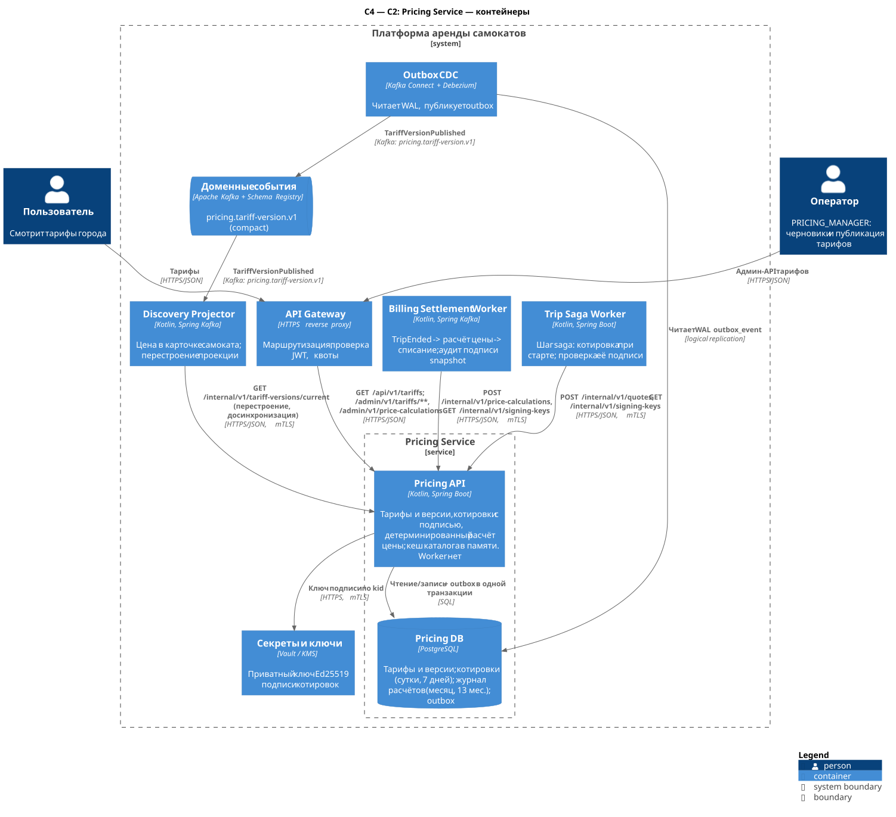
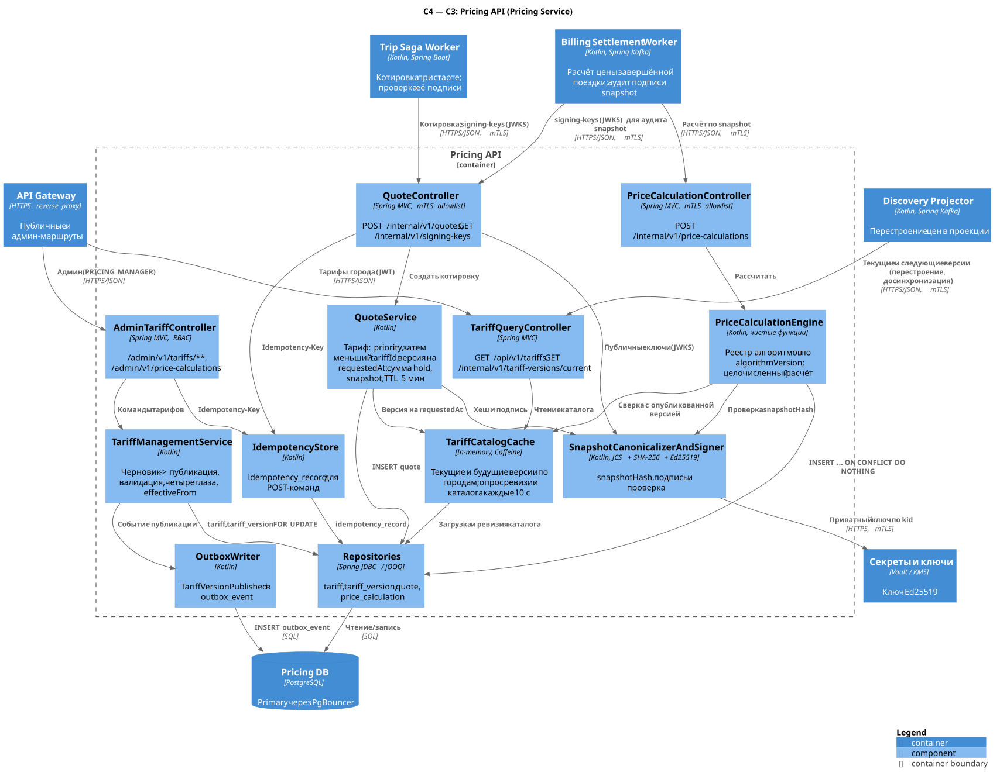

# Pricing Service

**Сводка.** Bounded context — **Pricing**; владелец — команда тарификации.

| | |
|---|---|
| Отвечает за | версионированные тарифы городов (черновик → публикация, опубликованная версия неизменяема, `effectiveFrom`); котировку при старте поездки — snapshot правил с `snapshotHash`, подписью и суммой авторизационного hold; детерминированный и идемпотентный расчёт цены завершённой поездки по snapshot; журнал расчётов для аудита; публичный список тарифов; событие `TariffVersionPublished` |
| Не делает | не списывает и не холдирует деньги (Billing); не решает, кто виноват и какой штраф (Geofence, Billing); не знает состояния поездки и не хранит поездки (Trip); не применяет промокоды и подписки (вне MVP) |
| Ссылки | [каталог сервисов](../service-catalog.md#6-pricing-service), [конвенции API](../api-conventions.md), [хранение данных](../data-storage.md), [старт поездки в lab-01](../lab-01.md#52-старт-и-разблокировка), [завершение и оплата](../lab-01.md#53-завершение-и-оплата) |

Все объёмы и нагрузки ниже — **оценка** по единым допущениям A1–A6 (1 млн поездок/сутки, пиковый час ≈ 10 % суток, финансовые данные ≥ 5 лет, суммы в минорных единицах, время в UTC).

## 1. Контейнеры (C2)



Исходник: [c2-pricing.puml](../../diagrams/services/pricing/c2-pricing.puml)

| Контейнер | Технология | Ответственность | Единица масштабирования / метрика автоскейлинга | Минимум реплик |
|---|---|---|---|---|
| Pricing API (`pricing_api`) | Kotlin, Spring Boot | админ-API тарифов, публикация версий с событием в outbox, котировки (`POST /internal/v1/quotes`), расчёт цены (`POST /internal/v1/price-calculations`), публичный список тарифов, текущие версии для Discovery; каталог тарифов в памяти каждого пода | под (stateless); HPA: CPU 60 % и p99 `POST /internal/v1/quotes` > 40 мс | 3 (по одной на зону доступности) |
| Pricing DB | PostgreSQL 17 + PgBouncer | тарифы и версии; котировки (суточные партиции, 7 дней); журнал расчётов (месячные партиции, 13 месяцев); outbox/idempotency | вертикально; primary + реплика в другой зоне (асинхронная по умолчанию, синхронная фиксация админ-изменений тарифов — [§4.6](#46-репликация-ha-бэкап)) | 1 primary + 1 реплика |

Решения уровня C2:

- **Worker нет** — асинхронной работы у сервиса нет; причины разобраны в [§2.2](#22-worker-отсутствует).
- **Каталог тарифов в памяти, без Redis.** Каталог мал (≈ 1 500 версий), а неизменяемость опубликованных версий делает кеш простым. Устройство — в [§2.3](#23-кеш-каталога-тарифов).
- **Событие публикует Outbox CDC** (Debezium читает WAL `outbox_event`) в `pricing.tariff-version.v1`.
- **Ключ подписи котировок** (Ed25519) хранится в платформенном Vault/KMS, сервис кеширует его в памяти.

## 2. Компоненты (C3)

### 2.1 Pricing API



Исходник: [c3-pricing-api.puml](../../diagrams/services/pricing/c3-pricing-api.puml)

| Компонент | Ответственность | Ключевые зависимости |
|---|---|---|
| TariffQueryController | `GET /api/v1/tariffs` (JWT пользователя), `GET /internal/v1/tariff-versions/current` (mTLS, allowlist `discovery-projector`); ETag и `304` | TariffCatalogCache |
| AdminTariffController | `/admin/v1/tariffs/**`, `/admin/v1/price-calculations`; RBAC по ролям JWT оператора | TariffManagementService, IdempotencyStore, Repositories |
| QuoteController | `POST /internal/v1/quotes` (mTLS, allowlist `trip-saga-worker`), `GET /internal/v1/signing-keys` (mTLS, allowlist `trip-saga-worker`, `billing-settlement-worker`) | QuoteService, IdempotencyStore, SnapshotCanonicalizerAndSigner |
| PriceCalculationController | `POST /internal/v1/price-calculations` (mTLS, allowlist `billing-settlement-worker`) | PriceCalculationEngine |
| TariffManagementService | создание тарифа и черновика, валидация правил, правило «четырёх глаз», проверки `effectiveFrom`, публикация: перевод версии, событие и ревизия каталога в одной транзакции | Repositories, OutboxWriter |
| QuoteService | выбор применимой версии на `requestedAt`, расчёт `authorizationAmountMinor`, сборка snapshot, TTL 5 мин, запись котировки | TariffCatalogCache, SnapshotCanonicalizerAndSigner, Repositories |
| PriceCalculationEngine | реестр алгоритмов по `algorithmVersion` (`linear-v1`); проверки snapshot; чистая функция расчёта в целых числах; журнал `INSERT ... ON CONFLICT DO NOTHING` | SnapshotCanonicalizerAndSigner, TariffCatalogCache, Repositories |
| SnapshotCanonicalizerAndSigner | канонизация JSON (RFC 8785, JCS), `snapshotHash = SHA-256`, подпись JWS EdDSA с отсоединённым payload, проверка хеша | Vault (приватный ключ по `kid`) |
| TariffCatalogCache | каталог текущих и будущих версий по городам + LRU неизменяемых версий; опрос ревизии каталога каждые 10 с, атомарная замена снимка | Repositories |
| IdempotencyStore | `idempotency_record` для POST-команд (котировки и админ-команды) | Repositories |
| Repositories | `tariff`, `tariff_version`, `tariff_catalog_revision`, `quote`, `price_calculation`, `idempotency_record` | Pricing DB |
| OutboxWriter | `TariffVersionPublished` в `outbox_event` в транзакции публикации | Pricing DB |

### 2.2 Worker отсутствует

У Pricing Service только один исполняемый контейнер — Pricing API. Отдельный Worker не нужен, потому что у сервиса нет асинхронной работы:

| Задача, которая могла бы потребовать Worker | Как решена без него |
|---|---|
| потребление событий | сервис не подписан ни на один топик (тарифы задаёт оператор через API, котировки и расчёты — синхронные вызовы) |
| публикация событий | Outbox CDC (Debezium) читает WAL; relay-процесс в сервисе не нужен |
| вступление версии в силу в момент `effectiveFrom` | не требует действия: версия выбирается по времени при чтении (`effective_from ≤ requestedAt`), каталог в памяти уже содержит будущие версии |
| истечение котировок | проверяется при использовании (`expiresAt`); удаление — `DROP` суточной партиции |
| создание и удаление партиций | фоновый процесс pg_partman внутри PostgreSQL ([§4.3](#43-партиционирование-ретенция-архив)) |
| выгрузка журнала расчётов в Parquet | платформенное задание архивации в `Archive Store` ([data-storage.md §6.4](../data-storage.md#64-архивирование-detach--parquet--drop)) |
| обновление кеша | каждый под сам опрашивает ревизию каталога |
| ротация ключа подписи | политика Vault; поды подхватывают новый `kid` при обновлении ключей |

Worker появится, если сервис начнёт потреблять события (например, динамическое ценообразование по спросу из Discovery) или понадобится пакетный пересчёт (массовые компенсации по новой версии тарифа).

### 2.3 Кеш каталога тарифов

| Аспект | Решение |
|---|---|
| Содержимое | по каждому тарифу — версия, действовавшая 24 ч назад, и все опубликованные после неё, включая будущие (≈ 1 500 записей на все города, < 5 МБ). Отдельно — LRU на 10 000 неизменяемых версий по ключу `(tariffId, version)` без TTL: опубликованная версия не меняется, поэтому инвалидация не нужна |
| Загрузка | при старте пода полная загрузка (`DISTINCT ON` по `ix_tv_tariff_published`); до её окончания readiness = false |
| Обновление | раз в 10 с `SELECT revision FROM tariff_catalog_revision`. Публикация увеличивает ревизию в той же транзакции. Если ревизия изменилась — полная перезагрузка в новый неизменяемый снимок и атомарная замена ссылки (copy-on-write): читатели не видят наполовину обновлённый каталог |
| Переключение версии в `effectiveFrom` | по времени, без события: выбирается версия с наибольшим `effectiveFrom ≤ t` (при равенстве — с большим `version`). Для котировки `t = requestedAt` из запроса, поэтому результат одинаков на любом поде |
| Гарантия свежести | `effectiveFrom` ≥ момента публикации + 5 мин; `requestedAt` отличается от времени сервера не более чем на 2 мин; котировки не выдаются, если каталог пода не подтверждён дольше 120 с (`503`). Тогда к моменту, когда версия может понадобиться котировке, она уже есть в каталоге пода: 5 мин > 2 мин + 120 с |
| Почему не LISTEN/NOTIFY и не событие | PgBouncer в режиме transaction pooling не поддерживает `LISTEN`; подписка на собственный топик добавила бы Kafka в путь котировки. Опрос одной строки раз в 10 с на под — пренебрежимая нагрузка |
| Наблюдаемость | метрика `pricing_catalog_age_seconds` (время с последнего подтверждения ревизии), алерт при > 60 с; метрика ревизии каталога по подам |

## 3. API

Общие правила (пути, `Idempotency-Key`, `traceparent`, problem+json, курсоры, деньги `{amountMinor, currency}`) — в [конвенциях API](../api-conventions.md). Ниже — только специфика сервиса.

### 3.1 Сводная таблица эндпоинтов

| Метод | Путь | Аудитория | Кто вызывает | Авторизация | Идемпотентность |
|---|---|---|---|---|---|
| GET | `/api/v1/tariffs?cityId=&scooterModel=` | public | мобильное приложение через Gateway | JWT пользователя | безопасный метод; ETag |
| POST | `/internal/v1/quotes` | internal | Trip Saga Worker | mTLS, allowlist `trip-saga-worker` | `Idempotency-Key` (обязателен, `{tripId}:quote`) |
| POST | `/internal/v1/price-calculations` | internal | Billing Settlement Worker | mTLS, allowlist `billing-settlement-worker` | естественная: детерминированный `calculationId`, повтор → тот же ответ |
| GET | `/internal/v1/tariff-versions/current?cityId=` | internal | Discovery Projector | mTLS, allowlist `discovery-projector` | безопасный метод |
| GET | `/internal/v1/signing-keys` *(добавлен)* | internal | Trip Saga Worker, Billing Settlement Worker | mTLS, allowlist `trip-saga-worker`, `billing-settlement-worker` | безопасный метод |
| POST | `/admin/v1/tariffs` | admin | консоль оператора | `PRICING_MANAGER`, `ADMIN` | `Idempotency-Key` |
| GET | `/admin/v1/tariffs?cityId=` *(добавлен)* | admin | консоль оператора | `PRICING_MANAGER`, `ADMIN`, `SUPPORT`, `FINANCE` | безопасный метод |
| POST | `/admin/v1/tariffs/{tariffId}/versions` | admin | консоль оператора | `PRICING_MANAGER`, `ADMIN` | `Idempotency-Key` |
| PATCH | `/admin/v1/tariffs/{tariffId}/versions/{version}` *(добавлен)* | admin | консоль оператора | `PRICING_MANAGER`, `ADMIN` | `If-Match` |
| POST | `/admin/v1/tariffs/{tariffId}/versions/{version}/publish` | admin | консоль оператора | `PRICING_MANAGER`, `ADMIN`; не автор черновика | `Idempotency-Key` + `If-Match` |
| GET | `/admin/v1/tariffs/{tariffId}/versions` | admin | консоль оператора | `PRICING_MANAGER`, `ADMIN`, `SUPPORT`, `FINANCE` | безопасный метод |
| GET | `/admin/v1/price-calculations?tripId=` *(добавлен)* | admin | консоль оператора | `FINANCE`, `SUPPORT`, `ADMIN` | безопасный метод |

### 3.2 Детальное описание

#### 3.2.1 Модель тарифа и алгоритм `linear-v1`

**Тариф** (`tariff`) — именованная линия цен в городе (`MSK_STANDARD`). Город задаётся `cityId` — UUID (UUIDv7), единый для всей платформы: тот же идентификатор, что у Geofence (он заводит города), Fleet, Trip и Discovery (в примерах Москва — `01900000-0000-7000-8000-000000000001`). Человекочитаемый код города (`msk`) в Pricing ключом не является: он хранится только как необязательная метка `cityCode` тарифа для админ-консоли и не принимается ни в одном API вместо `cityId`. **Версия тарифа** (`tariff_version`) — набор правил:

| Поле | Тип | Ограничения |
|---|---|---|
| `displayName` | string | 1–100 символов, показывается пользователю |
| `currency` | string | ISO 4217 (`RUB`) |
| `timeZone` | string | IANA (`Europe/Moscow`) — для отображения и будущих правил по времени суток |
| `algorithmVersion` | string | `linear-v1` (единственный в MVP) |
| `unlockFeeMinor` | int64 | ≥ 0 |
| `perMinuteMinor` | int64 | ≥ 0 |
| `roundingRule` | string | `CEIL_TO_MINUTE` (каждая начатая минута) или `PER_SECOND_CEIL_MINOR` (посекундно, округление вверх до копейки) |
| `minimumChargeMinor` | int64 | ≥ 0, ≤ `maxTripChargeMinor` |
| `maxTripChargeMinor` | int64 | > 0; потолок цены одной поездки |
| `holdMinutes` | int32 | 1–240; сколько минут поездки покрывает авторизационный hold |
| `holdMinAmountMinor` | int64 | ≥ 0, ≤ `maxTripChargeMinor` |
| `applicableModels` | string[] или `null` | `null` — все модели; `[]` — ни одной (снятие тарифа с продажи новой версией) |
| `priority` | int32 | 0–1000; при нескольких подходящих тарифах выигрывает больший, при равенстве — меньший `tariffId` |
| `effectiveFrom` | RFC 3339 | ≥ времени публикации + 5 мин; не раньше `effectiveFrom` последней опубликованной версии этого тарифа |

**Выбор тарифа для котировки:** в городе `cityId` для каждого тарифа берётся версия, действующая на `requestedAt` (опубликованная версия с наибольшим `effectiveFrom ≤ requestedAt`, при равных `effectiveFrom` — с большей `version`; то же правило у Discovery). Остаются тарифы, у которых `applicableModels` равен `null` или содержит `scooterModel`. Побеждает наибольший `priority`, при равенстве — меньший `tariffId` (сравнение UUIDv7 как 128-битных чисел, то есть выигрывает тариф, созданный раньше). Выбор детерминирован. Оба поля (`priority`, `tariffId`) есть в `TariffVersionPublished` и в `GET /internal/v1/tariff-versions/current`, поэтому Discovery применяет то же правило и показывает в карточке самоката тот же тариф, что выберет котировка. `code` в выборе не участвует: его нет в событиях.

**Алгоритм `linear-v1`** (только целочисленная арифметика `long`, без плавающей точки):

```text
billableMs   = max(0, min(endedAt, billableUntil) - startedAt)
billableSec  = ceil(billableMs / 1000)
CEIL_TO_MINUTE:          minutes = ceil(billableMs / 60000);  timeCharge = minutes * perMinuteMinor
PER_SECOND_CEIL_MINOR:   timeCharge = ceil(billableMs * perMinuteMinor / 60000)
subtotal     = unlockFeeMinor + timeCharge
total        = min(max(subtotal, minimumChargeMinor), maxTripChargeMinor)
```

Строки результата: `UNLOCK_FEE`, `RIDE_TIME`; при срабатывании — `MINIMUM_CHARGE_ADJUSTMENT` (доплата до минимума) и `CAP_ADJUSTMENT` (отрицательная, до потолка). Сумма строк всегда равна `total`. `billableUntil` задаёт Trip: если поездка завершилась с задержкой не по вине пользователя (например, самокат не подтвердил блокировку), время после `billableUntil` не тарифицируется.

**Сумма hold:** `authorizationAmountMinor = min(max(holdMinAmountMinor, unlockFeeMinor + perMinuteMinor × holdMinutes), maxTripChargeMinor)`. Если фактическая цена превысит hold, Billing доначисляет разницу ([lab-01 §5.3](../lab-01.md#53-завершение-и-оплата)).

**Новый алгоритм** (`linear-v2`, ночной тариф и т.п.) добавляется в реестр PriceCalculationEngine рядом со старым. Snapshot хранит `algorithmVersion`, поэтому поездки, начатые до выкладки, считаются по старому алгоритму. Удалять алгоритм из кода можно только после того, как истекли все snapshot с ним (практически — через 7 дней после последней котировки).

#### 3.2.2 `GET /api/v1/tariffs` — тарифы города

**Назначение:** показать пользователю действующие тарифы. **Вызывает:** приложение через Gateway (маршрут `/api/v1/tariffs`). **Авторизация:** JWT пользователя.
**Заголовки:** `Authorization`, `If-None-Match` (необязателен), `traceparent`.

| Параметр | Тип | Ограничения |
|---|---|---|
| `cityId` | uuid | обязателен; UUIDv7 города (код вида `msk` → `400 VALIDATION_FAILED`) |
| `scooterModel` | string | необязателен; если задан — возвращается только тариф, который будет применён к этой модели (0 или 1 элемент) |

**Ответ `200`**, `ETag: "c41f…"` (хеш тела), `Cache-Control: private, max-age=60`; при совпадении `If-None-Match` → `304`:

```json
{
  "cityId": "01900000-0000-7000-8000-000000000001",
  "items": [
    {
      "tariffId": "0192b6e1-3a40-7f2c-8d15-3c9a7e0b4f21",
      "version": 4,
      "displayName": "Стандарт",
      "applicableModels": null,
      "unlockFee": { "amountMinor": 5000, "currency": "RUB" },
      "perMinute": { "amountMinor": 900, "currency": "RUB" },
      "roundingRule": "CEIL_TO_MINUTE",
      "minimumCharge": { "amountMinor": 9900, "currency": "RUB" },
      "effectiveFrom": "2026-10-20T21:00:00Z",
      "next": {
        "version": 5,
        "unlockFee": { "amountMinor": 5000, "currency": "RUB" },
        "perMinute": { "amountMinor": 950, "currency": "RUB" },
        "effectiveFrom": "2026-11-09T21:00:00Z"
      }
    }
  ],
  "catalogRevision": 318
}
```

В список попадают только тарифы, которые выигрывают выбор хотя бы для одной модели; тарифы с `applicableModels = []` не показываются. `next` — ближайшая будущая опубликованная версия (или `null`). Неизвестный город → `200` с пустым `items`: города заводит Geofence, Pricing о них не знает.
**Ошибки:** `400 VALIDATION_FAILED` (нет `cityId` или это не UUID), `401 UNAUTHENTICATED` (Gateway). БД не используется — ответ из каталога в памяти.
**SLO:** p99 ≤ 20 мс. Тайм-аут клиента — 2 с.

#### 3.2.3 `POST /internal/v1/quotes` — котировка при старте

**Назначение:** зафиксировать цену поездки до разблокировки ([lab-01 §5.2](../lab-01.md#52-старт-и-разблокировка)): Trip сохраняет snapshot в поездке, Billing холдирует `authorizationAmountMinor`.
**Вызывает:** Trip Saga Worker. **Авторизация:** mTLS, allowlist `trip-saga-worker`.
**Заголовки:** `Idempotency-Key` (обязателен; Trip передаёт `{tripId}:quote`, при повторной котировке для той же поездки — `{tripId}:quote:2`), `traceparent`, `Content-Type: application/json`.

**Тело запроса:**

| Поле | Тип | Ограничения |
|---|---|---|
| `tripId` | uuid | обязателен |
| `userId` | uuid | обязателен |
| `scooterId` | uuid | обязателен |
| `cityId` | uuid | обязателен; `cityId` самоката из Fleet |
| `scooterModel` | string | 1–64 символа (`model` из Fleet) |
| `requestedAt` | RFC 3339 | отличается от времени сервера не более чем на 2 мин |

```json
{
  "tripId": "01a1aafe-3970-7d12-8f4b-6a9c2e1d0b35",
  "userId": "01962f3a-4b10-7c3e-9a51-6f2d8e1b0c47",
  "scooterId": "0195d1c2-7e40-7b8a-9c3d-1e2f3a4b5c6d",
  "cityId": "01900000-0000-7000-8000-000000000001",
  "scooterModel": "NB-G30-2025",
  "requestedAt": "2026-11-05T09:15:50.400Z"
}
```

**Ответ `201 Created`:**

```json
{
  "quoteId": "01a1aafe-3d58-7c41-9a2e-5b7f0d3c8e61",
  "tariffId": "0192b6e1-3a40-7f2c-8d15-3c9a7e0b4f21",
  "tariffVersion": 4,
  "algorithmVersion": "linear-v1",
  "currency": "RUB",
  "unlockFeeMinor": 5000,
  "perMinuteMinor": 900,
  "authorizationAmountMinor": 32000,
  "snapshot": {
    "snapshotSchema": 1,
    "quoteId": "01a1aafe-3d58-7c41-9a2e-5b7f0d3c8e61",
    "tripId": "01a1aafe-3970-7d12-8f4b-6a9c2e1d0b35",
    "userId": "01962f3a-4b10-7c3e-9a51-6f2d8e1b0c47",
    "scooterId": "0195d1c2-7e40-7b8a-9c3d-1e2f3a4b5c6d",
    "cityId": "01900000-0000-7000-8000-000000000001",
    "scooterModel": "NB-G30-2025",
    "tariffId": "0192b6e1-3a40-7f2c-8d15-3c9a7e0b4f21",
    "tariffVersion": 4,
    "algorithmVersion": "linear-v1",
    "currency": "RUB",
    "timeZone": "Europe/Moscow",
    "rules": {
      "unlockFeeMinor": 5000,
      "perMinuteMinor": 900,
      "roundingRule": "CEIL_TO_MINUTE",
      "minimumChargeMinor": 9900,
      "maxTripChargeMinor": 500000
    },
    "issuedAt": "2026-11-05T09:15:51Z",
    "expiresAt": "2026-11-05T09:20:51Z"
  },
  "snapshotHash": "05d0397fdd6377ca9e3c00d86347bdcbc819dd750e056caed78a8750651e65eb",
  "signature": "eyJhbGciOiJFZERTQSIsImtpZCI6InByaWNpbmctcXVvdGUtMjAyNi0xMCJ9..Xb3kQ9vN2pR7tL4mW8cH1dF6sJ0aG5eU2iO7yK3tQzR9pL4xW8vN2bM6cH1dF5sJ3aG0eU7iO4yK9tQ2zR8pLA",
  "expiresAt": "2026-11-05T09:20:51Z"
}
```

**Целостность snapshot:**

- `snapshotHash` — SHA-256 (hex, 64 символа) канонического JSON snapshot по RFC 8785 (JCS: ключи отсортированы, без пробелов, числа — целые). Хеш в примере вычислен именно так.
- `signature` — JWS Compact (RFC 7515) с отсоединённым payload (`<header>..<signature>`): заголовок `{"alg":"EdDSA","kid":"pricing-quote-2026-10"}`, подписываемый payload — JCS snapshot. Проверить подпись можно ключом из `GET /internal/v1/signing-keys`.
- Подпись нужна для разбора споров и офлайн-проверки. Расчёт цены от неё не зависит: правила в snapshot сверяются с неизменяемой опубликованной версией ([§3.2.4](#324-post-internalv1price-calculations--расчёт-цены-поездки)).

**Обработка:**

1. Проверка `requestedAt` и свежести каталога (≤ 120 с).
2. Выбор тарифа по правилам [§3.2.1](#321-модель-тарифа-и-алгоритм-linear-v1) из каталога в памяти; расчёт hold.
3. Сборка snapshot, JCS, хеш, подпись (ключ в памяти).
4. Одна транзакция: `INSERT INTO idempotency_record` (scope `quote:trip-saga-worker`) и `INSERT INTO quote`; ответ сохраняется в `idempotency_record`.

| HTTP | code | Условие |
|---|---|---|
| 400 | `VALIDATION_FAILED` | формат полей |
| 400 | `IDEMPOTENCY_KEY_REQUIRED` | нет `Idempotency-Key` |
| 403 | `CALLER_NOT_ALLOWED` | вызывающий не в allowlist |
| 422 | `REQUESTED_AT_OUT_OF_RANGE` | `requestedAt` отличается от времени сервера больше чем на 2 мин |
| 422 | `NO_APPLICABLE_TARIFF` | в городе нет действующего тарифа для этой модели — старт невозможен |
| 422 | `IDEMPOTENCY_KEY_REUSED` | тот же ключ с другим телом |
| 503 | `DEPENDENCY_UNAVAILABLE` | БД недоступна, каталог не подтверждён > 120 с или ключ подписи не загружен; `Retry-After: 1` |

**Повторы и конкурентность:**

- Повтор с тем же ключом и телом возвращает сохранённый ответ (`201` с той же котировкой) в течение 24 ч.
- Параллельный дубль ждёт на уникальном ключе `idempotency_record` (вставка в одной транзакции) и после коммита первого получает тот же ответ.
- `503` не сохраняется, поэтому повтор после него выполняется заново. Если к этому моменту `requestedAt` вышел за окно 2 мин, Trip повторяет с новым ключом `{tripId}:quote:2` и новым `requestedAt`.
- Котировка без старта поездки ничего не стоит: её удалит суточная партиция.

**SLO:** p99 ≤ 50 мс. Тайм-аут Trip Saga Worker — 500 мс, 1 повтор с тем же ключом.

#### 3.2.4 `POST /internal/v1/price-calculations` — расчёт цены поездки

**Назначение:** посчитать цену завершённой поездки по snapshot из `TripEnded.tariffSnapshot` ([lab-01 §5.3](../lab-01.md#53-завершение-и-оплата)).
**Вызывает:** Billing Settlement Worker. **Авторизация:** mTLS, allowlist `billing-settlement-worker`.
**Заголовки:** `traceparent`, `Content-Type: application/json`. `Idempotency-Key` не требуется: операция детерминирована, повтор даёт тот же результат.

**Тело запроса:**

| Поле | Тип | Ограничения |
|---|---|---|
| `tripId` | uuid | должен совпадать с `snapshot.tripId` |
| `snapshot` | object | snapshot из котировки без изменений |
| `snapshotHash` | string | 64 hex-символа |
| `startedAt` | RFC 3339 | время старта поездки |
| `endedAt` | RFC 3339 | ≥ `startedAt` |
| `billableUntil` | RFC 3339 | `startedAt` ≤ `billableUntil` ≤ `startedAt` + 7 суток |

```json
{
  "tripId": "01a1aafe-3970-7d12-8f4b-6a9c2e1d0b35",
  "snapshot": { "...": "snapshot из ответа котировки, без изменений" },
  "snapshotHash": "05d0397fdd6377ca9e3c00d86347bdcbc819dd750e056caed78a8750651e65eb",
  "startedAt": "2026-11-05T09:15:58Z",
  "endedAt": "2026-11-05T09:28:08Z",
  "billableUntil": "2026-11-05T09:28:08Z"
}
```

**Ответ `200`** (поля `billableSeconds`, `tariffId`, `tariffVersion` добавлены). 730 с → 13 начатых минут:

```json
{
  "calculationId": "01a1aafe-58b0-7c2f-a191-b3928ac51bd5",
  "total": { "amountMinor": 16700, "currency": "RUB" },
  "lines": [
    { "type": "UNLOCK_FEE", "quantity": 1, "unit": "TRIP", "unitPriceMinor": 5000,
      "amount": { "amountMinor": 5000, "currency": "RUB" } },
    { "type": "RIDE_TIME", "quantity": 13, "unit": "MINUTE", "unitPriceMinor": 900,
      "amount": { "amountMinor": 11700, "currency": "RUB" } }
  ],
  "algorithmVersion": "linear-v1",
  "billableSeconds": 730,
  "tariffId": "0192b6e1-3a40-7f2c-8d15-3c9a7e0b4f21",
  "tariffVersion": 4
}
```

**Проверки** (в этом порядке; любая ошибка — `422`, повторять бессмысленно):

| code | Условие |
|---|---|
| `SNAPSHOT_HASH_MISMATCH` | SHA-256 от JCS(`snapshot`) ≠ `snapshotHash` |
| `SNAPSHOT_TRIP_MISMATCH` | `snapshot.tripId` ≠ `tripId` |
| `UNSUPPORTED_ALGORITHM_VERSION` | `algorithmVersion` нет в реестре |
| `SNAPSHOT_TARIFF_MISMATCH` | правила в snapshot отличаются от опубликованной версии `(tariffId, tariffVersion)` (из LRU или по PK) или версия не опубликована. Это главная защита от подмены цены: snapshot может прийти только с правилами, которые реально публиковались |
| `QUOTE_MISMATCH` | строка `quote` с `snapshot.quoteId` ещё существует (≤ 7 дней) и её `snapshot_hash` отличается |
| `INVALID_TIME_RANGE` | `billableUntil < startedAt`, `endedAt < startedAt` или длительность > 7 суток |

Истёкшая котировка (`startedAt > snapshot.expiresAt`) **не отклоняется**: пользователь уже проехал по показанной цене. Это ошибка Trip, поэтому только метрика `pricing_expired_quote_used_total` и алерт.

**Детерминизм и идемпотентность:**

- `calculationId` вычисляется, а не генерируется. Это UUIDv7, где 48 бит времени = `startedAt`, а остальные биты — из `inputHash = SHA-256(JCS{tripId, snapshotHash, startedAt, endedAt, billableUntil, algorithmVersion})` с проставленными битами версии и варианта. Одинаковые входы → тот же `calculationId` → та же партиция журнала.
- Запись — `INSERT INTO price_calculation ... ON CONFLICT (calculation_id) DO NOTHING`; ответ всегда `200`.
- Если строка уже есть и пересчёт дал другой результат (ошибка в коде алгоритма), возвращается **сохранённый** результат и поднимается алерт `NON_DETERMINISTIC_CALCULATION`: Billing не должен получить две разные цены одной поездки.
- Другие входы (например, Trip исправил `billableUntil` после разбора) дают новый `calculationId`. Какой расчёт применить, решает Billing.
- `startedAt` старше горячего окна журнала (13 месяцев, партиция уже архивирована) — расчёт возвращается без записи в журнал (поздний повторный расчёт Billing Settlement Worker, например после исправления `billableUntil` при разборе). Других вызывающих у эндпоинта нет: Billing Reconciliation Worker цену не пересчитывает, а сверяет операции PSP с уже сохранённым в Billing результатом.

| HTTP | code | Условие |
|---|---|---|
| 400 | `VALIDATION_FAILED` | формат полей |
| 403 | `CALLER_NOT_ALLOWED` | вызывающий не в allowlist |
| 422 | см. таблицу проверок | невалидный snapshot или интервал |
| 503 | `DEPENDENCY_UNAVAILABLE` | БД недоступна; `Retry-After: 5` |

**Повторы:** Billing повторяет `503` и тайм-ауты: 2 немедленных повтора с тем же телом (circuit breaker), затем задание расчёта откладывается с экспоненциальной задержкой (5 с → … → 5 мин) без ограничения времени (событие `TripEnded` остаётся в обработке, [billing-service.md §2.2](billing-service.md#22-billing-settlement-worker)). `422` не повторяется, а отправляется в разбор (DLQ Billing).
**SLO:** p99 ≤ 50 мс. Тайм-аут Billing Settlement Worker — 1 с на попытку.

#### 3.2.5 `GET /internal/v1/tariff-versions/current` — текущие версии для Discovery

**Назначение:** перестроение проекции цен в Discovery, досинхронизация тарифов города (старт пода, активация версии, сброс offset) и восполнение пропусков после compaction топика.
**Вызывает:** Discovery Projector. **Авторизация:** mTLS, allowlist `discovery-projector`.

| Параметр | Тип | Ограничения |
|---|---|---|
| `cityId` | uuid | необязателен; без него — все города постранично |
| `limit` | int | 1–500, по умолчанию 200 |
| `cursor` | string | непрозрачный курсор |

**Ответ `200`** (поля названы как в `TariffVersionPublished`):

```json
{
  "items": [
    {
      "tariffId": "0192b6e1-3a40-7f2c-8d15-3c9a7e0b4f21",
      "cityId": "01900000-0000-7000-8000-000000000001",
      "version": 4,
      "effectiveFrom": "2026-10-20T21:00:00Z",
      "currency": "RUB",
      "unlockFeeMinor": 5000,
      "perMinuteMinor": 900,
      "roundingRule": "CEIL_TO_MINUTE",
      "displayName": "Стандарт",
      "applicableModels": null,
      "priority": 100,
      "minimumChargeMinor": 9900,
      "maxTripChargeMinor": 500000,
      "algorithmVersion": "linear-v1",
      "timeZone": "Europe/Moscow",
      "next": {
        "version": 5,
        "effectiveFrom": "2026-11-09T21:00:00Z",
        "currency": "RUB",
        "unlockFeeMinor": 5000,
        "perMinuteMinor": 950,
        "roundingRule": "CEIL_TO_MINUTE",
        "displayName": "Стандарт",
        "applicableModels": null,
        "priority": 100,
        "minimumChargeMinor": 9900,
        "maxTripChargeMinor": 500000,
        "algorithmVersion": "linear-v1",
        "timeZone": "Europe/Moscow"
      }
    }
  ],
  "nextCursor": null,
  "catalogRevision": 318,
  "asOf": "2026-11-05T09:15:52Z"
}
```

Отдаётся из каталога в памяти; `asOf` — время ответа, `catalogRevision` — ревизия, по которой Discovery понимает, что перестроение актуально. Курсор — `(cityId, tariffId)` последнего элемента.
- **Элемент** — действующая версия тарифа (наибольший `effectiveFrom ≤ now`, при равенстве — большая `version`) с полями версии из payload `TariffVersionPublished` ([§3.3](#33-публикуемые-события)). Тариф, у которого ещё не наступила ни одна версия, отдаётся с полями версии `null` и заполненным `next`.
- **`next`** — ближайшая будущая опубликованная версия (или `null`) с **тем же набором полей версии**, что и в `TariffVersionPublished`: `version`, `effectiveFrom`, `currency`, `unlockFeeMinor`, `perMinuteMinor`, `roundingRule`, `displayName`, `applicableModels`, `priority`, `minimumChargeMinor`, `maxTripChargeMinor`, `algorithmVersion`, `timeZone`. `applicableModels` и `priority` у каждой версии свои, поэтому Discovery, переключая цену на `next` по времени, не подставляет значения из текущей версии.

**Ошибки:** `400 VALIDATION_FAILED`, `403 CALLER_NOT_ALLOWED`. **SLO:** p99 ≤ 30 мс; тайм-аут вызывающего 2 с, до 2 повторов.

#### 3.2.6 `GET /internal/v1/signing-keys` — ключи проверки подписи котировок *(добавлен)*

**Вызывают:**

- **Trip Saga Worker** — проверяет JWS-подпись котировки при её получении (шаг `CREATE_QUOTE`) и при повторной сверке snapshot в `trip_review`. Подпись неверна → поездка с этой котировкой не стартует: одна повторная котировка, затем отказ старта `QUOTE_UNAVAILABLE` ([trip-service.md §3.7.3](trip-service.md#373-шаги-старта)).
- **Billing Settlement Worker** — проверяет подпись и хеш snapshot тарифа при аудите расчёта ([billing-service.md §2.2](billing-service.md#22-billing-settlement-worker)); несовпадение → путь `SNAPSHOT_TARIFF_MISMATCH`.

**Авторизация:** mTLS, allowlist `trip-saga-worker`, `billing-settlement-worker`. Путь совпадает с одноимённым эндпоинтом Telemetry, но это другой сервис и другой набор ключей.

**Параметры вызова для клиентов** (задаёт Pricing, вызывающие копируют):

| Параметр | Значение |
|---|---|
| Тайм-аут | 300 мс, 1 повтор с jitter |
| Кеш JWKS у клиента | 5 мин; неизвестный `kid` → принудительное обновление не чаще раза в 30 с |
| Pricing недоступен, ключ для `kid` в кеше | проверка по кешированному ключу, работа не блокируется |
| Pricing недоступен, ключа для `kid` нет | Trip — временный отказ шага (saga повторяет); Billing — задание откладывается и повторяется позже, алерт |

**Ответ `200`**, `Cache-Control: max-age=300`, ETag:

```json
{
  "keys": [
    { "kty": "OKP", "crv": "Ed25519", "kid": "pricing-quote-2026-10", "use": "sig", "alg": "EdDSA",
      "x": "11qYAYKxCrfVS_7TyWQHOg7hcvPapiMlrwIaaPcHURo", "status": "ACTIVE" }
  ]
}
```

Ключ ротирует Vault раз в квартал. Публичные части всех прежних версий остаются в ответе со статусом `RETIRED`: подпись проверяется и через годы.
**Ошибки:** `403 CALLER_NOT_ALLOWED`. **SLO:** p99 ≤ 10 мс.

#### 3.2.7 Admin-эндпоинты

Все требуют JWT оператора; изменения выполняются с `synchronous_commit = on` (см. [§4.6](#46-репликация-ha-бэкап)).

- **`POST /admin/v1/tariffs`** — создать тариф.
  - Роли: `PRICING_MANAGER`, `ADMIN`; `Idempotency-Key`.
  - Тело: `{cityId (uuid), cityCode (необязателен, ^[a-z0-9-]{2,32}$, например `msk`), code (^[A-Z0-9_]{3,64}$)}`. `cityCode` — только метка для консоли оператора: не уникальна, не ключ, в события, котировки и snapshot не попадает.
  - Ответ `201 {tariffId, cityId, cityCode | null, code, lastVersion: 0, createdAt}`.
  - Ошибки: `400 VALIDATION_FAILED` (формат `cityId`, `cityCode`, `code`), `409 TARIFF_CODE_EXISTS`.
- **`GET /admin/v1/tariffs?cityId=`** *(добавлен)* — тарифы города (`cityId` — uuid).
  - Ответ: `{items: [{tariffId, cityCode | null, code, currentVersion, draftVersion | null, nextVersion | null}]}`, курсор.
- **`POST /admin/v1/tariffs/{tariffId}/versions`** — создать черновик.
  - Роли: `PRICING_MANAGER`, `ADMIN`; `Idempotency-Key`.
  - Тело: все правила [§3.2.1](#321-модель-тарифа-и-алгоритм-linear-v1) **или** `{basedOnVersion, ...изменяемые поля}`.
  - Номер версии — `tariff.last_version + 1` под `SELECT ... FOR UPDATE` тарифа.
  - Ответ `201` с версией (`status: DRAFT`) и `ETag` (`row_version`).
  - Ошибки: `404 TARIFF_NOT_FOUND`, `409 DRAFT_ALREADY_EXISTS` (у тарифа может быть один черновик), `400 VALIDATION_FAILED` (схема, формат, диапазон отдельного поля из [§3.2.1](#321-модель-тарифа-и-алгоритм-linear-v1)), `422 TARIFF_RULE_VIOLATION` (правила противоречат друг другу — бизнес-правило, например `minimumChargeMinor > maxTripChargeMinor` или `holdMinAmountMinor > maxTripChargeMinor`).
- **`PATCH /admin/v1/tariffs/{tariffId}/versions/{version}`** *(добавлен)* — изменить черновик.
  - JSON Merge Patch, `If-Match` обязателен; `last_modified_by` = текущий оператор.
  - Ошибки: `400 VALIDATION_FAILED` (формат поля), `409 VERSION_NOT_DRAFT`, `412 PRECONDITION_FAILED`, `422 TARIFF_RULE_VIOLATION` (правила после изменения противоречат друг другу), `428 PRECONDITION_REQUIRED`.
- **`POST /admin/v1/tariffs/{tariffId}/versions/{version}/publish`** — опубликовать.
  - Роли: `PRICING_MANAGER`, `ADMIN`; `Idempotency-Key` и `If-Match` обязательны. Тело пустое: `effectiveFrom` задаётся в черновике и проверяется ещё раз.
  - Правило «четырёх глаз»: публикующий не должен быть автором или последним редактором черновика (`403 FOUR_EYES_REQUIRED`).
  - Транзакция под `SELECT ... FROM tariff WHERE tariff_id = $1 FOR UPDATE`: проверки → `status = PUBLISHED`, `published_by`, `published_at`, `content_hash` → `outbox_event` (`TariffVersionPublished`) → `UPDATE tariff_catalog_revision SET revision = revision + 1`.
  - Ответ `200` с версией. Повтор для уже опубликованной версии тоже `200`. Отзыва нет: ошибку исправляют новой версией с более поздним `effectiveFrom`.

  | HTTP | code | Условие |
  |---|---|---|
  | 403 | `FOUR_EYES_REQUIRED` | публикует автор или последний редактор черновика |
  | 404 | `VERSION_NOT_FOUND` | нет такой версии |
  | 409 | `VERSION_NOT_DRAFT` | версия уже опубликована другим запросом |
  | 409 | `EFFECTIVE_FROM_NOT_MONOTONIC` | `effectiveFrom` раньше, чем у последней опубликованной версии тарифа |
  | 412 | `PRECONDITION_FAILED` | черновик изменился после чтения |
  | 422 | `EFFECTIVE_FROM_IN_PAST` | `effectiveFrom` < now + 5 мин |

- **`GET /admin/v1/tariffs/{tariffId}/versions`** — история версий (новые сверху), курсор `?limit=&cursor=`.
- **`GET /admin/v1/price-calculations?tripId=`** *(добавлен)* — расчёты поездки для разбора обращений.
  - Роли: `FINANCE`, `SUPPORT`, `ADMIN`.
  - Ответ: `{items: [{calculationId, total, lines, tariffId, tariffVersion, startedAt, endedAt, billableUntil, requestedBy, createdAt}]}`.
  - Ищет в горячем окне (13 месяцев); более старые — в архиве через платформенный инструмент.

### 3.3 Публикуемые события

| Топик | Ключ | Событие | Производитель (outbox) | Потребители |
|---|---|---|---|---|
| `pricing.tariff-version.v1` (6 партиций, compact) | `tariffId` | `TariffVersionPublished` | Pricing API | Discovery Projector |

**Когда:** при публикации версии, в той же транзакции. `aggregateType = Tariff`, `aggregateVersion = version`.

```json
{
  "eventId": "01a1a3c2-7f10-7b2e-a4d1-93c5e8f0b6a2",
  "eventType": "TariffVersionPublished",
  "schemaVersion": 1,
  "aggregateType": "Tariff",
  "aggregateId": "0192b6e1-3a40-7f2c-8d15-3c9a7e0b4f21",
  "aggregateVersion": 5,
  "occurredAt": "2026-11-03T14:02:09.512Z",
  "producer": "pricing-api",
  "correlationId": "01a1a3c2-6e88-7d41-8c07-2b9f1e4a7d55",
  "causationId": null,
  "payload": {
    "tariffId": "0192b6e1-3a40-7f2c-8d15-3c9a7e0b4f21",
    "cityId": "01900000-0000-7000-8000-000000000001",
    "version": 5,
    "effectiveFrom": "2026-11-09T21:00:00Z",
    "currency": "RUB",
    "unlockFeeMinor": 5000,
    "perMinuteMinor": 950,
    "roundingRule": "CEIL_TO_MINUTE",
    "displayName": "Стандарт",
    "applicableModels": null,
    "priority": 100,
    "minimumChargeMinor": 9900,
    "maxTripChargeMinor": 500000,
    "algorithmVersion": "linear-v1",
    "timeZone": "Europe/Moscow"
  }
}
```

**Добавленные поля payload** (совместимы по правилу BACKWARD):
- `applicableModels`, `priority` — нужны Discovery, чтобы показать в карточке самоката именно тот тариф, который применит котировка;
- `minimumChargeMinor`, `maxTripChargeMinor`, `algorithmVersion`, `timeZone`.

**Правила для потребителя:**
- **Не применять версию сразу.** Версия начинает действовать в `effectiveFrom`, который может быть в будущем: Discovery хранит её как «следующую» и переключает по времени.
- **Compaction.** Топик сжимается по `tariffId`, поэтому будущая версия вытесняет из лога текущую. Потребитель, читающий топик с начала, увидит только последнюю версию каждого тарифа. Полное состояние (текущая + следующая) — через `GET /internal/v1/tariff-versions/current` ([§3.2.5](#325-get-internalv1tariff-versionscurrent--текущие-версии-для-discovery)). Discovery обращается к нему при перестроении и при старте пода, а для досинхронизации города — после каждой активации версии в городе, после сброса offset и когда событие пришло для тарифа, у которого в проекции нет действующей версии; не чаще раза в 10 с на город ([discovery-service.md §2.2.1](discovery-service.md#221-применение-событий)).
- **Порядок и дубликаты.** Версии одного тарифа монотонны: события применяются, если `version` больше сохранённой; дубликаты отбрасываются тем же сравнением.
- **Выбор между тарифами города** — то же правило, что у котировки ([§3.2.1](#321-модель-тарифа-и-алгоритм-linear-v1)): `applicableModels` (`null` — все модели, `[]` — тариф снят с продажи), затем наибольший `priority`, при равенстве — меньший `tariffId`. `cityId` в payload — UUID города.

### 3.4 Потребляемые события

Нет. Сервис не подписан ни на один топик, поэтому `inbox_message` не создаётся.

### 3.5 MQTT

Не используется.

## 4. Данные и хранение

### 4.1 Почему PostgreSQL

Тарифы — маленький справочник со строгими инвариантами: один черновик на тариф, неизменяемость опубликованной версии, монотонный `effectiveFrom`, публикация атомарно с outbox. Котировки и журнал расчётов — поток вставок с выборкой по ключу и удалением по времени, что хорошо ложится на партиционирование по диапазону UUIDv7. Это транзакционная OLTP-нагрузка — единый выбор платформы ([data-storage.md](../data-storage.md), [lab-01 §4.2](../lab-01.md#42-хранение-данных-почему-postgresql-индексы-партиционирование-шардирование)).

### 4.2 DDL и индексы

Общие `outbox_event` (суточные партиции, 3 дня) и `idempotency_record` (scope `quote:trip-saga-worker`, `admin-tariffs:<operator>`; 24 ч) создаются по единой схеме ([data-storage §4.3](../data-storage.md#43-общие-служебные-таблицы)). `inbox_message` не нужна.

```sql
CREATE TABLE tariff (
  tariff_id    uuid        PRIMARY KEY,                       -- UUIDv7; меньший побеждает при равном priority
  city_id      uuid        NOT NULL,                          -- UUIDv7 города (города заводит Geofence)
  city_code    text        CHECK (city_code ~ '^[a-z0-9-]{2,32}$'),  -- метка для консоли ('msk'), не ключ
  code         text        NOT NULL CHECK (code ~ '^[A-Z0-9_]{3,64}$'),
  last_version int         NOT NULL DEFAULT 0,                -- счётчик номеров версий
  created_by   text        NOT NULL,
  created_at   timestamptz NOT NULL DEFAULT now(),
  CONSTRAINT uq_tariff_code UNIQUE (code),
  CONSTRAINT uq_tariff_city UNIQUE (tariff_id, city_id)       -- цель составного FK из версий
);
CREATE INDEX ix_tariff_city ON tariff (city_id);

CREATE TABLE tariff_version (
  tariff_id             uuid        NOT NULL,
  version               int         NOT NULL CHECK (version >= 1),
  city_id               uuid        NOT NULL,
  status                text        NOT NULL CHECK (status IN ('DRAFT','PUBLISHED')),
  display_name          text        NOT NULL CHECK (length(display_name) BETWEEN 1 AND 100),
  currency              char(3)     NOT NULL,
  time_zone             text        NOT NULL,
  algorithm_version     text        NOT NULL,
  unlock_fee_minor      bigint      NOT NULL CHECK (unlock_fee_minor >= 0),
  per_minute_minor      bigint      NOT NULL CHECK (per_minute_minor >= 0),
  rounding_rule         text        NOT NULL CHECK (rounding_rule IN ('CEIL_TO_MINUTE','PER_SECOND_CEIL_MINOR')),
  minimum_charge_minor  bigint      NOT NULL DEFAULT 0 CHECK (minimum_charge_minor >= 0),
  max_trip_charge_minor bigint      NOT NULL CHECK (max_trip_charge_minor > 0),
  hold_minutes          int         NOT NULL CHECK (hold_minutes BETWEEN 1 AND 240),
  hold_min_amount_minor bigint      NOT NULL CHECK (hold_min_amount_minor >= 0),
  applicable_models     text[],                                 -- NULL = все модели, '{}' = снят с продажи
  priority              int         NOT NULL DEFAULT 100 CHECK (priority BETWEEN 0 AND 1000),
  effective_from        timestamptz NOT NULL,
  content_hash          bytea,                                  -- SHA-256 JCS правил, при публикации
  created_by            text        NOT NULL,
  created_at            timestamptz NOT NULL DEFAULT now(),
  last_modified_by      text        NOT NULL,
  published_by          text,
  published_at          timestamptz,
  row_version           int         NOT NULL DEFAULT 1,         -- ETag черновика
  PRIMARY KEY (tariff_id, version),
  FOREIGN KEY (tariff_id, city_id) REFERENCES tariff (tariff_id, city_id),
  CHECK ((status = 'PUBLISHED') = (published_at IS NOT NULL AND published_by IS NOT NULL
                                   AND content_hash IS NOT NULL)),
  CHECK (published_by IS NULL OR (published_by <> created_by AND published_by <> last_modified_by)),
  CHECK (minimum_charge_minor <= max_trip_charge_minor),
  CHECK (hold_min_amount_minor <= max_trip_charge_minor)
);
CREATE UNIQUE INDEX uq_tariff_one_draft ON tariff_version (tariff_id) WHERE status = 'DRAFT';
CREATE INDEX ix_tv_tariff_published ON tariff_version (tariff_id, effective_from DESC, version DESC)
  WHERE status = 'PUBLISHED';

-- Опубликованная версия неизменяема и неудаляема даже для прямого SQL.
CREATE FUNCTION forbid_published_change() RETURNS trigger LANGUAGE plpgsql AS $$
BEGIN
  IF OLD.status = 'PUBLISHED' THEN
    RAISE EXCEPTION 'tariff_version %/% is published and immutable', OLD.tariff_id, OLD.version
      USING ERRCODE = 'integrity_constraint_violation';
  END IF;
  IF TG_OP = 'DELETE' THEN RETURN OLD; END IF;
  RETURN NEW;
END $$;
CREATE TRIGGER trg_tariff_version_immutable
  BEFORE UPDATE OR DELETE ON tariff_version
  FOR EACH ROW EXECUTE FUNCTION forbid_published_change();

CREATE TABLE tariff_catalog_revision (
  id         boolean     PRIMARY KEY DEFAULT true CHECK (id),   -- ровно одна строка
  revision   bigint      NOT NULL,
  updated_at timestamptz NOT NULL
);

CREATE TABLE quote (
  quote_id                   uuid        NOT NULL,              -- UUIDv7, время = issuedAt
  trip_id                    uuid        NOT NULL,
  user_id                    uuid        NOT NULL,
  scooter_id                 uuid        NOT NULL,
  city_id                    uuid        NOT NULL,
  scooter_model              text        NOT NULL,
  tariff_id                  uuid        NOT NULL,
  tariff_version             int         NOT NULL,
  algorithm_version          text        NOT NULL,
  currency                   char(3)     NOT NULL,
  authorization_amount_minor bigint      NOT NULL CHECK (authorization_amount_minor > 0),
  snapshot                   jsonb       NOT NULL,
  snapshot_hash              char(64)    NOT NULL,
  signature                  text        NOT NULL,              -- JWS compact, detached payload
  signing_kid                text        NOT NULL,
  requested_at               timestamptz NOT NULL,
  created_at                 timestamptz NOT NULL DEFAULT now(),
  expires_at                 timestamptz NOT NULL,
  PRIMARY KEY (quote_id),
  FOREIGN KEY (tariff_id, tariff_version) REFERENCES tariff_version (tariff_id, version),
  CHECK (expires_at > created_at)
) PARTITION BY RANGE (quote_id);
CREATE TABLE quote_2026_11_05 PARTITION OF quote
  FOR VALUES FROM ('01a1a901-5800-7000-8000-000000000000')    -- 2026-11-05 00:00 UTC
              TO   ('01a1ae27-b400-7000-8000-000000000000');  -- 2026-11-06 00:00 UTC
CREATE INDEX ix_quote_trip ON quote (trip_id);

CREATE TABLE price_calculation (
  calculation_id     uuid        NOT NULL,                      -- детерминированный UUIDv7, время = startedAt
  trip_id            uuid        NOT NULL,
  quote_id           uuid        NOT NULL,                      -- без FK: котировка живёт 7 дней
  tariff_id          uuid        NOT NULL,
  tariff_version     int         NOT NULL,
  algorithm_version  text        NOT NULL,
  snapshot_hash      char(64)    NOT NULL,
  started_at         timestamptz NOT NULL,
  ended_at           timestamptz NOT NULL,
  billable_until     timestamptz NOT NULL,
  billable_seconds   int         NOT NULL CHECK (billable_seconds >= 0),
  total_amount_minor bigint      NOT NULL CHECK (total_amount_minor >= 0),
  currency           char(3)     NOT NULL,
  lines              jsonb       NOT NULL,
  input_hash         char(64)    NOT NULL,
  requested_by       text        NOT NULL,                      -- идентичность mTLS вызывающего
  created_at         timestamptz NOT NULL DEFAULT now(),
  PRIMARY KEY (calculation_id),
  FOREIGN KEY (tariff_id, tariff_version) REFERENCES tariff_version (tariff_id, version),
  CHECK (billable_until >= started_at AND ended_at >= started_at)
) PARTITION BY RANGE (calculation_id);
CREATE TABLE price_calculation_2026_11 PARTITION OF price_calculation
  FOR VALUES FROM ('01a19467-e800-7000-8000-000000000000')    -- 2026-11-01 00:00 UTC
              TO   ('01a22ee6-b000-7000-8000-000000000000');  -- 2026-12-01 00:00 UTC
CREATE INDEX ix_calc_trip ON price_calculation (trip_id);
```

В журнале нет snapshot: правила восстанавливаются по `(tariff_id, tariff_version)` (версии хранятся бессрочно), а `snapshot_hash` и времена позволяют воспроизвести расчёт. FK на `quote` нет намеренно: котировки удаляются через 7 дней, а журнал хранится годы.

**Периоды действия версий не пересекаются по построению.** Версия действует с `effective_from` до `effective_from` следующей опубликованной версии того же тарифа; столбца `effective_to` и ограничения `EXCLUDE` нет: опубликованная версия неизменяема (триггер выше), поэтому «закрыть» период предыдущей версии при публикации следующей было бы нельзя. Порядок версий обеспечивает публикация под `SELECT ... FOR UPDATE` строки `tariff` с проверкой монотонности `effective_from` (`409 EFFECTIVE_FROM_NOT_MONOTONIC`, [§3.2.7](#327-admin-эндпоинты)); при равных `effective_from` действует версия с большим `version`.

**Какой запрос обслуживает каждый индекс:**

| Индекс | Запрос |
|---|---|
| PK `tariff` | `SELECT ... FROM tariff WHERE tariff_id = $1 FOR UPDATE` — нумерация версий и сериализация публикаций тарифа |
| `uq_tariff_code` | инвариант «код уникален»; `409 TARIFF_CODE_EXISTS` |
| `uq_tariff_city` | цель составного FK: `city_id` версии всегда совпадает с городом тарифа |
| `ix_tariff_city` | админ-список `GET /admin/v1/tariffs?cityId=`: `WHERE city_id = $1` |
| PK `tariff_version` | чтение версии по `(tariffId, version)`: LRU-промах при проверке snapshot, админ-операции; цель FK из `quote` и `price_calculation` |
| `uq_tariff_one_draft` | инвариант «один черновик на тариф»; `409 DRAFT_ALREADY_EXISTS` |
| `ix_tv_tariff_published` | загрузка каталога: `SELECT DISTINCT ON (tariff_id) ... WHERE status = 'PUBLISHED' AND effective_from <= now() - interval '24 hours' ORDER BY tariff_id, effective_from DESC, version DESC` плюс версии позже этой границы; проверка монотонности при публикации: `... WHERE tariff_id = $1 AND status = 'PUBLISHED' ORDER BY effective_from DESC LIMIT 1`; история версий в админке |
| PK `tariff_catalog_revision` | опрос ревизии каждые 10 с и её увеличение при публикации |
| PK `quote` | проверка `QUOTE_MISMATCH`: `WHERE quote_id = $1` — по ключу партиционирования, затрагивает одну партицию |
| `ix_quote_trip` | разбор поездки: все котировки поездки (повторные котировки) `WHERE trip_id = $1`; ищет по 8 суточным партициям |
| PK `price_calculation` | `INSERT ... ON CONFLICT (calculation_id) DO NOTHING` и чтение сохранённого результата при повторе — одна месячная партиция |
| `ix_calc_trip` | `GET /admin/v1/price-calculations?tripId=` (разбор обращений и ручные сверки `FINANCE`): `WHERE trip_id = $1` |

### 4.3 Партиционирование, ретенция, архив

| Таблица | Партиционирование | Ретенция и обоснование |
|---|---|---|
| `quote` | посуточно `RANGE (quote_id)` по границам UUIDv7 начала суток UTC | **7 дней**, затем `DROP` партиции. Котировка живёт 5 мин, но нужна для проверки `QUOTE_MISMATCH` и разбора: максимальная длительность поездки 7 суток (`INVALID_TIME_RANGE`) — котировка гарантированно доживает до расчёта. Авторитетная копия snapshot хранится в поездке у Trip |
| `price_calculation` | помесячно `RANGE (calculation_id)`, время в ID = `startedAt` | **13 месяцев горячо** (единое окно горячих данных поездок A4 — разбор обращений и chargeback, годовая отчётность), затем `DETACH`, выгрузка в Parquet платформенным заданием архивации в платформенное архивное хранилище `Archive Store` (S3-совместимое в РФ, SSE, versioning и Object Lock на срок хранения, [data-storage.md §6.4](../data-storage.md#64-архивирование-detach--parquet--drop)), `DROP`. В архиве **5 лет** с конца года расчёта (402-ФЗ, A5): расчёт — основание суммы в первичном документе Billing. После этого архивные файлы удаляются |
| `tariff`, `tariff_version` | нет | **бессрочно** (< 100 МБ): правила нужны для воспроизведения любого архивного расчёта |
| `outbox_event` | посуточно по `created_at` | 3 дня |
| `idempotency_record` | нет | 24 ч |

**Управление партициями** — pg_partman 5.x (фоновый процесс внутри PostgreSQL; для UUIDv7-ключа используется time encoder/decoder):
- `quote` — premake 3 суток вперёд, удаление старше 7 суток;
- `price_calculation` — premake 2 месяца вперёд, `retention_keep_table = true`, чтобы задание архивации успело выгрузить отсоединённую партицию.

Партиции по умолчанию (`DEFAULT`) нет: строка без партиции — ошибка, на которую срабатывает алерт, а не тихий рост.

### 4.4 Оценка объёмов и нагрузки (по A1, A4, A5)

| Данные | Строк (оценка) | Объём (оценка) |
|---|---|---|
| `tariff` + `tariff_version` | сотни тарифов × десятки версий | < 100 МБ |
| `quote` | ≈ 1,2 млн/сутки (1 млн поездок + повторные котировки и несостоявшиеся старты) × 8 партиций | ≈ 1,2 КБ × 9,6 млн ≈ **11,5 ГБ** |
| `idempotency_record` | ≈ 1,2 млн за 24 ч (ответ с snapshot ≈ 1,5 КБ) | ≈ 2 ГБ |
| `price_calculation` (горячо) | ≈ 1 млн/сутки ≈ 30 млн/месяц × ≈ 570 Б (с индексами) | ≈ 17 ГБ/месяц, **≈ 220 ГБ** за 13 месяцев |
| `price_calculation` (архив, Parquet, сжатие ≈ 5×) | ≈ 1,8 млрд строк за 5 лет | ≈ 150–250 ГБ в объектном хранилище |
| **Итого в БД** | | **≈ 237 ГБ** |

**Нагрузка (оценка):**

| Операция | Пик | Как получено |
|---|---|---|
| котировки | ≈ 30 RPS (запас на всплески — 100 RPS) | 1 млн стартов/сутки, 10 % в пиковый час: 100 000 / 3 600 ≈ 28 |
| расчёты | ≈ 30 RPS | столько же завершений; при догоне после отказа Billing — до 200 RPS |
| публичный список тарифов | 100–300 RPS | открытия приложения; большая часть — `304` по ETag |
| `tariff-versions/current` | единицы запросов в минуту | перестроение и старт подов Discovery, досинхронизация города после активации версии (не чаще раза в 10 с на город); отвечает каталог в памяти, БД не затрагивается |
| запись в БД | ≈ 60–100 транзакций/с | котировка + расчёт, каждая — 1–2 строки |

### 4.5 Шардирование

**Не требуется** — триггеры ([data-storage §7.2](../data-storage.md#72-триггеры)) далеко:

| Триггер | Значение (оценка) |
|---|---|
| доля записи на primary | ≈ 100 коротких вставок/с — доли процента от возможностей узла |
| рабочий набор | каталог (МБ), котировки текущих суток (≈ 1,5 ГБ), индексы текущей партиции журнала — помещается в RAM |
| время восстановления | ≈ 237 ГБ восстанавливаются за 30–60 мин (параллельный restore pgBackRest), что укладывается в RTO 1 ч (условно) |

Объём растёт за счёт журнала. Если время восстановления подойдёт к RTO, первым шагом сокращается горячее окно журнала (раньше архивировать в Parquet), а не шардирование: журнал — append-only история, которую почти не читают.

Схема shard-ready:
- ключ для `quote` и `price_calculation` — `tripId`, 256 бакетов `hash(tripId) mod 256`. Все запросы котировки и расчёта адресуются одной поездкой;
- `tariff` и `tariff_version` реплицируются на все шарды как справочник;
- ревизия каталога — на координирующем узле.

### 4.6 Репликация, HA, бэкап

- **Реплика и failover:** реплика в другой зоне доступности — асинхронная по умолчанию, с кворумной синхронной фиксацией для админ-изменений тарифов (ниже; правило кластера `pg-core` — [data-storage §8.1](../data-storage.md#81-размещение-по-кластерам), [§8.2](../data-storage.md#82-ha-patroni-или-managed)), Patroni, PgBouncer (transaction pooling).
- **Синхронная фиксация для изменений тарифов.** `synchronous_standby_names = 'ANY 1 (replica)'` при `synchronous_commit = local` по умолчанию; админ-транзакции (создание, черновики, публикация) выполняются с `SET LOCAL synchronous_commit = on`. Опубликованная версия, событие о которой уже ушло в Discovery, не может потеряться при failover.
- **Потеря при failover (RPO — секунды) допустима для остального:**
  - **котировка:** её snapshot уже у Trip, а расчёт от строки `quote` не зависит — проверка `QUOTE_MISMATCH` просто не выполнится;
  - **запись журнала:** Billing повторит расчёт, детерминированный `calculationId` восстановит ту же строку.
- **CDC при failover:** failover-слоты PostgreSQL 17 и `synchronized_standby_slots`: Debezium не публикует изменения, которых нет на реплике.
- **Бэкапы:** pgBackRest — полный бэкап раз в неделю, разностный ежедневно, WAL-архив, PITR-окно 14 дней. Восстановление проверяется ежемесячно. Долгосрочное хранение журнала обеспечивает Parquet-архив, а не бэкапы.

## 5. Масштабирование и отказы

**Pricing API:**
- Stateless, HPA по CPU 60 % и p99 котировок; минимум 3 реплики в 3 зонах.
- CPU тратится на JCS + SHA-256 + Ed25519 (≈ 0,1 мс на котировку) и расчёт (микросекунды) — линейно масштабируется подами.
- Каталог в каждом поде (≈ 5 МБ) не ограничивает число подов: нагрузка опроса ревизии — 1 запрос в 10 с на под.
- Пулы соединений PgBouncer разделены: котировки, расчёты, админ. Перегрузка расчётов при догоне Billing не должна задерживать котировки, от которых зависит старт поездки.

**Pricing DB:**
- Вертикально; запись — короткие вставки в «горячие» партиции.
- Чтение каталога и публичного списка не доходит до БД.

**Отказы зависимостей:**

| Отказ | Поведение |
|---|---|
| Pricing DB primary | failover Patroni ≤ 30 с. На это время: котировки → `503`, Trip не стартует новые поездки (без котировки нет цены и hold); расчёты → `503`, Billing откладывает списание и повторяет; публичный список и `tariff-versions/current` отвечают из каталога в памяти; админ-API → `503` |
| Каталог не обновляется (сбой перезагрузки на поде) | `pricing_catalog_age_seconds` растёт → алерт с 60 с; после 120 с под отвечает на котировки `503` (Trip повторяет и попадает на другой под), публичный список продолжает отдавать последний снимок. Readiness по возрасту каталога не снимается: иначе при отказе БД вышли бы из строя все поды и пропал бы и публичный список |
| Vault / KMS | ключ подписи закеширован в памяти → котировки работают. Новые поды не проходят readiness, scale-in на время отказа запрещён |
| Kafka / Outbox CDC | события копятся в `outbox_event` (3 дня). Discovery показывает старую цену в карточке самоката, но цену определяет котировка, поэтому деньги не затронуты. После восстановления Discovery догоняет события |
| Discovery потерял состояние или топик сжат | перестроение или досинхронизация города через `GET /internal/v1/tariff-versions/current` (текущая и следующая версии с полным набором полей, [§3.2.5](#325-get-internalv1tariff-versionscurrent--текущие-версии-для-discovery)) |
| Ошибка в новой версии тарифа | опубликованную версию нельзя изменить или отозвать: публикуется исправленная версия с ближайшим допустимым `effectiveFrom` (now + 5 мин). Поездки, начатые по ошибочной версии, считаются по своему snapshot; компенсации — через Billing |
| Ошибка в коде алгоритма | `NON_DETERMINISTIC_CALCULATION` при повторных расчётах; исправление — новый `algorithmVersion` для новых котировок, старые snapshot считаются старым алгоритмом |
