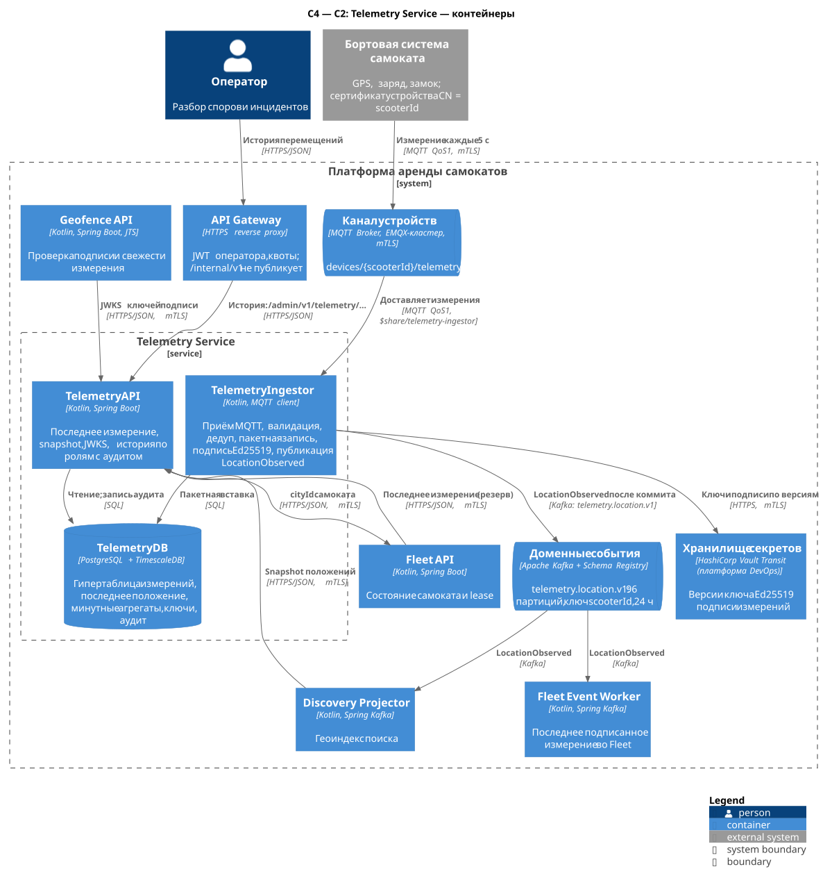
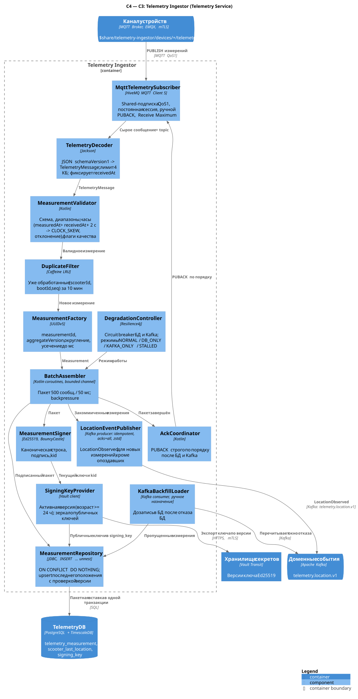
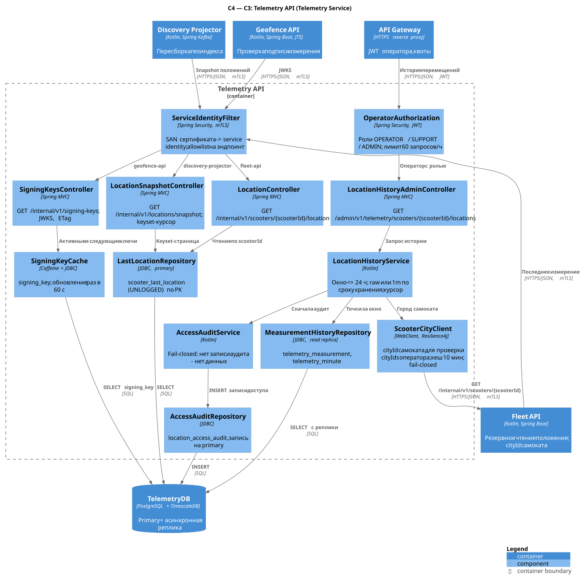

# Telemetry Service

| | |
| --- | --- |
| **Bounded context** | Fleet & IoT — телеметрия |
| **Команда-владелец** | Команда IoT/парка |
| **Контейнеры** | Telemetry Ingestor (`telemetry_ingestor`), Telemetry API (`telemetry_api`), Telemetry DB (PostgreSQL 17+ с TimescaleDB) |
| **Ответственность** | Приём измерений самокатов по MQTT (~20 000 сообщ./с, A2, условно); валидация, дедупликация, хранение истории; серверная подпись измерения Ed25519; публикация `LocationObserved`; последнее измерение для Fleet, snapshot положений для Discovery, JWKS для Geofence; история перемещений для оператора с обязательной причиной и аудитом |
| **Что НЕ делает** | Не определяет доступность и состояние самоката, не решает LOW_BATTERY/OFFLINE (это Fleet); не отправляет команды устройству (Fleet Command Worker); не проверяет зоны (Geofence); не отдаёт карту клиентам (Discovery); не знает `userId`/`tripId` — трек поездки оператор получает по `scooterId` и интервалу поездки из Trip (минимизация ПДн) |
| **Связанные документы** | [Каталог сервисов](../service-catalog.md#3-telemetry-service) · [Конвенции API](../api-conventions.md) (в т. ч. [MQTT](../api-conventions.md#14-mqtt) и [события](../api-conventions.md#15-события-kafka)) · [Хранение данных](../data-storage.md) · [Отчёт: поиск](../lab-01.md#51-поиск), [старт](../lab-01.md#52-старт-и-разблокировка), [события](../lab-01.md#54-контракты-событий-и-надёжность-доставки), [нагрузка](../lab-01.md#6-нагрузка-масштабирование-и-доступность) |

Ключевые решения:

1. **Порядок «БД → Kafka → PUBACK» без outbox.** Ingestor подтверждает сообщение брокеру только после коммита пакета в Telemetry DB и подтверждения Kafka. Буфером на случай сбоя служит очередь неподтверждённых сообщений MQTT-сессии, а не таблица outbox ([2.1.4](#214-почему-без-outbox)).
2. **Детерминированная идентичность измерения.** `measurementId = UUIDv5(ns, scooterId|bootId|seq)` (точное определение пространства имён и строки — [3.3.1](#331-каноническая-строка-и-подпись)), поэтому повторная доставка MQTT, повторная публикация в Kafka и дозапись из Kafka дают тот же ключ. Дубли отсекаются на каждом шаге.
3. **Подписанное измерение.** Ingestor подписывает каноническую строку измерения ключом Ed25519 из Vault Transit; `kid` ротируется ежемесячно. Geofence проверяет подпись по JWKS `GET /internal/v1/signing-keys` и потребляет не поток, а одно измерение от Fleet ([отчёт §5.2](../lab-01.md#52-старт-и-разблокировка)).
4. **TimescaleDB для временного ряда.** Гипертаблица с чанками по 1 ч и колоночным сжатием, сырые данные 30 дней, минутный continuous aggregate 1 год; последнее подписанное измерение — в отдельной узкой UNLOGGED-таблице ([4.1](#41-почему-postgresql--timescaledb)).
5. **Положение — персональные данные.** История доступна только ролям `OPERATOR`/`SUPPORT`/`ADMIN`, окно ≤ 24 ч, обязательная причина, аудит по принципу fail-closed: нет записи аудита — нет данных.

## 1. Контейнеры (C2)



Исходник: [c2-telemetry.puml](../../diagrams/services/telemetry/c2-telemetry.puml).

| Контейнер | Технология | Ответственность | Единица масштабирования / метрика автоскейлинга | Минимум реплик |
| --- | --- | --- | --- | --- |
| Telemetry Ingestor (`telemetry_ingestor`) | Kotlin, Java 21, HiveMQ MQTT Client 5, Kafka producer, JDBC (PgBouncer) | MQTT shared subscription, валидация, дедуп, пакетная запись, подпись, публикация `LocationObserved`, режимы деградации, дозапись из Kafka | StatefulSet: под = один член shared-группы. HPA: CPU 60 % и глубина очереди shared-подписки в EMQX > 20 000 сообщ.; ~6 000 сообщ./с на под (оценка) | 6 (по 2 на AZ), PDB `maxUnavailable: 1` |
| Telemetry API (`telemetry_api`) | Kotlin, Spring Boot, Spring Security | Последнее измерение (Fleet), snapshot (Discovery), JWKS (Geofence), история для оператора с аудитом | Deployment; HPA: CPU 60 % и p99 `/location` > 30 мс | 3 (по одной на AZ) |
| Telemetry DB | PostgreSQL 17+ (единая версия платформы, [data-storage §2.2](../data-storage.md#22-версия-и-расширения)) + TimescaleDB 2.x (TSL), Patroni, PgBouncer | Гипертаблица измерений, минутные агрегаты, последнее положение, ключи подписи, аудит доступа | Вертикально; при триггере — шардирование по `scooterId` ([4.6](#46-шардирование)) | Primary + асинхронная реплика в другой AZ |

Соседи: EMQX (канал устройств), Vault Transit (ключи подписи, платформа DevOps), Kafka (`telemetry.location.v1`), Fleet Event Worker и Discovery Projector (потребители события), Fleet API (резервное чтение `/location`; Telemetry API обращается к Fleet за `cityId` самоката), Discovery Projector (snapshot), Geofence API (JWKS), API Gateway (история для оператора).

### 1.1. Почему Ingestor и API — разные контейнеры

- **Профиль нагрузки.** Ingestor — непрерывный поток записи 20 000 сообщ./с с жёсткими требованиями к порядку подтверждений; API — десятки запросов чтения в секунду. Перегрузка приёма не должна задевать `/location` и JWKS, от которых зависит старт поездки.
- **Масштабирование.** Ingestor привязан к MQTT-сессиям (StatefulSet с постоянными `clientId`), API — обычный stateless Deployment.
- **Безопасность.** Закрытые ключи подписи есть только в памяти Ingestor; API видит лишь публичные ключи из `signing_key`.

## 2. Компоненты (C3)

### 2.1. Telemetry Ingestor



Исходник: [c3-telemetry-ingestor.puml](../../diagrams/services/telemetry/c3-telemetry-ingestor.puml).

| Компонент | Ответственность | Ключевые зависимости |
| --- | --- | --- |
| `MqttTelemetrySubscriber` | Подписка `$share/telemetry-ingestor/devices/+/telemetry`, QoS 1, постоянная сессия (`clientId = telemetry-ingestor-{ordinal}`, `cleanStart=false`, `sessionExpiryInterval = 600 с`), `Receive Maximum = 4000`, ручной PUBACK | EMQX |
| `TelemetryDecoder` | Разбор JSON `schemaVersion = 1` в `TelemetryMessage`; лимит 4 КБ; `scooterId` берётся из топика (ACL гарантирует, что CN сертификата = `scooterId`); retained-сообщения игнорируются | — |
| `MeasurementValidator` | Схема и диапазоны, окно времени устройства, флаги качества ([2.1.2](#212-валидация-и-флаги-качества)) | — |
| `DuplicateFilter` | Caffeine LRU уже подтверждённых `(scooterId, bootId, seq)` за 10 мин (~2 млн ключей на под при 3 300 сообщ./с) — снимает большинство повторов MQTT без обращения к БД. Истина — уникальный индекс в БД | — |
| `MeasurementFactory` | `measurementId` (UUIDv5), `aggregateVersion`, округление координат до 7 знаков и `accuracyM` до 0,1, усечение времени до мс, `receivedAt` | — |
| `BatchAssembler` | Пакет 500 сообщений или 50 мс; ограниченный канал (4 пакета в работе); backpressure: при заполнении канала подписчик перестаёт читать, и EMQX упирается в `Receive Maximum` | — |
| `MeasurementSigner` | Каноническая строка и подпись Ed25519 ([3.3.1](#331-каноническая-строка-и-подпись)); ~50 мкс на подпись → ~1 ядро на 20 000 сообщ./с (оценка) | `SigningKeyProvider` |
| `SigningKeyProvider` | Опрос Vault раз в 60 с; экспорт новой версии ключа, регистрация публичного ключа в `signing_key`, выбор активного ключа (`activates_at ≤ now`, не отозван) ([3.3.2](#332-ключи-подписи-и-ротация)) | Vault Transit, Telemetry DB |
| `MeasurementRepository` | Одна транзакция на пакет: `INSERT … SELECT FROM unnest(…) ON CONFLICT DO NOTHING RETURNING` в гипертаблицу + upsert `scooter_last_location` с проверкой версии | Telemetry DB |
| `LocationEventPublisher` | `LocationObserved` для новых (вставленных) измерений, кроме опоздавших; повторная публикация дубля, если он всё ещё последний ([2.1.1](#211-конвейер-обработки-пакета)) | Kafka |
| `AckCoordinator` | PUBACK строго в порядке получения (требование MQTT для QoS 1): пакет подтверждается, когда завершены он и все предыдущие | `MqttTelemetrySubscriber` |
| `DegradationController` | Circuit breaker БД и Kafka, переключение режимов NORMAL / DB_ONLY / KAFKA_ONLY / STALLED ([2.1.3](#213-режимы-деградации)) | Resilience4j |
| `KafkaBackfillLoader` | После отказа БД перечитывает `telemetry.location.v1` за окно отказа (`offsetsForTimes`, ручное назначение партиций, без consumer group) и дозаписывает пропущенное с `ON CONFLICT DO NOTHING` | Kafka, Telemetry DB |

#### 2.1.1. Конвейер обработки пакета

1. **Приём.** EMQX раздаёт сообщения членам shared-группы по стратегии `hash_topic`: все сообщения одного самоката попадают в один под и идут по порядку. Устройство получает PUBACK от брокера сразу; Ingestor подтверждает брокеру позже (шаг 7). Неподтверждённые сообщения брокер держит в сессии Ingestor и при её обрыве передаёт другому члену группы.
2. **Декодирование и валидация.** При декодировании фиксируется `receivedAt` (часы сервера, NTP, усечение до мс) — по нему проверяются часы устройства ([2.1.2](#212-валидация-и-флаги-качества)). Невалидное сообщение подтверждается сразу (повтор не исправит его), учитывается в `telemetry_rejected_total{reason}` и пишется в журнал выборочно (1 из 100 по самокату).
3. **Дедуп в памяти.** `(scooterId, bootId, seq)` из `DuplicateFilter` → PUBACK без записи.
4. **Сборка и подпись.** `MeasurementFactory` вычисляет `measurementId`, `aggregateVersion = bootId × 2³² + seq`, переносит `receivedAt` из шага 2; `MeasurementSigner` подписывает. Пакет — 500 сообщений или 50 мс.
5. **Транзакция БД** (одна на пакет; при шардировании — по одной на кластер):

   ```sql
   -- (a) история: дубль по уникальному индексу молча пропускается
   INSERT INTO telemetry_measurement (measured_at, scooter_id, boot_id, seq, received_at,
          lat, lon, accuracy_m, speed_kmh, battery_percent, lock_state, quality_flags)
   SELECT * FROM unnest($1::timestamptz[], $2::uuid[], $3::bigint[], $4::bigint[], $5::timestamptz[],
                        $6::float8[], $7::float8[], $8::numeric[], $9::real[], $10::int2[], $11::int2[], $12::int2[])
   ON CONFLICT (scooter_id, measured_at, boot_id, seq) DO NOTHING
   RETURNING scooter_id, boot_id, seq;

   -- (b) последнее положение: по одной строке на самокат из пакета, только если версия выросла
   INSERT INTO scooter_last_location AS l (scooter_id, measurement_id, boot_id, seq, measured_at, received_at,
          lat, lon, accuracy_m, speed_kmh, battery_percent, lock_state, quality_flags, signature_kid, signature)
   SELECT DISTINCT ON (b.scooter_id) b.*
     FROM unnest(/* те же массивы + measurement_id, kid, signature */) AS b
    ORDER BY b.scooter_id, b.boot_id DESC, b.seq DESC
   ON CONFLICT (scooter_id) DO UPDATE
      SET measurement_id = EXCLUDED.measurement_id, boot_id = EXCLUDED.boot_id, seq = EXCLUDED.seq,
          measured_at = EXCLUDED.measured_at, received_at = EXCLUDED.received_at,
          lat = EXCLUDED.lat, lon = EXCLUDED.lon, accuracy_m = EXCLUDED.accuracy_m,
          speed_kmh = EXCLUDED.speed_kmh, battery_percent = EXCLUDED.battery_percent,
          lock_state = EXCLUDED.lock_state, quality_flags = EXCLUDED.quality_flags,
          signature_kid = EXCLUDED.signature_kid, signature = EXCLUDED.signature, updated_at = now()
    WHERE l.aggregate_version < EXCLUDED.aggregate_version
       OR EXCLUDED.measured_at > l.measured_at + INTERVAL '10 minutes';   -- сброс счётчиков устройства
   ```

   `DISTINCT ON` нужен потому, что один `INSERT … ON CONFLICT DO UPDATE` не может дважды обновить одну строку. `COPY` не используется: он не поддерживает `ON CONFLICT`, а для пакета в 500 строк `unnest` не медленнее.
6. **Публикация.** После `COMMIT` — `LocationObserved` для строк, вернувшихся из (a), кроме помеченных `LATE`. Для дублей, найденных БД (а не памятью — например, после рестарта пода между коммитом и Kafka), Ingestor читает `scooter_last_location` по `measurement_id` и, если дубль всё ещё последний, публикует его повторно **с сохранёнными** `receivedAt` и подписью — событие получается байт-в-байт тем же. Producer: `enable.idempotence=true`, `acks=all`, `compression.type=zstd`, `linger.ms=5`, `batch.size=256 КБ`, `delivery.timeout.ms=30 000`; ключ — `scooterId`.
7. **PUBACK** всем сообщениям пакета после подтверждения Kafka по всем его записям; ключи добавляются в `DuplicateFilter`.

Порядок по самокату сохраняется: один самокат → один под → один пакет за раз → одна партиция Kafka. При изменении состава группы (масштабирование, рестарт) возможна кратковременная перестановка; потребители защищены проверкой версии ([3.3](#33-публикуемые-события)).

#### 2.1.2. Валидация и флаги качества

| Проверка | Правило | Результат |
| --- | --- | --- |
| Размер и формат | ≤ 4 КБ, JSON UTF-8, поддерживаемый `schemaVersion` | иначе отклонение (`MALFORMED`, `UNSUPPORTED_SCHEMA`) |
| Идентичность | `scooterId` из топика — UUID; поле `scooterId` в теле, если есть, обязано совпасть | `SCOOTER_ID_MISMATCH` |
| Счётчики | `bootId` ∈ [0, 2³¹−1], `seq` ∈ [0, 2³²−1] | `INVALID_COUNTER` |
| Координаты | `lat` ∈ [−90, 90], `lon` ∈ [−180, 180], точка (0, 0) запрещена (типичный «нет фикса») | `INVALID_POSITION` |
| Точность, скорость, заряд | `accuracyM` ∈ [0, 1000], `speedKmh` ∈ [0, 80], `batteryPercent` ∈ [0, 100], `lockState` ∈ {`OPEN`, `CLOSED`, `UNKNOWN`} | `OUT_OF_RANGE` |
| Часы устройства | `measuredAt` ≥ now − 72 ч и `measuredAt` ≤ `receivedAt` + 2 с (тот же допуск, что у `CLOCK_SKEW` в Geofence: [geofence-service.md §2.1.1](geofence-service.md#211-алгоритм-проверки)) | `CLOCK_SKEW`: отклонение — не пишется в историю и не публикуется (метрика `telemetry_rejected_total{reason="CLOCK_SKEW"}` и метрика по самокату → задача в Fleet на проверку устройства) |
| Флаг `LOW_ACCURACY` | `accuracyM` > 25 (порог Geofence для решения) | принимается с флагом |
| Флаг `IMPLAUSIBLE_JUMP` | скорость между соседними точками самоката > 80 км/ч (по кешу последней точки в поде) | принимается с флагом |
| Флаг `LATE` | `measuredAt` < now − 10 мин (буфер после потери связи) | пишется в историю, **не публикуется** в Kafka |

**Почему время из будущего отклоняется, а не помечается флагом.** Все потребители защищаются от отката по времени измерения: Fleet обновляет проекцию, только если `(measuredAt, seq)` новее записанного ([fleet-service.md §2.3.1](fleet-service.md#231-как-не-перегрузить-fleet-db-телеметрией)), а правило сброса счётчиков ([3.3](#33-публикуемые-события)) и upsert `scooter_last_location` ([2.1.1](#211-конвейер-обработки-пакета)) принимают точку, если она на 10 мин новее сохранённой. Одна точка с часами, ушедшими вперёд, стала бы «последней» и до наступления её времени отвергала бы все правильные измерения самоката — проекции застыли бы. Поэтому верхняя граница — 2 с от `receivedAt`, ровно как в проверке Geofence: точка, которую Ingestor пропустил, не получит у Geofence `CLOCK_SKEW` по часам, а точка, которую Geofence всё равно отклонил бы, не попадает ни в историю, ни в Kafka. Самокат с неверными часами перестаёт быть виден в Discovery и при старте получает `MEASUREMENT_STALE` — это корректно: его положению нельзя доверять. Опоздавшие точки (нижняя граница 72 ч) проекцию не откатывают: они старше сохранённых и отсекаются сравнением версий.

#### 2.1.3. Режимы деградации

| Режим | Когда | Поведение | Чем платим |
| --- | --- | --- | --- |
| `NORMAL` | БД и Kafka доступны | БД → Kafka → PUBACK | — |
| `DB_ONLY` | Kafka недоступна > 30 с (circuit breaker открыт) | PUBACK после коммита БД; события не публикуются; алерт P1 | Discovery и Fleet не получают координаты; Fleet при старте берёт измерение через `GET /internal/v1/scooters/{id}/location` (оно свежее, его пишет БД). После восстановления Kafka публикация возобновляется с новых измерений: старые точки потребителям не нужны (latest-wins) |
| `KAFKA_ONLY` | БД недоступна > 10 с | Публикуются **все** валидные измерения (включая `LATE`); PUBACK после подтверждения Kafka; `KafkaBackfillLoader` после восстановления БД дозаписывает окно отказа из топика (ретенция 24 ч) | Исключение из правила «PUBACK после записи в БД»: надёжным хранилищем на время отказа становится Kafka (RF=3, `min.insync.replicas=2`). `/location` и snapshot недоступны или устаревают; отказ БД дольше ~20 ч приведёт к потере истории за начало окна |
| `STALLED` | Недоступны обе | PUBACK не отправляется, чтение из MQTT прекращается; EMQX копит сообщения в сессиях (`max_mqueue_len` = 200 000 на член группы), затем отбрасывает самые старые | Дыра в истории; положение восстанавливается первым же новым измерением (каждые 5 с) |

Переключения логируются как события безопасности эксплуатации; режим — метрика `telemetry_ingestor_mode`.

#### 2.1.4. Почему без outbox

Остальные сервисы публикуют события через `outbox_event` + Outbox CDC ([lab-01 §5.4](../lab-01.md#54-контракты-событий-и-надёжность-доставки)). Для телеметрии это решение отвергнуто — `LocationObserved` публикуется напрямую после коммита:

- **Буфер уже есть.** Неподтверждённое сообщение остаётся в MQTT-сессии и будет доставлено снова, если под упал между коммитом и публикацией. Повтор безопасен: `measurementId` детерминирован, строка в БД не дублируется, событие публикуется повторно с теми же байтами.
- **Стоимость.** Outbox удвоил бы запись (20 000 строк/с в историю + 20 000 в outbox), WAL и нагрузку логического декодирования Debezium — самого дорогого компонента CDC — ради потока, который потребители всё равно читают по принципу «последнее значение побеждает».
- **Задержка.** Путь CDC добавляет сотни миллисекунд; положение на карте и в Fleet должно обновляться за ~1 с.
- **Цена.** Возможна публикация события, чья транзакция БД потом «потерялась» при асинхронном failover (RPO ≤ 5 с); такую точку дозаписывает `KafkaBackfillLoader` от момента failover ([4.8](#48-репликация-ha-бэкап)).

### 2.2. Telemetry API



Исходник: [c3-telemetry-api.puml](../../diagrams/services/telemetry/c3-telemetry-api.puml).

| Компонент | Ответственность | Ключевые зависимости |
| --- | --- | --- |
| `ServiceIdentityFilter` | mTLS: SAN сертификата → имя контейнера; allowlist на эндпоинт; чужой вызывающий → `403 CALLER_NOT_ALLOWED` | — |
| `OperatorAuthorization` | JWT оператора (проверен Gateway): роли `OPERATOR`/`SUPPORT`/`ADMIN`, `amr` содержит `mfa`; лимит 60 запросов истории в час на оператора | `AccessAuditRepository` (подсчёт) |
| `LocationController` | `GET /internal/v1/scooters/{scooterId}/location` | `LastLocationRepository` |
| `LocationSnapshotController` | `GET /internal/v1/locations/snapshot`; keyset-курсор, gzip | `LastLocationRepository` |
| `SigningKeysController` | `GET /internal/v1/signing-keys`; JWKS, `ETag`, `Cache-Control: max-age=600` | `SigningKeyCache` |
| `LocationHistoryAdminController` | `GET /admin/v1/telemetry/scooters/{scooterId}/locations`, `GET /admin/v1/telemetry/access-audit` | `LocationHistoryService` |
| `LocationHistoryService` | Проверка окна ≤ 24 ч, выбор `raw`/`1m` по сроку хранения, проверка города, курсор | `AccessAuditService`, `MeasurementHistoryRepository`, `ScooterCityClient` |
| `AccessAuditService` | Fail-closed: запись аудита до чтения данных; итог (`rows_returned`) — после | `AccessAuditRepository` |
| `ScooterCityClient` | `cityId` самоката у Fleet API (`GET /internal/v1/scooters/{scooterId}`) для проверки `cityIds` оператора; кеш 10 мин; тайм-аут 300 мс, 1 повтор, circuit breaker; при недоступности и промахе кеша — отказ (fail-closed). Для `ADMIN` не вызывается | Fleet API |
| `LastLocationRepository` | `scooter_last_location` по PK; только primary (таблица UNLOGGED, на реплике пуста) | Telemetry DB |
| `MeasurementHistoryRepository` | `telemetry_measurement` / `telemetry_minute` с асинхронной реплики | Telemetry DB (реплика) |
| `SigningKeyCache` | `signing_key` в памяти, обновление раз в 60 с; при недоступности БД отдаёт последнее загруженное | Telemetry DB |
| `AccessAuditRepository` | `location_access_audit`, запись на primary | Telemetry DB |

## 3. API

Общие правила — [конвенции API](../api-conventions.md): ошибки [RFC 9457](../api-conventions.md#6-ошибки-rfc-9457), [межсервисные вызовы](../api-conventions.md#11-межсервисные-вызовы-тайм-ауты-повторы-circuit-breaker), [лимиты Gateway](../api-conventions.md#10-лимиты-запросов-на-gateway). Все эндпоинты сервиса — безопасные `GET`, поэтому `Idempotency-Key` не используется.

### 3.1. Сводная таблица эндпоинтов

| Метод | Путь | Аудитория | Кто вызывает | Авторизация | Идемпотентность |
| --- | --- | --- | --- | --- | --- |
| GET | `/internal/v1/scooters/{scooterId}/location` | internal | Fleet API | mTLS, allowlist `fleet-api` | безопасный метод |
| GET | `/internal/v1/locations/snapshot?cursor=&limit=&measuredAfter=` | internal | Discovery Projector | mTLS, allowlist `discovery-projector` | безопасный метод |
| GET | `/internal/v1/signing-keys` | internal | Geofence API | mTLS, allowlist `geofence-api` | безопасный метод, `ETag` |
| GET | `/admin/v1/telemetry/scooters/{scooterId}/locations?from=&to=&reason=` | admin | Операторская консоль через Gateway | JWT: `OPERATOR`, `SUPPORT`, `ADMIN`; обязательный `reason`; аудит | безопасный метод (каждый вызов аудируется) |
| GET | `/admin/v1/telemetry/access-audit` *(добавлен)* | admin | Операторская консоль (DPO, безопасность) | JWT: `ADMIN` | безопасный метод |

### 3.2. Детальное описание

#### Общая модель: `measurement`

Объект — ровно то, что Fleet хранит и передаёт дальше в Trip и Geofence (`measurement` в `GET /internal/v1/scooters/{scooterId}` Fleet). Поля не переименовываются и не переформатируются: от их текстового представления зависит подпись ([3.3.1](#331-каноническая-строка-и-подпись)).

| Поле | Тип | Ограничения |
| --- | --- | --- |
| `measurementId` | string (UUID, версия 5) | детерминирован: `UUIDv5(ns, scooterId\|bootId\|seq)`, определение — [3.3.1](#331-каноническая-строка-и-подпись) |
| `lat`, `lon` | number | WGS84, 7 знаков после точки |
| `accuracyM` | number | `[0..1000]`, 1 знак после точки |
| `lockState` | string | `OPEN`, `CLOSED`, `UNKNOWN` |
| `measuredAt` | string (RFC 3339 UTC, мс) | время устройства |
| `receivedAt` | string (RFC 3339 UTC, мс) | время приёма Ingestor |
| `signature` | object | `{alg: "EdDSA", kid: string, value: string}`; `value` — base64url без `=`, 64 байта (86 символов) |

#### 3.2.1. `GET /internal/v1/scooters/{scooterId}/location`

**Назначение:** последнее подписанное измерение самоката. Резервный путь Fleet API, когда собственная проекция Fleet старше порога свежести (лаг Fleet Event Worker, ребаланс) — [fleet-service.md §2.3.2](fleet-service.md#232-свежесть-измерения-и-fallback-в-telemetry-api).
**Вызывает:** Fleet API. **Авторизация:** mTLS, allowlist `fleet-api`. **Заголовки:** `traceparent`.

| Параметр | Где | Тип | Ограничения |
| --- | --- | --- | --- |
| `scooterId` | путь | UUID | обязателен |

Ответ `200 OK` (`Cache-Control: no-store`):

```json
{
  "scooterId": "0192f1a4-7c3e-7b21-9d55-3a8e2c41f0b7",
  "bootId": 70,
  "seq": 1001,
  "aggregateVersion": 300647711721,
  "speedKmh": 0.0,
  "batteryPercent": 78,
  "qualityFlags": [],
  "measurement": {
    "measurementId": "3c885270-52a2-5be6-b756-e4894eaf062b",
    "lat": 59.9386301,
    "lon": 30.3141302,
    "accuracyM": 4.8,
    "lockState": "CLOSED",
    "measuredAt": "2026-11-05T09:15:29.870Z",
    "receivedAt": "2026-11-05T09:15:30.112Z",
    "signature": {
      "alg": "EdDSA",
      "kid": "tlm-2026-11",
      "value": "Xiri9EC97PooOT4BizNaxEsTCsiiNSexjv85_VqlwnEw44kdREJ4n9ugQ_QAIcS4SjCFWoc2BBhskCDWNkOl0g"
    }
  }
}
```

Сервис возвращает последнее известное измерение и не судит о его свежести: порог применяют Fleet (20/30 с) и Geofence. Значение подписи в примерах условное.

| HTTP | `code` | Условие |
| --- | --- | --- |
| 400 | `VALIDATION_FAILED` | `scooterId` не UUID |
| 403 | `CALLER_NOT_ALLOWED` | вызывающий не `fleet-api` |
| 404 | `SCOOTER_LOCATION_NOT_FOUND` | измерений нет: самокат не выходил на связь или не прислал точку после failover БД (таблица UNLOGGED, см. [4.2](#42-ddl)) |
| 503 | `DEPENDENCY_UNAVAILABLE` | primary Telemetry DB недоступен; `Retry-After: 1` |

**Повторы и конкурентность:** чтение одной строки по PK; гонка с upsert Ingestor безопасна (возвращается последнее зафиксированное состояние). **p99** ≤ 30 мс; тайм-аут вызывающего 150 мс без повтора, circuit breaker и bulkhead 50 на стороне Fleet.

#### 3.2.2. `GET /internal/v1/locations/snapshot`

**Назначение:** выгрузка последних положений всех самокатов для перестроения индекса Discovery ([discovery-service.md §2.2.2](discovery-service.md#222-перестроение-индекса-поколением)).
**Вызывает:** Discovery Projector. **Авторизация:** mTLS, allowlist `discovery-projector`. **Заголовки:** `traceparent`, `Accept-Encoding: gzip`.

| Параметр | Тип | Ограничения |
| --- | --- | --- |
| `cursor` | string | непрозрачный (base64url: последний `scooterId`, `snapshotAt`, `measuredAfter`; при шардировании — по курсору на шард); без него — первая страница |
| `limit` | int | 1–5000, по умолчанию 1000 |
| `measuredAfter` *(добавлен)* | string (RFC 3339) | необязателен; только строки с `measuredAt > measuredAfter`. Discovery передаёт `now − 15 мин`: более старые положения на карту всё равно не попадут |

Ответ `200 OK`:

```json
{
  "items": [
    {
      "scooterId": "0192f1a4-7c3e-7b21-9d55-3a8e2c41f0b7",
      "measurementId": "3c885270-52a2-5be6-b756-e4894eaf062b",
      "bootId": 70,
      "seq": 1001,
      "aggregateVersion": 300647711721,
      "lat": 59.9386301,
      "lon": 30.3141302,
      "accuracyM": 4.8,
      "speedKmh": 0.0,
      "batteryPercent": 78,
      "lockState": "CLOSED",
      "measuredAt": "2026-11-05T09:15:29.870Z",
      "receivedAt": "2026-11-05T09:15:30.112Z",
      "qualityFlags": []
    }
  ],
  "nextCursor": "eyJzIjoiMDE5MmYxYTQtN2MzZS03YjIxIiwidCI6IjIwMjYtMTEtMDVUMDk6MjA6MDBaIn0",
  "snapshotAt": "2026-11-05T09:20:00.000Z"
}
```

Подпись в snapshot не входит: Discovery её не проверяет, а объём страницы уменьшается вдвое. `nextCursor = null` — последняя страница.

**Согласованность.** Snapshot не атомарен: каждая страница — последние положения на момент её чтения (`snapshotAt` — время первой страницы). Discovery применяет строки той же функцией с проверкой `aggregateVersion`, что и события, а события, пришедшие во время перестроения, пишет в оба поколения — поэтому пропусков и откатов нет.

| HTTP | `code` | Условие |
| --- | --- | --- |
| 400 | `VALIDATION_FAILED` | `limit` вне диапазона, `measuredAfter` не RFC 3339 или в будущем |
| 400 | `INVALID_CURSOR` | курсор повреждён или выдан для другого `measuredAfter` |
| 403 | `CALLER_NOT_ALLOWED` | вызывающий не `discovery-projector` |
| 503 | `DEPENDENCY_UNAVAILABLE` | primary недоступен; `Retry-After: 5` |

**Повторы и конкурентность:** запрос страницы с тем же курсором повторяем (keyset `scooter_id > $cursor ORDER BY scooter_id LIMIT $n`). Не более 2 одновременных snapshot-запросов на под (bulkhead), чтобы перестроение не мешало `/location`. Полная выгрузка: 100 000 строк ≈ 100 страниц ≈ 30 МБ JSON до gzip (оценка). **p99** ≤ 400 мс на страницу из 1000; тайм-аут вызывающего 2 с, до 2 повторов с backoff.

#### 3.2.3. `GET /internal/v1/signing-keys`

**Назначение:** JWKS публичных ключей Ed25519 (RFC 8037), которыми подписаны измерения. Потребитель — Geofence API (проверка подписи в `geo-checks`).
**Вызывает:** Geofence API. **Авторизация:** mTLS, allowlist `geofence-api` ([api-conventions §2.3](../api-conventions.md#23-сервис-сервис-internal)); ключи публичные, но allowlist обязателен для всех внутренних эндпоинтов — новый проверяющий подписи добавляется в него явно.
**Заголовки запроса:** `traceparent`, `If-None-Match`. **Заголовки ответа:** `ETag`, `Cache-Control: max-age=600` (совпадает с TTL кеша JWKS в Geofence).

Ответ `200 OK` (или `304 Not Modified`):

```json
{
  "keys": [
    {
      "kty": "OKP",
      "crv": "Ed25519",
      "kid": "tlm-2026-11",
      "alg": "EdDSA",
      "use": "sig",
      "x": "1xwmDKXcWOIQRmE0fUENZTAhQlXTYGoicw2N7EP8yoo",
      "status": "active",
      "activatesAt": "2026-11-01T00:12:40.000Z",
      "retiredAt": null
    },
    {
      "kty": "OKP",
      "crv": "Ed25519",
      "kid": "tlm-2026-10",
      "alg": "EdDSA",
      "use": "sig",
      "x": "lzUJCy0hiK0jrwZkiOnZD47KRzok7h3Tj63evq6OOhc",
      "status": "retired",
      "activatesAt": "2026-10-01T00:10:05.000Z",
      "retiredAt": "2026-11-01T00:12:40.000Z"
    }
  ]
}
```

`status`, `activatesAt`, `retiredAt` — добавленные поля (стандартные клиенты JWKS их игнорируют). `next` — ключ опубликован, но ещё не используется; `active` — им подписываются новые измерения; `retired` — новых подписей нет, ключ остаётся в наборе 30 дней. Отозванный ключ (`revoked_at`) из набора удаляется сразу.

| HTTP | `code` | Условие |
| --- | --- | --- |
| 403 | `CALLER_NOT_ALLOWED` | вызывающий не `geofence-api` (или нет валидного mTLS-сертификата платформы) |
| 503 | `DEPENDENCY_UNAVAILABLE` | кеш ещё не загружен после старта пода и БД недоступна (под при этом не ready) |

**Повторы и конкурентность:** ответ из памяти; при недоступности БД отдаётся последний загруженный набор (публичные ключи безопасно отдавать устаревшими: новый ключ публикуется за ≥ 24 ч до использования). **p99** ≤ 100 мс; тайм-аут вызывающего 500 мс, 1 повтор; на неизвестный `kid` Geofence перезапрашивает набор не чаще раза в 30 с.

#### 3.2.4. `GET /admin/v1/telemetry/scooters/{scooterId}/locations` (admin)

**Назначение:** трек самоката за интервал — разбор спора по поездке, повреждения, угона, запроса поддержки или госоргана. Положение — персональные данные пользователя, поэтому доступ ограничен и аудируется ([api-conventions §2.2](../api-conventions.md#22-оператор)).
**Роли:** `OPERATOR`, `SUPPORT`, `ADMIN`; для не-`ADMIN` город самоката должен входить в `cityIds` токена. **Заголовки:** `Authorization: Bearer <JWT оператора>`, `traceparent`.

| Параметр | Тип | Ограничения |
| --- | --- | --- |
| `scooterId` (путь) | UUID | обязателен |
| `from`, `to` | RFC 3339 | обязательны; `from < to`, `to − from ≤ 24 ч`, `to ≤ now` |
| `reason` | enum | обязателен: `TRIP_DISPUTE`, `DAMAGE_INVESTIGATION`, `THEFT_INVESTIGATION`, `SUPPORT_REQUEST`, `LEGAL_REQUEST` |
| `caseRef` | string ≤ 64 | номер обращения/дела; обязателен для `LEGAL_REQUEST` |
| `resolution` | enum `raw` \| `1m` | по умолчанию `raw`; для окна старше 30 дней — только `1m` |
| `limit` | int | 1–5000, по умолчанию 2000 |
| `cursor` | string | продолжение (`measuredAt`, `bootId`, `seq` последней точки) |

Ответ `200 OK` (`resolution=raw`; для `1m` элементы — `{bucketStart, samples, lat, lon, avgLat, avgLon, maxSpeedKmh, minBatteryPercent, maxAccuracyM, openSamples}`):

```json
{
  "scooterId": "0192f1a4-7c3e-7b21-9d55-3a8e2c41f0b7",
  "from": "2026-11-05T08:00:00Z",
  "to": "2026-11-05T09:30:00Z",
  "resolution": "raw",
  "accessId": "01a1ab5c-0f00-7a10-8b20-3c4d5e6f7a8b",
  "items": [
    {
      "measuredAt": "2026-11-05T09:15:29.870Z",
      "receivedAt": "2026-11-05T09:15:30.112Z",
      "lat": 59.9386301,
      "lon": 30.3141302,
      "accuracyM": 4.8,
      "speedKmh": 0.0,
      "batteryPercent": 78,
      "lockState": "CLOSED",
      "bootId": 70,
      "seq": 1001,
      "qualityFlags": []
    }
  ],
  "nextCursor": null
}
```

| HTTP | `code` | Условие |
| --- | --- | --- |
| 400 | `VALIDATION_FAILED` | формат параметров, `from ≥ to`, `to` в будущем |
| 400 | `TIME_WINDOW_TOO_LARGE` | `to − from > 24 ч` |
| 400 | `REASON_REQUIRED` | нет `reason` или нет `caseRef` для `LEGAL_REQUEST` (общий код аудируемого чтения, [api-conventions §6](../api-conventions.md#6-ошибки-rfc-9457)) |
| 400 | `INVALID_CURSOR` | курсор от другого запроса |
| 401 | `UNAUTHENTICATED` | нет или просрочен JWT |
| 403 | `FORBIDDEN` | нет роли или город самоката вне `cityIds` |
| 404 | `SCOOTER_NOT_FOUND` | Fleet не знает такой самокат |
| 422 | `RAW_DATA_EXPIRED` | `resolution=raw` для окна старше 30 дней |
| 422 | `HISTORY_EXPIRED` | окно старше 1 года |
| 429 | `RATE_LIMITED` | > 60 запросов истории в час у оператора (сверх лимитов Gateway); `Retry-After` |
| 503 | `DEPENDENCY_UNAVAILABLE` | не удалось записать аудит, реплика и primary недоступны, Fleet недоступен при промахе кеша |

**Семантика:** каждый вызов (и каждая страница) сначала пишет строку аудита; если запись не удалась — `503`, данные не отдаются. **p99** ≤ 1,5 с; тайм-аут Gateway для admin 30 с, консоль ждёт 5 с.

#### 3.2.5. `GET /admin/v1/telemetry/access-audit` (admin, добавлен)

**Назначение:** журнал доступа к истории перемещений для DPO и службы безопасности (кто, когда, чей трек и зачем смотрел). **Роль:** `ADMIN`. **Параметры:** `operatorId`, `scooterId`, `from`, `to` (≤ 31 дня), `limit` (1–500), `cursor`. **Ответ `200`:** `{items[{accessId, operatorId, roles[], scooterId, windowFrom, windowTo, resolution, reason, caseRef, rowsReturned, outcome, requestedAt, traceId}], nextCursor}`. **Ошибки:** `400 VALIDATION_FAILED`, `401`, `403 FORBIDDEN`, `429 RATE_LIMITED`. Само чтение журнала тоже аудируется (журнал безопасности платформы).

### 3.3. Публикуемые события

| Топик | Ключ | Событие | Когда | Производитель |
| --- | --- | --- | --- | --- |
| `telemetry.location.v1` (96 партиций, 24 ч, RF=3, `min.insync.replicas=2`) | `scooterId` | `LocationObserved` | После коммита пакета в БД для каждого нового измерения без флага `LATE`; в режиме `KAFKA_ONLY` — для всех валидных | Telemetry Ingestor напрямую (без outbox, [2.1.4](#214-почему-без-outbox)) |

Конверт: `eventId = measurementId` (детерминирован, чтобы повторная публикация была тем же событием), `aggregateType = ScooterLocation`, `aggregateId = scooterId`, `aggregateVersion = bootId × 2³² + seq`, `occurredAt = receivedAt` (серверное время; устойчиво при повторе), `producer = telemetry-ingestor`, `correlationId = measurementId`, `causationId = null`. Заголовки Kafka: `traceparent` (новая трасса, выборка 0,1 %), `eventType`, `schemaVersion`, `content-type: application/json`.

```json
{
  "eventId": "3c885270-52a2-5be6-b756-e4894eaf062b",
  "eventType": "LocationObserved",
  "schemaVersion": 1,
  "aggregateType": "ScooterLocation",
  "aggregateId": "0192f1a4-7c3e-7b21-9d55-3a8e2c41f0b7",
  "aggregateVersion": 300647711721,
  "occurredAt": "2026-11-05T09:15:30.112Z",
  "producer": "telemetry-ingestor",
  "correlationId": "3c885270-52a2-5be6-b756-e4894eaf062b",
  "causationId": null,
  "payload": {
    "measurementId": "3c885270-52a2-5be6-b756-e4894eaf062b",
    "scooterId": "0192f1a4-7c3e-7b21-9d55-3a8e2c41f0b7",
    "seq": 1001,
    "bootId": 70,
    "lat": 59.9386301,
    "lon": 30.3141302,
    "accuracyM": 4.8,
    "speedKmh": 0.0,
    "batteryPercent": 78,
    "lockState": "CLOSED",
    "measuredAt": "2026-11-05T09:15:29.870Z",
    "receivedAt": "2026-11-05T09:15:30.112Z",
    "qualityFlags": [],
    "signature": {
      "alg": "EdDSA",
      "kid": "tlm-2026-11",
      "value": "Xiri9EC97PooOT4BizNaxEsTCsiiNSexjv85_VqlwnEw44kdREJ4n9ugQ_QAIcS4SjCFWoc2BBhskCDWNkOl0g"
    }
  }
}
```

Добавленные поля payload (совместимы по BACKWARD): `bootId` — счётчик загрузок устройства, без него `seq` неоднозначен после перезагрузки; `qualityFlags[]` — `LOW_ACCURACY`, `IMPLAUSIBLE_JUMP` (и `LATE` в режиме `KAFKA_ONLY`).

**Правило сравнения версий для потребителей.** Измерение B новее A, если `B.aggregateVersion > A.aggregateVersion` **или** `B.measuredAt > A.measuredAt + 10 мин` (сброс счётчиков после перепрошивки или очистки памяти). Применяйте только более новое — так дубли, повторная публикация и перестановка после ребаланса безопасны без inbox ([api-conventions §15.4](../api-conventions.md#154-доставка-at-least-once-и-inbox)). Fleet сравнивает `(measuredAt, seq)` — для одного устройства это эквивалентно. Правило «+10 мин» безопасно только потому, что измерение со временем из будущего (`measuredAt` позже `receivedAt` более чем на 2 с) Ingestor отклоняет как `CLOCK_SKEW` и не публикует ([2.1.2](#212-валидация-и-флаги-качества)): иначе одна точка с убежавшими часами заблокировала бы у потребителей все последующие.

**Объём (оценка, условно):** 20 000 событий/с × ~0,7 КБ ≈ 14 МБ/с ≈ 1,2 ТБ/сутки в JSON; пакеты zstd сжимаются в 2–4 раза → ~0,3–0,6 ТБ на диске на реплику при ретенции 24 ч, × RF 3.

#### 3.3.1. Каноническая строка и подпись

**Этот раздел — единственное нормативное определение** идентичности измерения и подписываемой строки (формат `TLM1`). Fleet, Geofence и общая библиотека проверки (`telemetry-contract`) ссылаются сюда и не пересказывают формат; строка с другим порядком полей (например, `measurementId|scooterId|…` без префикса) — не каноническая, подпись по ней не сходится.

**Идентичность измерения.** `measurementId = UUIDv5(NS_TLM, name)` (RFC 9562, SHA-1), где:

- `NS_TLM = a12ab9c4-aad8-5090-a554-da72d808c402` — фиксированное пространство имён (получено один раз как `UUIDv5(NAMESPACE_URL, "urn:escooter:telemetry:measurement:v1")`; его смена меняет идентичность всех измерений и недопустима);
- `name` — UTF-8 строка `{scooterId}|{bootId}|{seq}`: `scooterId` — UUID в нижнем регистре с дефисами, `bootId` и `seq` — десятичные целые без знака, ведущих нулей и пробелов.

Пример: `name = 0192f1a4-7c3e-7b21-9d55-3a8e2c41f0b7|70|1001` → `measurementId = 3c885270-52a2-5be6-b756-e4894eaf062b`; в выводе — нижний регистр с дефисами. Никакой другой сервис `measurementId` не генерирует (ни UUIDv4, ни UUIDv7): он приходит только из Telemetry.

Подписываются поля, на основании которых принимаются решения (Fleet, Geofence): `scooterId` и поля `measurement`. Строка (UTF-8 без BOM, разделитель `|`, без пробелов и без завершающего перевода строки):

```
TLM1|{scooterId}|{measurementId}|{lat}|{lon}|{accuracyM}|{lockState}|{measuredAt}|{receivedAt}
```

| Поле | Каноническая форма |
| --- | --- |
| `TLM1` | префикс домена и версии формата (подпись нельзя переиспользовать для другого типа данных) |
| `scooterId`, `measurementId` | UUID в нижнем регистре с дефисами |
| `lat`, `lon` | ровно 7 знаков после точки, разделитель `.` независимо от локали, без экспоненты, без `+`, `-` для отрицательных (`59.9386301`, `-0.1000000`); ноль — `0.0000000` (не `-0.0000000`) |
| `accuracyM` | ровно 1 знак после точки (`4.8`, `12.0`), те же правила записи числа |
| `lockState` | `OPEN` \| `CLOSED` \| `UNKNOWN` |
| `measuredAt`, `receivedAt` | `YYYY-MM-DDTHH:mm:ss.SSSZ` (UTC, только суффикс `Z`, не `+00:00`; ровно 3 знака долей секунды) |

Пример: `TLM1|0192f1a4-7c3e-7b21-9d55-3a8e2c41f0b7|3c885270-52a2-5be6-b756-e4894eaf062b|59.9386301|30.3141302|4.8|CLOSED|2026-11-05T09:15:29.870Z|2026-11-05T09:15:30.112Z`.
Алгоритм — Ed25519 (RFC 8032, чистый, без pre-hash); `signature.value` — base64url без дополнения. Ingestor округляет значения до канонической точности **до** записи в БД и публикации, поэтому JSON-число, разобранное как double и снова отформатированное по таблице, даёт ту же строку. Округляет только Ingestor и только один раз (HALF_UP, время — усечение до мс); проверяющий не округляет, а лишь дополняет нулями до канонической длины (`12` → `12.0`). Значение с бо́льшим числом знаков, чем в таблице, — признак искажения, подпись по нему не сходится. Потребитель, который хранит измерение и передаёт его дальше (Fleet), обязан сохранять не меньшую точность: `numeric(10,7)` или `double precision` для `lat`/`lon`, `numeric(6,1)` для `accuracyM`, время с точностью до мс. Проверяющий строит строку из `scooterId` **своего запроса** (Geofence берёт его из тела проверки), а не из измерения, — так чужое измерение не пройдёт.

`speedKmh`, `batteryPercent`, `seq`, `bootId` в подпись не входят: решения о зонах и выдаче самоката от них не зависят, а расширение подписи потребовало бы новой версии формата (`TLM2`) с периодом двойной проверки.

#### 3.3.2. Ключи подписи и ротация

- **Хранение.** Vault Transit, ключ `telemetry-measurement-signing` типа `ed25519`, `exportable = true`, `auto_rotate_period = 720h` (30 дней, условно). Подписывать через API Vault на 20 000 операций/с нельзя (задержка и нагрузка на Vault), поэтому Ingestor экспортирует закрытый ключ версии в память; на диск и в журналы ключ не попадает, политика Vault разрешает экспорт только сервисному аккаунту Ingestor.
- **`kid`.** `tlm-YYYY-MM` по месяцу создания версии (`tlm-2026-11`); внеплановая версия в том же месяце — суффикс `-b`, `-c`. Соответствие `kid` ↔ версия Vault хранится в `signing_key.vault_version`.
- **Жизненный цикл.**
  1. Vault создаёт версию N+1. `SigningKeyProvider` (опрос раз в 60 с, любой под) экспортирует её, вычисляет публичный ключ и вставляет строку `signing_key` с `activates_at = now() + 24 ч` (`ON CONFLICT DO NOTHING` — первый под побеждает).
  2. Telemetry API в течение 60 с показывает ключ в JWKS со статусом `next`; кеш Geofence (TTL 10 мин) гарантированно увидит его до активации.
  3. В `activates_at` все поды переходят на новый ключ (решение по времени из БД, а не по локальным часам пода с допуском ±1 с); прежний становится `retired`.
  4. `retired` остаётся в JWKS 30 дней (требование Geofence — ≥ 24 ч), затем исключается из ответа; строка в БД хранится (аудит), а свидетельства Geofence содержат копию ключа.
- **Отказ Vault.** Поды продолжают подписывать ключами из памяти; ротация откладывается (алерт). Новый под без ключа не становится ready — мощности хватает за счёт минимума 6 подов.
- **Компрометация** (runbook, два подтверждения): внеплановая ротация в Vault, строка нового ключа с `activates_at = now()`, `revoked_at` для скомпрометированного. Geofence при неизвестном `kid` перезапрашивает JWKS (не чаще раза в 30 с), поэтому новый ключ принимается сразу, а измерения со старым отвергаются; поездки получат `NEED_REMEASURE` до следующего измерения (≤ 5 с).

### 3.4. Потребляемые события

Сервис не потребляет чужих событий. Единственное чтение Kafka — служебное:

| Топик | Consumer group | Обработка | Идемпотентность | Ошибки |
| --- | --- | --- | --- | --- |
| `telemetry.location.v1` (собственный) | **Нет**: `KafkaBackfillLoader` назначает партиции вручную (`assign`) и стартует с `offsetsForTimes(начало отказа − 1 мин)`; offset не коммитится. Запускается только после режима `KAFKA_ONLY` или failover БД | Пакетная вставка в `telemetry_measurement` и upsert `scooter_last_location` (тот же SQL, что в [2.1.1](#211-конвейер-обработки-пакета)); `signature` берётся из события | `ON CONFLICT DO NOTHING` по уникальному индексу; проверка версии в upsert | Повтор с backoff 1 с → 60 с; DLQ нет (это собственные данные, источник — тот же топик); если окно отказа вышло за ретенцию 24 ч — алерт и отметка о дыре в истории |

### 3.5. MQTT

| Параметр | Значение |
| --- | --- |
| Топик | `devices/{scooterId}/telemetry` (устройство → платформа); ACL: устройство пишет только в свой топик (CN сертификата = `scooterId`) |
| Подписка | `$share/telemetry-ingestor/devices/+/telemetry`, QoS 1, стратегия EMQX `hash_topic` |
| Частота | 1 сообщение / 5 с на онлайн-самокат (A2); после потери связи — буфер по порядку `seq`, не более 2 публикаций/с и 10 неподтверждённых на устройство ([api-conventions §14](../api-conventions.md#14-mqtt)) |
| Сессия Ingestor | `clientId = telemetry-ingestor-{ordinal}`, `cleanStart = false`, `sessionExpiryInterval = 600 с`, `Receive Maximum = 4000`, keepalive 30 с |
| Подтверждение | Устройству — PUBACK брокера при приёме. Ingestor → брокер — PUBACK по порядку после коммита БД и подтверждения Kafka (в `KAFKA_ONLY` — после Kafka, в `DB_ONLY` — после БД) |
| Дедуп | `(scooterId, bootId, seq)` → детерминированный `measurementId` |

Сообщение устройства (JSON UTF-8, ≤ 4 КБ, `Content-Type: application/json`, `Payload Format Indicator = 1`):

```json
{
  "schemaVersion": 1,
  "bootId": 70,
  "seq": 1001,
  "measuredAt": "2026-11-05T09:15:29.870Z",
  "lat": 59.93863012,
  "lon": 30.31413018,
  "accuracyM": 4.83,
  "speedKmh": 0.0,
  "batteryPercent": 78,
  "lockState": "CLOSED",
  "fix": "3D",
  "hdop": 0.9,
  "fw": "2.14.3"
}
```

| Поле | Тип | Ограничения |
| --- | --- | --- |
| `schemaVersion` | int | `1`; новая версия поддерживается Ingestor раньше, чем выкатывается прошивка |
| `bootId` | uint32 | счётчик загрузок во flash, растёт при каждом старте; < 2³¹ |
| `seq` | uint32 | номер измерения в загрузке, растёт на 1, с 0 после загрузки |
| `measuredAt` | RFC 3339 UTC | время GNSS-фикса (часы устройства синхронизированы по GNSS/NTP) |
| `lat`, `lon`, `accuracyM` | number | см. [2.1.2](#212-валидация-и-флаги-качества); Ingestor округляет до 7 и 1 знака |
| `speedKmh`, `batteryPercent`, `lockState` | number, int, enum | см. [2.1.2](#212-валидация-и-флаги-качества) |
| `fix`, `hdop`, `fw` | enum `NONE\|2D\|3D`, number, string | диагностика; в историю не пишутся, идут в метрики прошивок |

`measurementId`, `receivedAt` и подпись добавляет Ingestor. `scooterId` в теле не нужен — он берётся из топика.

## 4. Данные и хранение

### 4.1. Почему PostgreSQL + TimescaleDB

Общая позиция — [data-storage.md §2](../data-storage.md#2-почему-postgresql) и [§3](../data-storage.md#3-сравнение-альтернатив). Для телеметрии:

- **Временной ряд append-only** с доступом «самокат + интервал». Гипертаблица режет данные на чанки по времени: вставка идёт в маленький горячий чанк, удаление старых данных — `DROP` чанка, а не `DELETE` и vacuum.
- **Сжатие ~10×** (A4): колоночное хранение сегментами по `scooter_id` превращает 170 ГБ/сутки в ~17 ГБ, а запрос истории одного самоката читает только его сегменты.
- **Continuous aggregates** дают минутный ряд на 1 год без отдельного ETL.
- **Тот же PostgreSQL**, что и в остальных сервисах: Patroni, pgBackRest, PgBouncer, мониторинг, SQL для разборов. Отдельная технология (Cassandra/ScyllaDB, ClickHouse) оправдана при ×10 ([4.7](#47-альтернатива-при-10)).
- **Лицензия.** Сжатие и continuous aggregates — в TimescaleDB под TSL: допустимо для self-managed кластера (Patroni), но не у облачных провайдеров, предлагающих только Apache-сборку.

### 4.2. DDL

```sql
CREATE EXTENSION IF NOT EXISTS timescaledb;

-- 1. Сырые измерения (гипертаблица). Без FK и лишних индексов: 20 000 вставок/с (data-storage §5.7).
CREATE TABLE telemetry_measurement (
  measured_at     timestamptz      NOT NULL,
  scooter_id      uuid             NOT NULL,
  boot_id         bigint           NOT NULL CHECK (boot_id BETWEEN 0 AND 2147483647),
  seq             bigint           NOT NULL CHECK (seq BETWEEN 0 AND 4294967295),
  received_at     timestamptz      NOT NULL,
  lat             double precision NOT NULL CHECK (lat BETWEEN -90 AND 90),
  lon             double precision NOT NULL CHECK (lon BETWEEN -180 AND 180),
  accuracy_m      numeric(6,1)     NOT NULL CHECK (accuracy_m BETWEEN 0 AND 1000),  -- не real: float4 → double даёт 4.800000190734863, подпись (3.3.1) не сойдётся
  speed_kmh       real                      CHECK (speed_kmh BETWEEN 0 AND 80),
  battery_percent smallint         NOT NULL CHECK (battery_percent BETWEEN 0 AND 100),
  lock_state      smallint         NOT NULL CHECK (lock_state IN (0, 1, 2)),  -- 0 UNKNOWN, 1 OPEN, 2 CLOSED
  quality_flags   smallint         NOT NULL DEFAULT 0                         -- биты: 1 LOW_ACCURACY, 2 IMPLAUSIBLE_JUMP, 4 LATE
);

SELECT create_hypertable('telemetry_measurement',
         by_range('measured_at', INTERVAL '1 hour'),
         create_default_indexes => false);

-- Дедуп и история; уникальный индекс гипертаблицы обязан содержать колонку времени
CREATE UNIQUE INDEX ux_measurement_scooter_time
  ON telemetry_measurement (scooter_id, measured_at DESC, boot_id, seq);

-- Сканы по времени без scooter_id внутри чанка (сверка после дозаписи, диагностика)
CREATE INDEX ix_measurement_measured_brin
  ON telemetry_measurement USING brin (measured_at) WITH (pages_per_range = 32);

-- Колоночное сжатие (в TimescaleDB ≥ 2.18 то же самое называется columnstore)
ALTER TABLE telemetry_measurement SET (
  timescaledb.compress,
  timescaledb.compress_segmentby = 'scooter_id',
  timescaledb.compress_orderby   = 'measured_at DESC, boot_id, seq'
);
SELECT add_compression_policy('telemetry_measurement', compress_after => INTERVAL '2 hours');
SELECT add_retention_policy('telemetry_measurement',  drop_after     => INTERVAL '30 days');

-- 2. Минутный агрегат (1 год)
CREATE MATERIALIZED VIEW telemetry_minute
WITH (timescaledb.continuous, timescaledb.materialized_only = true) AS
SELECT time_bucket(INTERVAL '1 minute', measured_at) AS bucket,
       scooter_id,
       count(*)                                 AS samples,
       avg(lat)                                 AS avg_lat,
       avg(lon)                                 AS avg_lon,
       last(lat, measured_at)                   AS last_lat,
       last(lon, measured_at)                   AS last_lon,
       max(speed_kmh)                           AS max_speed_kmh,
       min(battery_percent)                     AS min_battery_percent,
       max(accuracy_m)                          AS max_accuracy_m,
       count(*) FILTER (WHERE lock_state = 1)   AS open_samples
FROM telemetry_measurement
GROUP BY bucket, scooter_id
WITH NO DATA;

SELECT add_continuous_aggregate_policy('telemetry_minute',
         start_offset => INTERVAL '3 hours', end_offset => INTERVAL '1 minute',
         schedule_interval => INTERVAL '1 minute');
-- Раз в сутки досчитываются опоздавшие точки (буфер устройства до 72 ч):
--   CALL refresh_continuous_aggregate('telemetry_minute', now() - INTERVAL '3 days', now() - INTERVAL '3 hours');
ALTER MATERIALIZED VIEW telemetry_minute SET (timescaledb.compress = true);   -- segmentby = scooter_id (GROUP BY)
SELECT add_compression_policy('telemetry_minute', compress_after => INTERVAL '7 days');
SELECT add_retention_policy('telemetry_minute',  drop_after     => INTERVAL '1 year');

CREATE INDEX ix_minute_scooter_bucket ON telemetry_minute (scooter_id, bucket DESC);

-- 3. Ключи подписи (публичная часть; закрытая — только в Vault и памяти Ingestor)
CREATE TABLE signing_key (
  kid           text        PRIMARY KEY CHECK (kid ~ '^tlm-[0-9]{4}-[0-9]{2}(-[a-z])?$'),
  alg           text        NOT NULL DEFAULT 'EdDSA' CHECK (alg = 'EdDSA'),
  public_key    bytea       NOT NULL UNIQUE CHECK (octet_length(public_key) = 32),
  vault_key     text        NOT NULL,
  vault_version int         NOT NULL CHECK (vault_version > 0),
  created_at    timestamptz NOT NULL DEFAULT now(),
  activates_at  timestamptz NOT NULL,
  revoked_at    timestamptz,
  revoke_reason text,
  UNIQUE (vault_key, vault_version),
  CHECK (activates_at >= created_at),
  CHECK ((revoked_at IS NULL) = (revoke_reason IS NULL))
);

-- 4. Последнее подписанное измерение: 1 строка на самокат, UNLOGGED (см. ниже)
CREATE UNLOGGED TABLE scooter_last_location (
  scooter_id        uuid             PRIMARY KEY,
  measurement_id    uuid             NOT NULL,
  boot_id           bigint           NOT NULL CHECK (boot_id BETWEEN 0 AND 2147483647),
  seq               bigint           NOT NULL CHECK (seq BETWEEN 0 AND 4294967295),
  aggregate_version bigint           GENERATED ALWAYS AS ((boot_id << 32) + seq) STORED,
  measured_at       timestamptz      NOT NULL,
  received_at       timestamptz      NOT NULL,
  lat               double precision NOT NULL,
  lon               double precision NOT NULL,
  accuracy_m        numeric(6,1)     NOT NULL,          -- каноническая точность подписи (3.3.1)
  speed_kmh         real,
  battery_percent   smallint         NOT NULL,
  lock_state        smallint         NOT NULL,
  quality_flags     smallint         NOT NULL DEFAULT 0,
  signature_kid     text             NOT NULL,          -- без FK: горячая таблица
  signature         bytea            NOT NULL CHECK (octet_length(signature) = 64),
  updated_at        timestamptz      NOT NULL DEFAULT now()
) WITH (fillfactor = 70, autovacuum_vacuum_scale_factor = 0.02);

-- 5. Аудит доступа к истории перемещений (помесячно по UUIDv7, data-storage §6.2)
CREATE TABLE location_access_audit (
  audit_id      uuid        NOT NULL,                  -- UUIDv7 = accessId
  operator_id   text        NOT NULL,
  roles         text[]      NOT NULL,
  scooter_id    uuid        NOT NULL,
  window_from   timestamptz NOT NULL,
  window_to     timestamptz NOT NULL,
  resolution    text        NOT NULL CHECK (resolution IN ('RAW', 'MINUTE')),
  reason        text        NOT NULL CHECK (reason IN ('TRIP_DISPUTE', 'DAMAGE_INVESTIGATION',
                              'THEFT_INVESTIGATION', 'SUPPORT_REQUEST', 'LEGAL_REQUEST')),
  case_ref      text        CHECK (char_length(case_ref) <= 64),
  is_next_page  boolean     NOT NULL DEFAULT false,
  outcome       text        NOT NULL DEFAULT 'PENDING' CHECK (outcome IN ('PENDING', 'SERVED', 'FAILED')),
  rows_returned int         CHECK (rows_returned >= 0),
  trace_id      text        NOT NULL,
  client_ip     inet,
  requested_at  timestamptz NOT NULL DEFAULT now(),
  PRIMARY KEY (audit_id),
  CHECK (window_to > window_from AND window_to - window_from <= INTERVAL '24 hours'),
  CHECK (reason <> 'LEGAL_REQUEST' OR case_ref IS NOT NULL)
) PARTITION BY RANGE (audit_id);

CREATE TABLE location_access_audit_2026_11 PARTITION OF location_access_audit
  FOR VALUES FROM ('01a19467-e800-7000-8000-000000000000')   -- UUIDv7 2026-11-01T00:00Z
             TO   ('01a22ee6-b000-7000-8000-000000000000');  -- UUIDv7 2026-12-01T00:00Z

CREATE INDEX ix_access_audit_scooter  ON location_access_audit (scooter_id, requested_at DESC);
CREATE INDEX ix_access_audit_operator ON location_access_audit (operator_id, requested_at DESC);
```

**Почему отдельная `scooter_last_location`, а не «последняя точка из свежего чанка».** Это же решение описано в [data-storage §5.7](../data-storage.md#57-чего-избегаем-на-горячих-таблицах): узкая UNLOGGED-таблица, upsert в той же транзакции, что и вставка в историю, восстановление из Kafka после failover. Подпись (64 Б + `kid`) не хранится в гипертаблице: случайные байты не сжимаются, и это добавило бы ~110 ГБ/сутки к ~17 ГБ сжатых данных. Значит, подписанное измерение для `/location` есть только здесь. Кроме того, snapshot для Discovery — keyset по `scooter_id` через 100 000 строк — на гипертаблице превратился бы в 100 000 поисков «последней точки», а для самоката, давно не выходившего на связь, — в чтение сжатых чанков.

**Почему UNLOGGED.** 20 000 upsert/с × ~300 Б дали бы ~6 МБ/с WAL — больше, чем вставки в историю, — и всё это попадало бы в WAL-архив PITR и на реплику. Таблица производная: после рестарта или failover она пуста, но каждый онлайн-самокат заполняет её своей строкой за ≤ 5 с. Пока строки нет, `/location` возвращает 404, и Fleet отвечает по своей проекции или `MEASUREMENT_STALE` — то же, что при устаревшем измерении. Цена: таблица не реплицируется, поэтому `/location` и snapshot читаются только с primary (нагрузка мала: резервный путь Fleet и редкие перестроения). Вся таблица (~36 МБ с `fillfactor = 70`) в памяти, обновления HOT (меняются только неиндексированные колонки).

**Чего нет и почему.** Общих служебных таблиц платформы ([data-storage §4.3](../data-storage.md#43-общие-служебные-таблицы)) у сервиса нет: `outbox_event` — событие публикуется напрямую ([2.1.4](#214-почему-без-outbox)). `inbox_message` — чужих событий нет, собственные дозаписываются идемпотентно. `idempotency_record` — нет команд `POST`.

### 4.3. Индексы и обслуживаемые запросы

| Индекс | Запрос |
| --- | --- |
| `ux_measurement_scooter_time` | (1) Дедуп `ON CONFLICT (scooter_id, measured_at, boot_id, seq) DO NOTHING` при вставке и дозаписи; (2) история `WHERE scooter_id = $1 AND measured_at >= $from AND measured_at < $to ORDER BY measured_at, boot_id, seq LIMIT $n` по несжатым чанкам (чанки вне окна отсекаются по времени) |
| Сегменты сжатия (`segmentby scooter_id`, `orderby measured_at DESC`) | Та же история по сжатым чанкам: читается только сегмент самоката, батчи вне окна пропускаются по min/max `measured_at` |
| `ix_measurement_measured_brin` | `SELECT count(*) … WHERE measured_at BETWEEN $a AND $b` — сверка полноты после `KAFKA_ONLY`/failover; диагностические выборки по времени |
| `ix_minute_scooter_bucket` | История `resolution=1m`: `WHERE scooter_id = $1 AND bucket >= $from AND bucket < $to ORDER BY bucket` |
| `scooter_last_location` PK | `/location`: `WHERE scooter_id = $1`; snapshot: `WHERE scooter_id > $cursor AND measured_at > $measuredAfter ORDER BY scooter_id LIMIT $n`; upsert `ON CONFLICT (scooter_id)`; повторная публикация дубля по `scooter_id` + сравнение `measurement_id` |
| `signing_key` PK, `UNIQUE (vault_key, vault_version)`, `UNIQUE (public_key)` | Загрузка набора ключей (вся таблица, десятки строк); идемпотентная регистрация новой версии Vault; защита от повторного использования ключа |
| `location_access_audit` PK | Поиск записи по `accessId` (попадает в одну партицию); обновление итога после выдачи данных |
| `ix_access_audit_operator` | Лимит 60/ч: `count(*) WHERE operator_id = $1 AND requested_at > now() - '1 hour' AND audit_id >= $uuidv7(now() - '1 hour')` (условие на `audit_id` отсекает старые партиции); журнал по оператору |
| `ix_access_audit_scooter` | Журнал «кто смотрел трек самоката» (`access-audit?scooterId=`) |

### 4.4. Партиционирование, сжатие, ретенция

| Данные | Схема | Сжатие | Ретенция |
| --- | --- | --- | --- |
| `telemetry_measurement` | Гипертаблица, чанк 1 ч (~72 млн строк, ~7 ГБ до сжатия) | через 2 ч после конца чанка, ~10× | 30 дней, `DROP` чанков политикой |
| `telemetry_minute` | Continuous aggregate (чанки по умолчанию 10 ч) | через 7 дней | 1 год |
| `location_access_audit` | `PARTITION BY RANGE (audit_id)`, месяц; партиции создаются `pg_partman` на 3 месяца вперёд | — | 36 месяцев (условно; срок задаёт DPO), затем `DETACH` + `DROP` |
| `scooter_last_location`, `signing_key` | без партиций (10⁵ и десятки строк) | — | — |

Опоздавшая точка (буфер устройства до 72 ч) попадает в уже сжатый чанк: TimescaleDB (≥ 2.11) поддерживает `INSERT … ON CONFLICT` в сжатые чанки, распаковывая только сегмент самоката. Таких точек доли процента; их скорость ограничивает прошивка (≤ 2 публикации/с). Политика агрегата (`start_offset` 3 ч) не трогает данные, удалённые ретенцией сырых (30 дней), поэтому минутный ряд переживает удаление чанков.

### 4.5. Объёмы (оценка, условно)

| Показатель | Расчёт | Значение |
| --- | --- | --- |
| Строк в сутки | 20 000/с × 86 400 (A2) | ~1,73 млрд |
| Сырые до сжатия | ~100 Б/строка (A4) | ~170 ГБ/сутки |
| Сжатые | ~10× (A4) | ~17 ГБ/сутки → ~0,5 ТБ за 30 дней |
| Горячая несжатая часть | текущий чанк + 2 ч до сжатия; ~7 ГБ/ч таблица + ~3,5 ГБ/ч индекс | ~25–35 ГБ (держится в RAM) |
| Минутный агрегат | 100 000 × 1440 строк/сутки × ~100 Б = ~14 ГБ/сутки, после сжатия ~1,4 ГБ | ~0,4–0,5 ТБ за год |
| `scooter_last_location` | 100 000 × ~250 Б, `fillfactor = 70` | ~36 МБ |
| `location_access_audit` | ≤ 10 000 запросов/сутки × ~0,5 КБ | ~2 ГБ/год |
| **Итого** | | **~1 ТБ** (как в [data-storage.md §4.2](../data-storage.md#42-объёмы-и-эксплуатационные-параметры-условно)) |
| WAL | вставки ~20 000 × ~180 Б | ~3,5 МБ/с ≈ 0,3 ТБ/сутки до сжатия архива |

### 4.6. Шардирование

- **Сейчас не включено.** 20 000 вставок/с пакетами по 500 (≈ 40 транзакций/с) — посильная нагрузка для одного primary (оценка: < 40 % CPU на 16 vCPU с NVMe).
- **Ключ — `scooterId`** (совпадает с ключом партиционирования Kafka и со всеми запросами сервиса). Модель shard-ready из [data-storage.md §7](../data-storage.md#7-шардирование): `bucket = murmur3_32(scooterId) mod 256`, карта бакет → кластер в конфигурации Ingestor и API. Встроенный multi-node TimescaleDB не используется (удалён в 2.14), маршрутизация — в приложении.
- **Триггеры** ([data-storage.md §7.2](../data-storage.md#72-триггеры)): устойчивая загрузка primary > 60–70 % на нагрузочном тесте; рост парка > 200 000 онлайн-самокатов; горячая несжатая часть не помещается в RAM; восстановление из бэкапа не укладывается в RTO 4 ч.
- **Механизм.** Ingestor делит пакет по кластерам и коммитит по транзакции на кластер; PUBACK — после всех. API маршрутизирует `/location` и историю по `scooterId`, snapshot читает кластеры параллельно и склеивает курсоры. **Перенос бакета без копирования истории:** в момент T маршрут записи бакета переключается на новый кластер, а чтение окна до T идёт в старый; через 30 дней сырые данные в старом кластере истекают сами. Минутный агрегат бакета (~2 ГБ на бакет) переносится разово экспортом/импортом.

### 4.7. Альтернатива при ×10

При 1 млн онлайн-самокатов (200 000 сообщ./с, ~1,7 ТБ/сутки сырых, ~5 ТБ сжатых за 30 дней) порядок действий — по [data-storage.md §3](../data-storage.md#3-сравнение-альтернатив):

1. Шардирование TimescaleDB на 8–16 кластеров (4.6) — без смены технологии.
2. Если операционная стоимость десятков кластеров велика:
   - **ScyllaDB/Cassandra** для строгого доступа «ключ + время + TTL»: партиция `(scooter_id, day)`, кластеризация `measured_at DESC`, `TimeWindowCompactionStrategy` с окном 1 ч, `default_time_to_live = 30 дней`, `LOCAL_QUORUM`, RF=3. Линейно масштабируется на запись, но теряются SQL, continuous aggregates и транзакционная связка истории с последним положением (дедуп остаётся детерминированным по ключу).
   - **ClickHouse** для истории и аналитики: `MergeTree ORDER BY (scooter_id, measured_at)`, `PARTITION BY toDate(measured_at)`, TTL, `ReplacingMergeTree` для дублей; загрузка из `telemetry.location.v1` через Kafka engine.
   - Последнее положение и JWKS в любом варианте остаются в небольшом PostgreSQL.

### 4.8. Репликация, HA, бэкап

- **Patroni:** кластер `pg-telemetry`, primary + асинхронная реплика в другой AZ, синхронной реплики нет: потерянный при failover хвост дозаписывается из Kafka (ниже). Для сравнения ([data-storage.md §8.1](../data-storage.md#81-размещение-по-кластерам), [§8.2](../data-storage.md#82-ha-patroni-или-managed)): Trip, Fleet, Billing коммитят синхронно; `pg-core` — асинхронная по умолчанию, кворумная синхронная реплика настроена (`synchronous_standby_names = 'ANY 1 (replica)'`, по умолчанию `synchronous_commit = local`), и только критичные транзакции поднимают `SET LOCAL synchronous_commit = on` (User — блокировки, удаление, ротация ключей; Pricing — админские изменения тарифов; Geofence — запись свидетельств, опционально). Реплика обслуживает историю для оператора. PgBouncer в режиме transaction pooling (prepared statements поддерживаются PgBouncer ≥ 1.21).
- **RPO/RTO** ([data-storage.md §8.6](../data-storage.md#86-цели-rporto-проектные)): сбой узла или AZ — RPO ≤ 5 с, RTO ≤ 5 мин (Patroni переключается за ~1 мин). Потерянный при failover хвост дозаписывает `KafkaBackfillLoader` с момента «failover − 1 мин»: опубликованные точки не теряются, теряются только опоздавшие (`LATE`, их нет в Kafka). `scooter_last_location` после failover пуста и заполняется за ≤ 5 с.
- **Бэкапы:** pgBackRest — полный раз в неделю, дифференциальный ежедневно, архив WAL; **окно PITR — 7 суток** (короче платформенных 14 суток для нефинансовых сервисов: история малоценна, а WAL велик — ~0,3 ТБ/сутки; так же в [data-storage §8.5](../data-storage.md#85-бэкапы-и-pitr)). Сжатые чанки неизменяемы, поэтому дифференциальные бэкапы малы.
- **Полная потеря кластера** (RTO ≤ 4 ч): сначала поднимается пустая схема на новом кластере — приём возобновляется за минуты, Kafka дозаписывает последние 24 ч; история восстанавливается из бэкапа в отдельный кластер и подключается к чтению. Проверка восстановления — ежемесячно ([data-storage.md §8.7](../data-storage.md#87-проверка-восстановления)).
- **Доступ:** роль Ingestor — только `INSERT`/`UPDATE` в свои таблицы и `INSERT` в `signing_key`; роль API — `SELECT` + `INSERT/UPDATE` в `location_access_audit`; шифрование диска и бэкапов, данные в РФ (152-ФЗ, [data-storage.md §8.9](../data-storage.md#89-шифрование-доступ-локализация-152-фз)).

## 5. Масштабирование и отказы

### 5.1. Telemetry Ingestor

- **Масштабируется** подами StatefulSet: каждый — член shared-группы, EMQX раздаёт нагрузку по хешу топика. Минимум 6 подов держат пик с запасом N+2 (~3 300 сообщ./с на под при потолке ~6 000, оценка); HPA до 24.
- **Ограничения:** пропускная способность записи primary (триггер шардирования); пересчёт хешей EMQX при изменении числа подов вызывает краткие перестановки — их гасит проверка версии у потребителей. Kafka-партиций (96) для производителя не ограничение.
- **Backpressure:** медленная БД → пакеты не завершаются → канал `BatchAssembler` заполнен → подписчик не читает → EMQX упирается в `Receive Maximum` и копит очередь сессии. Метрики: возраст самого старого неподтверждённого сообщения, глубина очереди сессии, `receivedAt − measuredAt` p99.

| Отказ | Поведение |
| --- | --- |
| Падение пода | Неподтверждённые сообщения брокер передаёт другим членам группы; StatefulSet поднимает под с тем же `clientId` и продолжает сессию; повторы отсекаются дедупом |
| Узел EMQX | Клиенты переподключаются к другому узлу через балансировщик; сессии платформенных клиентов хранятся durable-сессиями EMQX, иначе возможна потеря очереди сессии (секунды данных) |
| Telemetry DB медленная/недоступна | Тайм-аут транзакции 2 с, circuit breaker → `KAFKA_ONLY` ([2.1.3](#213-режимы-деградации)) |
| Kafka недоступна | `delivery.timeout.ms` 30 с, circuit breaker → `DB_ONLY` |
| Vault недоступен | Подпись ключами из памяти; ротация откладывается; новые поды не ready |
| Ядовитое сообщение | Отклоняется валидацией, PUBACK, метрика; DLQ в MQTT нет |
| Неверные часы устройства | `measuredAt` позже `receivedAt` более чем на 2 с (или старше 72 ч) → отклонение `CLOCK_SKEW`: не пишется и не публикуется, PUBACK, метрика по самокату → задача на обслуживание через Fleet ([2.1.2](#212-валидация-и-флаги-качества)) |

### 5.2. Telemetry API

- **Масштабируется** горизонтально (stateless), HPA по CPU и p99 `/location`. Bulkhead: snapshot — 2 одновременных запроса на под, история — 4, `/location` и JWKS не ограничиваются, чтобы перестроение Discovery или тяжёлая история не вытесняли старт поездки.
- **Отказы:**
  - primary недоступен → `/location` и snapshot `503` (Fleet использует свою проекцию; Discovery повторит перестроение), JWKS продолжает отдаваться из памяти, история читается с реплики, но аудит требует primary — история `503` (fail-closed);
  - реплика отстаёт > 30 с → история читается с primary с ограничением 2 одновременных запроса;
  - Fleet недоступен → проверка города по кешу; промах кеша → `503` для не-`ADMIN`.

### 5.3. Telemetry DB

- Масштабируется вертикально до триггеров шардирования (4.6). Ресурсоёмкие фоновые задачи: сжатие чанков (раз в час, ~7 ГБ), обновление агрегата (раз в минуту, 1–2 мин данных), ретенция — распределены по времени через `scheduler` TimescaleDB, `max_background_workers` настраивается с запасом.
- Алерты: задержка сжатия > 2 чанков, отставание агрегата > 10 мин, лаг реплики > 30 с, свободное место < 25 %, объём WAL-архива.
