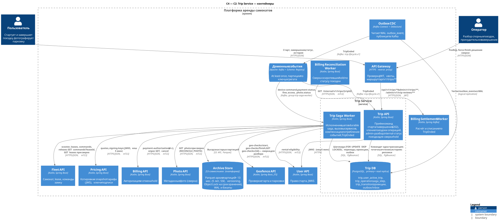
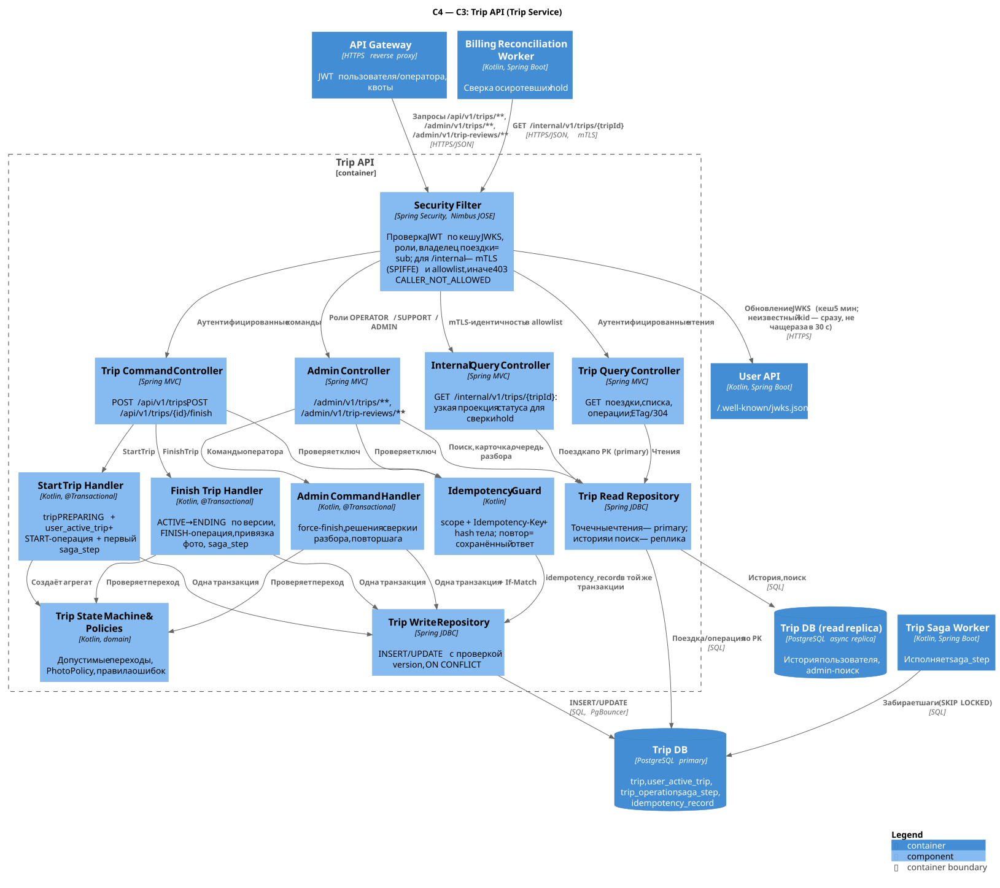
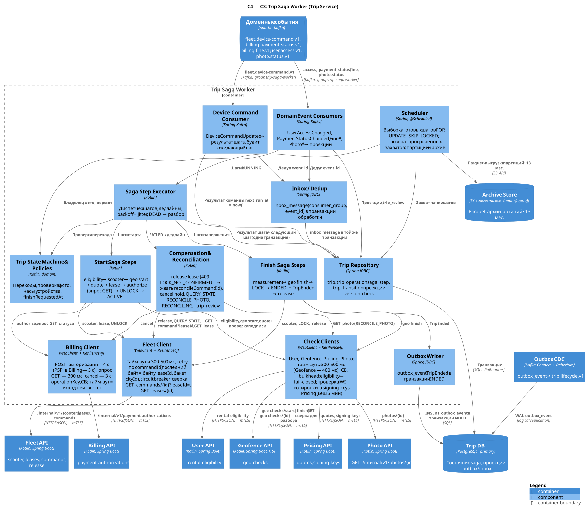

# Trip Service

**Bounded context:** Rental (аренда). **Команда-владелец:** команда аренды.

**Ответственность:**

- жизненный цикл поездки; Trip — единственный источник истины о статусе, времени старта и завершения, snapshot тарифа и ссылках на проверки;
- durable saga старта и завершения: проверки, котировка, lease, авторизация средств, команды `UNLOCK`/`LOCK` с подтверждением устройства, компенсации, сверка (`RECONCILING`);
- инвариант «у пользователя не более одной незавершённой поездки»;
- привязка фото парковки к поездке, проверка владельца и субъекта фото, очередь ручного разбора `trip_review`;
- публикация `TripEnded` — единственного факта, по которому Billing рассчитывает поездку.

**Что НЕ делает:**

- не считает стоимость и не списывает деньги — это Pricing и Billing Settlement Worker по `TripEnded`;
- не управляет замком напрямую и не владеет lease — это Fleet (`scooter_active_lease`, fencing token);
- не хранит и не проверяет содержимое фото — это Photo Service;
- не решает, где можно парковаться, — это Geofence;
- не выписывает штрафы — это Billing;
- не блокирует пользователей — это User.

Копии этих фактов Trip хранит только для отображения и аудита.

**Ключевое решение.** Trip API синхронно обращается только к Trip DB. Команда старта или завершения — это одна локальная транзакция: намерение, первый шаг saga и запись идемпотентности. Ответ — `202`. Все вызовы других сервисов выполняет Trip Saga Worker. Состояние saga хранится строками `saga_step` в той же БД, поэтому рестарт любого пода не теряет шаг. Поэтому приём завершения поездки не зависит от доступности Fleet, Geofence, Billing и Photo.

**Ссылки:**

- [каталог сервисов](../service-catalog.md#5-trip-service);
- [конвенции API и событий](../api-conventions.md);
- [хранение данных](../data-storage.md);
- взаимодействия в lab-01: [§5.2 старт](../lab-01.md#52-старт-и-разблокировка), [§5.3 завершение](../lab-01.md#53-завершение-и-оплата), [§5.4 события](../lab-01.md#54-контракты-событий-и-надёжность-доставки), [§6 нагрузка](../lab-01.md#6-нагрузка-масштабирование-и-доступность);
- ADR: [ADR-001 декомпозиция](../adr/ADR-001-decomposition.md), [ADR-002 хранилища](../adr/ADR-002-storage.md), [ADR-003 фотофиксация](../adr/ADR-003-photo-evidence.md);
- соседи: [Fleet](fleet-service.md), [Billing](billing-service.md), [Geofence](geofence-service.md), [Photo](photo-service.md), [User](user-service.md), [Pricing](pricing-service.md).

Последовательности:

- [старт поездки](../../diagrams/rendered/trip-start-sequence.svg) ([исходник](../../diagrams/trip-start-sequence.puml));
- [завершение с фото парковки](../../diagrams/rendered/trip-finish-sequence.svg) ([исходник](../../diagrams/trip-finish-sequence.puml)).

---

## 1. Контейнеры (C2)



Исходник: [c2-trip.puml](../../diagrams/services/trip/c2-trip.puml).

| Контейнер | Технология | Ответственность | Единица масштабирования / метрика автоскейлинга | Минимум реплик |
|---|---|---|---|---|
| **Trip API** | Kotlin, Spring Boot (Spring MVC на virtual threads), Spring JDBC | Приём команд старта и завершения (`202`). Чтение поездок, операций и истории. Операторские эндпоинты и очередь разбора. Внутреннее чтение статуса поездки для сверки hold в Billing (`GET /internal/v1/trips/{tripId}`, §3.2.7). Синхронно обращается только к Trip DB. | Stateless-под. HPA: CPU > 60 % или p99 > 150 мс. Пик по [lab-01 §6](../lab-01.md#6-нагрузка-масштабирование-и-доступность): ~500 RPS команд и ~1 000 RPS чтений (условно). Это ≈ 4–6 подов по 2 vCPU. | 3 (по одному на AZ) |
| **Trip Saga Worker** | Kotlin, Spring Boot, Spring Kafka, Resilience4j | Исполнение `saga_step`, вызовы сервисов, компенсации и сверка. Потребление пяти топиков. Запись `TripEnded` в outbox. Создание и архивация партиций. | KEDA по максимуму из двух метрик: `ready_steps / 200` на под и `consumer lag / 5000`. Потолок Kafka-потребителей — число партиций (48 у `fleet.device-command.v1`). Исполнители шагов масштабируются дальше: `SKIP LOCKED`. | 3 |
| **Trip DB** | PostgreSQL 17, Patroni, PgBouncer (transaction pooling) | Поездки, операции, шаги saga, история переходов, проекции, `outbox_event`/`inbox_message`/`idempotency_record`. | Сначала вертикально. Чтения истории — с read replica. Затем шардирование по бакетам `userId` (§4.7). | primary + синхронная реплика (другая AZ) + асинхронная read replica |

Trip API и Trip Saga Worker — разные контейнеры: у них разный профиль нагрузки и отказов.

- **Trip API:**
  - чувствителен к задержке;
  - должен принимать завершение даже при недоступности соседей: проектный SLO 99,95 % из [lab-01](../lab-01.md#1-исходные-требования-и-допущения).
- **Worker:**
  - держит долгие исходящие вызовы: авторизация в Billing ждёт до 4 с (тайм-аут PSP внутри Billing — 3 с);
  - его пулы не должны отнимать потоки и соединения у API.

Outbox CDC, Kafka и архивное объектное хранилище — платформенные элементы. Trip ими пользуется, но не владеет.

---

## 2. Компоненты (C3)

### 2.1 Trip API



Исходник: [c3-trip-api.puml](../../diagrams/services/trip/c3-trip-api.puml).

| Компонент | Ответственность | Ключевые зависимости |
|---|---|---|
| Security Filter | Проверяет JWT по JWKS User API (кеш 5 мин, принудительное обновление при неизвестном `kid` не чаще раза в 30 с). `sub` = `userId`. Проверяет роли операторов. Владелец поездки = `sub`, иначе `404`. Для `/internal/v1/**` JWT не используется: проверяется mTLS-идентичность (SPIFFE SAN) и allowlist эндпоинта, вне списка — `403 CALLER_NOT_ALLOWED` ([api-conventions §2.3](../api-conventions.md#23-сервис-сервис-internal)). | User API (`/.well-known/jwks.json`), mesh / cert-manager |
| Trip Command Controller | Обрабатывает `POST /api/v1/trips` и `POST /api/v1/trips/{tripId}/finish`: валидация, problem+json. | Idempotency Guard, обработчики |
| Trip Query Controller | Обрабатывает чтение поездки, списка и операции. `ETag` / `If-None-Match` → `304`. | Trip Read Repository |
| Admin Controller | Обрабатывает `/admin/v1/trips/**` и `/admin/v1/trip-reviews/**`. | Admin Command Handler, Read Repository |
| Internal Query Controller *(добавлен)* | Обрабатывает `GET /internal/v1/trips/{tripId}` для Billing Reconciliation Worker: узкая проекция статуса поездки без персональных данных (§3.2.7). | Trip Read Repository (primary) |
| Idempotency Guard | Ключ: `scope + Idempotency-Key`, хеш тела SHA-256. Повтор возвращает сохранённый ответ, другое тело — `422 IDEMPOTENCY_KEY_REUSED`. | Trip Write Repository (та же транзакция) |
| Start Trip Handler | В одной транзакции создаёт `trip` (`PREPARING`), `user_active_trip`, START-операцию, первый `saga_step` и `trip_transition`. | Domain, Write Repository |
| Finish Trip Handler | Переводит поездку `ACTIVE→ENDING` по версии, создаёт FINISH-операцию, привязывает фото и ставит `saga_step`. | Domain, Write Repository |
| Admin Command Handler | Принудительное завершение, решения сверки, решения по разбору, повтор шага. Требует `If-Match`. | Domain, Write Repository |
| Trip State Machine & Policies | Допустимые переходы, `PhotoPolicy` (ровно одно из `parkingPhotoId`/`photoSkipReason`), правило `finishRequestedAt`. | — |
| Trip Write Repository | `INSERT`/`UPDATE` с проверкой `version`, `ON CONFLICT`. | Trip DB (primary) |
| Trip Read Repository | Точечные чтения — с primary (read-your-writes). История и поиск — с реплики; при лаге > 5 с — с primary. | Trip DB primary / replica |

### 2.2 Trip Saga Worker



Исходник: [c3-trip-saga-worker.puml](../../diagrams/services/trip/c3-trip-saga-worker.puml).

| Компонент | Ответственность | Ключевые зависимости |
|---|---|---|
| Scheduler | Забирает готовые шаги пачками (`FOR UPDATE SKIP LOCKED LIMIT 50`). Возвращает просроченные захваты. Создаёт партиции на 3 месяца вперёд и архивирует старые (под advisory lock). | Trip Repository |
| Device Command Consumer | Читает `DeviceCommandUpdated`: записывает результат в ожидающий шаг и ставит ему `next_run_at = now()`. | Inbox, Repository |
| Domain Event Consumers | Читает `UserAccessChanged`, `PaymentStatusChanged`, `FineIssued`/`FineStatusChanged`, `PhotoValidated`/`PhotoRejected` и обновляет проекции и `trip_review`. | Inbox, Domain, Repository |
| Inbox / Dedup | Пишет `inbox_message(consumer_group, event_id)` в транзакции обработки. Повтор события ничего не меняет. | Repository |
| Saga Step Executor | Диспетчер шагов: дедлайны, backoff с jitter, перевод шага в `DEAD` с записью в `trip_review`. Одна попытка шага — один внешний вызов. | Steps, Domain, Repository |
| Start Saga Steps | eligibility → scooter → geo start → quote → lease → authorize → `UNLOCK` → `ACTIVE`. | Clients |
| Finish Saga Steps | measurement → geo finish → `LOCK` → `ENDED` + `TripEnded` → release. | Clients, Outbox Writer |
| Compensation & Reconciliation | Отпускает lease, отменяет hold, отправляет `QUERY_STATE`, переводит в `RECONCILING`, сверяет фото, создаёт `trip_review`. | Clients |
| Trip State Machine & Policies | Переходы; проверка владельца фото; часы устройства (расхождение ≤ 5 с); `finishRequestedAt`. | — |
| Trip Repository | `trip`, `trip_operation`, `saga_step`, `trip_transition`, проекции; проверка `version`. | Trip DB через PgBouncer |
| Outbox Writer | Пишет `outbox_event` с `TripEnded` в транзакции перехода в `ENDED`. | Trip DB |
| Fleet Client | Тайм-ауты 300–500 мс, повтор с тем же `commandId` (последний байт = последнему байту `leaseId`, §4.7), circuit breaker. Сверочное чтение команды — `GET /internal/v1/commands/{commandId}?leaseId=`, lease — `GET /internal/v1/leases/{leaseId}`. | Fleet API |
| Billing Client | `POST /internal/v1/payment-authorizations` — тайм-аут 4 с (тайм-аут PSP внутри Billing — 3 с), `operationKey`, circuit breaker. Тайм-аут означает «исход неизвестен», а не «отказ». Опрос `GET .../{authorizationId}` — 300 мс (тайм-аут вызывающего по контракту Billing), отмена hold — 3 с. | Billing API |
| Check Clients | User, Geofence, Pricing, Photo: тайм-ауты 300–500 мс (Geofence — 400 мс), circuit breaker, bulkhead. Eligibility — fail-closed: недоступность User отклоняет старт. Котировка Pricing проверяется по `snapshotHash` и JWS-подписи ключом из `GET /internal/v1/signing-keys` (кеш JWKS 5 мин, неизвестный `kid` — принудительное обновление не чаще раза в 30 с; §3.6). | User/Geofence/Pricing/Photo API |

**Модель потоков.**

- Шаги исполняются на virtual threads.
- У каждой зависимости свой bulkhead на под: Billing — 200, Fleet — 200, проверки — 100 одновременных вызовов.
- Медленный PSP не блокирует `LOCK` других поездок.

---

## 3. API

Общие правила — в [api-conventions.md](../api-conventions.md):

- RFC 9457 problem+json с машинным `code`;
- `Idempotency-Key` обязателен для POST-команд и хранится 24 ч;
- `traceparent` (W3C) передаётся в `saga_step` и в заголовки событий;
- курсорная пагинация `{items, nextCursor}`;
- деньги `{amountMinor, currency}`, время RFC 3339 UTC, идентификаторы UUIDv7.

`correlationId` событий = `operationId`.

### 3.1 Сводная таблица эндпоинтов

| Метод и путь | Аудитория | Кто вызывает | Авторизация | Идемпотентность |
|---|---|---|---|---|
| `POST /api/v1/trips` | public | приложение | JWT пользователя | `Idempotency-Key`, scope `trip-start:{userId}` |
| `GET /api/v1/trips/{tripId}` | public | приложение | JWT, владелец поездки | безопасный GET, `ETag` |
| `GET /api/v1/trips` | public | приложение | JWT, только свои | безопасный GET |
| `POST /api/v1/trips/{tripId}/finish` | public | приложение | JWT, владелец поездки | `Idempotency-Key`, scope `trip-finish:{tripId}` |
| `GET /api/v1/trips/{tripId}/operations/{operationId}` | public | приложение (опрос) | JWT, владелец поездки | безопасный GET, `ETag` |
| `GET /admin/v1/trips` | admin | back-office | `OPERATOR`, `SUPPORT`, `FINANCE`, `ADMIN` | GET |
| `GET /admin/v1/trips/{tripId}` *(добавлен)* | admin | back-office | `OPERATOR`, `SUPPORT`, `FINANCE`, `ADMIN` | GET |
| `POST /admin/v1/trips/{tripId}/force-finish` | admin | back-office | `SUPPORT`, `ADMIN` | `Idempotency-Key` + `If-Match` |
| `POST /admin/v1/trips/{tripId}/reconciliation-decisions` | admin | back-office | `OPERATOR`, `SUPPORT`, `ADMIN` | `Idempotency-Key` + `If-Match` |
| `GET /admin/v1/trip-reviews` *(добавлен)* | admin | back-office | `OPERATOR`, `SUPPORT`, `ADMIN` | GET |
| `POST /admin/v1/trip-reviews/{reviewId}/decision` *(добавлен)* | admin | back-office | `OPERATOR`, `SUPPORT`, `ADMIN` | `Idempotency-Key` + `If-Match` |
| `POST /admin/v1/trips/{tripId}/saga-steps/{stepId}/retry` *(добавлен)* | admin | дежурный инженер | `ADMIN` | `Idempotency-Key` |
| `GET /internal/v1/trips/{tripId}` *(добавлен)* | internal | Billing Reconciliation Worker | mTLS, allowlist `billing-reconciliation-worker` | безопасный GET |

**Внутренний эндпоинт у Trip один** — `GET /internal/v1/trips/{tripId}` (§3.2.7). Его вызывает только Billing Reconciliation Worker при сверке осиротевших hold: статус поездки заменяет эвристику «hold старше 48 ч». Все факты для расчёта Billing по-прежнему получает из `TripEnded`. Остальным сервисам состояние поездки синхронно не нужно: Fleet знает о занятости самоката по своему lease, Photo — по `subjectId`. Новый внутренний контракт добавляется только по согласованию с потребителем.

### 3.2 Эндпоинты — детально

**Общие ошибки всех эндпоинтов** (формат — [api-conventions.md](../api-conventions.md)):

| HTTP | `code` | Условие |
|---|---|---|
| 400 | `VALIDATION_FAILED` | Тело или параметры не прошли валидацию; подробности в `errors[]`. |
| 400 | `IDEMPOTENCY_KEY_REQUIRED` | POST-команда (public или admin) пришла без `Idempotency-Key`. |
| 401 | `UNAUTHENTICATED` | Нет JWT, JWT просрочен или подпись неверна. |
| 403 | `FORBIDDEN` | Не хватает роли или города (admin): роль не допускает действие или `cityId` поездки не входит в `cityIds` оператора. |
| 403 | `CALLER_NOT_ALLOWED` | Только `/internal/v1/**`: mTLS-идентичность вызывающего не входит в allowlist эндпоинта. |
| 404 | `TRIP_NOT_FOUND` | Поездки нет или она чужая. Существование чужой поездки не раскрывается. |
| 422 | `IDEMPOTENCY_KEY_REUSED` | Тот же `Idempotency-Key` пришёл с другим телом. |
| 429 | `RATE_LIMITED` | Сработала квота Gateway; ответ содержит `Retry-After`. |
| 503 | `DEPENDENCY_UNAVAILABLE` | Trip DB недоступна или идёт failover; `Retry-After: 1`. Других синхронных зависимостей у Trip API нет. |

Пример problem+json:

```json
{
  "type": "https://docs.scooter.example/problems/active-trip-exists",
  "title": "У пользователя уже есть незавершённая поездка",
  "status": 409,
  "detail": "Завершите текущую поездку, прежде чем начинать новую",
  "instance": "/api/v1/trips",
  "code": "ACTIVE_TRIP_EXISTS",
  "traceId": "4bf92f3577b34da6a3ce929d0e0e4736",
  "errors": [],
  "activeTripId": "01a1ab34-70d0-7a4d-b218-2530bb1d6d5c"
}
```

#### 3.2.1 `POST /api/v1/trips` — запрос старта

**Назначение.** Принять намерение начать поездку. Проверки, lease, авторизацию и разблокировку выполняет saga ([§3.7.3](#373-шаги-старта)). Последовательность — [trip-start-sequence](../../diagrams/rendered/trip-start-sequence.svg).

**Вызывающий:** мобильное приложение через API Gateway.

**Авторизация:** JWT пользователя.

**Заголовки:**

- `Authorization: Bearer <jwt>`;
- `Idempotency-Key: <uuid>` (обязателен, ≤ 64 символов);
- `traceparent`;
- `Content-Type: application/json`.

**Тело запроса:**

| Поле | Тип | Обязательность / ограничения |
|---|---|---|
| `scooterId` | uuid | обязательно |
| `clientLocation` | object \| null | Необязательно. Только для аудита и разбора споров. Решения принимаются по подписанному измерению самоката. |
| `clientLocation.lat` | number | от −90 до 90 |
| `clientLocation.lon` | number | от −180 до 180 |
| `clientLocation.accuracyM` | number | от 0 до 5000 |
| `clientLocation.capturedAt` | string (RFC 3339) | не позже чем через 5 мин от серверного времени |

```json
{
  "scooterId": "018fd306-f680-7da0-bbe8-b9997f5c7c29",
  "clientLocation": { "lat": 59.93428, "lon": 30.33510, "accuracyM": 12.5, "capturedAt": "2026-11-05T10:15:02.800Z" }
}
```

**Успешный ответ:** `202 Accepted`, заголовок `Location: /api/v1/trips/{tripId}/operations/{operationId}`.

```json
{ "tripId": "01a1ab34-70d0-7a4d-b218-2530bb1d6d5c", "operationId": "01a1ab34-70d1-72de-b523-7b2ed91e3f72", "status": "PREPARING" }
```

**Транзакция Trip API** (без единого сетевого вызова):

```sql
BEGIN;
INSERT INTO idempotency_record (scope, idempotency_key, request_hash, status, response_status, response_body, resource_id, expires_at)
VALUES ('trip-start:' || $user_id, $key, $hash, 'COMPLETED', 202, $resp, $trip_id, now() + interval '24 hours');
  -- конфликт PK: параллельный дубль ждёт коммита первого, затем читает запись → тот же 202 (или 422 при другом hash)
INSERT INTO trip (trip_id, user_id, shard_bucket, scooter_id, status, client_start_location, ...)
VALUES ($trip_id, $user_id, $bucket, $scooter_id, 'PREPARING', $client_location, ...);
INSERT INTO user_active_trip (user_id, trip_id) VALUES ($user_id, $trip_id);
  -- unique_violation по PK user_id → ROLLBACK → 409 ACTIVE_TRIP_EXISTS {activeTripId}
INSERT INTO trip_operation (operation_id, trip_id, type, initiator, status, deadline_at, request)
VALUES ($op_id, $trip_id, 'START', 'USER', 'ACCEPTED', now() + interval '30 seconds', $request);
INSERT INTO saga_step (step_id, operation_id, trip_id, step_type, status, max_attempts, next_run_at, deadline_at, idempotency_key)
VALUES ($step_id, $op_id, $trip_id, 'CHECK_ELIGIBILITY', 'PENDING', 3, now(), now() + interval '30 seconds', $trip_id::text);
INSERT INTO trip_transition (transition_id, trip_id, from_status, to_status, trip_version, operation_id, cause, actor_type, actor_id)
VALUES ($tr_id, $trip_id, NULL, 'PREPARING', 0, $op_id, 'USER_COMMAND', 'USER', $user_id::text);
COMMIT;
```

Генерация идентификаторов:

- `tripId` — UUIDv7 из приложения; последний байт равен `shard_bucket = hash(userId) mod 256` (§4.7);
- `operationId` и `stepId` — UUIDv7.

**Ошибки** (сверх общих):

| HTTP | `code` | Условие |
|---|---|---|
| 409 | `ACTIVE_TRIP_EXISTS` | У пользователя уже есть строка в `user_active_trip`; в теле `activeTripId`. |
| 403 | `USER_NOT_ELIGIBLE` *(добавлен)* | Быстрый отказ по локальной проекции `user_access_projection`: `accessStatus ∈ {BLOCKED, DELETED}`. Авторитетная проверка остаётся в saga: шаг `CHECK_ELIGIBILITY`. |

Несуществующий или занятый самокат синхронно не проверяется. Такой отказ приходит в операции: `CANCELLED`, `failure.code = SCOOTER_NOT_FOUND | SCOOTER_NOT_AVAILABLE`.

**Повторы, идемпотентность, конкурентность.**

- Повтор с тем же ключом и телом возвращает сохранённый `202`; новых строк не появляется.
- Ответ `409` не сохраняется: транзакция откатывается целиком и побочных эффектов нет.
- Два одновременных старта с разными ключами упираются в PK `user_active_trip`: один получает `202`, второй — `409`.
- Два пользователя на одном самокате получают `202` оба. Исключительность обеспечивает lease Fleet: проигравший получает `CANCELLED (SCOOTER_NOT_AVAILABLE)` за ~100–300 мс.
- Квота Gateway: 10 стартов в минуту на пользователя.

**Цели:**

- p99 ≤ 80 мс (одна транзакция из шести `INSERT`);
- тайм-аут Gateway → Trip API — 1 с;
- клиент ждёт 5 с, затем повторяет с тем же `Idempotency-Key` до 3 раз с backoff;
- p99 всей операции старта до `ACTIVE` — ≤ 8 с, включая задержку устройства.

#### 3.2.2 `GET /api/v1/trips/{tripId}` — карточка поездки

**Назначение.** Текущее состояние поездки для экрана поездки и чека.

**Вызывающий:** приложение.

**Авторизация:** JWT, `sub == trip.user_id`; чужая поездка → `404`.

**Заголовки:** `Authorization`, `traceparent`, `If-None-Match` (необязателен).

**Параметры пути:** `tripId` (uuid).

**Ответ `200`:** заголовок `ETag: "v11"`. Если `If-None-Match` совпадает — `304` без тела.

```json
{
  "tripId": "01a1ab34-70d0-7a4d-b218-2530bb1d6d5c",
  "status": "ENDED",
  "scooterId": "018fd306-f680-7da0-bbe8-b9997f5c7c29",
  "cityId": "01900000-0000-7000-8000-000000000001",
  "createdAt": "2026-11-05T10:15:03.120Z",
  "startedAt": "2026-11-05T10:15:05.412Z",
  "finishRequestedAt": "2026-11-05T10:39:41.802Z",
  "endedAt": "2026-11-05T10:39:43.870Z",
  "durationSec": 1478,
  "endReason": "USER_FINISH",
  "cancelReason": null,
  "tariff": {
    "tariffId": "019c167f-cc00-722f-a2f2-211f9ee491c5",
    "tariffVersion": 12,
    "unlockFee": { "amountMinor": 5000, "currency": "RUB" },
    "perMinute": { "amountMinor": 790, "currency": "RUB" }
  },
  "authorization": { "authorizationId": "01a1ab34-7454-7b0b-bbb5-563bfc1e6f93", "status": "AUTHORIZED" },
  "finishCheck": { "decision": "ALLOWED", "reasonCode": "OK" },
  "parkingPhoto": { "photoId": "01a1ab4a-abc0-7476-9d06-f85d8690024a", "status": "VALIDATED", "flags": [] },
  "payment": { "paymentId": "01a1ab4b-1150-7069-ae4b-0d982e85bb55", "kind": "TRIP_CHARGE", "status": "CAPTURED", "amount": { "amountMinor": 24750, "currency": "RUB" } },
  "fines": [],
  "activeOperation": null,
  "version": 11
}
```

Откуда берутся поля:

- `payment` и `fines` — проекции событий Billing (§3.4). Это отображение, а не расчёт: стоимость считает Billing.
- `activeOperation` = `{operationId, type, status}` незавершённой операции или `null`.

**Ошибки:** только общие (`404 TRIP_NOT_FOUND`).

**Конкурентность.** Чтение идёт с primary по PK; partition pruning по `trip_id` даёт одну партицию. Поэтому сразу после `202` клиент видит свою поездку.

**Цели:** p99 ≤ 30 мс; тайм-аут клиента 1 с.

#### 3.2.3 `GET /api/v1/trips` — история поездок пользователя

**Назначение.** Лента поездок пользователя, от новых к старым.

**Вызывающий:** приложение.

**Авторизация:** JWT; возвращаются только поездки `sub`.

**Параметры запроса:**

| Параметр | Тип | Ограничения |
|---|---|---|
| `status` | string, список через запятую | Значения из `PREPARING, STARTING, ACTIVE, ENDING, ENDED, CANCELLED, RECONCILING`; по умолчанию — все. |
| `cursor` | string | Непрозрачный base64url от `(createdAt, tripId)` последнего элемента. |
| `limit` | int | 1–50, по умолчанию 20. |

**Ответ `200`:**

```json
{
  "items": [
    {
      "tripId": "01a1ab34-70d0-7a4d-b218-2530bb1d6d5c",
      "status": "ENDED",
      "scooterId": "018fd306-f680-7da0-bbe8-b9997f5c7c29",
      "cityId": "01900000-0000-7000-8000-000000000001",
      "createdAt": "2026-11-05T10:15:03.120Z",
      "startedAt": "2026-11-05T10:15:05.412Z",
      "endedAt": "2026-11-05T10:39:43.870Z",
      "durationSec": 1478
    }
  ],
  "nextCursor": "MjAyNi0xMS0wNVQxMDoxNTowMy4xMlp8MDFhMWFiMzQtNzBkMC03YTRkLWIyMTgtMjUzMGJiMWQ2ZDVj"
}
```

**Источник данных.**

- История читается с read replica через покрывающий индекс `ix_trip_user_history`, без обращения к heap (§4.3).
- Если `status` содержит только незавершённые статусы, запрос идёт на primary через `user_active_trip`. Это одна строка, и свежая поездка не теряется из-за лага реплики.
- При лаге реплики > 5 с история читается с primary; для таких чтений действует отдельный лимит пула.

```sql
SELECT trip_id, status, scooter_id, city_id, created_at, started_at, ended_at, duration_sec
FROM trip
WHERE user_id = $1
  AND trip_id >= uuidv7_floor(now() - interval '13 months')   -- отсекает партиции старше горячего окна
  AND (created_at, trip_id) < ($cursor_created_at, $cursor_trip_id)
  AND ($statuses IS NULL OR status = ANY($statuses))
ORDER BY created_at DESC, trip_id DESC
LIMIT $limit + 1;
```

**Ошибки:** общие; `400 VALIDATION_FAILED` — неверный `cursor` или `status`.

**Цели:** p99 ≤ 60 мс; тайм-аут клиента 1 с. Лимит Gateway — 10 RPS на пользователя.

#### 3.2.4 `POST /api/v1/trips/{tripId}/finish` — запрос завершения

**Назначение.** Принять намерение завершить поездку. Фиксирует границу начисления `finishRequestedAt` и привязывает фото парковки. Проверку парковки, `LOCK` и `ENDED` выполняет saga ([§3.7.4](#374-шаги-завершения)). Последовательность — [trip-finish-sequence](../../diagrams/rendered/trip-finish-sequence.svg).

**Вызывающий:** приложение. Перед вызовом фото уже загружено: `upload-sessions` → presigned PUT → `complete` (см. [Photo Service](photo-service.md)).

**Авторизация:** JWT, `sub == trip.user_id`. Пользователь в статусе `BLOCKED` или `RESTRICTED` **может** завершить поездку: блокировка запрещает только новые поездки.

**Заголовки:** `Authorization`, `Idempotency-Key` (обязателен), `traceparent`, `Content-Type`.

**Параметры пути:** `tripId`.

**Тело запроса:**

| Поле | Тип | Ограничения |
|---|---|---|
| `parkingPhotoId` | uuid \| null | `photoId` из Photo Service (`purpose = TRIP_PARKING`, `subjectId = tripId`). |
| `photoSkipReason` | enum \| null | `PHOTO_SERVICE_UNAVAILABLE`, `CAMERA_UNAVAILABLE`. |
| `clientLocation` | object \| null | Как в старте; только для аудита. |

Ровно одно из полей `parkingPhotoId` и `photoSkipReason` должно быть не `null`. Если оба `null` — `422 PHOTO_REQUIRED`. Если заданы оба — `400 VALIDATION_FAILED`.

```json
{ "parkingPhotoId": "01a1ab4a-abc0-7476-9d06-f85d8690024a", "photoSkipReason": null, "clientLocation": null }
```

**Успешный ответ:** `202 Accepted`, заголовок `Location: /api/v1/trips/{tripId}/operations/{operationId}`.

```json
{ "operationId": "01a1ab4b-00ea-71cb-8671-174494d6493c", "status": "ACCEPTED" }
```

**Транзакция Trip API.** Trip **не ждёт** проверки фото и не вызывает Photo.

```sql
BEGIN;
INSERT INTO idempotency_record (...) VALUES ('trip-finish:' || $trip_id, $key, $hash, 'COMPLETED', 202, $resp, $op_id, now() + interval '24 hours');
UPDATE trip
   SET status = 'ENDING',
       finish_requested_at = CASE
           WHEN first_finish_requested_at > now() - interval '10 minutes' THEN first_finish_requested_at
           ELSE now() END,
       parking_photo_id = $photo_id, photo_skip_reason = $skip_reason,
       parking_photo_status = CASE WHEN $skip_reason IS NOT NULL THEN 'MISSING' ELSE 'PENDING' END,
       version = version + 1, updated_at = now()
 WHERE trip_id = $trip_id AND user_id = $user_id AND status = 'ACTIVE'
RETURNING version;
  -- 0 строк → SELECT status: нет строки → 404; ENDING → 409 FINISH_ALREADY_IN_PROGRESS; иначе → 409 TRIP_NOT_ACTIVE
INSERT INTO trip_parking_photo (photo_id, trip_id, linked, linked_at)
VALUES ($photo_id, $trip_id, true, now())
ON CONFLICT (photo_id) DO UPDATE SET linked = true, linked_at = now()
   WHERE trip_parking_photo.trip_id = EXCLUDED.trip_id
RETURNING status, owner_user_id, reject_reason;
  -- 0 строк (фото относится к другому субъекту), известный REJECTED или owner_user_id <> user_id → ROLLBACK → 422 PARKING_PHOTO_INVALID
  -- если статус уже известен (событие пришло раньше finish), он переносится в trip.parking_photo_status
INSERT INTO trip_operation (...) VALUES ($op_id, $trip_id, 'FINISH', 'USER', 'ACCEPTED', now() + interval '30 minutes', $request);
INSERT INTO saga_step (...) VALUES ($step_id, $op_id, $trip_id, 'LOAD_FINISH_MEASUREMENT', 'PENDING', ...);
INSERT INTO trip_transition (...) VALUES ($tr_id, $trip_id, 'ACTIVE', 'ENDING', $version, $op_id, 'USER_COMMAND', 'USER', $user_id::text);
COMMIT;
```

`finishRequestedAt` — время приёма команды сервером (часы БД). Это граница начисления, которую применяет Billing. Правило «время первой попытки сохраняется 10 минут после отказа `LOCATION_INACCURATE`» — проектное предложение, его нужно согласовать с бизнесом (§3.7.4).

**Ошибки** (сверх общих):

| HTTP | `code` | Условие |
|---|---|---|
| 422 | `PHOTO_REQUIRED` | Не передано ни `parkingPhotoId`, ни `photoSkipReason`. |
| 422 | `PARKING_PHOTO_INVALID` *(добавлен)* | Статус фото уже известен Trip и фото не подходит: `REJECTED`, чужой `ownerUserId` или другой `subjectId`. Пользователь может переснять фото. Неизвестный статус **не** блокирует завершение. |
| 409 | `TRIP_NOT_ACTIVE` | Поездка в статусе `PREPARING`, `STARTING`, `RECONCILING`, `ENDED` или `CANCELLED`. |
| 409 | `FINISH_ALREADY_IN_PROGRESS` *(добавлен)* | Поездка уже в `ENDING` — повторное нажатие с другим ключом. В теле `operationId` текущей операции. |

**Повторы и конкурентность.**

- Повтор с тем же ключом возвращает сохранённый `202`.
- Параллельное завершение с разными ключами разрешает условный `UPDATE ... WHERE status = 'ACTIVE'`: выигрывает только один.
- Принудительное завершение оператором конкурирует через ту же версию строки `trip`.
- Квота Gateway: 20 запросов в минуту на поездку.

**Цели:**

- p99 ≤ 80 мс; тайм-аут Gateway 1 с; клиент ждёт 5 с и повторяет с тем же ключом;
- p99 всей операции до `COMPLETED` — ≤ 10 с.

#### 3.2.5 `GET /api/v1/trips/{tripId}/operations/{operationId}` — статус операции

**Назначение.** Клиент опрашивает ход старта или завершения. Рекомендуемый интервал — 500 мс первые 5 с, затем 1 с, до терминального статуса; подсказка в поле `pollAfterMs`.

**Вызывающий:** приложение.

**Авторизация:** JWT, владелец поездки.

**Заголовки:** `Authorization`, `If-None-Match` (необязателен).

**Параметры пути:** `tripId`, `operationId`. Операция должна принадлежать поездке, иначе `404 OPERATION_NOT_FOUND`.

**Статусы операции:**

- **START**: `ACCEPTED, CHECKING, AUTHORIZING, UNLOCKING, COMPLETED, CANCELLED, RECONCILING`;
- **FINISH**: `ACCEPTED, CHECKING_PARKING, LOCKING, COMPLETED, REJECTED, RECONCILING`.

**Ответ `200`:** заголовок `ETag: "o4"`; `304` при совпадении `If-None-Match`.

```json
{
  "operationId": "01a1ab4b-00ea-71cb-8671-174494d6493c",
  "tripId": "01a1ab34-70d0-7a4d-b218-2530bb1d6d5c",
  "type": "FINISH",
  "status": "REJECTED",
  "step": "CHECK_FINISH_ZONE",
  "failure": {
    "code": "PARKING_FORBIDDEN",
    "reasonCode": "NO_PARKING_ZONE",
    "message": "Здесь парковка запрещена. Переставьте самокат в зону парковки"
  },
  "tripStatus": "ACTIVE",
  "createdAt": "2026-11-05T10:39:41.802Z",
  "updatedAt": "2026-11-05T10:39:42.310Z",
  "completedAt": "2026-11-05T10:39:42.310Z",
  "pollAfterMs": null
}
```

Значения `failure.code`:

| Операция | Коды |
|---|---|
| START | `USER_NOT_ELIGIBLE`, `SCOOTER_NOT_FOUND`, `SCOOTER_NOT_AVAILABLE`, `SCOOTER_OFFLINE`, `MEASUREMENT_STALE`, `START_ZONE_FORBIDDEN`, `QUOTE_UNAVAILABLE`, `PAYMENT_DECLINED`, `PAYMENT_TIMEOUT`, `UNLOCK_FAILED`, `DEPENDENCY_UNAVAILABLE` |
| FINISH | `PARKING_FORBIDDEN`, `LOCATION_INACCURATE` |

`reasonCode` передаётся из Geofence или Billing (`declineCode`).

**Ошибки:** общие; `404 OPERATION_NOT_FOUND`.

**Цели:** p99 ≤ 30 мс, чтение с primary по PK; тайм-аут клиента 1 с. Лимит Gateway — 5 RPS на пользователя.

#### 3.2.6 Операторские эндпоинты (компактно)

Все операторские эндпоинты:

- маршрутизируются Gateway по `/admin/v1/trips/**` и `/admin/v1/trip-reviews/**`;
- требуют JWT оператора;
- пишут действие в `trip_transition` с полями `actor_type = OPERATOR`, `actor_id`, `cause = ADMIN_DECISION`;
- в командах требуют `Idempotency-Key` и `If-Match` с версией поездки или разбора; несовпадение → `412 PRECONDITION_FAILED`.

**`GET /admin/v1/trips`** — поиск поездок.

- **Роли:** `OPERATOR`, `SUPPORT`, `FINANCE`, `ADMIN`.
- **Параметры:** `userId`, `scooterId`, `cityId`, `status` (список), `from`/`to` по `createdAt` (окно ≤ 31 дня), `cursor`, `limit` ≤ 100.
- **Ограничение:** обязателен `userId` или `scooterId`, либо `cityId` вместе с незавершёнными статусами, иначе `400 FILTER_REQUIRED` *(добавлен)*. Запрос без фильтра означал бы полный скан.
- **Источник:** read replica. Сводка «активные поездки по городу» читается с primary по частичному индексу.
- **Ответ:** `{items[], nextCursor}` с полями из §3.2.3 плюс `userId`.

**`GET /admin/v1/trips/{tripId}`** *(добавлен)* — полная карточка для разбора.

- **Роли:** как у поиска.
- **Ответ** — всё из §3.2.2, плюс:
  - `transitions[]` из `trip_transition`;
  - `operations[]` с `sagaSteps[]` (тип, статус, попытки, `lastError`);
  - `leaseId`, `fencingToken`;
  - `finishCheck` целиком, включая `violationEvidenceId`;
  - `parkingPhoto` с `flags` и `rejectReason`;
  - `reviews[]`;
  - `clientStartLocation`, `clientFinishLocation`.
- **Ошибки:** `404`.

**`POST /admin/v1/trips/{tripId}/force-finish`** — принудительное завершение.

- **Роли:** `SUPPORT`, `ADMIN`.
- **Тело:** `{reasonCode: DEVICE_UNREACHABLE | APP_FAILURE | USER_REQUEST | FRAUD_SUSPECTED | OTHER, comment: string 10..500, endedAt: RFC3339 | null, tryLock: boolean = true}`.
- **Допустимые статусы:** `ACTIVE`, `ENDING`, `RECONCILING` (последний — только после завершения).
- **Действие:**
  1. Создаётся FINISH-операция с `initiator = OPERATOR`. Незавершённые шаги пользовательской FINISH-операции переводятся в `CANCELLED`.
  2. Геопроверка выполняется по возможности: её результат записывается, но `FORBIDDEN` не блокирует завершение. Если геопроверки не было (нет свежего измерения, Geofence недоступна или оператор завершил поездку до её результата), в `TripEnded` уходит `finishCheck.decision = NOT_CHECKED`, а `checkId`, `reasonCode`, `policyVersion` и `violationEvidenceId` равны `null` (§3.3). Автоматического штрафа по `NOT_CHECKED` Billing не назначает; ручной — через разбор (§3.8).
  3. Если `tryLock = true`, отправляется `LOCK` с ожиданием 20 с.
  4. Поездка переходит в `ENDED` с `endReason = SUPPORT_FORCE_FINISH`. `endedAt` берётся из тела, иначе `finishRequestedAt`, иначе `now()`; ограничение: `startedAt ≤ endedAt ≤ now()`.
  5. `TripEnded` пишется в outbox, затем выполняется `RELEASE_LEASE`.
  6. Создаётся `trip_review` `FORCE_FINISHED` со статусом `AUTO_CLOSED` — аудиторская запись.
- **Ответ:** `202 {operationId, status: ACCEPTED}`.
- **Ошибки:** `404`, `409 TRIP_NOT_ACTIVE`, `412`, `422 IDEMPOTENCY_KEY_REUSED`.

**`POST /admin/v1/trips/{tripId}/reconciliation-decisions`** — решение оператора по поездке в `RECONCILING`.

- **Роли:** `OPERATOR`, `SUPPORT`, `ADMIN`.
- **Тело:** `{operationId, decision, endedAt | null, evidence: string 10..1000}`.
- **Значения `decision`:**

| `decision` | Применимо к | Результат |
|---|---|---|
| `UNLOCK_CONFIRMED` | START | `ACTIVE`; `startedAt` = время исполнения команды, иначе время решения. |
| `UNLOCK_NOT_EXECUTED` | START | Отмена hold, release lease, `CANCELLED (UNLOCK_FAILED)`. |
| `LOCK_CONFIRMED` | FINISH | `ENDED`; `endedAt` из тела или `finishRequestedAt`; `TripEnded`; release. |
| `RETRY_LOCK` | FINISH | Новый шаг `SEND_LOCK` с новым `commandId`. |
| `END_WITHOUT_LOCK_CONFIRMATION` | FINISH | `ENDED` с `endedAt = finishRequestedAt`. Release вернёт `409 LOCK_NOT_CONFIRMED` с `reconcileCommandId`: lease в `QUARANTINED`, Fleet сам ставит `QUERY_STATE`. Шаг `RELEASE_LEASE` ждёт `DeviceCommandUpdated` по `reconcileCommandId` и повторяет release до 24 ч. Lease освобождается, только если `QUERY_STATE` подтвердит, что замок закрыт, или после `POST /admin/v1/leases/{leaseId}/force-release` (роль `ADMIN`, после осмотра техником) — тогда повторный release отвечает `200` с `releaseReason = FORCE_RELEASED` ([fleet-service.md §2.2.2](fleet-service.md#222-сверка-query_state-и-карантин)). |

- **Побочный эффект:** открытые разборы `RECONCILIATION_TIMEOUT` и `LOCK_UNCONFIRMED` по этой поездке закрываются (`RESOLVED`).
- **Ответ:** `202 {operationId, status}`.
- **Ошибки:**
  - `404`;
  - `409 TRIP_NOT_RECONCILING` *(добавлен)*;
  - `422 DECISION_NOT_APPLICABLE` *(добавлен)* — например, `UNLOCK_*` для FINISH;
  - `412`; `422 IDEMPOTENCY_KEY_REUSED`.

**`GET /admin/v1/trip-reviews`** *(добавлен)* — очередь ручного разбора.

- **Роли:** `OPERATOR`, `SUPPORT`, `ADMIN`.
- **Параметры:** `status` (по умолчанию `OPEN`), `reason` (список), `cityId`, `cursor`, `limit` ≤ 100.
- **Порядок:** `priority`, затем `createdAt`.
- **Ответ:** `{items: [{reviewId, tripId, userId, cityId, reason, priority, status, details, createdAt, version}], nextCursor}`.

**`POST /admin/v1/trip-reviews/{reviewId}/decision`** *(добавлен)* — решение по разбору.

- **Роли:** `OPERATOR`, `SUPPORT`, `ADMIN`.
- **Тело:** `{resolution: NO_VIOLATION | VIOLATION_CONFIRMED | PHOTO_FRAUD_SUSPECTED | DEVICE_FAULT | DUPLICATE, comment: string 10..1000}`. `If-Match` — версия разбора.
- **Действие:** разбор переходит в `RESOLVED` (§3.8). При `VIOLATION_CONFIRMED` Trip в Billing не ходит: оператор выписывает штраф в Billing через `POST /admin/v1/fines` (роль `FINANCE`, `source = MANUAL`, ссылки на `tripId` и `violationEvidenceId` или `reviewId`; `finePolicyCode` необязателен — политику Billing выбирает сам по `(cityId, reasonCode)` на момент `endedAt`) — [billing-service.md §3.2.17](billing-service.md#3217-post-adminv1fines--ручной-штраф-после-разбора-добавлен). Пришедший `FineIssued` (`source = MANUAL`, `reviewId`, если штраф выписан по разбору) привязывается к разбору по `reviewId` (§3.4).
- **Ошибки:**
  - `404 REVIEW_NOT_FOUND`;
  - `409 REVIEW_ALREADY_RESOLVED` *(добавлен)*;
  - `422 RESOLUTION_NOT_APPLICABLE` *(добавлен)* — разборы сверки закрываются только через `reconciliation-decisions`;
  - `412`.

**`POST /admin/v1/trips/{tripId}/saga-steps/{stepId}/retry`** *(добавлен)* — повтор шага в статусе `DEAD`.

- **Роли:** `ADMIN`.
- **Тело:** `{comment}`.
- **Действие:** `status = 'PENDING'`, `attempt = 0`, `next_run_at = now()`, новый `deadline_at`.
- **Ошибки:** `404`, `409 STEP_NOT_RETRYABLE` *(добавлен)* — шаг не в `DEAD`.

#### 3.2.7 `GET /internal/v1/trips/{tripId}` — статус поездки для сверки hold *(добавлен)*

**Назначение.** Billing Reconciliation Worker проверяет осиротевший hold (авторизация `AUTHORIZED`, а расчёта по поездке нет): по статусу поездки он решает, отпускать hold или держать. Это заменяет эвристику «нет `TripEnded` дольше 48 ч» ([billing-service.md §2.3](billing-service.md#23-billing-reconciliation-worker)). Trip ничего не решает за Billing — только отдаёт факты о поездке.

**Вызывающий:** Billing Reconciliation Worker (`billing-reconciliation-worker`). Gateway путь не публикует.

**Авторизация:** mTLS, идентичность — SPIFFE SAN контейнера; allowlist — только `billing-reconciliation-worker`. Вызывающий вне списка получает `403 CALLER_NOT_ALLOWED` ([api-conventions §2.3](../api-conventions.md#23-сервис-сервис-internal)). JWT не передаётся.

**Заголовки:** `traceparent`.

**Параметры пути:** `tripId` (uuid).

**Ответ `200`:**

```json
{
  "tripId": "01a1ab34-70d0-7a4d-b218-2530bb1d6d5c",
  "userId": "019593aa-d000-795c-8d60-be31201e69fe",
  "status": "CANCELLED",
  "authorizationId": "01a1ab34-7454-7b0b-bbb5-563bfc1e6f93",
  "startedAt": null,
  "endedAt": null
}
```

| Поле | Тип | Смысл |
|---|---|---|
| `tripId`, `userId` | uuid | Поездка и её владелец; `userId` позволяет Billing сверить, что hold выписан тому же пользователю. |
| `status` | enum | `PREPARING`, `STARTING`, `ACTIVE`, `ENDING`, `ENDED`, `CANCELLED`, `RECONCILING`. Потребитель обязан терпеть неизвестные значения: считать их незавершённой поездкой. |
| `authorizationId` | uuid \| null | Авторизация, которую поездка использует сейчас. `null` — до шага `AUTHORIZE_PAYMENT` или если авторизация не понадобилась. |
| `startedAt`, `endedAt` | RFC 3339 \| null | Фактические начало и конец; `null`, пока событие не наступило (у `CANCELLED` оба `null`). |

Как Billing читает ответ (решение принимает Billing):

| Статус поездки | Что значит для hold |
|---|---|
| `CANCELLED` | Старт отменён: hold можно отпустить (`VOID`). Trip отменяет его и сам (`CANCEL_AUTHORIZATION`); сверка ловит потерянную отмену. |
| `ENDED` | Поездка завершена. Если расчёта по `TripEnded` в Billing нет, hold отпускается по правилам Billing; если расчёт есть — hold уже учтён им. |
| `ACTIVE`, `ENDING`, `RECONCILING`, `PREPARING`, `STARTING` | Поездка не завершена: hold **держится**. |
| `authorizationId` поездки ≠ проверяемому hold | Hold не принадлежит поездке (например, повторная авторизация): его можно отпустить. |

**Ошибки:**

- `404 TRIP_NOT_FOUND` — поездки нет в Trip DB (неверный `tripId` или поездка вне горячего окна, §4.5). Автоматического решения нет: кейс уходит `FINANCE`.
- `403 CALLER_NOT_ALLOWED` — вызывающий вне allowlist.
- `503 DEPENDENCY_UNAVAILABLE` — Trip DB недоступна или идёт failover; `Retry-After: 1`. Вызывающий повторяет на следующем проходе сверки: Billing не трогает hold и откладывает проверку (`next_check_at = now() + 5 мин`).

**Маршрутизация и чтение.** Бакет вычисляется из последнего байта `tripId` (§4.7): запрос сразу попадает в нужный шард без fan-out. Чтение — с primary по PK (статус должен быть свежим: решение влияет на деньги); partition pruning по `trip_id` даёт одну партицию. Эндпоинт обслуживает Trip API (Internal Query Controller) в отдельном bulkhead на 20 одновременных запросов: сверка не отнимает потоки у пользовательского пути.

**Цели:** p99 ≤ 30 мс; тайм-аут вызывающего 300 мс, до 2 повторов (безопасный GET); после исчерпания повторов — то же, что `503`: отсрочка на 5 мин. Нагрузка — единицы RPS: сверка идёт пачками только по подозрительным hold.

### 3.3 Публикуемые события

| Топик | Событие | Ключ | Партиций / ретенция | Когда публикуется |
|---|---|---|---|---|
| `trip.lifecycle.v1` | `TripEnded` | `tripId` | 24 / 14 д | В транзакции перехода в `ENDED` (outbox). Ровно один раз на поездку: переход в `ENDED` — условный `UPDATE`. |

Путь доставки: `outbox_event` → WAL → Outbox CDC (Debezium Outbox Event Router) → Kafka.

- Поле `topic` строки outbox задаёт топик, `message_key` — ключ.
- `aggregateVersion` = `trip.version`.
- Потребитель: Billing Settlement Worker.
- Других событий (старт, отмена) Trip не публикует: потребителей у них нет, и новые топики не вводятся.

Пример (заголовки Kafka: `traceparent`, `eventType`):

```json
{
  "eventId": "01a1ab4b-0d04-7dbd-a840-1be9c8cbccc9",
  "eventType": "TripEnded",
  "schemaVersion": 1,
  "aggregateType": "Trip",
  "aggregateId": "01a1ab34-70d0-7a4d-b218-2530bb1d6d5c",
  "aggregateVersion": 9,
  "occurredAt": "2026-11-05T10:39:44.900Z",
  "producer": "trip-saga-worker",
  "correlationId": "01a1ab4b-00ea-71cb-8671-174494d6493c",
  "causationId": "01a1ab4b-0ae1-7c55-9b20-6d3f81e0c4a7",
  "payload": {
    "tripId": "01a1ab34-70d0-7a4d-b218-2530bb1d6d5c",
    "userId": "019593aa-d000-795c-8d60-be31201e69fe",
    "scooterId": "018fd306-f680-7da0-bbe8-b9997f5c7c29",
    "cityId": "01900000-0000-7000-8000-000000000001",
    "startedAt": "2026-11-05T10:15:05.412Z",
    "endedAt": "2026-11-05T10:39:43.870Z",
    "finishRequestedAt": "2026-11-05T10:39:41.802Z",
    "durationSec": 1478,
    "tariffSnapshot": {
      "quoteId": "01a1ab34-71f2-74fa-b514-27a0aeb3fee9",
      "tariffId": "019c167f-cc00-722f-a2f2-211f9ee491c5",
      "tariffVersion": 12,
      "algorithmVersion": "linear-v1",
      "snapshotHash": "f313a26b8f377af49914255a6b887ba8bf0f17b4e66751b70114cdbe30c84112",
      "signature": "eyJhbGciOiJFZERTQSIsImtpZCI6InByaWNpbmctcXVvdGUtMjAyNi0xMCJ9.._hGkv9Hvey3OkRgM4TQzj5AvfF4-AC7xObStAeP0ee7d_tH-RboB73b7E0pgshmh7lyt-WHlwWi7GaFtFaavpA",
      "snapshot": {
        "snapshotSchema": 1,
        "quoteId": "01a1ab34-71f2-74fa-b514-27a0aeb3fee9",
        "tripId": "01a1ab34-70d0-7a4d-b218-2530bb1d6d5c",
        "userId": "019593aa-d000-795c-8d60-be31201e69fe",
        "scooterId": "018fd306-f680-7da0-bbe8-b9997f5c7c29",
        "cityId": "01900000-0000-7000-8000-000000000001",
        "scooterModel": "NB-G30-2025",
        "tariffId": "019c167f-cc00-722f-a2f2-211f9ee491c5",
        "tariffVersion": 12,
        "algorithmVersion": "linear-v1",
        "currency": "RUB",
        "timeZone": "Europe/Moscow",
        "rules": {
          "unlockFeeMinor": 5000,
          "perMinuteMinor": 790,
          "roundingRule": "CEIL_TO_MINUTE",
          "minimumChargeMinor": 9900,
          "maxTripChargeMinor": 500000
        },
        "issuedAt": "2026-11-05T10:15:03Z",
        "expiresAt": "2026-11-05T10:20:03Z"
      }
    },
    "authorizationId": "01a1ab34-7454-7b0b-bbb5-563bfc1e6f93",
    "startCheckId": "01a1ab34-7184-747e-b2c8-fe2955e5cd8e",
    "finishCheck": {
      "checkId": "01a1ab4b-0246-74dc-a3d4-b7c2764d2a5a",
      "decision": "ALLOWED",
      "reasonCode": "OK",
      "policyVersion": 57,
      "violationEvidenceId": null
    },
    "parkingPhoto": {
      "photoId": "01a1ab4a-abc0-7476-9d06-f85d8690024a",
      "status": "VALIDATED",
      "flags": [],
      "reason": null
    },
    "endReason": "USER_FINISH"
  }
}
```

Пояснения к полям:

- `tariffSnapshot` — котировка Pricing **без изменений** ([pricing-service.md §3.2.3](pricing-service.md#323-post-internalv1quotes--котировка-при-старте)): `algorithmVersion` (`linear-v1`), `snapshot` в формате Pricing, `snapshotHash` — SHA-256 (64 hex) от JCS(`snapshot`), в примере вычислен именно так. Trip ничего в snapshot не пересчитывает и не переупорядочивает, поэтому Billing и Pricing проверяют хеш по тем же байтам.
  - `signature` *(добавлено, BACKWARD-совместимо)* — JWS Compact с отсоединённым payload из ответа котировки (`{"alg":"EdDSA","kid":"pricing-quote-2026-10"}`). Trip проверил её на шаге `CREATE_QUOTE` (§3.6); Billing Settlement Worker проверяет `tariffSnapshot.signature` ключом из Pricing `GET /internal/v1/signing-keys`. Подпись в примере иллюстративная.
- `finishCheck` = `{checkId | null, decision, reasonCode | null, policyVersion | null, violationEvidenceId | null}` — копия результата Geofence `geo-checks/finish`, Trip значения не пересчитывает:
  - `decision`: `ALLOWED`, `ALLOWED_WITH_VIOLATION`; при `endReason = SUPPORT_FORCE_FINISH` также `FORBIDDEN` (результат записан, но завершение не блокировал) или `NOT_CHECKED`. Ответ `NEED_REMEASURE` решения не содержит и при принудительном завершении даёт `NOT_CHECKED`;
  - `reasonCode` *(добавлено, BACKWARD-совместимо)* — словарь Geofence ([geofence-service.md §2.1.3](geofence-service.md#213-правила-решения-и-reasoncode)): `OK`, `BOUNDARY_TOLERANCE`, `OUTSIDE_OPERATING_AREA`, `NO_RIDE_ZONE`, `NO_PARKING_ZONE`, `PARKING_OUTSIDE_ZONE`, `MEASUREMENT_STALE`, `LOW_ACCURACY`, `CLOCK_SKEW`. Billing выбирает `FinePolicy` по `(cityId, reasonCode)` на момент `endedAt`;
  - `policyVersion` — целое (int32), монотонное в пределах `cityId`; это версия правил зон, по которой принято решение;
  - `violationEvidenceId` — только при `ALLOWED_WITH_VIOLATION`, иначе `null`;
  - `NOT_CHECKED` — только при `endReason = SUPPORT_FORCE_FINISH` без геопроверки: `checkId`, `reasonCode`, `policyVersion`, `violationEvidenceId` равны `null`. Автоматического штрафа по нему (как и по любому `SUPPORT_FORCE_FINISH`) Billing не назначает; ручной возможен после разбора (§3.8).
- Потребители обязаны терпеть неизвестные значения enum (`decision`, `reasonCode`, `endReason`, `parkingPhoto.status`): новое значение добавляется без смены `schemaVersion`.
- `parkingPhoto.status` — статус фото **на момент** перехода в `ENDED`:
  - `PENDING` — проверка ещё не пришла;
  - `MISSING` — указан `photoSkipReason`.
- `parkingPhoto.reason` *(добавленное поле, BACKWARD-совместимо — [api-conventions.md §15.2](../api-conventions.md#152-schema-registry-и-эволюция-схем))*: `PhotoRejected.reason` или `OWNERSHIP_MISMATCH`; иначе `null`.
- Поздний статус фото `TripEnded` не перевыпускает (§3.8).
- `causationId` — `eventId` события `DeviceCommandUpdated`, подтвердившего `LOCK`.

### 3.4 Потребляемые события

Общая конфигурация потребления:

- consumer group — `trip-saga-worker`;
- `enable.auto.commit = false`: offset фиксируется после коммита транзакции БД;
- дедупликация — `inbox_message (consumer_group, event_id)` в той же транзакции; проекции дополнительно отбрасывают устаревшие версии.

| Топик (ключ, партиций) | События | Обработка в Trip | Идемпотентность и порядок |
|---|---|---|---|
| `fleet.device-command.v1` (`scooterId`, 48) | `DeviceCommandUpdated` | См. разбор ниже. | `UPDATE ... WHERE correlation_key = $commandId AND status = 'WAITING'` срабатывает один раз. Inbox пишется только для статусов, меняющих состояние. `userId` в событии нет: шард выбирается по бакету из последнего байта `tripId` (§4.7). |
| `billing.payment-status.v1` (`userId`, 24) | `PaymentStatusChanged` | Только при `tripId != null`: обновляет `trip.payment_view` — статус, сумма, долг — для карточки поездки. На состояние поездки не влияет. Долг пользователя Trip не обрабатывает: User пришлёт `UserAccessChanged`. | Порядок — по `aggregateVersion` конверта: `UPDATE ... WHERE payment_aggregate_version IS NULL OR payment_aggregate_version < :aggregateVersion`, устаревшая версия отбрасывается; inbox. |
| `billing.fine.v1` (`userId`, 12) | `FineIssued`, `FineStatusChanged` | Upsert `trip_fine`: штраф связан с поездкой для отображения в карточке и в разборе. Если по поездке есть открытый фото-разбор, в его `details` добавляется `fineId`. Ручной штраф (`source = MANUAL`), выписанный по разбору, несёт `reviewId`: `fineId` записывается в `details` именно этого разбора, даже если он уже `RESOLVED`. При `reviewId = null` (автоштраф `source = AUTO` или ручной только по `violationEvidenceId`) — привязка к открытому разбору поездки, как выше. Состояние поездки не меняется. | Порядок — по `aggregateVersion` конверта (агрегат — штраф): upsert `... ON CONFLICT (fine_id) DO UPDATE ... WHERE trip_fine.aggregate_version < :aggregateVersion`, устаревшая версия отбрасывается; inbox. |
| `user.access.v1` (`userId`, 24) | `UserAccessChanged` | Upsert `user_access_projection`; `aggregateVersion` события сохраняется как `accessVersion` (`aggregate_version`). Неизвестные значения `reasons` сохраняются как есть и не ломают обработку: решение принимается только по `canStartTrip`. Проекция используется для быстрого отказа в Trip API и для повторной проверки перед `SEND_UNLOCK`. `BLOCKED`/`DELETED` во время `ACTIVE` **не прерывает** поездку: пользователь доезжает и завершает её, новые поездки запрещены. Если поездка ещё в `PREPARING` и `canStartTrip = false` с `effectiveAt` позже проверки eligibility, saga перед `UNLOCK` отменяет старт с компенсациями. | Применяется, если `aggregateVersion` новее; inbox. |
| `photo.status.v1` (`photoId`, 24) | `PhotoValidated`, `PhotoRejected` | Учитываются только `purpose = TRIP_PARKING`, `subjectType = TRIP`. Upsert `trip_parking_photo`, проверка `ownerUserId == trip.user_id` и `subjectId == tripId`, обновление `trip.parking_photo_status`. После `ENDED` — поздний статус и `trip_review` (§3.8). | Inbox; повтор события ничего не меняет. |

**Обработка `DeviceCommandUpdated`:**

- Команды оператора (`leaseId = null`) Fleet в Kafka не публикует. Если событие всё же пришло с `tripId = null`, оно пропускается.
- **Маршрутизация по шарду.** В событии нет `userId`, а ключ шардирования Trip — `userId`. Поэтому шард берётся из бакета в последнем байте `tripId` (бакет `userId`, зашитый при создании поездки, §4.7) — без поиска по всем шардам.
- `EXECUTED` с `result`, `FAILED`, `EXPIRED`, `UNKNOWN`: результат записывается в шаг `AWAIT_UNLOCK`/`AWAIT_LOCK`/`RECONCILE_*` со статусом `WAITING` по `correlation_key = commandId`. Шаг будится: `next_run_at = now()`.
- `SENT`/`DELIVERED` — только прогресс для отображения. `ACCEPTED` Fleet не публикует (его видно только в `202` и в `GET` команды).
- Если ожидающего шага ещё нет (гонка в миллисекунды между `202` Fleet и коммитом шага), событие пропускается. Шаг получит тот же результат fallback-опросом `GET /internal/v1/commands/{commandId}?leaseId={leaseId}` через 3 с ([fleet-service.md §3.2.4](fleet-service.md#324-get-internalv1commandscommandid)).

**Ошибки и DLQ.**

- **Временные ошибки** (Trip DB недоступна, конфликт `version`): партиция приостанавливается (pause), повтор на месте с backoff от 1 с до 60 с с jitter, пока обработка не пройдёт. В DLQ временные ошибки не уходят никогда, чтобы сохранить порядок по ключу. Алерт — по возрасту самого старого необработанного сообщения или по лагу группы ([api-conventions §15.5](../api-conventions.md#155-ошибки-обработки-dlq-replay)).
- **Непригодные сообщения** (ошибка десериализации, нарушение схемы, отсутствует обязательное поле): запись в `<topic>.dlq.trip-saga-worker` с заголовками исходного топика, партиции, offset и исключения, затем commit offset. Пример: `photo.status.v1.dlq.trip-saga-worker`.
- Любое сообщение в DLQ вызывает алерт. После исправления сообщения переигрываются; повторная обработка безопасна благодаря inbox.
- Неизвестное значение enum, например новый флаг фото, — не повод для DLQ. Фото с неизвестным флагом уходит на ручной разбор.

### 3.5 MQTT

Trip не работает с MQTT. Команды замку и их подтверждения идут через Fleet API → Fleet Command Worker → MQTT Broker, а результат возвращается событием `fleet.device-command.v1` (см. [Fleet Service](fleet-service.md)).

### 3.6 Исходящие вызовы Trip Saga Worker

Все вызовы идут на `/internal/v1/...` по HTTPS с mTLS; сервисная идентичность — `trip-saga-worker`. Контракты принадлежат вызываемым сервисам: поля Trip не меняет.

| Шаг | Вызов (владелец) | p99 вызываемого (оценка) | Тайм-аут клиента | Повторы внутри попытки | Идемпотентность | Исход → действие |
|---|---|---|---|---|---|---|
| `CHECK_ELIGIBILITY` | `GET /internal/v1/users/{userId}/rental-eligibility` (User) | 30 мс | 500 мс | 1, jitter | безопасный GET | `eligible = false` → `CANCELLED (USER_NOT_ELIGIBLE)`. `503`, тайм-аут или открытый CB после повтора → **fail-closed**: старт не выполняется, `CANCELLED (DEPENDENCY_UNAVAILABLE)`. Решение — только по `eligible`; `reasons` сохраняются как есть, неизвестные значения не ошибка. `accessVersion` ответа сохраняется в поездке (`trip.access_version`). |
| `LOAD_SCOOTER`, `LOAD_FINISH_MEASUREMENT` | `GET /internal/v1/scooters/{scooterId}` (Fleet) | 30 мс (≤ 200 мс с fallback в Telemetry) | 500 мс | 2 | GET | 404, не `AVAILABLE` или `online = false` → отмена старта; измерение старше 30 с (старт) → повтор через 2 с, 3 раза |
| `CHECK_START_ZONE` | `POST /internal/v1/geo-checks/start` (Geofence) | 50 мс | 400 мс | 2, jitter | чистая функция: повтор даёт тот же ответ | `allowed = false` → `CANCELLED (START_ZONE_FORBIDDEN, reasonCode)` |
| `CREATE_QUOTE` | `POST /internal/v1/quotes` (Pricing) | 50 мс | 500 мс | 1 (тот же ключ) | `Idempotency-Key: {tripId}:quote`; повторная котировка той же поездки (истёк `quote.expiresAt` перед `UNLOCK`) — `{tripId}:quote:2`. `requestedAt` = время сервера Trip: Pricing отвергает расхождение > 2 мин | недоступен до дедлайна фазы → `CANCELLED (QUOTE_UNAVAILABLE)`; `snapshotHash` или JWS-подпись не сходятся → одна повторная котировка (`{tripId}:quote:2`), затем `CANCELLED (QUOTE_UNAVAILABLE)` |
| `CREATE_QUOTE` (проверка подписи котировки); повторная сверка snapshot при разборе `trip_review` | `GET /internal/v1/signing-keys` (Pricing; allowlist `trip-saga-worker`, [pricing-service.md §3.2.6](pricing-service.md#326-get-internalv1signing-keys--ключи-проверки-подписи-котировок-добавлен)) *(добавлен)* | 10 мс | 300 мс | 1, jitter | безопасный GET; кеш JWKS 5 мин (`Cache-Control: max-age=300`, `ETag`), неизвестный `kid` → принудительное обновление не чаще раза в 30 с. Вызов только при промахе кеша, не на каждую котировку | подпись неверна → как в строке `CREATE_QUOTE`; Pricing недоступен, ключ для `kid` в кеше → проверка по кешу, старт не блокируется; ключа для `kid` нет → временный отказ шага, saga повторяет его до дедлайна фазы, затем `CANCELLED (QUOTE_UNAVAILABLE)` |
| `ACQUIRE_LEASE` | `POST /internal/v1/scooters/{scooterId}/leases` `{tripId, userId, ttlSeconds: 90}` (Fleet) | 80 мс | 500 мс | 2 | `Idempotency-Key: {tripId}:lease`; повтор возвращает тот же lease | `409 SCOOTER_NOT_AVAILABLE`/`SCOOTER_LEASED` → `CANCELLED`; `422 MEASUREMENT_STALE` → снова `LOAD_SCOOTER` |
| `AUTHORIZE_PAYMENT` | `POST /internal/v1/payment-authorizations` (Billing → PSP) | ~1,5 с | 4 с (тайм-аут PSP внутри Billing — 3 с) | 0 (повтор — новой попыткой шага) | `operationKey = Idempotency-Key = "{tripId}:authorize"` | `DECLINED` → компенсации; `PENDING_RECONCILIATION`, тайм-аут или `409 AUTHORIZATION_IN_PROGRESS` → `AWAIT_AUTHORIZATION`; `503` → новая попытка шага с тем же ключом |
| `AWAIT_AUTHORIZATION` | `GET /internal/v1/payment-authorizations/{authorizationId}` (Billing) | 50 мс | 300 мс | опрос с backoff 1, 2, 4, 8, 16, 30 с | GET | События об исходе `PENDING_RECONCILIATION` Billing не публикует — Trip узнаёт его только опросом. `AUTHORIZED` → `SEND_UNLOCK`; `DECLINED` → компенсации; дедлайн 2 мин → `CANCEL_AUTHORIZATION` и `RELEASE_LEASE` |
| `SEND_UNLOCK`, `SEND_LOCK`, `RECONCILE_*` | `POST /internal/v1/leases/{leaseId}/commands` (Fleet) | 50 мс | 500 мс | 2 | `commandId` — UUIDv7, создаётся вместе с шагом; последний байт равен последнему байту `leaseId` (= бакет `cityId`, §4.7): Fleet проверяет это равенство (иначе `400 VALIDATION_FAILED`) и находит команду без fan-out | `409 LEASE_FENCED`/`LEASE_EXPIRED` → старт: компенсации; завершение: `RECONCILING` |
| `AWAIT_*` (fallback) | `GET /internal/v1/commands/{commandId}?leaseId={leaseId}` (Fleet) | 20 мс | 300 мс | опрос каждые 3 с | GET; `leaseId` — проверка согласованности | как у события `DeviceCommandUpdated` |
| `RELEASE_LEASE` | `POST /internal/v1/leases/{leaseId}/release` (Fleet) | 50 мс | 500 мс | backoff ≤ 5 мин, до 24 ч | `Idempotency-Key: {tripId}:release`; тело `{tripId, fencingToken, reason}` (`TRIP_CANCELLED` \| `TRIP_ENDED`), `leaseId` — в пути | `409 LOCK_NOT_CONFIRMED` (+ `reconcileCommandId`) → `trip_review` `LOCK_UNCONFIRMED`, ожидание `DeviceCommandUpdated` по `reconcileCommandId` и повтор release; `200` с `releaseReason = EXPIRED`/`FORCE_RELEASED` — цель достигнута |
| `RECONCILE_*`, `RELEASE_LEASE` (сверка lease) | `GET /internal/v1/leases/{leaseId}` (Fleet) | 20 мс | 300 мс | 2 | GET | Фаза lease, подтверждённое состояние замка и `releaseReason`: так Trip узнаёт о `FORCE_RELEASED`/`EXPIRED`, о которых его не уведомляют (§3.7.4) |
| `CANCEL_AUTHORIZATION` | `POST /internal/v1/payment-authorizations/{authorizationId}/cancel` (Billing) | ≤ 1 с | 3 с | backoff ≤ 5 мин, до 24 ч | `Idempotency-Key: {tripId}:cancel`; тело `{reason}` по причине отмены: отмена старта — `START_CANCELLED`, дедлайн 2 мин авторизации — `START_TIMEOUT`, истекла котировка — `QUOTE_EXPIRED`, истёк lease — `LEASE_EXPIRED`, `UNLOCK` не исполнен (отказ устройства, `CLOSED` при сверке, решение `UNLOCK_NOT_EXECUTED`) — `UNLOCK_NOT_EXECUTED`, прочее — `OTHER` | `CANCEL_PENDING` допустим: Billing досверит сам; `409 AUTHORIZATION_NOT_CANCELLABLE` для `DECLINED` — компенсация выполнена |
| `CHECK_FINISH_ZONE` | `POST /internal/v1/geo-checks/finish` (Geofence) | 50 мс (≤ 60 мс со свидетельством) | 400 мс | 2, jitter | `finishOperationId = operationId` | `NEED_REMEASURE` / `FORBIDDEN` / `ALLOWED*` (§3.7.4) |
| `RECONCILE_PHOTO` | `GET /internal/v1/photos/{photoId}` (Photo; Trip Saga Worker в allowlist) | 30 мс | 300 мс | 2; шаг — каждые 30 мин, до 24 ч | GET | §3.8 |
| Сверка сохранённой геопроверки (разбор `trip_review`) | `GET /internal/v1/geo-checks/{checkId}` (Geofence; allowlist — только `trip-saga-worker`, [geofence-service.md §3.2.3](geofence-service.md#323-get-internalv1geo-checkscheckid)) | 20 мс | 300 мс | 2 | GET | Не шаг старта или завершения: потерянный ответ `start`/`finish` закрывается повтором идемпотентного POST (тот же `finishOperationId` → тот же `checkId`). Читается сохранённый `trip.start_check_id` или `finish_check.checkId`, когда разбору нужен итог проверки из Geofence; `404`/`410 GEO_CHECK_ARCHIVED` → разбор без итога. Trip API Geofence не вызывает: история поездки — из Trip DB (`finishCheck`), оператор смотрит проверки поездки через Geofence `GET /admin/v1/geo-checks?tripId=` |

**Измерение для геопроверок.** Объект `measurement` из ответа Fleet `GET /internal/v1/scooters/{scooterId}` Trip передаёт в `geo-checks/start` и `geo-checks/finish` **без изменений**: подпись покрывает каноническую строку `TLM1` ([telemetry-service.md §3.3.1](telemetry-service.md#331-каноническая-строка-и-подпись)). Необязательные `bootId` и `qualityFlags` лежат вне подписи: если Fleet их передал, Trip их не удаляет и не дополняет, на решение они не влияют.

Значения p99 и тайм-ауты взяты из документов вызываемых сервисов (они владельцы контрактов) и [api-conventions §11](../api-conventions.md#11-межсервисные-вызовы-тайм-ауты-повторы-circuit-breaker). Тайм-аут клиента — несколько p99 вызываемого; исключение — Billing, где задержку определяет PSP: тайм-аут вызывающего (4 с) больше тайм-аута PSP (3 с), чтобы получить `PENDING_RECONCILIATION`, а не обрыв.

**Circuit breaker** (Resilience4j, отдельный на каждую зависимость):

- размыкается при ≥ 50 % ошибок или медленных вызовов в окне из 20 вызовов;
- через 10 с переходит в half-open с 5 пробными вызовами;
- пока CB разомкнут, шаг не выполняется и попытку не тратит: `next_run_at = now() + 10 с`.

### 3.7 Durable saga: состояния, шаги, компенсации, тайм-ауты

#### 3.7.1 Модель исполнения

Правила:

- Одна строка `saga_step` — один внешний вызов.
- Сетевой вызов выполняется **вне** транзакции БД.
- Результат шага, переход поездки, следующий шаг, запись `trip_transition` и (для `ENDED`) `outbox_event` фиксируются одной транзакцией.
- Доставка — at-least-once. Повтор безопасен: у каждого вызова есть ключ идемпотентности (`tripId`, `commandId`, `operationKey`, `finishOperationId`).

Захват пачки шагов (Scheduler):

```sql
WITH ready AS (
  SELECT step_id FROM saga_step
  WHERE status IN ('PENDING','RETRY','WAITING') AND next_run_at <= now()
  ORDER BY next_run_at
  LIMIT 50
  FOR UPDATE SKIP LOCKED
)
UPDATE saga_step s
   SET status = 'RUNNING', locked_by = $worker_id, locked_until = now() + interval '30 seconds',
       attempt = s.attempt + CASE WHEN s.status = 'WAITING' THEN 0 ELSE 1 END,   -- опрос ожидания не тратит попытку
       updated_at = now()
  FROM ready
 WHERE s.step_id = ready.step_id
RETURNING s.*;
```

Фиксация результата:

```sql
UPDATE saga_step SET status = 'DONE', result = $result, locked_by = NULL, locked_until = NULL, updated_at = now()
 WHERE step_id = $step_id AND status = 'RUNNING' AND locked_by = $worker_id;
-- 0 строк → захват истёк, шаг забрал другой под; результат отбрасывается (вызов идемпотентен)
UPDATE trip SET status = $to, version = version + 1, ... WHERE trip_id = $trip_id AND version = $expected;
-- 0 строк → конкурентное изменение (событие/оператор): ROLLBACK и перечитать
INSERT INTO saga_step (...) VALUES (...next step...);
INSERT INTO trip_transition (...);
```

Восстановление после падения пода: шаги с `status = 'RUNNING' AND locked_until < now() - interval '5 seconds'` возвращаются в `RETRY` пачками по 500 (индекс `ix_saga_step_claim_expired`).

**Повторы.**

- Технические ошибки: `next_run_at = now() + min(200 мс × 2^attempt, 30 с) × jitter(0,5…1,5)`, до `max_attempts` и не дольше `deadline_at`.
- Компенсации: backoff ≤ 5 мин, дедлайн 24 ч.
- После дедлайна шаг переходит в `DEAD`, создаётся `trip_review` `STEP_DEAD` с приоритетом 1 и срабатывает алерт.
- Автоматически шаг не живёт дольше 24 ч; `DEAD`-шаг перезапускается только вручную (§3.2.6) с новым `deadline_at`.

**Порядок внутри поездки.**

- Следующий шаг создаётся только после коммита предыдущего, поэтому одновременно у поездки исполняется не больше одного шага.
- Гонку шага с событием или решением оператора разрешает проверка `trip.version`.

#### 3.7.2 Состояния поездки

| Из | В | Причина |
|---|---|---|
| — | `PREPARING` | Принят `POST /api/v1/trips`. |
| `PREPARING` | `STARTING` | Авторизация `AUTHORIZED`, lease и котировка действительны; создан шаг `SEND_UNLOCK`. |
| `PREPARING` | `CANCELLED` | Отказ любой проверки, `DECLINED`, дедлайн авторизации, `BLOCKED` до разблокировки. Компенсации и `DELETE user_active_trip`. |
| `STARTING` | `ACTIVE` | `UNLOCK` подтверждён: `lockState = OPEN`. `startedAt = deviceTime`, если расхождение часов ≤ 5 с, иначе `serverReceivedAt`. |
| `STARTING` | `CANCELLED` | Явный `FAILED`/`EXPIRED` без исполнения. Release, cancel hold, `DELETE user_active_trip`. |
| `STARTING` | `RECONCILING` | ACK потерян, `UNKNOWN` или тайм-аут ожидания (`expiresAt + 5 с`). |
| `ACTIVE` | `ENDING` | Принят finish пользователя или force-finish. |
| `ENDING` | `ACTIVE` | Операция `REJECTED`: `FORBIDDEN` или исчерпаны попытки `NEED_REMEASURE`. |
| `ENDING` | `ENDED` | `LOCK` подтверждён: `lockState = CLOSED`. `endedAt` = `deviceTime` (по тому же правилу), `TripEnded`, `DELETE user_active_trip`. |
| `ENDING` | `RECONCILING` | `LOCK` не подтверждён: тайм-аут, `UNKNOWN` или повторный `FAILED`. |
| `RECONCILING` | `ACTIVE` / `CANCELLED` | Сверка старта: `OPEN` с исполненным `UNLOCK` → `ACTIVE`; `CLOSED` без исполнения → `CANCELLED`. Либо решение оператора. |
| `RECONCILING` | `ENDED` | Сверка завершения: `CLOSED`, либо решение `LOCK_CONFIRMED`/`END_WITHOUT_LOCK_CONFIRMATION`, либо force-finish. |

Терминальные статусы: `ENDED`, `CANCELLED`.

Строка `user_active_trip` удаляется в той же транзакции, что и переход в терминальный статус. Исключение — `RECONCILING` после завершения: через 10 мин, когда поездка передаётся оператору, строка удаляется досрочно. Начисление уже ограничено `finishRequestedAt`, поэтому пользователь не должен оставаться заложником неисправного замка и может взять другой самокат. Этот самокат остаётся занятым по lease до решения оператора.

При сверке старта строка сохраняется: неизвестно, открыт ли самокат. Если пользователь хочет другой самокат, поддержка принимает решение `UNLOCK_NOT_EXECUTED`.

#### 3.7.3 Шаги старта

| # | `step_type` | Статус операции | Действие | Успех → | Отказ → |
|---|---|---|---|---|---|
| 1 | `CHECK_ELIGIBILITY` | `CHECKING` | User eligibility; `accessVersion` → `trip.access_version` | 2 | `CANCELLED (USER_NOT_ELIGIBLE)`; User недоступен (`503`/тайм-аут) → fail-closed `CANCELLED (DEPENDENCY_UNAVAILABLE)`; компенсаций нет |
| 2 | `LOAD_SCOOTER` | `CHECKING` | Fleet: `cityId`, `model`, `availability`, `online`, подписанное `measurement` (≤ 30 с) | 3 | `SCOOTER_NOT_FOUND` / `SCOOTER_NOT_AVAILABLE` / `SCOOTER_OFFLINE` / `MEASUREMENT_STALE` |
| 3 | `CHECK_START_ZONE` | `CHECKING` | `geo-checks/start` с подписанным измерением | 4 | `START_ZONE_FORBIDDEN` |
| 4 | `CREATE_QUOTE` | `CHECKING` | Pricing (`Idempotency-Key: {tripId}:quote`, `requestedAt` — время сервера Trip, расхождение ≤ 2 мин): `quoteId`, `snapshot`, `snapshotHash`, `signature`, `authorizationAmountMinor`, `expiresAt`. Проверка: SHA-256(JCS(`snapshot`)) = `snapshotHash` и JWS-подпись верна по ключу из Pricing `GET /internal/v1/signing-keys` (кеш 5 мин, §3.6) | 5 | Хеш или подпись не сходятся → одна повторная котировка `{tripId}:quote:2`, затем `QUOTE_UNAVAILABLE`; Pricing недоступен → `QUOTE_UNAVAILABLE` |
| 5 | `ACQUIRE_LEASE` | `CHECKING` | Fleet lease (`Idempotency-Key: {tripId}:lease`), `ttlSeconds: 90` → `leaseId`, `fencingToken` | 6 | `SCOOTER_NOT_AVAILABLE` |
| 6 | `AUTHORIZE_PAYMENT` | `AUTHORIZING` | Billing, `operationKey = "{tripId}:authorize"` | `STARTING`, 8 | `DECLINED` → `RELEASE_LEASE` → `CANCELLED (PAYMENT_DECLINED)`; неизвестно → 7 |
| 7 | `AWAIT_AUTHORIZATION` | `AUTHORIZING` | Опрос `GET` с backoff 1, 2, 4 … 30 с, дедлайн 2 мин. Событие об исходе Billing не публикует | `STARTING`, 8 | Дедлайн → `CANCEL_AUTHORIZATION` + `RELEASE_LEASE` → `CANCELLED (PAYMENT_TIMEOUT)` |
| 8 | `SEND_UNLOCK` | `UNLOCKING` | Перед отправкой проверяются: `lease.expiresAt > now() + 20 с`, `quote.expiresAt` (истекла → одна повторная котировка с ключом `{tripId}:quote:2`), `user_access_projection`. Затем `UNLOCK` с `expiresAt = now() + 15 с`. | 9 | Lease истёк до отправки → повтор `ACQUIRE_LEASE` (новый `fencingToken`), при неудаче компенсации; `409 LEASE_*` → компенсации, `UNLOCK_FAILED` |
| 9 | `AWAIT_UNLOCK` | `UNLOCKING` | `WAITING` по `commandId`; fallback-опрос через 3 с | `ACTIVE`, операция `COMPLETED` | `FAILED`/`EXPIRED` → компенсации, `CANCELLED (UNLOCK_FAILED)`; `UNKNOWN`/тайм-аут → 10 |
| 10 | `RECONCILE_UNLOCK` | `RECONCILING` | `QUERY_STATE` каждые 30 с, до 10 мин | `ACTIVE` или `CANCELLED` | 10 мин без ответа → `trip_review` `RECONCILIATION_TIMEOUT` (приоритет 1); hold и lease держатся до решения оператора |

Дедлайны старта:

- фаза до `UNLOCK` — 30 с от приёма; ожидание неизвестного исхода авторизации продлевает её до 2 мин;
- проверки (шаги 1–5) занимают ~0,4 с при p99 вызываемых;
- p99 старта ≤ 8 с: проверки ~0,4 с + авторизация ~1,5 с (тайм-аут 4 с) + `UNLOCK` устройства 2–4 с.

**Компенсации старта** выполняются в обратном порядке, каждая — отдельным идемпотентным шагом:

1. `RELEASE_LEASE` (`{tripId, fencingToken, reason: TRIP_CANCELLED}`) — сначала, чтобы самокат быстрее вернулся в выдачу.
2. `CANCEL_AUTHORIZATION` (`{reason}` по причине отмены: `START_CANCELLED`, `START_TIMEOUT`, `QUOTE_EXPIRED`, `LEASE_EXPIRED`, `UNLOCK_NOT_EXECUTED` или `OTHER`, соответствие — в §3.6).

Компенсация не пропускается никогда: при исчерпании попыток — `DEAD` и `trip_review`. Lease, по которому `UNLOCK` не отправлялся, Fleet освободит сам по TTL 90 с. После отправки `UNLOCK` TTL lease не освобождает самокат — только release или решение оператора.

#### 3.7.4 Шаги завершения

| # | `step_type` | Статус операции | Действие | Успех → | Отказ → |
|---|---|---|---|---|---|
| 1 | `LOAD_FINISH_MEASUREMENT` | `CHECKING_PARKING` | Fleet `GET scooter`: подписанное измерение | 2 | Fleet недоступен → повторы до дедлайна операции |
| 2 | `CHECK_FINISH_ZONE` | `CHECKING_PARKING` | `geo-checks/finish` с `finishOperationId = operationId` | `ALLOWED`/`ALLOWED_WITH_VIOLATION` → 3, `finish_check` сохранён | см. ниже |
| 3 | `SEND_LOCK` | `LOCKING` | `LOCK`, `expiresAt = now() + 15 с` | 4 | `409 LEASE_FENCED` → `RECONCILING` + `trip_review` (штатно не случается; возможно после force-release оператором, см. ниже) |
| 4 | `AWAIT_LOCK` | `LOCKING` | `WAITING` по `commandId`; fallback-опрос через 3 с | `CLOSED` → транзакция `ENDED` | `FAILED` → один повтор `SEND_LOCK`, затем 5; `UNKNOWN`/тайм-аут → 5 |
| 5 | `RECONCILE_LOCK` | `RECONCILING` | `QUERY_STATE` каждые 30 с, до 10 мин | `CLOSED` → `ENDED`, `endedAt` = время подтверждения | `OPEN` → один повтор `LOCK`, затем `trip_review` `LOCK_UNCONFIRMED`; 10 мин → `RECONCILIATION_TIMEOUT` |
| 6 | `RELEASE_LEASE` | (`COMPLETED`) | release, `reason: TRIP_ENDED`, `Idempotency-Key: {tripId}:release` | — | `409 LOCK_NOT_CONFIRMED` → lease `QUARANTINED`, Fleet ставит `QUERY_STATE` (`reconcileCommandId`); `trip_review` `LOCK_UNCONFIRMED`; шаг ждёт `DeviceCommandUpdated` по `reconcileCommandId` и повторяет release до 24 ч |
| 7 | `RECONCILE_PHOTO` | — | Только если на `ENDED` статус фото `PENDING`: через 30 мин `GET /internal/v1/photos/{photoId}` (Photo, allowlist включает `trip-saga-worker`) | §3.8 | 24 ч → `PHOTO_NOT_PROCESSED` |

**Транзакция перехода в `ENDED`** (результат шага 4 или 5):

- `trip.status = 'ENDED'`, `ended_at`, `duration_sec`, `end_reason`;
- операция → `COMPLETED`;
- `DELETE FROM user_active_trip`;
- `INSERT outbox_event (TripEnded)`, `parkingPhoto` — по текущему статусу фото;
- `INSERT saga_step RELEASE_LEASE`;
- `trip_review` по фото: `PHOTO_MISSING`, `PHOTO_REJECTED`, `PHOTO_FLAGGED`;
- при статусе фото `PENDING` — шаг `RECONCILE_PHOTO` с `next_run_at = now() + 30 мин`.

**Ветки решения Geofence:**

- **`NEED_REMEASURE`** (точность > 25 м или измерение старше 60 с):
  - через 5 с снова шаг 1, всего до 3 проверок;
  - затем операция `REJECTED (LOCATION_INACCURATE)`, поездка снова `ACTIVE`;
  - в `trip.first_finish_requested_at` сохраняется время первой попытки. Если пользователь повторит завершение в течение 10 мин, `finishRequestedAt` будет равен этому времени: сбой GPS — не вина пользователя. Это проектное правило, его нужно согласовать с бизнесом.
- **`FORBIDDEN`:**
  - операция `REJECTED (PARKING_FORBIDDEN, reasonCode)`, поездка снова `ACTIVE`;
  - `finish_requested_at` и `first_finish_requested_at` сбрасываются: пользователь переставляет самокат, начисление продолжается.
- **`ALLOWED_WITH_VIOLATION`:**
  - завершение идёт как при `ALLOWED`;
  - `violationEvidenceId`, `reasonCode` и `policyVersion` попадают в `TripEnded.finishCheck`, и Billing решает вопрос о штрафе по своей политике: `FinePolicy` выбирается по `(cityId, reasonCode)` на момент `endedAt`;
  - Trip сам ничего не штрафует.

**Force-release lease оператором — принятое ограничение.** Если оператор освободил lease в Fleet (`POST /admin/v1/leases/{leaseId}/force-release`), Trip об этом **не уведомляется**: события об освобождении lease нет. Trip узнаёт об этом одним из двух способов:

- следующая команда по этому lease получает `409 LEASE_FENCED` (например, `SEND_LOCK`) → поездка уходит в `RECONCILING` и `trip_review`;
- на сверке (`RECONCILE_*`, повтор `RELEASE_LEASE`) Trip читает `GET /internal/v1/leases/{leaseId}` ([fleet-service.md §3.2.6](fleet-service.md#326-get-internalv1leasesleaseid-добавлен)) и видит `releaseReason = FORCE_RELEASED`; повторный release тоже отвечает `200` с этой причиной.

Регламент Fleet требует, чтобы оператор сначала закрыл поездку в Trip (force-finish или решение сверки), и только потом освобождал lease. Отдельный топик ради редкой ручной операции не вводится.

**Дедлайн операции завершения — 30 мин.** Неподтверждённый `LOCK` уходит в `RECONCILING` намного раньше: через 15 + 5 с. На всё время сверки начисление ограничено `finishRequestedAt`.

#### 3.7.5 Сводка тайм-аутов

| Что | Значение |
|---|---|
| Захват шага (`locked_until`) | 30 с; возврат после +5 с |
| Тайм-ауты вызовов | §3.6: 300–500 мс (Geofence — 400 мс); Billing: авторизация — 4 с (PSP внутри Billing — 3 с), отмена — 3 с, опрос `GET` — 300 мс |
| Фаза старта до `UNLOCK` | 30 с; ожидание неизвестного исхода авторизации — 2 мин |
| Lease до `UNLOCK` | TTL 90 с; перед отправкой должно оставаться ≥ 20 с |
| Ожидание подтверждения `UNLOCK`/`LOCK` | `expiresAt` команды (+15 с) + 5 с; fallback-опрос через 3 с |
| Сверка `QUERY_STATE` | каждые 30 с, до 10 мин → оператор |
| Повторы проверки парковки (`NEED_REMEASURE`) | 3 × 5 с |
| Операция завершения | 30 мин |
| Компенсации | backoff ≤ 5 мин, дедлайн 24 ч |
| Сверка фото | через 30 мин после `ENDED`, затем каждые 30 мин до 24 ч |
| p99 сценариев | старт ≤ 8 с, завершение ≤ 10 с |

### 3.8 Фото парковки и ручной разбор

Поток фото описан в [ADR-003](../adr/ADR-003-photo-evidence.md) и [Photo Service](photo-service.md).

**Правила Trip:**

1. **Обязательность.** `finish` принимает `parkingPhotoId` или `photoSkipReason`. Без обоих — `422 PHOTO_REQUIRED`. Trip API Photo не вызывает и проверки не ждёт.
2. **Привязка и владелец.** `trip_parking_photo` заполняется с двух сторон:
   - Trip API пишет связь;
   - Trip Saga Worker пишет статус из `photo.status.v1`.

   Когда известны обе стороны, проверяются `ownerUserId == trip.user_id`, `subjectType = TRIP`, `subjectId == tripId`, `purpose = TRIP_PARKING`. Несовпадение для поездки означает `REJECTED` с причиной `OWNERSHIP_MISMATCH` и `trip_review` `PHOTO_OWNERSHIP_MISMATCH`. Если статус известен уже при `finish`, ответ — `422 PARKING_PHOTO_INVALID`.
3. **`TripEnded.parkingPhoto`** — статус на момент `ENDED`:

   | Статус | Когда |
   |---|---|
   | `VALIDATED` (+`flags`) | проверка пришла и фото принято |
   | `REJECTED` (+`reason`) | фото отклонено или чужое |
   | `PENDING` | статус ещё не пришёл |
   | `MISSING` | указан `photoSkipReason` |

4. **Разборы при `ENDED`:**

   | Ситуация | Разбор | Приоритет |
   |---|---|---|
   | `MISSING` | `PHOTO_MISSING` | 3 |
   | `REJECTED` | `PHOTO_REJECTED` | 2 |
   | `VALIDATED` с флагами | `PHOTO_FLAGGED` | 3 |

   Флаги и отсутствие фото **никогда** не ведут к автоматическому штрафу — только к ручному разбору.
5. **Поздний статус** (событие пришло после `ENDED`):
   - сохраняется в `trip_parking_photo` с `after_trip_ended = true`;
   - обновляет `trip.parking_photo_status` для карточки;
   - всегда создаёт `trip_review` `PHOTO_LATE_STATUS`.

   `VALIDATED` без флагов закрывается сразу (`AUTO_CLOSED`): запись остаётся для аудита, но не отвлекает операторов. `REJECTED`, флаги или чужое фото — `OPEN` с приоритетом 2. `TripEnded` не перевыпускается, новых топиков нет: Billing уже рассчитал поездку, последствия возможны только по решению оператора.
6. **Сверка фото** (`RECONCILE_PHOTO`, если на `ENDED` статус `PENDING`). Через 30 мин выполняется `GET /internal/v1/photos/{photoId}` ([Photo Service §3.2.6](photo-service.md#326-get-internalv1photosphotoid); `trip-saga-worker` входит в allowlist эндпоинта):

   | Ответ Photo | Действие Trip |
   |---|---|
   | `VALIDATED` / `REJECTED` | обрабатывается как поздний статус |
   | `UPLOADED` / `PROCESSING` | повтор каждые 30 мин, через 24 ч → `PHOTO_NOT_PROCESSED` |
   | `404` / `EXPIRED` / `DELETED` | фото считается отсутствующим → `PHOTO_MISSING` |

**Работа оператора.**

1. Очередь: `GET /admin/v1/trip-reviews?status=OPEN&cityId=...`, сортировка по приоритету и возрасту.
2. Карточка: `GET /admin/v1/trips/{tripId}` — `finishCheck` с `decision`, `reasonCode`, `policyVersion` и `violationEvidenceId`, флаги фото, история переходов, связанные штрафы.
3. Просмотр фото: back-office запрашивает у Photo `POST /admin/v1/photos/{photoId}/view-url` (причина обязательна, доступ аудируется). Trip хранит только `photoId`.
4. Решение: `POST /admin/v1/trip-reviews/{reviewId}/decision`.

| `resolution` | Что фиксирует Trip | Действие вне Trip (back-office, с JWT оператора) |
|---|---|---|
| `NO_VIOLATION` | Разбор закрыт | — |
| `VIOLATION_CONFIRMED` | Решение и комментарий | Ручной штраф: оператор с ролью `FINANCE` вызывает Billing `POST /admin/v1/fines` (`source = MANUAL`; `tripId`, `violationEvidenceId` или `reviewId`, `reasonCode`, `photoIds[]`, `reviewComment`; `finePolicyCode` необязателен — только сверка, политику Billing выбирает по `(cityId, reasonCode)` на момент `endedAt`) — [billing-service.md §3.2.17](billing-service.md#3217-post-adminv1fines--ручной-штраф-после-разбора-добавлен). Trip Billing не вызывает; `FineIssued` привязывается к разбору по `reviewId` (§3.4). Удержание фото: `POST /admin/v1/photos/{photoId}/holds`. |
| `PHOTO_FRAUD_SUSPECTED` | Решение | Блокировка: `POST /admin/v1/users/{userId}/blocks` (User). |
| `DEVICE_FAULT` | Решение | Обслуживание: `PATCH /admin/v1/scooters/{scooterId}/maintenance` (Fleet). |
| `DUPLICATE` | Закрыт как дубль | — |

**Принудительное завершение и штраф.** По `SUPPORT_FORCE_FINISH` Billing автоматически не штрафует, в том числе при `finishCheck.decision = NOT_CHECKED` (геопроверки не было, `violationEvidenceId = null`). Если оператор считает, что нарушение было, штраф выписывается тем же ручным путём через `POST /admin/v1/fines` со ссылкой на `reviewId` разбора `FORCE_FINISHED`.

**SLA разбора (условно):**

| Приоритет | Что входит | Срок |
|---|---|---|
| 1 | Сверка, `STEP_DEAD` — заняты деньги или самокат | 15 мин |
| 2 | Чужое или отклонённое фото | 24 ч |
| 3 | Остальное | 72 ч |

Все сроки заметно меньше 90 дней ретенции фото `TRIP_PARKING`.

---

## 4. Данные и хранение

### 4.1 Почему PostgreSQL

Trip нуждается в возможностях PostgreSQL:

- **многострочные ACID-транзакции:** поездка + шаг saga + переход + outbox;
- **уникальные ограничения** для инварианта одной активной поездки;
- **частичные индексы** для durable-очереди и выборок незавершённых поездок;
- **`FOR UPDATE SKIP LOCKED`** для конкурентного захвата шагов;
- **условные `UPDATE` по `version`;**
- **JSONB** для snapshot тарифа и результатов проверок;
- **декларативное партиционирование;**
- **logical replication** для Outbox CDC и переноса бакетов.

Сравнение альтернатив — в [data-storage.md](../data-storage.md) и [ADR-002](../adr/ADR-002-storage.md).

### 4.2 DDL

Принципы схемы:

- **Ключи и партиции.** PK — UUIDv7. История партиционируется помесячно `PARTITION BY RANGE (<uuidv7_pk>)` ([data-storage.md §6.2](../data-storage.md#62-синтаксис-партиции-по-uuidv7)).
- **Внешние ключи.** На партиционированные таблицы истории внешние ключи **не ставятся**: ссылки пересекают границу месяца (переход поездки, созданной 31-го, лежит в следующей партиции) и мешали бы `DETACH`/`DROP` по месяцам. Целостность обеспечивают транзакции репозитория. Внешний ключ есть только у `user_active_trip → trip`: активные поездки никогда не попадают в архивируемые партиции.

```sql
-- Нижняя граница UUIDv7 для момента времени: 48 бит миллисекунд, остальное — минимум.
CREATE FUNCTION uuidv7_floor(ts timestamptz) RETURNS uuid
LANGUAGE sql IMMUTABLE PARALLEL SAFE AS $$
  SELECT (lpad(to_hex(floor(extract(epoch FROM ts) * 1000)::bigint), 12, '0')
          || '7000' || '8000' || '000000000000')::uuid
$$;

CREATE TABLE trip (
  trip_id                   uuid        NOT NULL,      -- UUIDv7 из приложения; последний байт = shard_bucket
  user_id                   uuid        NOT NULL,
  shard_bucket              smallint    NOT NULL CHECK (shard_bucket BETWEEN 0 AND 255),
  scooter_id                uuid        NOT NULL,
  city_id                   uuid,                      -- известен после LOAD_SCOOTER
  status                    text        NOT NULL CHECK (status IN
                              ('PREPARING','STARTING','ACTIVE','ENDING','ENDED','CANCELLED','RECONCILING')),
  version                   bigint      NOT NULL DEFAULT 0,   -- optimistic lock, ETag, aggregateVersion
  created_at                timestamptz NOT NULL DEFAULT now(),
  updated_at                timestamptz NOT NULL DEFAULT now(),
  started_at                timestamptz,
  finish_requested_at       timestamptz,
  first_finish_requested_at timestamptz,               -- первая попытка, отклонённая NEED_REMEASURE
  ended_at                  timestamptz,
  duration_sec              integer     CHECK (duration_sec >= 0),
  end_reason                text        CHECK (end_reason IN ('USER_FINISH','SUPPORT_FORCE_FINISH')),
  cancel_reason             text,                      -- коды failure.code старта
  client_start_location     jsonb,
  client_finish_location    jsonb,
  lease_id                  uuid,
  fencing_token             bigint,
  quote_id                  uuid,
  tariff_snapshot           jsonb,                     -- {quoteId, tariffId, tariffVersion, algorithmVersion, snapshotHash, signature, snapshot}
  authorization_id          uuid,
  authorization_status      text        CHECK (authorization_status IN ('REQUESTED','AUTHORIZED','DECLINED',
                              'PENDING_RECONCILIATION','CANCEL_PENDING','CANCELLED','CAPTURED')),
  access_version            bigint,                    -- accessVersion из rental-eligibility (= aggregateVersion UserAccessChanged)
  start_check_id            uuid,
  finish_check              jsonb,                     -- {checkId, decision, reasonCode, policyVersion(int), violationEvidenceId};
                                                       -- NOT_CHECKED (force-finish без геопроверки): все поля, кроме decision, null
  parking_photo_id          uuid,
  photo_skip_reason         text        CHECK (photo_skip_reason IN ('PHOTO_SERVICE_UNAVAILABLE','CAMERA_UNAVAILABLE')),
  parking_photo_status      text        CHECK (parking_photo_status IN ('PENDING','VALIDATED','REJECTED','MISSING')),
  payment_view              jsonb,                     -- проекция PaymentStatusChanged (для карточки)
  payment_changed_at        timestamptz,
  payment_aggregate_version bigint,                    -- aggregateVersion платежа; применяется только более новая версия
  PRIMARY KEY (trip_id),
  CHECK (get_byte(uuid_send(trip_id), 15) = shard_bucket),
  CHECK (status NOT IN ('ACTIVE','ENDING','ENDED') OR started_at IS NOT NULL),
  CHECK (status <> 'ENDED' OR (ended_at IS NOT NULL AND end_reason IS NOT NULL AND duration_sec IS NOT NULL)),
  CHECK (ended_at IS NULL OR ended_at >= started_at),
  CHECK (parking_photo_id IS NULL OR photo_skip_reason IS NULL)
) PARTITION BY RANGE (trip_id);   -- fillfactor = 90 задаётся у партиций (§4.4): у родителя storage-параметров нет

CREATE INDEX ix_trip_user_history ON trip (user_id, created_at DESC, trip_id DESC)
  INCLUDE (status, scooter_id, city_id, started_at, ended_at, duration_sec);
CREATE INDEX ix_trip_scooter ON trip (scooter_id, created_at DESC);
CREATE INDEX ix_trip_nonterminal ON trip (updated_at)
  WHERE status IN ('PREPARING','STARTING','ENDING','RECONCILING');
CREATE INDEX ix_trip_city_active ON trip (city_id, status, created_at)
  WHERE status IN ('ACTIVE','ENDING','RECONCILING');

-- Инвариант «не более одной незавершённой поездки»: маленькая непартиционированная таблица.
CREATE TABLE user_active_trip (
  user_id    uuid        PRIMARY KEY,
  trip_id    uuid        NOT NULL UNIQUE REFERENCES trip (trip_id),
  created_at timestamptz NOT NULL DEFAULT now()
);

CREATE TABLE trip_transition (
  transition_id uuid        NOT NULL,                  -- UUIDv7
  trip_id       uuid        NOT NULL,
  from_status   text,
  to_status     text        NOT NULL,
  trip_version  bigint      NOT NULL,
  operation_id  uuid,
  cause         text        NOT NULL CHECK (cause IN ('USER_COMMAND','STEP_RESULT','EVENT','TIMEOUT','ADMIN_DECISION')),
  actor_type    text        NOT NULL CHECK (actor_type IN ('USER','SYSTEM','OPERATOR')),
  actor_id      text,
  details       jsonb       NOT NULL DEFAULT '{}',
  occurred_at   timestamptz NOT NULL DEFAULT now(),
  PRIMARY KEY (transition_id)
) PARTITION BY RANGE (transition_id);
CREATE INDEX ix_trip_transition_trip ON trip_transition (trip_id, transition_id);

CREATE TABLE trip_operation (
  operation_id   uuid        NOT NULL,                 -- UUIDv7
  trip_id        uuid        NOT NULL,
  type           text        NOT NULL CHECK (type IN ('START','FINISH')),
  initiator      text        NOT NULL CHECK (initiator IN ('USER','OPERATOR')),
  status         text        NOT NULL,
  current_step   text,
  failure_code   text,
  failure_detail jsonb,
  request        jsonb       NOT NULL DEFAULT '{}',    -- parkingPhotoId, photoSkipReason, clientLocation, reasonCode оператора
  version        bigint      NOT NULL DEFAULT 0,
  created_at     timestamptz NOT NULL DEFAULT now(),
  updated_at     timestamptz NOT NULL DEFAULT now(),
  deadline_at    timestamptz NOT NULL,
  completed_at   timestamptz,
  PRIMARY KEY (operation_id),
  CHECK ((type = 'START'  AND status IN ('ACCEPTED','CHECKING','AUTHORIZING','UNLOCKING','COMPLETED','CANCELLED','RECONCILING'))
      OR (type = 'FINISH' AND status IN ('ACCEPTED','CHECKING_PARKING','LOCKING','COMPLETED','REJECTED','RECONCILING')))
) PARTITION BY RANGE (operation_id);
CREATE INDEX ix_trip_operation_trip ON trip_operation (trip_id, operation_id);

CREATE TABLE saga_step (
  step_id         uuid        NOT NULL,                -- UUIDv7
  operation_id    uuid        NOT NULL,
  trip_id         uuid        NOT NULL,
  step_type       text        NOT NULL CHECK (step_type IN (
                    'CHECK_ELIGIBILITY','LOAD_SCOOTER','CHECK_START_ZONE','CREATE_QUOTE','ACQUIRE_LEASE',
                    'AUTHORIZE_PAYMENT','AWAIT_AUTHORIZATION','SEND_UNLOCK','AWAIT_UNLOCK','RECONCILE_UNLOCK',
                    'LOAD_FINISH_MEASUREMENT','CHECK_FINISH_ZONE','SEND_LOCK','AWAIT_LOCK','RECONCILE_LOCK',
                    'RELEASE_LEASE','CANCEL_AUTHORIZATION','RECONCILE_PHOTO')),
  status          text        NOT NULL CHECK (status IN
                    ('PENDING','RUNNING','RETRY','WAITING','DONE','FAILED','DEAD','CANCELLED')),
  attempt         integer     NOT NULL DEFAULT 0 CHECK (attempt >= 0),
  max_attempts    integer     NOT NULL CHECK (max_attempts > 0),
  next_run_at     timestamptz NOT NULL DEFAULT now(),
  deadline_at     timestamptz NOT NULL,
  locked_by       text,
  locked_until    timestamptz,
  correlation_key text,                                -- commandId / authorizationId, по которому будит событие
  idempotency_key text        NOT NULL,                -- "{tripId}:quote", "{tripId}:lease", "{tripId}:authorize", commandId,
                                                       -- "{tripId}:release", "{tripId}:cancel", operationId
  request         jsonb,
  result          jsonb,                               -- компактный результат; полные ответы не храним
  last_error      text,
  created_at      timestamptz NOT NULL DEFAULT now(),
  updated_at      timestamptz NOT NULL DEFAULT now(),
  PRIMARY KEY (step_id),
  CHECK (status <> 'RUNNING' OR (locked_by IS NOT NULL AND locked_until IS NOT NULL)),
  CHECK (status <> 'WAITING' OR correlation_key IS NOT NULL),
  CHECK (deadline_at > created_at)
) PARTITION BY RANGE (step_id);   -- партиции с fillfactor = 80: частые UPDATE статуса → HOT

CREATE INDEX ix_saga_step_ready ON saga_step (next_run_at) WHERE status IN ('PENDING','RETRY','WAITING');
CREATE INDEX ix_saga_step_claim_expired ON saga_step (locked_until) WHERE status = 'RUNNING';
CREATE INDEX ix_saga_step_waiting ON saga_step (correlation_key) WHERE status = 'WAITING';
CREATE INDEX ix_saga_step_operation ON saga_step (operation_id, step_id);
CREATE INDEX ix_saga_step_dead ON saga_step (updated_at) WHERE status = 'DEAD';

CREATE TABLE trip_parking_photo (
  photo_id           uuid        NOT NULL,             -- photoId из Photo Service (UUIDv7)
  trip_id            uuid        NOT NULL,             -- subjectId события или tripId из finish
  linked             boolean     NOT NULL DEFAULT false,   -- выбрано пользователем в finish
  linked_at          timestamptz,
  owner_user_id      uuid,                             -- из события
  status             text        NOT NULL DEFAULT 'PENDING' CHECK (status IN ('PENDING','VALIDATED','REJECTED')),
  flags              text[]      NOT NULL DEFAULT '{}',
  reject_reason      text,                             -- PhotoRejected.reason или OWNERSHIP_MISMATCH
  status_event_id    uuid,
  status_received_at timestamptz,
  after_trip_ended   boolean     NOT NULL DEFAULT false,
  PRIMARY KEY (photo_id),
  CHECK (status <> 'REJECTED' OR reject_reason IS NOT NULL)
) PARTITION BY RANGE (photo_id);
CREATE INDEX ix_trip_parking_photo_trip ON trip_parking_photo (trip_id);

-- Очередь ручного разбора: объём — проценты от поездок, без партиций (иначе нельзя уникальный частичный индекс по trip_id).
CREATE TABLE trip_review (
  review_id   uuid        PRIMARY KEY,                 -- UUIDv7
  trip_id     uuid        NOT NULL,
  user_id     uuid        NOT NULL,
  city_id     uuid,
  reason      text        NOT NULL CHECK (reason IN ('PHOTO_MISSING','PHOTO_REJECTED','PHOTO_FLAGGED',
                'PHOTO_OWNERSHIP_MISMATCH','PHOTO_LATE_STATUS','PHOTO_NOT_PROCESSED','LOCK_UNCONFIRMED',
                'RECONCILIATION_TIMEOUT','FORCE_FINISHED','STEP_DEAD')),
  priority    smallint    NOT NULL CHECK (priority BETWEEN 1 AND 3),
  status      text        NOT NULL CHECK (status IN ('OPEN','RESOLVED','AUTO_CLOSED')),
  details     jsonb       NOT NULL DEFAULT '{}',       -- photoId, flags, finishCheck, violationEvidenceId, stepId, fineIds
  resolution  text        CHECK (resolution IN ('NO_VIOLATION','VIOLATION_CONFIRMED','PHOTO_FRAUD_SUSPECTED',
                'DEVICE_FAULT','DUPLICATE','RECONCILED')),
  resolved_by text,
  resolved_at timestamptz,
  comment     text,
  version     bigint      NOT NULL DEFAULT 0,
  created_at  timestamptz NOT NULL DEFAULT now(),
  updated_at  timestamptz NOT NULL DEFAULT now(),
  CHECK (status <> 'RESOLVED' OR (resolution IS NOT NULL AND resolved_by IS NOT NULL AND resolved_at IS NOT NULL))
);
CREATE INDEX ix_trip_review_queue ON trip_review (priority, created_at) WHERE status = 'OPEN';
CREATE INDEX ix_trip_review_city_queue ON trip_review (city_id, priority, created_at) WHERE status = 'OPEN';
CREATE UNIQUE INDEX ux_trip_review_open ON trip_review (trip_id, reason) WHERE status = 'OPEN';
CREATE INDEX ix_trip_review_trip ON trip_review (trip_id);
CREATE INDEX ix_trip_review_resolved ON trip_review (resolved_at) WHERE status IN ('RESOLVED','AUTO_CLOSED');

-- Проекции чужих фактов (только отображение).
CREATE TABLE trip_fine (
  fine_id      uuid        PRIMARY KEY,
  trip_id      uuid        NOT NULL,
  user_id      uuid        NOT NULL,
  status       text        NOT NULL CHECK (status IN ('ISSUED','APPEALED','UPHELD','CANCELLED','PAID')),
  amount_minor bigint      NOT NULL CHECK (amount_minor >= 0),
  currency     char(3)     NOT NULL,
  reason_code  text,
  photo_ids    uuid[]      NOT NULL DEFAULT '{}',
  issued_at    timestamptz NOT NULL,
  changed_at   timestamptz NOT NULL,
  aggregate_version bigint NOT NULL                  -- aggregateVersion штрафа; применяется только более новая версия
);
CREATE INDEX ix_trip_fine_trip ON trip_fine (trip_id);

CREATE TABLE user_access_projection (
  user_id         uuid        PRIMARY KEY,
  shard_bucket    smallint    NOT NULL CHECK (shard_bucket BETWEEN 0 AND 255),
  access_status   text        NOT NULL CHECK (access_status IN ('ACTIVE','RESTRICTED','BLOCKED','DELETED')),
  can_start_trip  boolean     NOT NULL,
  reasons         text[]      NOT NULL DEFAULT '{}',   -- без CHECK: неизвестные причины хранятся как есть
  effective_at    timestamptz NOT NULL,
  aggregate_version bigint    NOT NULL,                -- = accessVersion; применяется только более новая версия
  updated_at      timestamptz NOT NULL DEFAULT now()
);
```

Общие таблицы — по единой схеме из [data-storage §4.3](../data-storage.md#43-общие-служебные-таблицы), без изменений:

```sql
CREATE TABLE outbox_event (
  event_id uuid NOT NULL, topic text NOT NULL, message_key text NOT NULL,
  event_type text NOT NULL, schema_version int NOT NULL,
  aggregate_id text NOT NULL, aggregate_version bigint NOT NULL,
  payload jsonb NOT NULL, headers jsonb NOT NULL DEFAULT '{}',
  created_at timestamptz NOT NULL DEFAULT now(),
  PRIMARY KEY (created_at, event_id)
) PARTITION BY RANGE (created_at);        -- суточные партиции, DROP через 3 дня; Debezium читает WAL
CREATE TABLE inbox_message (
  consumer_group text NOT NULL, event_id uuid NOT NULL,
  received_at timestamptz NOT NULL DEFAULT now(),
  PRIMARY KEY (consumer_group, event_id)
);                                        -- без партиций; очистка пачками > 14 дней
CREATE INDEX ix_inbox_received ON inbox_message (received_at);
CREATE TABLE idempotency_record (
  scope text NOT NULL, idempotency_key text NOT NULL, request_hash bytea NOT NULL,
  status text NOT NULL, response_status int, response_body jsonb, resource_id uuid,
  created_at timestamptz NOT NULL DEFAULT now(), expires_at timestamptz NOT NULL,
  PRIMARY KEY (scope, idempotency_key)
);
CREATE INDEX ix_idempotency_expires ON idempotency_record (expires_at);
```

Особенности использования общих таблиц в Trip:

| Таблица | Как используется |
|---|---|
| `outbox_event` | `topic = 'trip.lifecycle.v1'`, `message_key = tripId`. |
| `idempotency_record` | Scopes `trip-start:{userId}`, `trip-finish:{tripId}` и `admin:{operatorId}:{endpoint}`. `status` всегда `COMPLETED`: команда Trip API — одна транзакция, промежуточного состояния нет. TTL 24 ч. |
| `inbox_message` | `consumer_group = 'trip-saga-worker'`. |

### 4.3 Индексы и обслуживаемые запросы

| Индекс | Запрос |
|---|---|
| `trip` PK `(trip_id)` | Карточка и обновления по `tripId`. Partition pruning даёт одну партицию. |
| `ix_trip_user_history` (покрывающий) | `GET /api/v1/trips`: `WHERE user_id = ? AND (created_at, trip_id) < cursor ORDER BY created_at DESC LIMIT n`. Index-only scan на реплике. Условие `trip_id >= uuidv7_floor(now() - 13 мес.)` отсекает лишние партиции; в каждой оставшейся читается ≤ `limit` строк (Merge Append). |
| `ix_trip_scooter` | Админ-поиск «кто ехал на самокате X», разбор повреждений и штрафов: `WHERE scooter_id = ? AND created_at BETWEEN ? AND ?`. |
| `ix_trip_nonterminal` (частичный) | Сторож зависших поездок: `WHERE status IN (...) AND updated_at < now() - interval '15 minutes'`. Индекс мал: в нём только незавершённые поездки. |
| `ix_trip_city_active` (частичный) | Операторская сводка «активные поездки города»: `WHERE city_id = ? AND status IN ('ACTIVE','ENDING','RECONCILING')`. |
| `user_active_trip` PK / UNIQUE | Инвариант одной поездки (`409 ACTIVE_TRIP_EXISTS`); поиск текущей поездки пользователя; обратная ссылка по `trip_id` при удалении. |
| `ix_trip_transition_trip` | История переходов в карточке: `WHERE trip_id = ? AND transition_id >= ?::uuid ORDER BY transition_id`. Второе условие — сам `tripId`: переходы не старше поездки, поэтому старые партиции отсекаются. |
| `ix_trip_operation_trip` | Список операций поездки в карточке (с тем же приёмом `operation_id >= trip_id`). `GET .../operations/{operationId}` идёт по PK с проверкой `trip_id`. |
| `ix_saga_step_ready` (частичный) | Захват шагов (`FOR UPDATE SKIP LOCKED LIMIT 50`, §3.7.1). Содержит только готовые и ожидающие строки — десятки тысяч, а не миллионы. |
| `ix_saga_step_claim_expired` (частичный) | Возврат шагов упавших подов: `WHERE status = 'RUNNING' AND locked_until < now()`. |
| `ix_saga_step_waiting` (частичный) | Пробуждение шага событием: `WHERE correlation_key = $commandId AND status = 'WAITING'`. |
| `ix_saga_step_operation` | Ход операции (`step` в ответе), шаги в карточке, отмена шагов при force-finish. |
| `ix_saga_step_dead` (частичный) | Алерт и экран дежурного: `WHERE status = 'DEAD' ORDER BY updated_at`. |
| `trip_parking_photo` PK | Upsert статуса из события и привязка из finish (`ON CONFLICT (photo_id)`). |
| `ix_trip_parking_photo_trip` | Фото поездки в карточке и разборе. |
| `ix_trip_review_queue`, `ix_trip_review_city_queue` (частичные) | `GET /admin/v1/trip-reviews?status=OPEN[&cityId=]` в порядке приоритета и возраста. |
| `ux_trip_review_open` (уникальный частичный) | Не больше одного открытого разбора одной причины на поездку; повтор события не плодит дубли (`ON CONFLICT DO NOTHING`). |
| `ix_trip_review_trip` | Разборы в карточке поездки. |
| `ix_trip_review_resolved` (частичный) | Архивация закрытых разборов старше 13 месяцев. |
| `ix_trip_fine_trip` | Штрафы в карточке поездки. |
| `user_access_projection` PK | Быстрый отказ в Trip API и повторная проверка перед `UNLOCK`. |
| `ix_inbox_received`, `ix_idempotency_expires` | Очистка просроченных записей пачками. |

Цена покрывающего индекса истории: изменение `status`/`ended_at` делает `UPDATE` не-HOT. Это приемлемо: поездка обновляется ~6–8 раз за жизнь. Часто меняющиеся поля — `payment_view`, `updated_at` — в индексы не входят.

### 4.4 Партиционирование

Помесячные партиции по UUIDv7 у таблиц `trip`, `trip_transition`, `trip_operation`, `saga_step`, `trip_parking_photo`. Граница — минимальный UUIDv7 первого числа месяца (UTC). PostgreSQL сравнивает `uuid` побайтно, поэтому UUIDv7 упорядочен по времени.

```sql
CREATE TABLE trip_p2026_11 PARTITION OF trip
  FOR VALUES FROM ('01a19467-e800-7000-8000-000000000000')   -- 2026-11-01T00:00Z
             TO   ('01a22ee6-b000-7000-8000-000000000000')   -- 2026-12-01T00:00Z
  WITH (fillfactor = 90);                                    -- запас под HOT-обновления статуса
CREATE TABLE trip_p2026_12 PARTITION OF trip
  FOR VALUES FROM ('01a22ee6-b000-7000-8000-000000000000')
             TO   ('01a2ce8b-d400-7000-8000-000000000000')   -- 2027-01-01T00:00Z
  WITH (fillfactor = 90);
CREATE TABLE trip_p2027_01 PARTITION OF trip
  FOR VALUES FROM ('01a2ce8b-d400-7000-8000-000000000000')
             TO   ('01a36e30-f800-7000-8000-000000000000')   -- 2027-02-01T00:00Z
  WITH (fillfactor = 90);
CREATE TABLE saga_step_p2026_11 PARTITION OF saga_step
  FOR VALUES FROM ('01a19467-e800-7000-8000-000000000000')
             TO   ('01a22ee6-b000-7000-8000-000000000000')
  WITH (fillfactor = 80, autovacuum_vacuum_scale_factor = 0.01);
-- то же для trip_transition, trip_operation, trip_parking_photo (без fillfactor: в основном INSERT);
-- границы вычисляются как uuidv7_floor(date_trunc('month', ts, 'UTC'))
```

Обслуживание партиций:

- **Создание.** Партиции создаёт Scheduler в Trip Saga Worker под advisory lock, на 3 месяца вперёд. Алерт срабатывает, если впереди осталось меньше 2 партиций. Границы — `uuidv7_floor(...)`; альтернатива — pg_partman 5.x с кодировщиком времени для UUIDv7-ключей ([data-storage.md §6.3](../data-storage.md#63-автоматизация)).
- **`DEFAULT`-партиции нет.** Иначе каждое `ATTACH` сканирует default, а ошибочный ключ молча уходит туда. Без неё вставка в несуществующий месяц сразу падает с ошибкой.

Почему партиционирование по ключу, а не по `created_at`:

- PK из одного `trip_id` допустим, потому что включает ключ партиционирования;
- поиск по `tripId` попадает в одну партицию;
- старые месяцы удаляются через `DETACH`/`DROP` без `DELETE`.

`outbox_event` — суточные партиции по `created_at`, `DROP` через 3 дня.

### 4.5 Ретенция и архив

| Данные | Горячее хранение | Дальше |
|---|---|---|
| `trip`, `trip_transition`, `trip_operation`, `trip_parking_photo` | 13 месяцев | Выгрузка партиции в Parquet в платформенное архивное хранилище `Archive Store` (`trip-archive/<table>/year=YYYY/month=MM/`, SSE, versioning, манифест с числом строк и контрольными суммами) — [data-storage.md §6.4](../data-storage.md#64-архивирование-detach--parquet--drop). Затем `ALTER TABLE ... DETACH PARTITION ... CONCURRENTLY` и `DROP`. Архив хранится 5 лет под Object Lock на весь срок хранения — согласовано с финансовыми записями Billing (A5), чтобы разбирать споры. |
| `saga_step` | 2 месяца | `DROP` партиции без архива: операционные данные, а значимые факты есть в `trip_transition`. |
| `trip_review` | закрытые — 13 месяцев | Выгрузка в Parquet, затем `DELETE` пачками по `ix_trip_review_resolved`. |
| `trip_fine`, `user_access_projection` | пока актуальны | Проекции восстанавливаются из топиков. `trip_fine` чистится вместе с архивом поездок. |
| `outbox_event` | 3 дня | `DROP` суточной партиции. |
| `inbox_message` | 14 дней | `DELETE` пачками. |
| `idempotency_record` | 24 ч | `DELETE` пачками раз в час. |

Выгрузка идёт с read replica, чтобы не нагружать primary. Чтение архива — ad hoc (DuckDB/Trino), без SLA.

### 4.6 Объёмы (оценка по A1, A4; условно)

| Таблица | Строк/сутки | Строка | В сутки | Горячее окно | Итого |
|---|---|---|---|---|---|
| `trip` | 1 млн | ~0,8 КБ | ~0,8 ГБ | 13 мес. | ~320 ГБ |
| `trip_transition` | ~6 млн | ~0,1 КБ | ~0,6 ГБ | 13 мес. | ~240 ГБ |
| `trip_operation` | ~2,1 млн | ~0,15 КБ | ~0,3 ГБ | 13 мес. | ~125 ГБ |
| `saga_step` | ~13 млн | ~0,1 КБ | ~1,3 ГБ | 2 мес. | ~80 ГБ |
| `trip_parking_photo` | ~1 млн | ~0,15 КБ | ~0,15 ГБ | 13 мес. | ~60 ГБ |
| **Итого данных** | | | **~3,1 ГБ** (A4: ≈ 3 ГБ) | | **~0,8 ТБ** |

Сверх таблицы:

- индексы: +40–60 %;
- `inbox_message`: ~11 ГБ (~8 млн значимых событий в сутки × 14 дней);
- `outbox_event`: ~3 ГБ;
- `trip_review`: ~6 ГБ (~3,5 % поездок → ~35 тыс. в сутки);
- `user_access_projection`: ~0,5 ГБ.

**Горячий объём Trip DB ≈ 1,2–1,3 ТБ.** Архив Parquet (сжатие ~5×) растёт на ~0,2 ТБ в год.

**Нагрузка на запись:**

| Сценарий | Старты/с | Завершения/с | Транзакций на поездку | TPS primary |
|---|---|---|---|---|
| Ожидаемый пиковый час (10 % суток) | ~28 | ~28 | старт ~10, завершение ~6 | ~450 |
| Проектный пик [lab-01 §6](../lab-01.md#6-нагрузка-масштабирование-и-доступность) (500 команд/с) | — | — | — | ~4 000 |

Один primary справляется с обоими сценариями с запасом.

**Чтения:** ~1 000 RPS. Карточки и операции идут на primary по PK, история — на реплику.

### 4.7 Шардирование

На старте шардирование **не включается**: одного кластера хватает (§4.6). Схема спроектирована shard-ready.

**Ключ — `userId`**, 256 логических бакетов. Хеш-функция, seed и тест-векторы — общие для всех сервисов, из библиотеки маршрутизации ([data-storage.md §7.3](../data-storage.md#73-shard-ready-модель)); Trip свою не вводит.

- Бакет хранится в `trip.shard_bucket` и **в последнем байте `tripId`**. Байт берётся из случайной части UUIDv7: версия, вариант и монотонность по времени не нарушаются; согласованность проверяет `CHECK`.
- Поэтому маршрут вычисляется и по `userId`, и по одному `tripId`, без справочника. Это нужно там, где `userId` нет: `DeviceCommandUpdated` (в событии только `tripId`) и `GET /internal/v1/trips/{tripId}` для Billing.
- `commandId`, которые Trip генерирует для Fleet, несут в последнем байте бакет **`cityId`** (ключ шардирования Fleet; `cityId` известен после `LOAD_SCOOTER`): Trip копирует последний байт `leaseId`, который Fleet уже выдал с бакетом `cityId`. Fleet проверяет равенство последних байтов `commandId` и `leaseId` и отвечает `400 VALIDATION_FAILED` при расхождении ([fleet-service.md §3.2.3](fleet-service.md#323-post-internalv1leasesleaseidcommands)). Так Fleet находит команду по одному `commandId` без опроса всех кластеров; `?leaseId=` в `GET` команды остаётся проверкой согласованности. Время в UUIDv7 — текущее время Worker: Fleet принимает его как ключ партиции при расхождении ≤ 5 мин.
- Карта `bucket → кластер` хранится в конфигурации (сначала все 256 бакетов на одном кластере) и кешируется в подах.

**Почему инварианты остаются локальными:**

- все поездки пользователя, его `user_active_trip`, история и проекция доступа живут в одном бакете;
- «не более одной поездки», история с курсором и проверка владельца фото — однокластерные операции;
- saga поездки целиком (операции, шаги, outbox) лежит рядом с поездкой: межшардовых транзакций нет.

**Маршрутизация:**

| Откуда | Как определяется бакет |
|---|---|
| Trip API, публичные запросы | по `sub` из JWT или по `tripId` |
| Admin по `userId`/`tripId` | один шард |
| Internal `GET /internal/v1/trips/{tripId}` (Billing Reconciliation Worker) | по `tripId` (последний байт) — один шард |
| Admin по `scooterId`/`cityId` | scatter-gather по шардам (редкие операторские запросы) |
| Worker: шаги saga | каждый под работает со всеми кластерами, у каждого кластера свой Scheduler-цикл |
| Worker: `user.access.v1`, `billing.*` | по `userId` |
| Worker: `fleet.device-command.v1` | по `tripId` (последний байт): `userId` в событии нет |
| Worker: `photo.status.v1` | по `subjectId` = `tripId` |

**Триггеры** (любой из них):

- устойчивая загрузка записи primary > 60–70 % на нагрузочном тесте (≈ ×5–8 от проектного пика);
- горячий набор (индексы истории и незавершённые строки) не помещается в RAM;
- восстановление из бэкапа превышает RTO;
- лаг репликации или vacuum не укладывается в цели.

Для Trip первым вероятнее сработает восстановление. Сейчас 1,3 ТБ восстанавливаются за ~1,5–2 ч при цели ≤ 4 ч (условно). При ~3 ТБ, то есть росте ×2–2,5 или более длинном горячем окне, цель перестаёт выполняться.

**Перенос бакета** (logical replication, PG ≥ 15):

1. На источнике создаётся публикация с фильтром строк, например `CREATE PUBLICATION mv_b17 FOR TABLE trip WHERE (get_byte(uuid_send(trip_id), 15) = 17), trip_transition WHERE (get_byte(uuid_send(trip_id), 15) = 17), ... WITH (publish_via_partition_root = true)`. Для `user_access_projection` фильтр — по `shard_bucket`. Фильтр публикации, передающей `UPDATE`/`DELETE`, может ссылаться только на столбцы replica identity. Поэтому у `trip` фильтр строится по байту PK `trip_id`, а таблицам, где `trip_id`/`shard_bucket` не входят в PK (`trip_transition`, `trip_operation`, `saga_step`, `trip_review`, `user_access_projection`), на время переноса ставится `REPLICA IDENTITY FULL` (на каждой партиции).
2. На целевом кластере создаётся подписка с `copy_data`; ждём, пока лаг станет ≈ 0.
3. Бакет переводится в состояние `MOVING` на несколько секунд:
   - Trip API отвечает `503` с `Retry-After: 1`;
   - Worker не захватывает шаги этого бакета.
4. Ждём LSN, переключаем карту на целевой кластер.
5. Удаляем данные бакета на источнике пачками.

Сиквенсов нет (UUID), поэтому конфликтов ключей не бывает. У каждого кластера свой коннектор Outbox CDC: события, записанные до переключения, публикует источник, после — цель. `TripEnded` один на поездку, поэтому порядок по ключу не страдает.

Альтернатива — Citus: распределённые таблицы по `user_id`, колокация. Но тогда `user_id` нужно включить в PK всех таблиц, и PK меняется. Вариант оставлен на случай, если ручных переносов станет много.

### 4.8 Репликация, HA, бэкап

- **Кластер Patroni из 3 узлов:**
  - primary (AZ-a);
  - синхронная реплика (AZ-b): `synchronous_mode: true`, RPO ≈ 0 при отказе AZ;
  - асинхронная read replica (AZ-c) обслуживает историю, admin-поиск и выгрузку архива. Если AZ-b отказывает, она становится кандидатом в синхронные (`synchronous_node_count = 1`).
- **Переключение.** Failover ≤ 30–60 с. PgBouncer (transaction pooling) получает адрес primary через Patroni REST.
  - На время failover Trip API отвечает `503 DEPENDENCY_UNAVAILABLE` с `Retry-After: 1`. Клиент повторяет с тем же `Idempotency-Key` — дублей нет.
  - Worker просто повторяет шаги. Захваты, сделанные на старом primary, вернутся по `locked_until`.
- **Логический слот Outbox CDC** переживает failover: failover-слоты PostgreSQL 17 (`failover = true`, `sync_replication_slots`) или постоянные слоты Patroni. Лимит `max_slot_wal_keep_size = 200 GB` и алерт на лаг слота защищают диск primary при простое Kafka Connect.
- **Лаг read replica** проверяется постоянно. При лаге > 5 с история читается с primary, для этого есть отдельный пул с лимитом.
- **Бэкапы** — pgBackRest:
  - полный бэкап еженедельно, разностный ежедневно;
  - непрерывный архив WAL (`archive_timeout = 60 s`) в объектное хранилище в другом регионе РФ;
  - PITR за 14 дней.
- **Проверка восстановления** — ежемесячная; измеренное время восстановления — метрика триггера шардирования.

Цели (условно):

| Сценарий | RPO | RTO |
|---|---|---|
| Отказ узла или AZ | ≈ 0 | ≤ 1 мин |
| Потеря региона (восстановление из WAL-архива) | ≤ 1 мин | ≤ 4 ч |

---

## 5. Масштабирование и отказы

### 5.1 Trip API

- **Масштабирование:** stateless, горизонтально, HPA по CPU и p99 (§1).
- **Ограничения:**
  - соединения к Trip DB идут через PgBouncer: ~20 клиентских на под, ~60 серверных на всех;
  - горячих строк нет. Конкуренция возможна только в пределах одной поездки (повторное нажатие «завершить») и одного пользователя (PK `user_active_trip`); её решают условные `UPDATE` и уникальные ключи.
- **Отказы:**

| Отказ | Поведение Trip API |
|---|---|
| Trip DB primary недоступна | `503` с `Retry-After`. Чтение карточки можно временно отдавать с синхронной реплики с заголовком `Warning` — флаг деградации. |
| Лаг реплики | История читается с primary. |
| User API (JWKS) недоступен | Работа продолжается на кешированных ключах. Новые `kid` не принимаются до восстановления. |
| Fleet, Geofence, Billing, Pricing, Photo, Kafka недоступны | **Не влияют** на приём команд. Завершение принимается, граница начисления фиксируется, saga дождётся зависимостей. |
| Всплеск запросов сверки от Billing (`GET /internal/v1/trips/{tripId}`) | Отдельный bulkhead (20 одновременных): сверх лимита — `503` с `Retry-After`, пользовательский путь не затрагивается. Billing повторит на следующем проходе. |

### 5.2 Trip Saga Worker

- **Масштабирование:**
  - исполнители шагов — любое число подов (`SKIP LOCKED`);
  - Kafka-потребители ограничены числом партиций: 48 / 24 / 24 / 24 / 12 у пяти топиков.
- **Ограничения:**
  - у одной поездки одновременно исполняется не больше одного шага;
  - пропускная способность Billing ограничена лимитами PSP (см. [Billing](billing-service.md));
  - при исчерпании bulkhead Billing шаги авторизации ждут в очереди и не мешают `LOCK`/`UNLOCK`.
- **Деградация при отказе зависимостей:**

| Отказ | Старт | Завершение |
|---|---|---|
| User API | **Fail-closed:** `503` или тайм-аут после одного повтора с jitter (открытый CB — сразу) → `CANCELLED (DEPENDENCY_UNAVAILABLE)`, старт отклонён; пользователь может повторить. Компенсаций нет: lease ещё не взят. Решение по `user_access_projection` возможно как отключаемая деградация, по умолчанию выключено. | не участвует |
| Fleet API | Отмена до `UNLOCK`. Компенсация release повторяется до 24 ч; неиспользованный lease истечёт по TTL. | Поездка остаётся `ENDING`, граница начисления — `finishRequestedAt`. Повторы до дедлайна операции, затем `RECONCILING` и разбор. |
| Geofence API | `CANCELLED`: старт без проверки зоны запрещён. | Повторы, поездка `ENDING`, начисление ограничено. Через 30 мин — `STEP_DEAD` и force-finish оператором. |
| Pricing API | `CANCELLED (QUOTE_UNAVAILABLE)`. Ключи `signing-keys` берутся из кеша (5 мин); для известного `kid` проверка подписи от доступности Pricing не зависит. | не участвует: snapshot уже в поездке |
| Billing API / PSP | Тайм-аут (4 с) или `PENDING_RECONCILIATION` означает «исход неизвестен»: опрос `GET` авторизации с backoff (событие об исходе Billing не публикует), повтор `POST` — только новой попыткой шага с тем же `operationKey`; дедлайн 2 мин, затем cancel и release. `UNLOCK` без `AUTHORIZED` не отправляется. | не участвует: расчёт по `TripEnded` асинхронный |
| Photo | не участвует | Не влияет: `photoSkipReason = PHOTO_SERVICE_UNAVAILABLE`, сверка фото откладывается. |
| Kafka | Ожидающие шаги переходят на fallback-опрос `GET /internal/v1/commands/{commandId}?leaseId=` каждые 3 с: критический путь от Kafka не зависит. | Как у старта. `TripEnded` копится в WAL и уходит, когда Kafka и CDC восстановятся (алерт на лаг слота). Поездка уже `ENDED`. |
| Outbox CDC | — | Публикация `TripEnded` задерживается; данные не теряются: слот держит WAL. |
| Trip DB | Захват шагов и потребление останавливаются; offset не фиксируется. После восстановления работа продолжается с сохранённых шагов. | Как у старта. |

- **Ядовитые шаги:** `DEAD` → `trip_review` `STEP_DEAD`, алерт. Повтор — `POST .../saga-steps/{stepId}/retry`.
- **Метрики и алерты:**

| Метрика | Порог алерта |
|---|---|
| `saga_ready_steps` | — |
| `saga_oldest_ready_age` | > 5 с |
| `saga_dead_steps` | > 0 |
| `trips_reconciling` | — |
| `trip_review_open{priority=1}` (возраст) | > 15 мин |
| consumer lag по топикам | — |
| лаг слота Outbox CDC | — |
| `dlq_messages` | > 0 |

### 5.3 Trip DB

- **Масштабирование:** вертикальное → read replica для чтений → шардирование по бакетам (§4.7).
- **Ограничения:**
  - один primary на запись;
  - vacuum таблицы `saga_step` с интенсивными `UPDATE`: `fillfactor 80`, `autovacuum_vacuum_scale_factor = 0.01` для партиций, удаление через `DROP` партиций вместо `DELETE`;
  - рост `inbox_message`: очистка пачками по `ix_inbox_received`;
  - удержание WAL логическим слотом.
- **Отказы:** failover Patroni ≤ 1 мин (§4.8). Потерю данных при отказе AZ исключает синхронная реплика. Последствия для API и Worker — в §5.1 и §5.2.
