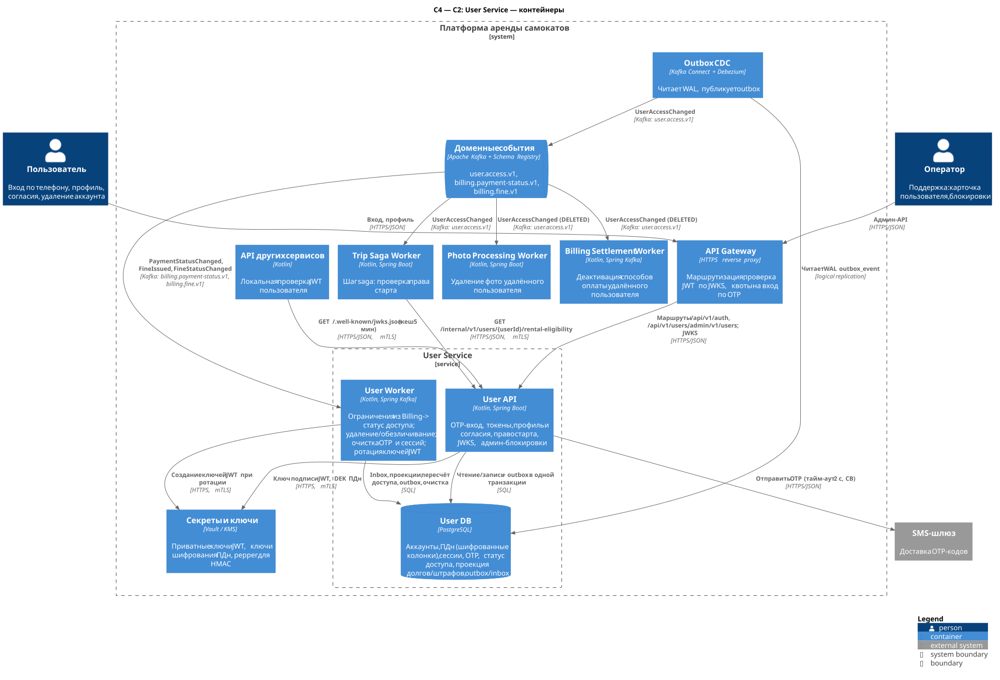
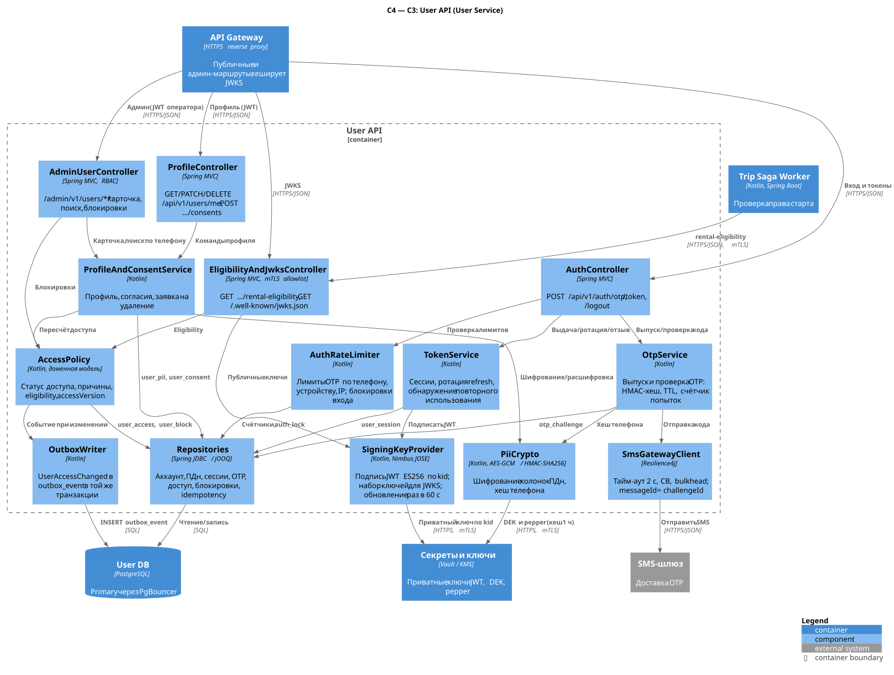
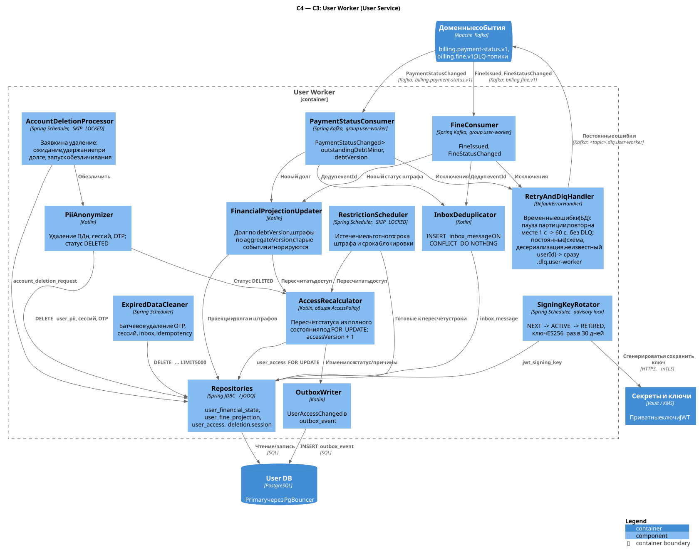

# User Service

**Сводка.** Bounded context — **User Management**; владелец — команда пользователей.

| | |
|---|---|
| Отвечает за | вход по телефону с OTP через SMS-шлюз; выпуск и ротацию токенов (JWT доступа, refresh-сессии); JWKS для Gateway и сервисов; профиль и согласия; статус доступа пользователя и синхронную проверку права на старт аренды (`rental-eligibility`); административные блокировки; удаление и обезличивание аккаунта (152-ФЗ) |
| Не делает | не хранит финансовую истину (долг и штрафы — локальная проекция событий Billing); не запрещает завершение текущей поездки; не выдаёт JWT операторов (их выпускает корпоративный IdP, см. [§3.2.1](#321-аутентификация-и-модель-токенов)); не проверяет документы (KYC) |
| Ссылки | [каталог сервисов](../service-catalog.md#1-user-service), [конвенции API](../api-conventions.md), [хранение данных](../data-storage.md), [старт поездки в lab-01](../lab-01.md#52-старт-и-разблокировка), [контракты событий](../lab-01.md#54-контракты-событий-и-надёжность-доставки) |

Все объёмы и нагрузки ниже — **оценка** по единым допущениям A1–A6 (5 млн пользователей, DAU ≈ 1 млн, 1 млн поездок/сутки, пиковый час ≈ 10 % суток).

## 1. Контейнеры (C2)



Исходник: [c2-user.puml](../../diagrams/services/user/c2-user.puml)

| Контейнер | Технология | Ответственность | Единица масштабирования / метрика автоскейлинга | Минимум реплик |
|---|---|---|---|---|
| User API (`user_api`) | Kotlin, Spring Boot | OTP-вход, выпуск и ротация токенов, JWKS, профиль и согласия, заявка на удаление, `rental-eligibility`, админ-API; пишет `UserAccessChanged` в outbox при изменениях доступа из API | под (stateless); HPA: CPU 60 % и p99 `POST /api/v1/auth/token` > 150 мс | 3 (по одной на зону доступности) |
| User Worker (`user_worker`) | Kotlin, Spring Kafka | потребляет `billing.payment-status.v1` и `billing.fine.v1`, ведёт проекцию долга/штрафов, пересчитывает доступ и пишет `UserAccessChanged` в outbox; обрабатывает заявки на удаление; снимает истёкшие ограничения; чистит OTP/сессии/inbox; ротирует ключи подписи JWT | под = consumer группы `user-worker`; KEDA по lag группы (> 5 000 сообщений); потолок полезных реплик — 24 (число партиций `billing.payment-status.v1`) | 2 |
| User DB | PostgreSQL 17 + PgBouncer | единственное хранилище сервиса: аккаунты, ПДн (шифрованные колонки), сессии, OTP, статус доступа, проекция долга/штрафов, outbox/inbox/idempotency | вертикально; primary + реплика в другой зоне (асинхронная по умолчанию, синхронная фиксация для критичных транзакций — [§4.7](#47-репликация-ha-бэкап)) | 1 primary + 1 реплика |

Решения уровня C2:

- **Только User DB, без Redis.** Счётчики лимитов OTP и блокировки входа считаются по индексам `otp_challenge` и `auth_lock` (≈ 10 запросов OTP/с в пике — нагрузка ничтожная для PostgreSQL). Отдельное in-memory хранилище добавило бы компонент с собственной отказоустойчивостью ради нагрузки, которую выдерживает основная БД.
- **Секреты и ключи (Vault / KMS)** — платформенный компонент: приватные ключи подписи JWT, ключ шифрования ключей данных ПДн (KEK), pepper для HMAC телефона/IP/устройства, ключ MAC refresh-токенов. Сервис кеширует их в памяти, поэтому кратковременная недоступность Vault не останавливает вход.
- **События публикует Outbox CDC** (Debezium читает WAL `outbox_event`), relay в сервисе нет.
- **SMS-шлюз** — единственная синхронная внешняя зависимость (только для `POST /api/v1/auth/otp`).

## 2. Компоненты (C3)

### 2.1 User API



Исходник: [c3-user-api.puml](../../diagrams/services/user/c3-user-api.puml)

| Компонент | Ответственность | Ключевые зависимости |
|---|---|---|
| AuthController | `POST /api/v1/auth/otp`, `/token`, `/logout`; нормализация телефона (E.164), заголовок `X-Device-Id` | AuthRateLimiter, OtpService, TokenService |
| ProfileController | `GET/PATCH/DELETE /api/v1/users/me`, `POST /api/v1/users/me/consents`; If-Match/ETag | ProfileAndConsentService |
| AdminUserController | `/admin/v1/users/**`: карточка, поиск по телефону, блокировки, отзыв сессий; RBAC по ролям JWT оператора, аудит доступа к ПДн | ProfileAndConsentService, AccessPolicy |
| EligibilityAndJwksController | `GET /internal/v1/users/{userId}/rental-eligibility` (mTLS, allowlist `trip-saga-worker`), `GET /.well-known/jwks.json` | AccessPolicy, SigningKeyProvider |
| AuthRateLimiter | лимиты OTP по телефону, устройству, IP и глобальный бюджет SMS; проверка `auth_lock`; локальный token bucket по IP перед обращением к БД | Repositories |
| OtpService | выпуск кода (6 цифр, TTL 5 мин), хранение только `HMAC-SHA256`, проверка в постоянное время, атомарный счётчик попыток | SmsGatewayClient, PiiCrypto, Repositories |
| TokenService | создание сессии, ротация refresh-токена с окном повтора, обнаружение повторного использования, отзыв; сборка JWT | SigningKeyProvider, Repositories |
| SigningKeyProvider | набор ключей ES256 (`NEXT/ACTIVE/RETIRED`) из `jwt_signing_key`, приватные части из Vault; обновление каждые 60 с; подпись JWT; содержимое JWKS | Vault, Repositories |
| ProfileAndConsentService | профиль (JSON Merge Patch), согласия (append-only), заявка на удаление, расчёт «профиль завершён» | PiiCrypto, AccessPolicy, Repositories |
| AccessPolicy | доменная политика: статус доступа и причины из полного состояния, `accessVersion`, ответ eligibility; общая библиотека с User Worker | Repositories, OutboxWriter |
| PiiCrypto | AES-256-GCM для колонок ПДн (envelope encryption, DEK обёрнут KMS), HMAC-SHA256 телефона/IP/устройства | Vault/KMS |
| SmsGatewayClient | вызов SMS-шлюза: тайм-аут 2 с, circuit breaker (50 % ошибок на окне 50 вызовов, open 30 с), bulkhead 20 одновременных вызовов, `messageId = challengeId` | SMS-шлюз |
| Repositories | доступ к `user_account`, `user_pii`, `user_session`, `otp_challenge`, `user_access`, `user_block`, `user_consent`, `idempotency_record` | User DB |
| OutboxWriter | `UserAccessChanged` в `outbox_event` в той же транзакции, что и изменение `user_access` | User DB |

### 2.2 User Worker



Исходник: [c3-user-worker.puml](../../diagrams/services/user/c3-user-worker.puml)

| Компонент | Ответственность | Ключевые зависимости |
|---|---|---|
| PaymentStatusConsumer | `billing.payment-status.v1`, группа `user-worker`: берёт `outstandingDebtMinor` и `debtVersion` | InboxDeduplicator, FinancialProjectionUpdater |
| FineConsumer | `billing.fine.v1`, группа `user-worker`: `FineIssued`, `FineStatusChanged` | InboxDeduplicator, FinancialProjectionUpdater |
| RetryAndDlqHandler | правила [конвенций §15.5](../api-conventions.md#155-ошибки-обработки-dlq-replay): временная ошибка (БД, тайм-аут) — пауза партиции и повтор на месте с backoff 1 с → 60 с с jitter, в DLQ не уходит (порядок в партиции сохраняется); постоянная (схема, десериализация, неизвестный `userId`) — сразу в `<topic>.dlq.user-worker` | Kafka |
| InboxDeduplicator | `INSERT INTO inbox_message ... ON CONFLICT DO NOTHING` в транзакции обработки; 0 строк — дубликат, подтверждаем offset | Repositories |
| FinancialProjectionUpdater | долг применяется только если `debtVersion` больше сохранённой; штраф — только если `aggregateVersion` больше сохранённой | Repositories, AccessRecalculator |
| AccessRecalculator | пересчёт статуса под `SELECT ... FOR UPDATE` строки `user_access` (через общую AccessPolicy); при фактическом изменении — `access_version + 1` и событие | Repositories, OutboxWriter |
| RestrictionScheduler | раз в минуту: штрафы с истёкшим льготным сроком, блокировки с истёкшим `expires_at` (`FOR UPDATE SKIP LOCKED`) → пересчёт доступа | Repositories, AccessRecalculator |
| AccountDeletionProcessor | очередь `account_deletion_request` (`SKIP LOCKED`): ожидание `not_before`, удержание при долге/открытых штрафах, запуск обезличивания | Repositories, PiiAnonymizer |
| PiiAnonymizer | в одной транзакции: удаление `user_pii`, сессий, OTP; статус `DELETED`; событие `UserAccessChanged(DELETED)` | Repositories, AccessRecalculator |
| ExpiredDataCleaner | батчевое удаление (по 5 000 строк) просроченных OTP, сессий, `auth_lock`, `inbox_message` > 14 дней, `idempotency_record` | Repositories |
| SigningKeyRotator | раз в 30 дней: новый ключ ES256 в Vault и строка `NEXT`; через 24 ч `NEXT → ACTIVE`, прежний `ACTIVE → RETIRED`; одиночный исполнитель через `pg_try_advisory_lock` | Vault, Repositories |
| Repositories | `user_financial_state`, `user_fine_projection`, `user_access`, `user_block`, `account_deletion_request`, `user_session`, `jwt_signing_key` | User DB |
| OutboxWriter | `UserAccessChanged` в `outbox_event` | User DB |

Все планировщики работают на каждом поде без лидера: строки разбираются через `FOR UPDATE SKIP LOCKED`, поэтому параллельная обработка безопасна. Исключение — ротация ключей (одна операция на кластер, advisory lock).

## 3. API

Общие правила (пути, `Idempotency-Key`, `traceparent`, problem+json, курсоры, деньги) — в [конвенциях API](../api-conventions.md). Ниже — только специфика сервиса.

### 3.1 Сводная таблица эндпоинтов

| Метод | Путь | Аудитория | Кто вызывает | Авторизация | Идемпотентность |
|---|---|---|---|---|---|
| POST | `/api/v1/auth/otp` | public | мобильное приложение через Gateway | без токена; лимиты по телефону/устройству/IP | `Idempotency-Key` (обязателен): тот же ключ → тот же `challengeId`, повторной SMS нет |
| POST | `/api/v1/auth/token` | public | приложение | без токена (OTP или refresh-токен в теле) | естественная: повтор верного кода ≤ 30 с, один повтор refresh ≤ 30 с; `Idempotency-Key` не используется (ответ содержит секреты) |
| POST | `/api/v1/auth/logout` | public | приложение | JWT пользователя | естественная (всегда 204) |
| GET | `/api/v1/users/me` | public | приложение | JWT пользователя | безопасный метод |
| PATCH | `/api/v1/users/me` | public | приложение | JWT пользователя | `If-Match` (обязателен) |
| POST | `/api/v1/users/me/consents` | public | приложение | JWT пользователя | `Idempotency-Key` |
| DELETE | `/api/v1/users/me` | public | приложение | JWT пользователя, `auth_time` ≤ 10 мин | естественная: одна открытая заявка на пользователя |
| GET | `/internal/v1/users/{userId}/rental-eligibility` | internal | Trip Saga Worker | mTLS, allowlist `trip-saga-worker` | безопасный метод |
| GET | `/.well-known/jwks.json` | internal | API Gateway, API сервисов | без авторизации внутри кластера (публичные ключи) | безопасный метод |
| GET | `/admin/v1/users/{userId}` | admin | консоль оператора | `SUPPORT`, `OPERATOR`, `ADMIN` | безопасный метод |
| GET | `/admin/v1/users?phone=` *(добавлен)* | admin | консоль оператора | `SUPPORT`, `ADMIN`; параметр `?reason=` обязателен | безопасный метод |
| POST | `/admin/v1/users/{userId}/blocks` | admin | консоль оператора | `SUPPORT`, `ADMIN` | `Idempotency-Key` |
| DELETE | `/admin/v1/users/{userId}/blocks/{blockId}` | admin | консоль оператора | `SUPPORT`, `ADMIN`; параметр `?reason=` обязателен | естественная (повтор → 204) |
| POST | `/admin/v1/users/{userId}/sessions/revocations` *(добавлен)* | admin | консоль оператора | `SUPPORT`, `ADMIN` | `Idempotency-Key` |

### 3.2 Детальное описание

#### 3.2.1 Аутентификация и модель токенов

- **Access token** — JWT, подпись **ES256** (ECDSA P-256), TTL 10 мин. Заголовок: `alg=ES256`, `kid`, `typ=JWT`. Claims: `iss` (`user-service`), `sub` (= `userId`), `aud` (`scooter-platform`), `exp`, `iat`, `jti`, `sid` (= `sessionId`), `auth_time`, `roles` (`["RIDER"]`). Статус доступа в токен не кладётся: он меняется чаще, чем живёт токен, и проверяется синхронно через `rental-eligibility`.
- **Проверка JWT** выполняют Gateway и API сервисов локально по JWKS (кеш 5 мин, принудительное обновление при неизвестном `kid` не чаще раза в 30 с).
- **Ротация ключей подписи** (SigningKeyRotator): раз в 30 дней создаётся ключ со статусом `NEXT` и сразу попадает в JWKS; через 24 ч он становится `ACTIVE` (им подписывают), прежний — `RETIRED` и остаётся в JWKS ещё 24 ч (≫ TTL токена 10 мин + кеш JWKS 5 мин). Компрометация: статус `REVOKED`, ключ немедленно исключается из JWKS, все токены с этим `kid` становятся недействительными, клиенты проходят refresh.
- **Refresh token** — непрозрачная строка `rt1.<sessionId>.<generation>.<nonce>.<tag>`, где `nonce` — 256 случайных бит, `tag = HMAC-SHA256(refreshMacKey, sessionId|generation|nonce)`. В БД хранится только `SHA-256` токена текущего поколения (`refresh_hash`) и предыдущего (`prev_refresh_hash`). `tag` позволяет отличить настоящий старый токен от подделки, не храня историю всех поколений.
- **Сессия:** простой (idle) TTL 30 дней, абсолютный — 90 дней; `expires_at = LEAST(now() + 30 d, absolute_expires_at)` пересчитывается при каждой ротации.
- **JWT операторов** (`/admin/v1`) выпускает корпоративный IdP (OIDC), Gateway проверяет их по JWKS IdP. User Service операторов не аутентифицирует, только читает роли из токена.

#### 3.2.2 `POST /api/v1/auth/otp` — запросить код

**Назначение:** выслать одноразовый код на телефон. Ответ не раскрывает, зарегистрирован ли номер.
**Вызывает:** мобильное приложение через Gateway (маршрут `/api/v1/auth/**`, грубый лимит Gateway — 20 запросов/мин на IP).

**Заголовки:** `Idempotency-Key` (обязателен, UUID), `X-Device-Id` (UUID установки приложения; в БД — только HMAC), `traceparent`, `Content-Type: application/json`.

**Тело запроса:**

| Поле | Тип | Ограничения |
|---|---|---|
| `phone` | string | 5–32 символа; нормализуется в E.164 (libphonenumber); поддерживаемые регионы — из конфигурации (на старте только `+7`) |

```json
{ "phone": "+7 (916) 123-45-67" }
```

**Успех — `202 Accepted`** (поля `expiresAt` и `codeLength` добавлены сервисом):

```json
{
  "challengeId": "01a1aafd-b4a0-7517-8b89-8a1f751beeff",
  "resendAfterSec": 60,
  "expiresAt": "2026-11-05T09:20:16Z",
  "codeLength": 6
}
```

**Обработка:**

1. Нормализация номера, `phone_hash = HMAC-SHA256(pepper_v, E.164)`.
2. Если circuit breaker SMS-шлюза открыт — сразу `503`, лимиты не расходуются.
3. Транзакция: `pg_advisory_xact_lock(<первые 8 байт phone_hash>)` сериализует запросы по одному номеру; проверка `auth_lock`; проверка лимитов (таблица ниже) по индексам `otp_challenge`; вставка `otp_challenge` (`status = SENT`, `code_hmac = HMAC-SHA256(otpKey, challengeId|code)`, `attempts = 0`, `expires_at = now() + 5 min`); запись `idempotency_record`.
4. После коммита — вызов SMS-шлюза с `messageId = challengeId` (шлюз дедуплицирует повтор). Тайм-аут 2 с → всё равно `202` (SMS может дойти; через 60 с можно запросить повтор). Быстрый отказ шлюза → `otp_challenge.status = FAILED`, ответ `503`.

| Лимит | Значение (условно, конфигурация) | Источник |
|---|---|---|
| телефон: интервал | 1 запрос / 60 с (`resendAfterSec`) | `ix_otp_phone` |
| телефон: час / сутки | 5 / 10 | `ix_otp_phone` |
| устройство | 10 / час | `ix_otp_device` |
| IP | 30 / час (+ локальный token bucket пода 2 запроса/с) | `ix_otp_ip` |
| глобальный бюджет SMS | 300 SMS/мин на кластер (делится между подами) — защита от SMS-pumping | счётчик в памяти пода + алерт |
| неверные коды | ≥ 10 неверных вводов на номер за час → `auth_lock` на 1 ч | `ix_otp_phone` (сумма `attempts`) |

**Ошибки:**

| HTTP | code | Условие |
|---|---|---|
| 400 | `VALIDATION_FAILED` | номер не разбирается |
| 400 | `IDEMPOTENCY_KEY_REQUIRED` | нет `Idempotency-Key` |
| 422 | `PHONE_REGION_NOT_SUPPORTED` | код страны не поддерживается |
| 422 | `IDEMPOTENCY_KEY_REUSED` | тот же ключ с другим телом |
| 429 | `OTP_RATE_LIMITED` | превышен лимит; расширение `limitScope`: `PHONE`, `DEVICE`, `IP`, `GLOBAL`; `Retry-After` |
| 429 | `OTP_LOCKED` | номер заблокирован после неверных вводов; `Retry-After` |
| 503 | `DEPENDENCY_UNAVAILABLE` | SMS-шлюз недоступен (CB open или отказ) либо недоступна БД; `Retry-After: 30` |

**Повторы и конкурентность:** повтор с тем же `Idempotency-Key` (scope `auth-otp:<phone_hash>`, хранение 24 ч) возвращает тот же ответ без новой SMS. Параллельные запросы на один номер сериализуются advisory lock. Новый запрос после `resendAfterSec` создаёт новый challenge; прежний действует до своего `expiresAt`.
**SLO:** p99 ≤ 1 с (основная доля — SMS-шлюз). Тайм-аут клиента — 5 с.

#### 3.2.3 `POST /api/v1/auth/token` — выдать или обновить токены

**Назначение:** обмен верного OTP на пару токенов (вход/регистрация) либо ротация refresh-токена.
**Вызывает:** приложение. **Заголовки:** `X-Device-Id`, `User-Agent`, `traceparent`. `Authorization` не нужен.

**Тело запроса:**

| Поле | Тип | Ограничения |
|---|---|---|
| `grantType` | string | `otp` или `refresh_token` |
| `challengeId` | uuid | обязателен для `otp` |
| `code` | string | для `otp`: ровно 6 цифр |
| `refreshToken` | string | для `refresh_token`: формат `rt1.…`, ≤ 200 символов |

```json
{ "grantType": "otp", "challengeId": "01a1aafd-b4a0-7517-8b89-8a1f751beeff", "code": "482915" }
```

```json
{ "grantType": "refresh_token", "refreshToken": "rt1.01a1aafd-cff8-73ed-b7c4-20aa1abfa2a5.14.vJ3k9Qm2xR7tYp4LzN8cWb6HfDs1Ae5Ug0Ko3Xi9MqE.N4c2Tq8ZpVx1Lw7Ry3Ks9Hd5Fb0Jm6Ge2Ua4Oi8PnA" }
```

**Успех — `200 OK`**, `Cache-Control: no-store` (поля `tokenType` и `refreshExpiresIn` добавлены):

```json
{
  "accessToken": "eyJhbGciOiJFUzI1NiIsImtpZCI6InVzZXItMjAyNi0xMSIsInR5cCI6IkpXVCJ9.eyJpc3MiOiJ1c2VyLXNlcnZpY2UiLCJzdWIiOiIwMTk2MmYzYS00YjEwLTdjM2UtOWE1MS02ZjJkOGUxYjBjNDciLCJzaWQiOiIwMWExYWFmZC1jZmY4LTczZWQtYjdjNC0yMGFhMWFiZmEyYTUiLCJleHAiOjE3OTQwNDQ2MTZ9.MEUCIQ...",
  "tokenType": "Bearer",
  "expiresIn": 600,
  "refreshToken": "rt1.01a1aafd-cff8-73ed-b7c4-20aa1abfa2a5.1.Zp8Rk2Lw5Tq9Xv3Mb7Nc1Hd6Fs4Ja0Ge8Ui2Oy5KtQ.c7Vb2Nm9Lk4Jh1Gf6Ds3Ap8Qw5Er0Ty7Ui2Op4AsD",
  "refreshExpiresIn": 2592000,
  "userId": "01962f3a-4b10-7c3e-9a51-6f2d8e1b0c47",
  "isNewUser": false
}
```

**Обработка `grantType = otp`:**

1. `SELECT ... FROM otp_challenge WHERE challenge_id = $1 FOR UPDATE`; проверка `auth_lock` по `phone_hash`.
2. Сравнение `HMAC-SHA256(otpKey, challengeId|code)` с `code_hmac` в постоянное время. Неверно → `UPDATE ... SET attempts = attempts + 1 ... WHERE attempts < 5 RETURNING attempts`; на 5-й ошибке `status = LOCKED`; если сумма неверных попыток по номеру за час ≥ 10 — вставка `auth_lock` на 1 ч.
3. Верно → `status = VERIFIED`, `verified_at = now()`. Поиск пользователя по `user_pii.phone_hash`. Нет пользователя → регистрация в той же транзакции под advisory lock номера: `user_account`, `user_pii`, `user_access` (`RESTRICTED`, причины `[VERIFICATION_REQUIRED]`, `access_version = 1`) и событие `UserAccessChanged` в outbox; `isNewUser = true`. Уникальный индекс `phone_hash` — последняя защита от дубля.
4. Новая сессия (`refresh_generation = 1`), `otp_challenge.session_id = sessionId`, подпись JWT, запись `auth_audit_event(LOGIN_SUCCEEDED)`.

Вход разрешён и пользователям со статусом `RESTRICTED`/`BLOCKED` и с заявкой на удаление: им нужно погасить долг, обжаловать штраф или завершить поездку. Право **начать** аренду проверяет `rental-eligibility`.

**Обработка `grantType = refresh_token`** (под `SELECT ... FROM user_session WHERE session_id = $1 FOR UPDATE`):

| Ситуация | Действие |
|---|---|
| `tag` не сходится | `401 REFRESH_TOKEN_INVALID`; сессию не трогаем (подделка не должна позволять отзывать чужие сессии) |
| сессии нет, она `REVOKED` или `expires_at` прошёл | `401 REFRESH_TOKEN_INVALID` |
| `generation` = текущему и `SHA-256(token) = refresh_hash` | ротация: новый `nonce`, `generation + 1`, `prev_refresh_hash = refresh_hash`, `rotated_at = now()`, новый `expires_at` |
| `generation` = текущему − 1, хеш = `prev_refresh_hash`, `now() − rotated_at ≤ 30 с` | окно повтора (клиент потерял ответ): ещё одна ротация; допускается один такой повтор |
| `generation` меньше текущего (вне окна) или `generation` = текущему при несовпадении хеша | **повторное использование**: `status = REVOKED`, `revoke_reason = REUSE_DETECTED`, аудит, алерт безопасности, `401 REFRESH_TOKEN_REUSED` |
| `generation` больше текущего | `401 REFRESH_TOKEN_INVALID` + алерт (возможна утечка `refreshMacKey`) |

**Ошибки:**

| HTTP | code | Условие |
|---|---|---|
| 400 | `VALIDATION_FAILED` | неизвестный `grantType`, нет обязательного поля |
| 400 | `OTP_INVALID` | неверный код; расширение `attemptsLeft` (400 — как `invalid_grant` в OAuth 2.0) |
| 401 | `REFRESH_TOKEN_INVALID` | токен не распознан, сессия отозвана или истекла |
| 401 | `REFRESH_TOKEN_REUSED` | обнаружено повторное использование, сессия отозвана |
| 404 | `CHALLENGE_NOT_FOUND` | нет такого `challengeId` (или он удалён очисткой) |
| 409 | `CHALLENGE_NOT_ACTIVE` | challenge в статусе `FAILED` или уже использован более 30 с назад |
| 410 | `OTP_EXPIRED` | `expires_at` прошёл |
| 429 | `OTP_ATTEMPTS_EXCEEDED` | 5 неверных попыток на этот challenge |
| 429 | `OTP_LOCKED` | номер заблокирован; `Retry-After` |
| 503 | `DEPENDENCY_UNAVAILABLE` | БД недоступна |

**Повторы и конкурентность.** `Idempotency-Key` не используется: хранить ответ с токенами в `idempotency_record` означало бы держать секреты в БД. Вместо этого:
- повтор верного кода для того же challenge в течение 30 с после `verified_at` выдаёт новую сессию, а предыдущую (`otp_challenge.session_id`) отзывает с причиной `SUPERSEDED` — у пользователя не остаётся «висящей» сессии;
- для refresh действует окно повтора, описанное выше.

Параллельные запросы по одному challenge или сессии сериализуются блокировкой строки.
**SLO:** p99 ≤ 100 мс. Тайм-аут клиента — 3 с, автоповтор — 1 раз.

#### 3.2.4 `POST /api/v1/auth/logout` — выйти

**Назначение:** отозвать текущую сессию или все сессии пользователя. **Авторизация:** JWT пользователя.
**Тело (необязательное):** `refreshToken` (string, если передан — отзывается его сессия, она должна принадлежать `sub`), `allSessions` (boolean, по умолчанию `false`). Без тела отзывается сессия `sid` из JWT.

```json
{ "allSessions": true }
```

**Ответ:** `204 No Content` всегда, в том числе для уже отозванной сессии (не раскрываем состояние; операция идемпотентна). `UPDATE user_session SET status = 'REVOKED', revoke_reason = 'LOGOUT' | 'LOGOUT_ALL', absolute_expires_at = LEAST(absolute_expires_at, now() + interval '1 day') WHERE ...`.
Уже выданные access-токены отозванной сессии живут до 10 мин. Это принято: старт аренды всё равно проходит синхронную проверку.
**Ошибки:** `401 UNAUTHENTICATED` (нет или недействителен JWT — отвечает Gateway), `503 DEPENDENCY_UNAVAILABLE`. **SLO:** p99 ≤ 50 мс, тайм-аут клиента 3 с.

#### 3.2.5 `GET /api/v1/users/me` — профиль

**Авторизация:** JWT пользователя (`sub`). **Ответ `200`**, заголовок `ETag: "12"` (= `user_account.version`):

```json
{
  "userId": "01962f3a-4b10-7c3e-9a51-6f2d8e1b0c47",
  "phoneMasked": "+7 *** ***-**-67",
  "fullName": "Иван Петров",
  "birthDate": "1995-04-12",
  "email": "ivan.petrov@example.com",
  "accountStatus": "ACTIVE",
  "access": {
    "accessStatus": "RESTRICTED",
    "reasons": ["DEBT"],
    "canStartTrip": false,
    "accessVersion": 7
  },
  "verification": { "phoneVerified": true, "profileComplete": true },
  "consents": [
    { "consentType": "TERMS_OF_SERVICE", "documentVersion": "2026-09-01", "granted": true, "updatedAt": "2026-09-14T08:02:11Z" },
    { "consentType": "PERSONAL_DATA_PROCESSING", "documentVersion": "2026-09-01", "granted": true, "updatedAt": "2026-09-14T08:02:11Z" },
    { "consentType": "MARKETING_COMMUNICATIONS", "documentVersion": "2026-06-15", "granted": false, "updatedAt": "2026-09-14T08:02:11Z" }
  ],
  "pendingConsents": [],
  "deletionRequest": null,
  "createdAt": "2025-03-02T17:44:20Z"
}
```

`accountStatus`: `ACTIVE`, `DELETION_PENDING`. `pendingConsents` — обязательные документы новой редакции, которые пользователь ещё не принял. Телефон показывается маской из `phone_last4`, остальные ПДн расшифровываются в памяти.
**Ошибки:** `401 UNAUTHENTICATED` (Gateway), `404 USER_NOT_FOUND` (аккаунт удалён — токены к этому моменту отозваны), `503 DEPENDENCY_UNAVAILABLE`. **SLO:** p99 ≤ 50 мс, тайм-аут клиента 3 с.

#### 3.2.6 `PATCH /api/v1/users/me` — изменить профиль

**Заголовки:** `Content-Type: application/merge-patch+json`, `If-Match: "12"` (обязателен).

| Поле | Тип | Ограничения |
|---|---|---|
| `fullName` | string | 1–200 символов, буквы, пробел, дефис, апостроф |
| `birthDate` | date (`YYYY-MM-DD`) | возраст ≥ 18 лет; задаётся один раз, дальнейшее изменение — через поддержку |
| `email` | string или `null` | ≤ 254 символа, RFC 5322; `null` удаляет |

```json
{ "fullName": "Иван Петров", "birthDate": "1995-04-12" }
```

**Ответ `200`** — полный профиль как в `GET` и новый `ETag`. Если профиль стал полным и обязательные согласия даны, `profile_completed_at` заполняется, причина `VERIFICATION_REQUIRED` снимается, публикуется `UserAccessChanged` (в той же транзакции).

| HTTP | code | Условие |
|---|---|---|
| 400 | `VALIDATION_FAILED` | формат полей |
| 409 | `FIELD_IMMUTABLE` | попытка изменить уже заданную `birthDate` |
| 412 | `PRECONDITION_FAILED` | `If-Match` не совпал с текущей версией |
| 422 | `AGE_RESTRICTION` | возраст < 18 |
| 422 | `FIELD_NOT_EDITABLE` | попытка изменить `phone` или служебные поля |
| 428 | `PRECONDITION_REQUIRED` | нет `If-Match` |

**Конкурентность:** оптимистическая блокировка `UPDATE user_account SET version = version + 1 WHERE user_id = $1 AND version = $2`. Повтор с тем же телом и устаревшим `If-Match` → `412`; клиент перечитывает профиль. **SLO:** p99 ≤ 80 мс, тайм-аут клиента 3 с.

#### 3.2.7 `POST /api/v1/users/me/consents` — дать или отозвать согласия

**Заголовки:** `Idempotency-Key` (обязателен).

| Поле | Тип | Ограничения |
|---|---|---|
| `consents[]` | array | 1–5 элементов |
| `consents[].consentType` | string | `TERMS_OF_SERVICE`, `PERSONAL_DATA_PROCESSING`, `MARKETING_COMMUNICATIONS` |
| `consents[].documentVersion` | string | версия документа, известная сервису (действующие редакции — в конфигурации) |
| `consents[].granted` | boolean | `false` допустим только для `MARKETING_COMMUNICATIONS` |

```json
{
  "consents": [
    { "consentType": "TERMS_OF_SERVICE", "documentVersion": "2026-09-01", "granted": true },
    { "consentType": "PERSONAL_DATA_PROCESSING", "documentVersion": "2026-09-01", "granted": true },
    { "consentType": "MARKETING_COMMUNICATIONS", "documentVersion": "2026-06-15", "granted": false }
  ]
}
```

**Ответ `200`:** `{ "consents": [ ...текущее состояние, как в GET... ], "pendingConsents": [] }`. Каждая запись — новая строка в append-only `user_consent` с источником, `ip_hash` и `User-Agent` (доказательство согласия).

| HTTP | code | Условие |
|---|---|---|
| 400 | `VALIDATION_FAILED` | формат |
| 400 | `IDEMPOTENCY_KEY_REQUIRED` | нет `Idempotency-Key` |
| 409 | `MANDATORY_CONSENT_WITHDRAWAL` | `granted = false` для обязательного согласия; для отказа от обработки ПДн — `DELETE /api/v1/users/me` |
| 422 | `UNKNOWN_DOCUMENT_VERSION` | версия документа не существует |
| 422 | `IDEMPOTENCY_KEY_REUSED` | тот же ключ с другим телом |

**SLO:** p99 ≤ 80 мс, тайм-аут клиента 3 с.

#### 3.2.8 `DELETE /api/v1/users/me` — заявка на удаление аккаунта

**Авторизация:** JWT пользователя со «свежей» аутентификацией (`auth_time` не старше 10 мин), иначе приложение заново проводит вход по OTP. Тела нет.
**Ответ `202 Accepted`:**

```json
{
  "requestId": "01a1aafe-2200-7b27-9fc3-ae77cb6efe11",
  "status": "REQUESTED",
  "requestedAt": "2026-11-05T09:15:44Z",
  "notBefore": "2026-11-12T09:15:44Z",
  "deadline": "2026-12-05T09:15:44Z"
}
```

**Обработка:**

- **В API (одна транзакция):**
  - `user_account.status = DELETION_PENDING`;
  - заявка в `account_deletion_request`;
  - причина `ACCOUNT_DELETION_PENDING` в `user_access` (новые старты запрещены);
  - событие `UserAccessChanged` (`RESTRICTED`, `canStartTrip = false`, подробности в `detailReasons`, см. [§3.3](#33-публикуемые-события)).
- **Сессии не отзываются сразу.** Пользователь должен иметь возможность завершить текущую поездку и оплатить её; сам User Service о поездках ничего не знает.
- **Через `notBefore` (7 дней)** — за это время поездка и расчёт по ней гарантированно закрыты — заявку берёт `AccountDeletionProcessor`:
  - есть долг (`outstanding_debt_minor > 0`) или открытые штрафы → `ON_HOLD`, повторная проверка раз в сутки. Минимальные данные хранятся на основании исполнения договора; формулировку согласовывают юристы;
  - иначе — обезличивание (см. [§4.3](#43-хранение-персональных-данных)) и событие `UserAccessChanged(DELETED)`.
- **`deadline`** — 30 дней (152-ФЗ). Если заявка в `ON_HOLD` подходит к сроку, срабатывает алерт ответственному за ПДн.

| HTTP | code | Условие |
|---|---|---|
| 403 | `REAUTHENTICATION_REQUIRED` | `auth_time` старше 10 мин |
| 503 | `DEPENDENCY_UNAVAILABLE` | БД недоступна |

**Идемпотентность:** повтор возвращает `202` с той же открытой заявкой (частичный уникальный индекс по `user_id`). Отмена заявки в MVP не предусмотрена. **SLO:** p99 ≤ 100 мс, тайм-аут клиента 3 с.

#### 3.2.9 `GET /internal/v1/users/{userId}/rental-eligibility` — право на старт аренды

**Назначение:** синхронная проверка в шаге saga старта поездки ([lab-01 §5.2](../lab-01.md#52-старт-и-разблокировка)).
**Вызывает:** Trip Saga Worker. **Авторизация:** mTLS, allowlist `trip-saga-worker`; чужая идентичность → `403`.
**Заголовки:** `traceparent`. **Параметр пути:** `userId` (uuid).

**Ответ `200`** (поле `accessStatus` добавлено):

```json
{
  "userId": "01962f3a-4b10-7c3e-9a51-6f2d8e1b0c47",
  "eligible": false,
  "reasons": ["DEBT", "UNPAID_FINE"],
  "accessVersion": 7,
  "checkedAt": "2026-11-05T09:15:52.318Z",
  "accessStatus": "RESTRICTED"
}
```

**Правила:**

- `eligible = true` только при `accessStatus = ACTIVE` и пустом `reasons`.
- `reasons` перечисляет **все** невыполненные условия, а не первое. Значения `DEBT`, `UNPAID_FINE`, `ADMIN_BLOCK`, `VERIFICATION_REQUIRED` совпадают с перечислением события. Сервис добавляет ещё три:

  | Причина | Когда | Хранение |
  |---|---|---|
  | `CONSENT_REQUIRED` | вступила новая редакция обязательного документа, пользователь её не принял | вычисляется при чтении и в `user_access` не хранится. Иначе смена редакции вызвала бы пересчёт и 5 млн событий сразу |
  | `ACCOUNT_DELETION_PENDING` | открыта заявка на удаление | хранится в `user_access` |
  | `ACCOUNT_DELETED` | аккаунт обезличен | — |

- `accessVersion` = `user_access.access_version` = `aggregateVersion` последнего `UserAccessChanged`. Trip Saga Worker сохраняет его в поездке, чтобы при разборе было видно, на какой версии статуса принято решение.
- Trip решает по `eligible`, а `reasons` только сохраняет и показывает: неизвестные ему значения не считаются ошибкой. Поэтому новые причины добавляются без изменения Trip.
- Чтение идёт **с primary**: одна выборка по PK `user_access` + `user_account` и последних согласий по `ix_consent_latest`. Асинхронная реплика могла бы не увидеть только что наложенную блокировку.
- Удалённый пользователь → `200`, `eligible = false`, `reasons = ["ACCOUNT_DELETED"]`. `404` — только если пользователя никогда не было.

| HTTP | code | Условие |
|---|---|---|
| 403 | `CALLER_NOT_ALLOWED` | вызывающий не в allowlist |
| 404 | `USER_NOT_FOUND` | `userId` не существовал |
| 503 | `DEPENDENCY_UNAVAILABLE` | БД недоступна; `Retry-After: 1` |

**Повторы:** GET безопасен. Trip повторяет один раз с джиттером, при отказе старт не выполняется (fail-closed). Для этого эндпоинта выделен отдельный пул потоков и соединений (bulkhead), чтобы всплеск входов не замедлял старты.
**SLO:** p99 ≤ 30 мс. Тайм-аут Trip Saga Worker — 500 мс, 1 повтор.

#### 3.2.10 `GET /.well-known/jwks.json` — ключи проверки JWT

**Вызывают:** API Gateway и API сервисов. Ключи публичные, поэтому авторизация не нужна; внутри кластера трафик идёт по mTLS сервис-меша. Наружу Gateway этот путь не публикует.
**Ответ `200`**, `Cache-Control: public, max-age=300`, `ETag`; на `If-None-Match` → `304`:

```json
{
  "keys": [
    { "kty": "EC", "crv": "P-256", "kid": "user-2026-11", "use": "sig", "alg": "ES256",
      "x": "f83OJ3D2xF1Bg8vub9tLe1gHMzV76e8Tus9uPHvRVEU", "y": "x_FEzRu9m36HLN_tue659LNpXW6pCyStikYjKIWI5a0" },
    { "kty": "EC", "crv": "P-256", "kid": "user-2026-12", "use": "sig", "alg": "ES256",
      "x": "gI0GAILBdu7T53akrFmMyGcsF3n5dO7MmwNBHKW5SV0", "y": "SLW_xSffzlPWrHEVI30DHM_4egVwt3NQqeUD7nMFpps" }
  ]
}
```

Набор содержит ключи `NEXT`, `ACTIVE` и `RETIRED` (в течение 24 ч после вывода). Ответ отдаётся из памяти SigningKeyProvider.
**Ошибки:** `503 DEPENDENCY_UNAVAILABLE` — только если под ещё не загрузил ключи (такой под не проходит readiness). **SLO:** p99 ≤ 10 мс; тайм-аут вызывающего 2 с, при ошибке он продолжает работать с кешированным набором.

#### 3.2.11 Admin-эндпоинты

Все требуют JWT оператора; каждое действие пишется в `auth_audit_event` (`actor = operator:<sub>`). Причина доступа передаётся параметром запроса `reason` ([конвенции §2.2](../api-conventions.md#22-оператор): непустая строка ≤ 500 символов — номер тикета или пояснение, пишется в аудит); отдельного заголовка для неё нет. Если `reason` обязателен, а он отсутствует или пуст, — `400 REASON_REQUIRED`.

- **`GET /admin/v1/users/{userId}`** — карточка пользователя.
  - Роли: `SUPPORT`, `OPERATOR`, `ADMIN`.
  - Ответ: профиль с маскированными ПДн, `access` (статус, причины, `accessVersion`), активные и исторические блокировки, проекция долга и открытых штрафов, число активных сессий, заявка на удаление.
  - Полные ПДн отдаются только `SUPPORT`/`ADMIN` и только при переданном `?reason=` (тикет); без него карточка возвращается с маскированными ПДн. Каждое раскрытие пишется в аудит как `PII_VIEWED`.
  - Ошибки: `404 USER_NOT_FOUND`, `403 FORBIDDEN`.
- **`GET /admin/v1/users?phone=`** *(добавлен)* — поиск пользователя по телефону для обращения в поддержку.
  - Роли: `SUPPORT`, `ADMIN`; параметр `?reason=` обязателен.
  - Номер нормализуется, ищется по `phone_hash`. Ответ: `{items: [{userId, phoneMasked, accountStatus, accessStatus}]}`, 0 или 1 элемент.
  - Ошибки: `400 VALIDATION_FAILED` (номер не разбирается), `400 REASON_REQUIRED` (нет или пуст `reason`).
- **`POST /admin/v1/users/{userId}/blocks`** — наложить блокировку.
  - Роли: `SUPPORT`, `ADMIN`; `Idempotency-Key`.
  - Тело: `{blockType: ADMIN_BLOCK | VERIFICATION_REQUIRED, reasonCode: FRAUD | ABUSE | SAFETY | DOCUMENT_CHECK | OTHER, comment (≤ 2000), expiresAt | null}`.
  - Ответ `201 {blockId, userId, blockType, reasonCode, expiresAt, createdAt, access: {accessStatus, reasons, accessVersion}}`. Пересчёт доступа и `UserAccessChanged` — в той же транзакции.
  - Транзакция выполняется с `synchronous_commit = on`, чтобы блокировка не потерялась при failover (см. [§4.7](#47-репликация-ha-бэкап)).
  - Ошибки: `400 VALIDATION_FAILED` (формат тела), `400 IDEMPOTENCY_KEY_REQUIRED`, `404 USER_NOT_FOUND`, `409 ACCOUNT_DELETED`, `422 EXPIRES_AT_IN_PAST` (`expiresAt` в прошлом — бизнес-правило), `422 IDEMPOTENCY_KEY_REUSED`.
- **`DELETE /admin/v1/users/{userId}/blocks/{blockId}`** — снять блокировку.
  - Роли: `SUPPORT`, `ADMIN`; параметр `?reason=` обязателен (тела у `DELETE` нет).
  - `lifted_at`, `lifted_by`, `lift_reason = MANUAL`; пересчёт доступа и событие.
  - Ответ `204`, повтор тоже `204`. Ошибки: `400 REASON_REQUIRED`, `404 BLOCK_NOT_FOUND`.
- **`POST /admin/v1/users/{userId}/sessions/revocations`** *(добавлен)* — принудительный выход со всех устройств (компрометация, просьба пользователя).
  - Роли: `SUPPORT`, `ADMIN`; `Idempotency-Key`; тело `{reasonCode: COMPROMISED | USER_REQUEST | OTHER, comment}`.
  - Ответ `200 {revokedSessions: 3}`. Ошибки: `404 USER_NOT_FOUND`.

### 3.3 Публикуемые события

| Топик | Ключ | Событие | Производитель (outbox) | Потребители |
|---|---|---|---|---|
| `user.access.v1` (24 партиции, хранение 7 дней) | `userId` | `UserAccessChanged` | User API, User Worker | Trip Saga Worker; Photo Processing Worker (`DELETED` → удаление фото без удержаний); Billing Settlement Worker (`DELETED` → деактивация способов оплаты и удаление токенов карт у PSP) |

**Когда публикуется** — при каждом фактическом изменении видимой части статуса (`accessStatus`, `reasons`, `canStartTrip`, `detailReasons`):

| Источник изменения | Кто публикует |
|---|---|
| регистрация (`RESTRICTED`, `VERIFICATION_REQUIRED`); профиль завершён (`ACTIVE`) | User API |
| наложение и снятие блокировки | User API |
| заявка на удаление (`RESTRICTED`, `detailReasons: [ACCOUNT_DELETION_PENDING]`) | User API |
| изменение долга; изменение статуса штрафа; истечение льготного срока штрафа; истечение блокировки | User Worker |
| обезличивание (`DELETED`) | User Worker |

**Пример в конверте:**

```json
{
  "eventId": "01a1aafd-eb50-768d-8bc3-e732fbfd6f2f",
  "eventType": "UserAccessChanged",
  "schemaVersion": 1,
  "aggregateType": "UserAccess",
  "aggregateId": "01962f3a-4b10-7c3e-9a51-6f2d8e1b0c47",
  "aggregateVersion": 7,
  "occurredAt": "2026-11-05T09:15:30.112Z",
  "producer": "user-worker",
  "correlationId": "01a1aafe-aab8-7139-bbda-ab71b61b657e",
  "causationId": "01a1aafe-c610-7a4e-9b3d-2f8e6a1c5d07",
  "payload": {
    "userId": "01962f3a-4b10-7c3e-9a51-6f2d8e1b0c47",
    "accessStatus": "RESTRICTED",
    "reasons": ["DEBT"],
    "canStartTrip": false,
    "effectiveAt": "2026-11-05T09:15:30.104Z",
    "detailReasons": ["DEBT"]
  }
}
```

**Поля payload и порядок:**

- `causationId` — `eventId` вызвавшего изменение `PaymentStatusChanged`.
- `detailReasons` — добавленное поле, полный внутренний список причин. В `reasons` попадают только значения из контракта.
  - Удалённый аккаунт: `accessStatus = DELETED`, `reasons = []`, `canStartTrip = false`.
  - Заявка на удаление: `accessStatus = RESTRICTED`, `canStartTrip = false`, в `detailReasons` — `ACCOUNT_DELETION_PENDING`. Перечисление `reasons` контракта ради этого не расширяется: туда попадают только прочие действующие причины (часто список пуст).
- `accessVersion` отдельным полем в payload нет: это `aggregateVersion` конверта, то же значение, что возвращает eligibility ([§3.2.9](#329-get-internalv1usersuseridrental-eligibility--право-на-старт-аренды)).
- **Порядок.** Вставка в outbox идёт под `FOR UPDATE` строки `user_access`, и этой блокировкой пользуются и API, и Worker. Поэтому порядок коммитов совпадает с порядком `aggregateVersion`. Debezium читает WAL в порядке коммитов, а ключ `userId` даёт одну партицию на пользователя.
- **Потребителям:** применять событие, только если `aggregateVersion` больше сохранённой. Пропуски номеров допустимы: версия растёт и при изменениях, не попавшим в событие.

### 3.4 Потребляемые события

Consumer group — `user-worker` (по имени контейнера); подтверждение offset — после коммита транзакции (at-least-once).

| Топик | Событие | Обработка | Упорядочивание |
|---|---|---|---|
| `billing.payment-status.v1` | `PaymentStatusChanged` | `user_financial_state.outstanding_debt_minor = outstandingDebtMinor` (валюта — из `amount.currency`); причина `DEBT` при `outstandingDebtMinor > 0` | применяется, только если `debtVersion` больше сохранённой `debt_version`: `INSERT ... ON CONFLICT (user_id) DO UPDATE ... WHERE user_financial_state.debt_version < EXCLUDED.debt_version`. Событие с той же `debtVersion` несёт тот же долг и отбрасывается без изменений |
| `billing.fine.v1` | `FineIssued` | upsert `user_fine_projection` (`ISSUED`, сумма, `restrict_after = issuedAt + 72 ч`) | применяется, если `aggregateVersion` (версия штрафа в конверте) больше сохранённой; `FineStatusChanged`, пришедший раньше `FineIssued`, создаёт строку со статусом, а поздний `FineIssued` дополняет сумму, не откатывая статус |
| `billing.fine.v1` | `FineStatusChanged` | статус `APPEALED`, `UPHELD`, `CANCELLED`, `PAID`; при `UPHELD` — `restrict_after = changedAt + 72 ч` | то же |

**Почему `debtVersion`, а не `changedAt`.** `PaymentStatusChanged` публикуют три контейнера Billing (API, Settlement, Reconciliation), и их часы не синхронны до миллисекунды, поэтому порядок по `changedAt` не гарантирует, что последним применится актуальный долг. Billing ведёт `debtVersion` (int64, монотонный по `userId`) и увеличивает его в той же транзакции, что и изменение непогашенного долга; события без изменения долга несут текущее значение. Сравнение по одной целочисленной версии не зависит ни от часов, ни от порядка доставки (в том числе при переигрывании DLQ).

**Правило `UNPAID_FINE`:** есть штраф в статусе `ISSUED` или `UPHELD` с `restrict_after ≤ now()`. Льготный срок 72 ч — параметр политики (условно). Апелляция (`APPEALED`) ограничение снимает.

**Транзакция обработки:**

1. `INSERT INTO inbox_message` (`ON CONFLICT DO NOTHING`); дубликат → только подтвердить offset.
2. `SELECT ... FROM user_access WHERE user_id = $1 FOR UPDATE` — сначала блокировка агрегата, затем изменение входных данных. Единый порядок блокировок исключает взаимные блокировки и гарантирует, что параллельная транзакция по тому же пользователю увидит все входы.
3. Обновление проекции и пересчёт доступа по **полному** текущему состоянию, а не по дельте. Поэтому результат не зависит от порядка прихода событий из двух разных топиков.
4. При изменении — `access_version + 1` и `outbox_event`.

**Ошибки:**

Классы ошибок — по [конвенциям §15.5](../api-conventions.md#155-ошибки-обработки-dlq-replay):

- **Временные** (БД недоступна, тайм-аут, failover): партиция приостанавливается (`pause`), сообщение повторяется на месте с backoff 1 с → 60 с с jitter, пока не будет обработано. В DLQ оно не уходит и не пропускается — порядок в партиции сохраняется. Алерт — по возрасту самого старого необработанного сообщения и лагу группы `user-worker`.
- **Постоянные** — сразу в DLQ `billing.payment-status.v1.dlq.user-worker` / `billing.fine.v1.dlq.user-worker` и алерт, обработка продолжается со следующего сообщения:
  - не проходит схема или десериализация (ошибка сериализации — постоянная: повтор её не исправит);
  - неизвестный `userId`. Окна ожидания нет: пользователь создаётся раньше любого события Billing о нём, а у удалённых строка `user_account` остаётся с `status = DELETED`. Поэтому это ошибка данных, а не нормальная ситуация.
- Переигрывание DLQ безопасно: устаревшие события отбрасываются сравнением `debtVersion` (долг) и `aggregateVersion` (штрафы).

### 3.5 MQTT

Не используется.

## 4. Данные и хранение

### 4.1 Почему PostgreSQL

Данные сервиса — небольшой (≈ 40 ГБ, оценка) строго консистентный набор со связанными инвариантами: уникальность телефона, одна открытая заявка на удаление, атомарное изменение статуса доступа вместе с outbox, блокировки строк для ротации refresh-токенов. Это транзакционная OLTP-нагрузка, для которой PostgreSQL — единый выбор платформы ([data-storage.md](../data-storage.md), [lab-01 §4.2](../lab-01.md#42-хранение-данных-почему-postgresql-индексы-партиционирование-шардирование)). Шифрование колонок выполняется в приложении, поэтому от СУБД нужен только `bytea`.

### 4.2 DDL и индексы

Ниже — специфичные таблицы. Общие `outbox_event`, `inbox_message`, `idempotency_record` создаются по единой схеме ([data-storage §4.3](../data-storage.md#43-общие-служебные-таблицы)):

- `outbox_event` — суточные партиции, удаляются через 3 дня;
- `inbox_message` — для группы `user-worker`;
- `idempotency_record` — scope `auth-otp:<phone_hash>`, `consents:<userId>`, `admin-blocks:<operator>`; хранение 24 ч.

```sql
CREATE TABLE user_account (
  user_id              uuid        PRIMARY KEY,                -- UUIDv7
  status               text        NOT NULL DEFAULT 'ACTIVE'
                       CHECK (status IN ('ACTIVE','DELETION_PENDING','DELETED')),
  phone_verified_at    timestamptz NOT NULL,
  profile_completed_at timestamptz,                            -- ФИО + дата рождения 18+ + обязательные согласия
  version              bigint      NOT NULL DEFAULT 1,         -- ETag профиля
  created_at           timestamptz NOT NULL DEFAULT now(),
  updated_at           timestamptz NOT NULL DEFAULT now(),
  deleted_at           timestamptz,
  CHECK ((status = 'DELETED') = (deleted_at IS NOT NULL))
);

CREATE TABLE pii_data_key (
  dek_id          text        PRIMARY KEY,                     -- 'dek-2026-11'
  wrapped_key     bytea       NOT NULL,                        -- DEK, зашифрованный KEK в KMS
  kms_key_version int         NOT NULL,
  status          text        NOT NULL CHECK (status IN ('ACTIVE','DECRYPT_ONLY')),
  created_at      timestamptz NOT NULL DEFAULT now()
);
CREATE UNIQUE INDEX uq_pii_data_key_active ON pii_data_key ((true)) WHERE status = 'ACTIVE';

CREATE TABLE user_pii (
  user_id                uuid     PRIMARY KEY REFERENCES user_account (user_id),
  phone_hash             bytea    NOT NULL,                    -- HMAC-SHA256(pepper_v, E.164)
  phone_hash_key_version smallint NOT NULL,
  phone_enc              bytea    NOT NULL,                    -- AES-256-GCM, AAD = user_id|'phone'
  phone_last4            char(4)  NOT NULL,
  full_name_enc          bytea,
  birth_date_enc         bytea,
  email_enc              bytea,
  dek_id                 text     NOT NULL REFERENCES pii_data_key (dek_id),
  updated_at             timestamptz NOT NULL DEFAULT now(),
  CONSTRAINT uq_user_pii_phone_hash UNIQUE (phone_hash)
);

CREATE TABLE user_access (
  user_id        uuid        PRIMARY KEY REFERENCES user_account (user_id),
  access_status  text        NOT NULL CHECK (access_status IN ('ACTIVE','RESTRICTED','BLOCKED','DELETED')),
  reasons        text[]      NOT NULL DEFAULT '{}'
                 CHECK (reasons <@ ARRAY['DEBT','UNPAID_FINE','ADMIN_BLOCK','VERIFICATION_REQUIRED','ACCOUNT_DELETION_PENDING']),
  can_start_trip boolean     NOT NULL,
  access_version bigint      NOT NULL CHECK (access_version >= 1),
  changed_at     timestamptz NOT NULL,
  CHECK (can_start_trip = (access_status = 'ACTIVE'))
);

CREATE TABLE user_block (
  block_id    uuid        PRIMARY KEY,
  user_id     uuid        NOT NULL REFERENCES user_account (user_id),
  block_type  text        NOT NULL CHECK (block_type IN ('ADMIN_BLOCK','VERIFICATION_REQUIRED')),
  reason_code text        NOT NULL CHECK (reason_code IN ('FRAUD','ABUSE','SAFETY','DOCUMENT_CHECK','OTHER')),
  comment     text        CHECK (length(comment) <= 2000),
  created_by  text        NOT NULL,                            -- sub оператора
  created_at  timestamptz NOT NULL DEFAULT now(),
  expires_at  timestamptz,
  lifted_at   timestamptz,
  lifted_by   text,
  lift_reason text        CHECK (lift_reason IN ('MANUAL','EXPIRED')),
  CHECK (expires_at IS NULL OR expires_at > created_at),
  CHECK ((lifted_at IS NULL) = (lift_reason IS NULL))
);
CREATE INDEX ix_user_block_user   ON user_block (user_id, created_at DESC);
CREATE INDEX ix_user_block_expiry ON user_block (expires_at)
  WHERE lifted_at IS NULL AND expires_at IS NOT NULL;

CREATE TABLE user_financial_state (
  user_id                uuid        PRIMARY KEY REFERENCES user_account (user_id),
  outstanding_debt_minor bigint      NOT NULL CHECK (outstanding_debt_minor >= 0),
  currency               char(3)     NOT NULL,
  debt_version           bigint      NOT NULL CHECK (debt_version >= 0),  -- debtVersion из Billing; порядок применения
  debt_as_of             timestamptz NOT NULL,                 -- changedAt применённого события (для карточки)
  debt_event_id          uuid        NOT NULL                  -- eventId применённого события (аудит)
);

CREATE TABLE user_fine_projection (
  fine_id             uuid        PRIMARY KEY,
  user_id             uuid        NOT NULL REFERENCES user_account (user_id),
  status              text        NOT NULL CHECK (status IN ('ISSUED','APPEALED','UPHELD','CANCELLED','PAID')),
  amount_minor        bigint      CHECK (amount_minor >= 0),   -- NULL, пока не пришёл FineIssued
  currency            char(3),
  issued_at           timestamptz,
  status_changed_at   timestamptz NOT NULL,
  aggregate_version   bigint      NOT NULL,
  restrict_after      timestamptz,
  restriction_applied boolean     NOT NULL DEFAULT false
);
CREATE INDEX ix_fine_open_by_user ON user_fine_projection (user_id)
  WHERE status IN ('ISSUED','APPEALED','UPHELD');
CREATE INDEX ix_fine_restrict_due ON user_fine_projection (restrict_after)
  WHERE status IN ('ISSUED','UPHELD') AND NOT restriction_applied;

CREATE TABLE user_consent (
  consent_id       uuid        PRIMARY KEY,                    -- UUIDv7
  user_id          uuid        NOT NULL REFERENCES user_account (user_id),
  consent_type     text        NOT NULL
                   CHECK (consent_type IN ('TERMS_OF_SERVICE','PERSONAL_DATA_PROCESSING','MARKETING_COMMUNICATIONS')),
  document_version text        NOT NULL,
  granted          boolean     NOT NULL,
  source           text        NOT NULL CHECK (source IN ('MOBILE_APP','SUPPORT')),
  ip_hash          bytea,
  user_agent       text        CHECK (length(user_agent) <= 512),
  created_at       timestamptz NOT NULL DEFAULT now()
);
CREATE INDEX ix_consent_latest ON user_consent (user_id, consent_type, created_at DESC)
  INCLUDE (document_version, granted);

CREATE TABLE otp_challenge (
  challenge_id uuid        PRIMARY KEY,                        -- UUIDv7
  phone_hash   bytea       NOT NULL,
  device_hash  bytea,
  ip_hash      bytea       NOT NULL,
  code_hmac    bytea       NOT NULL,                           -- HMAC-SHA256(otpKey, challengeId|code)
  status       text        NOT NULL CHECK (status IN ('SENT','VERIFIED','LOCKED','FAILED')),
  attempts     smallint    NOT NULL DEFAULT 0 CHECK (attempts BETWEEN 0 AND 5),
  created_at   timestamptz NOT NULL DEFAULT now(),
  expires_at   timestamptz NOT NULL,
  verified_at  timestamptz,
  session_id   uuid,                                           -- сессия, выданная по коду (повтор ≤ 30 с)
  CHECK (expires_at > created_at),
  CHECK ((status = 'VERIFIED') = (verified_at IS NOT NULL))
);
CREATE INDEX ix_otp_phone   ON otp_challenge (phone_hash, created_at DESC) INCLUDE (attempts);
CREATE INDEX ix_otp_device  ON otp_challenge (device_hash, created_at) WHERE device_hash IS NOT NULL;
CREATE INDEX ix_otp_ip      ON otp_challenge (ip_hash, created_at);
CREATE INDEX ix_otp_expires ON otp_challenge (expires_at);

CREATE TABLE auth_lock (
  subject_type text        NOT NULL CHECK (subject_type IN ('PHONE','DEVICE','IP')),
  subject_hash bytea       NOT NULL,
  locked_until timestamptz NOT NULL,
  reason       text        NOT NULL,
  created_at   timestamptz NOT NULL DEFAULT now(),
  PRIMARY KEY (subject_type, subject_hash)
);

CREATE TABLE user_session (
  session_id          uuid        PRIMARY KEY,                 -- UUIDv7
  user_id             uuid        NOT NULL REFERENCES user_account (user_id),
  status              text        NOT NULL CHECK (status IN ('ACTIVE','REVOKED')),
  refresh_generation  bigint      NOT NULL CHECK (refresh_generation >= 1),
  refresh_hash        bytea       NOT NULL,
  prev_refresh_hash   bytea,
  rotated_at          timestamptz,
  device_hash         bytea,
  device_name         text        CHECK (length(device_name) <= 100),
  auth_time           timestamptz NOT NULL,
  created_at          timestamptz NOT NULL DEFAULT now(),
  expires_at          timestamptz NOT NULL,                    -- LEAST(idle 30 d, absolute)
  absolute_expires_at timestamptz NOT NULL,                    -- created_at + 90 d; при отзыве ≤ now() + 1 d
  revoked_at          timestamptz,
  revoke_reason       text CHECK (revoke_reason IN
                      ('LOGOUT','LOGOUT_ALL','REUSE_DETECTED','ADMIN','ACCOUNT_DELETED','SUPERSEDED')),
  CHECK (expires_at <= absolute_expires_at),
  CHECK ((status = 'REVOKED') = (revoked_at IS NOT NULL))
) WITH (fillfactor = 80);
CREATE INDEX ix_session_user_active ON user_session (user_id) WHERE status = 'ACTIVE';
CREATE INDEX ix_session_absolute    ON user_session (absolute_expires_at);

CREATE TABLE jwt_signing_key (
  kid             text        PRIMARY KEY,                     -- 'user-2026-11'
  alg             text        NOT NULL CHECK (alg = 'ES256'),
  public_jwk      jsonb       NOT NULL,
  private_key_ref text        NOT NULL,                        -- путь в Vault
  status          text        NOT NULL CHECK (status IN ('NEXT','ACTIVE','RETIRED','REVOKED')),
  created_at      timestamptz NOT NULL DEFAULT now(),
  activates_at    timestamptz NOT NULL,
  retired_at      timestamptz,
  publish_until   timestamptz                                  -- до какого момента ключ в JWKS
);
CREATE UNIQUE INDEX uq_jwt_one_active ON jwt_signing_key ((true)) WHERE status = 'ACTIVE';

CREATE TABLE account_deletion_request (
  request_id   uuid        PRIMARY KEY,                        -- UUIDv7
  user_id      uuid        NOT NULL REFERENCES user_account (user_id),
  status       text        NOT NULL CHECK (status IN ('REQUESTED','ON_HOLD','COMPLETED')),
  hold_reason  text        CHECK (hold_reason IN ('OUTSTANDING_DEBT','OPEN_FINES')),
  requested_at timestamptz NOT NULL DEFAULT now(),
  not_before   timestamptz NOT NULL,                           -- requested_at + 7 d
  deadline     timestamptz NOT NULL,                           -- requested_at + 30 d (152-ФЗ)
  next_run_at  timestamptz NOT NULL,
  attempts     int         NOT NULL DEFAULT 0,
  completed_at timestamptz,
  CHECK (deadline > not_before),
  CHECK ((status = 'COMPLETED') = (completed_at IS NOT NULL)),
  CHECK ((status = 'ON_HOLD') = (hold_reason IS NOT NULL))
);
CREATE UNIQUE INDEX uq_deletion_open ON account_deletion_request (user_id)
  WHERE status IN ('REQUESTED','ON_HOLD');
CREATE INDEX ix_deletion_due ON account_deletion_request (next_run_at)
  WHERE status IN ('REQUESTED','ON_HOLD');

CREATE TABLE auth_audit_event (
  event_id    uuid        NOT NULL,                            -- UUIDv7
  occurred_at timestamptz NOT NULL DEFAULT now(),
  user_id     uuid,
  event_type  text        NOT NULL,   -- LOGIN_SUCCEEDED, OTP_FAILED, OTP_LOCKED, REFRESH_REUSE_DETECTED,
                                      -- LOGOUT, PII_VIEWED, BLOCK_CREATED, BLOCK_LIFTED, SESSIONS_REVOKED, ...
  actor       text        NOT NULL,   -- 'user' | 'operator:<sub>' | 'system'
  ip_hash     bytea,
  device_hash bytea,
  details     jsonb       NOT NULL DEFAULT '{}',
  PRIMARY KEY (event_id)
) PARTITION BY RANGE (event_id);
CREATE TABLE auth_audit_event_2026_11 PARTITION OF auth_audit_event
  FOR VALUES FROM ('01a19467-e800-7000-8000-000000000000')    -- 2026-11-01 00:00 UTC
              TO   ('01a22ee6-b000-7000-8000-000000000000');  -- 2026-12-01 00:00 UTC
CREATE INDEX ix_audit_user ON auth_audit_event (user_id, event_id DESC);
```

**Какой запрос обслуживает каждый индекс:**

| Индекс | Запрос |
|---|---|
| PK `user_account`, `user_access`, `user_financial_state` | eligibility, профиль, пересчёт доступа `... WHERE user_id = $1 [FOR UPDATE]` |
| `uq_user_pii_phone_hash` | вход и регистрация: `SELECT user_id FROM user_pii WHERE phone_hash = $1`; инвариант «телефон уникален»; поиск оператором |
| `uq_pii_data_key_active` | инвариант «один активный DEK»; выбор DEK для шифрования новых записей |
| `ix_user_block_user` | активные блокировки для AccessPolicy (`WHERE user_id = $1 AND lifted_at IS NULL`, у пользователя единицы строк) и история в админ-карточке |
| `ix_user_block_expiry` | RestrictionScheduler: `WHERE lifted_at IS NULL AND expires_at <= now() ORDER BY expires_at LIMIT 500 FOR UPDATE SKIP LOCKED` |
| PK `user_fine_projection` | upsert по `fineId` из событий |
| `ix_fine_open_by_user` | AccessPolicy (`UNPAID_FINE`) и проверка перед обезличиванием: открытые штрафы пользователя |
| `ix_fine_restrict_due` | RestrictionScheduler: `WHERE status IN ('ISSUED','UPHELD') AND NOT restriction_applied AND restrict_after <= now() ORDER BY restrict_after LIMIT 500 FOR UPDATE SKIP LOCKED` |
| `ix_consent_latest` | текущее состояние согласий (index-only scan): `SELECT DISTINCT ON (consent_type) consent_type, document_version, granted FROM user_consent WHERE user_id = $1 ORDER BY consent_type, created_at DESC` |
| PK `otp_challenge` | проверка кода `... WHERE challenge_id = $1 FOR UPDATE` |
| `ix_otp_phone` | лимиты по номеру: `count(*)` за 60 с / час / сутки и `sum(attempts)` за час (`INCLUDE (attempts)` — index-only) |
| `ix_otp_device`, `ix_otp_ip` | лимиты по устройству и IP за час |
| `ix_otp_expires` | очистка: `DELETE ... WHERE expires_at < now() - interval '24 hours'` батчами |
| PK `auth_lock` | проверка блокировки входа по номеру/устройству/IP |
| PK `user_session` | refresh и logout по `sessionId` из токена |
| `ix_session_user_active` | «выйти везде», админ-отзыв, число сессий в карточке; при ротации не меняется, поэтому ротация остаётся HOT-обновлением |
| `ix_session_absolute` | очистка: `DELETE ... WHERE absolute_expires_at < now()` (колонка не меняется при ротации, `fillfactor = 80` оставляет место для HOT) |
| `uq_jwt_one_active` | инвариант «один ключ подписи `ACTIVE`» |
| `uq_deletion_open` | инвариант «одна открытая заявка на удаление»; повторный `DELETE /users/me` находит её |
| `ix_deletion_due` | AccountDeletionProcessor: `WHERE status IN ('REQUESTED','ON_HOLD') AND next_run_at <= now() ORDER BY next_run_at LIMIT 50 FOR UPDATE SKIP LOCKED` |
| `ix_audit_user` | история безопасности пользователя в админ-карточке: `WHERE user_id = $1 ORDER BY event_id DESC LIMIT 50` |

### 4.3 Хранение персональных данных

- **Отдельная таблица `user_pii`.** Все ПДн собраны в ней и шифруются на уровне колонок (AES-256-GCM, envelope encryption).
  - DEK хранится обёрнутым ключом KMS в `pii_data_key`; новый DEK заводится ежемесячно, старые остаются `DECRYPT_ONLY`.
  - AAD = `user_id|<колонка>`: шифротекст нельзя незаметно перенести в чужую строку.
- **Поиск по телефону без расшифровки:** `phone_hash = HMAC-SHA256(pepper, E.164)`. Простой SHA-256 не годится: пространство номеров мало, и его перебирают за минуты.
  - Смена pepper: фоновый перерасчёт с `phone_hash_key_version`; на время перерасчёта поиск идёт по обеим версиям.
- **Права доступа:** к `user_pii` есть доступ только у ролей БД `user_api` и `user_worker`. Логическая репликация для аналитики `user_pii` не включает. В логах и аудите — только хеши и `phone_last4`.
- **Обезличивание** (PiiAnonymizer, одна транзакция):
  - удаляются `user_pii` (номер освобождается для новой регистрации), `user_session`, `otp_challenge` по `phone_hash`, `auth_lock`;
  - `user_consent` остаются как псевдонимизированное доказательство законности прошлой обработки (только `user_id`; `ip_hash` и `user_agent` обнуляются), срок хранения — 3 года;
  - `user_account.status = DELETED`; `user_access` → `DELETED`; событие в outbox; заявка → `COMPLETED`.
  - Записи Billing (≥ 5 лет по 402-ФЗ) ссылаются на `userId`, но ПДн не содержат. Фото удаляет Photo Service по событию `DELETED`. По тому же событию Billing Settlement Worker деактивирует сохранённые способы оплаты и просит PSP удалить токены карт; финансовые записи остаются псевдонимизированными на срок 402-ФЗ ([billing-service.md](billing-service.md#34-потребляемые-события)).
- **Бэкапы:** хранятся 14 дней, поэтому через 7 + 14 = 21 день (< 30 дней по 152-ФЗ) ПДн не остаются и в резервных копиях.
  - Восстановленную БД не открывают для трафика, пока User Worker заново не выполнит обезличивание для всех `UserAccessChanged(DELETED)` из `user.access.v1` за период после точки восстановления. PITR восстанавливает на минуты до сбоя, а топик хранит 7 дней.
  - Точка восстановления для рабочего трафика — не старше 7 дней (хранение топика), иначе часть обезличиваний нечем повторить. Более ранняя точка из 14-дневного окна (поздно замеченная логическая порча) поднимается только в изолированный экземпляр для выборочного переноса данных и в рабочий контур не открывается.

### 4.4 Партиционирование, ретенция, архив

| Таблица | Партиционирование | Ретенция |
|---|---|---|
| `auth_audit_event` | помесячно `RANGE (event_id)` по границам UUIDv7 начала месяца; партиции создаются на 2 месяца вперёд | 12 месяцев, затем `DETACH` + `DROP` (архив не нужен: финансовой силы нет) |
| `outbox_event` | посуточно по `created_at` | 3 дня |
| `otp_challenge` | нет (≈ 0,3 млн строк/сутки, оценка) | 24 ч после `expires_at` (нужны для суточных лимитов), батчевый `DELETE` |
| `user_session` | нет (≈ 7,5 млн строк) | до `absolute_expires_at` (≤ 90 дней; отозванные — 1 день) |
| `inbox_message` | нет (общая схема, [data-storage §4.3](../data-storage.md#43-общие-служебные-таблицы)) | 14 дней (≥ хранения `billing.payment-status.v1`) |
| `idempotency_record` | нет | 24 ч |
| `user_fine_projection` | нет | закрытые штрафы (`CANCELLED`, `PAID`) — 13 месяцев как надгробия: поздний повтор события из DLQ не воскресит штраф |
| `account_deletion_request` | нет | бессрочно (минимальный журнал исполнения 152-ФЗ, без ПДн) |

Ядро (`user_account`, `user_pii`, `user_access`) не партиционируется: это справочные данные по `userId`, а не история.

### 4.5 Оценка объёмов (по A1, A4)

| Данные | Строк (оценка) | Объём (оценка) |
|---|---|---|
| `user_account` + `user_pii` + `user_access` + `user_financial_state` | 5 млн | ≈ 10 ГБ (A4: ~2 КБ × 5 млн, с индексами) |
| `user_session` | ≈ 7,5 млн (≈ 1,5 устройства на пользователя) | ≈ 2 ГБ |
| `user_consent` | ≈ 15–20 млн (3 типа + новые редакции) | ≈ 3 ГБ |
| `otp_challenge` | ≈ 0,3 млн/сутки, хранится 1–2 суток | < 0,2 ГБ |
| `user_fine_projection` | до ≈ 20 тыс./сутки (A6: верхняя оценка 2 % поездок, типично ~1 %) | ≈ 1 ГБ/год |
| `inbox_message` | ≈ 2–3 млн событий/сутки × 14 дней | ≈ 5 ГБ |
| `auth_audit_event` | ≈ 0,5 млн/сутки (входы, ошибки OTP, админ-действия; обычные refresh не пишутся) | ≈ 18 ГБ/год |
| **Итого** | | **≈ 40 ГБ** |

**Нагрузка (оценка):**

| Операция | Пик | Как получено |
|---|---|---|
| refresh | ≈ 85/с | ≈ 3 обновления на активного пользователя в сутки, 10 % — в пиковый час |
| вход по OTP | ≤ 10/с | — |
| `rental-eligibility` | ≈ 30/с, всплески до 100/с | 1 млн стартов/сутки, 10 % в пиковый час |
| профиль | ≈ 85/с | — |
| **итого на User API** | ≈ 300 RPS | — |
| User Worker | ≈ 80 событий/с | — |

Записи короткие (единицы строк на транзакцию).

### 4.6 Шардирование

**Не требуется** — все триггеры ([data-storage §7.2](../data-storage.md#72-триггеры)) далеко:

| Триггер | Значение (оценка) |
|---|---|
| доля записи на primary | ≈ 300 коротких транзакций/с в пике — единицы процентов от возможностей одного узла |
| рабочий набор | ≈ 40 ГБ — целиком помещается в RAM узла на 64 ГБ |
| восстановление из бэкапа | минуты, в RTO укладывается |

Схема всё равно shard-ready: все таблицы, кроме `jwt_signing_key` и `pii_data_key`, имеют `user_id`. Если шардирование понадобится:

- ключ — `userId`, 256 бакетов `hash(userId) mod 256`;
- поиск по телефону потребует глобального каталога `phone_hash → user_id` — маленькая таблица на отдельном узле или справочная таблица Citus;
- `jwt_signing_key` и `pii_data_key` реплицируются на все шарды.

### 4.7 Репликация, HA, бэкап

- **Реплика и failover:** реплика в другой зоне доступности — асинхронная по умолчанию, с кворумной синхронной фиксацией для критичных транзакций (ниже; правило кластера `pg-core` — [data-storage §8.1](../data-storage.md#81-размещение-по-кластерам), [§8.2](../data-storage.md#82-ha-patroni-или-managed)), Patroni для автоматического failover, PgBouncer (transaction pooling) перед primary.
- **Синхронная фиксация только для критичных транзакций.** Настройка: `synchronous_standby_names = 'ANY 1 (replica)'` при `synchronous_commit = local` по умолчанию. Транзакции, которые нельзя потерять при failover, делают `SET LOCAL synchronous_commit = on`:
  - наложение и снятие блокировки;
  - заявка на удаление и обезличивание;
  - ротация ключей.
- **Потеря при failover (RPO — секунды) допустима для остального:**
  - последних ротаций refresh — клиент получит `REFRESH_TOKEN_INVALID` и войдёт заново;
  - последних OTP — пользователь запросит код повторно.
- **CDC при failover:** PostgreSQL 17 failover-слоты (`failover = true`, `sync_replication_slots = on` на реплике) и `synchronized_standby_slots` на primary. Debezium не публикует изменения, которых нет на реплике, поэтому после failover событие не может «существовать без данных».
- **Бэкапы:** pgBackRest — полный бэкап раз в неделю, разностный ежедневно, WAL-архив в объектное хранилище, **PITR-окно 14 дней**: бэкапы и WAL хранятся 14 дней (ограничение 152-ФЗ, см. [§4.3](#43-хранение-персональных-данных)). Восстановление проверяется ежемесячно; RTO ≈ 1 ч.

## 5. Масштабирование и отказы

**User API:**
- Stateless, HPA по CPU 60 % и p99 `/auth/token`; минимум 3 реплики в 3 зонах.
- Ограничители: соединения PgBouncer (пул на под — 20, общий лимит primary — 300) и bulkhead SMS-клиента.
- Eligibility и auth используют раздельные пулы потоков: всплеск входов (утро, рассылка) не должен задерживать старты.
- Узкое место при росте — подпись ES256 и HMAC: доли миллисекунды CPU, линейно масштабируется подами.

**User Worker:**
- Масштабируется числом consumer-ов группы `user-worker`: полезный максимум — 24 (партиции `billing.payment-status.v1`; у `billing.fine.v1` — 12). Минимум 2 реплики, KEDA по lag.
- Порядок событий одного пользователя сохраняется партицией, а конкуренция разных топиков за одного пользователя снимается блокировкой `user_access`.
- Планировщики масштабируются вместе с подами (`SKIP LOCKED`).

**User DB:**
- Вертикально; чтение для аналитики — с реплики.
- Запись ограничена блокировкой строки `user_access` на пользователя. Конкуренция за одного пользователя минимальна: единицы событий в минуту.

**Отказы зависимостей:**

| Отказ | Поведение |
|---|---|
| SMS-шлюз | тайм-аут 2 с; CB открывается при 50 % ошибок → `POST /auth/otp` отвечает `503` с `Retry-After`; refresh, профиль и eligibility работают. Новые входы невозможны — алерт; резервный SMS-провайдер — вариант развития |
| User DB primary | failover Patroni ≤ 30 с. На это время: `auth/token`, профиль → `503`; eligibility → `503`, Trip не стартует новые поездки (fail-closed); выданные JWT продолжают работать (проверяются локально по JWKS), текущие поездки завершаются без User Service |
| Kafka / Outbox CDC | события копятся в `outbox_event` (хранение 3 дня). Ограничения из Billing применяются с задержкой; риск неоплаты покрывает авторизационный hold Billing. Eligibility продолжает отражать админ-блокировки и удаление, так как они записываются в БД синхронно |
| Vault / KMS | ключи подписи, DEK и pepper закешированы (DEK — 1 ч, ключи — до рестарта) → вход и профиль работают. Новые поды не проходят readiness, поэтому scale-in на время отказа запрещён; ротация ключей откладывается |
| Ядовитые события Billing | постоянная ошибка (схема, десериализация, неизвестный `userId`) — сразу DLQ и алерт, обработка партиции продолжается со следующего сообщения. Временная (БД) — пауза партиции и повтор на месте (1 с → 60 с), без DLQ ([§3.4](#34-потребляемые-события)) |
| Перегрузка входа (атака) | грубый лимит Gateway → локальный token bucket по IP → лимиты по номеру/устройству/IP в БД → глобальный бюджет SMS. Перебор кода ограничен 5 попытками на challenge и 10 на номер в час |
